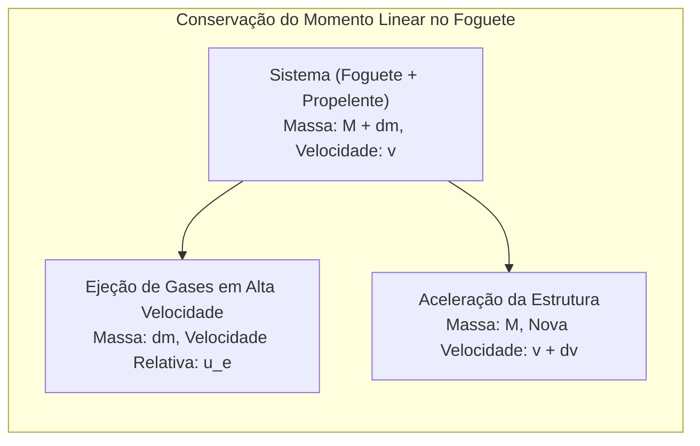
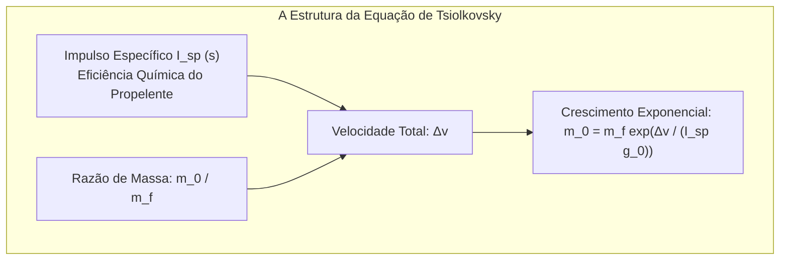
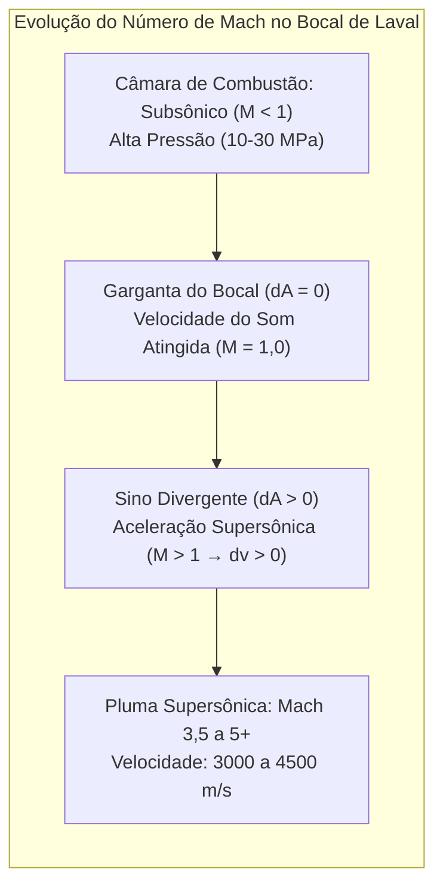

Rasgando os céus noturnos com um estrondo ensurdecedor e expelindo plumas de fogo incandescente, os foguetes espaciais figuram entre as máquinas mais extremas já projetadas pela humanidade. Como uma estrutura de milhares de toneladas é capaz de superar a atração gravitacional terrestre e manobrar no vácuo espacial?

O senso comum comumente incorre em equívocos: "Como um foguete pode acelerar no vácuo absoluto se não há ar para empurrar?" ou "Ir para o espaço não significa apenas subir em linha reta na máxima velocidade possível?"

Pela perspectiva da física fundamental, o voo espacial é <strong>uma obra-prima de conversão termodinâmica e mecânica: uma aplicação estrita da conservação do momento linear, da dinâmica de gases compressíveis, da mecânica orbital e da aerotermodinâmica hipersônica</strong>. Um foguete nunca se apoia no ar externo; ele se move exclusivamente pela <strong>terceira lei de Newton (ação e reação)</strong>, ejetando massa em velocidades hipersônicas. E alcançar a órbita não é subir alto, mas sim <strong>"cair perpetuamente de lado a 7,9 km/s ao redor da curvatura da Terra"</strong>.

---

### 1. O Princípio Físico da Propulsão no Vácuo: Conservação do Momento

Veículos terrestres necessitam de atrito com o solo, e aviões empurram o ar circundante para trás.

Em contrapartida, um foguete <strong>não depende de nenhum meio exterior e atinge sua máxima eficiência no vácuo absoluto</strong>, onde não há contrapressão atmosférica atuando na saída do bocal.

Em um sistema isolado sem forças externas:

$$(M + dm) v = M (v + dv) + dm (v - u_e)$$

Desprezando o termo de segunda ordem $dm dv$ e com $dM = -dm$:

$$M dv = - u_e dM \implies dv = - u_e \frac{dM}{M}$$

Isso comprova que a aceleração instantânea depende unicamente da velocidade relativa de exaustão dos gases $u_e$ e da taxa de queima mássica do propelente.

---

### 2. A Equação de Tsiolkovsky e a "Tirania do Foguete"

Em 1903, Konstantin Tsiolkovsky formulou a lei matemática máxima da astronáutica:

$$\Delta v = u_e \ln\left( \frac{m_0}{m_f} \right) = I_{sp} g_0 \ln\left( \frac{m_0}{m_f} \right)$$

Onde:
- $\Delta v$ é o incremento total de velocidade fornecido pelos motores;
- $I_{sp}$ é o <strong>impulso específico</strong> (em segundos), que quantifica a eficiência do propelente;
- $m_0 / m_f$ é a razão entre a massa total no lançamento e a massa seca final.

Para atingir a órbita terrestre baixa (LEO), computando perdas por gravidade e arrasto, exige-se um $\Delta v$ de aproximadamente <strong>$9,4\,\mathrm{km/s}$</strong>.
Invertendo a equação:

$$\frac{m_0}{m_f} = \exp\left( \frac{\Delta v}{I_{sp} g_0} \right)$$

- Com querosene e oxigênio líquido (LOX/RP-1, $I_{sp} \approx 310\,\mathrm{s}$), a razão de massa é $22,0$: <strong>$95,5\,\%$ do peso do foguete no lançamento deve ser propelente puro, restando apenas $4,5\,\%$ para tanques, motores e satélite</strong>!
- Com hidrogênio e oxigênio (LOX/LH2, $I_{sp} \approx 450\,\mathrm{s}$), o propelente ainda representa $88,1\,\%$.

Essa restrição extrema é a <strong>"Tirania da Equação do Foguete"</strong>. A saída de engenharia fundamental é o <strong>foguete de múltiplos estágios (Staging)</strong>: descartar tanques vazios para eliminar peso morto e permitir aceleração contínua dos estágios superiores.

---

### 3. O Bocal de Laval e a Expansão Supersônica

Como transformar a imensa pressão estática de gases em combustão a mais de $3.000\,^\circ\mathrm{C}$ em um jato supersônico orientado? Através do <strong>bocal de Laval (convergente-divergente)</strong>.

Pela relação de área-velocidade em fluidos compressíveis isentrópicos:

$$\frac{dA}{A} = (M^2 - 1) \frac{dv}{v}$$

- <strong>Seção Convergente ($M < 1$)</strong>: Estreitar o duto ($dA < 0$) acelera o fluxo subsônico ($dv > 0$);
- <strong>Garganta ($M = 1$)</strong>: Atinge-se a velocidade sônica local (fluxo bloqueado);
- <strong>Seção Divergente ($M > 1$)</strong>: No regime supersônico, <strong>alargar o duto ($dA > 0$) provoca uma violenta expansão adiabática que acelera ainda mais o gás ($dv > 0$)!</strong> O jato escapa a velocidades entre Mach 3,5 e 5 ($3.000$ a $4.500\,\mathrm{m/s}$).

---

### 4. Ciclos Termodinâmicos de Motores de Foguete

Alimentar câmaras a $20\,\mathrm{MPa}$ requer turbobombas de altíssima potência:
- <strong>Ciclo Gerador de Gás (Aberto)</strong>: Queima uma pequena fração de propelente para mover turbinas e descarta o gás (Merlin 1D do Falcon 9);
- <strong>Combustão Estagiada (Fechado)</strong>: Todo o gás do pré-queimador é injetado na câmara principal para máxima pressão sem perdas (RD-180, SSME);
- <strong>Combustão Estagiada de Fluxo Total (FFSC)</strong>: O motor Raptor da SpaceX gaseifica metano e oxigênio em pré-queimadores independentes, atingindo a pressão recorde de $35\,\mathrm{MPa}$ (350 bar).

---

### 5. Mecânica Orbital: Por Que Orbitar Significa "Cair de Lado"

Na Estação Espacial Internacional ($400\,\mathrm{km}$), a gravidade da Terra ainda é cerca de $90\,\%$ da superfície. Os astronautas flutuam porque estão em <strong>queda livre ininterrupta</strong>.

Pelo experimento do canhão de Newton, ao atingir a <strong>primeira velocidade cósmica ($v_1 \approx 7,9\,\mathrm{km/s}$)</strong>, a curvatura de queda do projétil coincide perfeitamente com a curvatura esférica da Terra:

$$v_1 = \sqrt{g_0 R_E} \approx 7,9\,\mathrm{km/s} \quad (28.400\,\mathrm{km/h})$$

Mais de <strong>$80\,\%$ da energia de um foguete</strong> é gasta para atingir essa velocidade tangencial horizontal. Por meio da <strong>curva de gravidade (Gravity Turn)</strong>, o foguete se inclina suavemente para converter empuxo em velocidade orbital.

---

### 6. Reentrada Atmosférica e a Teoria do Corpo Rombudo (Blunt Body Theory)

Ao retornar da órbita, a nave precisa dissipar uma energia cinética de $30,4\,\mathrm{MJ/kg}$ (sete vezes sua massa em TNT).

Em 1953, H. Julian Allen formulou a <strong>teoria do corpo rombudo</strong>:
- Um fundo arredondado e achatado empurra uma potente <strong>onda de choque destacada (Bow Shock)</strong> à frente da cápsula;
- O calor violento decorre da <strong>compressão adiabática do ar pela onda de choque</strong>, gerando plasma entre $6.000\,\mathrm{K}$ e $10.000\,\mathrm{K}$;
- Com o corpo rombudo, <strong>mais de $90\,\%$ desse calor extremo é desviado lateralmente pelo fluxo de ar</strong>, permitindo que menos de $10\,\%$ atinja o escudo térmico;
- Escudos ablativos (PICA-X) consomem material para neutralizar o calor residual por pirólise e vaporização.

---

### 7. Conclusão

Da ejeção de massa no vácuo à equação de Tsiolkovsky, do bocal de Laval à queda livre orbital a 7,9 km/s e às ondas de choque da reentrada, a física dos foguetes sintetiza a inteligência e a coragem humana para desbravar o cosmos.
