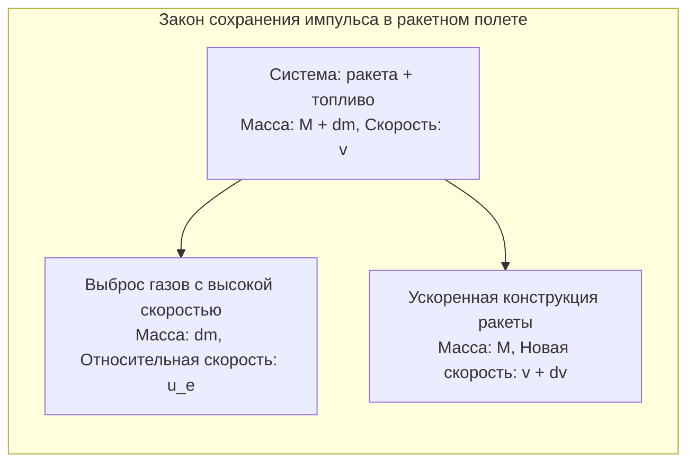
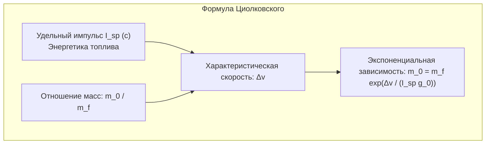
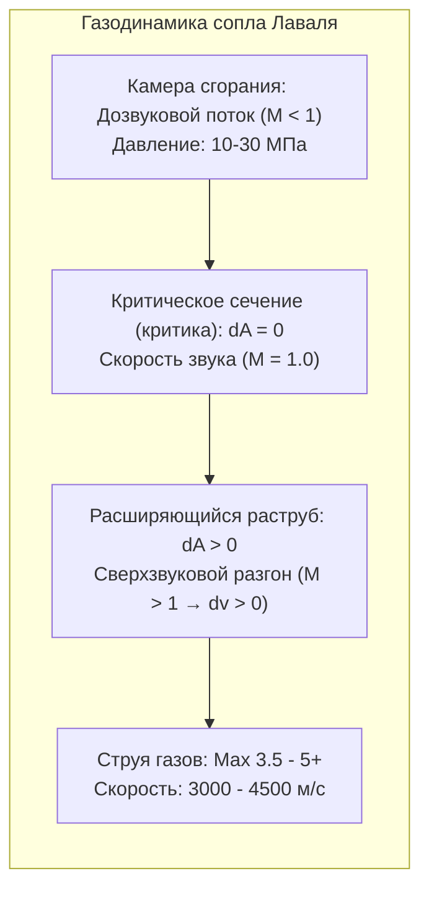

С оглушительным ревом и столбами раскаленного пламени многотонная орбитальная ракета устремляется в ночное небо. Как эта исполинская конструкция преодолевает гравитацию Земли и ускоряется в безвоздушном пространстве?

В обыденном сознании бытуют заблуждения: «Как ракета может ускоряться в вакууме, если там не от чего оттолкнуться?» или «Разве полет в космос — это не просто движение строго вверх на максимальной скорости?»

С точки зрения фундаментальной физики полет ракеты — это <strong>триумф закона сохранения импульса, газодинамики сверхзвуковых течений, орбитальной механики и гиперзвуковой аэротермодинамики</strong>. Ракете не нужен внешний воздух; она ускоряется строго по <strong>третьему закону Ньютона</strong> за счет выброса массы с гиперзвуковой скоростью. А выход на орбиту означает не просто высоту, а <strong>«бесконечное горизонтальное падение мимо Земли со скоростью 7,9 км/с»</strong>.

---

### 1. Физика реактивного движения в вакууме: Закон сохранения импульса

Наземный транспорт отталкивается от дороги, самолеты опираются на воздух. Ракета же <strong>совершенно автономна и в глубоком вакууме работает с максимальным КПД</strong>, так как отсутствует противодавление атмосферы на срезе сопла.

В замкнутой системе закон сохранения импульса дает:

$$(M + dm) v = M (v + dv) + dm (v - u_e)$$

Пренебрегая слагаемым $dm dv$ и учитывая, что $dM = -dm$:

$$M dv = - u_e dM \implies dv = - u_e \frac{dM}{M}$$

Ускорение ракеты зависит исключительно от скорости истечения газов $u_e$ и темпа расхода массы.

---

### 2. Формула Циолковского и «тирания ракетного уравнения»

В 1903 году Константин Эдуардович Циолковский проинтегрировал уравнение движения, заложив математический базис космонавтики:

$$\Delta v = u_e \ln\left( \frac{m_0}{m_f} \right) = I_{sp} g_0 \ln\left( \frac{m_0}{m_f} \right)$$

Где:
- $\Delta v$ — характеристическая скорость ракеты;
- $I_{sp}$ — <strong>удельный импульс</strong> (в секундах), показатель эффективности топлива;
- $m_0 / m_f$ — соотношение начальной стартовой массы к сухой массе после выгорания топлива.

Для выхода на низкую околоземную орбиту (НОО) с учетом гравитационных и аэродинамических потерь требуется $\Delta v \approx 9,4\,\mathrm{км/с}$.
Выражая отношение масс:

$$\frac{m_0}{m_f} = \exp\left( \frac{\Delta v}{I_{sp} g_0} \right)$$

- Для пары керосин / жидкий кислород (LOX/RP-1, $I_{sp} \approx 310\,\mathrm{с}$) отношение масс составляет $22,0$: <strong>$95,5\,\%$ стартовой массы ракеты должно составлять топливо, и лишь $4,5\,\%$ остается на двигатели, баки и полезный груз</strong>!
- На водороде (LOX/LH2, $I_{sp} \approx 450\,\mathrm{с}$) доля топлива составляет $88,1\,\%$.

Это ограничение называют <strong>«тиранией формулы Циолковского»</strong>. Единственным инженерным решением стали <strong>многоступенчатые ракеты (Staging)</strong>: сброс пустых отработавших баков в полете избавляет ракету от мертвого груза и позволяет верхним ступеням ускоряться дальше.

---

### 3. Сопло Лаваля и сверхзвуковое истечение газов

Как превратить высокое давление неподвижных газов в камере сгорания в направленный сверхзвуковой факел? С помощью <strong>сужающегося-расширяющегося сопла Лаваля</strong>.

Уравнение изменения площади и скорости для сжимаемого изэнтропического потока гласит:

$$\frac{dA}{A} = (M^2 - 1) \frac{dv}{v}$$

- <strong>В дозвуковой части ($M < 1$)</strong>: Сужение канала ($dA < 0$) разгоняет поток ($dv > 0$);
- <strong>В критическом сечении ($M = 1$)</strong>: Поток достигает местной скорости звука;
- <strong>В расширяющейся части ($M > 1$)</strong>: В сверхзвуковом потоке <strong>расширение канала ($dA > 0$) вызывает адиабатическое расширение и ускорение газа ($dv > 0$)!</strong> Газ разгоняется до скоростей свыше $3000$–$4500\,\mathrm{м/с}$ (Мах 3,5–5).

---

### 4. Термодинамические циклы ракетных двигателей

Подача сотен килограммов криогенных компонентов в секунду под давлением $20\,\mathrm{МПа}$ требует мощнейших турбонасосов:
- <strong>Открытый цикл (газогенераторный)</strong>: Часть топлива сжигается для привода турбины и сбрасывается за борт (Merlin 1D);
- <strong>Замкнутый цикл (с дожиганием генераторного газа)</strong>: Газ из газогенератора полностью поступает в основную камеру сгорания, обеспечивая колоссальное давление без потерь массы (РД-180, SSME);
- <strong>Полнопоточный закрытый цикл (FFSC)</strong>: Двигатель Raptor компании SpaceX с раздельной газификацией метана и кислорода развивает рекордное давление $35\,\mathrm{МПа}$ (350 атм).

---

### 5. Орбитальная механика: Почему полет по орбите — это «падение мимо горизонта»

На высоте МКС ($400\,\mathrm{км}$) гравитация Земли составляет почти $90\,\%$ от наземной. Космонавты парят не потому, что там нет гравитации, а потому, что они находятся в <strong>непрерывном свободном падении</strong>.

Если разогнать тело до <strong>первой космической скорости ($v_1 \approx 7,9\,\mathrm{км/с}$)</strong>, кривизна его падения точно совпадет с кривизной поверхности Земли:

$$v_1 = \sqrt{g_0 R_E} \approx 7,9\,\mathrm{км/с} \quad (28\,400\,\mathrm{км/ч})$$

Более <strong>$80\,\%$ энергии ракеты</strong> тратится на набор этой колоссальной горизонтальной скорости. При помощи гравитационного маневра (<strong>Gravity Turn</strong>) ракета плавно ложится на горизонт.

---

### 6. Вход в атмосферу: Теория затупленного тела (Blunt Body Theory)

При возвращении с орбиты корабль несет удельную кинетическую энергию $30,4\,\mathrm{МДж/кг}$ (эквивалент семикратной массы тротила).

В 1953 году Джулиан Аллен сформулировал <strong>теорию затупленного тела</strong>:
- Широкое скругленное днище формирует перед собой мощную <strong>отошедшую головную ударную волну (Bow Shock)</strong>;
- Нагрев вызывается не трением, а <strong>адиабатическим сжатием воздуха ударной волной</strong>, разогревающим плазму до $6000\,\mathrm{K}$–$10000\,\mathrm{K}$;
- Благодаря затупленной форме <strong>более $90\,\%$ этого тепла сдувается обтекающим потоком воздуха мимо корабля</strong>, и на теплозащиту попадает менее $10\,\%$ теплового потока;
- Абляционные щиты (PICA-X) рассеивают остаточное тепло за счет эндотермического уноса массы.

---

### 7. Заключение

От реактивной силы в вакууме до формулы Циолковского, сопла Лаваля, кругового свободного падения на скорости 7,9 км/с и ударных волн при возвращении на Землю — физика ракет раскрывает величие человеческой науки, открывшей путь к звездам.
