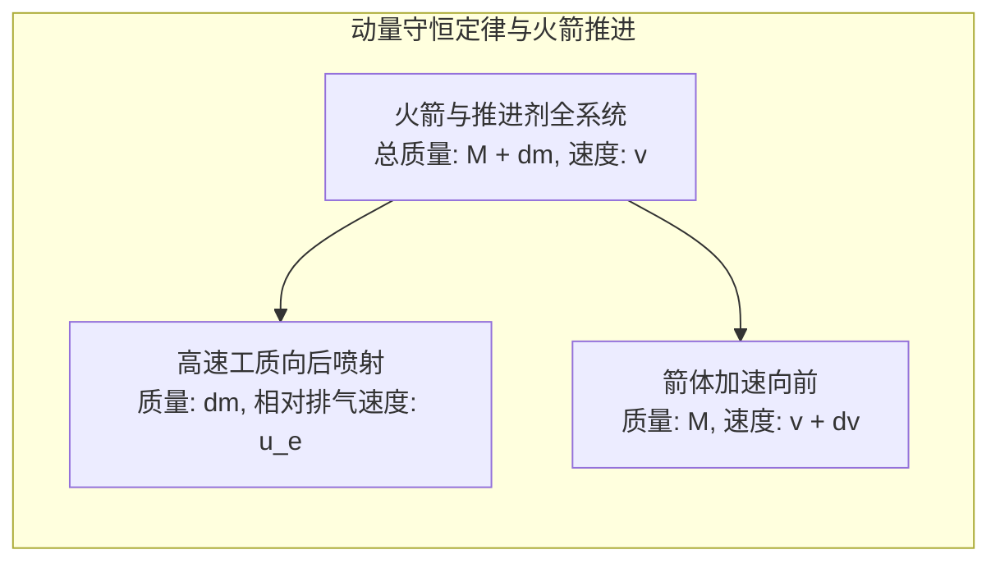
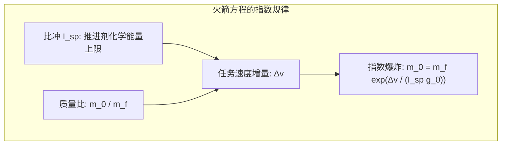
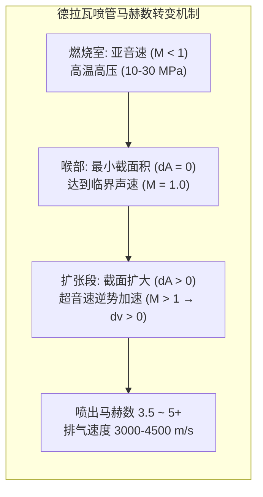

撕裂夜空，伴随着震耳欲聋的轰鸣与白炽的烈焰，数千吨重的运载火箭拔地而起。作为人类工程文明建造的最极端的机械，火箭究竟依靠什么物理机制冲破厚重大气层、挣脱地球重力的束缚，最终进入真空宇宙？

日常直觉中充斥着误解：“太空中没有空气可以借力推搡，火箭究竟如何加速？”“去太空难道不就是全速垂直向上飞吗？”

在现代物理学视野下，火箭的飞行是一场<strong>在热力学、可压缩流体力学、轨道力学与高超声速气动热力学边缘谱写的能量转换壮举</strong>。火箭从不依靠外部空气，而是完全依靠向后喷射巨量工质的<strong>动量守恒定律</strong>；进入太空的核心并非“飞得高”，而是<strong>“以每秒 7.9 公里的疯狂速度向水平方向横向坠落（绕地球圆周自由落体）”</strong>；而重返地球，则是将这惊人的动能通过激波剧烈压缩空气，转化为数千度等离子体热能散逸到宇宙空间中。

---

### 1. 真空推进的物理本源：动量守恒定律

地面交通工具的行进依赖与外界介质的相互作用：汽车靠轮胎摩擦地面，飞机靠机翼与发动机向后推挤空气。

与此截然相反，火箭推进<strong>完全基于系统内部的动量反作用，在没有一颗空气分子的纯净真空中，推进效率反而达到最高</strong>。

根据微积分推导，在无外力作用的微小时间间隔 $dt$ 内，系统动量严格守恒：

$$(M + dm) v = M (v + dv) + dm (v - u_e)$$

化简整理并舍去二阶微元 $dm dv$：

$$M dv = u_e dm = - u_e dM \implies dv = - u_e \frac{dM}{M}$$

这表明火箭的瞬时加速度仅取决于两个内生因素：工质消耗速率 $|dM/dt|$ 与相对于发动机喷管的排气速度 $u_e$。

---

### 2. 齐奥尔科夫斯基火箭方程与“火箭的暴政”

1903 年，俄国科学家康斯坦丁·齐奥尔科夫斯基将基本推进微分方程积分，奠定了宇航学的数学基石——<strong>齐奥尔科夫斯基火箭方程</strong>：

$$\Delta v = u_e \ln\left( \frac{m_0}{m_f} \right) = I_{sp} g_0 \ln\left( \frac{m_0}{m_f} \right)$$

式中：
- $\Delta v$：火箭燃烧所能获得的总速度增量；
- $I_{sp}$：<strong>比冲（Specific Impulse）</strong>，衡量推进剂利用效率的核心指标（定义为 1 千克推进剂产生 1 千克力推力持续的时间，单位：秒）；
- $m_0 / m_f$：起飞初始总质量（湿重）与燃料耗尽结构质量（干重）之比。

进入近地轨道（LEO）扣除重力损失与空气阻力损失后，实际需要约 <strong>$9.4\,\mathrm{km/s}$</strong> 的总速度增量。
根据指数反解：

$$\frac{m_0}{m_f} = \exp\left( \frac{\Delta v}{I_{sp} g_0} \right)$$

- 若采用液氧煤油（LOX/RP-1，综合比冲约 $310\,\mathrm{s}$），所需质量比高达 $22.0$。这意味着<strong>火箭发射质量的 $95.5\%$ 必须是燃料，留给发动机、贮箱、电子设备及卫星有效载荷的总质量份额仅剩 $4.5\%$</strong>；
- 即便采用氢氧发动机（LOX/LH2，比冲约 $450\,\mathrm{s}$），燃料占比依然高达 $88.1\%$。

这就是航天界著名的<strong>“火箭方程式的暴政（Tyranny of the Rocket Equation）”</strong>：单级火箭必须拖拽巨大的空贮箱死重加速至第一宇宙速度，工程材料极限无法承受。这在物理上直接催生了<strong>多级火箭（Multistage Rocket）</strong>技术——在飞行过程中果断抛弃空贮箱，使后续子级在极轻的质量基准下继续指数加速。

---

### 3. 德拉瓦喷管（de Laval Nozzle）的超音速流体力学

火箭发动机如何将数千度的高压静止燃气转化为高达数千米每秒的定向超音速射流？其核心是瑞典工程师拉瓦尔发明的<strong>渐缩-渐扩喷管（收敛-扩张喷管）</strong>。

根据一维定常等熵可压缩流体面积-速度关系式：

$$\frac{dA}{A} = (M^2 - 1) \frac{dv}{v}$$

- <strong>亚音速收敛段（$M < 1$）</strong>：$(M^2 - 1) < 0$，管壁收缩（$dA < 0$）使气流加速（$dv > 0$）；
- <strong>喉部（$M = 1$）</strong>：截面达到极小值，气流达到当地声速，产生气动阻塞；
- <strong>超音速扩张段（$M > 1$）</strong>：$(M^2 - 1) > 0$，<strong>截面积反向扩大（$dA > 0$），气流剧烈绝热膨胀，速度不降反升（$dv > 0$）！</strong> 气体的内能与压力势能瞬间彻底转化为轴向动能，出口排气马赫数可达 3.5 至 5 以上（秒速 3000 至 4500 米）。

---

### 4. 推进剂组合与发动机动力循环

火箭发动机的推重比与效率受制于热力学动力循环：
1. <strong>开式循环（燃气发生器循环）</strong>：分流少量推进剂驱动涡轮泵后直接排出机外，结构简单但有工质浪费（如猎鹰9号 Merlin 1D）；
2. <strong>闭式循环（分级燃烧循环）</strong>：预燃室燃气推动涡轮后全部注入主燃烧室继续反应，无工质浪费，室压高达 $20\,\mathrm{MPa}$ 以上（如俄制 RD-180、航天飞机 SSME）；
3. <strong>全流量分级燃烧循环（FFSC）</strong>：SpaceX 猛禽（Raptor）发动机采用的双预燃室技术，分别实现全气态富氧与全气态富燃喷射，燃烧室压突破惊人的 $35\,\mathrm{MPa}$（350个大气压），推重比傲视全球。

---

### 5. 轨道力学：为什么入轨是“横向跌落”而非“垂直攀登”

很多人误以为火箭进入太空是靠“飞得高逃离引力”。事实上，在海拔 $400\,\mathrm{km}$ 的空间站高度，地球重力加速度仍高达地表的近 $90\%$。宇航员的漂浮不是因为失重，而是处于<strong>无休止的轨道自由落体</strong>中。

根据牛顿的大炮思考实验，水平发射初速度达到<strong>第一宇宙速度（环绕速度 $v_1$）</strong>时，物体下落的轨迹曲率刚好与地球表面的几何弯曲曲率完全一致：

$$v_1 = \sqrt{\frac{G M_E}{R_E}} = \sqrt{g_0 R_E} \approx 7.9\,\mathrm{km/s} \quad (28,400\,\mathrm{km/h})$$

火箭消耗的能量中，<strong>超过 80% 用于加速达到横向的 $7.9\,\mathrm{km/s}$，而非增加垂直海拔</strong>。垂直起飞仅用于迅速穿透稠密对流层，随后立即通过<strong>重力转向（Gravity Turn）</strong>平滑下俯，借地球引力将推力完全转化为切向水平速度。

---

### 6. 大气层再入的极热考验：钝头体理论与热防护

从近地轨道重返地球，必须耗散航天器携带的巨大比动能（约 $30.4\,\mathrm{MJ/kg}$，相当于自重 7 倍的 TNT 炸药）。

1953 年 NACA 提出的<strong>钝头体理论（Blunt Body Theory）</strong>彻底颠覆了“尖头减阻”的传统观念：
- 钝圆形隔热底在高速冲入大气（马赫25）时，会在机体前方推开一道强烈的<strong>离体弓形激波（Detached Bow Shock）</strong>；
- 气动加热的根本原因不是摩擦，而是<strong>极度强烈的激波绝热压缩</strong>，激波层温度高达 $6000\,\mathrm{K} \sim 10000\,\mathrm{K}$；
- 钝头体使 <strong>$90\%$ 以上的灼热等离子体热量随侧向激波气流被迅速吹散带走</strong>，仅不足 $10\%$ 的热通量传递给防热底；
- 飞船底部的<strong>烧蚀防热材料（PICA-X）</strong>通过吸热分解汽化带走残余热量，或通过陶瓷瓦高发射率辐射冷却，确保舱内航天员安然无恙。

---

### 7. 结语

从动量守恒的反作用推进，到多级火箭战胜指数牢笼；从德拉瓦喷管的超音速热动转换，到每秒 7.9 公里的环绕落体，再到钝头激波的气动隔热，火箭工程凝聚了人类经典物理与现代尖端材料科学的极限智慧，是人类文明跨出地球摇篮的唯一阶梯。
