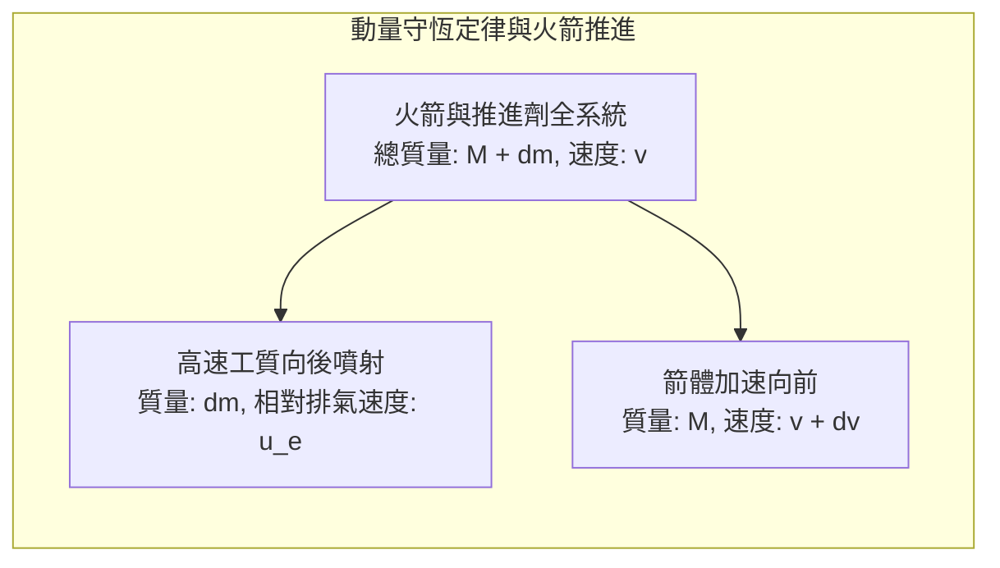
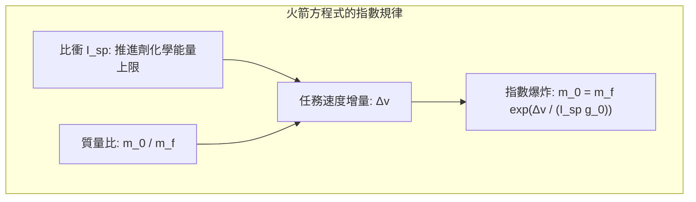
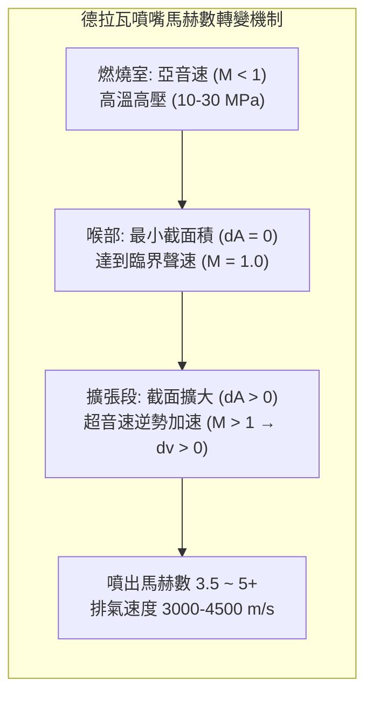

撕裂夜空，伴隨著震耳欲聾的轟鳴與白熾的烈焰，數千噸重的運載火箭拔地而起。作為人類工程文明建造的最極端的機械，火箭究竟依靠什麼物理機制衝破厚重大氣層、掙脫地球重力的束縛，最終進入真空宇宙？

日常直覺中充斥著誤解：「太空中沒有空氣可以借力推搡，火箭究竟如何加速？」「去太空難道不就是全速垂直向上飛嗎？」

在現代物理學視野下，火箭的飛行是一場<strong>在熱力學、可壓縮流體力學、軌道力學與高超音速氣動熱力學邊緣譜寫的能量轉換壯舉</strong>。火箭從不依靠外部空氣，而是完全依靠向後噴射巨量工質的<strong>動量守恆定律</strong>；進入太空的核心並非「飛得高」，而是<strong>「以每秒 7.9 公里的瘋狂速度向水平方向橫向墜落（繞地球圓周自由落體）」</strong>；而重返地球，則是將這驚人的動能透過震波劇烈壓縮空氣，轉化為數千度電漿熱能散逸到宇宙空間中。

---

### 1. 真空推進的物理本源：動量守恆定律

地面交通工具的行進依賴與外界介質的交互作用：汽車靠輪胎摩擦地面，飛機靠機翼與發動機向後推擠空氣。

與此截然相反，火箭推進<strong>完全基於系統內部的動量反作用，在沒有一顆空氣分子的純淨真空中，推進效率反而達到最高</strong>。

根據微積分推導，在無外力作用的微小時間間隔 $dt$ 內，系統動量嚴格守恆：

$$(M + dm) v = M (v + dv) + dm (v - u_e)$$

化簡整理並捨去二階微元 $dm dv$：

$$M dv = u_e dm = - u_e dM \implies dv = - u_e \frac{dM}{M}$$

這表明火箭的瞬時加速度僅取決於兩個內生因素：工質消耗速率 $|dM/dt|$ 與相對於發動機噴嘴的排氣速度 $u_e$。

---

### 2. 齊奧爾科夫斯基火箭方程式與「火箭的暴政」

1903 年，俄國科學家康斯坦丁·齊奧爾科夫斯基將基本推進微分方程式積分，奠定了太空航行學的數學基石——<strong>齊奧爾科夫斯基火箭方程式</strong>：

$$\Delta v = u_e \ln\left( \frac{m_0}{m_f} \right) = I_{sp} g_0 \ln\left( \frac{m_0}{m_f} \right)$$

式中：
- $\Delta v$：火箭燃燒所能獲得的總速度增量；
- $I_{sp}$：<strong>比衝（Specific Impulse）</strong>，衡量推進劑利用效率的核心指標（定義為 1 公斤推進劑產生 1 公斤力推力持續的時間，單位：秒）；
- $m_0 / m_f$：起飛初始總質量（濕重）與燃料耗盡結構質量（乾重）之比。

進入近地軌道（LEO）扣除重力損失與空氣阻力損失後，實際需要約 <strong>$9.4\,\mathrm{km/s}$</strong> 的總速度增量。
根據指數反解：

$$\frac{m_0}{m_f} = \exp\left( \frac{\Delta v}{I_{sp} g_0} \right)$$

- 若採用液氧煤油（LOX/RP-1，綜合比衝約 $310\,\mathrm{s}$），所需質量比高達 $22.0$。這意味著<strong>火箭發射質量的 $95.5\%$ 必須是燃料，留給發動機、貯箱、電子設備及衛星有效載荷的總質量份額僅剩 $4.5\%$</strong>；
- 即便採用氫氧發動機（LOX/LH2，比衝約 $450\,\mathrm{s}$），燃料佔比依然高達 $88.1\%$。

這就是航太界著名的<strong>「火箭方程式的暴政（Tyranny of the Rocket Equation）」</strong>：單級火箭必須拖曳巨大的空貯箱死重加速至第一宇宙速度，工程材料極限無法承受。這在物理上直接催生了<strong>多級火箭（Multistage Rocket）</strong>技術——在飛行過程中果斷拋棄空貯箱，使後續子級在極輕的質量基準下繼續指數加速。

---

### 3. 德拉瓦噴嘴（de Laval Nozzle）的超音速流體力學

火箭發動機如何將數千度的高壓靜止燃氣轉化為高達數千米每秒的定向超音速射流？其核心是瑞典工程師拉瓦爾發明的<strong>漸縮-漸擴噴嘴（收斂-擴張噴嘴）</strong>。

根據一維定常等熵可壓縮流體面積-速度關係式：

$$\frac{dA}{A} = (M^2 - 1) \frac{dv}{v}$$

- <strong>亞音速收斂段（$M < 1$）</strong>：$(M^2 - 1) < 0$，管壁收縮（$dA < 0$）使氣流加速（$dv > 0$）；
- <strong>喉部（$M = 1$）</strong>：截面達到極小值，氣流達到當地聲速，產生氣動阻塞；
- <strong>超音速擴張段（$M > 1$）</strong>：$(M^2 - 1) > 0$，<strong>截面積反向擴大（$dA > 0$），氣流劇烈絕熱膨脹，速度不降反升（$dv > 0$）！</strong> 氣體的內能與壓力勢能瞬間徹底轉化為軸向動能，出口排氣馬赫數可達 3.5 至 5 以上（秒速 3000 至 4500 米）。

---

### 4. 推進劑組合與發動機動力循環

火箭發動機的推重比與效率受制於熱力學動力循環：
1. <strong>開式循環（燃氣發生器循環）</strong>：分流少量推進劑驅動渦輪泵後直接排出機外，結構簡單但有工質浪費（如獵鷹9號 Merlin 1D）；
2. <strong>閉式循環（分級燃燒循環）</strong>：預燃室燃氣推動渦輪後全部注入主燃燒室繼續反應，無工質浪費，室壓高達 $20\,\mathrm{MPa}$ 以上（如俄制 RD-180、太空梭 SSME）；
3. <strong>全流量分級燃燒循環（FFSC）</strong>：SpaceX 猛禽（Raptor）發動機採用的雙預燃室技術，分別實現全氣態富氧與全氣態富燃噴射，燃燒室壓突破驚人的 $35\,\mathrm{MPa}$（350個大氣壓），推重比傲視全球。

---

### 5. 軌道力學：為什麼入軌是「橫向跌落」而非「垂直攀登」

很多人誤以為火箭進入太空是靠「飛得高逃離引力」。事實上，在海拔 $400\,\mathrm{km}$ 的太空站高度，地球重力加速度仍高達地表的近 $90\%$。太空人的漂浮不是因為失重，而是處於<strong>無休止的軌道自由落體</strong>中。

根據牛頓的大炮思考實驗，水平發射初速度達到<strong>第一宇宙速度（環繞速度 $v_1$）</strong>時，物體下落的軌跡曲率剛好與地球表面的幾何彎曲曲率完全一致：

$$v_1 = \sqrt{\frac{G M_E}{R_E}} = \sqrt{g_0 R_E} \approx 7.9\,\mathrm{km/s} \quad (28,400\,\mathrm{km/h})$$

火箭消耗的能量中，<strong>超過 80% 用於加速達到橫向的 $7.9\,\mathrm{km/s}$，而非增加垂直海拔</strong>。垂直起飛僅用於迅速穿透稠密對流層，隨後立即透過<strong>重力轉向（Gravity Turn）</strong>平滑下俯，借地球引力將推力完全轉化為切向水平速度。

---

### 6. 大氣層重返的極熱考驗：鈍頭體理論與熱防護

從近地軌道重返地球，必須耗散太空船攜帶的巨大比動能（約 $30.4\,\mathrm{MJ/kg}$，相當於自重 7 倍的 TNT 炸藥）。

1953 年 NACA 提出的<strong>鈍頭體理論（Blunt Body Theory）</strong>徹底顛覆了「尖頭減阻」的傳統觀念：
- 鈍圓形隔熱底在高速衝入大氣（馬赫25）時，會在機體前方推開一道強烈的<strong>離體弓形震波（Detached Bow Shock）</strong>；
- 氣動加熱的根本原因不是摩擦，而是<strong>極度強烈的震波絕熱壓縮</strong>，震波層溫度高達 $6000\,\mathrm{K} \sim 10000\,\mathrm{K}$；
- 鈍頭體使 <strong>$90\%$ 以上的灼熱電漿熱量隨側向震波氣流被迅速吹散帶走</strong>，僅不足 $10\%$ 的熱通量傳遞給防熱底；
- 太空船底部的<strong>燒蝕防熱材料（PICA-X）</strong>透過吸熱分解汽化帶走殘餘熱量，或透過陶瓷瓦高發射率輻射冷卻，確保艙內太空人安然無恙。

---

### 7. 結語

從動量守恆的反作用推進，到多級火箭戰勝指數牢籠；從德拉瓦噴嘴的超音速熱動轉換，到每秒 7.9 公里的環繞落體，再到鈍頭震波的氣動隔熱，火箭工程凝聚了人類古典物理與現代尖端材料科學的極限智慧，是人類文明跨出地球搖籃的唯一階梯。
