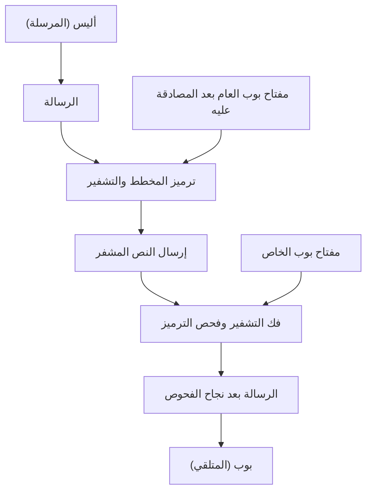
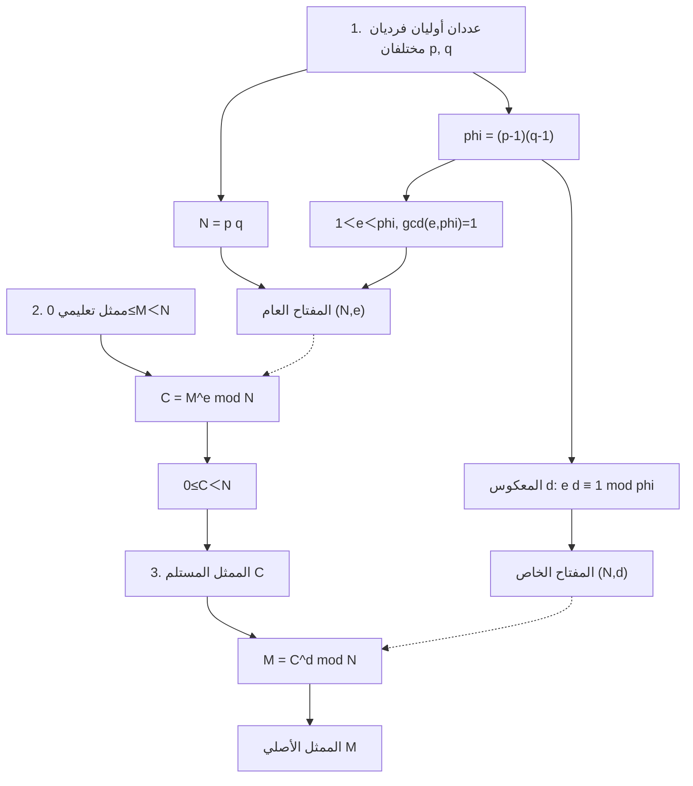
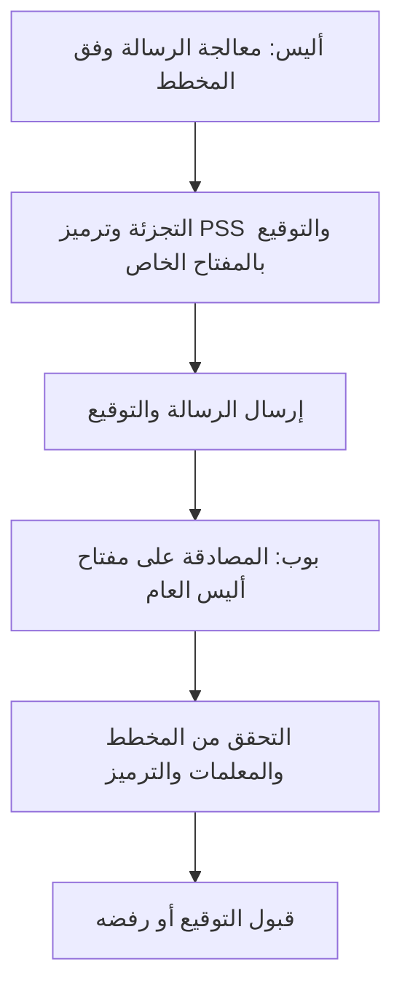

تُستخدم RSA في التشفير بالمفتاح العام والتوقيعات الرقمية. ويمكن تتبّع حساباتها باستخدام مفاهيم المرحلة الثانوية: الأعداد الأولية والبواقي والقوى. لكن رفع عدد صحيح مباشرة إلى قوة في نموذج تعليمي يختلف عن مخططات الاتصالات الفعلية.

سنتتبّع قيمًا صغيرة معلنة ونشرح لماذا يعيد فك التشفير قيمة الإدخال. تحتاج المخططات العملية، مثل RSAES-OAEP للتشفير وRSASSA-PSS للتوقيعات، إلى قواعد خاصة للترميز والتحقق. راجع أيضًا [مقدمة المفاتيح العامة والتجزئة والتوقيعات](/ar/p/modern-cryptography-public-key-hash-signature/).

## 1. التشفير المتماثل والتشفير بالمفتاح العام

في التشفير المتماثل، يتشارك المرسل والمتلقي مفتاحًا سريًا للتشفير وفكّه. وهو يعالج كميات كبيرة من البيانات بكفاءة، لكن مشاركة ذلك المفتاح بأمان مع طرف جديد مسألة أخرى.

في التشفير بالمفتاح العام، يُعدّ المتلقي بوب مفتاحًا عامًا وآخر خاصًا، وتشفّر أليس بالمفتاح العام لبوب. التشبيه هو قفل يستطيع أي شخص إغلاقه، بينما يحتفظ بوب بمفتاح فتحه. ويجب على أليس التأكد من أن المفتاح العام يخص بوب فعلًا. المصادقة لمنع المهاجم من استبدال المفتاح مطلب إضافي.



الهدف هو أن يكون فك التشفير دون المفتاح الخاص صعبًا حسابيًا، حتى مع معرفة المفتاح العام. وليس ذلك ضمانًا رياضيًا غير مشروط بالاستحالة. وتشمل تقنيات المفتاح العام أيضًا الاتفاق على المفاتيح والتوقيعات؛ فهي لا تنفذ جميعًا عملية التشفير نفسها.

## 2. الأعداد الأولية والتحليل إلى عوامل

العدد الأولي عدد صحيح أكبر من واحد، قواسِمه الموجبة الوحيدة هي الواحد والعدد نفسه. الأمثلة الأولى هي $2,3,5,7,11,13,17,19,23$. لكل عدد صحيح أكبر من واحد تحليل وحيد إلى عوامل أولية، مع تجاهل ترتيبها؛ مثل $60=2^2\times3\times5$. لا يشمل ذلك الصفر، ويُعامل الواحد منفصلًا بوصفه حاصل ضرب فارغًا.

حساب $11\times13=143$ سهل، لكن إيجاد $17\times19$ انطلاقًا من $323$ مهمة مختلفة. تنشر RSA العدد $N=pq$ لعددين أوليين كبيرين ومختلفين ومختارين على نحو مناسب. معرفة العاملين تتيح حساب الأس الخاص. تحليل المقياس إلى عوامل يكسر RSA، لكننا لا ندّعي أن كل طرق كسر RSA ثبت تكافؤها عمومًا مع التحليل إلى عوامل.

تعني عبارة «RSA بطول 2048 بت» عادةً **طول المقياس $N$ بالبتات**. العدد $N$ ذو 2048 بت يتكون من 617 رقمًا عشريًا. عند استخدام عاملين أوليين متقاربين في الحجم، يكون طول كل منهما نحو 1024 بت. وتعتمد الصعوبة على توليد المعلمات وحجمها والخوارزميات والموارد الحاسوبية المتاحة. تقديرات مثل «تريليونات السنين» أو «أطول من عمر الكون» دون أساس ليست ضمانًا.

## 3. التطابق والبواقي

كما تُسمى الساعة بعد خمس ساعات من العاشرة «الثالثة» في نظام الاثنتي عشرة ساعة، يمكننا الاهتمام ببواقي القسمة بترديد عدد.

$$15\equiv3\pmod{12}$$

لمقياس $N>1$، إذا كان $a\equiv b\pmod N$ و$c\equiv d\pmod N$، فإن عمليات الجمع والطرح والضرب تحافظ على التطابق. ولعدد صحيح غير سالب $k$، يصح أيضًا $a^k\equiv b^k\pmod N$. تحتاج الأسس السالبة إلى شروط إضافية، منها وجود المعكوس.

من $7\equiv2\pmod5$ نحصل على $7^{100}\equiv2^{100}\pmod5$. ويمكن استبدال النتائج الوسيطة ببواقيها، دون بناء القوة الهائلة كاملة أولًا. ولا يعني ذلك أن قوة الباقي وباقي القوة متساويان كعددين صحيحين عاديين. والأس ليس القوة نفسها: في $a^k$، يكون $k$ هو الأس.

## 4. دالة أويلر ومبرهنته

تعدّ $\phi(N)$ الأعداد الصحيحة $1\le a\le N$ الأولية نسبيًا مع $N$، أي التي يكون القاسم المشترك الأكبر بينها وبين $N$ واحدًا. مثلًا $\phi(5)=4$ و$\phi(6)=2$. للعدد الأولي $p$،

$$\phi(p)=p-1$$

ولعددين أوليين مختلفين $p,q$ مع $N=pq$،

$$\phi(N)=(p-1)(q-1)$$

معرفة $p,q$ تتيح حساب هذه القيمة. وبالعكس، تتيح معرفة $\phi(N)$ العلاقتين $p+q=N-\phi(N)+1$ و$pq=N$، ومنهما نستعيد العاملين بحل معادلة تربيعية. ولذلك يجب الحفاظ على سرية هذه القيمة أيضًا.

تنص مبرهنة أويلر على أنه إذا كان $\gcd(a,N)=1$، فإن

$$a^{\phi(N)}\equiv1\pmod N$$

وبضرب الطرفين في $a$، نحصل على

$$a^{\phi(N)+1}\equiv a\pmod N$$

ولكل عدد صحيح غير سالب $k$،

$$a^{k\phi(N)+1}\equiv a\pmod N$$

لا يجوز استخدام النتيجة الوسيطة $a^{\phi(N)}\equiv1$ بعد حذف شرط الأولية النسبية.

## 5. المفاتيح والتشفير وفكّه في النموذج التعليمي

نستخدم نموذجًا بعاملين أوليين. تتطلب المعلمات الفعلية عددين أوليين فرديين مختلفين وكبيرين على نحو مناسب $p,q$، لكن المثال اللاحق يستخدم عمدًا قيمًا صغيرة معروفة لإظهار الحساب.

1. احسب $N=pq$ و$\phi(N)=(p-1)(q-1)$.
2. اختر أسًا عامًا $e$ بحيث $1<e<\phi(N)$ و$\gcd(e,\phi(N))=1$.
3. أوجد أسًا خاصًا موجبًا $d$ يحقق

$$ed\equiv1\pmod{\phi(N)}$$

المفتاح العام هو $(N,e)$، وأحد التمثيلات الأساسية للمفتاح الخاص هو $(N,d)$. العدد $d$ أسّ، وليس وحده التمثيل القياسي الكامل للمفتاح. وقد تشمل التمثيلات العملية العاملين ومعلمات مبرهنة البواقي الصينية. يعرّف RFC 8017 الشرط باستخدام $\lambda(N)=\operatorname{lcm}(p-1,q-1)$. اختيار الأس الخاص معكوسًا للأس العام بترديد $\phi(N)$ هنا شرط كافٍ بسيط يحقق أيضًا الشرط بترديد $\lambda(N)$.

بالنسبة إلى **الممثل العددي الصحيح للرسالة** $0\le M<N$، يكون حساب التشفير التعليمي

$$C\equiv M^e\pmod N$$

ولممثل النص المشفر $0\le C<N$، يحسب فك التشفير

$$M\equiv C^d\pmod N$$

في المخطط العملي، تُرمَّز بايتات الرسالة وفق القواعد المحددة قبل تحويلها إلى عدد صحيح، ويتضمن فك التشفير فحوصًا أيضًا. لا يكفي تحويل الأحرف مباشرة إلى عدد صحيح ورفعه إلى قوة.



حساب RSA وحده حتمي: تعطي القيمة نفسها $M$ القيمة نفسها $C$. إذا كانت الرسائل المرشحة قليلة، يمكن لأي شخص تشفير كل مرشح بالمفتاح العام والمقارنة. كذلك، فإن استبدال $C$ بالقيمة $C\,r^e\bmod N$ يغير ممثل نتيجة فك التشفير إلى $Mr\bmod N$. ولا تنتج خصائص أمان المخطط العملي من هذا الحساب وحده.

## 6. لماذا يعيد فك التشفير قيمة الإدخال

يحسب فك التشفير

$$C^d\equiv(M^e)^d\equiv M^{ed}\pmod N$$

ومن شرط المفاتيح يوجد عدد صحيح غير سالب $k$ بحيث

$$ed=k\phi(N)+1$$

إذا كان $\gcd(M,N)=1$، تعطي مبرهنة أويلر

$$M^{ed}=(M^{\phi(N)})^k M\equiv1^k M\equiv M\pmod N$$

لكن ممثل RSA لا يلزم أن يكون أوليًا نسبيًا مع $N$. مثلًا $M=0,11,13$ تقع أيضًا داخل المجال. لذلك نفحص كل عدد أولي على حدة.

- إذا كان $p\mid M$، فإن $M^{ed}\equiv M\equiv0\pmod p$ لأن الأس $ed$ موجب.
- إذا كان $p\nmid M$، تعطي مبرهنة فيرما الصغرى $M^{p-1}\equiv1\pmod p$. وبما أن $ed-1$ من مضاعفات $p-1$، فإن $M^{ed}\equiv M\pmod p$.
- ينطبق الاستدلال نفسه بترديد $q$.

العددان الأوليان المختلفان $p,q$ أوليان نسبيًا، ولذلك تعطي مبرهنة البواقي الصينية

$$M^{ed}\equiv M\pmod{pq}$$

لكل ممثل $0\le M<N$. هذا برهان على صحة الحساب، وليس على أمان مخطط ضد التنصت أو التعديل.

## 7. حساب يدوي بأعداد أولية صغيرة

نأخذ $p=11,q=13$. عندئذ $N=143$ و$\phi(N)=120$. نختار $e=7$ ونحل $7d\equiv1\pmod{120}$. بما أن $7\times103=721=6\times120+1$، يمكن اختيار $d=103$.

للإدخال التعليمي $M=9$، لدينا $9^7=4\,782\,969=33\,447\times143+48$، وبالتالي $C=48$. يعطينا فك التشفير $48^{103}\bmod143=9$. تحسب `pow(48, 103, 143)` في Python ذلك دون بناء العدد الصحيح الكامل $48^{103}$ أولًا.

هذه الأعداد الأولية والأس الخاص قيم تعليمية معلنة للجميع. ولا يمكنها حماية رسائل سرية.

## 8. إيجاد المعكوس بخوارزمية إقليدس الممتدة

يعني التطابق $7d\equiv1\pmod{120}$ وجود عددين صحيحين $d,y$ بحيث $7d+120y=1$. وبما أن $120=17\times7+1$، نحصل على $1=120-17\times7$، ومنه $d\equiv-17\equiv103\pmod{120}$.

تجد خوارزمية إقليدس الممتدة هذه المعاملات عمومًا. يوجد المعكوس عندما يكون العدد الصحيح والمقياس أوليين نسبيًا. ويتوقف الحساب على طول الإدخال؛ فلا يستغرق زمنًا ثابتًا للمدخلات مهما بلغ حجمها.

## 9. التوقيعات الرقمية تحتاج إلى مخطط مخصص

يُنشأ توقيع RSA بالمفتاح الخاص ويُتحقق منه بالمفتاح العام المقابل. وصف ذلك بأنه «تشفير بالمفتاح الخاص وفك تشفير بالمفتاح العام» يخفي الفروق في الترميز والتحقق بين مخططات التشفير والتوقيع.

العلاقة دون ترميز $S=M^d\bmod N$، مع الفحص $S^e\equiv M\pmod N$، ليست مخطط توقيع آمنًا. يمكن للمهاجم اختيار $S=2$ ثم حساب $M=2^7\bmod143=128$ من القيم العامة $e=7,N=143$. ينجح هذا الزوج في الفحص دون استخدام المفتاح الخاص. لا يعني ذلك إمكان توقيع أي رسالة محددة مسبقًا؛ بل يبين أن هذا الفحص وحده غير كافٍ.



تستخدم مخططات مثل RSASSA-PSS التجزئة مع قواعد خاصة للترميز والتحقق. لا يخفي التوقيع الرسالة، وتظل إدارة المفاتيح وربطها بالهوية ضروريين. افصل مفاتيح التشفير والتوقيع بحسب الغرض، واستخدم مكتبة تُصان وتدعم البروتوكول المقصود.

## 10. فحص الحساب التعليمي باستخدام Python

هذا المثال مستقل التنفيذ لـ Python 3.8 أو أحدث، ويستخدم قيمًا تعليمية معروفة فقط. تحسب `pow(e, -1, phi)` المعكوس لأعداد صحيحة أولية نسبيًا. ويُفحص مجال الممثل صراحة. المثال ليس مولد مفاتيح، ولا ينفذ OAEP أو PSS أو حسابًا بزمن ثابت.

```python
from math import gcd


def mod_inverse(e, phi):
    # Fixed public teaching parameters, not a key generator.
    if type(e) is not int or type(phi) is not int:
        raise TypeError("Integer parameters required")
    if phi <= 1 or not 1 < e < phi or gcd(e, phi) != 1:
        raise ValueError("Invalid teaching exponent or modulus")
    return pow(e, -1, phi)


def rsa_primitive_demo(value, exponent, modulus):
    # Range checks do not make raw RSA a secure encryption scheme.
    if any(type(x) is not int for x in (value, exponent, modulus)):
        raise TypeError("Integer parameters required")
    if modulus <= 1 or exponent <= 0 or not 0 <= value < modulus:
        raise ValueError("Invalid exponent, modulus or representative")
    return pow(value, exponent, modulus)


# Public toy values only. Never use this code or these keys for secrets.
p, q = 11, 13
N = p * q
phi = (p - 1) * (q - 1)
e = 7
d = mod_inverse(e, phi)
message = 9
ciphertext = rsa_primitive_demo(message, e, N)
decrypted_message = rsa_primitive_demo(ciphertext, d, N)
assert (N, phi, d, ciphertext, decrypted_message) == (143, 120, 103, 48, 9)
assert all(rsa_primitive_demo(rsa_primitive_demo(m, e, N), d, N) == m
           for m in range(N))
print(f"Public toy parameters: N={N}, e={e}, d={d}")
print(f"Ciphertext representative: {ciphertext}")
print(f"Recovered representative: {decrypted_message}")
print("All 143 representatives round-trip")
```

تحسب `pow` ذات الوسائط الثلاثة قوةً بترديد المقياس دون بناء القوة كاملة. وهي أكفأ من ذلك الأسلوب، لكن الزمن يعتمد على المدخلات والتنفيذ. وتظل فحوص الإدخال ونجاح استعادة جميع 143 قيمةً فحوصًا للحساب التعليمي.

## 11. المخططات العملية والتقنيات المستقبلية

يستخدم تشفير RSA العملي مخططًا مثل RSAES-OAEP. وتُستخدم RSA مكوّنًا في التشفير الهجين، بدل تشفير رسائل طويلة مباشرة. مثلًا، يسمح OAEP بمقياس 2048 بت مع SHA-256 بإدخال لا يتجاوز $256-2\times32-2=190$ بايتًا. ولا يصادق التشفير وحده على هوية المرسل.

يعتمد أمان الاتصال على البروتوكول كله. لا يستخدم TLS 1.3 نقل المفاتيح باستخدام RSA. وعند استخدام توقيعات RSA، يختلف دورها عن التشفير لنقل المفاتيح. فلا ينبغي فهم الاتصالات الحديثة كلها على أنها «مشفرة بـRSA».

تحلل خوارزمية شور الكمومية الأعداد إلى عوامل في زمن متعدد الحدود في طول الإدخال ضمن نموذج الحساب الكمومي المناسب. ولا يعني ذلك حسابًا لحظيًا أو توقعًا لموعد وجود العتاد الملائم. يشكل الحاسوب الكمومي القادر على إجراء الحساب المطلوب تهديدًا لـ RSA، وهو ما يدفع تطوير التشفير ما بعد الكمومي. ولا يضمن هذا الاسم أيضًا أمانًا مطلقًا ضد كل هجوم مستقبلي.

تعلمنا RSA الأعداد الأولية والتطابق والمعكوس وبرهان الصحة. ويضيف أمان المخطط العملي شروط الترميز والمصادقة والتحقق والتنفيذ.

### المراجع

- [RFC 8017: PKCS #1 v2.2](https://www.rfc-editor.org/rfc/rfc8017.html) (§§3, 5, 7.1, 8.1)
- [RFC 8446: TLS 1.3](https://www.rfc-editor.org/rfc/rfc8446.html) (§1.2, Appendix E.8)
- [Python 3.12: pow](https://docs.python.org/3.12/library/functions.html#pow)
- [Shor: Polynomial-Time Algorithms for Prime Factorization and Discrete Logarithms on a Quantum Computer](https://arxiv.org/abs/quant-ph/9508027) (الملخص)
