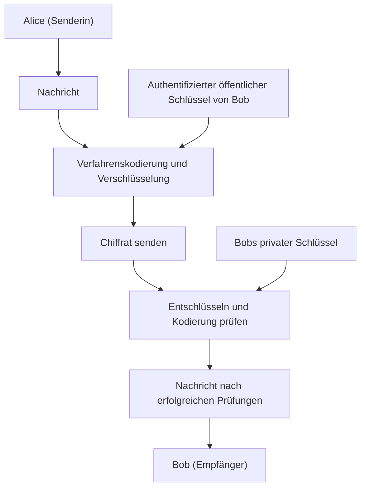
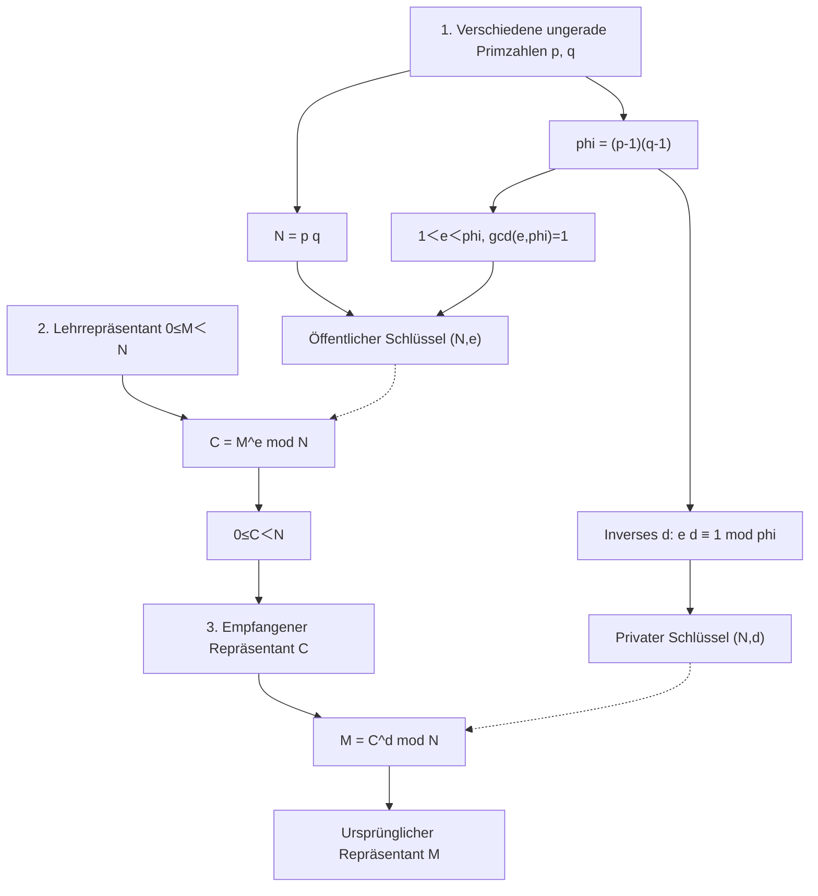
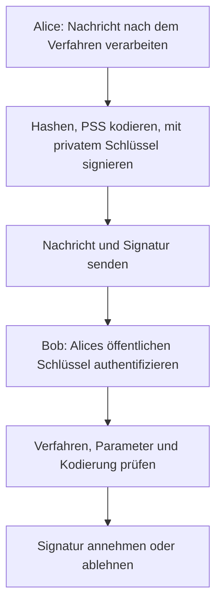

RSA wird für Verschlüsselung mit öffentlichen Schlüsseln und für digitale Signaturen verwendet. Die Arithmetik lässt sich mit Schulmathematik erkunden: Primzahlen, Reste und Potenzen. Das direkte Potenzieren einer ganzen Zahl im Lehrbeispiel ist jedoch von den Verfahren für reale Kommunikation zu unterscheiden.

Wir verfolgen kleine öffentliche Werte und erklären, warum die Entschlüsselung den Ausgangswert wiederherstellt. Praktische Verfahren wie RSAES-OAEP zur Verschlüsselung und RSASSA-PSS für Signaturen benötigen eigene Kodierungs- und Prüfregeln. Siehe auch den [Überblick über öffentliche Schlüssel, Hashfunktionen und Signaturen](/de/p/modern-cryptography-public-key-hash-signature/).

## 1. Symmetrische und asymmetrische Verschlüsselung

Bei symmetrischer Verschlüsselung teilen Sender und Empfänger einen geheimen Schlüssel zum Ver- und Entschlüsseln. Sie verarbeitet große Datenmengen effizient. Diesen Schlüssel mit einem neuen Kommunikationspartner sicher zu teilen, ist jedoch eine eigene Aufgabe.

Bei asymmetrischer Verschlüsselung erstellt der Empfänger Bob einen öffentlichen und einen privaten Schlüssel. Alice verschlüsselt mit Bobs öffentlichem Schlüssel. Als Bild dient ein Vorhängeschloss, das jeder schließen kann, während Bob den Schlüssel zum Öffnen behält. Alice muss weiterhin feststellen, dass der öffentliche Schlüssel tatsächlich Bob gehört. Die Authentifizierung, die ein Ersetzen des öffentlichen Schlüssels durch Angreifer verhindern soll, ist eine zusätzliche Anforderung.



Das Ziel ist, die Entschlüsselung ohne privaten Schlüssel rechnerisch schwierig zu machen, auch wenn der öffentliche Schlüssel bekannt ist. Das ist keine unbedingte mathematische Unmöglichkeitsgarantie. Zu Verfahren mit öffentlichen Schlüsseln gehören auch Schlüsselvereinbarung und Signaturen; sie führen nicht alle dieselbe Verschlüsselungsoperation aus.

## 2. Primzahlen und Faktorisierung

Eine Primzahl ist eine ganze Zahl größer als eins, deren einzige positive Teiler eins und sie selbst sind. Die ersten Beispiele sind $2,3,5,7,11,13,17,19,23$. Jede ganze Zahl größer als eins besitzt bis auf die Reihenfolge eine eindeutige Primfaktorzerlegung, etwa $60=2^2\times3\times5$. Null ist ausgenommen; eins wird gesondert als leeres Produkt behandelt.

$11\times13=143$ zu berechnen ist einfach, aber $17\times19$ aus $323$ zu finden ist eine andere Aufgabe. RSA veröffentlicht $N=pq$ für geeignet gewählte große, verschiedene Primzahlen. Wer die Faktoren kennt, kann den privaten Exponenten berechnen. Das Faktorisieren des Modulus bricht RSA; wir behaupten jedoch nicht, dass jede Möglichkeit, RSA zu brechen, allgemein nachweislich der Faktorisierung gleichwertig ist.

„RSA mit 2048 Bit“ bezeichnet normalerweise die **Bitlänge des Modulus $N$**. Ein $N$ mit 2048 Bit hat 617 Dezimalstellen. Bei zwei etwa gleich großen Primzahlen hat jede ungefähr 1024 Bit. Die Schwierigkeit hängt von Erzeugung und Größe der Parameter, verfügbaren Algorithmen und Rechenressourcen ab. Unbelegte Angaben wie „Billionen Jahre“ oder „länger als das Alter des Universums“ sind keine Garantie.

## 3. Kongruenzen und Reste

Wie bei einer Zwölfstundenuhr, auf der fünf Stunden nach zehn Uhr drei Uhr angezeigt wird, betrachten wir Reste modulo einer Zahl.

$$15\equiv3\pmod{12}$$

Für einen Modulus $N>1$ gilt: Wenn $a\equiv b\pmod N$ und $c\equiv d\pmod N$ gelten, bleiben die Kongruenzen bei Addition, Subtraktion und Multiplikation erhalten. Für eine nichtnegative ganze Zahl $k$ gilt außerdem $a^k\equiv b^k\pmod N$. Negative Exponenten verlangen zusätzliche Voraussetzungen, etwa die Existenz von Inversen.

Aus $7\equiv2\pmod5$ folgt $7^{100}\equiv2^{100}\pmod5$. Auch Zwischenergebnisse dürfen durch ihre Reste ersetzt werden, ohne zunächst die vollständige riesige Potenz zu bilden. Kongruenz bedeutet nicht Gleichheit als gewöhnliche ganze Zahlen.

## 4. Eulersche Phi-Funktion und Satz von Euler

$\phi(N)$ zählt die ganzen Zahlen $1\le a\le N$, die zu $N$ teilerfremd sind. Beispielsweise gilt $\phi(5)=4$ und $\phi(6)=2$. Für eine Primzahl $p$ gilt

$$\phi(p)=p-1$$

Für verschiedene Primzahlen $p,q$ und $N=pq$ gilt

$$\phi(N)=(p-1)(q-1)$$

Wer $p,q$ kennt, kann diesen Wert berechnen. Umgekehrt liefern $\phi(N)$ und $N$ die Beziehungen $p+q=N-\phi(N)+1$ und $pq=N$. Eine quadratische Gleichung ergibt dann die beiden Faktoren. Deshalb muss auch dieser Wert geheim bleiben.

Nach dem Satz von Euler gilt für $\gcd(a,N)=1$

$$a^{\phi(N)}\equiv1\pmod N$$

Multiplikation mit $a$ ergibt

$$a^{\phi(N)+1}\equiv a\pmod N$$

und für jede nichtnegative ganze Zahl $k$

$$a^{k\phi(N)+1}\equiv a\pmod N$$

Die Zwischenaussage $a^{\phi(N)}\equiv1$ darf nicht weiterverwendet werden, nachdem die Voraussetzung der Teilerfremdheit weggelassen wurde.

## 5. Schlüssel, Verschlüsselung und Entschlüsselung im Lehrmodell

Wir verwenden ein Modell mit zwei Primzahlen. Reale Parameter erfordern geeignet große, verschiedene ungerade Primzahlen $p,q$; das spätere Beispiel nutzt bewusst kleine bekannte Werte, um die Rechnung sichtbar zu machen.

1. $N=pq$ und $\phi(N)=(p-1)(q-1)$ berechnen.
2. Einen öffentlichen Exponenten $e$ mit $1<e<\phi(N)$ und $\gcd(e,\phi(N))=1$ wählen.
3. Einen positiven privaten Exponenten $d$ finden, der die Bedingung erfüllt:

$$ed\equiv1\pmod{\phi(N)}$$

Der öffentliche Schlüssel ist $(N,e)$, eine grundlegende Darstellung des privaten Schlüssels ist $(N,d)$. Die Zahl $d$ ist ein Exponent, nicht für sich allein die vollständige standardisierte Schlüsseldarstellung. Praktische Darstellungen können auch Faktoren und Werte für den chinesischen Restsatz enthalten. RFC 8017 definiert die Bedingung mit $\lambda(N)=\operatorname{lcm}(p-1,q-1)$. Hier das Inverse modulo $\phi(N)$ zu verwenden ist eine einfache hinreichende Bedingung, die auch die Bedingung modulo $\lambda(N)$ erfüllt.

Für einen **ganzzahligen Nachrichtenrepräsentanten** $0\le M<N$ lautet die Lehrrechnung zur Verschlüsselung

$$C\equiv M^e\pmod N$$

Für einen Chiffratrepräsentanten $0\le C<N$ berechnet die Entschlüsselung

$$M\equiv C^d\pmod N$$

In einem praktischen Verfahren werden die Nachrichtenbytes nach Vorschrift kodiert und dann in eine ganze Zahl umgewandelt. Auch nach der Entschlüsselung sind Prüfungen nötig. Zeichen direkt in eine ganze Zahl umzuwandeln und zu potenzieren reicht nicht aus.



Die RSA-Arithmetik allein ist deterministisch: Dasselbe $M$ ergibt dasselbe $C$. Bei wenigen möglichen Nachrichten kann jeder diese mit dem öffentlichen Schlüssel verschlüsseln und vergleichen. Außerdem verändert das Ersetzen von $C$ durch $C\,r^e\bmod N$ den entschlüsselten Repräsentanten zu $Mr\bmod N$. Die Sicherheitseigenschaften eines praktischen Verfahrens folgen nicht allein aus dieser Arithmetik.

## 6. Warum die Entschlüsselung die Eingabe wiederherstellt

Die Entschlüsselung berechnet

$$C^d\equiv(M^e)^d\equiv M^{ed}\pmod N$$

Aus der Schlüsselbedingung folgt für eine nichtnegative ganze Zahl $k$

$$ed=k\phi(N)+1$$

Für $\gcd(M,N)=1$ liefert der Satz von Euler

$$M^{ed}=(M^{\phi(N)})^k M\equiv1^k M\equiv M\pmod N$$

RSA-Repräsentanten müssen aber nicht teilerfremd zu $N$ sein. Auch $M=0,11,13$ liegen im Wertebereich. Deshalb betrachten wir jede Primzahl einzeln.

- Falls $p\mid M$, gilt $M^{ed}\equiv M\equiv0\pmod p$, weil der Exponent $ed$ positiv ist.
- Falls $p\nmid M$, liefert der kleine fermatsche Satz $M^{p-1}\equiv1\pmod p$. Da $ed-1$ ein Vielfaches von $p-1$ ist, folgt $M^{ed}\equiv M\pmod p$.
- Modulo $q$ gilt dieselbe Argumentation.

Die verschiedenen Primzahlen $p,q$ sind teilerfremd. Der chinesische Restsatz liefert daher

$$M^{ed}\equiv M\pmod{pq}$$

für jeden Repräsentanten $0\le M<N$. Das beweist die arithmetische Korrektheit, nicht die Sicherheit eines Verfahrens gegen Abhören oder Veränderungen.

## 7. Handrechnung mit kleinen Primzahlen

Wir wählen $p=11,q=13$. Dann ist $N=143$ und $\phi(N)=120$. Wir nehmen $e=7$ und lösen $7d\equiv1\pmod{120}$. Wegen $7\times103=721=6\times120+1$ können wir $d=103$ verwenden.

Für die Lehreingabe $M=9$ gilt $9^7=4\,782\,969=33\,447\times143+48$, also $C=48$. Die Entschlüsselung ergibt $48^{103}\bmod143=9$. Python berechnet dies mit `pow(48, 103, 143)`, ohne zuvor die vollständige ganze Zahl $48^{103}$ zu bilden.

Diese Primzahlen und der private Exponent sind öffentliche Lehrwerte, die jeder kennt. Sie können keine geheimen Nachrichten schützen.

## 8. Ein Inverses mit dem erweiterten euklidischen Algorithmus finden

Die Kongruenz $7d\equiv1\pmod{120}$ bedeutet, dass es ganze Zahlen $d,y$ mit $7d+120y=1$ gibt. Aus $120=17\times7+1$ folgt $1=120-17\times7$, also $d\equiv-17\equiv103\pmod{120}$.

Der erweiterte euklidische Algorithmus findet solche Koeffizienten allgemein. Ein Inverses existiert, wenn die ganze Zahl und der Modulus teilerfremd sind. Der Aufwand hängt von der Eingabelänge ab; für beliebig große Eingaben gibt es keine feste Laufzeit.

## 9. Digitale Signaturen benötigen ein eigenes Verfahren

RSA-Signaturen werden mit einem privaten Schlüssel erzeugt und mit dem zugehörigen öffentlichen Schlüssel geprüft. Die Beschreibung „mit dem privaten Schlüssel verschlüsseln und mit dem öffentlichen entschlüsseln“ verdeckt die Unterschiede der Kodierung und Prüfung zwischen Verschlüsselungs- und Signaturverfahren.

Die unkodierte Beziehung $S=M^d\bmod N$ mit der Prüfung $S^e\equiv M\pmod N$ ist kein sicheres Signaturverfahren. Ein Angreifer kann $S=2$ wählen und aus den öffentlichen Werten $e=7,N=143$ den Wert $M=2^7\bmod143=128$ berechnen. Dieses Paar besteht die Prüfung ohne privaten Schlüssel. Das bedeutet nicht, dass jede vorab festgelegte Nachricht signiert werden kann; es zeigt, dass diese Prüfung allein unzureichend ist.



Verfahren wie RSASSA-PSS kombinieren Hashen mit eigener Kodierung und Prüfung. Eine Signatur verbirgt die Nachricht nicht; auch Schlüsselverwaltung und die Bindung an eine Identität sind nötig. Verschlüsselungs- und Signaturschlüssel sollten nach Zweck getrennt werden. Für reale Anwendungen benötigt man eine gepflegte Bibliothek, die das vorgesehene Protokoll unterstützt.

## 10. Die Lehrarithmetik mit Python prüfen

Dieses eigenständig ausführbare Beispiel für Python ab 3.8 verwendet nur bekannte Lehrwerte. `pow(e, -1, phi)` berechnet das Inverse für teilerfremde ganze Zahlen. Der Wertebereich des Repräsentanten wird ausdrücklich geprüft. Es ist kein Schlüsselgenerator und implementiert weder OAEP noch PSS. Eine konstante Laufzeit wird ebenfalls nicht garantiert.

```python
from math import gcd


def mod_inverse(e, phi):
    # Fixed public teaching parameters, not a key generator.
    if type(e) is not int or type(phi) is not int:
        raise TypeError("Integer parameters required")
    if phi <= 1 or not 1 < e < phi or gcd(e, phi) != 1:
        raise ValueError("Invalid teaching exponent or modulus")
    return pow(e, -1, phi)


def rsa_primitive_demo(value, exponent, modulus):
    # Range checks do not make raw RSA a secure encryption scheme.
    if any(type(x) is not int for x in (value, exponent, modulus)):
        raise TypeError("Integer parameters required")
    if modulus <= 1 or exponent <= 0 or not 0 <= value < modulus:
        raise ValueError("Invalid exponent, modulus or representative")
    return pow(value, exponent, modulus)


# Public toy values only. Never use this code or these keys for secrets.
p, q = 11, 13
N = p * q
phi = (p - 1) * (q - 1)
e = 7
d = mod_inverse(e, phi)
message = 9
ciphertext = rsa_primitive_demo(message, e, N)
decrypted_message = rsa_primitive_demo(ciphertext, d, N)
assert (N, phi, d, ciphertext, decrypted_message) == (143, 120, 103, 48, 9)
assert all(rsa_primitive_demo(rsa_primitive_demo(m, e, N), d, N) == m
           for m in range(N))
print(f"Public toy parameters: N={N}, e={e}, d={d}")
print(f"Ciphertext representative: {ciphertext}")
print(f"Recovered representative: {decrypted_message}")
print("All 143 representatives round-trip")
```

`pow` mit drei Argumenten berechnet eine modulare Potenz, ohne die vollständige Potenz zu bilden. Das ist effizienter, aber die Laufzeit hängt von Eingabe und Implementierung ab. Eingabeprüfungen und die erfolgreiche Rückgewinnung aller 143 Werte prüfen weiterhin nur die Lehrarithmetik.

## 11. Praktische Verfahren und zukünftige Technik

Praktische RSA-Verschlüsselung nutzt ein Verfahren wie RSAES-OAEP. RSA dient als Bestandteil hybrider Verschlüsselung, statt lange Nachrichten direkt zu verschlüsseln. Beispielsweise erlaubt OAEP mit einem Modulus von 2048 Bit und SHA-256 höchstens $256-2\times32-2=190$ Bytes. Verschlüsselung allein authentifiziert den Absender nicht.

Die Kommunikationssicherheit hängt vom gesamten Protokoll ab. TLS 1.3 verwendet keinen RSA-Schlüsseltransport. Wo RSA-Signaturen verwendet werden, haben sie eine andere Rolle als Verschlüsselung für den Schlüsseltransport. Moderne Kommunikation wird nicht durchweg „mit RSA verschlüsselt“.

Shors Quantenalgorithmus faktorisiert im entsprechenden Quantenrechenmodell in einer zur Eingabelänge polynomialen Zeit. Das bedeutet weder augenblickliche Berechnung noch eine Prognose, wann geeignete Hardware existiert. Ein Quantencomputer, der die nötige Berechnung durchführen kann, würde RSA bedrohen. Das motiviert Post-Quanten-Kryptografie, deren Name ebenfalls keine absolute Sicherheit gegen jeden zukünftigen Angriff garantiert.

RSA vermittelt Primzahlen, Kongruenzen, Inverse und einen Korrektheitsbeweis. Die Sicherheit eines praktischen Verfahrens verlangt zusätzlich Kodierung, Authentifizierung, Prüfung und geeignete Implementierung.

### Quellen

- [RFC 8017: PKCS #1 v2.2](https://www.rfc-editor.org/rfc/rfc8017.html) (§§3, 5, 7.1, 8.1)
- [RFC 8446: TLS 1.3](https://www.rfc-editor.org/rfc/rfc8446.html) (§1.2, Appendix E.8)
- [Python 3.12: pow](https://docs.python.org/3.12/library/functions.html#pow)
- [Shor: Polynomial-Time Algorithms for Prime Factorization and Discrete Logarithms on a Quantum Computer](https://arxiv.org/abs/quant-ph/9508027) (Zusammenfassung)
