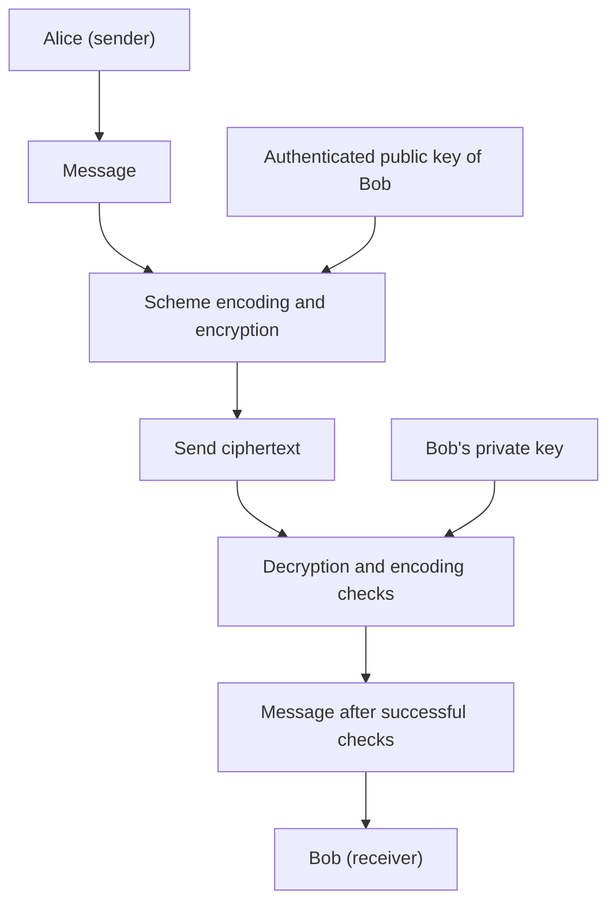
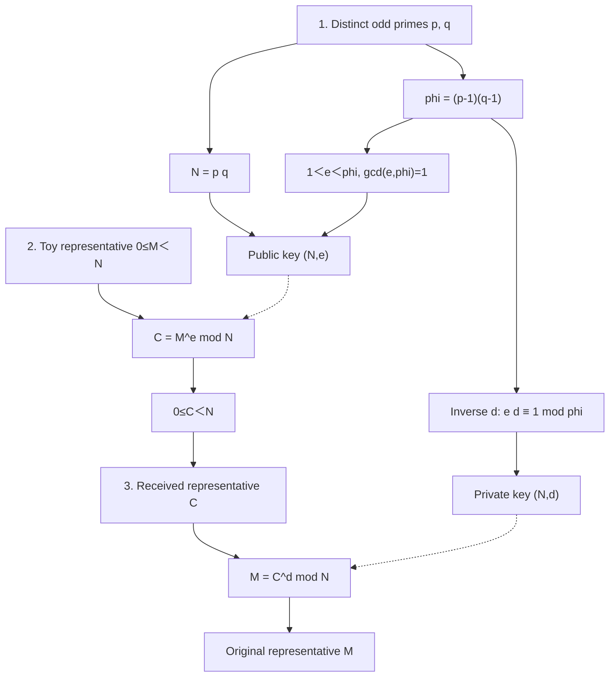
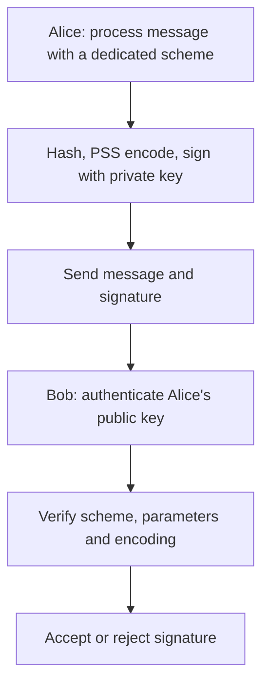

RSA is used in public-key encryption and digital signatures. Its arithmetic can be explored with high-school ideas: prime numbers, remainders and powers. However, the textbook operation of raising an integer to a power must be distinguished from the encryption schemes used in real communications.

This article follows small public examples and explains why decryption recovers the input. Practical schemes such as RSAES-OAEP for encryption and RSASSA-PSS for signatures require their own encoding and verification rules. See also the [overview of public keys, hashing and signatures](/en/p/modern-cryptography-public-key-hash-signature/).

## 1. Symmetric-key and public-key cryptography

In symmetric-key encryption, the sender and receiver share a secret key for encryption and decryption. It can handle large amounts of data efficiently, but sharing that key safely with a new correspondent is a separate challenge.

For public-key encryption, the receiver, Bob, prepares a public and private key. Alice encrypts with Bob's public key. A padlock analogy is a lock that anyone can close, with Bob keeping the key that opens it. Alice must still establish that the public key really belongs to Bob. Authentication to prevent key substitution is an additional requirement.



The intended property is computational difficulty of decryption without the private key, even when the public key is known. It is not an unconditional mathematical guarantee that decryption is impossible. Public-key techniques also include key agreement and signatures; they do not all perform the same encryption operation.

## 2. Primes and factorization

A prime is an integer greater than one whose only positive divisors are one and itself. The first examples are $2,3,5,7,11,13,17,19,23$. Every integer greater than one has a unique prime factorization up to ordering; for example, $60=2^2\times3\times5$. Zero is excluded, and one is treated separately as the empty product.

Calculating $11\times13=143$ is easy, but finding $17\times19$ from $323$ is a different task. RSA publishes $N=pq$ for suitably chosen large, distinct primes $p,q$. Knowing the factors allows the private exponent to be calculated. Factoring the modulus breaks RSA, but we do not claim that every way of breaking RSA has been proved generally equivalent to factorization.

“2048-bit RSA” normally describes the **bit length of the modulus $N$**. A 2048-bit $N$ has 617 decimal digits. With balanced two-prime parameters, each prime is approximately 1024 bits. Difficulty depends on parameter generation, sizes, available algorithms and computing resources. An unsupported estimate of “trillions of years” or “longer than the age of the universe” is not a useful guarantee.

## 3. Congruences and remainders

As on a twelve-hour clock, where five hours after ten is called three, we can focus on remainders modulo a number.

$$15\equiv3\pmod{12}$$

For a modulus $N>1$, if $a\equiv b\pmod N$ and $c\equiv d\pmod N$, addition, subtraction and multiplication preserve congruence. For a nonnegative integer $k$, we also have $a^k\equiv b^k\pmod N$. Negative exponents require additional conditions, including the existence of inverses.

Since $7\equiv2\pmod5$, we have $7^{100}\equiv2^{100}\pmod5$. Intermediate results may be replaced by their remainders, allowing computation without constructing the full enormous power. This does not mean that the power of a remainder and the remainder of a power are equal as ordinary integers.

## 4. Euler's totient function and theorem

$\phi(N)$ counts the integers $1\le a\le N$ that are coprime to $N$. For example, $\phi(5)=4$ and $\phi(6)=2$. For a prime $p$,

$$\phi(p)=p-1$$

For distinct primes $p,q$ and $N=pq$,

$$\phi(N)=(p-1)(q-1)$$

Knowing $p,q$ makes this value easy to calculate. Conversely, knowing $\phi(N)$ gives $p+q=N-\phi(N)+1$ and $pq=N$, from which a quadratic equation recovers both factors. The totient must therefore also be kept secret.

Euler's theorem states that, if $\gcd(a,N)=1$,

$$a^{\phi(N)}\equiv1\pmod N$$

Multiplying both sides by $a$ gives

$$a^{\phi(N)+1}\equiv a\pmod N$$

and, for every nonnegative integer $k$,

$$a^{k\phi(N)+1}\equiv a\pmod N$$

The intermediate assertion $a^{\phi(N)}\equiv1$ cannot be used after dropping the coprimality assumption.

## 5. Textbook RSA keys, encryption and decryption

We now use a two-prime teaching model. Actual parameters require appropriately large, distinct odd primes $p,q$; the later example deliberately uses small known values to make the arithmetic visible.

1. Calculate $N=pq$ and $\phi(N)=(p-1)(q-1)$.
2. Choose a public exponent $e$ with $1<e<\phi(N)$ and $\gcd(e,\phi(N))=1$.
3. Find a positive private exponent $d$ satisfying

$$ed\equiv1\pmod{\phi(N)}$$

The public key is $(N,e)$, and a basic private-key representation is $(N,d)$. The number $d$ is an exponent, not the entire standard key representation on its own. Practical representations can also include factors and CRT parameters. RFC 8017 defines the condition using $\lambda(N)=\operatorname{lcm}(p-1,q-1)$. Taking the inverse modulo $\phi(N)$ here is a simple sufficient condition that also satisfies the condition modulo $\lambda(N)$.

For a **message representative** $0\le M<N$, the textbook encryption calculation is

$$C\equiv M^e\pmod N$$

For a ciphertext representative $0\le C<N$, decryption calculates

$$M\equiv C^d\pmod N$$

In a practical scheme, message bytes undergo the specified encoding before conversion to an integer, and decryption includes validation. Converting characters directly to an integer and exponentiating is insufficient.



RSA arithmetic alone is deterministic: the same $M$ gives the same $C$. With a small set of candidates, anyone can encrypt each candidate with the public key and compare. Moreover, replacing $C$ with $C\,r^e\bmod N$ changes the recovered representative to $Mr\bmod N$. The security properties needed for a practical encryption scheme do not follow from this arithmetic alone.

## 6. Why decryption recovers the input

Decryption computes

$$C^d\equiv(M^e)^d\equiv M^{ed}\pmod N$$

By the key condition, there is a nonnegative integer $k$ with

$$ed=k\phi(N)+1$$

If $\gcd(M,N)=1$, Euler's theorem gives

$$M^{ed}=(M^{\phi(N)})^k M\equiv1^k M\equiv M\pmod N$$

However, RSA representatives need not be coprime to $N$. For example, $M=0,11,13$ are all in range. We therefore examine each prime separately.

- If $p\mid M$, then $M^{ed}\equiv M\equiv0\pmod p$, since the exponent $ed$ is positive.
- If $p\nmid M$, Fermat's little theorem gives $M^{p-1}\equiv1\pmod p$. Since $ed-1$ is a multiple of $p-1$, we have $M^{ed}\equiv M\pmod p$.
- The same reasoning applies modulo $q$.

The distinct primes $p,q$ are coprime, so the Chinese remainder theorem gives

$$M^{ed}\equiv M\pmod{pq}$$

for every representative $0\le M<N$. This proves arithmetic correctness, not the security of an encryption scheme against eavesdropping or modification.

## 7. A hand calculation with small primes

Let $p=11,q=13$. Then $N=143$ and $\phi(N)=120$. Choose $e=7$ and solve $7d\equiv1\pmod{120}$. Since $7\times103=721=6\times120+1$, we may use $d=103$.

For the toy input $M=9$, $9^7=4,782,969=33,447\times143+48$, so $C=48$. Decryption gives $48^{103}\bmod143=9$. In Python, `pow(48, 103, 143)` calculates this without first constructing the full integer $48^{103}$.

These primes and the private exponent are public teaching values visible to everyone. They cannot protect secret messages.

## 8. Finding an inverse with the extended Euclidean algorithm

The congruence $7d\equiv1\pmod{120}$ means that integers $d,y$ satisfy $7d+120y=1$. Since $120=17\times7+1$, we have $1=120-17\times7$, giving $d\equiv-17\equiv103\pmod{120}$.

The extended Euclidean algorithm finds such coefficients in general. An inverse exists when the integer and modulus are coprime. The computation depends on input length; it does not take a fixed amount of time for arbitrarily large inputs.

## 9. Digital signatures use a dedicated scheme

RSA signatures are generated with a private key and verified with the corresponding public key. Describing this as “encrypting with the private key and decrypting with the public key” hides the differences between encryption and signature encoding and validation.

The raw relation $S=M^d\bmod N$, checked by $S^e\equiv M\pmod N$, is not a secure signature scheme. For example, an attacker can choose $S=2$ and use the public values $e=7,N=143$ to calculate $M=2^7\bmod143=128$. That pair passes the raw check without using the private key. This does not claim a signature on any particular message chosen beforehand; it demonstrates that the raw check is insufficient as a signature scheme.



Schemes such as RSASSA-PSS combine hashing with dedicated encoding and verification. A signature does not hide the message, and key management and binding the key to an identity still matter. Separate encryption and signing keys by purpose and use a maintained library supporting the intended protocol.

## 10. Checking the teaching arithmetic with Python

The following standalone Python 3.8+ example uses only known toy values. `pow(e, -1, phi)` computes an inverse for coprime integers. The representative's range is checked explicitly. This is not a key generator, OAEP, PSS or a constant-time implementation.

```python
from math import gcd


def mod_inverse(e, phi):
    # Fixed public teaching parameters, not a key generator.
    if type(e) is not int or type(phi) is not int:
        raise TypeError("Integer parameters required")
    if phi <= 1 or not 1 < e < phi or gcd(e, phi) != 1:
        raise ValueError("Invalid teaching exponent or modulus")
    return pow(e, -1, phi)


def rsa_primitive_demo(value, exponent, modulus):
    # Range checks do not make raw RSA a secure encryption scheme.
    if any(type(x) is not int for x in (value, exponent, modulus)):
        raise TypeError("Integer parameters required")
    if modulus <= 1 or exponent <= 0 or not 0 <= value < modulus:
        raise ValueError("Invalid exponent, modulus or representative")
    return pow(value, exponent, modulus)


# Public toy values only. Never use this code or these keys for secrets.
p, q = 11, 13
N = p * q
phi = (p - 1) * (q - 1)
e = 7
d = mod_inverse(e, phi)
message = 9
ciphertext = rsa_primitive_demo(message, e, N)
decrypted_message = rsa_primitive_demo(ciphertext, d, N)
assert (N, phi, d, ciphertext, decrypted_message) == (143, 120, 103, 48, 9)
assert all(rsa_primitive_demo(rsa_primitive_demo(m, e, N), d, N) == m
           for m in range(N))
print(f"Public toy parameters: N={N}, e={e}, d={d}")
print(f"Ciphertext representative: {ciphertext}")
print(f"Recovered representative: {decrypted_message}")
print("All 143 representatives round-trip")
```

Three-argument `pow` computes a modular power without constructing the full power. It is more efficient than doing so, but runtime depends on the inputs and implementation. Input checks and successful round trips over all 143 values are still checks of teaching arithmetic.

## 11. Practical schemes and future technology

Practical RSA encryption uses a scheme such as RSAES-OAEP. RSA is used as a component in hybrid encryption, rather than directly encrypting large message bodies. For example, OAEP with a 2048-bit modulus and SHA-256 has a maximum input length of $256-2\times32-2=190$ bytes. Encryption alone does not authenticate the sender.

Communication security depends on the entire protocol. TLS 1.3 does not use RSA key transport. Where RSA signatures are used, their role differs from encryption for key transport. Modern communications should not be understood as universally “encrypted with RSA.”

Shor's quantum algorithm factors integers in time polynomial in the input length in the appropriate quantum computation model. This means neither instantaneous computation nor a forecast of when suitable hardware will exist. A quantum computer capable of performing the required computation would threaten RSA, motivating post-quantum cryptography. That name is not an absolute guarantee against every future attack.

RSA teaches primes, congruences, inverses and a correctness proof. Practical scheme security adds further requirements involving encoding, authentication, verification and implementation.

### References

- [RFC 8017: PKCS #1 v2.2](https://www.rfc-editor.org/rfc/rfc8017.html) (§§3, 5, 7.1, 8.1)
- [RFC 8446: TLS 1.3](https://www.rfc-editor.org/rfc/rfc8446.html) (§1.2, Appendix E.8)
- [Python 3.12: pow](https://docs.python.org/3.12/library/functions.html#pow)
- [Shor: Polynomial-Time Algorithms for Prime Factorization and Discrete Logarithms on a Quantum Computer](https://arxiv.org/abs/quant-ph/9508027) (abstract)
