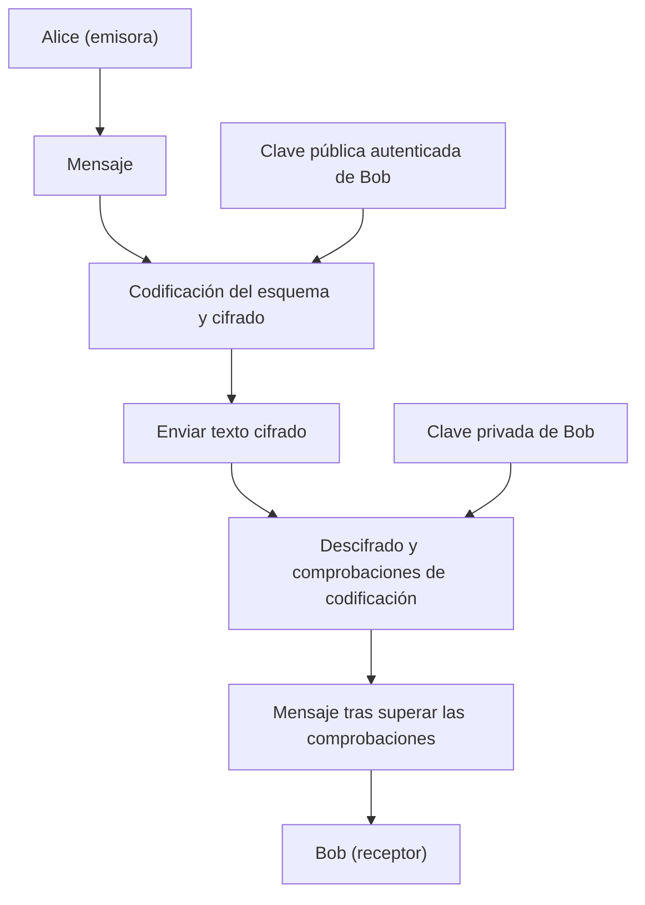
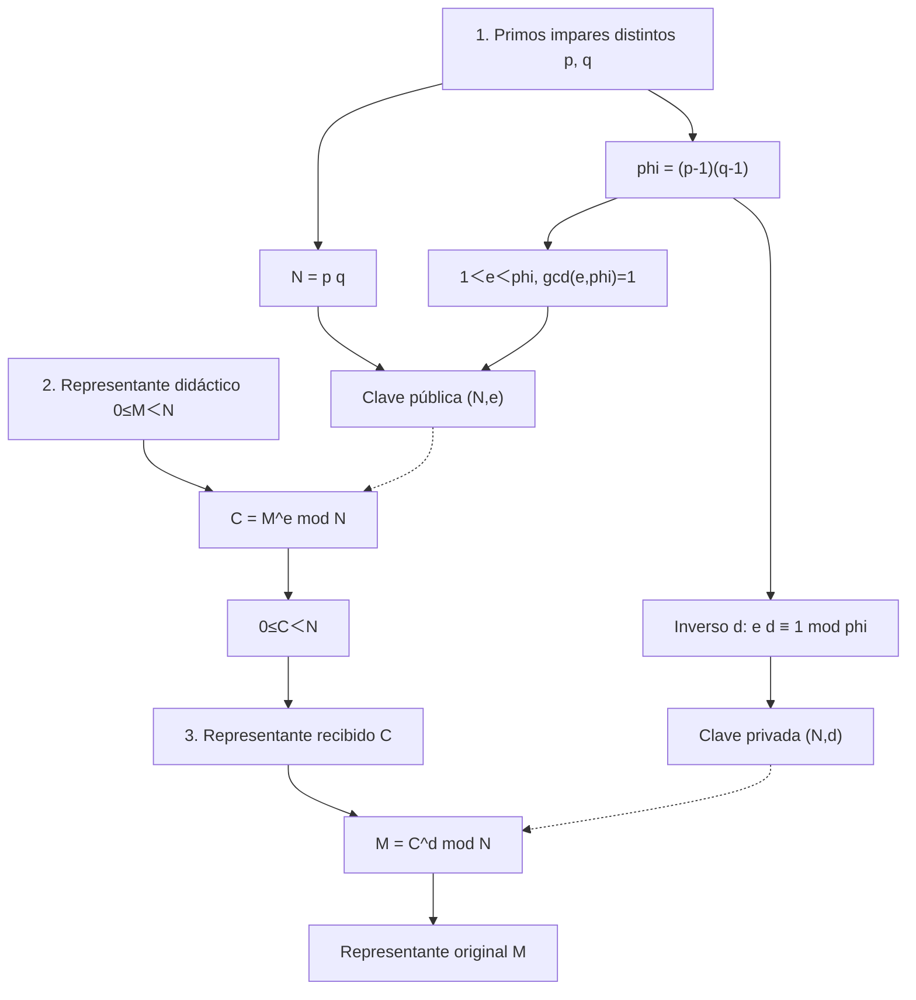
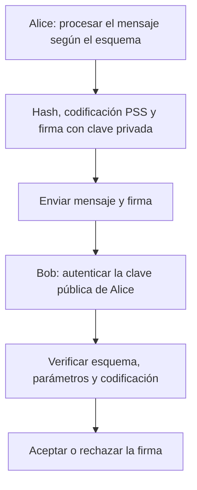

RSA se utiliza en el cifrado de clave pública y en las firmas digitales. Su aritmética puede explorarse con ideas de secundaria: números primos, restos y potencias. Sin embargo, elevar directamente un entero a una potencia en un ejemplo didáctico no equivale a un esquema de cifrado para comunicaciones reales.

Seguiremos valores pequeños y públicos para explicar por qué el descifrado recupera la entrada. Los esquemas prácticos, como RSAES-OAEP para cifrado y RSASSA-PSS para firmas, necesitan sus propias reglas de codificación y verificación. Véase también la [introducción a claves públicas, hash y firmas](/es/p/modern-cryptography-public-key-hash-signature/).

## 1. Cifrado simétrico y de clave pública

En el cifrado simétrico, emisor y receptor comparten una clave secreta para cifrar y descifrar. Permite procesar grandes cantidades de datos con eficiencia, pero compartir esa clave de forma segura con un interlocutor nuevo es otro problema.

En el cifrado de clave pública, Bob, el receptor, prepara una clave pública y una privada. Alice cifra con la clave pública de Bob. La analogía del candado es un cierre que cualquiera puede cerrar, mientras Bob conserva la llave para abrirlo. Alice debe comprobar que la clave pública pertenece realmente a Bob: la autenticación para evitar su sustitución es un requisito adicional.



Se busca que descifrar sin la clave privada resulte computacionalmente difícil, aunque se conozca la pública. No es una garantía matemática incondicional de imposibilidad. Las técnicas de clave pública también incluyen acuerdos de claves y firmas; no todas realizan la misma operación de cifrado.

## 2. Números primos y factorización

Un primo es un entero mayor que uno cuyos únicos divisores positivos son uno y él mismo. Los primeros ejemplos son $2,3,5,7,11,13,17,19,23$. Todo entero mayor que uno tiene una factorización única en primos, salvo el orden; por ejemplo, $60=2^2\times3\times5$. El cero queda excluido y el uno se trata aparte como producto vacío.

Calcular $11\times13=143$ es fácil, pero encontrar $17\times19$ a partir de $323$ es otra tarea. RSA publica $N=pq$, con primos grandes, distintos y elegidos adecuadamente. Conocer los factores permite calcular el exponente privado. Factorizar el módulo permite romper RSA, pero no afirmamos que todas las formas de romper RSA se hayan demostrado generalmente equivalentes a factorizar.

«RSA de 2048 bits» suele describir la **longitud en bits del módulo $N$**. Un $N$ de 2048 bits tiene 617 dígitos decimales. Con dos primos equilibrados, cada uno tiene aproximadamente 1024 bits. La dificultad depende de la generación y el tamaño de los parámetros, los algoritmos disponibles y los recursos de cálculo. Las estimaciones sin fundamento de «billones de años» o «más que la edad del universo» no constituyen una garantía.

## 3. Congruencias y restos

Como en un reloj de doce horas, donde cinco horas después de las diez se dice que son las tres, podemos centrarnos en los restos módulo un número.

$$15\equiv3\pmod{12}$$

Para un módulo $N>1$, si $a\equiv b\pmod N$ y $c\equiv d\pmod N$, la suma, la resta y la multiplicación conservan la congruencia. Para un entero no negativo $k$, también se cumple $a^k\equiv b^k\pmod N$. Los exponentes negativos requieren condiciones adicionales, como la existencia de inversos.

Como $7\equiv2\pmod5$, tenemos $7^{100}\equiv2^{100}\pmod5$. Los resultados intermedios pueden sustituirse por sus restos, sin construir la potencia completa. Esto no significa que la potencia de un resto y el resto de una potencia sean iguales como enteros ordinarios.

## 4. La función indicatriz y el teorema de Euler

$\phi(N)$ cuenta los enteros $1\le a\le N$ que son coprimos con $N$. Por ejemplo, $\phi(5)=4$ y $\phi(6)=2$. Para un primo $p$,

$$\phi(p)=p-1$$

Para primos distintos $p,q$ y $N=pq$,

$$\phi(N)=(p-1)(q-1)$$

Conocer $p,q$ permite calcular este valor. A la inversa, conocer $\phi(N)$ proporciona $p+q=N-\phi(N)+1$ y $pq=N$, con los que una ecuación de segundo grado recupera los factores. Por eso ese valor también debe mantenerse secreto.

El teorema de Euler establece que, si $\gcd(a,N)=1$,

$$a^{\phi(N)}\equiv1\pmod N$$

Multiplicando por $a$ se obtiene

$$a^{\phi(N)+1}\equiv a\pmod N$$

y, para todo entero no negativo $k$,

$$a^{k\phi(N)+1}\equiv a\pmod N$$

No se puede utilizar el resultado intermedio $a^{\phi(N)}\equiv1$ después de eliminar la hipótesis de coprimalidad.

## 5. Claves, cifrado y descifrado del modelo didáctico

Usaremos un modelo de dos primos. Los parámetros reales requieren primos impares, distintos y suficientemente grandes $p,q$; el ejemplo posterior usa deliberadamente valores pequeños y conocidos para observar la aritmética.

1. Calcular $N=pq$ y $\phi(N)=(p-1)(q-1)$.
2. Elegir un exponente público $e$ con $1<e<\phi(N)$ y $\gcd(e,\phi(N))=1$.
3. Encontrar un exponente privado positivo $d$ que satisfaga

$$ed\equiv1\pmod{\phi(N)}$$

La clave pública es $(N,e)$ y una representación básica de la privada es $(N,d)$. El número $d$ es un exponente, no toda la representación estándar de la clave por sí solo. Las representaciones prácticas también pueden incluir los factores y parámetros del teorema chino del resto. RFC 8017 define la condición mediante $\lambda(N)=\operatorname{lcm}(p-1,q-1)$. Tomar aquí el inverso módulo $\phi(N)$ es una condición suficiente sencilla que también satisface la condición módulo $\lambda(N)$.

Para un **representante entero del mensaje** $0\le M<N$, el cálculo didáctico de cifrado es

$$C\equiv M^e\pmod N$$

Para un representante del texto cifrado $0\le C<N$, el descifrado calcula

$$M\equiv C^d\pmod N$$

En un esquema práctico, los bytes del mensaje pasan por la codificación especificada antes de convertirse en un entero, y el descifrado incluye validaciones. No basta con convertir caracteres directamente en un entero y elevarlo a una potencia.



La aritmética RSA sin más es determinista: el mismo $M$ produce el mismo $C$. Si hay pocos candidatos, cualquiera puede cifrarlos con la clave pública y comparar. Además, sustituir $C$ por $C\,r^e\bmod N$ cambia el representante recuperado a $Mr\bmod N$. Las propiedades de seguridad necesarias para un esquema práctico no se deducen únicamente de esta aritmética.

## 6. Por qué el descifrado recupera la entrada

El descifrado calcula

$$C^d\equiv(M^e)^d\equiv M^{ed}\pmod N$$

Por la condición de las claves, existe un entero no negativo $k$ tal que

$$ed=k\phi(N)+1$$

Si $\gcd(M,N)=1$, el teorema de Euler da

$$M^{ed}=(M^{\phi(N)})^k M\equiv1^k M\equiv M\pmod N$$

Sin embargo, los representantes RSA no necesitan ser coprimos con $N$. Por ejemplo, $M=0,11,13$ están dentro del intervalo. Examinamos cada primo por separado.

- Si $p\mid M$, entonces $M^{ed}\equiv M\equiv0\pmod p$, porque el exponente $ed$ es positivo.
- Si $p\nmid M$, el pequeño teorema de Fermat da $M^{p-1}\equiv1\pmod p$. Como $ed-1$ es múltiplo de $p-1$, tenemos $M^{ed}\equiv M\pmod p$.
- El mismo razonamiento se aplica módulo $q$.

Los primos distintos $p,q$ son coprimos, por lo que el teorema chino del resto da

$$M^{ed}\equiv M\pmod{pq}$$

para todo representante $0\le M<N$. Esto demuestra la corrección aritmética, no la seguridad de un esquema frente a escuchas o modificaciones.

## 7. Un cálculo a mano con primos pequeños

Tomemos $p=11,q=13$. Entonces $N=143$ y $\phi(N)=120$. Elegimos $e=7$ y resolvemos $7d\equiv1\pmod{120}$. Como $7\times103=721=6\times120+1$, podemos usar $d=103$.

Para la entrada didáctica $M=9$, $9^7=4\,782\,969=33\,447\times143+48$, de modo que $C=48$. El descifrado da $48^{103}\bmod143=9$. En Python, `pow(48, 103, 143)` lo calcula sin construir primero el entero completo $48^{103}$.

Estos primos y el exponente privado son valores didácticos públicos y visibles para todos. No pueden proteger mensajes secretos.

## 8. Calcular un inverso con el algoritmo de Euclides extendido

La congruencia $7d\equiv1\pmod{120}$ significa que hay enteros $d,y$ con $7d+120y=1$. Como $120=17\times7+1$, resulta $1=120-17\times7$, de donde $d\equiv-17\equiv103\pmod{120}$.

El algoritmo de Euclides extendido encuentra esos coeficientes en general. El inverso existe cuando el entero y el módulo son coprimos. El cálculo depende de la longitud de entrada; no tarda un tiempo fijo para entradas arbitrariamente grandes.

## 9. Las firmas digitales utilizan un esquema específico

Las firmas RSA se generan con una clave privada y se verifican con la pública correspondiente. Describirlo como «cifrar con la privada y descifrar con la pública» oculta las diferencias de codificación y validación entre esquemas de cifrado y de firma.

La relación sin codificación $S=M^d\bmod N$, comprobada mediante $S^e\equiv M\pmod N$, no es un esquema de firma seguro. Un atacante puede elegir $S=2$ y usar los valores públicos $e=7,N=143$ para calcular $M=2^7\bmod143=128$. Ese par supera la comprobación sin usar la clave privada. No afirmamos que permita firmar cualquier mensaje elegido de antemano: muestra que esa comprobación por sí sola es insuficiente.



Esquemas como RSASSA-PSS combinan hash con codificación y verificación específicas. Una firma no oculta el mensaje; también importan la gestión de claves y su vinculación con la identidad. Conviene separar las claves de cifrado y firma por finalidad y utilizar una biblioteca mantenida que admita el protocolo previsto.

## 10. Comprobar la aritmética didáctica con Python

Este ejemplo independiente para Python 3.8 o posterior utiliza únicamente valores didácticos conocidos. `pow(e, -1, phi)` calcula un inverso de enteros coprimos. También se comprueba explícitamente el intervalo del representante. No es un generador de claves ni una implementación de OAEP, PSS o tiempo constante.

```python
from math import gcd


def mod_inverse(e, phi):
    # Fixed public teaching parameters, not a key generator.
    if type(e) is not int or type(phi) is not int:
        raise TypeError("Integer parameters required")
    if phi <= 1 or not 1 < e < phi or gcd(e, phi) != 1:
        raise ValueError("Invalid teaching exponent or modulus")
    return pow(e, -1, phi)


def rsa_primitive_demo(value, exponent, modulus):
    # Range checks do not make raw RSA a secure encryption scheme.
    if any(type(x) is not int for x in (value, exponent, modulus)):
        raise TypeError("Integer parameters required")
    if modulus <= 1 or exponent <= 0 or not 0 <= value < modulus:
        raise ValueError("Invalid exponent, modulus or representative")
    return pow(value, exponent, modulus)


# Public toy values only. Never use this code or these keys for secrets.
p, q = 11, 13
N = p * q
phi = (p - 1) * (q - 1)
e = 7
d = mod_inverse(e, phi)
message = 9
ciphertext = rsa_primitive_demo(message, e, N)
decrypted_message = rsa_primitive_demo(ciphertext, d, N)
assert (N, phi, d, ciphertext, decrypted_message) == (143, 120, 103, 48, 9)
assert all(rsa_primitive_demo(rsa_primitive_demo(m, e, N), d, N) == m
           for m in range(N))
print(f"Public toy parameters: N={N}, e={e}, d={d}")
print(f"Ciphertext representative: {ciphertext}")
print(f"Recovered representative: {decrypted_message}")
print("All 143 representatives round-trip")
```

La versión de `pow` con tres argumentos calcula una potencia modular sin construir la potencia completa. Es más eficiente que hacerlo, pero el tiempo depende de las entradas y la implementación. Las comprobaciones de entrada y el recorrido correcto de los 143 valores siguen siendo pruebas de aritmética didáctica.

## 11. Esquemas prácticos y tecnologías futuras

El cifrado RSA práctico utiliza un esquema como RSAES-OAEP. RSA se emplea como componente del cifrado híbrido, en lugar de cifrar directamente mensajes largos. Por ejemplo, OAEP con módulo de 2048 bits y SHA-256 admite como máximo $256-2\times32-2=190$ bytes. El cifrado por sí solo no autentica al emisor.

La seguridad de la comunicación depende del protocolo completo. TLS 1.3 no utiliza transporte de claves RSA. Cuando se usan firmas RSA, su función es distinta del cifrado para transportar claves. No debe interpretarse que toda comunicación moderna esté «cifrada con RSA».

El algoritmo cuántico de Shor factoriza enteros en tiempo polinómico en la longitud de entrada dentro del modelo cuántico correspondiente. Eso no significa cálculo instantáneo ni predice cuándo existirá el hardware adecuado. Una computadora cuántica capaz de realizar el cálculo requerido amenazaría RSA, lo que motiva la criptografía poscuántica. Ese nombre tampoco garantiza seguridad absoluta frente a cualquier ataque futuro.

RSA enseña números primos, congruencias, inversos y una demostración de corrección. La seguridad de un esquema práctico añade requisitos de codificación, autenticación, verificación e implementación.

### Referencias

- [RFC 8017: PKCS #1 v2.2](https://www.rfc-editor.org/rfc/rfc8017.html) (§§3, 5, 7.1, 8.1)
- [RFC 8446: TLS 1.3](https://www.rfc-editor.org/rfc/rfc8446.html) (§1.2, Appendix E.8)
- [Python 3.12: pow](https://docs.python.org/3.12/library/functions.html#pow)
- [Shor: Polynomial-Time Algorithms for Prime Factorization and Discrete Logarithms on a Quantum Computer](https://arxiv.org/abs/quant-ph/9508027) (resumen)
