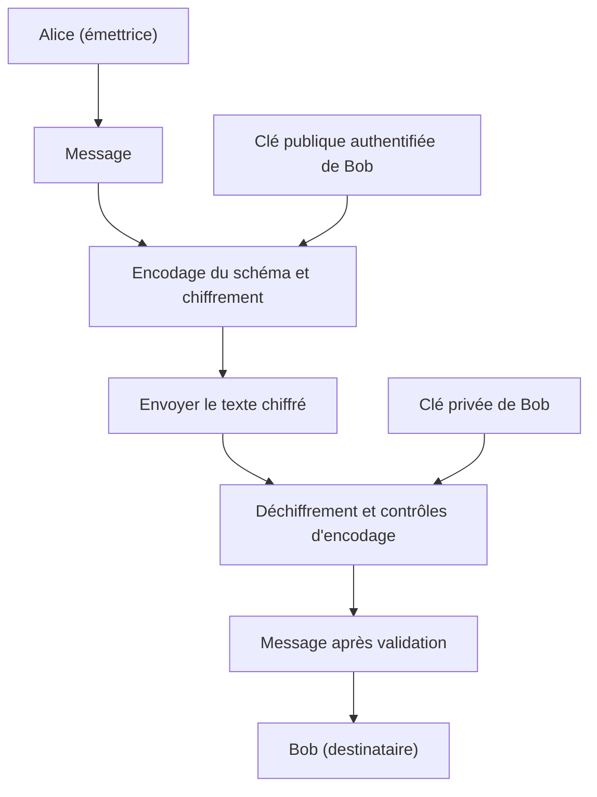
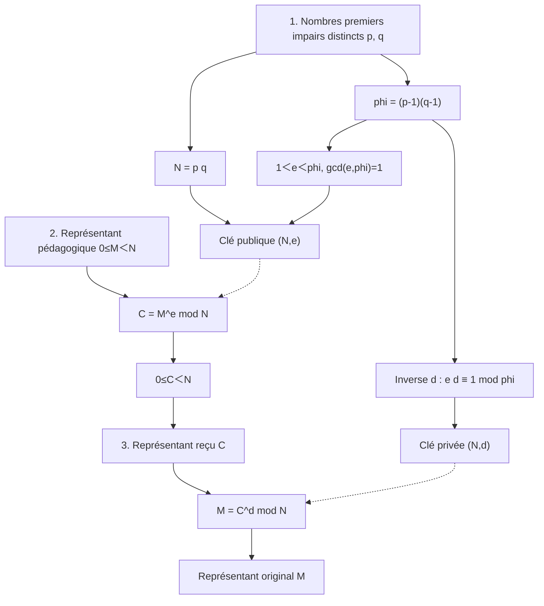
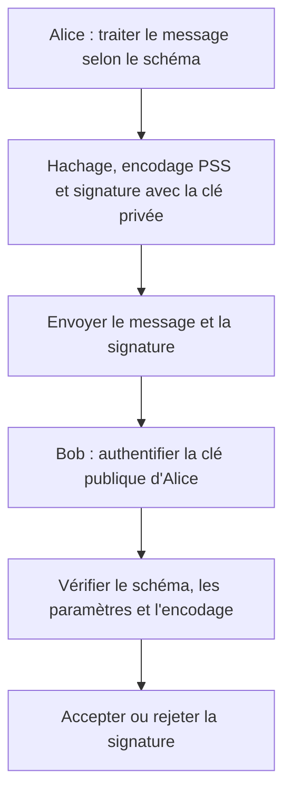

RSA sert au chiffrement à clé publique et aux signatures numériques. Son arithmétique peut s'explorer avec des notions du lycée : nombres premiers, restes et puissances. Il faut toutefois distinguer l'exponentiation directe d'un entier dans un modèle pédagogique des schémas employés dans les communications réelles.

Nous suivrons de petites valeurs publiques pour expliquer pourquoi le déchiffrement retrouve l'entrée. Les schémas pratiques, comme RSAES-OAEP pour le chiffrement et RSASSA-PSS pour les signatures, ont leurs propres règles d'encodage et de vérification. Voir aussi la [présentation des clés publiques, du hachage et des signatures](/fr/p/modern-cryptography-public-key-hash-signature/).

## 1. Chiffrement symétrique et à clé publique

Dans le chiffrement symétrique, l'émetteur et le destinataire partagent une clé secrète pour chiffrer et déchiffrer. Il permet de traiter efficacement de grandes quantités de données, mais partager cette clé en sécurité avec un nouvel interlocuteur est un autre problème.

Pour le chiffrement à clé publique, Bob, le destinataire, prépare une clé publique et une clé privée. Alice chiffre avec la clé publique de Bob. L'analogie est celle d'un cadenas que tout le monde peut fermer, dont Bob conserve la clé d'ouverture. Alice doit encore s'assurer que la clé publique appartient réellement à Bob. L'authentification destinée à empêcher sa substitution est une exigence supplémentaire.



On cherche à rendre le déchiffrement sans clé privée difficile sur le plan calculatoire, même si la clé publique est connue. Ce n'est pas une garantie mathématique inconditionnelle d'impossibilité. Les techniques à clé publique comprennent aussi l'accord de clés et les signatures ; elles n'effectuent pas toutes la même opération de chiffrement.

## 2. Nombres premiers et factorisation

Un nombre premier est un entier supérieur à un dont les seuls diviseurs positifs sont un et lui-même. Les premiers exemples sont $2,3,5,7,11,13,17,19,23$. Tout entier supérieur à un possède une factorisation unique en nombres premiers, à l'ordre près ; par exemple, $60=2^2\times3\times5$. Zéro est exclu et un est traité séparément comme le produit vide.

Calculer $11\times13=143$ est facile, mais retrouver $17\times19$ à partir de $323$ est un autre travail. RSA publie $N=pq$, pour de grands nombres premiers distincts et convenablement choisis. Connaître les facteurs permet de calculer l'exposant privé. Factoriser le module permet de casser RSA, mais nous n'affirmons pas que toute manière de casser RSA ait été démontrée généralement équivalente à la factorisation.

« RSA de 2048 bits » désigne normalement la **longueur en bits du module $N$**. Un $N$ de 2048 bits comporte 617 chiffres décimaux. Avec deux nombres premiers équilibrés, chacun fait environ 1024 bits. La difficulté dépend de la génération et de la taille des paramètres, des algorithmes disponibles et des ressources de calcul. Des estimations sans fondement de « milliers de milliards d'années » ou de « plus que l'âge de l'univers » ne sont pas des garanties.

## 3. Congruences et restes

Comme sur une horloge de douze heures, où cinq heures après dix heures il est trois heures, on peut s'intéresser aux restes modulo un nombre.

$$15\equiv3\pmod{12}$$

Pour un module $N>1$, si $a\equiv b\pmod N$ et $c\equiv d\pmod N$, l'addition, la soustraction et la multiplication conservent la congruence. Pour un entier non négatif $k$, on a aussi $a^k\equiv b^k\pmod N$. Les exposants négatifs demandent des conditions supplémentaires, notamment l'existence d'inverses.

Puisque $7\equiv2\pmod5$, on a $7^{100}\equiv2^{100}\pmod5$. Les résultats intermédiaires peuvent être remplacés par leurs restes, sans construire l'énorme puissance complète. Cela ne signifie pas que la puissance d'un reste et le reste d'une puissance soient égaux comme entiers ordinaires.

## 4. Indicatrice et théorème d'Euler

$\phi(N)$ compte les entiers $1\le a\le N$ premiers avec $N$. Par exemple, $\phi(5)=4$ et $\phi(6)=2$. Pour un nombre premier $p$,

$$\phi(p)=p-1$$

Pour des nombres premiers distincts $p,q$ et $N=pq$,

$$\phi(N)=(p-1)(q-1)$$

Connaître $p,q$ permet de calculer cette valeur. Inversement, connaître $\phi(N)$ donne $p+q=N-\phi(N)+1$ et $pq=N$, ce qui permet de retrouver les facteurs en résolvant une équation du second degré. Cette valeur doit donc aussi rester secrète.

Le théorème d'Euler affirme que, si $\gcd(a,N)=1$,

$$a^{\phi(N)}\equiv1\pmod N$$

En multipliant par $a$, on obtient

$$a^{\phi(N)+1}\equiv a\pmod N$$

et, pour tout entier non négatif $k$,

$$a^{k\phi(N)+1}\equiv a\pmod N$$

On ne peut pas employer la conclusion intermédiaire $a^{\phi(N)}\equiv1$ après avoir retiré l'hypothèse que les deux nombres sont premiers entre eux.

## 5. Clés, chiffrement et déchiffrement du modèle pédagogique

Nous utilisons un modèle à deux nombres premiers. Les paramètres réels demandent des nombres premiers impairs, distincts et convenablement grands $p,q$ ; l'exemple qui suit emploie délibérément de petites valeurs connues pour rendre l'arithmétique visible.

1. Calculer $N=pq$ et $\phi(N)=(p-1)(q-1)$.
2. Choisir un exposant public $e$ avec $1<e<\phi(N)$ et $\gcd(e,\phi(N))=1$.
3. Trouver un exposant privé positif $d$ satisfaisant

$$ed\equiv1\pmod{\phi(N)}$$

La clé publique est $(N,e)$ et une représentation élémentaire de la clé privée est $(N,d)$. Le nombre $d$ est un exposant, pas à lui seul toute la représentation normalisée de la clé. Des représentations pratiques peuvent aussi contenir les facteurs et des paramètres du théorème chinois des restes. La RFC 8017 définit la condition avec $\lambda(N)=\operatorname{lcm}(p-1,q-1)$. Prendre ici l'inverse modulo $\phi(N)$ est une condition suffisante simple qui satisfait aussi la condition modulo $\lambda(N)$.

Pour un **représentant entier du message** $0\le M<N$, le calcul pédagogique de chiffrement est

$$C\equiv M^e\pmod N$$

Pour un représentant du texte chiffré $0\le C<N$, le déchiffrement calcule

$$M\equiv C^d\pmod N$$

Dans un schéma pratique, les octets du message passent par l'encodage prescrit avant la conversion en entier, et le déchiffrement comprend des validations. Convertir directement les caractères en entier puis calculer une puissance ne suffit pas.



L'arithmétique RSA seule est déterministe : le même $M$ produit le même $C$. Si les messages possibles sont peu nombreux, chacun peut les chiffrer avec la clé publique et comparer. De plus, remplacer $C$ par $C\,r^e\bmod N$ change le représentant récupéré en $Mr\bmod N$. Les propriétés de sécurité d'un schéma pratique ne découlent pas de cette seule arithmétique.

## 6. Pourquoi le déchiffrement retrouve l'entrée

Le déchiffrement calcule

$$C^d\equiv(M^e)^d\equiv M^{ed}\pmod N$$

Par la condition sur les clés, il existe un entier non négatif $k$ tel que

$$ed=k\phi(N)+1$$

Si $\gcd(M,N)=1$, le théorème d'Euler donne

$$M^{ed}=(M^{\phi(N)})^k M\equiv1^k M\equiv M\pmod N$$

Cependant, les représentants RSA n'ont pas besoin d'être premiers avec $N$. Par exemple, $M=0,11,13$ sont dans l'intervalle. Examinons chaque nombre premier séparément.

- Si $p\mid M$, alors $M^{ed}\equiv M\equiv0\pmod p$, puisque l'exposant $ed$ est positif.
- Si $p\nmid M$, le petit théorème de Fermat donne $M^{p-1}\equiv1\pmod p$. Comme $ed-1$ est multiple de $p-1$, on a $M^{ed}\equiv M\pmod p$.
- Le même raisonnement s'applique modulo $q$.

Les nombres premiers distincts $p,q$ sont premiers entre eux ; le théorème chinois des restes donne donc

$$M^{ed}\equiv M\pmod{pq}$$

pour tout représentant $0\le M<N$. Cela démontre la correction arithmétique, pas la sécurité d'un schéma contre l'écoute ou la modification.

## 7. Calcul à la main avec de petits nombres premiers

Prenons $p=11,q=13$. On a $N=143$ et $\phi(N)=120$. Choisissons $e=7$ et résolvons $7d\equiv1\pmod{120}$. Puisque $7\times103=721=6\times120+1$, on peut utiliser $d=103$.

Pour l'entrée pédagogique $M=9$, $9^7=4\,782\,969=33\,447\times143+48$, donc $C=48$. Le déchiffrement donne $48^{103}\bmod143=9$. En Python, `pow(48, 103, 143)` calcule ce résultat sans construire d'abord l'entier complet $48^{103}$.

Ces nombres premiers et cet exposant privé sont des valeurs pédagogiques publiques, visibles par tous. Ils ne peuvent pas protéger des messages secrets.

## 8. Trouver un inverse avec l'algorithme d'Euclide étendu

La congruence $7d\equiv1\pmod{120}$ signifie qu'il existe des entiers $d,y$ tels que $7d+120y=1$. Comme $120=17\times7+1$, on obtient $1=120-17\times7$, d'où $d\equiv-17\equiv103\pmod{120}$.

L'algorithme d'Euclide étendu trouve de tels coefficients en général. L'inverse existe lorsque l'entier et le module sont premiers entre eux. Le calcul dépend de la longueur de l'entrée ; il ne dure pas un temps fixe pour des entrées arbitrairement grandes.

## 9. Les signatures numériques emploient un schéma spécifique

Les signatures RSA sont produites avec une clé privée et vérifiées avec la clé publique correspondante. Les décrire comme « chiffrer avec la clé privée et déchiffrer avec la clé publique » masque les différences d'encodage et de validation entre schémas de chiffrement et de signature.

La relation sans encodage $S=M^d\bmod N$, contrôlée par $S^e\equiv M\pmod N$, n'est pas un schéma de signature sûr. Un attaquant peut choisir $S=2$ et utiliser les valeurs publiques $e=7,N=143$ pour calculer $M=2^7\bmod143=128$. Ce couple passe le contrôle sans employer la clé privée. Cela ne signifie pas qu'on peut signer n'importe quel message choisi à l'avance ; cela montre que ce seul contrôle est insuffisant.



Les schémas comme RSASSA-PSS associent hachage, encodage et vérification spécifiques. Une signature ne cache pas le message ; la gestion des clés et leur lien avec une identité comptent aussi. Il faut séparer les clés de chiffrement et de signature selon leur usage et utiliser une bibliothèque maintenue qui prend en charge le protocole prévu.

## 10. Vérifier l'arithmétique pédagogique avec Python

Cet exemple autonome pour Python 3.8 ou ultérieur n'utilise que des valeurs pédagogiques connues. `pow(e, -1, phi)` calcule un inverse pour des entiers premiers entre eux. L'intervalle du représentant est également vérifié explicitement. Cet exemple n'est pas un générateur de clés et n'implémente ni OAEP, ni PSS, ni des calculs à temps constant.

```python
from math import gcd


def mod_inverse(e, phi):
    # Fixed public teaching parameters, not a key generator.
    if type(e) is not int or type(phi) is not int:
        raise TypeError("Integer parameters required")
    if phi <= 1 or not 1 < e < phi or gcd(e, phi) != 1:
        raise ValueError("Invalid teaching exponent or modulus")
    return pow(e, -1, phi)


def rsa_primitive_demo(value, exponent, modulus):
    # Range checks do not make raw RSA a secure encryption scheme.
    if any(type(x) is not int for x in (value, exponent, modulus)):
        raise TypeError("Integer parameters required")
    if modulus <= 1 or exponent <= 0 or not 0 <= value < modulus:
        raise ValueError("Invalid exponent, modulus or representative")
    return pow(value, exponent, modulus)


# Public toy values only. Never use this code or these keys for secrets.
p, q = 11, 13
N = p * q
phi = (p - 1) * (q - 1)
e = 7
d = mod_inverse(e, phi)
message = 9
ciphertext = rsa_primitive_demo(message, e, N)
decrypted_message = rsa_primitive_demo(ciphertext, d, N)
assert (N, phi, d, ciphertext, decrypted_message) == (143, 120, 103, 48, 9)
assert all(rsa_primitive_demo(rsa_primitive_demo(m, e, N), d, N) == m
           for m in range(N))
print(f"Public toy parameters: N={N}, e={e}, d={d}")
print(f"Ciphertext representative: {ciphertext}")
print(f"Recovered representative: {decrypted_message}")
print("All 143 representatives round-trip")
```

La version de `pow` à trois arguments calcule une puissance modulaire sans construire la puissance complète. Elle est plus efficace que cette dernière méthode, mais la durée dépend des entrées et de l'implémentation. Les contrôles d'entrée et le retour correct des 143 valeurs restent des tests d'arithmétique pédagogique.

## 11. Schémas pratiques et technologies futures

Le chiffrement RSA pratique utilise un schéma comme RSAES-OAEP. RSA intervient comme composant du chiffrement hybride, plutôt que pour chiffrer directement de longs messages. Par exemple, OAEP avec un module de 2048 bits et SHA-256 accepte au maximum $256-2\times32-2=190$ octets. Le chiffrement seul n'authentifie pas l'émetteur.

La sécurité des communications dépend du protocole entier. TLS 1.3 n'utilise pas de transport de clés RSA. Lorsque des signatures RSA sont utilisées, leur rôle diffère de celui du chiffrement pour transporter des clés. Il ne faut pas comprendre que toutes les communications modernes sont « chiffrées avec RSA ».

L'algorithme quantique de Shor factorise les entiers en temps polynomial en la longueur de l'entrée dans le modèle quantique approprié. Cela ne signifie ni calcul instantané ni prévision de la date d'existence du matériel adéquat. Un ordinateur quantique capable d'effectuer le calcul requis menacerait RSA, ce qui motive la cryptographie post-quantique. Ce nom ne garantit pas davantage une sécurité absolue contre toute attaque future.

RSA enseigne les nombres premiers, les congruences, les inverses et une preuve de correction. La sécurité d'un schéma pratique ajoute des exigences d'encodage, d'authentification, de vérification et d'implémentation.

### Références

- [RFC 8017: PKCS #1 v2.2](https://www.rfc-editor.org/rfc/rfc8017.html) (§§3, 5, 7.1, 8.1)
- [RFC 8446: TLS 1.3](https://www.rfc-editor.org/rfc/rfc8446.html) (§1.2, Appendix E.8)
- [Python 3.12: pow](https://docs.python.org/3.12/library/functions.html#pow)
- [Shor: Polynomial-Time Algorithms for Prime Factorization and Discrete Logarithms on a Quantum Computer](https://arxiv.org/abs/quant-ph/9508027) (résumé)
