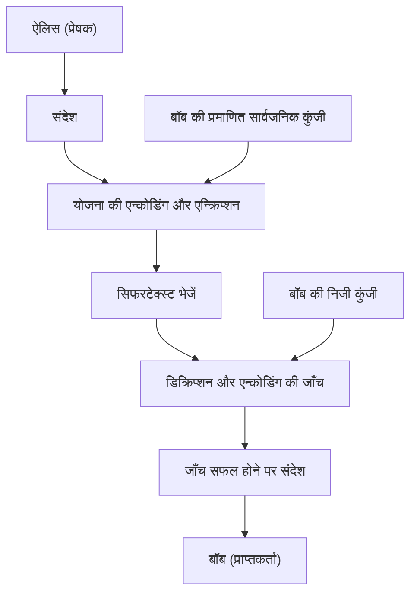
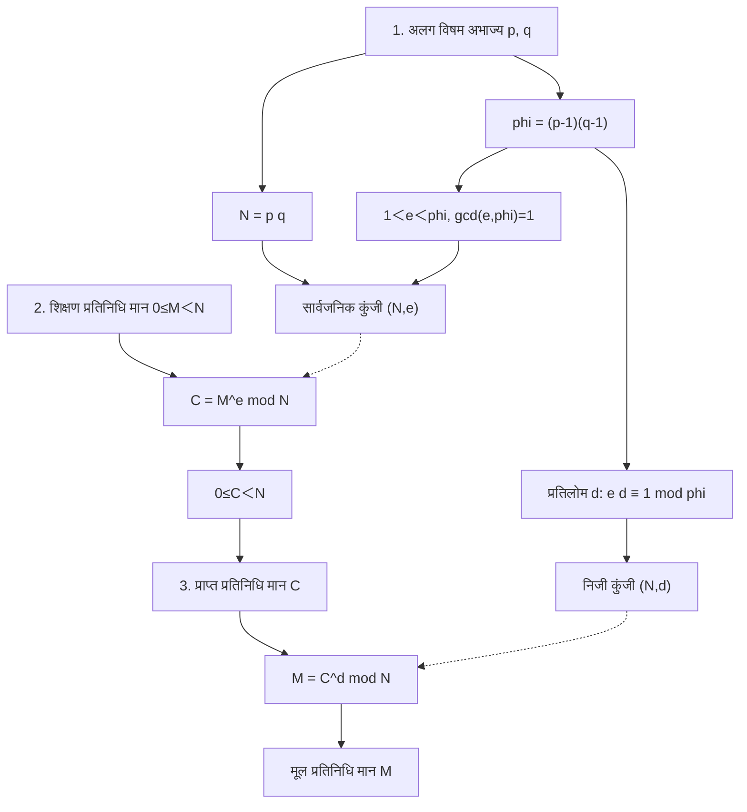
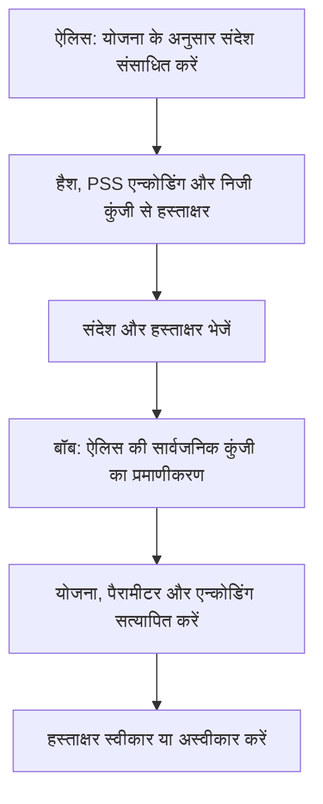

RSA का उपयोग सार्वजनिक कुंजी एन्क्रिप्शन और डिजिटल हस्ताक्षर में होता है। इसके अंकगणित को हाई स्कूल की अभाज्य संख्याओं, शेषफलों और घातों से समझा जा सकता है। लेकिन किसी पूर्णांक की सीधे घात निकालने वाला शिक्षण मॉडल, वास्तविक संचार की एन्क्रिप्शन योजना से अलग है।

हम छोटे, सार्वजनिक मानों से गणना करेंगे और समझेंगे कि डिक्रिप्शन मूल इनपुट क्यों लौटाता है। एन्क्रिप्शन के लिए RSAES-OAEP और हस्ताक्षर के लिए RSASSA-PSS जैसी व्यावहारिक योजनाओं के अपने एन्कोडिंग और सत्यापन नियम हैं। [सार्वजनिक कुंजी, हैश और हस्ताक्षर का परिचय](/hi/p/modern-cryptography-public-key-hash-signature/) भी देखें।

## 1. सममित और सार्वजनिक कुंजी एन्क्रिप्शन

सममित एन्क्रिप्शन में प्रेषक और प्राप्तकर्ता एक गुप्त कुंजी साझा करके एन्क्रिप्शन और डिक्रिप्शन करते हैं। इससे बड़ी मात्रा में डेटा कुशलता से संसाधित होता है, लेकिन पहली बार संपर्क करने वाले व्यक्ति के साथ कुंजी सुरक्षित ढंग से साझा करना अलग समस्या है।

सार्वजनिक कुंजी एन्क्रिप्शन में प्राप्तकर्ता बॉब सार्वजनिक और निजी कुंजी तैयार करता है। ऐलिस बॉब की सार्वजनिक कुंजी से एन्क्रिप्ट करती है। इसे ऐसे ताले से समझ सकते हैं जिसे कोई भी बंद कर सकता है, लेकिन खोलने की चाबी बॉब रखता है। ऐलिस को फिर भी सुनिश्चित करना होगा कि सार्वजनिक कुंजी वास्तव में बॉब की है। हमलावर द्वारा कुंजी बदल दिए जाने से बचने के लिए प्रमाणीकरण अलग आवश्यकता है।



लक्ष्य यह है कि सार्वजनिक कुंजी ज्ञात होने पर भी निजी कुंजी के बिना डिक्रिप्शन गणनात्मक रूप से कठिन हो। यह पूर्ण गणितीय असंभवता की बिना शर्त गारंटी नहीं है। सार्वजनिक कुंजी तकनीकों में कुंजी समझौता और हस्ताक्षर भी हैं; सभी एक ही एन्क्रिप्शन क्रिया नहीं करते।

## 2. अभाज्य संख्याएँ और गुणनखंडन

अभाज्य संख्या 1 से बड़ा ऐसा पूर्णांक है जिसके धनात्मक भाजक केवल 1 और वह स्वयं हैं। शुरुआती उदाहरण $2,3,5,7,11,13,17,19,23$ हैं। 1 से बड़े प्रत्येक पूर्णांक का अभाज्य गुणनखंडन क्रम को छोड़कर अद्वितीय है; जैसे $60=2^2\times3\times5$। शून्य इसमें शामिल नहीं है; एक को अलग से रिक्त गुणनफल मानते हैं।

$11\times13=143$ निकालना आसान है, लेकिन $323$ से $17\times19$ खोजना अलग काम है। RSA उपयुक्त ढंग से चुनी गई बड़ी, अलग अभाज्य संख्याओं $p,q$ का गुणनफल $N=pq$ प्रकाशित करता है। गुणनखंड जानने से निजी घातांक निकाला जा सकता है। मापांक का गुणनखंडन RSA को तोड़ सकता है, लेकिन RSA को तोड़ने का हर तरीका सामान्य रूप से गुणनखंडन के समतुल्य सिद्ध हो चुका है, ऐसा दावा नहीं करते।

'2048-बिट RSA' आमतौर पर **मापांक $N$ की बिट लंबाई** बताता है। 2048-बिट $N$ में 617 दशमलव अंक होते हैं। आकार में संतुलित दो अभाज्य संख्याएँ लेने पर प्रत्येक लगभग 1024 बिट की होती है। कठिनाई पैरामीटर निर्माण, आकार, उपलब्ध एल्गोरिथम और गणना संसाधनों पर निर्भर है। 'खरबों वर्ष' या 'ब्रह्मांड की आयु से अधिक' जैसे निराधार समय-अनुमान गारंटी नहीं हैं।

## 3. सर्वांगसमता और शेषफल

12-घंटे की घड़ी पर दस बजे से पाँच घंटे बाद तीन बजे होते हैं। इसी तरह हम किसी संख्या से भाग देने के बाद शेषफल पर ध्यान दे सकते हैं।

$$15\equiv3\pmod{12}$$

मापांक $N>1$ के लिए, यदि $a\equiv b\pmod N$ और $c\equiv d\pmod N$ हों, तो जोड़, घटाव और गुणा सर्वांगसमता बनाए रखते हैं। किसी गैर-ऋणात्मक पूर्णांक $k$ के लिए $a^k\equiv b^k\pmod N$ भी सही है। ऋणात्मक घातांकों के लिए प्रतिलोम के अस्तित्व जैसी अतिरिक्त शर्तें चाहिए।

$7\equiv2\pmod5$ से $7^{100}\equiv2^{100}\pmod5$ मिलता है। बीच के परिणाम भी उनके शेषफल से बदले जा सकते हैं, इसलिए पूरी विशाल घात पहले बनाने की आवश्यकता नहीं है। इसका अर्थ यह नहीं कि शेषफल की घात और घात का शेषफल साधारण पूर्णांक के रूप में बराबर हैं। घात और घातांक भी अलग हैं: $a^k$ में $k$ घातांक है।

## 4. यूलर का टोटिएंट फलन और प्रमेय

$\phi(N)$ उन पूर्णांकों $1\le a\le N$ की संख्या है जो $N$ के साथ सह-अभाज्य हैं, यानी जिनका महत्तम समापवर्तक 1 है। उदाहरणार्थ $\phi(5)=4$ और $\phi(6)=2$। अभाज्य $p$ के लिए,

$$\phi(p)=p-1$$

अलग अभाज्य संख्याओं $p,q$ और $N=pq$ के लिए,

$$\phi(N)=(p-1)(q-1)$$

$p,q$ ज्ञात होने पर यह मान निकाला जा सकता है। उलटे, $\phi(N)$ जानने से $p+q=N-\phi(N)+1$ और $pq=N$ मिलते हैं। इनसे द्विघात समीकरण हल करके दोनों गुणनखंड मिल जाते हैं। इसलिए यह मान भी गुप्त रखना चाहिए।

यूलर के प्रमेय के अनुसार, यदि $\gcd(a,N)=1$ हो, तो

$$a^{\phi(N)}\equiv1\pmod N$$

दोनों ओर $a$ से गुणा करने पर,

$$a^{\phi(N)+1}\equiv a\pmod N$$

और प्रत्येक गैर-ऋणात्मक पूर्णांक $k$ के लिए,

$$a^{k\phi(N)+1}\equiv a\pmod N$$

सह-अभाज्य होने की शर्त हटाने के बाद बीच का निष्कर्ष $a^{\phi(N)}\equiv1$ उपयोग नहीं कर सकते।

## 5. शिक्षण RSA की कुंजियाँ, एन्क्रिप्शन और डिक्रिप्शन

हम दो अभाज्य संख्याओं वाला शिक्षण मॉडल लेते हैं। वास्तविक पैरामीटर के लिए उपयुक्त बड़ी, अलग और विषम अभाज्य संख्याएँ $p,q$ चाहिए। आगे का उदाहरण गणना दिखाने के लिए जानबूझकर छोटे, ज्ञात मान लेता है।

1. $N=pq$ और $\phi(N)=(p-1)(q-1)$ निकालें।
2. ऐसा सार्वजनिक घातांक $e$ चुनें कि $1<e<\phi(N)$ और $\gcd(e,\phi(N))=1$ हो।
3. निम्न शर्त पूरी करने वाला धनात्मक निजी घातांक $d$ खोजें:

$$ed\equiv1\pmod{\phi(N)}$$

सार्वजनिक कुंजी $(N,e)$ है और निजी कुंजी का एक मूल निरूपण $(N,d)$ है। $d$ घातांक है, अपने आप में मानक कुंजी का पूरा डेटा नहीं। वास्तविक निरूपण में गुणनखंड और CRT पैरामीटर भी हो सकते हैं। RFC 8017 में शर्त $\lambda(N)=\operatorname{lcm}(p-1,q-1)$ से परिभाषित है। यहाँ $\phi(N)$ के मापांक में प्रतिलोम लेना एक सरल पर्याप्त शर्त है, जो $\lambda(N)$ की शर्त भी पूरी करती है।

**संदेश के पूर्णांक प्रतिनिधि मान** $0\le M<N$ के लिए शिक्षण एन्क्रिप्शन गणना है:

$$C\equiv M^e\pmod N$$

सिफरटेक्स्ट के प्रतिनिधि मान $0\le C<N$ पर डिक्रिप्शन गणना है:

$$M\equiv C^d\pmod N$$

व्यावहारिक योजना में संदेश के बाइट क्रम को निर्धारित ढंग से एन्कोड करके पूर्णांक में बदलते हैं और डिक्रिप्शन के बाद भी जाँचते हैं। अक्षरों को सीधे पूर्णांक बनाकर घात निकाल देना पर्याप्त नहीं है।



केवल RSA का यह अंकगणित नियतात्मक है: समान $M$ से समान $C$ मिलता है। संभावित संदेश कम हों, तो कोई भी सार्वजनिक कुंजी से सभी उम्मीदवारों को एन्क्रिप्ट करके तुलना कर सकता है। साथ ही $C$ को $C\,r^e\bmod N$ से बदलने पर डिक्रिप्ट किया हुआ प्रतिनिधि मान $Mr\bmod N$ बन जाता है। व्यावहारिक योजना की सुरक्षा केवल इस अंकगणित से नहीं मिलती।

## 6. डिक्रिप्शन इनपुट क्यों लौटाता है

डिक्रिप्शन में गणना होती है:

$$C^d\equiv(M^e)^d\equiv M^{ed}\pmod N$$

कुंजी की शर्त से किसी गैर-ऋणात्मक पूर्णांक $k$ के लिए,

$$ed=k\phi(N)+1$$

यदि $\gcd(M,N)=1$ हो, तो यूलर का प्रमेय देता है:

$$M^{ed}=(M^{\phi(N)})^k M\equiv1^k M\equiv M\pmod N$$

लेकिन RSA प्रतिनिधि मान का $N$ के साथ सह-अभाज्य होना आवश्यक नहीं। उदाहरणार्थ $M=0,11,13$ भी सीमा में हैं। इसलिए प्रत्येक अभाज्य संख्या के लिए अलग जाँचते हैं।

- यदि $p\mid M$, तो धनात्मक घातांक $ed$ के कारण $M^{ed}\equiv M\equiv0\pmod p$ है।
- यदि $p\nmid M$, तो फर्मेट का छोटा प्रमेय $M^{p-1}\equiv1\pmod p$ देता है। चूँकि $ed-1$, $p-1$ का गुणज है, इसलिए $M^{ed}\equiv M\pmod p$ है।
- $q$ के मापांक में भी यही तर्क लागू होता है।

अलग अभाज्य संख्याएँ $p,q$ सह-अभाज्य हैं। चीनी शेषफल प्रमेय (Chinese remainder theorem) से,

$$M^{ed}\equiv M\pmod{pq}$$

प्रत्येक प्रतिनिधि मान $0\le M<N$ के लिए मिलता है। यह अंकगणित की शुद्धता का प्रमाण है, किसी योजना की चोरी-छिपे सुनने या बदलाव के विरुद्ध सुरक्षा का प्रमाण नहीं।

## 7. छोटी अभाज्य संख्याओं से हाथ की गणना

$p=11,q=13$ लें। तब $N=143$ और $\phi(N)=120$ हैं। $e=7$ चुनकर $7d\equiv1\pmod{120}$ हल करें। चूँकि $7\times103=721=6\times120+1$, हम $d=103$ ले सकते हैं।

शिक्षण इनपुट $M=9$ पर $9^7=4\,782\,969=33\,447\times143+48$, इसलिए $C=48$। डिक्रिप्शन $48^{103}\bmod143=9$ देता है। Python में `pow(48, 103, 143)` पूरा पूर्णांक $48^{103}$ पहले बनाए बिना यह गणना करता है।

ये अभाज्य संख्याएँ और निजी घातांक सभी को ज्ञात सार्वजनिक शिक्षण मान हैं। इनसे गुप्त संदेश सुरक्षित नहीं किए जा सकते।

## 8. विस्तारित यूक्लिड एल्गोरिथम से प्रतिलोम निकालना

$7d\equiv1\pmod{120}$ का अर्थ है कि ऐसे पूर्णांक $d,y$ हैं जिनके लिए $7d+120y=1$। चूँकि $120=17\times7+1$, इसलिए $1=120-17\times7$ और $d\equiv-17\equiv103\pmod{120}$ मिलता है।

विस्तारित यूक्लिड एल्गोरिथम सामान्य रूप से ऐसे गुणांक खोजता है। प्रतिलोम तभी है जब पूर्णांक और मापांक सह-अभाज्य हों। गणना इनपुट की लंबाई पर निर्भर है; मनमाने बड़े इनपुट के लिए समय निश्चित नहीं होता।

## 9. डिजिटल हस्ताक्षर के लिए अलग योजना

RSA हस्ताक्षर निजी कुंजी से बनाया जाता है और संबंधित सार्वजनिक कुंजी से सत्यापित होता है। इसे 'निजी कुंजी से एन्क्रिप्शन, सार्वजनिक कुंजी से डिक्रिप्शन' कहना एन्क्रिप्शन और हस्ताक्षर की एन्कोडिंग तथा जाँच के अंतर को छिपाता है।

बिना एन्कोडिंग वाला संबंध $S=M^d\bmod N$ और जाँच $S^e\equiv M\pmod N$ सुरक्षित हस्ताक्षर योजना नहीं हैं। हमलावर $S=2$ चुनकर सार्वजनिक मानों $e=7,N=143$ से $M=2^7\bmod143=128$ निकाल सकता है। यह जोड़ा निजी कुंजी इस्तेमाल किए बिना जाँच पार करता है। इसका अर्थ किसी भी पहले से चुने संदेश पर हस्ताक्षर करना नहीं; यह बताता है कि केवल यह जाँच अपर्याप्त है।



RSASSA-PSS जैसी योजनाएँ हैश के साथ विशेष एन्कोडिंग और सत्यापन जोड़ती हैं। हस्ताक्षर संदेश को छिपाता नहीं है। कुंजी प्रबंधन और कुंजी को पहचान से जोड़ना भी आवश्यक है। एन्क्रिप्शन और हस्ताक्षर की कुंजियों को उद्देश्य के अनुसार अलग रखें और इच्छित प्रोटोकॉल का समर्थन करने वाली, रखरखाव की जा रही लाइब्रेरी का उपयोग करें।

## 10. Python से शिक्षण अंकगणित जाँचना

यह स्वतंत्र उदाहरण Python 3.8 या बाद के संस्करण में ज्ञात शिक्षण मान ही उपयोग करता है। `pow(e, -1, phi)` सह-अभाज्य पूर्णांकों का प्रतिलोम निकालता है। प्रतिनिधि मान की सीमा स्पष्ट रूप से जाँची जाती है। यह कुंजी जनरेटर नहीं है और OAEP, PSS या स्थिर-समय की गणना लागू नहीं करता।

```python
from math import gcd


def mod_inverse(e, phi):
    # Fixed public teaching parameters, not a key generator.
    if type(e) is not int or type(phi) is not int:
        raise TypeError("Integer parameters required")
    if phi <= 1 or not 1 < e < phi or gcd(e, phi) != 1:
        raise ValueError("Invalid teaching exponent or modulus")
    return pow(e, -1, phi)


def rsa_primitive_demo(value, exponent, modulus):
    # Range checks do not make raw RSA a secure encryption scheme.
    if any(type(x) is not int for x in (value, exponent, modulus)):
        raise TypeError("Integer parameters required")
    if modulus <= 1 or exponent <= 0 or not 0 <= value < modulus:
        raise ValueError("Invalid exponent, modulus or representative")
    return pow(value, exponent, modulus)


# Public toy values only. Never use this code or these keys for secrets.
p, q = 11, 13
N = p * q
phi = (p - 1) * (q - 1)
e = 7
d = mod_inverse(e, phi)
message = 9
ciphertext = rsa_primitive_demo(message, e, N)
decrypted_message = rsa_primitive_demo(ciphertext, d, N)
assert (N, phi, d, ciphertext, decrypted_message) == (143, 120, 103, 48, 9)
assert all(rsa_primitive_demo(rsa_primitive_demo(m, e, N), d, N) == m
           for m in range(N))
print(f"Public toy parameters: N={N}, e={e}, d={d}")
print(f"Ciphertext representative: {ciphertext}")
print(f"Recovered representative: {decrypted_message}")
print("All 143 representatives round-trip")
```

तीन तर्कों वाला `pow` पूरी घात बनाए बिना मॉड्यूलर घात निकालता है। यह अधिक कुशल है, लेकिन समय इनपुट और कार्यान्वयन पर निर्भर है। इनपुट जाँच और सभी 143 मानों की सफल वापसी भी शिक्षण अंकगणित की जाँच हैं।

## 11. व्यावहारिक योजनाएँ और भविष्य की तकनीक

व्यावहारिक RSA एन्क्रिप्शन RSAES-OAEP जैसी योजना उपयोग करता है। RSA लंबे संदेश को सीधे एन्क्रिप्ट करने के बजाय हाइब्रिड एन्क्रिप्शन का घटक होता है। उदाहरण के लिए 2048-बिट मापांक और SHA-256 के साथ OAEP की इनपुट सीमा $256-2\times32-2=190$ बाइट है। केवल एन्क्रिप्शन से प्रेषक का प्रमाणीकरण नहीं मिलता।

संचार की सुरक्षा पूरे प्रोटोकॉल पर निर्भर है। TLS 1.3 में RSA कुंजी परिवहन नहीं है। RSA हस्ताक्षर उपयोग होने पर भी उसकी भूमिका एन्क्रिप्शन द्वारा कुंजी भेजने से अलग है। सभी आधुनिक संचार को 'RSA से एन्क्रिप्टेड' नहीं समझना चाहिए।

शोर का क्वांटम एल्गोरिथम उपयुक्त क्वांटम गणना मॉडल में इनपुट लंबाई के बहुपद समय में गुणनखंडन करता है। इसका अर्थ तत्काल गणना या उपयुक्त हार्डवेयर कब उपलब्ध होगा, इसकी भविष्यवाणी नहीं है। आवश्यक गणना कर सकने वाला क्वांटम कंप्यूटर RSA के लिए खतरा होगा, इसलिए पोस्ट-क्वांटम क्रिप्टोग्राफी पर काम हो रहा है। यह नाम भी भविष्य के हर हमले के विरुद्ध पूर्ण सुरक्षा की गारंटी नहीं देता।

RSA से अभाज्य संख्याएँ, सर्वांगसमता, प्रतिलोम और शुद्धता का प्रमाण सीखा जा सकता है। व्यावहारिक योजना की सुरक्षा में एन्कोडिंग, प्रमाणीकरण, सत्यापन और कार्यान्वयन की अतिरिक्त शर्तें हैं।

### संदर्भ

- [RFC 8017: PKCS #1 v2.2](https://www.rfc-editor.org/rfc/rfc8017.html) (§§3, 5, 7.1, 8.1)
- [RFC 8446: TLS 1.3](https://www.rfc-editor.org/rfc/rfc8446.html) (§1.2, Appendix E.8)
- [Python 3.12: pow](https://docs.python.org/3.12/library/functions.html#pow)
- [Shor: Polynomial-Time Algorithms for Prime Factorization and Discrete Logarithms on a Quantum Computer](https://arxiv.org/abs/quant-ph/9508027) (सार)
