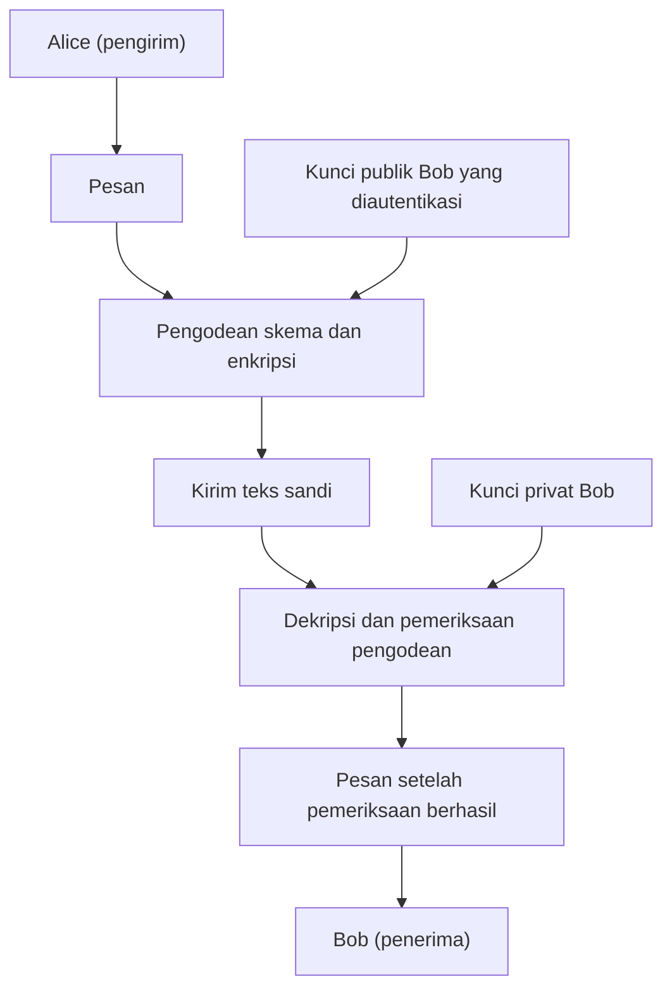
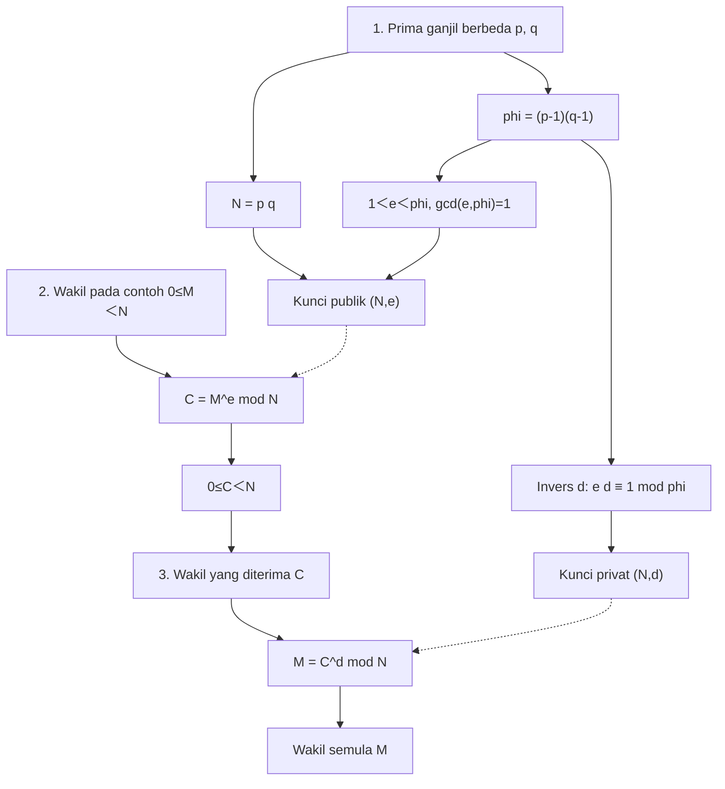
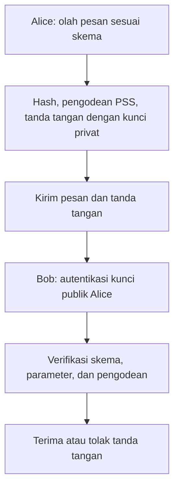

RSA digunakan dalam enkripsi kunci publik dan tanda tangan digital. Aritmetikanya dapat dipahami dari matematika SMA: bilangan prima, sisa pembagian, dan perpangkatan. Namun, memangkatkan bilangan bulat secara langsung dalam model pembelajaran harus dibedakan dari skema untuk komunikasi nyata.

Kita akan mengikuti nilai kecil yang bersifat publik untuk menjelaskan mengapa dekripsi memulihkan masukan. Skema praktis seperti RSAES-OAEP untuk enkripsi dan RSASSA-PSS untuk tanda tangan memerlukan aturan pengodean dan verifikasinya sendiri. Lihat juga [pengantar kunci publik, hash, dan tanda tangan](/id/p/modern-cryptography-public-key-hash-signature/).

## 1. Enkripsi simetris dan kunci publik

Dalam enkripsi simetris, pengirim dan penerima berbagi kunci rahasia untuk enkripsi dan dekripsi. Cara ini efisien untuk data dalam jumlah besar, tetapi berbagi kunci itu secara aman dengan pihak yang baru pertama kali dihubungi merupakan persoalan tersendiri.

Dalam enkripsi kunci publik, Bob sebagai penerima menyiapkan kunci publik dan kunci privat. Alice mengenkripsi dengan kunci publik Bob. Analogi gemboknya ialah gembok yang dapat ditutup siapa saja, sementara Bob menyimpan kunci pembukanya. Alice masih harus memastikan bahwa kunci publik itu benar-benar milik Bob. Autentikasi untuk mencegah penggantian kunci oleh penyerang adalah persyaratan tambahan.



Tujuannya adalah membuat dekripsi tanpa kunci privat sulit secara komputasi, meskipun kunci publik diketahui. Ini bukan jaminan matematis tanpa syarat bahwa dekripsi mustahil. Teknik kunci publik juga mencakup kesepakatan kunci dan tanda tangan; tidak semuanya melakukan operasi enkripsi yang sama.

## 2. Bilangan prima dan faktorisasi

Bilangan prima adalah bilangan bulat lebih besar dari satu yang pembagi positifnya hanya satu dan dirinya sendiri. Contoh awalnya ialah $2,3,5,7,11,13,17,19,23$. Setiap bilangan bulat lebih besar dari satu memiliki faktorisasi prima yang unik jika urutannya diabaikan; misalnya $60=2^2\times3\times5$. Nol tidak termasuk, sedangkan satu diperlakukan terpisah sebagai hasil kali kosong.

Menghitung $11\times13=143$ mudah, tetapi menemukan $17\times19$ dari $323$ adalah tugas lain. RSA memublikasikan $N=pq$ untuk bilangan prima besar, berbeda, dan dipilih secara tepat. Mengetahui faktor memungkinkan perhitungan eksponen privat. Memfaktorkan modulus dapat mematahkan RSA, tetapi kita tidak menyatakan bahwa setiap cara mematahkan RSA telah terbukti secara umum setara dengan faktorisasi.

'RSA 2048 bit' biasanya menyatakan **panjang bit modulus $N$**. Nilai $N$ sepanjang 2048 bit memiliki 617 digit desimal. Dengan dua bilangan prima yang seimbang, masing-masing sekitar 1024 bit. Kesulitan bergantung pada pembentukan dan ukuran parameter, algoritma yang tersedia, serta sumber daya komputasi. Perkiraan tanpa dasar seperti 'triliunan tahun' atau 'lebih lama daripada usia alam semesta' bukan jaminan.

## 3. Kongruensi dan sisa pembagian

Seperti pada jam dengan format dua belas jam, ketika lima jam setelah pukul sepuluh disebut pukul tiga, kita dapat memperhatikan sisa pembagian modulo suatu bilangan.

$$15\equiv3\pmod{12}$$

Untuk modulus $N>1$, jika $a\equiv b\pmod N$ dan $c\equiv d\pmod N$, penjumlahan, pengurangan, serta perkalian mempertahankan kongruensi. Untuk bilangan bulat tak negatif $k$, berlaku pula $a^k\equiv b^k\pmod N$. Eksponen negatif membutuhkan syarat tambahan, termasuk keberadaan invers.

Karena $7\equiv2\pmod5$, berlaku $7^{100}\equiv2^{100}\pmod5$. Hasil antara juga dapat diganti dengan sisanya tanpa membentuk seluruh bilangan berpangkat yang sangat besar. Ini tidak berarti pangkat suatu sisa dan sisa suatu pangkat sama sebagai bilangan bulat biasa.

## 4. Fungsi totien dan teorema Euler

$\phi(N)$ menghitung banyaknya bilangan bulat $1\le a\le N$ yang relatif prima dengan $N$, yaitu memiliki faktor persekutuan terbesar satu. Misalnya $\phi(5)=4$ dan $\phi(6)=2$. Untuk bilangan prima $p$,

$$\phi(p)=p-1$$

Untuk bilangan prima berbeda $p,q$ dan $N=pq$,

$$\phi(N)=(p-1)(q-1)$$

Mengetahui $p,q$ memungkinkan perhitungan nilai ini. Sebaliknya, mengetahui $\phi(N)$ memberi $p+q=N-\phi(N)+1$ dan $pq=N$; persamaan kuadrat kemudian mengembalikan kedua faktor. Jadi, nilai tersebut juga harus dirahasiakan.

Teorema Euler menyatakan bahwa jika $\gcd(a,N)=1$,

$$a^{\phi(N)}\equiv1\pmod N$$

Dengan mengalikan kedua sisi dengan $a$, diperoleh

$$a^{\phi(N)+1}\equiv a\pmod N$$

dan untuk setiap bilangan bulat tak negatif $k$,

$$a^{k\phi(N)+1}\equiv a\pmod N$$

Kesimpulan antara $a^{\phi(N)}\equiv1$ tidak dapat digunakan setelah syarat relatif prima dihilangkan.

## 5. Kunci, enkripsi, dan dekripsi pada model pembelajaran

Kita memakai model dengan dua bilangan prima. Parameter nyata memerlukan bilangan prima ganjil yang berbeda dan cukup besar $p,q$; contoh berikut sengaja memakai nilai kecil yang diketahui agar aritmetikanya terlihat.

1. Hitung $N=pq$ dan $\phi(N)=(p-1)(q-1)$.
2. Pilih eksponen publik $e$ dengan $1<e<\phi(N)$ dan $\gcd(e,\phi(N))=1$.
3. Cari eksponen privat positif $d$ yang memenuhi

$$ed\equiv1\pmod{\phi(N)}$$

Kunci publiknya $(N,e)$, sedangkan salah satu representasi dasar kunci privat adalah $(N,d)$. Bilangan $d$ ialah eksponen, bukan seluruh representasi standar kunci itu sendiri. Representasi praktis juga dapat memuat faktor dan parameter teorema sisa Cina. RFC 8017 mendefinisikan syarat menggunakan $\lambda(N)=\operatorname{lcm}(p-1,q-1)$. Mengambil invers modulo $\phi(N)$ di sini adalah syarat cukup sederhana yang juga memenuhi syarat modulo $\lambda(N)$.

Untuk **wakil bilangan bulat pesan** (message representative) $0\le M<N$, perhitungan enkripsi pada model ini adalah

$$C\equiv M^e\pmod N$$

Untuk wakil teks sandi $0\le C<N$, dekripsi menghitung

$$M\equiv C^d\pmod N$$

Dalam skema praktis, byte pesan melalui pengodean yang ditentukan sebelum diubah menjadi bilangan bulat; setelah dekripsi juga diperlukan validasi. Mengubah karakter langsung menjadi bilangan bulat lalu memangkatkannya belum cukup.



Aritmetika RSA saja bersifat deterministik: $M$ yang sama menghasilkan $C$ yang sama. Bila kandidat pesan sedikit, siapa saja dapat mengenkripsi setiap kandidat dengan kunci publik lalu membandingkannya. Selain itu, mengganti $C$ dengan $C\,r^e\bmod N$ mengubah wakil hasil dekripsi menjadi $Mr\bmod N$. Sifat keamanan yang diperlukan skema praktis tidak diperoleh hanya dari aritmetika ini.

## 6. Mengapa dekripsi memulihkan masukan

Dekripsi menghitung

$$C^d\equiv(M^e)^d\equiv M^{ed}\pmod N$$

Dari syarat kunci, ada bilangan bulat tak negatif $k$ sehingga

$$ed=k\phi(N)+1$$

Jika $\gcd(M,N)=1$, teorema Euler memberi

$$M^{ed}=(M^{\phi(N)})^k M\equiv1^k M\equiv M\pmod N$$

Namun, wakil RSA tidak harus relatif prima dengan $N$. Misalnya $M=0,11,13$ juga berada dalam rentang. Karena itu, kita meninjau setiap bilangan prima secara terpisah.

- Jika $p\mid M$, maka $M^{ed}\equiv M\equiv0\pmod p$ karena eksponen $ed$ positif.
- Jika $p\nmid M$, teorema kecil Fermat memberi $M^{p-1}\equiv1\pmod p$. Karena $ed-1$ merupakan kelipatan $p-1$, diperoleh $M^{ed}\equiv M\pmod p$.
- Penalaran yang sama berlaku modulo $q$.

Bilangan prima berbeda $p,q$ relatif prima, sehingga teorema sisa Cina memberi

$$M^{ed}\equiv M\pmod{pq}$$

untuk setiap wakil $0\le M<N$. Ini membuktikan kebenaran aritmetika, bukan keamanan skema terhadap penyadapan atau perubahan.

## 7. Perhitungan manual dengan prima kecil

Ambil $p=11,q=13$. Maka $N=143$ dan $\phi(N)=120$. Pilih $e=7$ dan selesaikan $7d\equiv1\pmod{120}$. Karena $7\times103=721=6\times120+1$, kita dapat memakai $d=103$.

Untuk masukan contoh $M=9$, berlaku $9^7=4\,782\,969=33\,447\times143+48$, sehingga $C=48$. Dekripsi memberi $48^{103}\bmod143=9$. Dalam Python, `pow(48, 103, 143)` menghitungnya tanpa lebih dahulu membentuk bilangan bulat lengkap $48^{103}$.

Bilangan prima dan eksponen privat ini merupakan nilai pembelajaran publik yang terlihat oleh siapa saja. Nilai tersebut tidak dapat melindungi pesan rahasia.

## 8. Mencari invers dengan algoritma Euclid diperluas

Kongruensi $7d\equiv1\pmod{120}$ berarti ada bilangan bulat $d,y$ sehingga $7d+120y=1$. Karena $120=17\times7+1$, diperoleh $1=120-17\times7$, sehingga $d\equiv-17\equiv103\pmod{120}$.

Algoritma Euclid diperluas mencari koefisien semacam ini secara umum. Invers ada ketika bilangan bulat dan modulus relatif prima. Perhitungan bergantung pada panjang masukan; waktunya tidak tetap untuk masukan sebesar apa pun.

## 9. Tanda tangan digital memakai skema khusus

Tanda tangan RSA dibuat dengan kunci privat dan diverifikasi dengan kunci publik yang bersesuaian. Menyebutnya 'enkripsi dengan kunci privat lalu dekripsi dengan kunci publik' menutupi perbedaan pengodean dan validasi antara skema enkripsi dan tanda tangan.

Relasi tanpa pengodean $S=M^d\bmod N$ dengan pemeriksaan $S^e\equiv M\pmod N$ bukan skema tanda tangan yang aman. Penyerang dapat memilih $S=2$, lalu memakai nilai publik $e=7,N=143$ untuk menghitung $M=2^7\bmod143=128$. Pasangan ini lolos pemeriksaan tanpa memakai kunci privat. Ini bukan klaim dapat menandatangani sembarang pesan yang sudah ditentukan sebelumnya; ini menunjukkan bahwa pemeriksaan tadi saja tidak memadai.



Skema seperti RSASSA-PSS menggabungkan hash dengan pengodean dan verifikasi khusus. Tanda tangan tidak menyembunyikan pesan; pengelolaan kunci serta pengikatannya dengan identitas tetap penting. Pisahkan kunci enkripsi dan tanda tangan menurut tujuannya, dan gunakan pustaka terpelihara yang mendukung protokol yang dimaksud.

## 10. Memeriksa aritmetika pembelajaran dengan Python

Contoh mandiri untuk Python 3.8 atau lebih baru ini hanya memakai nilai pembelajaran yang diketahui. `pow(e, -1, phi)` mencari invers bilangan bulat yang relatif prima. Rentang wakil juga diperiksa secara eksplisit. Contoh ini tidak membangkitkan kunci, tidak mengimplementasikan OAEP atau PSS, dan tidak menjamin waktu eksekusi konstan.

```python
from math import gcd


def mod_inverse(e, phi):
    # Fixed public teaching parameters, not a key generator.
    if type(e) is not int or type(phi) is not int:
        raise TypeError("Integer parameters required")
    if phi <= 1 or not 1 < e < phi or gcd(e, phi) != 1:
        raise ValueError("Invalid teaching exponent or modulus")
    return pow(e, -1, phi)


def rsa_primitive_demo(value, exponent, modulus):
    # Range checks do not make raw RSA a secure encryption scheme.
    if any(type(x) is not int for x in (value, exponent, modulus)):
        raise TypeError("Integer parameters required")
    if modulus <= 1 or exponent <= 0 or not 0 <= value < modulus:
        raise ValueError("Invalid exponent, modulus or representative")
    return pow(value, exponent, modulus)


# Public toy values only. Never use this code or these keys for secrets.
p, q = 11, 13
N = p * q
phi = (p - 1) * (q - 1)
e = 7
d = mod_inverse(e, phi)
message = 9
ciphertext = rsa_primitive_demo(message, e, N)
decrypted_message = rsa_primitive_demo(ciphertext, d, N)
assert (N, phi, d, ciphertext, decrypted_message) == (143, 120, 103, 48, 9)
assert all(rsa_primitive_demo(rsa_primitive_demo(m, e, N), d, N) == m
           for m in range(N))
print(f"Public toy parameters: N={N}, e={e}, d={d}")
print(f"Ciphertext representative: {ciphertext}")
print(f"Recovered representative: {decrypted_message}")
print("All 143 representatives round-trip")
```

`pow` dengan tiga argumen menghitung pangkat modular tanpa membentuk seluruh pangkatnya. Ini lebih efisien, tetapi waktu eksekusi bergantung pada masukan dan implementasi. Pemeriksaan masukan serta pemulihan semua 143 nilai tetap merupakan pengujian aritmetika pembelajaran.

## 11. Skema praktis dan teknologi masa depan

Enkripsi RSA praktis memakai skema seperti RSAES-OAEP. RSA digunakan sebagai komponen enkripsi hibrida, bukan untuk langsung mengenkripsi pesan panjang. Misalnya, OAEP dengan modulus 2048 bit dan SHA-256 menerima paling banyak $256-2\times32-2=190$ byte. Enkripsi saja tidak mengautentikasi pengirim.

Keamanan komunikasi bergantung pada keseluruhan protokol. TLS 1.3 tidak menggunakan transportasi kunci RSA. Jika tanda tangan RSA digunakan, perannya berbeda dari enkripsi untuk mengirimkan kunci. Komunikasi modern tidak boleh dipahami selalu 'dienkripsi dengan RSA'.

Algoritma kuantum Shor memfaktorkan bilangan bulat dalam waktu polinomial terhadap panjang masukan pada model komputasi kuantum yang sesuai. Ini tidak berarti perhitungan seketika atau perkiraan kapan perangkat kerasnya tersedia. Komputer kuantum yang mampu menjalankan perhitungan yang diperlukan akan mengancam RSA, sehingga mendorong kriptografi pascakuantum. Nama itu pun tidak menjamin keamanan mutlak terhadap setiap serangan masa depan.

RSA mengajarkan bilangan prima, kongruensi, invers, dan bukti kebenaran. Keamanan skema praktis menambahkan persyaratan pengodean, autentikasi, verifikasi, dan implementasi.

### Referensi

- [RFC 8017: PKCS #1 v2.2](https://www.rfc-editor.org/rfc/rfc8017.html) (§§3, 5, 7.1, 8.1)
- [RFC 8446: TLS 1.3](https://www.rfc-editor.org/rfc/rfc8446.html) (§1.2, Appendix E.8)
- [Python 3.12: pow](https://docs.python.org/3.12/library/functions.html#pow)
- [Shor: Polynomial-Time Algorithms for Prime Factorization and Discrete Logarithms on a Quantum Computer](https://arxiv.org/abs/quant-ph/9508027) (abstrak)
