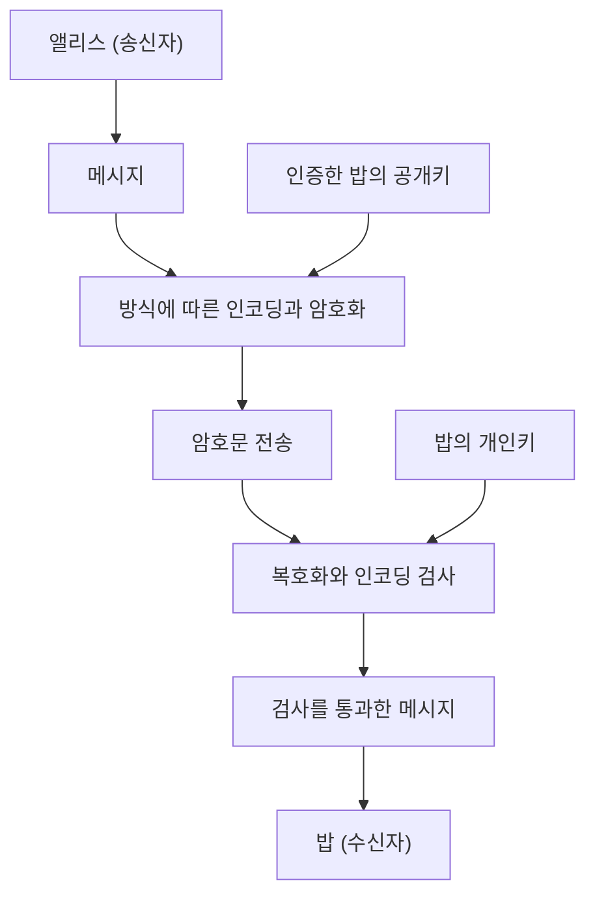
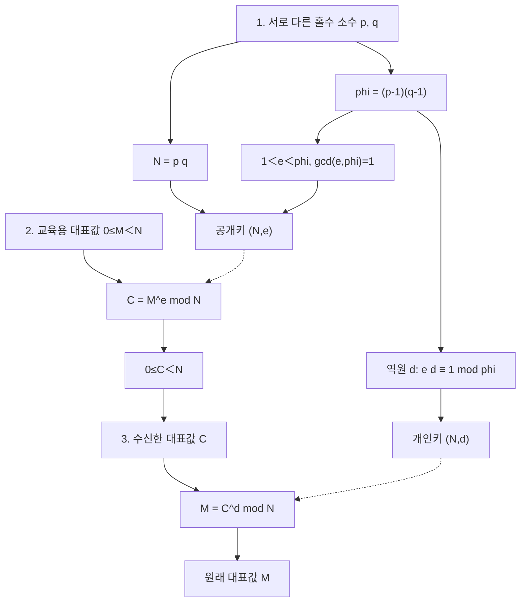
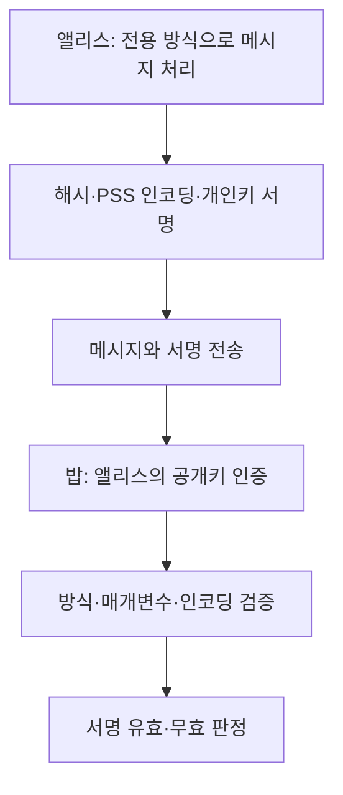

RSA는 공개키 암호화와 디지털 서명에 쓰이는 기술입니다. 소수, 나머지, 거듭제곱이라는 고등학교 수학으로 그 산술 원리를 따라갈 수 있습니다. 다만 정수를 그대로 거듭제곱하는 교육용 RSA와 실제 통신의 암호 방식은 구분해야 합니다.

이 글은 공개된 작은 값으로 계산을 추적하고 복호화가 입력을 복원하는 이유를 설명합니다. 실제 암호화에는 RSAES-OAEP, 서명에는 RSASSA-PSS 같은 방식과 각각의 인코딩·검증 규칙이 필요합니다. [공개키·해시·서명의 개요](/ko/p/modern-cryptography-public-key-hash-signature/)도 참고하세요.

## 1. 대칭키 암호와 공개키 암호

대칭키 암호에서는 송수신자가 같은 비밀키를 공유하여 암호화하고 복호화합니다. 많은 데이터를 효율적으로 처리하지만, 처음 통신하는 상대와 그 키를 안전하게 공유하는 문제는 따로 해결해야 합니다.

공개키 암호화에서는 수신자 밥이 공개키와 개인키를 준비하고, 송신자 앨리스가 밥의 공개키로 암호화합니다. 누구나 잠글 수 있는 자물쇠를 공개하고 밥만 여는 열쇠를 보관하는 모습에 비유할 수 있습니다. 다만 앨리스는 공개키가 실제로 밥의 것인지 확인해야 합니다. 키 바꿔치기를 막는 인증은 별도의 요건입니다.



목표는 공개키를 알아도 개인키 없이는 복호화하기가 계산상 어렵도록 하는 것입니다. 절대로 복호화할 수 없다는 무조건적인 수학적 보장은 아닙니다. 공개키 기술에는 키 합의와 서명도 있으며, 모두 같은 암호화 연산을 하는 것은 아닙니다.

## 2. 소수와 소인수분해

소수는 양의 약수가 1과 자기 자신뿐인, 1보다 큰 정수입니다. 처음의 예는 $2,3,5,7,11,13,17,19,23$입니다. 1보다 큰 정수는 순서를 제외하면 유일하게 소수의 곱으로 분해됩니다. 예를 들어 $60=2^2\times3\times5$입니다. 0은 이 정리의 대상에서 제외하고, 1은 빈 곱으로 따로 다룹니다.

$11\times13=143$을 계산하는 것과 $323$에서 $17\times19$를 찾는 것은 다른 작업입니다. RSA는 적절히 고른 크고 서로 다른 소수 $p,q$의 곱 $N=pq$를 공개합니다. 인수를 알면 개인키 지수를 계산할 수 있습니다. 법을 소인수분해하면 RSA를 깰 수 있지만, RSA를 깨는 모든 방법이 소인수분해와 일반적으로 동치라고 증명되었다고 단정하지는 않습니다.

'2048비트 RSA'는 보통 **법 $N$의 비트 길이**를 가리킵니다. 2048비트인 $N$은 십진수로 617자리입니다. 크기가 균형 잡힌 두 소수를 쓰면 각 소수는 약 1024비트입니다. 어려움은 매개변수 생성과 크기, 사용 가능한 알고리즘과 계산 자원에 달려 있습니다. '반드시 수조 년' 또는 '우주의 나이보다 오래'라는 근거 없는 시간 추정은 보장이 될 수 없습니다.

## 3. 합동식과 나머지

12시간 시계에서 10시의 5시간 뒤를 3시라고 하듯이, 정수를 어떤 법으로 나눈 나머지에 주목합니다.

$$15\equiv3\pmod{12}$$

법 $N>1$에 대해 $a\equiv b\pmod N$, $c\equiv d\pmod N$이면 덧셈·뺄셈·곱셈에서 합동 관계가 유지됩니다. 음이 아닌 정수 $k$에 대해 $a^k\equiv b^k\pmod N$도 성립합니다. 음의 지수에는 역원의 존재 같은 추가 조건이 필요합니다.

$7\equiv2\pmod5$이므로 $7^{100}\equiv2^{100}\pmod5$입니다. 중간 결과도 나머지로 대체할 수 있어 거대한 거듭제곱 전체를 만들 필요가 없습니다. '나머지의 거듭제곱'과 '거듭제곱의 나머지'가 보통의 정수로서 같다는 뜻은 아닙니다.

## 4. 오일러 피 함수와 오일러의 정리

$\phi(N)$은 $1\le a\le N$에서 $N$과 서로소인 정수의 개수입니다. 예를 들어 $\phi(5)=4$, $\phi(6)=2$입니다. 소수 $p$에 대해

$$\phi(p)=p-1$$

서로 다른 소수 $p,q$와 $N=pq$에 대해

$$\phi(N)=(p-1)(q-1)$$

$p,q$를 알면 이 값을 계산할 수 있습니다. 반대로 $\phi(N)$을 알면 $p+q=N-\phi(N)+1$, $pq=N$에서 이차방정식을 풀어 두 인수를 복원할 수 있으므로 이 값도 비밀로 유지해야 합니다.

오일러의 정리는 $\gcd(a,N)=1$이면

$$a^{\phi(N)}\equiv1\pmod N$$

이라고 말합니다. 양변에 $a$를 곱하면

$$a^{\phi(N)+1}\equiv a\pmod N$$

또한 모든 음이 아닌 정수 $k$에 대해

$$a^{k\phi(N)+1}\equiv a\pmod N$$

입니다. 서로소라는 전제를 없앤 뒤에도 중간 결론 $a^{\phi(N)}\equiv1$을 사용할 수는 없습니다.

## 5. 교육용 RSA의 키·암호화·복호화

여기서는 두 소수를 사용하는 교육 모델을 다룹니다. 실제 매개변수에는 적절히 크고 서로 다른 홀수 소수 $p,q$가 필요하지만, 뒤의 예는 계산을 관찰하도록 알려진 작은 값을 사용합니다.

1. $N=pq$와 $\phi(N)=(p-1)(q-1)$을 계산합니다.
2. $1<e<\phi(N)$, $\gcd(e,\phi(N))=1$을 만족하는 공개키 지수 $e$를 고릅니다.
3. 다음을 만족하는 양의 개인키 지수 $d$를 구합니다.

$$ed\equiv1\pmod{\phi(N)}$$

공개키는 $(N,e)$, 개인키의 기본 표현 중 하나는 $(N,d)$입니다. $d$는 지수이며 표준 키 데이터 전체를 뜻하지 않습니다. 실제 개인키 표현에는 인수와 CRT용 값도 들어갈 수 있습니다. RFC 8017은 $\lambda(N)=\operatorname{lcm}(p-1,q-1)$ 값을 사용하는 조건으로 정의합니다. 여기서 $\phi(N)$ 값을 법으로 역원을 구하는 것은 $\lambda(N)$에 대한 조건도 만족하는 이해하기 쉬운 충분조건입니다.

**메시지의 정수 대표값** $0\le M<N$에 대해 교육용 암호화 계산은

$$C\equiv M^e\pmod N$$

암호문 대표값 $0\le C<N$에 대한 복호화 계산은

$$M\equiv C^d\pmod N$$

입니다. 실제 방식에서는 메시지 바이트열을 정해진 방법으로 인코딩한 뒤 정수로 변환하고, 복호화 후에도 검사합니다. 문자를 그대로 정수로 바꿔 거듭제곱하는 것만으로는 부족합니다.



이 산술 연산뿐인 RSA는 결정적이므로 같은 $M$에서 같은 $C$가 나옵니다. 후보 메시지가 적으면 누구나 공개키로 각 후보를 암호화하여 비교할 수 있습니다. 또한 $C$를 $C\,r^e\bmod N$으로 바꾸면 복호화 결과는 $Mr\bmod N$으로 바뀝니다. 실용 암호 방식에 필요한 안전성은 이 산술만으로 얻어지지 않습니다.

## 6. 복호화가 입력을 복원하는 이유

복호화에서 계산하는 것은

$$C^d\equiv(M^e)^d\equiv M^{ed}\pmod N$$

입니다. 키의 조건에서 어떤 음이 아닌 정수 $k$에 대해

$$ed=k\phi(N)+1$$

로 쓸 수 있습니다. $\gcd(M,N)=1$이면 오일러의 정리로

$$M^{ed}=(M^{\phi(N)})^k M\equiv1^k M\equiv M\pmod N$$

입니다. 그러나 RSA 대표값이 $N$과 서로소일 필요는 없습니다. $M=0,11,13$도 범위 안에 있습니다. 따라서 소수마다 나누어 확인합니다.

- $p\mid M$이면 양의 지수 $ed$에 대해 $M^{ed}\equiv M\equiv0\pmod p$입니다.
- $p\nmid M$이면 페르마의 소정리로 $M^{p-1}\equiv1\pmod p$입니다. $ed-1$은 $p-1$의 배수이므로 $M^{ed}\equiv M\pmod p$입니다.
- $q$에 대해서도 같은 논증이 성립합니다.

서로 다른 소수 $p,q$는 서로소이므로 중국인의 나머지 정리에 따라

$$M^{ed}\equiv M\pmod{pq}$$

가 모든 대표값 $0\le M<N$에 대해 성립합니다. 이는 산술의 정확성 증명이며, 도청이나 변조에 대한 암호 방식의 안전성 증명은 아닙니다.

## 7. 작은 소수로 손계산

$p=11,q=13$이면 $N=143$, $\phi(N)=120$입니다. $e=7$을 고르고 $7d\equiv1\pmod{120}$을 풉니다. $7\times103=721=6\times120+1$이므로 $d=103$을 쓸 수 있습니다.

교육용 입력 $M=9$에 대해 $9^7=4,782,969=33,447\times143+48$이므로 $C=48$입니다. 복호화는 $48^{103}\bmod143=9$입니다. Python의 `pow(48, 103, 143)`을 사용하면 거대한 정수 $48^{103}$ 전체를 먼저 만들지 않고 계산할 수 있습니다.

이 소수와 개인키 지수는 누구나 볼 수 있는 공개된 교육용 값입니다. 비밀 메시지를 보호하는 데 사용할 수 없습니다.

## 8. 확장 유클리드 알고리즘으로 역원 구하기

$7d\equiv1\pmod{120}$은 정수 $d,y$로 $7d+120y=1$을 쓸 수 있다는 뜻입니다. $120=17\times7+1$에서 $1=120-17\times7$이므로 $d\equiv-17\equiv103\pmod{120}$입니다.

일반적으로 확장 유클리드 알고리즘으로 이런 계수를 구합니다. 역원이 존재하는 조건은 해당 정수와 법이 서로소라는 것입니다. 계산량은 입력 길이에 의존하며, 아무리 큰 입력도 고정된 시간 안에 끝난다는 뜻은 아닙니다.

## 9. 디지털 서명에는 전용 방식이 필요하다

RSA 서명은 개인키로 생성하고 대응하는 공개키로 검증합니다. 이를 '개인키로 암호화하고 공개키로 복호화한다'고 설명하면 암호화 방식과 서명 방식의 인코딩·검증 규칙 차이를 놓치기 쉽습니다.

별도 인코딩 없는 $S=M^d\bmod N$과 검사 $S^e\equiv M\pmod N$만으로는 안전한 서명 방식이 되지 않습니다. 공격자가 $S=2$를 고르고 공개된 $e=7,N=143$으로 $M=2^7\bmod143=128$을 계산하면 개인키를 한 번도 사용하지 않고 검사를 통과하는 쌍을 만들 수 있습니다. 미리 지정된 임의의 메시지에 서명할 수 있다는 주장이 아니라, 이 검사만으로 서명 방식을 구성하기에는 부족하다는 예입니다.



RSASSA-PSS 같은 방식은 해시와 전용 인코딩·검증을 결합합니다. 서명은 메시지를 숨기는 기능이 아니며, 키 관리와 신원에 대한 결합도 필요합니다. 암호화 키와 서명 키는 용도를 나누고, 목적에 맞는 프로토콜을 지원하며 유지보수되는 라이브러리를 사용해야 합니다.

## 10. Python으로 교육용 산술 확인하기

다음은 Python 3.8 이상에서 단독 실행할 수 있는, 알려진 교육용 값만 사용하는 예입니다. `pow(e, -1, phi)`는 서로소인 정수의 역원을 구합니다. 대표값의 범위도 명시적으로 검사합니다. 키 생성기나 OAEP·PSS·상수 시간 구현은 아닙니다.

```python
from math import gcd


def mod_inverse(e, phi):
    # Fixed public teaching parameters, not a key generator.
    if type(e) is not int or type(phi) is not int:
        raise TypeError("Integer parameters required")
    if phi <= 1 or not 1 < e < phi or gcd(e, phi) != 1:
        raise ValueError("Invalid teaching exponent or modulus")
    return pow(e, -1, phi)


def rsa_primitive_demo(value, exponent, modulus):
    # Range checks do not make raw RSA a secure encryption scheme.
    if any(type(x) is not int for x in (value, exponent, modulus)):
        raise TypeError("Integer parameters required")
    if modulus <= 1 or exponent <= 0 or not 0 <= value < modulus:
        raise ValueError("Invalid exponent, modulus or representative")
    return pow(value, exponent, modulus)


# Public toy values only. Never use this code or these keys for secrets.
p, q = 11, 13
N = p * q
phi = (p - 1) * (q - 1)
e = 7
d = mod_inverse(e, phi)
message = 9
ciphertext = rsa_primitive_demo(message, e, N)
decrypted_message = rsa_primitive_demo(ciphertext, d, N)
assert (N, phi, d, ciphertext, decrypted_message) == (143, 120, 103, 48, 9)
assert all(rsa_primitive_demo(rsa_primitive_demo(m, e, N), d, N) == m
           for m in range(N))
print(f"Public toy parameters: N={N}, e={e}, d={d}")
print(f"Ciphertext representative: {ciphertext}")
print(f"Recovered representative: {decrypted_message}")
print("All 143 representatives round-trip")
```

인수가 셋인 `pow`는 법을 취하면서 거듭제곱을 계산합니다. 거듭제곱 전체를 먼저 만드는 방법보다 효율적이지만 실행 시간은 입력과 구현에 달려 있습니다. 입력 검사와 143개 값의 왕복 성공도 교육용 산술의 검사입니다.

## 11. 실용 방식과 미래 기술

실용 RSA 암호화에는 RSAES-OAEP 같은 방식을 사용합니다. RSA는 긴 본문 전체를 직접 암호화하기보다는 하이브리드 암호의 구성요소로 쓰입니다. 예를 들어 2048비트 법과 SHA-256을 쓰는 OAEP의 입력 상한은 $256-2\times32-2=190$바이트입니다. 암호화만으로 송신자의 인증까지 얻는 것은 아닙니다.

통신의 안전성은 프로토콜 전체에 달려 있습니다. TLS 1.3은 RSA 키 전송을 사용하지 않으며, RSA 서명을 쓰는 경우에도 암호화를 통한 키 전송과 역할이 다릅니다. 현대의 통신이 모두 'RSA로 암호화된다'고 이해해서는 안 됩니다.

쇼어의 양자 알고리즘은 해당 양자 계산 모델에서 입력 길이의 다항 시간으로 소인수분해합니다. 즉시 계산된다는 뜻도, 적절한 하드웨어가 실현될 시기를 예측한다는 뜻도 아닙니다. 필요한 계산을 수행할 수 있는 양자 컴퓨터는 RSA에 위협이 되므로 양자 내성 암호가 연구·정비되고 있습니다. 그 이름도 미래의 모든 공격에 대한 절대 안전을 보장하지는 않습니다.

RSA에서 배울 수 있는 것은 소수·합동식·역원과 정확성의 증명입니다. 실용 방식의 안전성에는 인코딩·인증·검증·구현이라는 추가 조건이 필요합니다.

### 참고 자료

- [RFC 8017: PKCS #1 v2.2](https://www.rfc-editor.org/rfc/rfc8017.html) (§§3, 5, 7.1, 8.1)
- [RFC 8446: TLS 1.3](https://www.rfc-editor.org/rfc/rfc8446.html) (§1.2, Appendix E.8)
- [Python 3.12: pow](https://docs.python.org/3.12/library/functions.html#pow)
- [Shor: Polynomial-Time Algorithms for Prime Factorization and Discrete Logarithms on a Quantum Computer](https://arxiv.org/abs/quant-ph/9508027) (초록)
