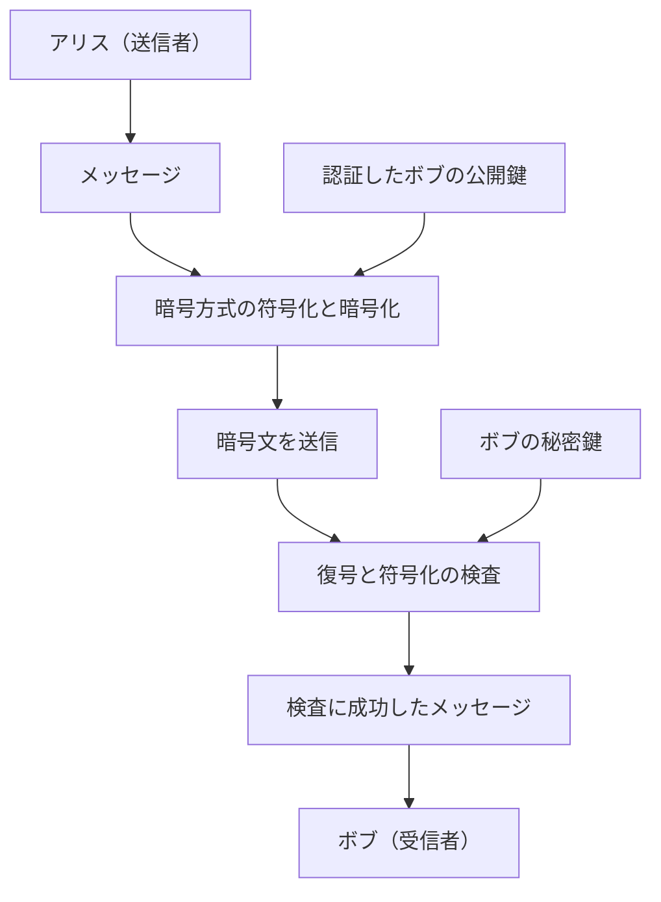
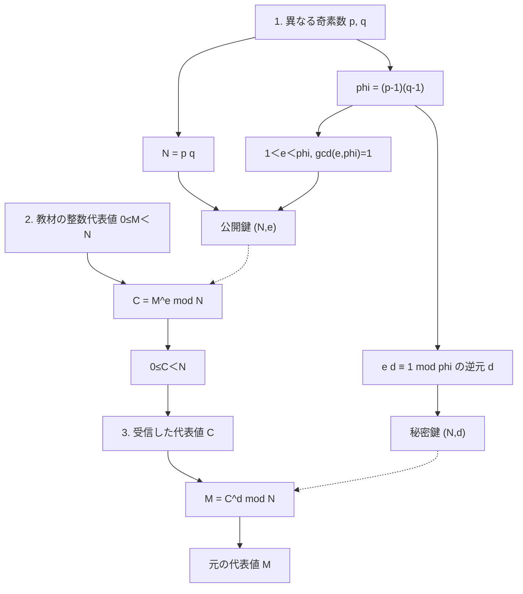
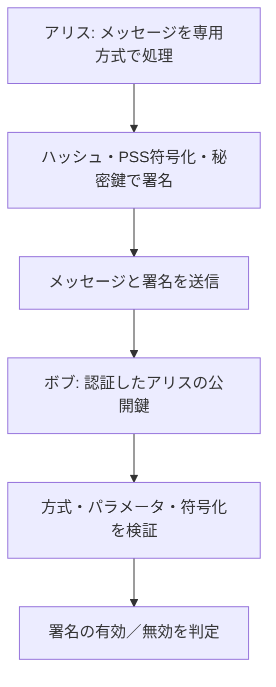

RSAは、公開鍵暗号とデジタル署名に使われる技術の一つです。素数、余り、べき乗を使う数学的な仕組みは、高校数学からたどれます。ただし、整数をそのままべき乗する教材RSAと、実際の通信で使う暗号方式は区別する必要があります。

この記事では小さな公開値で計算を追い、復号できる理由を説明します。実用上の暗号化にはRSAES-OAEP、署名にはRSASSA-PSSなどの方式があり、それぞれの符号化・検証規則が必要です。[公開鍵・ハッシュ・署名の全体像](/p/modern-cryptography-public-key-hash-signature/)も参照してください。

## 1. 共通鍵暗号と公開鍵暗号

共通鍵暗号では、送受信者が同じ秘密鍵を共有して暗号化と復号を行います。大量のデータを効率よく扱えますが、初めて通信する相手と鍵をどう安全に共有するかが課題です。

公開鍵暗号の暗号化では、受信者ボブが公開鍵と秘密鍵を用意し、送信者アリスはボブの公開鍵で暗号化します。南京錠に例えるなら、誰でも閉められる錠前を公開し、開ける鍵をボブだけが保持するイメージです。ただし、アリスは公開鍵が本当にボブのものかを確認する必要があります。鍵のすり替えを防ぐ認証は別の要件です。



狙う性質は「公開鍵を知っていても、秘密鍵なしの復号が計算上困難である」ことです。絶対に復号できないという数学的保証ではありません。また、公開鍵技術には鍵合意や署名もあり、すべてが同じ暗号化操作を行うわけではありません。

## 2. 素数と素因数分解

素数は、正の約数が1と自分自身だけである、1より大きい整数です。最初の例は $2,3,5,7,11,13,17,19,23$ です。1より大きい整数は、順序を除いて一意に素数の積に分解できます。例えば $60=2^2\times3\times5$ です。0はこの定理の対象に含めず、1は空の積として別扱いにします。

$11\times13=143$ は簡単に計算できますが、$323$ だけから $17\times19$ を探すには別の作業が必要です。RSAでは、適切に選んだ大きな異なる素数 $p,q$ の積 $N=pq$ を公開します。因数を知る側は秘密の指数を求められます。因数分解ができればRSAを破れますが、RSAのあらゆる破り方と因数分解が一般に同値だと断定することはしません。

「2048ビットRSA」という場合、通常は**法 $N$ のビット長**を指します。2048ビットの $N$ は10進数で617桁です。釣り合った2素数を用いる例では、各素数はおよそ1024ビットです。困難さは鍵の作り方、サイズ、利用できるアルゴリズムや計算資源によります。「必ず何兆年かかる」「宇宙の年齢より長い」といった根拠のない所要時間は置きません。

## 3. 合同式と余り

10時から5時間後を12時間時計で3時と呼ぶように、整数をある法で割った余りに注目します。

$$15\equiv3\pmod{12}$$

法 $N>1$ に対し、$a\equiv b\pmod N$ と $c\equiv d\pmod N$ なら、加算・減算・乗算で合同関係が保たれます。非負整数 $k$ について、$a^k\equiv b^k\pmod N$ も成り立ちます。負の指数では逆元の存在など別の条件が必要です。

$7\equiv2\pmod5$ なので、$7^{100}\equiv2^{100}\pmod5$ です。計算の途中でも法で割った余りに置き換えられるため、巨大なべき乗全体を作らずに計算できます。「べき乗した余り」と「余りをべき乗した整数」が通常の整数として等しいという意味ではありません。

## 4. オイラー関数とオイラーの定理

$\phi(N)$ は、$1\le a\le N$ の範囲で $N$ と互いに素な整数の個数です。例えば $\phi(5)=4$、$\phi(6)=2$ です。素数 $p$ について、

$$\phi(p)=p-1$$

異なる素数 $p,q$ と $N=pq$ について、

$$\phi(N)=(p-1)(q-1)$$

$p,q$ が既知ならこの値を求められます。逆に $\phi(N)$ が分かれば、$p+q=N-\phi(N)+1$ と $pq=N$ から二次方程式を解いて両因数を求められるので、この値も秘密として扱います。

オイラーの定理は、$\gcd(a,N)=1$ なら、

$$a^{\phi(N)}\equiv1\pmod N$$

というものです。両辺に $a$ を掛ければ、

$$a^{\phi(N)+1}\equiv a\pmod N$$

さらに非負整数 $k$ について、

$$a^{k\phi(N)+1}\equiv a\pmod N$$

となります。互いに素という仮定を外して、途中の $a^{\phi(N)}\equiv1$ を使うことはできません。

## 5. 教材RSAの鍵・暗号化・復号

ここからは2素数の教材モデルです。適切に大きな異なる奇素数 $p,q$ を選ぶ必要がありますが、後の例では計算を追うため、既知の小さな値を使います。

1. $N=pq$ と $\phi(N)=(p-1)(q-1)$ を計算します。
2. $1<e<\phi(N)$、$\gcd(e,\phi(N))=1$ を満たす公開指数 $e$ を選びます。
3. 正の秘密指数 $d$ を、次の合同式を満たすように求めます。

$$ed\equiv1\pmod{\phi(N)}$$

公開鍵は $(N,e)$、秘密鍵の基本表現は $(N,d)$ です。$d$ は鍵の指数であり、それだけが標準的な鍵データ全体という意味ではありません。実際の秘密鍵表現には因数やCRT用の値も含まれます。RFC 8017は $\lambda(N)=\operatorname{lcm}(p-1,q-1)$ を用いる条件で定義しています。ここで使う $\phi(N)$ を法とする逆元は、その条件も満たす分かりやすい十分条件です。

メッセージの**整数代表値**を $0\le M<N$ とすると、教材の暗号化計算は、

$$C\equiv M^e\pmod N$$

復号計算は、$0\le C<N$ に対して、

$$M\equiv C^d\pmod N$$

です。実用方式ではメッセージのバイト列を所定の方法で符号化してから整数に変換し、復号後も検査します。文字をそのまま整数にしてべき乗するだけでは足りません。



この演算だけのRSAは決定的で、同じ $M$ は同じ $C$ になります。候補が少なければ誰でも公開鍵で各候補を計算して照合できます。さらに $C$ を $C\,r^e\bmod N$ に変えると、復号結果は $Mr\bmod N$ に変わります。実用暗号方式に必要な安全性は、この算術だけからは得られません。

## 6. なぜ元に戻るのか

復号で計算するのは、

$$C^d\equiv(M^e)^d\equiv M^{ed}\pmod N$$

です。鍵の条件から、ある非負整数 $k$ を用いて、

$$ed=k\phi(N)+1$$

と書けます。$\gcd(M,N)=1$ の場合は、

$$M^{ed}=(M^{\phi(N)})^k M\equiv1^k M\equiv M\pmod N$$

とオイラーの定理で示せます。ただし、RSAの代表値は $N$ と互いに素である必要はありません。例えば $M=0,11,13$ も範囲内です。そこで素数ごとに確認します。

- $p\mid M$ なら、正の指数 $ed$ に対して $M^{ed}\equiv M\equiv0\pmod p$ です。
- $p\nmid M$ なら、フェルマーの小定理で $M^{p-1}\equiv1\pmod p$。$ed-1$ は $p-1$ の倍数なので、$M^{ed}\equiv M\pmod p$ です。
- $q$ についても同じ議論が成り立ちます。

異なる素数 $p,q$ は互いに素なので、中国剰余定理により、

$$M^{ed}\equiv M\pmod{pq}$$

が全代表値 $0\le M<N$ について成り立ちます。これは算術的な正しさの証明であり、盗聴や改ざんに対する暗号方式の安全性の証明ではありません。

## 7. 小さな素数で手計算

$p=11,q=13$ とすると、$N=143$、$\phi(N)=120$ です。$e=7$ を選び、$7d\equiv1\pmod{120}$ を解きます。$7\times103=721=6\times120+1$ なので、$d=103$ です。

$M=9$ を送る教材計算では、$9^7=4,782,969=33,447\times143+48$ より $C=48$。復号は $48^{103}\bmod143=9$ です。実際には `pow(48, 103, 143)` とすると、巨大な整数 $48^{103}$ を丸ごと作らずに計算できます。

これらの素数と秘密指数は全員に見えている公開の教材値です。秘密のメッセージには使えません。

## 8. 拡張ユークリッドの互除法で逆元を求める

$7d\equiv1\pmod{120}$ は、整数 $d,y$ を使って $7d+120y=1$ と書けます。$120=17\times7+1$ なので、$1=120-17\times7$。よって $d\equiv-17\equiv103\pmod{120}$ です。

一般には拡張ユークリッドの互除法でこのような係数を求めます。逆元がある条件は、対象の整数と法が互いに素であることです。計算量は入力の長さに依存し、どんな大きさでも固定時間で終わるという意味ではありません。

## 9. デジタル署名は専用の方式

RSAの署名では秘密鍵で署名し、対応する公開鍵で検証します。しかし、署名を「秘密鍵で暗号化、公開鍵で復号」と説明すると、暗号化方式と署名方式の符号化・検証規則の違いが隠れてしまいます。

生の式 $S=M^d\bmod N$ と照合 $S^e\equiv M\pmod N$ だけでは、安全な署名になりません。例えば攻撃者が $S=2$ を選び、公開鍵 $e=7,N=143$ から $M=2^7\bmod143=128$ を計算すれば、秘密鍵を一度も使わずにその照合を通る組が作れます。これは特定の任意メッセージに署名できるという主張ではなく、生の照合が署名方式として不十分である例です。



RSASSA-PSSなどではハッシュや専用の符号化・検証を組み合わせます。署名は内容を隠す機能ではなく、鍵の管理と身元への結び付けも必要です。暗号化と署名の鍵は用途を分け、実際のプロトコルに対応した保守されるライブラリを使います。

## 10. Pythonで教材の算術を確かめる

次の単独実行例はPython 3.8以降を対象に、既知の教材値だけを使います。`pow(e, -1, phi)` は、互いに素な整数の逆元を求めます。代表値の範囲も明示的に検査します。これは鍵生成器・OAEP・PSS・定数時間実装ではありません。

```python
from math import gcd


def mod_inverse(e, phi):
    # Fixed public teaching parameters, not a key generator.
    if type(e) is not int or type(phi) is not int:
        raise TypeError("Integer parameters required")
    if phi <= 1 or not 1 < e < phi or gcd(e, phi) != 1:
        raise ValueError("Invalid teaching exponent or modulus")
    return pow(e, -1, phi)


def rsa_primitive_demo(value, exponent, modulus):
    # Range checks do not make raw RSA a secure encryption scheme.
    if any(type(x) is not int for x in (value, exponent, modulus)):
        raise TypeError("Integer parameters required")
    if modulus <= 1 or exponent <= 0 or not 0 <= value < modulus:
        raise ValueError("Invalid exponent, modulus or representative")
    return pow(value, exponent, modulus)


# Public toy values only. Never use this code or these keys for secrets.
p, q = 11, 13
N = p * q
phi = (p - 1) * (q - 1)
e = 7
d = mod_inverse(e, phi)
message = 9
ciphertext = rsa_primitive_demo(message, e, N)
decrypted_message = rsa_primitive_demo(ciphertext, d, N)
assert (N, phi, d, ciphertext, decrypted_message) == (143, 120, 103, 48, 9)
assert all(rsa_primitive_demo(rsa_primitive_demo(m, e, N), d, N) == m
           for m in range(N))
print(f"Public toy parameters: N={N}, e={e}, d={d}")
print(f"Ciphertext representative: {ciphertext}")
print(f"Recovered representative: {decrypted_message}")
print("All 143 representatives round-trip")
```

3引数の `pow` は法を取りながらべき乗を計算します。大きなべき乗全体を作る方法より効率的ですが、所要時間は入力と実装に依存します。入力検査や全143値の往復成功も、教材の算術の検査です。

## 11. 実用方式と今後の技術

実用のRSA暗号化ではRSAES-OAEPのような方式を用います。RSAは大量の本文を直接暗号化するための方式ではなく、ハイブリッド暗号の構成要素として使われます。例えば2048ビットの法とSHA-256のOAEPでは、上限は $256-2\times32-2=190$ バイトです。暗号化だけで送信者の認証も得られるわけではありません。

通信の安全性はプロトコル全体に依存します。TLS 1.3はRSA鍵配送を用いず、RSA署名を用いる場合も暗号化による鍵配送とは別の役割です。「現代の通信はすべてRSAで暗号化される」とは考えないでください。

Shorの量子アルゴリズムは、適切な量子計算モデルで因数分解を入力長の多項式時間で行います。これは即座に解けるという意味でも、実現時期を示すものでもありません。十分な計算を実行できる量子計算機はRSAへの脅威となるため、耐量子暗号が研究・整備されています。その名称も、将来のあらゆる攻撃に対する絶対安全を保証するものではありません。

RSAの教材で学べるのは、素数、合同式、逆元、そして正しさの証明です。その上で、実用方式の安全性には符号化・認証・検証・実装という別の条件があることを押さえましょう。

### 参考資料

- [RFC 8017: PKCS #1 v2.2](https://www.rfc-editor.org/rfc/rfc8017.html)（§§3, 5, 7.1, 8.1）
- [RFC 8446: TLS 1.3](https://www.rfc-editor.org/rfc/rfc8446.html)（§1.2, Appendix E.8）
- [Python 3.12: pow](https://docs.python.org/3.12/library/functions.html#pow)
- [Shor: Polynomial-Time Algorithms for Prime Factorization and Discrete Logarithms on a Quantum Computer](https://arxiv.org/abs/quant-ph/9508027)（要旨）
