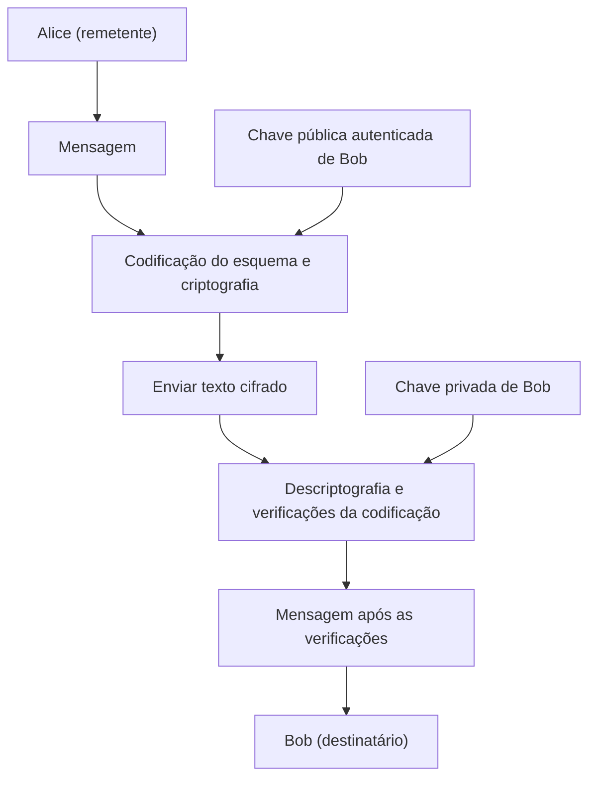
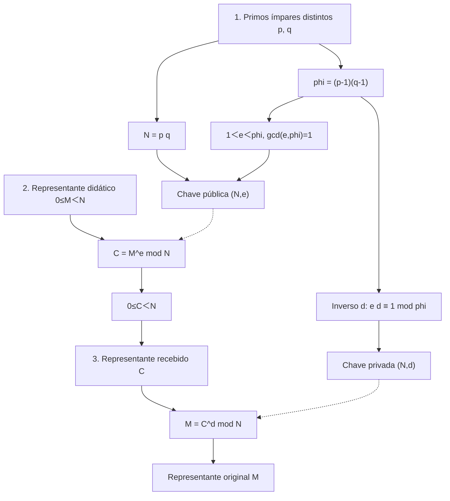
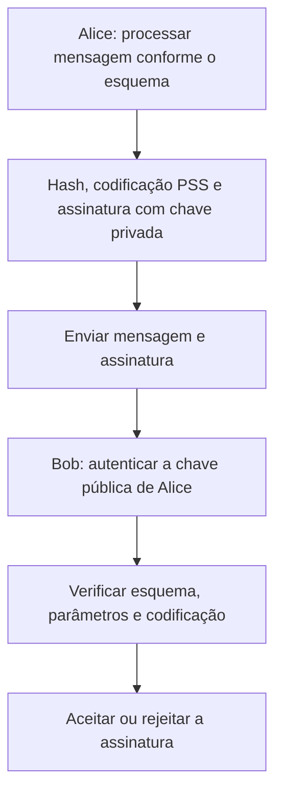

RSA é usado em criptografia de chave pública e assinaturas digitais. Sua aritmética pode ser explorada com ideias do ensino médio: números primos, restos e potências. Porém, elevar diretamente um inteiro a uma potência em um exemplo didático deve ser distinguido dos esquemas usados em comunicações reais.

Vamos acompanhar valores pequenos e públicos para explicar por que a descriptografia recupera a entrada. Esquemas práticos, como RSAES-OAEP para criptografia e RSASSA-PSS para assinaturas, exigem suas próprias regras de codificação e verificação. Veja também a [introdução a chaves públicas, hash e assinaturas](/pt/p/modern-cryptography-public-key-hash-signature/).

## 1. Criptografia simétrica e de chave pública

Na criptografia simétrica, remetente e destinatário compartilham uma chave secreta para criptografar e descriptografar. Isso permite tratar grandes quantidades de dados com eficiência, mas compartilhar essa chave com segurança com um novo interlocutor é outro problema.

Na criptografia de chave pública, Bob, o destinatário, prepara uma chave pública e uma privada. Alice criptografa com a chave pública de Bob. A analogia do cadeado é um fecho que qualquer pessoa pode fechar, enquanto Bob guarda a chave que o abre. Alice ainda precisa confirmar que a chave pública realmente pertence a Bob. A autenticação para impedir a substituição da chave é um requisito adicional.



O objetivo é tornar computacionalmente difícil descriptografar sem a chave privada, mesmo conhecendo a pública. Não é uma garantia matemática incondicional de impossibilidade. Técnicas de chave pública também incluem acordo de chaves e assinaturas; nem todas realizam a mesma operação de criptografia.

## 2. Números primos e fatoração

Um primo é um inteiro maior que um cujos únicos divisores positivos são um e ele mesmo. Os primeiros exemplos são $2,3,5,7,11,13,17,19,23$. Todo inteiro maior que um tem uma fatoração única em primos, desconsiderando a ordem; por exemplo, $60=2^2\times3\times5$. O zero fica excluído, e o um é tratado separadamente como produto vazio.

Calcular $11\times13=143$ é fácil, mas encontrar $17\times19$ a partir de $323$ é outra tarefa. RSA publica $N=pq$, com primos grandes, distintos e escolhidos adequadamente. Conhecer os fatores permite calcular o expoente privado. Fatorar o módulo permite quebrar RSA, mas não afirmamos que toda forma de quebrar RSA tenha sido demonstrada geralmente equivalente à fatoração.

'RSA de 2048 bits' normalmente descreve o **comprimento em bits do módulo $N$**. Um $N$ de 2048 bits tem 617 algarismos decimais. Com dois primos equilibrados, cada um tem aproximadamente 1024 bits. A dificuldade depende da geração e do tamanho dos parâmetros, dos algoritmos disponíveis e dos recursos de cálculo. Estimativas sem fundamento de 'trilhões de anos' ou 'mais que a idade do universo' não são garantias.

## 3. Congruências e restos

Como em um relógio de doze horas, no qual cinco horas depois das dez são três horas, podemos nos concentrar nos restos módulo um número.

$$15\equiv3\pmod{12}$$

Para um módulo $N>1$, se $a\equiv b\pmod N$ e $c\equiv d\pmod N$, soma, subtração e multiplicação preservam a congruência. Para um inteiro não negativo $k$, também vale $a^k\equiv b^k\pmod N$. Expoentes negativos exigem condições adicionais, como a existência de inversos.

Como $7\equiv2\pmod5$, temos $7^{100}\equiv2^{100}\pmod5$. Os resultados intermediários podem ser substituídos por seus restos, sem construir a potência inteira. Isso não significa que a potência de um resto e o resto de uma potência sejam iguais como inteiros comuns.

## 4. Função totiente e teorema de Euler

$\phi(N)$ conta os inteiros $1\le a\le N$ que são coprimos com $N$. Por exemplo, $\phi(5)=4$ e $\phi(6)=2$. Para um primo $p$,

$$\phi(p)=p-1$$

Para primos distintos $p,q$ e $N=pq$,

$$\phi(N)=(p-1)(q-1)$$

Conhecer $p,q$ permite calcular esse valor. Inversamente, conhecer $\phi(N)$ fornece $p+q=N-\phi(N)+1$ e $pq=N$, com os quais uma equação do segundo grau recupera os fatores. Por isso, esse valor também deve permanecer secreto.

O teorema de Euler afirma que, se $\gcd(a,N)=1$,

$$a^{\phi(N)}\equiv1\pmod N$$

Multiplicando por $a$, obtemos

$$a^{\phi(N)+1}\equiv a\pmod N$$

e, para todo inteiro não negativo $k$,

$$a^{k\phi(N)+1}\equiv a\pmod N$$

Não podemos usar a conclusão intermediária $a^{\phi(N)}\equiv1$ depois de retirar a hipótese de coprimalidade.

## 5. Chaves, criptografia e descriptografia do modelo didático

Usaremos um modelo com dois primos. Parâmetros reais exigem primos ímpares, distintos e adequadamente grandes $p,q$; o exemplo posterior usa deliberadamente valores pequenos e conhecidos para observar a aritmética.

1. Calcular $N=pq$ e $\phi(N)=(p-1)(q-1)$.
2. Escolher um expoente público $e$ com $1<e<\phi(N)$ e $\gcd(e,\phi(N))=1$.
3. Encontrar um expoente privado positivo $d$ que satisfaça

$$ed\equiv1\pmod{\phi(N)}$$

A chave pública é $(N,e)$, e uma representação básica da privada é $(N,d)$. O número $d$ é um expoente, não toda a representação padrão da chave por si só. Representações práticas também podem incluir fatores e parâmetros do teorema chinês dos restos. A RFC 8017 define a condição usando $\lambda(N)=\operatorname{lcm}(p-1,q-1)$. Tomar aqui o inverso módulo $\phi(N)$ é uma condição suficiente simples que também satisfaz a condição módulo $\lambda(N)$.

Para um **representante inteiro da mensagem** $0\le M<N$, o cálculo didático de criptografia é

$$C\equiv M^e\pmod N$$

Para um representante do texto cifrado $0\le C<N$, a descriptografia calcula

$$M\equiv C^d\pmod N$$

Em um esquema prático, os bytes da mensagem passam pela codificação especificada antes da conversão para inteiro, e a descriptografia inclui validações. Não basta converter caracteres diretamente para um inteiro e elevá-lo a uma potência.



A aritmética RSA isolada é determinística: o mesmo $M$ produz o mesmo $C$. Se houver poucos candidatos, qualquer pessoa pode criptografar cada um com a chave pública e comparar. Além disso, substituir $C$ por $C\,r^e\bmod N$ muda o representante recuperado para $Mr\bmod N$. As propriedades de segurança necessárias a um esquema prático não decorrem apenas dessa aritmética.

## 6. Por que a descriptografia recupera a entrada

A descriptografia calcula

$$C^d\equiv(M^e)^d\equiv M^{ed}\pmod N$$

Pela condição das chaves, existe um inteiro não negativo $k$ tal que

$$ed=k\phi(N)+1$$

Se $\gcd(M,N)=1$, o teorema de Euler fornece

$$M^{ed}=(M^{\phi(N)})^k M\equiv1^k M\equiv M\pmod N$$

No entanto, representantes RSA não precisam ser coprimos com $N$. Por exemplo, $M=0,11,13$ estão no intervalo. Examinamos cada primo separadamente.

- Se $p\mid M$, então $M^{ed}\equiv M\equiv0\pmod p$, pois o expoente $ed$ é positivo.
- Se $p\nmid M$, o pequeno teorema de Fermat fornece $M^{p-1}\equiv1\pmod p$. Como $ed-1$ é múltiplo de $p-1$, temos $M^{ed}\equiv M\pmod p$.
- O mesmo raciocínio vale módulo $q$.

Os primos distintos $p,q$ são coprimos, portanto o teorema chinês dos restos fornece

$$M^{ed}\equiv M\pmod{pq}$$

para todo representante $0\le M<N$. Isso demonstra a correção aritmética, não a segurança de um esquema contra interceptação ou alteração.

## 7. Um cálculo à mão com primos pequenos

Tomemos $p=11,q=13$. Então $N=143$ e $\phi(N)=120$. Escolhemos $e=7$ e resolvemos $7d\equiv1\pmod{120}$. Como $7\times103=721=6\times120+1$, podemos usar $d=103$.

Para a entrada didática $M=9$, $9^7=4\,782\,969=33\,447\times143+48$, portanto $C=48$. A descriptografia fornece $48^{103}\bmod143=9$. Em Python, `pow(48, 103, 143)` calcula isso sem construir primeiro o inteiro completo $48^{103}$.

Esses primos e o expoente privado são valores didáticos públicos, visíveis para todos. Não podem proteger mensagens secretas.

## 8. Encontrar um inverso com o algoritmo de Euclides estendido

A congruência $7d\equiv1\pmod{120}$ significa que existem inteiros $d,y$ com $7d+120y=1$. Como $120=17\times7+1$, temos $1=120-17\times7$, de onde $d\equiv-17\equiv103\pmod{120}$.

O algoritmo de Euclides estendido encontra esses coeficientes em geral. O inverso existe quando o inteiro e o módulo são coprimos. O cálculo depende do comprimento da entrada; não leva um tempo fixo para entradas arbitrariamente grandes.

## 9. Assinaturas digitais usam um esquema específico

Assinaturas RSA são geradas com uma chave privada e verificadas com a pública correspondente. Descrever isso como 'criptografar com a privada e descriptografar com a pública' esconde as diferenças de codificação e validação entre esquemas de criptografia e de assinatura.

A relação sem codificação $S=M^d\bmod N$, verificada por $S^e\equiv M\pmod N$, não é um esquema de assinatura seguro. Um atacante pode escolher $S=2$ e usar os valores públicos $e=7,N=143$ para calcular $M=2^7\bmod143=128$. Esse par passa na verificação sem usar a chave privada. Isso não afirma que seja possível assinar qualquer mensagem escolhida previamente; mostra que aquela verificação isolada é insuficiente.



Esquemas como RSASSA-PSS combinam hash com codificação e verificação específicas. Uma assinatura não esconde a mensagem; a gestão das chaves e sua vinculação à identidade também importam. É necessário separar chaves de criptografia e de assinatura por finalidade e usar uma biblioteca mantida que ofereça suporte ao protocolo pretendido.

## 10. Conferir a aritmética didática com Python

Este exemplo independente para Python 3.8 ou posterior usa somente valores didáticos conhecidos. `pow(e, -1, phi)` calcula um inverso de inteiros coprimos. O intervalo do representante também é verificado explicitamente. Não é um gerador de chaves nem uma implementação de OAEP, PSS ou tempo constante.

```python
from math import gcd


def mod_inverse(e, phi):
    # Fixed public teaching parameters, not a key generator.
    if type(e) is not int or type(phi) is not int:
        raise TypeError("Integer parameters required")
    if phi <= 1 or not 1 < e < phi or gcd(e, phi) != 1:
        raise ValueError("Invalid teaching exponent or modulus")
    return pow(e, -1, phi)


def rsa_primitive_demo(value, exponent, modulus):
    # Range checks do not make raw RSA a secure encryption scheme.
    if any(type(x) is not int for x in (value, exponent, modulus)):
        raise TypeError("Integer parameters required")
    if modulus <= 1 or exponent <= 0 or not 0 <= value < modulus:
        raise ValueError("Invalid exponent, modulus or representative")
    return pow(value, exponent, modulus)


# Public toy values only. Never use this code or these keys for secrets.
p, q = 11, 13
N = p * q
phi = (p - 1) * (q - 1)
e = 7
d = mod_inverse(e, phi)
message = 9
ciphertext = rsa_primitive_demo(message, e, N)
decrypted_message = rsa_primitive_demo(ciphertext, d, N)
assert (N, phi, d, ciphertext, decrypted_message) == (143, 120, 103, 48, 9)
assert all(rsa_primitive_demo(rsa_primitive_demo(m, e, N), d, N) == m
           for m in range(N))
print(f"Public toy parameters: N={N}, e={e}, d={d}")
print(f"Ciphertext representative: {ciphertext}")
print(f"Recovered representative: {decrypted_message}")
print("All 143 representatives round-trip")
```

A versão de `pow` com três argumentos calcula uma potência modular sem construir a potência completa. É mais eficiente do que fazer isso, mas o tempo depende das entradas e da implementação. As verificações de entrada e o retorno correto dos 143 valores continuam sendo testes de aritmética didática.

## 11. Esquemas práticos e tecnologias futuras

A criptografia RSA prática usa um esquema como RSAES-OAEP. RSA é empregado como componente da criptografia híbrida, em vez de criptografar diretamente mensagens longas. Por exemplo, OAEP com módulo de 2048 bits e SHA-256 admite no máximo $256-2\times32-2=190$ bytes. A criptografia isolada não autentica o remetente.

A segurança da comunicação depende do protocolo inteiro. TLS 1.3 não usa transporte de chaves RSA. Quando assinaturas RSA são usadas, seu papel é diferente da criptografia para transportar chaves. Não devemos interpretar que toda comunicação moderna seja 'criptografada com RSA'.

O algoritmo quântico de Shor fatora inteiros em tempo polinomial no comprimento da entrada, no modelo quântico correspondente. Isso não significa cálculo instantâneo nem prevê quando existirá o hardware adequado. Um computador quântico capaz de realizar o cálculo necessário ameaçaria RSA, motivando a criptografia pós-quântica. Esse nome tampouco garante segurança absoluta contra qualquer ataque futuro.

RSA ensina números primos, congruências, inversos e uma demonstração de correção. A segurança de um esquema prático acrescenta requisitos de codificação, autenticação, verificação e implementação.

### Referências

- [RFC 8017: PKCS #1 v2.2](https://www.rfc-editor.org/rfc/rfc8017.html) (§§3, 5, 7.1, 8.1)
- [RFC 8446: TLS 1.3](https://www.rfc-editor.org/rfc/rfc8446.html) (§1.2, Appendix E.8)
- [Python 3.12: pow](https://docs.python.org/3.12/library/functions.html#pow)
- [Shor: Polynomial-Time Algorithms for Prime Factorization and Discrete Logarithms on a Quantum Computer](https://arxiv.org/abs/quant-ph/9508027) (resumo)
