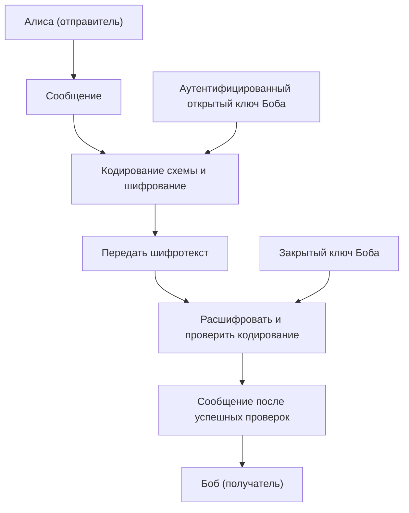
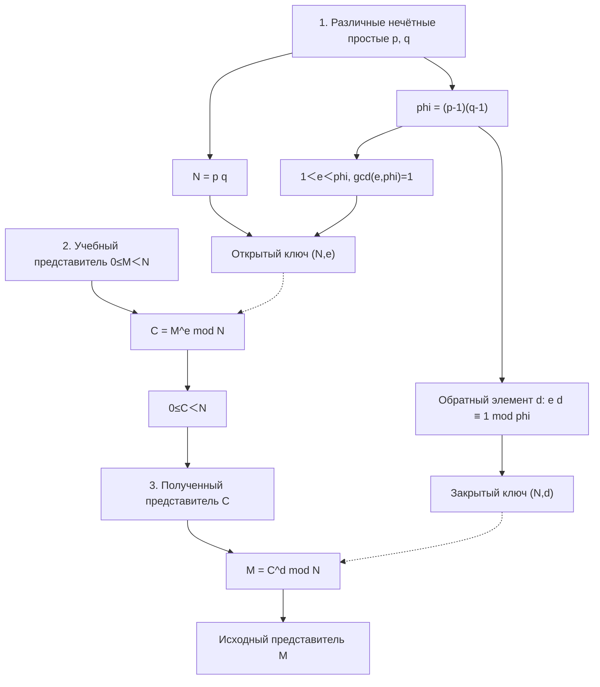
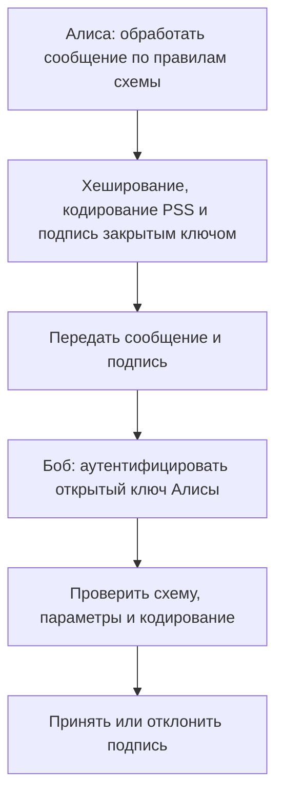

RSA применяется для шифрования с открытым ключом и цифровых подписей. Его арифметику можно изучить с помощью школьных понятий: простых чисел, остатков и степеней. Но непосредственное возведение целого числа в степень в учебном примере нужно отличать от схем для реальной связи.

Мы проследим вычисления на небольших общедоступных значениях и объясним, почему расшифрование восстанавливает входные данные. Практические схемы, например RSAES-OAEP для шифрования и RSASSA-PSS для подписи, требуют собственных правил кодирования и проверки. См. также [обзор открытых ключей, хеширования и подписей](/ru/p/modern-cryptography-public-key-hash-signature/).

## 1. Симметричное шифрование и шифрование с открытым ключом

При симметричном шифровании отправитель и получатель используют общий секретный ключ для шифрования и расшифрования. Оно эффективно обрабатывает большие объёмы данных, но безопасно передать ключ новому собеседнику — отдельная задача.

При шифровании с открытым ключом получатель Боб готовит открытый и закрытый ключи. Алиса шифрует открытым ключом Боба. Аналогия — замок, который может закрыть любой, а ключ для открытия хранит Боб. При этом Алиса должна убедиться, что открытый ключ действительно принадлежит Бобу. Аутентификация для предотвращения подмены ключа — дополнительное требование.



Цель — сделать расшифрование без закрытого ключа вычислительно трудным, даже когда открытый ключ известен. Это не безусловная математическая гарантия невозможности. К технологиям с открытым ключом относятся также согласование ключей и подписи; не все они выполняют одну и ту же операцию шифрования.

## 2. Простые числа и факторизация

Простое число — целое число больше единицы, единственные положительные делители которого — единица и оно само. Первые примеры: $2,3,5,7,11,13,17,19,23$. Любое целое число больше единицы имеет единственное разложение на простые множители с точностью до порядка; например, $60=2^2\times3\times5$. Ноль исключается, а единица рассматривается отдельно как пустое произведение.

Вычислить $11\times13=143$ легко, но найти $17\times19$ по числу $323$ — другая задача. RSA публикует $N=pq$ для подходящим образом выбранных больших различных простых чисел. Зная множители, можно вычислить секретную экспоненту. Факторизация модуля позволяет взломать RSA, но мы не утверждаем, что все способы взлома RSA доказанно эквивалентны факторизации в общем случае.

«RSA 2048 бит» обычно означает **битовую длину модуля $N$**. Число $N$ длиной 2048 бит содержит 617 десятичных цифр. При двух сбалансированных простых числах каждое имеет около 1024 бит. Трудность зависит от генерации и размера параметров, доступных алгоритмов и вычислительных ресурсов. Неподтверждённые оценки вроде «триллионы лет» или «дольше возраста Вселенной» не являются гарантией.

## 3. Сравнения по модулю и остатки

Как на двенадцатичасовых часах, где через пять часов после десяти будет три часа, можно рассматривать остатки по модулю числа.

$$15\equiv3\pmod{12}$$

Для модуля $N>1$, если $a\equiv b\pmod N$ и $c\equiv d\pmod N$, сложение, вычитание и умножение сохраняют сравнения. Для неотрицательного целого $k$ также верно $a^k\equiv b^k\pmod N$. Отрицательные показатели требуют дополнительных условий, включая существование обратных элементов.

Из $7\equiv2\pmod5$ следует $7^{100}\equiv2^{100}\pmod5$. Промежуточные результаты тоже можно заменять остатками, не строя сначала огромную степень целиком. Это не означает, что степень остатка и остаток степени равны как обычные целые числа.

## 4. Функция и теорема Эйлера

$\phi(N)$ считает количество целых $1\le a\le N$, взаимно простых с $N$. Например, $\phi(5)=4$ и $\phi(6)=2$. Для простого $p$

$$\phi(p)=p-1$$

Для различных простых $p,q$ и $N=pq$

$$\phi(N)=(p-1)(q-1)$$

Зная $p,q$, легко вычислить это значение. Обратно, знание $\phi(N)$ даёт $p+q=N-\phi(N)+1$ и $pq=N$, откуда квадратное уравнение восстанавливает множители. Поэтому это значение тоже следует хранить в секрете.

Теорема Эйлера утверждает: если $\gcd(a,N)=1$, то

$$a^{\phi(N)}\equiv1\pmod N$$

Умножив обе части на $a$, получаем

$$a^{\phi(N)+1}\equiv a\pmod N$$

и для любого неотрицательного целого $k$

$$a^{k\phi(N)+1}\equiv a\pmod N$$

Промежуточный вывод $a^{\phi(N)}\equiv1$ нельзя использовать после удаления предположения о взаимной простоте.

## 5. Ключи, шифрование и расшифрование в учебной модели

Мы используем модель с двумя простыми числами. Реальные параметры требуют подходящих больших различных нечётных простых $p,q$; дальнейший пример намеренно использует небольшие известные значения, чтобы показать арифметику.

1. Вычислить $N=pq$ и $\phi(N)=(p-1)(q-1)$.
2. Выбрать открытую экспоненту $e$ с $1<e<\phi(N)$ и $\gcd(e,\phi(N))=1$.
3. Найти положительную секретную экспоненту $d$, удовлетворяющую условию

$$ed\equiv1\pmod{\phi(N)}$$

Открытый ключ — $(N,e)$, одно из основных представлений закрытого ключа — $(N,d)$. Число $d$ является показателем степени, а не всем стандартным представлением ключа само по себе. Практические представления могут также содержать множители и параметры китайской теоремы об остатках. RFC 8017 определяет условие через $\lambda(N)=\operatorname{lcm}(p-1,q-1)$. Выбор секретной экспоненты как обратного элемента к открытой экспоненте по модулю $\phi(N)$ — простое достаточное условие, обеспечивающее также условие по модулю $\lambda(N)$.

Для **целочисленного представителя сообщения** $0\le M<N$ учебная операция шифрования имеет вид

$$C\equiv M^e\pmod N$$

Для представителя шифротекста $0\le C<N$ расшифрование вычисляет

$$M\equiv C^d\pmod N$$

В практической схеме байты сообщения проходят установленное кодирование перед преобразованием в целое число, а расшифрование включает проверки. Недостаточно напрямую превратить символы в целое число и возвести его в степень.



Одна лишь арифметика RSA детерминирована: одинаковое $M$ даёт одинаковое $C$. Если вариантов сообщения мало, любой может зашифровать каждый открытым ключом и сравнить. Кроме того, замена $C$ на $C\,r^e\bmod N$ меняет результат расшифрования на $Mr\bmod N$. Свойства безопасности практической схемы не следуют только из этой арифметики.

## 6. Почему расшифрование восстанавливает входное значение

Расшифрование вычисляет

$$C^d\equiv(M^e)^d\equiv M^{ed}\pmod N$$

Из условия на ключи следует, что для некоторого неотрицательного целого $k$

$$ed=k\phi(N)+1$$

Если $\gcd(M,N)=1$, теорема Эйлера даёт

$$M^{ed}=(M^{\phi(N)})^k M\equiv1^k M\equiv M\pmod N$$

Однако представители RSA не обязаны быть взаимно простыми с $N$. Например, $M=0,11,13$ тоже входят в допустимый диапазон. Поэтому рассмотрим каждое простое число отдельно.

- Если $p\mid M$, то $M^{ed}\equiv M\equiv0\pmod p$, поскольку показатель $ed$ положителен.
- Если $p\nmid M$, малая теорема Ферма даёт $M^{p-1}\equiv1\pmod p$. Поскольку $ed-1$ кратно $p-1$, имеем $M^{ed}\equiv M\pmod p$.
- То же рассуждение применимо по модулю $q$.

Различные простые $p,q$ взаимно просты, поэтому китайская теорема об остатках даёт

$$M^{ed}\equiv M\pmod{pq}$$

для каждого представителя $0\le M<N$. Это доказательство арифметической корректности, а не безопасности схемы против перехвата или изменения данных.

## 7. Ручной расчёт с небольшими простыми числами

Возьмём $p=11,q=13$. Тогда $N=143$ и $\phi(N)=120$. Выберем $e=7$ и решим $7d\equiv1\pmod{120}$. Так как $7\times103=721=6\times120+1$, можно взять $d=103$.

Для учебного входа $M=9$ имеем $9^7=4\,782\,969=33\,447\times143+48$, поэтому $C=48$. Расшифрование даёт $48^{103}\bmod143=9$. В Python `pow(48, 103, 143)` вычисляет это без предварительного построения полного целого $48^{103}$.

Эти простые числа и секретная экспонента — общедоступные учебные значения. Они не могут защитить секретные сообщения.

## 8. Обратный элемент и расширенный алгоритм Евклида

Сравнение $7d\equiv1\pmod{120}$ означает, что существуют целые $d,y$ с $7d+120y=1$. Из $120=17\times7+1$ получаем $1=120-17\times7$, то есть $d\equiv-17\equiv103\pmod{120}$.

Расширенный алгоритм Евклида находит такие коэффициенты в общем случае. Обратный элемент существует, когда целое число и модуль взаимно просты. Вычисления зависят от длины входа; для сколь угодно больших значений время не фиксировано.

## 9. Для цифровых подписей нужна отдельная схема

RSA-подписи создаются закрытым ключом и проверяются соответствующим открытым. Описание «зашифровать закрытым ключом, расшифровать открытым» скрывает различия кодирования и проверки между схемами шифрования и подписи.

Соотношение без кодирования $S=M^d\bmod N$ с проверкой $S^e\equiv M\pmod N$ не является безопасной схемой подписи. Атакующий может выбрать $S=2$ и по открытым значениям $e=7,N=143$ вычислить $M=2^7\bmod143=128$. Эта пара проходит проверку без закрытого ключа. Это не утверждение о возможности подписать любое заранее выбранное сообщение; пример показывает недостаточность одной этой проверки.



Схемы вроде RSASSA-PSS объединяют хеширование со специальным кодированием и проверкой. Подпись не скрывает сообщение; важны управление ключами и их привязка к личности. Ключи шифрования и подписи следует разделять по назначению и использовать поддерживаемую библиотеку для нужного протокола.

## 10. Проверка учебной арифметики на Python

Этот самостоятельный пример для Python 3.8 и новее использует только известные учебные значения. `pow(e, -1, phi)` находит обратный элемент для взаимно простых целых. Диапазон представителя проверяется явно. Это не генератор ключей и не реализация OAEP, PSS или вычислений с постоянным временем.

```python
from math import gcd


def mod_inverse(e, phi):
    # Fixed public teaching parameters, not a key generator.
    if type(e) is not int or type(phi) is not int:
        raise TypeError("Integer parameters required")
    if phi <= 1 or not 1 < e < phi or gcd(e, phi) != 1:
        raise ValueError("Invalid teaching exponent or modulus")
    return pow(e, -1, phi)


def rsa_primitive_demo(value, exponent, modulus):
    # Range checks do not make raw RSA a secure encryption scheme.
    if any(type(x) is not int for x in (value, exponent, modulus)):
        raise TypeError("Integer parameters required")
    if modulus <= 1 or exponent <= 0 or not 0 <= value < modulus:
        raise ValueError("Invalid exponent, modulus or representative")
    return pow(value, exponent, modulus)


# Public toy values only. Never use this code or these keys for secrets.
p, q = 11, 13
N = p * q
phi = (p - 1) * (q - 1)
e = 7
d = mod_inverse(e, phi)
message = 9
ciphertext = rsa_primitive_demo(message, e, N)
decrypted_message = rsa_primitive_demo(ciphertext, d, N)
assert (N, phi, d, ciphertext, decrypted_message) == (143, 120, 103, 48, 9)
assert all(rsa_primitive_demo(rsa_primitive_demo(m, e, N), d, N) == m
           for m in range(N))
print(f"Public toy parameters: N={N}, e={e}, d={d}")
print(f"Ciphertext representative: {ciphertext}")
print(f"Recovered representative: {decrypted_message}")
print("All 143 representatives round-trip")
```

`pow` с тремя аргументами вычисляет степень по модулю, не строя степень целиком. Это эффективнее, но время зависит от входа и реализации. Проверки входа и успешное восстановление всех 143 значений остаются тестами учебной арифметики, а не гарантией безопасности.

## 11. Практические схемы и будущие технологии

Практическое шифрование RSA использует схему вроде RSAES-OAEP. RSA служит компонентом гибридного шифрования, а не способом напрямую шифровать длинные сообщения. Например, OAEP с модулем 2048 бит и SHA-256 допускает не более $256-2\times32-2=190$ байт. Само шифрование не аутентифицирует отправителя.

Безопасность связи зависит от всего протокола. TLS 1.3 не использует транспорт ключей RSA. Если применяются RSA-подписи, их роль отличается от шифрования для передачи ключей. Нельзя считать, что вся современная связь «зашифрована RSA».

Квантовый алгоритм Шора выполняет факторизацию за полиномиальное по длине входа время в соответствующей модели квантовых вычислений. Это не означает мгновенный расчёт и не предсказывает срок появления нужного оборудования. Квантовый компьютер, способный выполнить необходимые вычисления, угрожал бы RSA, что мотивирует постквантовую криптографию. Её название тоже не гарантирует абсолютной безопасности от любых будущих атак.

RSA знакомит с простыми числами, сравнениями, обратными элементами и доказательством корректности. Безопасность практической схемы дополнительно требует кодирования, аутентификации, проверки и подходящей реализации.

### Источники

- [RFC 8017: PKCS #1 v2.2](https://www.rfc-editor.org/rfc/rfc8017.html) (§§3, 5, 7.1, 8.1)
- [RFC 8446: TLS 1.3](https://www.rfc-editor.org/rfc/rfc8446.html) (§1.2, Appendix E.8)
- [Python 3.12: pow](https://docs.python.org/3.12/library/functions.html#pow)
- [Shor: Polynomial-Time Algorithms for Prime Factorization and Discrete Logarithms on a Quantum Computer](https://arxiv.org/abs/quant-ph/9508027) (аннотация)
