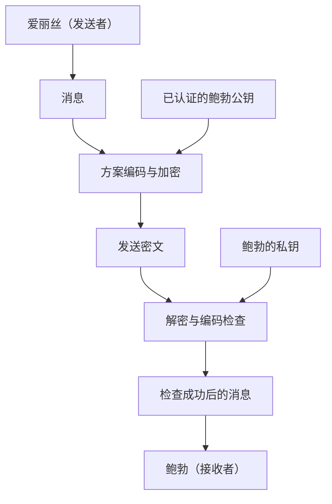
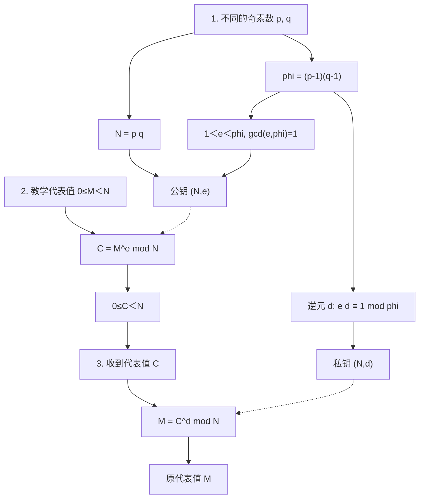
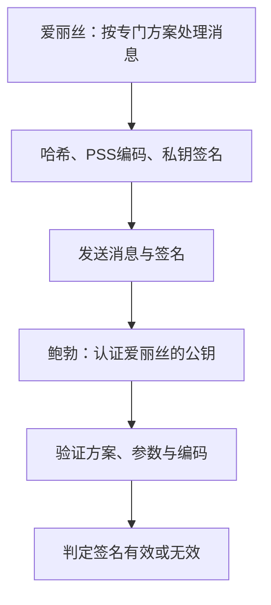

RSA用于公钥加密和数字签名。它的算术原理可以从高中数学中的素数、余数和乘方讲起。不过，直接对整数做模幂运算的教学模型，与实际通信使用的加密方案需要区分。

本文用公开的小整数追踪计算，说明为什么解密能恢复输入。实用的加密方案如RSAES-OAEP、签名方案如RSASSA-PSS，都有各自的编码和验证规则。也可参阅[公钥、哈希与签名概述](/zh-cn/p/modern-cryptography-public-key-hash-signature/)。

## 1. 对称加密与公钥加密

对称加密中，收发双方共享一个秘密密钥来加密和解密。它适合高效处理大量数据，但如何与首次通信的对象安全共享密钥，是另一个问题。

公钥加密中，接收者鲍勃准备公钥和私钥，发送者爱丽丝用鲍勃的公钥加密。挂锁的比喻是：公开一个任何人都能扣上的锁，而鲍勃保管开锁的钥匙。不过，爱丽丝仍需确认这个公钥确实属于鲍勃。防止公钥被替换的身份认证是额外要求。



目标是让攻击者即使知道公钥，在没有私钥时也难以在计算上解密。这不是“绝对无法解密”的无条件数学保证。公钥技术还包括密钥协商和签名，不能把它们都当作同一种加密操作。

## 2. 素数与素因数分解

素数是大于1、正因数只有1和自身的整数。最初的例子是 $2,3,5,7,11,13,17,19,23$。每个大于1的整数都可以唯一分解为素数之积，不计因数顺序。例如 $60=2^2\times3\times5$。0不在这个定理的范围内；1则单独视为空积。

计算 $11\times13=143$ 很容易，但从 $323$ 找到 $17\times19$ 是另一项任务。RSA公开适当选取的大而不同的素数 $p,q$ 的乘积 $N=pq$。知道因数的一方可以算出私钥指数。分解模数能破解RSA，但不能据此断言RSA的一切破解方法都已被证明与因数分解普遍等价。

“2048位RSA”通常指**模数 $N$ 的二进制位数**。2048位的 $N$ 有617个十进制数位。采用大小均衡的两个素数时，每个素数约为1024位。困难程度取决于参数生成、大小、可用算法与计算资源，不能把“必然需要数万亿年”或“超过宇宙年龄”等无依据的耗时当成保证。

## 3. 同余与余数

就像12小时制钟表上10点过5小时叫作3点，我们关注整数除以某个模数后的余数。

$$15\equiv3\pmod{12}$$

对于模数 $N>1$，若 $a\equiv b\pmod N$ 且 $c\equiv d\pmod N$，加、减、乘都保持同余关系。对非负整数 $k$，也有 $a^k\equiv b^k\pmod N$。负指数则需要逆元存在等额外条件。

因为 $7\equiv2\pmod5$，所以 $7^{100}\equiv2^{100}\pmod5$。中间结果也可替换为余数，不必先构造完整的巨大幂。这不表示“余数的幂”和“幂的余数”作为普通整数相等。

## 4. 欧拉函数与欧拉定理

$\phi(N)$ 是 $1\le a\le N$ 中与 $N$ 互质的整数个数。例如 $\phi(5)=4$、$\phi(6)=2$。对于素数 $p$，

$$\phi(p)=p-1$$

对于不同的素数 $p,q$ 和 $N=pq$，

$$\phi(N)=(p-1)(q-1)$$

知道 $p,q$ 就能计算这个值。反过来，如果知道 $\phi(N)$，由 $p+q=N-\phi(N)+1$ 和 $pq=N$ 解二次方程也能恢复两个因数，所以欧拉函数的这个值同样需要保密。

欧拉定理指出，若 $\gcd(a,N)=1$，则

$$a^{\phi(N)}\equiv1\pmod N$$

两边乘以 $a$，得到

$$a^{\phi(N)+1}\equiv a\pmod N$$

进一步，对每个非负整数 $k$，

$$a^{k\phi(N)+1}\equiv a\pmod N$$

不能去掉互质的前提后，还使用中间结论 $a^{\phi(N)}\equiv1$。

## 5. 教学RSA的密钥、加密与解密

接下来使用双素数教学模型。实际参数需要适当大的、彼此不同的奇素数 $p,q$，而后面的示例故意使用已知的小整数，方便观察算术。

1. 计算 $N=pq$ 和 $\phi(N)=(p-1)(q-1)$。
2. 选择满足 $1<e<\phi(N)$、$\gcd(e,\phi(N))=1$ 的公钥指数 $e$。
3. 求满足下式的正的私钥指数 $d$：

$$ed\equiv1\pmod{\phi(N)}$$

公钥为 $(N,e)$，私钥的一种基本表示为 $(N,d)$。$d$ 是指数，并不是标准密钥数据的全部。实际私钥表示还可包含素因数和CRT参数。RFC 8017使用 $\lambda(N)=\operatorname{lcm}(p-1,q-1)$ 来定义条件。本文取模 $\phi(N)$ 的逆元，是同时满足模 $\lambda(N)$ 条件的一个易懂的充分条件。

对于**消息的整数代表值** $0\le M<N$，教学加密计算为：

$$C\equiv M^e\pmod N$$

对于密文代表值 $0\le C<N$，解密计算为：

$$M\equiv C^d\pmod N$$

实用方案会先按规定编码消息的字节串，再转换为整数，解密后也要验证。仅把文字直接变为整数后乘方是不够的。



单纯的RSA运算是确定性的：同一个 $M$ 总给出同一个 $C$。若候选消息很少，任何人都能用公钥加密每个候选值再比较。而且，把 $C$ 替换成 $C\,r^e\bmod N$，会使解密所得代表值变为 $Mr\bmod N$。实际加密方案需要的安全性不能仅从这些算术得出。

## 6. 为什么解密能恢复输入

解密计算的是：

$$C^d\equiv(M^e)^d\equiv M^{ed}\pmod N$$

根据密钥条件，存在某个非负整数 $k$ 使得

$$ed=k\phi(N)+1$$

当 $\gcd(M,N)=1$ 时，欧拉定理给出：

$$M^{ed}=(M^{\phi(N)})^k M\equiv1^k M\equiv M\pmod N$$

但RSA代表值并不需要与 $N$ 互质，例如 $M=0,11,13$ 都在范围内。因此要分别对每个素数讨论。

- 若 $p\mid M$，由于指数 $ed$ 为正，有 $M^{ed}\equiv M\equiv0\pmod p$。
- 若 $p\nmid M$，费马小定理给出 $M^{p-1}\equiv1\pmod p$。由于 $ed-1$ 是 $p-1$ 的倍数，得到 $M^{ed}\equiv M\pmod p$。
- 模 $q$ 时也可作相同论证。

不同的素数 $p,q$ 互质，由中国剩余定理得到：

$$M^{ed}\equiv M\pmod{pq}$$

这对所有代表值 $0\le M<N$ 都成立。这证明的是算术正确性，并不是加密方案抵御窃听或篡改的安全性。

## 7. 用小素数手算

取 $p=11,q=13$，则 $N=143$、$\phi(N)=120$。选择 $e=7$，求解 $7d\equiv1\pmod{120}$。因为 $7\times103=721=6\times120+1$，所以可取 $d=103$。

教学输入 $M=9$ 时，$9^7=4,782,969=33,447\times143+48$，因此 $C=48$。解密给出 $48^{103}\bmod143=9$。在Python中，可用 `pow(48, 103, 143)`，不必先构造完整的整数 $48^{103}$。

这些素数和私钥指数都是人人可见的公开教学值，不能用于保护秘密消息。

## 8. 用扩展欧几里得算法求逆元

$7d\equiv1\pmod{120}$ 等价于存在整数 $d,y$ 使 $7d+120y=1$。因为 $120=17\times7+1$，所以 $1=120-17\times7$，得到 $d\equiv-17\equiv103\pmod{120}$。

一般情况下，扩展欧几里得算法可以求出这样的系数。逆元存在的条件是该整数与模数互质。计算量取决于输入长度，并不是任意大的输入都在固定时间内完成。

## 9. 数字签名使用专门方案

RSA签名由私钥生成，用对应公钥验证。但把它说成“私钥加密、公钥解密”，会掩盖加密方案和签名方案在编码与验证规则上的区别。

仅有原始关系 $S=M^d\bmod N$ 和检查 $S^e\equiv M\pmod N$，并不能构成安全的签名方案。例如，攻击者可先选择 $S=2$，再用公开的 $e=7,N=143$ 算出 $M=2^7\bmod143=128$。这对值不需要使用私钥就能通过原始检查。它不表示能为任意预先指定的消息签名，而是说明这种原始检查不足以构成签名方案。



RSASSA-PSS等方案结合了哈希、专门的编码和验证。签名不会隐藏消息，密钥管理以及密钥与身份的绑定同样重要。加密密钥与签名密钥应按用途分开，并使用支持目标协议且持续维护的库。

## 10. 用Python检查教学算术

以下可独立执行的示例适用于Python 3.8及以上版本，只使用已知教学值。`pow(e, -1, phi)` 求互质整数的逆元，代码也显式检查代表值范围。它不是密钥生成器，也没有实现OAEP、PSS或恒定时间运算。

```python
from math import gcd


def mod_inverse(e, phi):
    # Fixed public teaching parameters, not a key generator.
    if type(e) is not int or type(phi) is not int:
        raise TypeError("Integer parameters required")
    if phi <= 1 or not 1 < e < phi or gcd(e, phi) != 1:
        raise ValueError("Invalid teaching exponent or modulus")
    return pow(e, -1, phi)


def rsa_primitive_demo(value, exponent, modulus):
    # Range checks do not make raw RSA a secure encryption scheme.
    if any(type(x) is not int for x in (value, exponent, modulus)):
        raise TypeError("Integer parameters required")
    if modulus <= 1 or exponent <= 0 or not 0 <= value < modulus:
        raise ValueError("Invalid exponent, modulus or representative")
    return pow(value, exponent, modulus)


# Public toy values only. Never use this code or these keys for secrets.
p, q = 11, 13
N = p * q
phi = (p - 1) * (q - 1)
e = 7
d = mod_inverse(e, phi)
message = 9
ciphertext = rsa_primitive_demo(message, e, N)
decrypted_message = rsa_primitive_demo(ciphertext, d, N)
assert (N, phi, d, ciphertext, decrypted_message) == (143, 120, 103, 48, 9)
assert all(rsa_primitive_demo(rsa_primitive_demo(m, e, N), d, N) == m
           for m in range(N))
print(f"Public toy parameters: N={N}, e={e}, d={d}")
print(f"Ciphertext representative: {ciphertext}")
print(f"Recovered representative: {decrypted_message}")
print("All 143 representatives round-trip")
```

三参数 `pow` 在取模的同时计算幂，比先构造完整的幂更高效，但耗时依赖输入和实现。输入检查及全部143个代表值的往返成功，仍然只是教学算术的检查。

## 11. 实用方案与未来技术

实际RSA加密使用RSAES-OAEP之类的方案。RSA通常作为混合加密的一部分，而不是直接加密大段正文。例如，2048位模数、SHA-256的OAEP输入上限为 $256-2\times32-2=190$ 字节。加密本身也不提供发送者身份认证。

通信安全取决于整个协议。TLS 1.3不使用RSA密钥传输；使用RSA签名时，其作用也不同于通过加密传输密钥。不能把现代通信理解为一律“用RSA加密”。

Shor量子算法在相应量子计算模型中以输入长度的多项式时间完成因数分解。这既不是瞬间完成，也不是对硬件实现时间的预测。能够完成所需计算的量子计算机会威胁RSA，因此人们研究和完善后量子密码学。但这个名称不保证能绝对抵御未来的一切攻击。

RSA教学展示了素数、同余、逆元和正确性证明；实用方案的安全性还要求编码、身份认证、验证与实现等额外条件。

### 参考资料

- [RFC 8017: PKCS #1 v2.2](https://www.rfc-editor.org/rfc/rfc8017.html)（§§3, 5, 7.1, 8.1）
- [RFC 8446: TLS 1.3](https://www.rfc-editor.org/rfc/rfc8446.html)（§1.2, Appendix E.8）
- [Python 3.12: pow](https://docs.python.org/3.12/library/functions.html#pow)
- [Shor: Polynomial-Time Algorithms for Prime Factorization and Discrete Logarithms on a Quantum Computer](https://arxiv.org/abs/quant-ph/9508027)（摘要）
