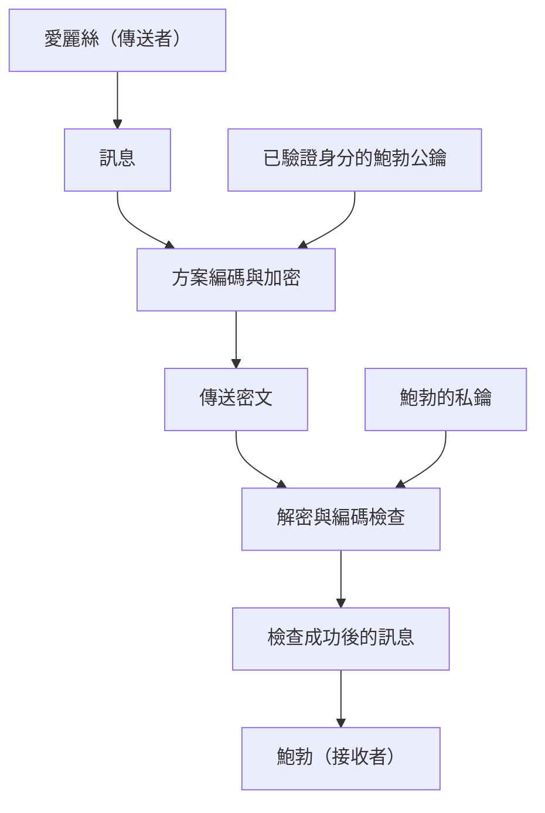
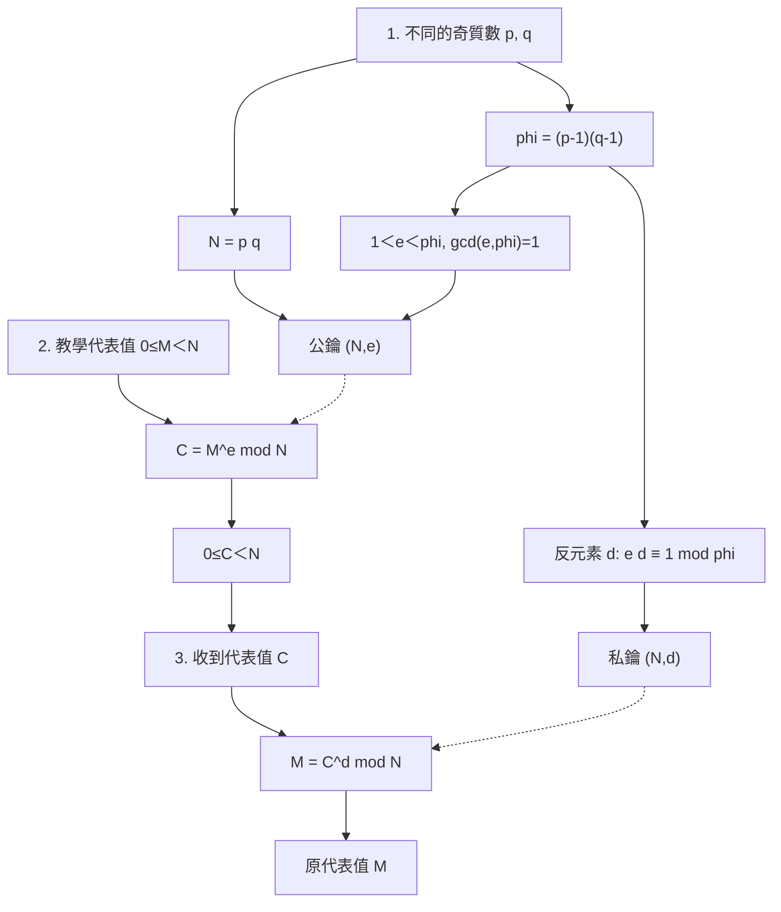
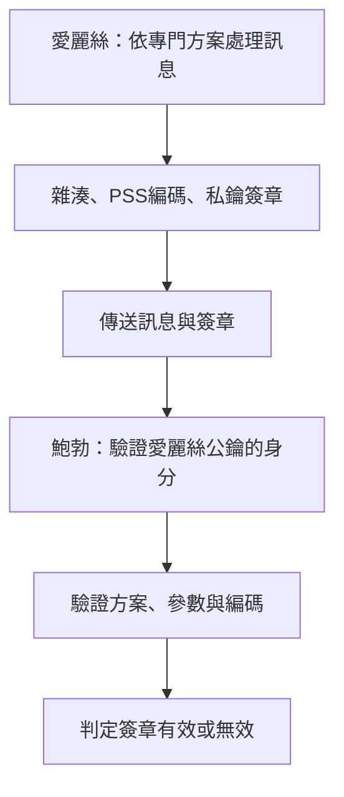

RSA可用於公開金鑰加密與數位簽章。它的算術原理可以從高中數學中的質數、餘數與次方開始理解。不過，直接對整數做模冪運算的教學模型，與實際通訊使用的加密方案需要區分。

本文用公開的小整數追蹤計算，說明解密為什麼能還原輸入。實用的加密方案如RSAES-OAEP、簽章方案如RSASSA-PSS，各有自己的編碼與驗證規則。也可參閱[公開金鑰、雜湊與簽章概述](/zh-tw/p/modern-cryptography-public-key-hash-signature/)。

## 1. 對稱加密與公開金鑰加密

對稱加密中，收發雙方共用一把秘密金鑰來加密與解密。它適合有效率地處理大量資料，但如何與首次通訊的對象安全共用金鑰，是另一個問題。

公開金鑰加密中，接收者鮑勃準備公開金鑰（公鑰）與私有金鑰（私鑰），傳送者愛麗絲用鮑勃的公鑰加密。掛鎖的比喻是：公開一把任何人都能扣上的鎖，而鮑勃保管開鎖的鑰匙。不過，愛麗絲仍須確認這把公鑰確實屬於鮑勃。防止公鑰被替換的身分驗證是額外的要求。



目標是讓攻擊者即使知道公鑰，在沒有私鑰時也難以在計算上解密。這不是「絕對無法解密」的無條件數學保證。公開金鑰技術還包括金鑰協議與簽章，不能把它們都當成同一種加密操作。

## 2. 質數與質因數分解

質數是大於1、正因數只有1與自身的整數。最初的例子是 $2,3,5,7,11,13,17,19,23$。每個大於1的整數都可唯一分解為質數的乘積，不計因數順序。例如 $60=2^2\times3\times5$。0不在這個定理的範圍內；1則單獨視為空乘積。

計算 $11\times13=143$ 很容易，但從 $323$ 找到 $17\times19$ 是另一項工作。RSA公開適當選取的大且不同的質數 $p,q$ 的乘積 $N=pq$。知道因數的一方可算出私鑰指數。分解模數能破解RSA，但不能據此斷言RSA的一切破解方法都已被證明與因數分解普遍等價。

「2048位元RSA」通常指**模數 $N$ 的位元長度**。2048位元的 $N$ 有617個十進位數字。採用大小均衡的兩個質數時，每個質數約為1024位元。困難程度取決於參數產生、大小、可用演算法與計算資源，不能把「必然需要數兆年」或「超過宇宙年齡」等無根據的耗時當成保證。

## 3. 同餘與餘數

就像12小時制時鐘上10點過5小時稱為3點，我們關注整數除以某個模數後的餘數。

$$15\equiv3\pmod{12}$$

對於模數 $N>1$，若 $a\equiv b\pmod N$ 且 $c\equiv d\pmod N$，加、減、乘都保持同餘關係。對非負整數 $k$，也有 $a^k\equiv b^k\pmod N$。負指數則需要反元素存在等額外條件。

因為 $7\equiv2\pmod5$，所以 $7^{100}\equiv2^{100}\pmod5$。中間結果也能替換成餘數，不必先建立完整的巨大次方值。這不表示「餘數的次方」與「次方的餘數」作為普通整數相等。

## 4. 歐拉函數與歐拉定理

歐拉函數（Euler's totient function）$\phi(N)$ 是 $1\le a\le N$ 中與 $N$ 互質的整數個數。例如 $\phi(5)=4$、$\phi(6)=2$。對於質數 $p$，

$$\phi(p)=p-1$$

對於不同的質數 $p,q$ 與 $N=pq$，

$$\phi(N)=(p-1)(q-1)$$

知道 $p,q$ 就能計算這個值。反過來，若知道 $\phi(N)$，由 $p+q=N-\phi(N)+1$ 與 $pq=N$ 解二次方程式也能還原兩個因數，所以歐拉函數的這個值同樣需要保密。

歐拉定理指出，若 $\gcd(a,N)=1$，則

$$a^{\phi(N)}\equiv1\pmod N$$

兩邊乘以 $a$，得到

$$a^{\phi(N)+1}\equiv a\pmod N$$

進一步，對每個非負整數 $k$，

$$a^{k\phi(N)+1}\equiv a\pmod N$$

不能去掉互質的前提後，仍使用中間結論 $a^{\phi(N)}\equiv1$。

## 5. 教學RSA的金鑰、加密與解密

接下來使用雙質數教學模型。實際參數需要適當大的、彼此不同的奇質數 $p,q$，而後面的範例刻意使用已知的小整數，方便觀察算術。

1. 計算 $N=pq$ 與 $\phi(N)=(p-1)(q-1)$。
2. 選擇滿足 $1<e<\phi(N)$、$\gcd(e,\phi(N))=1$ 的公鑰指數 $e$。
3. 求滿足下式的正的私鑰指數 $d$：

$$ed\equiv1\pmod{\phi(N)}$$

公鑰為 $(N,e)$，私鑰的一種基本表示為 $(N,d)$。$d$ 是指數，並不是標準金鑰資料的全部。實際私鑰表示還可包含質因數與CRT參數。RFC 8017使用 $\lambda(N)=\operatorname{lcm}(p-1,q-1)$ 定義條件。本文取模 $\phi(N)$ 的反元素，是同時滿足模 $\lambda(N)$ 條件的一個易懂的充分條件。

對於**訊息的整數代表值** $0\le M<N$，教學加密計算為：

$$C\equiv M^e\pmod N$$

對於密文代表值 $0\le C<N$，解密計算為：

$$M\equiv C^d\pmod N$$

實用方案會先依規定編碼訊息的位元組字串，再轉換為整數，解密後也要驗證。僅把文字直接變成整數後取次方是不夠的。



單純的RSA運算是確定性的：同一個 $M$ 總會給出同一個 $C$。若候選訊息很少，任何人都能用公鑰加密每個候選值再比較。而且，把 $C$ 替換成 $C\,r^e\bmod N$，會使解密所得代表值變成 $Mr\bmod N$。實際加密方案需要的安全性不能僅從這些算術得出。

## 6. 為什麼解密能還原輸入

解密計算的是：

$$C^d\equiv(M^e)^d\equiv M^{ed}\pmod N$$

根據金鑰條件，存在某個非負整數 $k$ 使得

$$ed=k\phi(N)+1$$

當 $\gcd(M,N)=1$ 時，歐拉定理給出：

$$M^{ed}=(M^{\phi(N)})^k M\equiv1^k M\equiv M\pmod N$$

但RSA代表值並不需要與 $N$ 互質，例如 $M=0,11,13$ 都在範圍內。因此要分別對每個質數討論。

- 若 $p\mid M$，因為指數 $ed$ 為正，有 $M^{ed}\equiv M\equiv0\pmod p$。
- 若 $p\nmid M$，費馬小定理給出 $M^{p-1}\equiv1\pmod p$。因為 $ed-1$ 是 $p-1$ 的倍數，得到 $M^{ed}\equiv M\pmod p$。
- 模 $q$ 時也可作相同論證。

不同的質數 $p,q$ 互質，由中國餘數定理（Chinese remainder theorem）得到：

$$M^{ed}\equiv M\pmod{pq}$$

這對所有代表值 $0\le M<N$ 都成立。這證明的是算術正確性，並不是加密方案抵禦竊聽或竄改的安全性。

## 7. 用小質數手算

取 $p=11,q=13$，則 $N=143$、$\phi(N)=120$。選擇 $e=7$，求解 $7d\equiv1\pmod{120}$。因為 $7\times103=721=6\times120+1$，所以可取 $d=103$。

教學輸入 $M=9$ 時，$9^7=4,782,969=33,447\times143+48$，因此 $C=48$。解密給出 $48^{103}\bmod143=9$。在Python中，可用 `pow(48, 103, 143)`，不必先建立完整的整數 $48^{103}$。

這些質數與私鑰指數都是人人可見的公開教學值，不能用於保護秘密訊息。

## 8. 用擴展歐幾里得演算法求反元素

$7d\equiv1\pmod{120}$ 等價於存在整數 $d,y$ 使 $7d+120y=1$。因為 $120=17\times7+1$，所以 $1=120-17\times7$，得到 $d\equiv-17\equiv103\pmod{120}$。

一般情況下，擴展歐幾里得演算法可以求出這樣的係數。反元素存在的條件是該整數與模數互質。計算量取決於輸入長度，並不是任意大的輸入都能在固定時間內完成。

## 9. 數位簽章使用專門方案

RSA簽章由私鑰產生，用對應公鑰驗證。但把它說成「私鑰加密、公鑰解密」，會掩蓋加密方案與簽章方案在編碼及驗證規則上的差異。

只有原始關係 $S=M^d\bmod N$ 與檢查 $S^e\equiv M\pmod N$，無法構成安全的簽章方案。例如，攻擊者可先選擇 $S=2$，再用公開的 $e=7,N=143$ 算出 $M=2^7\bmod143=128$。這組值不需要使用私鑰就能通過原始檢查。它不表示能為任意事先指定的訊息簽章，而是說明這種原始檢查不足以構成簽章方案。



RSASSA-PSS等方案結合雜湊、專門的編碼與驗證。簽章不會隱藏訊息，金鑰管理以及金鑰與身分的綁定同樣重要。加密金鑰與簽章金鑰應依用途分開，並使用支援目標協定且持續維護的函式庫。

## 10. 用Python檢查教學算術

以下可獨立執行的範例適用於Python 3.8及以上版本，只使用已知教學值。`pow(e, -1, phi)` 求互質整數的模反元素，程式也明確檢查代表值範圍。它不是金鑰產生器，也沒有實作OAEP、PSS或常數時間運算。

```python
from math import gcd


def mod_inverse(e, phi):
    # Fixed public teaching parameters, not a key generator.
    if type(e) is not int or type(phi) is not int:
        raise TypeError("Integer parameters required")
    if phi <= 1 or not 1 < e < phi or gcd(e, phi) != 1:
        raise ValueError("Invalid teaching exponent or modulus")
    return pow(e, -1, phi)


def rsa_primitive_demo(value, exponent, modulus):
    # Range checks do not make raw RSA a secure encryption scheme.
    if any(type(x) is not int for x in (value, exponent, modulus)):
        raise TypeError("Integer parameters required")
    if modulus <= 1 or exponent <= 0 or not 0 <= value < modulus:
        raise ValueError("Invalid exponent, modulus or representative")
    return pow(value, exponent, modulus)


# Public toy values only. Never use this code or these keys for secrets.
p, q = 11, 13
N = p * q
phi = (p - 1) * (q - 1)
e = 7
d = mod_inverse(e, phi)
message = 9
ciphertext = rsa_primitive_demo(message, e, N)
decrypted_message = rsa_primitive_demo(ciphertext, d, N)
assert (N, phi, d, ciphertext, decrypted_message) == (143, 120, 103, 48, 9)
assert all(rsa_primitive_demo(rsa_primitive_demo(m, e, N), d, N) == m
           for m in range(N))
print(f"Public toy parameters: N={N}, e={e}, d={d}")
print(f"Ciphertext representative: {ciphertext}")
print(f"Recovered representative: {decrypted_message}")
print("All 143 representatives round-trip")
```

三參數 `pow` 在取模的同時計算次方，比先建立完整的次方值更有效率，但耗時依賴輸入與實作。輸入檢查及全部143個代表值的往返成功，仍然只是教學算術的檢查。

## 11. 實用方案與未來技術

實際RSA加密使用RSAES-OAEP之類的方案。RSA通常作為混合加密的一部分，而不是直接加密大段本文。例如，2048位元模數、SHA-256的OAEP輸入上限為 $256-2\times32-2=190$ 位元組。加密本身也不提供傳送者身分驗證。

通訊安全取決於整個協定。TLS 1.3不使用RSA金鑰傳輸；使用RSA簽章時，其作用也不同於透過加密傳輸金鑰。不能把現代通訊理解為一律「用RSA加密」。

Shor量子演算法在相應量子計算模型中以輸入長度的多項式時間完成因數分解。這既不是瞬間完成，也不是對硬體實現時間的預測。能夠完成所需計算的量子電腦會威脅RSA，因此人們研究與完善後量子密碼學。但這個名稱不保證能絕對抵禦未來的一切攻擊。

RSA教學展示質數、同餘、反元素與正確性證明；實用方案的安全性還要求編碼、身分驗證、驗證與實作等額外條件。

### 參考資料

- [RFC 8017: PKCS #1 v2.2](https://www.rfc-editor.org/rfc/rfc8017.html)（§§3, 5, 7.1, 8.1）
- [RFC 8446: TLS 1.3](https://www.rfc-editor.org/rfc/rfc8446.html)（§1.2, Appendix E.8）
- [Python 3.12: pow](https://docs.python.org/3.12/library/functions.html#pow)
- [Shor: Polynomial-Time Algorithms for Prime Factorization and Discrete Logarithms on a Quantum Computer](https://arxiv.org/abs/quant-ph/9508027)（摘要）
