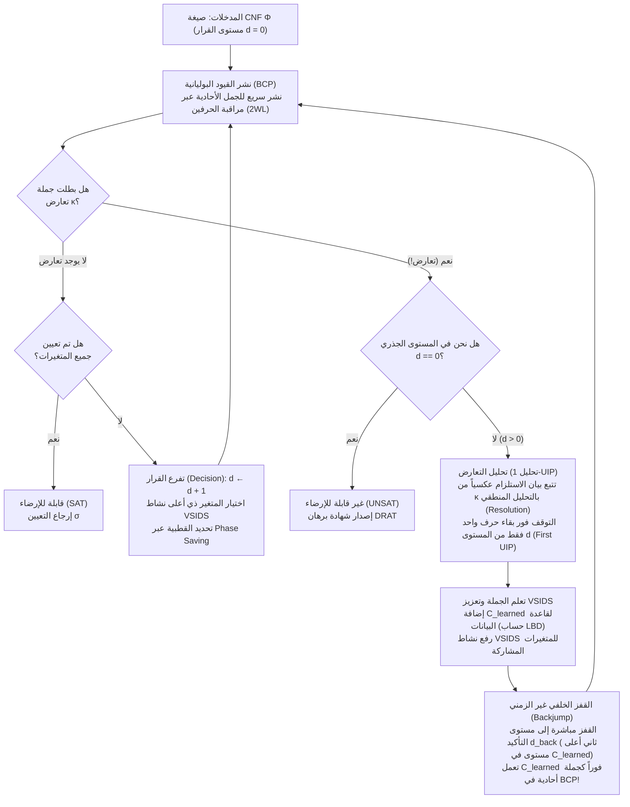
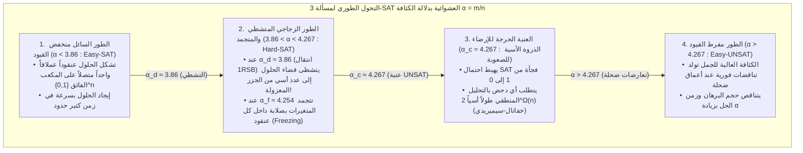

## 1. الثورة الخوارزمية الصامتة في علوم الحاسوب

افتح أي مرجع أكاديمي في علوم الحاسوب النظرية وستصادف تحذيراً صارماً:
<strong>«مسألة الإرضاء المنطقي البولياني (Boolean Satisfiability Problem - SAT) هي مسألة كاملة من الفئة NP (NP-Complete). وبما أن تعقيدها الزمني في أسوأ الحالات ينمو أسياً بمقدار $O(2^n)$ مع عدد المتغيرات $n$، فإن المسائل الكبيرة منها مستعصية حسابياً (Intractable).»</strong>

من الناحية التوافقية البحتة، يبدو هذا الكلام بديهياً؛ فصيغة منطقية تحتوي على $n = 100$ متغير بولياني فقط تمتلك $2^{100} \approx 1.26 \times 10^{30}$ تعويضاً محتملاً لقيم الصواب والخطأ. وحتى لو عمل حاسوب فائق منذ الانفجار العظيم (قبل 13.8 مليار سنة) يفحص $10^{12}$ احتمالاً في الثانية، فلن يستكشف حتى اليوم أكثر من $10^{-8}$ من فضاء البحث. وبالفعل، حتى عام 1990 تقريباً، كانت أفضل حلالات SAT تتعثر أمام صيغ لا تتجاوز $100$ متغير و$400$ جملة (Clause).

غير أن الواقع الهندسي في القرن الحادي والعشرين يدحض هذا الحدس ملايين المرات يومياً؛ إذ تقوم محركات SAT وSMT الصناعية الحديثة — مثل <strong>MiniSat وGlucose وLingeling وCaDiCaL وKissat</strong> و<strong>Z3</strong> من أبحاث مايكروسوفت — بحل مسائل التحقق الرسمي من المعالجات الدقيقة، وتحسين المترجمات، وحل اعتماديات الحزم البرمجية التي تحتوي على <strong>$10,000,000$ ($10^7$) متغير و$50,000,000$ ($5 \times 10^7$) جملة في غضون ثوانٍ معدودة</strong>.

عندما نشر دونالد كنوث (Donald E. Knuth) المجلد 4B (القسم 7.2.2.2) من موسوعته الشهيرة *فن برمجة الحاسوب (TAOCP)* عام 2015، خصص أكثر من 300 صفحة لمحركات SAT وحدها، واصفاً طفرة أواخر التسعينيات وأوائل الألفية بأنها <strong>واحدة من أعظم الثورات الخوارزمية في تاريخ علوم الحاسوب</strong>. فبعد أن كان اختزال مسألة ما إلى SAT يعني إثبات استحالة حلها عملياً، أصبح تحويل المسائل التوافقية المعقدة إلى SAT اليوم هو الاستراتيجية الذهبية لحلها فوراً.

---

## 2. الصيغة النظامية العطفية (CNF)، تحويل تسايتين، ومبرهنة كوك-ليفين (1971)

### 2.1 الصيغة النظامية العطفية (CNF) وترميز تسايتين الخطي

يتعامل حلال SAT مع صيغة منطقية قضوية $\Phi$ معرفة على $n$ متغيراً بوليانياً $V = \{x_1, \dots, x_n\}$ تأخذ قيمها في $\{0, 1\}$. يُسمى المتغير $x_v$ أو نفيه $\neg x_v$ <strong>حرفاً منطقياً (Literal)</strong> $\ell$؛ ويُشكل الفصل المنطقي (OR, $\lor$) لمجموعة من الحروف <strong>جملة أو بنداً (Clause)</strong> $C_i = \bigvee_{j=1}^{k_i} \ell_{i,j}$؛ بينما يُشكل العطف المنطقي (AND, $\land$) لعدد $m$ من الجمل <strong>الصيغة النظامية العطفية (Conjunctive Normal Form - CNF)</strong>:

$$\Phi(x_1, \dots, x_n) = \bigwedge_{i=1}^m C_i = \bigwedge_{i=1}^m \left(\bigvee_{j=1}^{k_i} \ell_{i,j}\right)$$

لو حاولنا تحويل دارة منطقية عشوائية إلى CNF بشكل مباشر عبر تطبيق قانون التوزيع $A \lor (B \land C) \equiv (A \lor B) \land (A \lor C)$ مراراً وتكراراً، فسينفجر حجم الصيغة أسياً. في عام 1968، حل عالم الرياضيات الروسي <strong>غريغوري تسايتين (Grigori Tseitin)</strong> هذه المعضلة عبر <strong>تحويل تسايتين (Tseitin Transformation)</strong>: حيث يُضاف <strong>متغير مساعد (Auxiliary Variable)</strong> جديد $y_g$ لمخرج كل بوابة منطقية $g$ في الدارة، ويُعبَّر عن التكافؤ المحلي $y_g \leftrightarrow \text{gate}(a, b)$ بثلاث أو أربع جمل فقط. على سبيل المثال، بوابة AND $y_g \leftrightarrow (a \land b)$ تكافئ ثلاث جمل بالضبط:

$$\left(\neg y_g \lor a\right) \;\land\; \left(\neg y_g \lor b\right) \;\land\; \left(y_g \lor \neg a \lor \neg b\right)$$

وبذلك تتحول أي دارة منطقية تضم $|G|$ بوابة في <strong>زمن ومساحة خطيين تماماً $O(|G|)$</strong> إلى صيغة 3-CNF <strong>متكافئة الإرضاء (Equisatisfiable)</strong>.

### 2.2 مبرهنة كوك-ليفين وهاوية التعقيد بين 2-SAT و3-SAT

في عام 1971، أثبت <strong>ستيفن كوك (Stephen Cook)</strong> و<strong>ليونيد ليفين (Leonid Levin)</strong> بشكل مستقل <strong>مبرهنة كوك-ليفين (Cook-Levin Theorem)</strong>: كل مسألة قرار في الفئة $\text{NP}$ يمكن اختزالها في زمن كثير حدود إلى SAT عن طريق ترميز جدول الحساب الزمكاني لآلة تورينغ غير حتمية خلال $p(n)$ خطوة (الحالات $S_{t,q}$، موقع الرأس $H_{t,i}$، ورموز الشريط $T_{t,i,\sigma}$) على هيئة صيغة CNF.

وعندما تحتوي كل جملة على $k$ حروف كحد أقصى (<strong>$k$-SAT</strong>)، تبرز هاوية رياضية فاصلة بين $k = 2$ و$k = 3$:
- <strong>مسألة 2-SAT تُحل في زمن خطي $O(n + m)$</strong>: لأن الجملة الثنائية $(\ell_1 \lor \ell_2)$ تكافئ استلزامين موجهين حتميين $(\neg \ell_1 \Rightarrow \ell_2) \land (\neg \ell_2 \Rightarrow \ell_1)$. ومن خلال بناء <strong>بيان الاستلزام (Implication Graph)</strong> على $2n$ حرفاً، تحدد خوارزمية تارجان (Tarjan) <strong>المكونات المترابطة بقوة (SCC)</strong> في زمن $O(n+m)$: وتكون الصيغة قابلة للإرضاء إذا وفقط إذا لم يشترك أي متغير $x_v$ مع نفيه $\neg x_v$ في نفس المكون المترابط بقوة.
- <strong>مسألة 3-SAT كاملة من الفئة NP</strong>: الجملة الثلاثية $(\ell_1 \lor \ell_2 \lor \ell_3)$ تكافئ $(\neg \ell_1 \land \neg \ell_2) \Rightarrow \ell_3$، وهي حافة فائقة (Hyperedge) تتطلب تحقق مقدمتين معاً. وتحت <strong>فرضية الزمن الأسي (ETH)</strong>، لا توجد خوارزمية حتمية تحل 3-SAT في زمن دون أسي $2^{o(n)}$ في أسوأ الحالات.

---

## 3. خوارزمية DPLL الكلاسيكية (1962) ومأساة التراجع الزمني

تجمع خوارزمية <strong>DPLL</strong> (ديفيس، بوتنام، لوجمان، لوفلاند، 1962) بين البحث في العمق وآلية <strong>نشر الوحدة (Unit Propagation / Boolean Constraint Propagation - BCP)</strong>:

> <strong>نشر الوحدة (BCP)</strong>:
> إذا كانت جميع الحروف في جملة $C = (\ell_1 \lor \dots \lor \ell_{k-1} \lor \ell_k)$ باستثناء $\ell_k$ قد أخذت القيمة `False` ($0$) بينما بقي $\ell_k$ غير معين، فإن $C$ تُسمى <strong>جملة أحادية (Unit Clause)</strong>. عندئذٍ يفرض المحرك فوراً $\ell_k = \text{True}$ ($1$) دون تفرع، مما يطلق سلسلة متتالية تشبه أحجار الدومينو من الاستنتاجات حتى الاستقرار أو حدوث <strong>تعارض (Conflict)</strong>.

<strong>لماذا عجزت خوارزمية DPLL عن تخطي حاجز 100 متغير؟</strong>
بسبب <strong>التراجع الزمني الأعمى (Chronological Backtracking)</strong>. فلو افترض المحرك $x_1 = 0$ عند <strong>مستوى القرار $d = 1$</strong>، ثم اتخذ 48 قراراً مستقلاً تماماً للمتغيرات $x_2, \dots, x_{49}$ في المستويات $d = 2 \dots 49$، وعند <strong>المستوى $d = 50$</strong> اختار $x_{50} = 1$ فحدث تعارض فوري سببه الوحيد هو $x_1 = 0$ و$x_{50}$ عبر الجمل $(x_1 \lor \neg x_{50} \lor \pm x_{51})$ و$(x_1 \lor x_{50} \lor \pm x_{52})$، فإن DPLL لا يدرك أن الجذر يكمن في المستوى 1، بل يتراجع خطوة واحدة فقط إلى $d = 49$ ويعكس المتغير البريء $x_{49}$، مكرراً نفس الفشل عبر <strong>$2^{48} \approx 2.81 \times 10^{14}$ شجرة فرعية غير ذات صلة</strong> (<strong>التخبط / Thrashing</strong>)!

---

## 4. ثورة CDCL: بيانات الاستلزام، تحليل 1-UIP، والقفز الخلفي غير الزمني

قدم كل من ماركيز-سيلفا وساكالا في محرك <strong>GRASP</strong> (عام 1996)، ثمطور فريق موسكيويتز وماليك في جامعة برينستون عبر محرك <strong>Chaff</strong> (عام 2001)، معمارية <strong>تعلم الجمل الموجه بالتعارض (Conflict-Driven Clause Learning - CDCL)</strong>.



### 4.1 بيان الاستلزام، التحليل المنطقي (Resolution)، ونقطة الاستلزام الفريدة الأولى (1-UIP)

يسجل كل حرف معين $\ell@d$ مستوى قراره $d$ و<strong>جملة السبب (Antecedent / Reason Clause)</strong> $\text{reason}(\ell)$. وعندما تبطل جملة تعارض $\kappa$، يبدأ CDCL من $C \leftarrow \kappa$ ويتتبع مكدس التعيينات (Trail) عكسياً في المستوى الحالي $d_{\text{curr}}$ مطبقاً <strong>قاعدة التحليل المنطقي (Boolean Resolution)</strong>:

$$\frac{(A \lor x) \qquad (\neg x \lor B)}{(A \lor B)} = \text{Res}(C_1, C_2, x)$$

في بيان الاستلزام، يُسمى الرأس $u@d_{\text{curr}}$ <strong>نقطة استلزام فريدة (UIP)</strong> إذا كان *كل* مسار موجه من متغير القرار $\ell_{\text{dec}}@d_{\text{curr}}$ إلى رأس التعارض $\Lambda$ يمر حتماً عبر $u$. وتُسمى أقرب نقطة UIP إلى التعارض <strong>نقطة الاستلزام الفريدة الأولى (First UIP / 1-UIP)</strong>، ويتم الوصول إليها جبرياً في اللحظة التي يتبقى فيها داخل الجملة $C$ <strong>حرف واحد فقط ينتمي إلى مستوى القرار الحالي $d_{\text{curr}}$</strong>!

في مثالنا مع $x_1 = 0@1, x_2 = 0@2, x_3 = 1@3$ والقرار $x_4 = 1@5$ والجمل $\omega_1 = (x_1 \lor \neg x_4 \lor x_5)$ و$\omega_2 = (\neg x_4 \lor \neg x_5 \lor x_6)$ و$\omega_3 = (x_2 \lor \neg x_6 \lor x_7)$ و$\omega_4 = (\neg x_3 \lor \neg x_6 \lor x_8)$ وصولاً للتعارض $\kappa = (\neg x_7 \lor \neg x_8)$، فإن خطوتي تحليل لـ $\kappa$ مع $\omega_4$ ثم $\omega_3$ تنتجان فوراً <strong>الجملة المتعلمة 1-UIP</strong>:

$$C_{\text{learned}} = \left(x_2@2 \lor \neg x_3@3 \lor \neg x_6@5\right)$$

### 4.2 القفز الخلفي غير الزمني (Backjumping) ومستوى التأكيد

بما أن المستويات في $C_{\text{learned}}$ هي $\{5, 3, 2\}$، يقفز المحرك مباشرة إلى <strong>ثاني أعلى مستوى قرار (مستوى التأكيد Assertion Level) $d_{\text{back}} = 3$</strong>! وعند المستوى $3$، تظل $x_2@2$ و$\neg x_3@3$ خاطئة بينما يعود $\neg x_6$ حراً، فتعمل $C_{\text{learned}}$ فوراً <strong>كجملة أحادية مؤكدة</strong> وتفرض $\neg x_6 = 1@3$ ($x_6 = 0@3$) عبر BCP!

---

## 5. المعجزات الهندسية: مراقبة الحرفين (2WL)، وVSIDS، وLBD

1. <strong>مراقبة الحرفين (Two-Watched Literals - 2WL, Chaff 2001)</strong>:
   ما دام في الجملة حرفان على الأقل غير زائفين، فلن تصبح الجملة أحادية ولا متعارضة أبداً. لذلك يراقب المحرك <strong>حرفين فقط $w_1, w_2$ في كل جملة</strong>. وتكمن المعجزة الكبرى عند <strong>القفز الخلفي (Backjump)</strong>: فإلغاء تعيين المتغيرات يحافظ تلقائياً على شرط 2WL، مما يعني أن <strong>التراجع يتطلب صفراً من تحديثات المؤشرات ($O(1)$)</strong>!
2. <strong>خوارزمية VSIDS وحفظ الطور (Phase Saving)</strong>:
   تُمنح المتغيرات المشاركة في تحليل التعارض زيادة $+\Delta$ في نشاطها مع تضخيم $\Delta \leftarrow \Delta / \gamma$ ($\gamma = 0.95$) بعد كل تعارض، مما يركز البحث كشعاع ليزر على عنق الزجاجة النشط.
3. <strong>مسافة كتل الحروف (LBD / جمل الغراء Glue Clauses) وإعادة التشغيل السريع</strong>:
   يُعرّف محرك Glucose (عام 2009) قيمة $\text{LBD}(C)$ بعدد مستويات القرار المختلفة في الجملة المتعلمة $C$. الجمل ذات $\text{LBD} = 2$ (<strong>Glue Clauses</strong>) تربط نقطة UIP الحالية بكتلة قرار سابقة وحيدة وتُحفظ للأبد.

| البعد المعماري | DPLL الكلاسيكي (1962) | الجيل الأول CDCL (GRASP / Chaff 2001) | أحدث محركات CDCL (Glucose / CaDiCaL / Kissat) |
| :--- | :--- | :--- | :--- |
| <strong>بنية بيانات BCP</strong> | عدادات كاملة للحروف في كل جملة | <strong>مراقبة الحرفين (2WL)</strong> (تكلفة التراجع $O(1)$ دون تحديث مؤشرات) | <strong>2WL مع حروف حاجبة مدمجة</strong> + قوائم سريعة للجمل الثنائية |
| <strong>التعافي من التعارض</strong> | <strong>تراجع زمني</strong> ($d-1$، تخبط أسي $2^k$) | <strong>قفز خلفي غير زمني</strong> إلى مستوى التأكيد $d_{\text{back}}$ | هجين بين القفز الخلفي والتراجع الزمني المحلي (2018) |
| <strong>تعلم الجمل</strong> | لا يوجد (شجرة بحث بلا ذاكرة) | <strong>تحليل 1-UIP</strong> + تقليص الجمل العودي | 1-UIP + الاختزال الذاتي الفوري والتنشيط وحذف المتغيرات (BVE) |
| <strong>موجه التفرع</strong> | ترتيب ثابت / DLIS | <strong>VSIDS</strong> (نشاط متضائل أسياً مدفوع بالتعارض) | التناوب بين <strong>EVSIDS + VMTF</strong> + حفظ الطور والبحث المحلي WalkSAT |
| <strong>إدارة قاعدة الجمل</strong> | غير متاح | حذف دوري حسب الطول والنشاط | <strong>إدارة ثلاثية المستويات عبر LBD</strong> (جمل الغراء $\text{LBD} \le 2$ دائمة) |

---

## 6. تنفيذ كامل لمحرك CDCL بلغة Python

فيما يلي كود Python متكامل ومستقل ينفذ محرك CDCL مع نشر القيود (BCP)، وتتبع بيان الاستلزام، و<strong>استنتاج 1-UIP</strong>، و<strong>القفز الخلفي غير الزمني</strong>، وموجه <strong>VSIDS</strong>:

```python
from typing import List, Dict, Optional, Set, Tuple

class CDCLSolver:
    '''Minimal Conflict-Driven Clause Learning (CDCL) SAT Solver with 1-UIP & VSIDS.'''
    def __init__(self, num_vars: int, clauses: List[List[int]]):
        self.num_vars = num_vars
        self.clauses: List[List[int]] = [list(set(c)) for c in clauses]
        self.assigns: Dict[int, bool] = {}
        self.trail: List[int] = []
        self.level: Dict[int, int] = {}
        self.reason: Dict[int, Optional[List[int]]] = {}
        self.decision_level: int = 0
        self.activity: Dict[int, float] = {v: 0.0 for v in range(1, num_vars + 1)}
        for c in self.clauses:
            for lit in c:
                self.activity[abs(lit)] += 1.0
        self.var_inc: float = 1.0
        self.var_decay: float = 0.95

    def value_lit(self, lit: int) -> Optional[bool]:
        var = abs(lit)
        if var not in self.assigns:
            return None
        return self.assigns[var] if lit > 0 else not self.assigns[var]

    def assign(self, lit: int, level: int, reason: Optional[List[int]]) -> None:
        var = abs(lit)
        self.assigns[var] = (lit > 0)
        self.trail.append(lit)
        self.level[var] = level
        self.reason[var] = reason

    def bcp(self) -> Optional[List[int]]:
        changed = True
        while changed:
            changed = False
            for clause in self.clauses:
                unassigned_lit = None
                num_unassigned = 0
                satisfied = False
                for lit in clause:
                    val = self.value_lit(lit)
                    if val is True:
                        satisfied = True
                        break
                    elif val is None:
                        num_unassigned += 1
                        unassigned_lit = lit
                if satisfied:
                    continue
                if num_unassigned == 0:
                    return clause
                if num_unassigned == 1 and unassigned_lit is not None:
                    self.assign(unassigned_lit, self.decision_level, clause)
                    changed = True
        return None

    def analyze_conflict(self, conflict_clause: List[int]) -> Tuple[List[int], int]:
        learned: Set[int] = set(conflict_clause)
        def count_curr_level(cset: Set[int]) -> int:
            return sum(1 for lit in cset if self.level[abs(lit)] == self.decision_level)

        idx = len(self.trail) - 1
        while count_curr_level(learned) > 1:
            while True:
                pivot_lit = self.trail[idx]
                idx -= 1
                if -pivot_lit in learned and self.level[abs(pivot_lit)] == self.decision_level:
                    break
            pivot_var = abs(pivot_lit)
            antecedent = self.reason[pivot_var]
            assert antecedent is not None
            self.activity[pivot_var] += self.var_inc
            learned.remove(-pivot_lit)
            for lit in antecedent:
                if lit != pivot_lit:
                    learned.add(lit)

        learned_clause = list(learned)
        for lit in learned_clause:
            self.activity[abs(lit)] += self.var_inc
        self.var_inc /= self.var_decay
        levels = sorted({self.level[abs(lit)] for lit in learned_clause}, reverse=True)
        backjump_level = levels[1] if len(levels) > 1 else 0
        return learned_clause, backjump_level

    def backtrack(self, target_level: int) -> None:
        while self.trail and self.level[abs(self.trail[-1])] > target_level:
            lit = self.trail.pop()
            var = abs(lit)
            del self.assigns[var], self.level[var], self.reason[var]
        self.decision_level = target_level

    def solve(self) -> Tuple[bool, Optional[Dict[int, bool]]]:
        if self.bcp() is not None:
            return False, None
        while True:
            unassigned = [v for v in range(1, self.num_vars + 1) if v not in self.assigns]
            if not unassigned:
                return True, dict(self.assigns)
            branch_var = max(unassigned, key=lambda v: self.activity[v])
            self.decision_level += 1
            self.assign(branch_var, self.decision_level, reason=None)
            while True:
                conflict = self.bcp()
                if conflict is None:
                    break
                if self.decision_level == 0:
                    return False, None
                learned_clause, backjump_level = self.analyze_conflict(conflict)
                self.clauses.append(learned_clause)
                self.backtrack(backjump_level)
```

---

## 7. الفيزياء الإحصائية والتحول الطوري في مسائل $k$-SAT العشوائية ($\alpha_c \approx 4.267$)

لصيغة 3-SAT عشوائية تضم $n$ متغيراً و$m = \alpha n$ جملة (<strong>نسبة كثافة الجمل إلى المتغيرات $\alpha = m / n$</strong>)، تعطي طريقة العزم الأول القيمة المتوقعة لعدد الحلول $\mathbb{E}[Z]$:

$$\mathbb{E}[Z] = 2^n \left(1 - 2^{-3}\right)^m = \left(2 \cdot \left(\frac{7}{8}\right)^\alpha\right)^n \implies \alpha_{\text{annealed}} = \frac{\ln 2}{\ln(8/7)} \approx 5.191$$

وباستخدام <strong>طريقة التجويف (Cavity Method)</strong> و<strong>كسر تناظر النسخ ذي الخطوة الواحدة (1RSB)</strong> من فيزياء زجاجيات البرم (Spin Glasses)، حدد ميزار وباريزي وزيكينا (2002) العتبة الحرجة الدقيقة لتحول الطور في 3-SAT العشوائية:

$$\alpha_c \approx 4.267$$



عند النقطة الحرجة $\alpha_c \approx 4.267$، يشكل البيان الفائق العشوائي <strong>بياناً موسعاً (Expander Graph)</strong> بلا اختناقات محلية، مما يفرض على أي برهان بالتحليل المنطقي طولاً أسياً $2^{\Omega(n)}$ (Chvátal & Szemerédi, 1988). أما <strong>المسائل الصناعية الواقعية فتتميز ببنية مجتمعية معيارية (Community Structure) ومجموعات أبواب خلفية صغيرة (Backdoor Sets)</strong> (Ansótegui et al. 2012; Williams, Gomes, Selman 2003)، وهو ما يستغله CDCL لتفكيك 10 ملايين متغير في ثوانٍ.

---

## 8. إنجازات العالم الحقيقي وبرهان 200 تيرابايت الرياضي

1. <strong>الرياضيات بمساعدة الحاسوب وبرهان DRAT بحجم 200 تيرابايت (Heule, Kullmann, Marek 2016)</strong>: باستخدام تقنية <strong>Cube-and-Conquer</strong> على 800 نواة، أثبت الباحثون أن مسألة ثلاثيات فيثاغورس البوليانية ($a^2 + b^2 = c^2$) قابلة للإرضاء حتى <strong>$N = 7824$ (SAT)</strong>، لكنها <strong>مستحيلة عند $N = 7825$ (UNSAT)</strong>، مصدرين <strong>شهادة برهان DRAT رسمية بحجم 200 تيرابايت</strong>، كما حسموا عدد شور $S(5) = 160$ (2018) وحدسية كيلر في البعد السابع (2020).
2. <strong>التحقق الرسمي من رقائق أشباه الموصلات (CEC وBMC)</strong>: تُبنى دارات <strong>Miter</strong> (بوابة XOR بين تصميم RTL ومستوى البوابات) وتُفحص بمحركات SAT قبل تصنيع أي معالج حديث.
3. <strong>مديرو الحزم (Debian apt, Rust Cargo, Dart PubGrub, uv)</strong> و<strong>محركات SMT ($\text{DPLL}(T)$: Z3 وcvc5)</strong>: بدمج نواة CDCL مع حلالات النظريات الرياضية، تقود هذه المحركات التنفيذ الرمزي ومحرك أمان السحابة <strong>AWS Zelkova</strong>.
