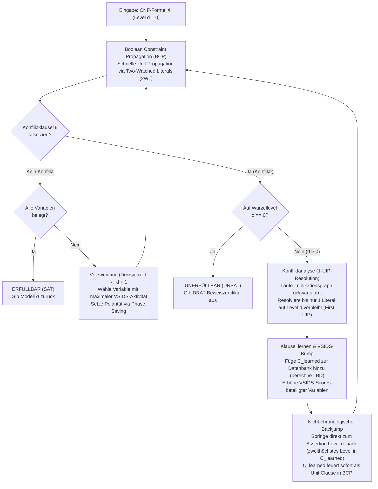
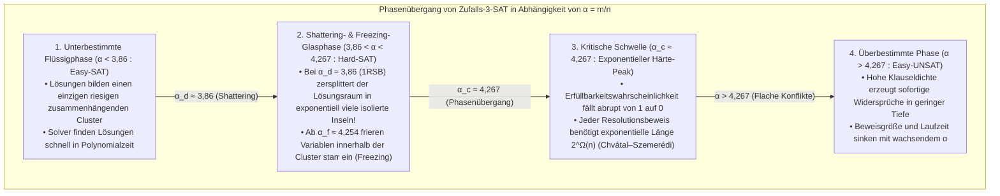

## 1. Die stille algorithmische Revolution der Informatik

Fast jedes Lehrbuch der theoretischen Informatik beginnt das Kapitel über Komplexitätstheorie mit einer unmissverständlichen Warnung:
<strong>„Das Erfüllbarkeitsproblem der Aussagenlogik (Boolean Satisfiability Problem, SAT) ist NP-vollständig. Da seine Worst-Case-Zeitkomplexität exponentiell mit $O(2^n)$ in der Anzahl der Variablen $n$ wächst, sind große Instanzen praktisch unlösbar (intractable).“</strong>

Rein kombinatorisch scheint dieses Urteil unumstößlich: Eine Formel mit nur $n = 100$ Booleschen Variablen besitzt $2^{100} \approx 1,26 \times 10^{30}$ mögliche Wahrheitswertzuweisungen. Selbst ein Supercomputer, der seit dem Urknall (vor 13,8 Milliarden Jahren) jede Sekunde $10^{12}$ Belegungen prüft, hätte bis heute weniger als $10^{-8}$ des Suchraums durchkämmt. Tatsächlich scheiterten um 1990 die besten SAT-Solver regelmäßig an Formeln mit kaum $100$ Variablen und $400$ Klauseln.

Doch im 21. Jahrhundert widerlegt die industrielle Praxis diese Lehrbuch-Intuition täglich millionenfach. Moderne Hochleistungs-SAT- und SMT-Solver wie <strong>MiniSat, Glucose, Lingeling, CaDiCaL, Kissat</strong> und <strong>Z3</strong> (Microsoft Research) lösen bei der formalen Hardware-Verifikation von Mikroprozessoren, der Compiler-Optimierung und der Paketabhängigkeitsauflösung routinemäßig Formeln mit <strong>$10.000.000$ ($10^7$) Variablen und $50.000.000$ ($5 \times 10^7$) Klauseln in wenigen Sekunden</strong>.

Donald E. Knuth widmete diesem Phänomen 2015 in Band 4B (Abschnitt 7.2.2.2) von *The Art of Computer Programming* über 300 Seiten und würdigte den Durchbruch der späten 1990er und frühen 2000er Jahre als <strong>eine der größten algorithmischen Revolutionen in der Geschichte der Informatik</strong>. War die Reduktion eines Problems auf SAT früher ein Beweis seiner praktischen Unlösbarkeit, so ist die Übersetzung in CNF heute der Königsweg, um ein kombinatorisches Problem mithilfe universeller Hochleistungs-Solver blitzschnell zu knacken.

---

## 2. Konjunktive Normalform (CNF), Tseitin-Transformation und der Satz von Cook-Levin (1971)

### 2.1 Konjunktive Normalform (CNF) und die lineare Tseitin-Kodierung

Ein SAT-Solver verarbeitet eine aussagenlogische Formel $\Phi$ über $n$ Booleschen Variablen $V = \{x_1, \dots, x_n\}$ mit Werten in $\{0, 1\}$. Ein <strong>Literal</strong> $\ell \in \{x_v, \neg x_v\}$ ist eine Variable oder ihre Negation; eine <strong>Klausel</strong> $C_i = \bigvee_{j=1}^{k_i} \ell_{i,j}$ ist eine Disjunktion (ODER, $\lor$) von Literalen; und eine Formel in <strong>Konjunktiver Normalform (CNF)</strong> ist eine Konjunktion (UND, $\land$) von $m$ Klauseln:

$$\Phi(x_1, \dots, x_n) = \bigwedge_{i=1}^m C_i = \bigwedge_{i=1}^m \left(\bigvee_{j=1}^{k_i} \ell_{i,j}\right)$$

Würde man eine beliebige digitale Schaltung naiv über das Distributivgesetz $A \lor (B \land C) \equiv (A \lor B) \land (A \lor C)$ in CNF ausmultiplizieren, würde die Formelgröße exponentiell explodieren. <strong>Grigori Tseitin</strong> löste dieses Problem 1968 durch die <strong>Tseitin-Transformation</strong>: Für jedes Logikgatter $g$ der Schaltung wird eine neue <strong>Hilfsvariable</strong> $y_g$ eingeführt, welche die lokale Äquivalenz $y_g \leftrightarrow \text{gate}(a, b)$ in nur 3 bis 4 Klauseln kodiert. Ein UND-Gatter $y_g \leftrightarrow (a \land b)$ wird exakt durch drei Klauseln dargestellt:

$$\left(\neg y_g \lor a\right) \;\land\; \left(\neg y_g \lor b\right) \;\land\; \left(y_g \lor \neg a \lor \neg b\right)$$

Damit lässt sich jeder Schaltkreis mit $|G|$ Gattern in strikt <strong>linearer Zeit und linearer Größe $O(|G|)$</strong> in eine <strong>erfüllbarkeitsäquivalente (equisatisfiable)</strong> 3-CNF-Formel überführen.

### 2.2 Der Satz von Cook-Levin und die Komplexitätsklippe zwischen 2-SAT und 3-SAT

1971 bewiesen <strong>Stephen Cook</strong> und <strong>Leonid Levin</strong> unabhängig voneinander den <strong>Satz von Cook-Levin</strong>: Jedes Entscheidungsproblem der Klasse $\text{NP}$ lässt sich in Polynomialzeit auf SAT reduzieren, indem das Berechnungs-Tableau einer nichtdeterministischen Turingmaschine über $p(n)$ Schritte (Zustände $S_{t,q}$, Kopfpositionen $H_{t,i}$, Bandsymbole $T_{t,i,\sigma}$) als CNF-Formel kodiert wird. SAT war damit das <strong>erste als NP-vollständig bewiesene Problem</strong>.

Zwischen $k = 2$ und $k = 3$ Literalen pro Klausel verläuft ein dramatischer Abgrund:
- <strong>2-SAT ist in Linearzeit $O(n + m)$ lösbar</strong>: Jede binäre Klausel $(\ell_1 \lor \ell_2)$ ist äquivalent zu zwei gerichteten Implikationen $(\neg \ell_1 \Rightarrow \ell_2) \land (\neg \ell_2 \Rightarrow \ell_1)$. Im resultierenden <strong>Implikationsgraphen</strong> über $2n$ Literalen prüft Tarjans Algorithmus für <strong>starke Zusammenhangskomponenten (SCCs)</strong> in $O(n+m)$ Zeit, ob eine Variable $x_v$ und ihre Negation $\neg x_v$ im selben SCC liegen.
- <strong>3-SAT ist NP-vollständig</strong>: Eine ternäre Klausel $(\ell_1 \lor \ell_2 \lor \ell_3)$ entspricht $(\neg \ell_1 \land \neg \ell_2) \Rightarrow \ell_3$ – einer Hyperkante, die zwei gleichzeitige Prämissen benötigt. Unter der <strong>Exponential Time Hypothesis (ETH)</strong> existiert kein Algorithmus, der 3-SAT im Worst Case in subexponentieller Zeit $2^{o(n)}$ löst.

---

## 3. Klassisches DPLL (1962) und das Debakel des chronologischen Backtrackings

Der <strong>DPLL-Algorithmus</strong> (Davis, Putnam, Logemann, Loveland, 1962) kombiniert Tiefensuche mit <strong>Unit Propagation (Boolean Constraint Propagation, BCP)</strong>:

> <strong>Unit Propagation (BCP)</strong>:
> Sind in einer Klausel $C = (\ell_1 \lor \dots \lor \ell_{k-1} \lor \ell_k)$ unter der aktuellen Teilbelegung alle Literale außer $\ell_k$ bereits `False` ($0$), während $\ell_k$ noch unbelegt ist, so heißt $C$ <strong>Einheitsklausel (Unit Clause)</strong>. Um $C$ zu erfüllen, muss $\ell_k$ sofort zwingend auf `True` ($1$) gesetzt werden, was eine Domino-Kaskade weiterer Implikationen auslöst.

<strong>Warum scheiterte DPLL an der 100-Variablen-Grenze?</strong>
Weil DPLL bei einem Widerspruch (Conflict) stur <strong>chronologisches Backtracking</strong> zur unmittelbar vorhergehenden Entscheidungsstufe $d - 1$ durchführt.
Setzt der Solver auf <strong>Entscheidungslevel $d = 1$</strong> die Variable $x_1 = 0$, trifft dann auf den Stufen $d = 2, \dots, 49$ völlig unabhängige Entscheidungen für $x_2, \dots, x_{49}$ und wählt schließlich auf <strong>Stufe $d = 50$</strong> den Wert $x_{50} = 1$, der allein wegen $x_1 = 0$ über vier lokale Klauseln $(x_1 \lor \neg x_{50} \lor \pm x_{51})$ und $(x_1 \lor x_{50} \lor \pm x_{52})$ sofort kollidiert, so erkennt DPLL nicht, dass $x_1 = 0$ die Wurzel des Übels ist. Stattdessen springt DPLL nur zu Stufe $d = 49$ zurück, invertiert das unschuldige $x_{49}$ und wiederholt denselben Konflikt in allen <strong>$2^{48} \approx 2,81 \times 10^{14}$ irrelevanten Teilbäumen</strong> (<strong>Thrashing</strong>)!

---

## 4. Die CDCL-Revolution: Implikationsgraphen, First-UIP-Resolution und Backjumping

Mit <strong>GRASP</strong> (Marques-Silva & Sakallah, 1996) und <strong>Chaff</strong> (Moskewicz et al., 2001) ersetzte <strong>Conflict-Driven Clause Learning (CDCL)</strong> das blinde Zurückweichen durch kausale Konfliktanalyse.



### 4.1 Implikationsgraph, Boolesche Resolution und der First UIP (1-UIP)

Jedes zugewiesene Literal $\ell@d$ speichert sein Entscheidungslevel $d$ und seine <strong>Ursachenklausel (Reason / Antecedent Clause)</strong> $\text{reason}(\ell)$. Wird eine Klausel $\kappa$ falsifiziert, startet CDCL mit $C \leftarrow \kappa$ und wendet rückwärts entlang des Zuweisungs-Trails wiederholt die <strong>Boolesche Resolution</strong> an:

$$\frac{(A \lor x) \qquad (\neg x \lor B)}{(A \lor B)} = \text{Res}(C_1, C_2, x)$$

Ein Knoten $u@d_{\text{curr}}$ im Implikationsgraphen heißt <strong>Unique Implication Point (UIP)</strong>, wenn *jeder* gerichtete Pfad von der Entscheidungsvariable $\ell_{\text{dec}}@d_{\text{curr}}$ zum Konfliktknoten $\Lambda$ durch $u$ verläuft (Dominator). Der dem Konflikt am nächsten gelegene UIP ist der <strong>First UIP (1-UIP)</strong>.
In der Rückwärts-Resolution ist der 1-UIP exakt in dem Moment erreicht, in dem die Arbeitsklausel $C$ <strong>nur noch ein einziges Literal des aktuellen Entscheidungslevels $d_{\text{curr}}$</strong> enthält!

Ausgehend von $x_1 = 0@1, x_2 = 0@2, x_3 = 1@3$ und der Entscheidung $x_4 = 1@5$ mit den Klauseln $\omega_1 = (x_1 \lor \neg x_4 \lor x_5)$, $\omega_2 = (\neg x_4 \lor \neg x_5 \lor x_6)$, $\omega_3 = (x_2 \lor \neg x_6 \lor x_7)$, $\omega_4 = (\neg x_3 \lor \neg x_6 \lor x_8)$ und Konflikt $\kappa = (\neg x_7 \lor \neg x_8)$ liefert die Resolution von $\kappa$ mit $\omega_4$ (Pivot $x_8$) und anschließend mit $\omega_3$ (Pivot $x_7$) sofort die <strong>1-UIP-Lernklausel</strong>:

$$C_{\text{learned}} = \left(x_2@2 \lor \neg x_3@3 \lor \neg x_6@5\right)$$

### 4.2 Nicht-chronologisches Backjumping zum Assertion Level

Die Entscheidungslevel in $C_{\text{learned}}$ sind $\{5, 3, 2\}$. Der Solver springt <strong>nicht</strong> zu Level $4$, sondern direkt zum <strong>zweithöchsten Entscheidungslevel (Assertion Level) $d_{\text{back}} = 3$</strong>! Auf Level $3$ sind $x_2@2$ und $\neg x_3@3$ weiterhin `False`, während $\neg x_6$ wieder unbelegt ist – wodurch $C_{\text{learned}}$ sofort als <strong>Unit Clause</strong> feuert und $\neg x_6 = 1@3$ ($x_6 = 0@3$) erzwingt!

---

## 5. Engineering-Wunder: Two-Watched Literals (2WL), VSIDS und LBD

1. <strong>Two-Watched Literals (2WL, Chaff 2001)</strong>:
   Da fast $90\%$ der Rechenzeit in BCP verbracht wird, überwacht 2WL in jeder Klausel <strong>nur genau zwei nicht-falsifizierte Literale $w_1, w_2$</strong>. Solange mindestens zwei Literale nicht `False` sind, kann die Klausel weder Unit noch Konflikt werden. Wird $w_1$ `False`, sucht der Solver in der Klausel ein anderes nicht-falsifiziertes Literal $\ell'$. <strong>Der Clou beim Backtracking</strong>: Beim Rückgängigmachen von Zuweisungen bleiben $w_1$ und $w_2$ automatisch gültig – <strong>Backtracking erfordert exakt null Zeigeroperationen ($O(1)$)</strong>!
2. <strong>VSIDS (Variable State Independent Decaying Sum) & Phase Saving</strong>:
   Variablen, die an der 1-UIP-Konfliktanalyse beteiligt sind, erhalten einen Aktivitäts-Bonus $+\Delta$, während $\Delta \leftarrow \Delta / \gamma$ ($\gamma = 0.95$) nach jedem Konflikt wächst. Dieser exponentiell gewichtete gleitende Durchschnitt fokussiert die Suche wie ein Laser auf aktuelle Konfliktherde.
3. <strong>LBD (Literal Block Distance / Glue Clauses) & Rapid Restarts</strong>:
   Glucose (Audemard & Simon, 2009) bewertet gelernte Klauseln nach der Anzahl $\text{LBD}(C)$ unterschiedlicher Entscheidungslevel in $C$. Klauseln mit $\text{LBD} = 2$ (<strong>Glue Clauses</strong>) verbinden den aktuellen UIP direkt mit einem einzigen vergangenen Level und werden niemals gelöscht.

| Architektur-Merkmal | Klassisches DPLL (1962) | Erste CDCL-Generation (GRASP / Chaff 2001) | Moderne CDCL-Solver (Glucose / CaDiCaL / Kissat) |
| :--- | :--- | :--- | :--- |
| <strong>BCP-Datenstruktur</strong> | Vollständige Literalzähler pro Klausel | <strong>Two-Watched Literals (2WL)</strong> ($O(1)$ Backtracking ohne Zeiger-Updates) | <strong>2WL mit Inline-Blocking-Literalen</strong> + separate Binärklausel-Listen |
| <strong>Konfliktrücksprung</strong> | <strong>Chronologisches Backtracking</strong> ($d-1$, $2^k$-Thrashing) | <strong>Nicht-chronologischer Backjump</strong> zum Assertion Level $d_{\text{back}}$ | Hybrid aus Backjumping & chronologischem Backtracking (2018) |
| <strong>Klausellernen</strong> | Keines (gedächtnisloser Suchbaum) | <strong>First-UIP (1-UIP) Resolution</strong> + Klauselminimierung | 1-UIP + On-the-Fly Subsumption, Vivification & Variableneliminierung |
| <strong>Verzweigungs-Heuristik</strong> | Statisch / DLIS | <strong>VSIDS</strong> (exponentiell abklingende Konfliktaktivität) | <strong>EVSIDS + VMTF</strong> im Wechsel (Stable/Focused) + Phase Saving |
| <strong>Klausel-Datenbank</strong> | Keine Lernklauseln | Löschung nach Länge und Aktivität | <strong>3-Stufen-Management via LBD (Glue Clauses $\text{LBD} \le 2$ permanent)</strong> |

---

## 6. Vollständige Python-Implementierung einer CDCL-Solver-Engine

Der folgende Python-Code implementiert einen voll funktionsfähigen CDCL-Kern mit BCP, Implikationsgraph, <strong>1-UIP-Resolution</strong>, <strong>Backjumping</strong> und <strong>VSIDS</strong>:

```python
from typing import List, Dict, Optional, Set, Tuple

class CDCLSolver:
    '''Minimal Conflict-Driven Clause Learning (CDCL) SAT Solver with 1-UIP & VSIDS.'''
    def __init__(self, num_vars: int, clauses: List[List[int]]):
        self.num_vars = num_vars
        self.clauses: List[List[int]] = [list(set(c)) for c in clauses]
        self.assigns: Dict[int, bool] = {}
        self.trail: List[int] = []
        self.level: Dict[int, int] = {}
        self.reason: Dict[int, Optional[List[int]]] = {}
        self.decision_level: int = 0
        self.activity: Dict[int, float] = {v: 0.0 for v in range(1, num_vars + 1)}
        for c in self.clauses:
            for lit in c:
                self.activity[abs(lit)] += 1.0
        self.var_inc: float = 1.0
        self.var_decay: float = 0.95

    def value_lit(self, lit: int) -> Optional[bool]:
        var = abs(lit)
        if var not in self.assigns:
            return None
        return self.assigns[var] if lit > 0 else not self.assigns[var]

    def assign(self, lit: int, level: int, reason: Optional[List[int]]) -> None:
        var = abs(lit)
        self.assigns[var] = (lit > 0)
        self.trail.append(lit)
        self.level[var] = level
        self.reason[var] = reason

    def bcp(self) -> Optional[List[int]]:
        changed = True
        while changed:
            changed = False
            for clause in self.clauses:
                unassigned_lit = None
                num_unassigned = 0
                satisfied = False
                for lit in clause:
                    val = self.value_lit(lit)
                    if val is True:
                        satisfied = True
                        break
                    elif val is None:
                        num_unassigned += 1
                        unassigned_lit = lit
                if satisfied:
                    continue
                if num_unassigned == 0:
                    return clause
                if num_unassigned == 1 and unassigned_lit is not None:
                    self.assign(unassigned_lit, self.decision_level, clause)
                    changed = True
        return None

    def analyze_conflict(self, conflict_clause: List[int]) -> Tuple[List[int], int]:
        learned: Set[int] = set(conflict_clause)
        def count_curr_level(cset: Set[int]) -> int:
            return sum(1 for lit in cset if self.level[abs(lit)] == self.decision_level)

        idx = len(self.trail) - 1
        while count_curr_level(learned) > 1:
            while True:
                pivot_lit = self.trail[idx]
                idx -= 1
                if -pivot_lit in learned and self.level[abs(pivot_lit)] == self.decision_level:
                    break
            pivot_var = abs(pivot_lit)
            antecedent = self.reason[pivot_var]
            assert antecedent is not None
            self.activity[pivot_var] += self.var_inc
            learned.remove(-pivot_lit)
            for lit in antecedent:
                if lit != pivot_lit:
                    learned.add(lit)

        learned_clause = list(learned)
        for lit in learned_clause:
            self.activity[abs(lit)] += self.var_inc
        self.var_inc /= self.var_decay
        levels = sorted({self.level[abs(lit)] for lit in learned_clause}, reverse=True)
        backjump_level = levels[1] if len(levels) > 1 else 0
        return learned_clause, backjump_level

    def backtrack(self, target_level: int) -> None:
        while self.trail and self.level[abs(self.trail[-1])] > target_level:
            lit = self.trail.pop()
            var = abs(lit)
            del self.assigns[var], self.level[var], self.reason[var]
        self.decision_level = target_level

    def solve(self) -> Tuple[bool, Optional[Dict[int, bool]]]:
        if self.bcp() is not None:
            return False, None
        while True:
            unassigned = [v for v in range(1, self.num_vars + 1) if v not in self.assigns]
            if not unassigned:
                return True, dict(self.assigns)
            branch_var = max(unassigned, key=lambda v: self.activity[v])
            self.decision_level += 1
            self.assign(branch_var, self.decision_level, reason=None)
            while True:
                conflict = self.bcp()
                if conflict is None:
                    break
                if self.decision_level == 0:
                    return False, None
                learned_clause, backjump_level = self.analyze_conflict(conflict)
                self.clauses.append(learned_clause)
                self.backtrack(backjump_level)
```

---

## 7. Statistische Physik und der Phasenübergang von Zufalls-$k$-SAT ($\alpha_c \approx 4,267$)

Warum lösen CDCL-Solver industrielle Probleme mit $10^7$ Variablen in Sekunden, scheitern aber an zufälligen 3-SAT-Formeln mit nur $700$ Variablen?
Für eine zufällige 3-SAT-Formel mit $n$ Variablen und $m = \alpha n$ Klauseln (<strong>Klausel-zu-Variablen-Verhältnis $\alpha = m / n$</strong>) liefert die Methode des ersten Moments für die erwartete Lösungsanzahl $\mathbb{E}[Z]$:

$$\mathbb{E}[Z] = 2^n \left(1 - 2^{-3}\right)^m = \left(2 \cdot \left(\frac{7}{8}\right)^\alpha\right)^n \implies \alpha_{\text{annealed}} = \frac{\ln 2}{\ln(8/7)} \approx 5,191$$

Mithilfe der <strong>Cavity-Methode</strong> und <strong>One-Step Replica Symmetry Breaking (1RSB)</strong> aus der Physik der Spingläser zeigten Mézard, Parisi und Zecchina (2002), dass der wahre kritische Phasenübergang für Zufalls-3-SAT bei

$$\alpha_c \approx 4,267$$

liegt.



Am kritischen Punkt $\alpha_c \approx 4,267$ ist der Zufallshypergraph ein <strong>Expander-Graph</strong> ohne lokale Engpässe, weshalb jeder Resolutionsbeweis Klauseln linearer Breite $\Omega(n)$ und exponentielle Länge $2^{\Omega(n)}$ erfordert (Chvátal & Szemerédi, 1988).
<strong>Reale industrielle Probleme hingegen besitzen eine ausgeprägte Struktur</strong>:
1. <strong>Modularität und Community-Struktur (Ansótegui et al. 2012)</strong>: Hardware-Schaltkreise bestehen aus Modulen, die nur über schmale Schnittstellen-Variablen kommunizieren. 1-UIP-Resolution isoliert genau diese Schnittstellen als Dominatoren und zerlegt die Formel durch kurze Glue Clauses ($\text{LBD}=2$).
2. <strong>Kleine Backdoor-Mengen (Williams, Gomes, Selman 2003)</strong>: Oft genügen wenige Dutzend Schlüsselvariablen $B \subset V$ ($|B| \ll n$), nach deren Belegung der gesamte Rest der 10-Millionen-Variablen-Formel allein durch BCP-Kaskaden kollabiert!

---

## 8. Reale Triumphe: Vom 200-Terabyte-Mathematikbeweis bis zu Chip-Design und SMT

1. <strong>Computergestützte Mathematik & der 200-TB-Beweis (Heule, Kullmann, Marek 2016)</strong>:
   Lässt sich $\{1, \dots, N\}$ so mit zwei Farben färben, dass kein pythagoreisches Tripel $a^2 + b^2 = c^2$ einfarbig ist? Mit <strong>Cube-and-Conquer</strong> bewiesen Heule et al. auf 800 Kernen, dass $N = 7824$ erfüllbar (<strong>SAT</strong>), aber <strong>$N = 7825$ unerfüllbar (UNSAT)</strong> ist – dokumentiert durch ein <strong>200 Terabyte großes DRAT-Beweiszertifikat</strong>, das von formal verifizierten Proof-Checkern Bit für Bit bestätigt wurde! Ebenso lösten sie die Schur-Zahl $S(5) = 160$ (2018) und Kellers Vermutung in Dimension 7 (2020).
2. <strong>Halbleiter-EDA (Equivalence Checking & Bounded Model Checking)</strong>: Seit dem Intel-Pentium-FDIV-Bug (1994) werden RTL-Spezifikation und Gate-Level-Netzliste über eine XOR-<strong>Miter-Schaltung</strong> in CNF übersetzt und mit SAT-Solvern formal auf Äquivalenz geprüft.
3. <strong>Paketmanager (Debian apt, Rust Cargo, Dart PubGrub, uv)</strong>: Versionsabhängigkeiten werden als CNF-Klauseln modelliert; <strong>PubGrub</strong> nutzt CDCL und übersetzt den 1-UIP-Resolutionsgraphen bei Konflikten in verständliche Fehlermeldungen.
4. <strong>SMT-Solver ($\text{DPLL}(T)$: Z3 & cvc5)</strong>: Durch Kopplung eines CDCL-Kerns mit Theoriesolvern für lineare Arithmetik, Bitvektoren und Arrays bilden SMT-Solver das Rückgrat symbolischer Ausführung und der Cloud-Sicherheitsverifikation (<strong>AWS Zelkova</strong>).
