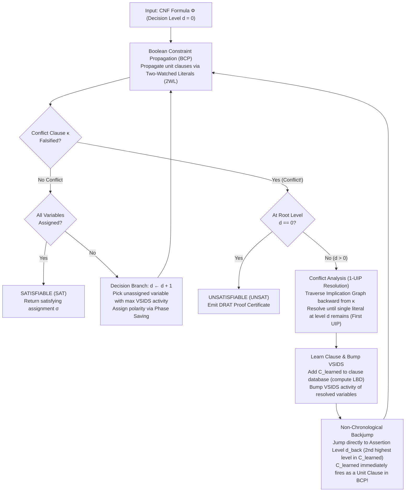
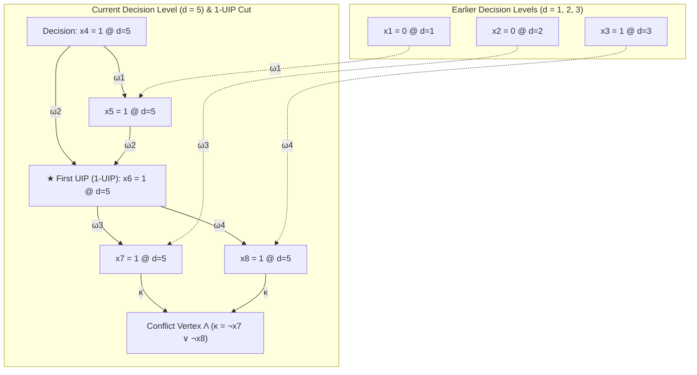
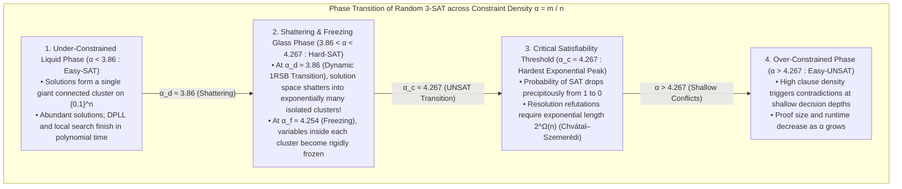

## 1. The Quiet Algorithmic Revolution of the 21st Century

Open almost any undergraduate textbook on theoretical computer science and you will encounter a stern warning:
<strong>"The Boolean Satisfiability Problem (SAT) is NP-Complete. Because its worst-case time complexity scales exponentially as $O(2^n)$ in the number of variables $n$, large instances are fundamentally intractable."</strong>

As an exercise in raw combinatorics, the warning seems unassailable. A propositional formula over $n = 100$ Boolean variables admits $2^{100} \approx 1.26 \times 10^{30}$ distinct truth assignments. Even if a hypothetical exascale supercomputer could inspect $10^{12}$ assignments every second since the Big Bang ($13.8$ billion years ago), it would still have explored less than $0.00000001\%$ of the search space today. Indeed, around 1990, the world's best SAT solvers routinely choked on formulas containing just $100$ variables and $400$ clauses.

Yet across the engineering landscape of the 21st century, reality defies that textbook intuition millions of times every day.
Modern industrial SAT and SMT solvers—such as <strong>MiniSat</strong>, <strong>Glucose</strong>, <strong>Lingeling</strong>, <strong>CaDiCaL</strong>, <strong>Kissat</strong>, and Microsoft Research's <strong>Z3</strong>—routinely ingest formal hardware verification, compiler optimization, cryptographic analysis, and package dependency instances containing <strong>$10,000,000$ ($10^7$) variables and $50,000,000$ ($5 \times 10^7$) clauses, solving them to mathematical certainty in a matter of seconds</strong>.

When Donald E. Knuth published Volume 4B (Fascicle 6, Section 7.2.2.2: *Satisfiability*) of *The Art of Computer Programming* in 2015, he devoted over 300 pages to SAT solvers alone, hailing the breakthroughs of the late 1990s and early 2000s as <strong>one of the greatest algorithmic revolutions in the history of computer science</strong>. In the 1970s and 1980s, reducing your problem to SAT was a formal proof of hopelessness—a way of telling your manager why your algorithm could never scale. Today, reducing a hard combinatorial problem to SAT is the premier engineering strategy for *solving* it at scale, leveraging thirty years of relentless algorithmic and systems engineering inside off-the-shelf SAT engines.

How can a deterministic program navigate a search space of size $2^{10,000,000}$—a number that dwarfs the $10^{80}$ atoms in the observable universe by millions of orders of magnitude—without getting lost? Conversely, why do those very same industrial solvers, capable of crushing ten-million-variable microprocessor verification circuits in seconds, grind to a complete halt when fed a synthetic random formula of just $700$ variables?

In this article, we trace the complete mathematical and algorithmic anatomy of modern SAT solving:
- <strong>The Cook-Levin Theorem (1971)</strong>, Conjunctive Normal Form (CNF), the linear-size <strong>Tseitin Transformation</strong>, and the sharp complexity cliff between <strong>2-SAT</strong> ($O(n+m)$ via Tarjan's Strongly Connected Components) and <strong>3-SAT</strong> ($O(2^n)$ under the Exponential Time Hypothesis).
- <strong>Classical DPLL (Davis-Putnam-Logemann-Loveland, 1962)</strong>, <strong>Boolean Constraint Propagation (BCP / Unit Propagation)</strong>, and why naive chronological backtracking suffers from catastrophic exponential <strong>thrashing</strong>.
- <strong>The CDCL Revolution (Conflict-Driven Clause Learning — GRASP 1996, Chaff 2001)</strong>: how solvers record the <strong>Implication Graph</strong>, apply iterated <strong>Boolean Resolution</strong> backward from a conflict clause $\kappa$ to isolate the <strong>First Unique Implication Point (1-UIP)</strong>, synthesize a permanent <strong>Learned Clause</strong>, and execute <strong>Non-Chronological Backjumping</strong> across dozens of decision levels in a single leap.
- <strong>Systems Engineering Miracles</strong>: Chaff's <strong>Two-Watched Literals (2WL)</strong> lazy data structure (which requires *zero* pointer updates upon backtracking), <strong>VSIDS</strong> exponentially decaying activity heuristics, <strong>Phase Saving</strong>, <strong>Luby Rapid Restarts</strong>, and Glucose's <strong>Literal Block Distance (LBD / Glue Clauses)</strong>.
- <strong>Statistical Physics of Random $k$-SAT</strong>: the <strong>Clause-to-Variable Ratio $\alpha = m / n$</strong>, Replica Symmetry Breaking (1RSB), solución-space shattering, and the sharp <strong>Phase Transition at $\alpha_c \approx 4.267$</strong> vs. the <strong>Community Structure and Backdoor Sets</strong> of real-world industrial instances.
- <strong>Modern Frontiers</strong>: from the <strong>200-Terabyte DRAT proof</strong> of the Boolean Pythagorean Triples Problem ($N = 7825$) to EDA chip equivalence checking, Rust/Linux package managers, and <strong>SMT Solvers ($\text{DPLL}(T)$)</strong>.

---

## 2. Mathematical Foundations: CNF, Tseitin Encoding, and the Cook-Levin Theorem

### 2.1 Propositional Logic, Conjunctive Normal Form (CNF), and Tseitin Transformation

A SAT solver operates over a finite set of $n$ Boolean variables $V = \{x_1, x_2, \dots, x_n\}$, where each variable takes a truth value in $\{0, 1\}$ (representing `False` and `True`).
A <strong>literal</strong> $\ell$ is either a variable $x_v$ (a *positive literal*) or its negation $\neg x_v$ (a *negative literal*):

$$\ell \in \{x_1, \neg x_1, x_2, \neg x_2, \dots, x_n, \neg x_n\}$$

A <strong>clause</strong> $C_i$ is a finite disjunction (logical OR, $\lor$) of $k_i$ literals:

$$C_i = \left(\ell_{i,1} \lor \ell_{i,2} \lor \dots \lor \ell_{i,k_i}\right) = \bigvee_{j=1}^{k_i} \ell_{i,j}$$

A propositional formula $\Phi$ is in <strong>Conjunctive Normal Form (CNF)</strong> if it is expressed as a conjunction (logical AND, $\land$) of $m$ clauses:

$$\Phi(x_1, \dots, x_n) = \bigwedge_{i=1}^m C_i = \bigwedge_{i=1}^m \left(\bigvee_{j=1}^{k_i} \ell_{i,j}\right)$$

The <strong>Boolean Satisfiability Problem (SAT)</strong> asks: given a CNF formula $\Phi$, does there exist a truth assignment $\sigma: V \to \{0, 1\}$ that evaluates every clause $C_1, \dots, C_m$ to `True` simultaneously (so that $\Phi(\sigma) = 1$)? If such an assignment exists, $\Phi$ is <strong>Satisfiable (SAT)</strong>; otherwise, $\Phi$ is <strong>Unsatisfiable (UNSAT)</strong>.

At first glance, restricting the input to CNF might appear limiting. Real-world digital circuits and software verification conditions are deeply nested directed acyclic graphs (DAGs) of `AND`, `OR`, `NOT`, `XOR`, `ITE` (if-then-else), and arithmetic adders. If one naively converts an arbitrary Boolean formula into CNF by repeatedly applying De Morgan's laws and the distributive law $A \lor (B \land C) \equiv (A \lor B) \land (A \lor C)$, a parity chain of $n$ `XOR` gates explodes into $2^{n-1}$ clauses!

In 1968, the Russian mathematician <strong>Grigori Tseitin</strong> eliminated this exponential blowup by inventing the <strong>Tseitin Transformation</strong>. Instead of preserving *logical equivalence* over the original variables alone, Tseitin introduced one fresh <strong>auxiliary variable</strong> $y_g$ for the output of every logic gate $g$ in the circuit, asserting the local bi-implication $y_g \leftrightarrow \text{gate}(a, b)$ as a tiny set of 3-CNF clauses:

- For an <strong>AND gate</strong> $y_g \leftrightarrow (a \land b)$, expanding $(y_g \to (a \land b)) \land ((a \land b) \to y_g)$ yields exactly <strong>3 clauses</strong>:
  $$\left(\neg y_g \lor a\right) \;\land\; \left(\neg y_g \lor b\right) \;\land\; \left(y_g \lor \neg a \lor \neg b\right)$$
- For an <strong>OR gate</strong> $y_g \leftrightarrow (a \lor b)$, we obtain <strong>3 clauses</strong>:
  $$\left(y_g \lor \neg a\right) \;\land\; \left(y_g \lor \neg b\right) \;\land\; \left(\neg y_g \lor a \lor b\right)$$
- For an <strong>XOR gate</strong> $y_g \leftrightarrow (a \oplus b)$, we obtain <strong>4 clauses</strong>:
  $$\left(\neg y_g \lor a \lor b\right) \;\land\; \left(\neg y_g \lor \neg a \lor \neg b\right) \;\land\; \left(y_g \lor \neg a \lor b\right) \;\land\; \left(y_g \lor a \lor \neg b\right)$$

By conjoining the local gate clauses across all $|G|$ gates in a circuit and adding a unit clause $(y_{\text{root}})$ for the output wire, the Tseitin transformation produces a 3-CNF formula $\Phi_{\text{Tseitin}}$ with at most $n + |G|$ variables and $4|G| + 1$ clauses. Crucially, $\Phi_{\text{Tseitin}}$ is <strong>equisatisfiable</strong> with the original circuit, and the translation runs in strictly <strong>linear time and linear space $O(|G|)$</strong>.

### 2.2 The Cook-Levin Theorem (1971): The Universal Nexus of NP

In 1971, Stephen Cook at the University of Toronto (in *"The complexity of theorem-proving procedures"*) and Leonid Levin in the Soviet Union independently established the foundational result of computational complexity theory:

$$\text{Theorem (Cook–Levin, 1971)}: \quad \text{SAT is NP-Complete.}$$

Recall that the complexity class $\text{NP}$ (Nondeterministic Polynomial time) consists of all decision problems $L \subseteq \{0, 1\}^*$ solvable by a Non-Deterministic Turing Machine (NDTM) $M$ in polynomial time $p(n)$—equivalently, all problems for which a candidate solution (a polynomial-length witness or certificate $w$) can be verified by a deterministic Turing machine in polynomial time.

To prove that *every* language $L \in \text{NP}$ reduces to SAT in polynomial time ($L \le_p \text{SAT}$), Cook and Levin showed how to compile the entire space-time computation tableau of a non-deterministic Turing machine $M$ on an input string $x$ of length $n$ over $T = p(n)$ steps directly into a polynomial-size CNF formula $\Phi_{M, x}$:
1. <strong>State Variables $S_{t, q}$</strong>: True iff machine $M$ is in state $q \in Q$ at time step $t \in \{0, 1, \dots, T\}$.
2. <strong>Head Position Variables $H_{t, i}$</strong>: True iff the read/write tape head scans cell $i \in \{1, \dots, T\}$ at time step $t$.
3. <strong>Tape Symbol Variables $T_{t, i, \sigma}$</strong>: True iff tape cell $i$ contains symbol $\sigma \in \Gamma$ at time step $t$.

Using $O(T^2)$ variables and clauses, $\Phi_{M, x}$ encodes four groups of constraints:
- <strong>Initial Configuration ($t = 0$)</strong>: Tape cells $1 \dots n$ contain the input string $x$, remaining cells hold blanks, the head sits at cell $1$, and the state is $q_0$.
- <strong>Uniqueness & Well-Formedness</strong>: At every time step $t$, the machine occupies *exactly one* state $q$, the head points to *exactly one* cell $i$, and each cell $i$ holds *exactly one* symbol $\sigma$.
- <strong>Frame & Transition Rules ($t \to t+1$)</strong>: If the head is not at cell $i$ at step $t$ ($\neg H_{t, i}$), then cell $i$'s symbol cannot change ($T_{t, i, \sigma} \Rightarrow T_{t+1, i, \sigma}$). Where the head *is* located, the next state, symbol, and head movement at $t+1$ must match at least one valid non-deterministic transition in $\delta(q, \sigma)$.
- <strong>Acceptance</strong>: $\bigvee_{t=0}^T S_{t, q_{\text{accept}}}$ asserts that the machine reaches the accepting state $q_{\text{accept}}$ within $T$ steps.

Because $M$ accepts $x$ if and only if $\Phi_{M, x}$ is satisfiable, <strong>SAT is the universal language of search and verification</strong>. Any problem in $\text{NP}$—graph coloring, integer programming, traveling salesperson decision, circuit synthesis, scheduling, or cryptographic preimage search—can be compiled into a CNF formula with polynomial overhead.

### 2.3 The Complexity Cliff: Why 2-SAT Takes Linear Time $O(n+m)$ While 3-SAT Explodes

When every clause in $\Phi$ has length at most $k$, the problem is called <strong>$k$-SAT</strong>. Between $k = 2$ and $k = 3$ lies one of the sharpest complexity cliffs in mathematics: <strong>2-SAT is solvable in linear time $O(n + m)$</strong>, whereas <strong>3-SAT is NP-Complete</strong>.

Why does adding a single literal per clause shatter polynomial solvability?
Consider a binary clause $(\ell_1 \lor \ell_2)$ in <strong>2-SAT</strong>. By the definition of material implication $(A \Rightarrow B) \equiv (\neg A \lor B)$, a binary disjunction is logically equivalent to <strong>two deterministic directed implications</strong>:

$$(\ell_1 \lor \ell_2) \iff (\neg \ell_1 \Rightarrow \ell_2) \;\land\; (\neg \ell_2 \Rightarrow \ell_1)$$

If $\ell_1$ becomes `False` (meaning $\neg \ell_1$ is `True`), then $\ell_2$ is *unconditionally forced* to be `True`—there are no other literals left in the clause to save it! Consequently, we can construct the <strong>Implication Graph</strong> $G_{\text{imp}} = (V_{\text{lit}}, E_{\text{imp}})$ over the $2n$ literals, adding two directed edges $\neg \ell_1 \to \ell_2$ and $\neg \ell_2 \to \ell_1$ for each clause $(\ell_1 \lor \ell_2)$.
In $G_{\text{imp}}$, reachability is transitive: a directed path from $\ell_a$ to $\ell_b$ means $\ell_a \Rightarrow \ell_b$. Therefore, a 2-CNF formula $\Phi$ is unsatisfiable if and only if there exists some variable $x_v$ such that $x_v$ can reach $\neg x_v$ *and* $\neg x_v$ can reach $x_v$—that is, <strong>$x_v$ and $\neg x_v$ belong to the same Strongly Connected Component (SCC)</strong>! Using <strong>Tarjan's (1972)</strong> or <strong>Kosaraju's depth-first SCC algorithm</strong>, we can partition $G_{\text{imp}}$ into strongly connected components and assign truth values in reverse topological order in <strong>$O(n + m)$ linear time</strong>.

Now examine a ternary clause $(\ell_1 \lor \ell_2 \lor \ell_3)$ in <strong>3-SAT</strong>:

$$(\ell_1 \lor \ell_2 \lor \ell_3) \iff (\neg \ell_1 \land \neg \ell_2) \Rightarrow \ell_3$$

Setting a single literal $\ell_1 = \text{False}$ no longer forces a unique consequence; it merely reduces the ternary clause to a binary residual clause $(\ell_2 \lor \ell_3)$, leaving a <strong>disjunctive choice (branching)</strong> between $\ell_2$ and $\ell_3$. In graph-theoretic terms, 3-SAT implications are *hyperedges* with two tail vertices $(\neg \ell_1, \neg \ell_2)$ and one head vertex $\ell_3$. Under Impagliazzo and Paturi's <strong>Exponential Time Hypothesis (ETH, 1999)</strong>, no deterministic algorithm can solve 3-SAT in subexponential time $2^{o(n)}$.

---

## 3. Classical DPLL (1962) and the Tragedy of Chronological Backtracking

### 3.1 From Davis-Putnam (1960) Resolution to DPLL (1962) Search

The first automated theorem-proving procedure for SAT was proposed by <strong>Martin Davis and Hilary Putnam in 1960</strong> (the <strong>DP algorithm</strong>). DP eliminated variables one by one by resolving every clause containing $x_v$ against every clause containing $\neg x_v$. Unfortunately, eliminating a single variable that appears positively in $p$ clauses and negatively in $q$ clauses replaces $p + q$ clauses with up to $p \cdot q$ new clauses—causing quadratic-per-step (exponential overall) memory blowup that exhausted early computers within a dozen steps.

In <strong>1962</strong>, <strong>Martin Davis, George Logemann, and Donald Loveland</strong> (together with Putnam) replaced variable elimination with a depth-first backtracking search that required only linear memory $O(n + m)$. This algorithm—universally known as <strong>DPLL</strong>—is built around <strong>Boolean Constraint Propagation (BCP)</strong>, also called <strong>Unit Propagation</strong>:

> <strong>Unit Propagation (Boolean Constraint Propagation — BCP)</strong>:
> Suppose that under the current partial truth assignment $\sigma$, all literals in a clause $C = (\ell_1 \lor \ell_2 \lor \dots \lor \ell_{k-1} \lor \ell_k)$ except $\ell_k$ have evaluated to `False` ($0$), while $\ell_k$ remains unassigned. Then $C$ is a <strong>Unit Clause</strong> and $\ell_k$ is a <strong>Unit Literal</strong>.
> Because $\ell_k = \text{True}$ is the only way left to satisfy $C$, the solver *immediately forces* $\ell_k = 1$ without branching. Setting $\ell_k = 1$ falsifies $\neg \ell_k$ in other clauses, potentially creating new unit clauses in a domino cascade until either a fixed point is reached or all literals in some clause become `False` (a <strong>Conflict</strong>).

Alongside Pure Literal Elimination (assigning variables that appear with only a single polarity across all unsatisfied clauses), DPLL executes a simple recursive loop:
1. Run `BCP()` until saturation.
2. If a clause is falsified (<strong>Conflict</strong>), return `UNSAT` for this branch.
3. If all variables are assigned without conflict, return `SAT`.
4. Otherwise, select an unassigned decision variable $x_v$ at <strong>Decision Level $d \leftarrow d + 1$</strong>, first try the branch $x_v = 1$, and if that subtree returns `UNSAT`, <strong>chronologically backtrack</strong> to level $d$ and try the opposite polarity $x_v = 0$.

### 3.2 Chronological Backtracking's Fatal Flaw: Exponential Thrashing

Why did classical DPLL hit a brick wall around $100\text{–}300$ variables?
Because <strong>chronological backtracking is completely blind to the causal structure of a conflict</strong>. When a contradiction occurs at Decision Level $d = 50$, DPLL automatically blames the most recent decision variable at level $d = 50$ (and then $d = 49, 48, \dots$), even when those variables had *nothing whatsoever* to do with the contradiction!

Let us trace a concrete pathology. Suppose a formula over $100$ variables contains the following four clauses linking $x_1$ and $x_{50}, x_{51}, x_{52}$:

$$\begin{aligned}
C_{101} &= (x_1 \lor \neg x_{50} \lor x_{51}) \\
C_{102} &= (x_1 \lor \neg x_{50} \lor \neg x_{51}) \\
C_{103} &= (x_1 \lor x_{50} \lor x_{52}) \\
C_{104} &= (x_1 \lor x_{50} \lor \neg x_{52})
\end{aligned}$$

Notice that if $x_1 = 0$, these four clauses simplify to $(\neg x_{50} \lor x_{51}) \land (\neg x_{50} \lor \neg x_{51}) \land (x_{50} \lor x_{52}) \land (x_{50} \lor \neg x_{52})$, which has <strong>no solution</strong> for $x_{50}, x_{51}, x_{52}$—meaning $x_1$ *must* be $1$!
Now watch what happens during a classical DPLL search:
- <strong>Decision Level $d = 1$</strong>: The solver branches on $x_1 = 0$. No unit clauses exist yet, so BCP does nothing.
- <strong>Decision Levels $d = 2, 3, \dots, 49$</strong>: The solver branches on $48$ completely independent variables $x_2, x_3, \dots, x_{49}$ belonging to unrelated modules of the circuit.
- <strong>Decision Level $d = 50$</strong>: The solver branches on $x_{50} = 1$.
  - Immediately, $C_{101} = (0 \lor 0 \lor x_{51})$ becomes a unit clause, forcing $x_{51} = 1$ via BCP.
  - That immediately falsifies $C_{102} = (0 \lor 0 \lor \neg x_{51})$, triggering a <strong>Conflict</strong>!
- DPLL flips the level-$50$ decision to $x_{50} = 0$.
  - Immediately, $C_{103} = (0 \lor 0 \lor x_{52})$ forces $x_{52} = 1$, which falsifies $C_{104} = (0 \lor 0 \lor \neg x_{52})$—another <strong>Conflict</strong>!

Both polarities of $x_{50}$ have failed at level $d = 50$. What does chronological DPLL do next?
It steps back *one level* to <strong>Decision Level $d = 49$</strong>, flips the completely innocent variable $x_{49}$ from $1$ to $0$, and re-enters level $d = 50$—where it immediately hits the exact same conflict between $x_1 = 0$ and $x_{50}$!
Worse still, DPLL repeats this futile ritual across every single combination of the $48$ irrelevant intermediate variables $x_2, x_3, \dots, x_{49}$:

$$2^{48} = 281,474,976,710,656 \text{ wasted subtrees!}$$

This pathology is known in constraint satisfaction as <strong>thrashing</strong>: exponentially rediscovering the exact same local contradiction millions of trillions of times because the search engine neither diagnoses *which past decisions caused the conflict* nor remembers the resulting "nogood" constraint.

---

## 4. The CDCL Revolution: Implication Graphs, First-UIP Resolution, and Backjumping

In <strong>1996</strong>, <strong>João Marques-Silva and Karem Sakallah</strong> introduced <strong>Conflict-Driven Clause Learning (CDCL)</strong> in their seminal solver <strong>GRASP</strong> (*Generic seaRch Algorithm for the Satisfiability Problem*, IEEE Trans. Computers 1999; building on truth maintenance systems by Stallman & Sussman 1977 and CSP backjumping by Gaschnig 1979). Five years later, in <strong>2001</strong>, <strong>Matthew Moskewicz, Conor Madigan, Ying Zhao, Lintao Zhang, and Sharad Malik</strong> at Princeton University combined CDCL with lazy data structures and dynamic conflict heuristics in <strong>Chaff (zChaff)</strong>, achieving a $10\times$ to $1,000\times$ speedup on industrial benchmarks and inaugurating the modern SAT era.

Instead of blindly stepping backward one level at a time, a CDCL solver responds to every conflict by asking three surgical questions:
1. <strong>Causal Diagnosis</strong>: *Which exact subset of past assignments conspired through BCP to falsify the conflict clause $\kappa$?*
2. <strong>Clause Learning via Resolution</strong>: *How can we distill the immediate bottleneck of this contradiction (the First Unique Implication Point) into a brand-new clause $C_{\text{learned}}$ so the solver never enters this trap again?*
3. <strong>Non-Chronological Backjumping</strong>: *What is the earliest decision level $d_{\text{back}}$ at which $C_{\text{learned}}$ becomes a unit clause that immediately forces the bottleneck literal to flip?*



### 4.1 The Implication Graph and Antecedent (Reason) Clauses

During execution, a CDCL solver maintains a linear assignment stack called the <strong>Trail</strong>, recording every assigned literal $\ell$ in chronological order along with two pieces of metadata:
- <strong>Decision Level $\text{level}(\ell) \in \{0, 1, \dots, d\}$</strong>, written compactly as $\ell@d$.
- <strong>Antecedent (Reason Clause) $\text{reason}(\ell)$</strong>:
  - If $\ell$ was chosen as a branching assumption at the start of level $d$, it has no antecedent: $\text{reason}(\ell) = \text{NIL}$.
  - If $\ell$ was forced by unit propagation on clause $\omega = (\ell_1 \lor \ell_2 \lor \dots \lor \ell_{k-1} \lor \ell)$ because $\ell_1, \dots, \ell_{k-1}$ were all `False`, then $\text{reason}(\ell) = \omega$.

Together, these assignments define a directed acyclic graph called the <strong>Implication Graph</strong> $\mathcal{G} = (V_{\mathcal{G}}, E_{\mathcal{G}})$:
- Each vertex is an assigned literal $\ell@\text{level}(\ell)$.
- For every propagated literal $\ell$ with $\text{reason}(\ell) = (\ell_1 \lor \dots \lor \ell_{k-1} \lor \ell)$, there is a directed edge from each falsified premise $\neg \ell_j$ to $\ell$:
  $$\neg \ell_j \xrightarrow{\;\omega\;} \ell \qquad (j = 1, \dots, k-1)$$
- When BCP falsifies all literals in a clause $\kappa = (\ell_1 \lor \dots \lor \ell_k)$, we add a special conflict sink vertex $\Lambda$ with incoming edges $\neg \ell_j \xrightarrow{\kappa} \Lambda$ and $\text{reason}(\Lambda) = \kappa$.

### 4.2 Iterated Boolean Resolution and the First Unique Implication Point (1-UIP)

Recall <strong>Boolean Resolution</strong> (Robinson, 1965): given two clauses $C_1 = (A \lor x)$ and $C_2 = (\neg x \lor B)$ sharing a complementary pivot variable $x$, their resolvent $C = \text{Res}(C_1, C_2, x) = (A \lor B)$ is a logical consequence of $C_1 \land C_2$:

$$\frac{(A \lor x) \qquad (\neg x \lor B)}{(A \lor B)}$$

When conflict clause $\kappa$ is falsified at the current decision level $d_{\text{curr}}$, the solver initializes a working clause $C \leftarrow \kappa$ and walks backward along the Trail at level $d_{\text{curr}}$. At each step, it selects the most recently assigned literal $\ell@d_{\text{curr}}$ whose negation $\neg \ell$ appears in $C$, looks up its antecedent clause $\omega = \text{reason}(\ell)$, and replaces $C$ by the resolvent:

$$C \leftarrow \text{Res}\big(C,\; \text{reason}(\ell),\; \text{var}(\ell)\big)$$

Where should this backward resolution process stop?
A naive approach would resolve all the way back to the decision literal $\ell_{\text{dec}}@d_{\text{curr}}$ at the root of level $d_{\text{curr}}$. However, Marques-Silva & Sakallah (1996) and Zhang et al. (2001) proved that stopping at the <strong>First Unique Implication Point (1-UIP)</strong> yields dramatically stronger, shorter learned clauses.

> <strong>Definition (Unique Implication Point — UIP)</strong>:
> In the implication graph $\mathcal{G}$ at decision level $d_{\text{curr}}$, a vertex $u@d_{\text{curr}}$ is a <strong>Unique Implication Point (UIP)</strong> if *every* directed path from the decision vertex $\ell_{\text{dec}}@d_{\text{curr}}$ to the conflict vertex $\Lambda$ passes through $u$. (In graph theory, $u$ is a <strong>dominator</strong> of $\Lambda$ with respect to $\ell_{\text{dec}}$.)
> The UIP closest to the conflict $\Lambda$ is called the <strong>First UIP (1-UIP)</strong>.

How does the solver detect that its backward resolution loop has reached the First UIP without running a separate graph-dominator algorithm?
By a remarkable algebraic invariant: <strong>backward resolution along the reverse topological order of the Trail reaches the First UIP at the exact instant when the working clause $C$ contains *only one* literal assigned at the current decision level $d_{\text{curr}}$!</strong>

### 4.3 Step-by-Step Numerical Trace of 1-UIP Conflict Analysis

Let us walk through a complete concrete example. Suppose that at earlier decision levels $d = 1, 2, 3$, the solver has already assigned:

$$x_1 = 0@1, \qquad x_2 = 0@2, \qquad x_3 = 1@3$$

Now, at <strong>Decision Level $d = 5$</strong>, the solver branches on the decision literal <strong>$x_4 = 1@5$</strong>. Suppose our CNF formula contains the following five clauses, which fire one after another during BCP at level $5$:

$$\begin{aligned}
\omega_1 &= (x_1 \lor \neg x_4 \lor x_5) &\implies&\quad x_5 = 1@5 \quad (\text{since } x_1=0@1,\; x_4=1@5) \\
\omega_2 &= (\neg x_4 \lor \neg x_5 \lor x_6) &\implies&\quad x_6 = 1@5 \quad (\text{since } x_4=1@5,\; x_5=1@5) \\
\omega_3 &= (x_2 \lor \neg x_6 \lor x_7) &\implies&\quad x_7 = 1@5 \quad (\text{since } x_2=0@2,\; x_6=1@5) \\
\omega_4 &= (\neg x_3 \lor \neg x_6 \lor x_8) &\implies&\quad x_8 = 1@5 \quad (\text{since } x_3=1@3,\; x_6=1@5) \\
\kappa &= (\neg x_7 \lor \neg x_8) &\implies&\quad \mathbf{\text{CONFLICT }\Lambda!} \quad (\text{since } x_7=1@5,\; x_8=1@5)
\end{aligned}$$

Look at the structure of the implication graph at level $d = 5$ below: paths leaving the decision variable $x_4@5$ travel both directly and via $x_5@5$ to converge at <strong>$x_6@5$</strong>, and then split through $x_7@5$ and $x_8@5$ into the conflict $\kappa$. Every path from $x_4@5$ to $\Lambda$ must pass through $x_6@5$; thus <strong>$x_6@5$ is the First UIP</strong>!



Now trace the solver's backward resolution loop starting from the Trail at level 5, which is $[x_4@5,\; x_5@5,\; x_6@5,\; x_7@5,\; x_8@5]$:

1. <strong>Initialization</strong>:
   $$C^{(0)} = \kappa = \left(\neg x_7@5 \lor \neg x_8@5\right)$$
   How many literals in $C^{(0)}$ belong to the current level $d = 5$? <strong>Two</strong> ($\neg x_7@5$ and $\neg x_8@5$). Since $2 > 1$, we continue.
2. <strong>Resolution Step 1 (Pivot = $x_8@5$)</strong>:
   The most recently assigned level-$5$ variable in $C^{(0)}$ is $x_8@5$, whose antecedent is $\text{reason}(x_8) = \omega_4 = (\neg x_3@3 \lor \neg x_6@5 \lor x_8@5)$. Resolving $C^{(0)}$ with $\omega_4$ on pivot $x_8$ gives:
   $$C^{(1)} = \text{Res}\big((\neg x_7@5 \lor \neg x_8@5),\; (\neg x_3@3 \lor \neg x_6@5 \lor x_8@5),\; x_8\big) = \left(\neg x_3@3 \lor \neg x_6@5 \lor \neg x_7@5\right)$$
   How many literals in $C^{(1)}$ belong to level $d = 5$? Still <strong>two</strong> ($\neg x_6@5$ and $\neg x_7@5$). Since $2 > 1$, we continue.
3. <strong>Resolution Step 2 (Pivot = $x_7@5$)</strong>:
   The next most recently assigned level-$5$ variable in $C^{(1)}$ is $x_7@5$, whose antecedent is $\text{reason}(x_7) = \omega_3 = (x_2@2 \lor \neg x_6@5 \lor x_7@5)$. Resolving $C^{(1)}$ with $\omega_3$ on pivot $x_7$ gives:
   $$C^{(2)} = \text{Res}\big((\neg x_3@3 \lor \neg x_6@5 \lor \neg x_7@5),\; (x_2@2 \lor \neg x_6@5 \lor x_7@5),\; x_7\big) = \left(x_2@2 \lor \neg x_3@3 \lor \neg x_6@5\right)$$
   How many literals in $C^{(2)}$ belong to level $d = 5$? <strong>Exactly one ($\neg x_6@5$)!</strong>

The loop terminates immediately! Our <strong>1-UIP Learned Clause</strong> is:

$$C_{\text{learned}} = \left(x_2@2 \lor \neg x_3@3 \lor \neg x_6@5\right)$$

Compare this with what would happen if we kept resolving past $x_6@5$ all the way back to the decision variable $x_4@5$: resolving with $\omega_2$ and $\omega_1$ would yield $(x_1@1 \lor x_2@2 \lor \neg x_3@3 \lor \neg x_4@5)$—a longer, weaker 4-literal clause polluted by $x_1@1$. By stopping at the First UIP $x_6@5$, the solver captures the exact intermediate bottleneck that triggered the contradiction.

### 4.4 Non-Chronological Backjumping and the Assertion Level

Having synthesized $C_{\text{learned}}$, where should the solver jump?
In general, write a 1-UIP learned clause with its decision levels sorted in strictly descending order ($d_{\text{curr}} > d_1 \ge d_2 \ge \dots \ge d_r$):

$$C_{\text{learned}} = \left(\ell_{\text{UIP}}@d_{\text{curr}} \lor \ell_{i_1}@d_1 \lor \ell_{i_2}@d_2 \lor \dots \lor \ell_{i_r}@d_r\right)$$

> <strong>Definition (Assertion Level / Backjump Level)</strong>:
> The <strong>Assertion Level</strong> $d_{\text{back}}$ of a 1-UIP clause $C_{\text{learned}}$ is the <strong>second-highest decision level</strong> appearing in $C_{\text{learned}}$, namely $d_{\text{back}} = d_1$ (or $d_{\text{back}} = 0$ if $C_{\text{learned}}$ is a unary clause $(\ell_{\text{UIP}})$).

In our trace above, $C_{\text{learned}} = (x_2@2 \lor \neg x_3@3 \lor \neg x_6@5)$ contains levels $\{5, 3, 2\}$. The second-highest level is <strong>$d_{\text{back}} = 3$</strong>.
The CDCL solver <strong>backjumps directly from level $d = 5$ to level $d = 3$</strong> (discarding all assignments made at levels $4$ and $5$).
Look at the status of $C_{\text{learned}} = (x_2 \lor \neg x_3 \lor \neg x_6)$ the instant the solver lands at level $d = 3$:
- $x_2$ is still `False` (assigned $x_2 = 0$ at level $2$).
- $\neg x_3$ is still `False` (assigned $x_3 = 1$ at level $3$).
- $\neg x_6$ is now <strong>unassigned</strong> (since level $5$ was undone).

Consequently, at level $d = 3$, the newly learned clause $C_{\text{learned}}$ is an <strong>Asserting Unit Clause</strong>! When BCP resumes at level $d = 3$, $C_{\text{learned}}$ immediately forces <strong>$\neg x_6 = 1@3$</strong> (i.e., $x_6 = 0@3$) with $\text{reason}(\neg x_6) = C_{\text{learned}}$!
And what about the pathological DPLL thrashing example from Section 3.2, where $x_1 = 0@1$ and $x_{50} = 1@50$ conflicted after $48$ irrelevant decisions?
- At $d = 50$, 1-UIP resolution on $C_{101}$ and $C_{102}$ immediately derives $C_{\text{learned}} = (x_1@1 \lor \neg x_{50}@50)$.
- Its levels are $\{50, 1\}$, so the assertion level is <strong>$d_{\text{back}} = 1$</strong>!
- The solver <strong>leaps straight from level $d = 50$ back to level $d = 1$</strong>, bypassing all $2^{48}$ combinations of $x_2, \dots, x_{49}$ in a single microsecond, asserts $x_{50} = 0@1$, resolves $C_{103}$ and $C_{104}$ to learn the unit clause $(x_1)$, backjumps to level $d = 0$, and permanently locks $x_1 = 1@0$!

---

## 5. Systems Engineering Miracles: Two-Watched Literals (2WL), VSIDS, and LBD

Even with 1-UIP clause learning and backjumping, early CDCL solvers like GRASP spent nearly $90\%$ of their CPU cycles scanning clauses during BCP and updating counters during backtracking. Scaling from $10,000$ variables to $10,000,000$ variables required rethinking how clauses live in CPU cache lines.

### 5.1 Chaff's Two-Watched Literals (2WL) Data Structure

Consider how a naive solver implements BCP for a clause $C = (\ell_1 \lor \ell_2 \lor \dots \lor \ell_k)$: it maintains a counter of unassigned literals and a pointer to whether any literal is `True`. Every time a variable $x_v$ is assigned—<strong>and every time $x_v$ is unassigned during backtracking</strong>—the solver must visit *every clause in the database that mentions $x_v$ or $\neg x_v$*. When a solver learns millions of long clauses containing $20$ to $50$ literals each, touching every occurrence list on every assignment and backtrack floods the memory bus with random pointer chases and L3 cache misses.

In 2001, Moskewicz et al. introduced <strong>Two-Watched Literals (2WL)</strong> in Chaff (refining the Head/Tail pointer concept of Hantao Zhang's 1997 solver SATO), based on a deceptively simple invariant:

> <strong>The Two-Watched Literals (2WL) Invariant</strong>:
> A clause $C$ of length $k \ge 2$ can <strong>never</strong> become a unit clause or a conflict clause as long as <strong>at least two of its literals are not falsified</strong> (i.e., each is either unassigned or `True`).

Therefore, for every clause $C = (\ell_1 \lor \ell_2 \lor \dots \lor \ell_k)$, the solver selects <strong>only two non-falsified literals</strong>—conventionally stored in the first two array slots $C[0]$ and $C[1]$—as its <strong>Watched Literals ($w_1, w_2$)</strong>. The solver registers clause $C$ *only* in the watch lists of their negations, $\text{Watch}[\neg w_1]$ and $\text{Watch}[\neg w_2]$.

Now watch what happens during forward BCP and backward backtracking:
1. <strong>When a literal $\ell$ is assigned `True`</strong> (so $\neg \ell$ becomes <strong>`False`</strong>):
   - Clauses that contain $\ell$ or $\neg \ell$ in non-watched positions $C[2 \dots k-1]$ are <strong>not even looked at</strong>!
   - The solver iterates *only* through the watch list $\text{Watch}[\neg \ell]$ of clauses where $\neg \ell$ was one of the two watched literals (say $w_1 = \neg \ell$, with the other watch being $w_2$).
   - If the other watched literal $w_2$ is already `True`, the clause is satisfied—do nothing!
   - Otherwise, the solver scans the non-watched slots $C[2 \dots k-1]$ looking for any literal $\ell'$ that is <strong>not `False`</strong> (either unassigned or `True`):
     - <strong>Case A (Replacement found)</strong>: Swap $\ell'$ into $C[0]$ so $\ell'$ becomes the new watched literal $w_1$, and move clause $C$ from $\text{Watch}[\neg \ell]$ to $\text{Watch}[\neg \ell']$. The 2WL invariant is restored; $C$ is neither unit nor conflicted!
     - <strong>Case B (No replacement exists—every literal in $C[2 \dots k-1]$ is `False`)</strong>: Now $w_2$ is the *only* potentially non-falsified literal left in $C$!
       - If $w_2$ is unassigned, $C$ is a <strong>Unit Clause</strong>, and $w_2 = \text{True}$ is immediately enqueued on the Trail!
       - If $w_2$ is already `False`, $C$ is a <strong>Conflict Clause</strong>, and BCP halts to run 1-UIP conflict analysis!
2. <strong>When Backjumping Unassigns Variables</strong>:
   What must the solver do to the watch lists $\text{Watch}[\cdot]$ and watched pointers $w_1, w_2$ when unassigning $1,000$ variables during a non-chronological backjump?
   <strong>ABSOLUTELY NOTHING! Zero pointer updates, zero memory writes, $O(1)$ time!</strong>
   Why? Because before the backjump, $w_1$ and $w_2$ were not falsified (or one was the propagated unit literal at the level being undone). Unassigning variables only changes `False` or `True` literals back to `Unassigned`—it *never* turns a non-falsified literal into `False`! Thus the 2WL invariant remains automatically valid across the entire clause database without touching a single clause!

Modern solvers like <strong>MiniSat</strong>, <strong>CaDiCaL</strong>, and <strong>Kissat</strong> further optimize 2WL by storing a <strong>Blocking Literal</strong> right inside the 64-bit watch-list entry $(C\text{\_ptr}, \ell_{\text{block}})$: if $\ell_{\text{block}}$ is already `True`, the solver doesn't even dereference the pointer $C\text{\_ptr}$ into main memory, eliminating over $70\%$ of L2/L3 cache misses during BCP!

### 5.2 VSIDS (Variable State Independent Decaying Sum) and Phase Saving

How should a CDCL solver pick the next branching variable when BCP saturates?
In Chaff, Moskewicz et al. introduced <strong>VSIDS (Variable State Independent Decaying Sum)</strong>, later refined into <strong>EVSIDS (Exponential VSIDS)</strong> by Niklas Eén and Niklas Sörensson in <strong>MiniSat (2003)</strong>:

1. Every variable $x_v$ maintains a floating-point activity score $A(x_v)$, stored in an $O(\log n)$ binary max-heap.
2. <strong>Conflict Bump</strong>: Whenever a conflict occurs, every variable $x_v$ encountered during the 1-UIP resolution derivation has its activity incremented by $\Delta$:
   $$A(x_v) \leftarrow A(x_v) + \Delta$$
3. <strong>Exponential Decay</strong>: After *every* conflict, all variable activities are decayed by a factor $\gamma \in (0, 1)$ (typically $\gamma = 0.95$). Rather than multiplying all $10^7$ variables by $0.95$ after every conflict (which would take $O(n)$ time), MiniSat leaves existing scores untouched and instead <strong>scales up the bump increment</strong>:
   $$\Delta \leftarrow \frac{\Delta}{\gamma}$$
   (Whenever $\Delta$ exceeds $10^{100}$, all scores and $\Delta$ are rescaled by $10^{-100}$ in a single pass.)

Mathematically, EVSIDS computes an <strong>exponentially weighted moving average (EMA)</strong> over recent conflicts. Variables that are actively causing contradictions right now shoot to the top of the heap, forcing the solver to branch on the exact variables needed to resolve the current local subproblem, while variables from already-solved modules decay away exponentially.

Once VSIDS selects variable $x_v$, which polarity (`True` or `False`) should it try first?
<strong>Knot Pipatsrisawat and Adnan Darwiche (2007)</strong> introduced <strong>Phase Saving (Progress Saving)</strong>: whenever a variable $x_v$ is unassigned during backjumping or restarts, the solver remembers the last truth value $\text{phase}[x_v] \in \{0, 1\}$ that $x_v$ held, and re-assigns that exact same polarity the next time $x_v$ is chosen as a decision variable. Why does Phase Saving work so well? Because when a conflict in Module B forces a deep backjump that wipes out $500$ non-conflicting assignments already made in Module A, Phase Saving immediately reconstructs the partial satisfying assignment for Module A instead of solving it from scratch!

### 5.3 Clause Database Reduction via LBD ("Glue Clauses") and Rapid Restarts

A modern CDCL solver generates roughly $3,000$ to $10,000$ new 1-UIP learned clauses every second. Left unchecked, millions of learned clauses will bloat the watch lists and strangle BCP speed. Which learned clauses should be kept forever, and which should be garbage-collected?

In <strong>2009</strong>, <strong>Gilles Audemard and Laurent Simon</strong> introduced <strong>Literal Block Distance (LBD)</strong> in their solver <strong>Glucose</strong>:

> <strong>Definition (Literal Block Distance — LBD)</strong>:
> Given a clause $C$ under the current assignment, $\text{LBD}(C)$ is the number of <strong>distinct decision levels</strong> represented among the literals of $C$:
> $$\text{LBD}(C) = \left|\left\{\text{level}(\ell) \;\middle|\; \ell \in C\right\}\right|$$

A clause with <strong>$\text{LBD}(C) = 2$</strong> contains the 1-UIP literal at the current level $d_{\text{curr}}$ plus literals all coming from a <strong>single past decision level $d_1$</strong>. Because it acts as logical "glue" binding the current subproblem directly to a single past decision block, Audemard and Simon named $\text{LBD} = 2$ clauses <strong>Glue Clauses</strong>.
Modern solvers (such as Chanseok Oh's *MapleSAT* and Armin Biere's *CaDiCaL* / *Kissat*) partition the learned clause database into <strong>Three Tiers</strong>:
- <strong>Core Tier ($\text{LBD} \le 2$, Glue Clauses)</strong>: Kept permanently in memory; never deleted.
- <strong>Tier 2 ($3 \le \text{LBD} \le 6$)</strong>: Kept as long as they are periodically used as reason clauses in BCP; demoted if inactive.
- <strong>Local Tier ($\text{LBD} > 6$)</strong>: Aggressively garbage-collected (deleting the worst $50\%$ periodically).

Finally, because solver runtimes on combinatorial problems exhibit <strong>Heavy-Tailed Distributions</strong> (Gomes, Selman, Crato, 1997)—where an unlucky sequence of initial decisions can trap the solver in a massive hard subtree—modern solvers execute <strong>Rapid Restarts</strong>: periodically jumping all the way back to Decision Level $d = 0$ (controlled either by the universal <strong>Luby Sequence</strong> $1, 1, 2, 1, 1, 2, 4, 1, 1, 2, 1, 1, 2, 4, 8, \dots$ or by Glucose's fast/slow EMA of recent LBD scores) while <strong>retaining all learned clauses, VSIDS activities, and saved phases</strong>.

| Architectural Dimension | Classical DPLL (1962) | First-Gen CDCL (GRASP 1996 / Chaff 2001) | State-of-the-Art CDCL (Glucose / CaDiCaL / Kissat) |
| :--- | :--- | :--- | :--- |
| <strong>BCP Data Structure</strong> | Full literal counters per clause (updates required on both assign & backtrack) | <strong>Two-Watched Literals (2WL)</strong> (zero pointer updates on backtrack, $O(1)$) | <strong>2WL with Inline Blocking Literals</strong> + separate fast binary-clause watch lists |
| <strong>Conflict Recovery</strong> | <strong>Chronological Backtracking</strong> (step to $d - 1$, suffers $2^k$ thrashing) | <strong>Non-Chronological Backjumping</strong> to 1-UIP Assertion Level $d_{\text{back}}$ | Hybrid Non-Chronological + Chronological Backtracking (Nadel & Ryvchin 2018) |
| <strong>Clause Learning</strong> | None (memoryless search tree) | <strong>First-UIP (1-UIP) Resolution</strong> + Recursive Clause Minimization (MiniSat) | 1-UIP + On-the-Fly Self-Subsumption, Vivification, and Bounded Variable Elimination (BVE) |
| <strong>Branching Heuristic</strong> | Static variable order / DLIS (Dynamic Largest Individual Sum) | <strong>VSIDS</strong> (conflict-driven activity score with exponential decay) | <strong>EVSIDS + VMTF (Variable Move-To-Front)</strong> alternating in Stable / Focused modes + WalkSAT target phases |
| <strong>Learned Clause GC</strong> | N/A | Size & activity-based periodic deletion | <strong>3-Tier LBD (Glue Clause) Management</strong> (Core $\text{LBD} \le 2$ kept forever) + EMA Restarts |

---

## 6. Complete Python Implementation of a Working CDCL SAT Engine

To make every concept concrete, below is a clean, self-contained Python implementation of a working <strong>CDCL SAT Solver</strong> featuring Boolean Constraint Propagation (BCP), Implication Graph tracking, <strong>First-UIP (1-UIP) Conflict Analysis via Boolean Resolution</strong>, <strong>Non-Chronological Backjumping</strong> to the Assertion Level, and <strong>EVSIDS</strong> branching.

```python
from typing import List, Dict, Optional, Set, Tuple

class CDCLSolver:
    '''
    A self-contained Conflict-Driven Clause Learning (CDCL) SAT Solver core.
    Implements:
      1. Boolean Constraint Propagation (BCP) with antecedent reason tracking
      2. First Unique Implication Point (1-UIP) conflict analysis via Resolution
      3. Non-Chronological Backjumping to the second-highest decision level (Assertion Level)
      4. Exponential VSIDS (Variable State Independent Decaying Sum) branching heuristic
    '''
    def __init__(self, num_vars: int, clauses: List[List[int]]):
        self.num_vars = num_vars
        # Clause database (original CNF clauses + learned 1-UIP clauses)
        self.clauses: List[List[int]] = [list(set(c)) for c in clauses]

        # Current truth assignment: var_id -> True / False
        self.assigns: Dict[int, bool] = {}
        # Assignment trail in exact chronological order (signed literals)
        self.trail: List[int] = []
        # Decision level at which each variable was assigned: var_id -> level
        self.level: Dict[int, int] = {}
        # Antecedent (reason) clause that propagated each variable (None for decisions)
        self.reason: Dict[int, Optional[List[int]]] = {}
        self.decision_level: int = 0

        # EVSIDS activity scores and exponential decay factor
        self.activity: Dict[int, float] = {v: 0.0 for v in range(1, num_vars + 1)}
        for c in self.clauses:
            for lit in c:
                self.activity[abs(lit)] += 1.0
        self.var_inc: float = 1.0
        self.var_decay: float = 0.95

        # Diagnostics
        self.num_conflicts: int = 0
        self.learned_clauses: List[List[int]] = []

    def value_lit(self, lit: int) -> Optional[bool]:
        '''Evaluate a signed literal under the current partial assignment.'''
        var = abs(lit)
        if var not in self.assigns:
            return None
        val = self.assigns[var]
        return val if lit > 0 else not val

    def assign(self, lit: int, level: int, reason: Optional[List[int]]) -> None:
        '''Assign literal `lit` to True at decision `level` with antecedent `reason`.'''
        var = abs(lit)
        self.assigns[var] = (lit > 0)
        self.trail.append(lit)
        self.level[var] = level
        self.reason[var] = reason

    def bcp(self) -> Optional[List[int]]:
        '''
        Run Boolean Constraint Propagation (Unit Propagation) until saturation.
        Returns a falsified conflict clause if a contradiction is reached, or None.
        '''
        changed = True
        while changed:
            changed = False
            for clause in self.clauses:
                unassigned_lit: Optional[int] = None
                num_unassigned = 0
                satisfied = False

                for lit in clause:
                    val = self.value_lit(lit)
                    if val is True:
                        satisfied = True
                        break
                    elif val is None:
                        num_unassigned += 1
                        unassigned_lit = lit

                if satisfied:
                    continue
                # All literals evaluated to False -> Conflict!
                if num_unassigned == 0:
                    return clause
                # Exactly one unassigned literal and all others False -> Unit Clause!
                if num_unassigned == 1 and unassigned_lit is not None:
                    self.assign(unassigned_lit, self.decision_level, clause)
                    changed = True
        return None

    def analyze_conflict(self, conflict_clause: List[int]) -> Tuple[List[int], int]:
        '''
        Perform backward Boolean Resolution along the Implication Graph until
        reaching the First Unique Implication Point (1-UIP).
        Returns (learned_clause, backjump_assertion_level).
        '''
        learned: Set[int] = set(conflict_clause)

        def count_current_level_lits(clause_set: Set[int]) -> int:
            return sum(1 for lit in clause_set if self.level[abs(lit)] == self.decision_level)

        trail_idx = len(self.trail) - 1
        # Resolve backward until `learned` has ONLY ONE literal at `self.decision_level` (1-UIP)
        while count_current_level_lits(learned) > 1:
            while True:
                pivot_lit = self.trail[trail_idx]
                trail_idx -= 1
                if -pivot_lit in learned and self.level[abs(pivot_lit)] == self.decision_level:
                    break

            pivot_var = abs(pivot_lit)
            antecedent = self.reason[pivot_var]
            assert antecedent is not None, "1-UIP is guaranteed to be reached at or before the decision literal"

            # Bump VSIDS activity of the pivot variable
            self.activity[pivot_var] += self.var_inc

            # Resolution step: Res(learned, antecedent, pivot_var)
            learned.remove(-pivot_lit)
            for lit in antecedent:
                if lit != pivot_lit:
                    learned.add(lit)

        learned_clause = list(learned)
        for lit in learned_clause:
            self.activity[abs(lit)] += self.var_inc
        self.var_inc /= self.var_decay  # Exponential decay of past activities

        # Compute Assertion Level (second-highest decision level in learned_clause)
        levels = sorted({self.level[abs(lit)] for lit in learned_clause}, reverse=True)
        backjump_level = levels[1] if len(levels) > 1 else 0
        return learned_clause, backjump_level

    def backtrack(self, target_level: int) -> None:
        '''Non-chronologically backjump to `target_level`, unassigning all variables above it.'''
        while self.trail and self.level[abs(self.trail[-1])] > target_level:
            lit = self.trail.pop()
            var = abs(lit)
            del self.assigns[var]
            del self.level[var]
            del self.reason[var]
        self.decision_level = target_level

    def pick_branch_lit(self) -> Optional[int]:
        '''Select the unassigned variable with maximum VSIDS activity.'''
        unassigned = [v for v in range(1, self.num_vars + 1) if v not in self.assigns]
        if not unassigned:
            return None
        best_var = max(unassigned, key=lambda v: self.activity[v])
        return best_var

    def solve(self) -> Tuple[bool, Optional[Dict[int, bool]]]:
        '''Main CDCL search and learning loop.'''
        conflict = self.bcp()
        if conflict is not None:
            return False, None

        while True:
            branch_lit = self.pick_branch_lit()
            if branch_lit is None:
                return True, dict(self.assigns)

            self.decision_level += 1
            self.assign(branch_lit, self.decision_level, reason=None)

            while True:
                conflict = self.bcp()
                if conflict is None:
                    break

                self.num_conflicts += 1
                if self.decision_level == 0:
                    return False, None

                learned_clause, backjump_level = self.analyze_conflict(conflict)
                self.clauses.append(learned_clause)
                self.learned_clauses.append(learned_clause)

                # Non-chronological backjump: upon landing at `backjump_level`,
                # `learned_clause` is automatically a Unit Clause for the next `bcp()` call!
                self.backtrack(backjump_level)


if __name__ == "__main__":
    # Test on the Implication Graph instance from Section 4.3
    clauses = [
        [1, -4, 5],     # ω1: (x1 ∨ ¬x4 ∨ x5)
        [-4, -5, 6],    # ω2: (¬x4 ∨ ¬x5 ∨ x6)
        [2, -6, 7],     # ω3: (x2 ∨ ¬x6 ∨ x7)
        [-3, -6, 8],    # ω4: (¬x3 ∨ ¬x6 ∨ x8)
        [-7, -8],       # κ : (¬x7 ∨ ¬x8)
        [-1, -2, 3],
        [1, 4, -6],
    ]
    solver = CDCLSolver(num_vars=8, clauses=clauses)
    sat, model = solver.solve()
    print(f"SAT: {sat} | Conflicts: {solver.num_conflicts} | Learned: {solver.learned_clauses}")
```

---

## 7. Statistical Physics Meets Complexity: The Phase Transition of Random $k$-SAT

### 7.1 The Clause-to-Variable Ratio $\alpha = m / n$ and the Critical Threshold $\alpha_c \approx 4.267$

We are now ready to answer our second foundational question:
<strong>If modern CDCL solvers can crush industrial circuits with $10,000,000$ variables in seconds, why do they choke on a random 3-SAT formula with just $700$ variables?</strong>

In the early 1990s, <strong>Peter Cheeseman, Bob Kanefsky, and William Taylor (1991)</strong>, followed by <strong>David Mitchell, Bart Selman, and Hector Levesque (1992)</strong> and <strong>Scott Kirkpatrick and Bart Selman (1994)</strong> in *Science*, discovered a striking connection between NP-completeness and statistical mechanics.

Consider the uniform random $k$-SAT ensemble $F_k(n, m)$, generated by choosing $m$ clauses independently and uniformly at random from all $2^k \binom{n}{k}$ possible $k$-clauses over $n$ variables. Define the <strong>Clause-to-Variable Ratio (Constraint Density)</strong> $\alpha$:

$$\alpha = \frac{m}{n}$$

First, let us compute the expected number of satisfying assignments $\mathbb{E}[Z]$ using the <strong>First Moment Method (Annealed Approximation)</strong>.
Each fixed truth assignment $\sigma \in \{0, 1\}^n$ fails to satisfy a randomly chosen $k$-clause if and only if all $k$ literals in the clause evaluate to `False`, which occurs with probability $2^{-k}$ (for $k = 3$, $2^{-3} = 1/8$). Thus a single random 3-clause is satisfied with probability $1 - 2^{-3} = 7/8$. Since all $m = \alpha n$ clauses are drawn independently, linearity of expectation over the $2^n$ assignments yields:

$$\mathbb{E}[Z] = 2^n \left(1 - 2^{-k}\right)^m = 2^n \left(\frac{7}{8}\right)^{\alpha n} = \left(2 \cdot \left(\frac{7}{8}\right)^\alpha\right)^n = \exp\left(n \left[\ln 2 + \alpha \ln\left(\frac{7}{8}\right)\right]\right)$$

Whenever $\ln 2 + \alpha \ln(7/8) < 0$—that is, whenever

$$\alpha > \alpha_{\text{annealed}} = \frac{\ln 2}{\ln(8/7)} \approx 5.191$$

the expected number of solutions $\mathbb{E}[Z]$ decays exponentially to $0$ as $n \to \infty$. By Markov's Inequality $\Pr[Z \ge 1] \le \mathbb{E}[Z]$, any random 3-SAT formula with $\alpha > 5.191$ is <strong>Unsatisfiable with high probability</strong>.

Why is the true threshold lower than $5.191$? Because the First Moment Method is fooled by rare "lottery ticket" formulas that happen to cluster millions of solutions together, inflating the average $\mathbb{E}[Z]$ even after almost all formulas have already become UNSAT!
Using the <strong>Cavity Method</strong> and <strong>One-Step Replica Symmetry Breaking (1RSB)</strong> from the statistical physics of spin glasses, <strong>Marc Mézard, Giorgio Parisi (2021 Nobel Laureate in Physics), and Riccardo Zecchina (2002)</strong> derived the exact critical threshold for Random 3-SAT (and in 2015, <strong>Jian Ding, Allan Sly, and Nike Sun</strong> rigorously proved the satisfiability threshold conjecture for large $k$):

$$\alpha_c \approx 4.267 \quad (\text{Critical Phase Transition of Random 3-SAT})$$

As $n \to \infty$, the probability that $F_3(n, \alpha n)$ is satisfiable undergoes a <strong>sharp zero-one phase transition</strong> at $\alpha_c \approx 4.267$, plunging from $\Pr[\text{SAT}] = 1$ for $\alpha < 4.267$ to $\Pr[\text{SAT}] = 0$ for $\alpha > 4.267$. Simultaneously, empirical and theoretical solver runtimes trace a dramatic <strong>Easy–Hard–Easy computational peak</strong> centered right at $\alpha_c \approx 4.267$.



### 7.2 Replica Symmetry Breaking (1RSB), Shattering ($\alpha_d \approx 3.86$), and Freezing ($\alpha_f \approx 4.254$)

Spin-glass physics reveals *why* algorithms break down as $\alpha$ approaches $\alpha_c \approx 4.267$:
1. <strong>The Giant Cluster Regime ($\alpha < \alpha_d \approx 3.86$)</strong>:
   All satisfying assignments live in a single connected giant component of the Hamming hypercube $\{0, 1\}^n$. Any reasonable branching choice can be extended to a valid solution (<strong>Easy-SAT</strong>).
2. <strong>The Dynamic / Shattering Transition ($\alpha_d \approx 3.86$)</strong>:
   At $\alpha_d \approx 3.86$, the giant component undergoes <strong>One-Step Replica Symmetry Breaking (1RSB)</strong> and shatters into <strong>exponentially many tiny, disconnected clusters</strong>, separated from one another by massive Hamming distances $O(n)$ of unsatisfied clauses. Local search algorithms get trapped in deep local minima (metastable glassy states).
3. <strong>The Condensation & Freezing Transitions ($\alpha_f \approx 4.254 \to \alpha_c \approx 4.267$)</strong>:
   Above $\alpha_f \approx 4.254$, every surviving cluster becomes <strong>frozen</strong>: a constant fraction of the variables take the *exact same rigid truth value* across all solutions inside that cluster. Worse still, <strong>Václav Chvátal and Endre Szemerédi (1988)</strong> and <strong>Eli Ben-Sasson and Avi Wigderson (2001)</strong> proved that because a random 3-SAT hypergraph at $\alpha \approx 4.267$ is a topological <strong>expander graph</strong> with no narrow vertex bottlenecks, *every* Resolution refutation must contain clauses of linear width $\Omega(n)$ and therefore requires <strong>exponentially many clauses $2^{\Omega(n)}$</strong>! Since CDCL is a Resolution-based proof system, no amount of clever 1-UIP learning or VSIDS heuristics can escape the $2^{\Omega(n)}$ lower bound on random 3-SAT at the phase transition.

### 7.3 Why Real-World Industrial Problems Are Easy for CDCL: Community Structure and Backdoors

Why, then, do industrial benchmarks with $10^7$ variables escape the Chvátal–Szemerédi exponential lower bound?
Because <strong>human-engineered circuits, protocols, and software dependencies are the exact opposite of uniform random expander graphs</strong>:

1. <strong>Modularity and Community Structure (Ansótegui, Giráldez-Cru, Levy, 2012)</strong>:
   When represented as a variable-incidence graph, an industrial CNF formula exhibits high <strong>Newman Modularity ($Q \in [0.7, 0.95]$)</strong>—compared to $Q < 0.1$ for random 3-SAT. A microprocessor consists of distinct functional modules (ALU, branch predictor, register file, load/store unit) that are densely connected internally but communicate with other modules through narrow <strong>interface buses</strong>.
   In the Implication Graph, these narrow interface variables act as natural <strong>dominators (Unique Implication Points)</strong>! CDCL's 1-UIP resolution automatically learns short <strong>Glue Clauses ($\text{LBD} = 2$)</strong> over the interface variables, cutting the global problem into independent local components, while VSIDS keeps the solver focused inside one community until it is completely resolved.
2. <strong>Scale-Free (Power-Law) Variable Occurrences</strong>:
   Unlike random $k$-SAT (where variable degrees follow a tight Poisson distribution around $3\alpha$), industrial formulas exhibit a <strong>power-law (scale-free) distribution</strong> where global control signals (clock, reset, mode bits, base libraries) appear in tens of thousands of clauses. VSIDS immediately identifies and branches on these high-impact hub variables.
3. <strong>Hidden Small Backdoor Sets (Williams, Gomes, Selman, 2003)</strong>:
   A <strong>Strong Backdoor Set</strong> is a subset of variables $B \subseteq V$ such that once the variables in $B$ are assigned any truth values, the simplified residual formula $\Phi|_B$ falls into a polynomial-time sub-class (such as 2-SAT or Horn-SAT) and is solved *entirely by BCP without further search conflicts*. Empirical studies show that industrial instances with $1,000,000$ variables often possess backdoor sets containing fewer than $50$ to $200$ variables ($|B| / n < 0.01\%$)!

---

## 8. Real-World Triumphs: From 200-Terabyte Mathematical Proofs to Chip Verification and SMT

### 8.1 Computer-Assisted Mathematics and the 200-TB Proof of the Pythagorean Triples Problem

In the 1980s, Ronald Graham offered a cash prize for a classic question in Ramsey Theory:

> <strong>The Boolean Pythagorean Triples Problem</strong>:
> Can the set of positive integers $\{1, 2, \dots, N\}$ be partitioned into two colors (Red and Blue) such that no Pythagorean triple $(a, b, c)$ satisfying $a^2 + b^2 = c^2$ is monochromatic (all three integers having the same color)?

For every $i \in \{1, \dots, N\}$, introduce a Boolean variable $x_i \in \{0, 1\}$ ($1 = \text{Red}$, $0 = \text{Blue}$). For every triple $(a, b, c) \in \{1, \dots, N\}^3$ with $a^2 + b^2 = c^2$, add two 3-SAT clauses forbidding all-Red and all-Blue:

$$\left(\neg x_a \lor \neg x_b \lor \neg x_c\right) \;\land\; \left(x_a \lor x_b \lor x_c\right)$$

In <strong>2016</strong>, <strong>Marijn Heule, Oliver Kullmann, and Victor Marek</strong> solved this decades-old open problem using their hybrid <strong>Cube-and-Conquer</strong> architecture (which uses a lookahead solver `march_cu` to partition the hardest top levels of the search tree into $1,000,000$ independent subproblems called *cubes*, and dispatches each cube to a CDCL solver `Glucose` across 800 CPU cores on the Stampede supercomputer at UT Austin).
They proved two extraordinary facts:
- For <strong>$N = 7824$</strong>, the formula is <strong>SAT</strong>: a valid 2-coloring exists!
- For <strong>$N = 7825$</strong>, the formula is <strong>UNSAT</strong>: no such coloring exists in the universe!

To guarantee that this mathematical proof did not rely on trusting unverified C++ solver code, the solver emitted a complete <strong>DRAT (Deletion Resolution Asymmetric Tautology)</strong> proof certificate recording every learned clause and deletion step. Uncompressed, the proof for $N = 7825$ measured <strong>200 Terabytes</strong>—the largest formal proof in human history—and was independently validated down to the bit by `ACL2` and `CakeML` formally verified proof checkers! Using the exact same SAT methodology, Heule and collaborators subsequently conquered <strong>Schur Number Five ($S(5) = 160$, 2018, 2-Petabyte proof)</strong> and resolved the 90-year-old <strong>Keller's Conjecture in Dimension 7 (2020)</strong>.

### 8.2 Semiconductor EDA: Combinational Equivalence Checking and Bounded Model Checking

After Intel's infamous <strong>1994 Pentium FDIV floating-point division bug</strong> forced a \$475 million processor recall, the semiconductor industry underwent a permanent shift from random simulation to <strong>SAT-based Formal Verification</strong>:
- <strong>Combinational Equivalence Checking (CEC)</strong>: To prove that a synthesis tool's gate-level optimization $C_{\text{impl}}$ is $100\%$ bit-accurate against the RTL specification $C_{\text{spec}}$ across all $2^{64}$ inputs, EDA tools tie both circuits to the same input variables, feed their outputs into an `XOR` comparator (a <strong>Miter Circuit</strong>), apply the Tseitin transformation, and ask a CDCL solver whether the miter output can ever evaluate to $1$. An `UNSAT` result is an ironclad mathematical proof of equivalence; a `SAT` result yields the exact 64-bit input vector that triggers the hardware bug!
- <strong>Bounded Model Checking (BMC, Biere et al., 1999)</strong>: By unrolling a sequential state machine's transition relation $T(s_t, s_{t+1})$ over $k$ clock cycles into a CNF formula:
  $$I(s_0) \;\land\; \bigwedge_{t=0}^{k-1} T(s_t, s_{t+1}) \;\land\; \left(\bigvee_{t=0}^k \neg P(s_t)\right)$$
  SAT solvers verify cache coherence protocols, pipeline hazards, and deadlock freedom across every modern CPU and GPU from Intel, AMD, Apple, and NVIDIA.

### 8.3 Package Dependency Resolution (Debian, Rust Cargo, Dart PubGrub, uv)

Every time a developer runs `apt-get`, `opam`, `swift package resolve`, `dart pub`, or `uv pip compile`, they are solving an NP-Complete SAT instance (<strong>Di Cosmo, 2006</strong>).
- *Dependency*: "`Package A v1.2` requires `Package B >= 2.0` ($\in \{2.0, 2.1\}$)" is the CNF clause $(\neg A_{1.2} \lor B_{2.0} \lor B_{2.1})$.
- *Mutual Exclusion*: "`Package B v1.9` and `Package B v2.0` cannot coexist" is the binary clause $(\neg B_{1.9} \lor \neg B_{2.0})$.

Modern package managers powered by <strong>PubGrub</strong> (designed by Natalie Weizenbaum for Dart and adopted across ecosystems) implement <strong>CDCL with 1-UIP conflict learning and non-chronological backjumping directly over version ranges</strong>. Better yet, when your dependency tree is unsatisfiable (`UNSAT`), PubGrub walks the solver's <strong>1-UIP Resolution Proof DAG</strong> and translates every resolution step into clear English—explaining *why* your build failed in three human-readable sentences instead of dumping a raw stack trace!

### 8.4 From SAT to SMT (Satisfiability Modulo Theories — $\text{DPLL}(T)$)

Pure SAT operates over individual bits, but software verification, symbolic execution, and cloud security require reasoning over rich first-order mathematical theories $T$: 64-bit Bit-Vectors ($\text{BV}$), Linear Integer and Real Arithmetic ($\text{LIA} / \text{LRA}$), Uninterpreted Functions with Equality ($\text{EUF}$), Strings, and Arrays.
In <strong>SMT (Satisfiability Modulo Theories)</strong> solvers such as <strong>Z3</strong> (de Moura & Bjørner, 2008) and <strong>cvc5</strong>, the <strong>$\text{DPLL}(T) / \text{CDCL}(T)$ architecture</strong> couples a high-speed CDCL SAT engine with domain-specific Theory Solvers:
1. <strong>Boolean Abstraction</strong>: Replace every first-order theory atom—such as $(x + 2y \le 5)$, $(x \ge 4)$, and $(y \ge 1)$—with a fresh Boolean variable $p_1, p_2, p_3$.
2. <strong>CDCL Propositional Search</strong>: The CDCL core searches for a truth assignment satisfying the Boolean skeleton (say $p_1 = 1, p_2 = 1, p_3 = 1$).
3. <strong>Theory Consistency Check & Theory Lemmas</strong>: The Theory Solver $T_{\text{LRA}}$ (e.g., Dual Simplex) checks whether the conjunction $(x + 2y \le 5) \land (x \ge 4) \land (y \ge 1)$ is feasible over $\mathbb{R}$. Seeing that $4 + 2(1) = 6 > 5$, $T_{\text{LRA}}$ extracts the minimal infeasible core and returns a <strong>Theory Conflict Clause (Theory Lemma)</strong>:
   $$C_T = (\neg p_1 \lor \neg p_2 \lor \neg p_3)$$
   back to the CDCL engine, which runs 1-UIP resolution and backjumps!

Today, AWS's <strong>Zelkova</strong> and <strong>Tiros</strong> automated reasoning engines invoke Z3, cvc5, and CaDiCaL <strong>billions of times per day</strong> to formally verify that S3 bucket policies, IAM roles, and VPC network routing tables contain zero unintended security backdoors.

---

## 9. Conclusion: Conquering Complexity by Discovering Hidden Structure

When Stephen Cook and Leonid Levin proved in 1971 that SAT is NP-Complete, many assumed that automated logical reasoning at scale was forever barred by an exponential wall. And in a purely adversarial or uniform random universe—such as random 3-SAT right at the $\alpha_c \approx 4.267$ spin-glass phase transition—that exponential barrier remains absolute.

Yet the universe of human engineering and mathematical structure is not random noise. Microprocessors, software ecosystems, cryptographic protocols, and mathematical theorems are built out of modular hierarchies, local implications, and narrow interface bottlenecks.
By wedding <strong>Two-Watched Literals</strong> (which make forward propagation blindingly fast and backtracking free) with <strong>First-UIP Conflict-Driven Clause Learning</strong>, <strong>Non-Chronological Backjumping</strong>, <strong>VSIDS</strong>, and <strong>LBD Glue Clause management</strong>, modern SAT solvers act as relentless <strong>structure-discovery engines</strong>. Every contradiction they encounter is transformed via Boolean Resolution into a permanent theorem that prunes away exponential subtrees of the search space—turning yesterday's textbook definition of intractability into today's foundational engine of formal truth.

---

## References

1. <strong>Cook, S. A.</strong> (1971). "The complexity of theorem-proving procedures." *Proceedings of the 3rd Annual ACM Symposium on Theory of Computing (STOC)*, 151–158.
2. <strong>Davis, M., Logemann, G., & Loveland, D.</strong> (1962). "A machine program for theorem-proving." *Communications of the ACM*, 5(7), 394–397.
3. <strong>Marques-Silva, J. P., & Sakallah, K. A.</strong> (1999). "GRASP: A search algorithm for propositional satisfiability." *IEEE Transactions on Computers*, 48(5), 506–521.
4. <strong>Moskewicz, M. W., Madigan, C. F., Zhao, Y., Zhang, L., & Malik, S.</strong> (2001). "Chaff: Engineering an efficient SAT solver." *Proceedings of the 38th Design Automation Conference (DAC)*, 530–535.
5. <strong>Eén, N., & Sörensson, N.</strong> (2003). "An extensible SAT-solver [MiniSat]." *International Conference on Theory and Applications of Satisfiability Testing (SAT)*, 502–518.
6. <strong>Audemard, G., & Simon, L.</strong> (2009). "Predicting learnt clauses quality in modern SAT solvers [Glucose]." *Proceedings of the 21st International Joint Conference on Artificial Intelligence (IJCAI)*, 399–404.
7. <strong>Knuth, D. E.</strong> (2015). *The Art of Computer Programming, Volume 4B, Fascicle 6: Satisfiability*. Addison-Wesley Professional.
8. <strong>Kirkpatrick, S., & Selman, B.</strong> (1994). "Critical behavior in the satisfiability of random boolean expressions." *Science*, 264(5163), 1297–1301.
9. <strong>Mézard, M., Parisi, G., & Zecchina, R.</strong> (2002). "Analytic and algorithmic solution of random satisfiability problems." *Science*, 297(5582), 812–815.
10. <strong>Ding, J., Sly, A., & Sun, N.</strong> (2015). "Proof of the satisfiability conjecture for large $k$." *Proceedings of the 47th Annual ACM Symposium on Theory of Computing (STOC)*, 59–68.
11. <strong>Heule, M. J. H., Kullmann, O., & Marek, V. W.</strong> (2016). "Solving and verifying the boolean Pythagorean Triples problem via Cube-and-Conquer." *International Conference on Theory and Applications of Satisfiability Testing (SAT)*, 228–245.
12. <strong>Biere, A., Heule, M., van Maaren, H., & Walsh, T. (Eds.)</strong> (2021). *Handbook of Satisfiability* (2nd Edition). IOS Press.
