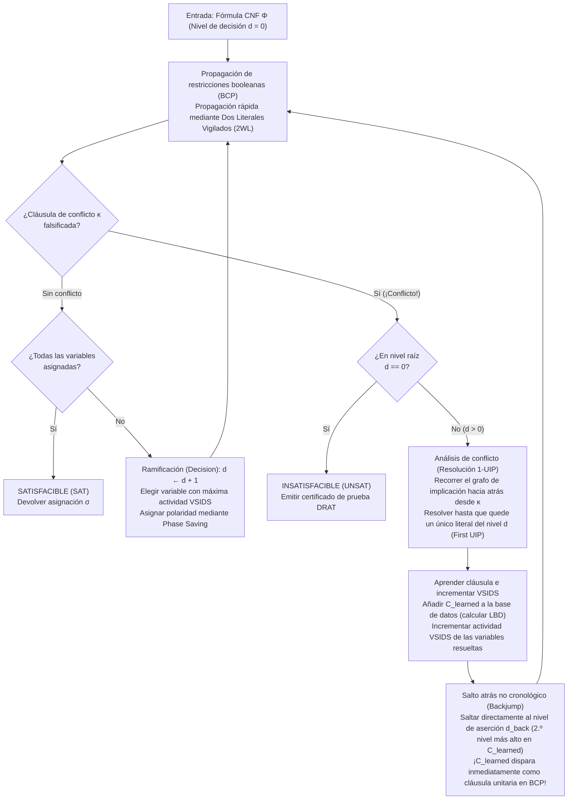
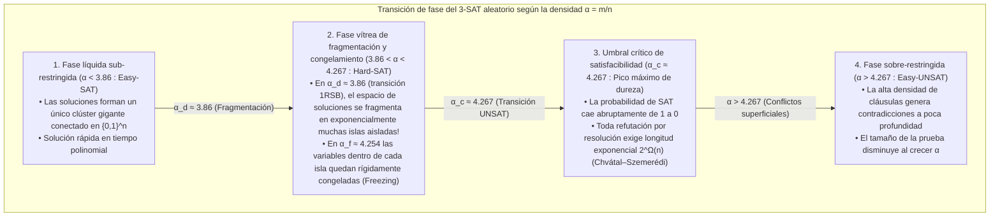

## 1. La revolución algorítmica silenciosa de la informática

Abra casi cualquier libro de texto de informática teórica y encontrará una advertencia contundente:
<strong>«El problema de satisfacibilidad booleana (SAT) es NP-completo. Dado que su complejidad temporal en el peor de los casos crece exponencialmente como $O(2^n)$ con el número de variables $n$, las instancias grandes son fundamentalmente intratables».</strong>

Desde la combinatoria elemental, el argumento parece irrefutable. Una fórmula proposicional sobre $n = 100$ variables booleanas admite $2^{100} \approx 1.26 \times 10^{30}$ asignaciones de verdad posibles. Incluso si una supercomputadora pudiera verificar $10^{12}$ asignaciones por segundo desde el Big Bang (hace 13,800 millones de años), hoy habría explorado menos del $10^{-8}$ del espacio de búsqueda. De hecho, alrededor de 1990, los mejores solucionadores SAT colapsaban ante fórmulas de apenas $100$ variables y $400$ cláusulas.

Sin embargo, en el siglo XXI la ingeniería desafía esa intuición millones de veces al día. Los solucionadores SAT y SMT industriales modernos —como <strong>MiniSat, Glucose, Lingeling, CaDiCaL, Kissat</strong> y <strong>Z3</strong> de Microsoft Research— resuelven rutinariamente instancias de verificación formal de microprocesadores, optimización de compiladores y resolución de dependencias de paquetes con <strong>$10,000,000$ ($10^7$) de variables y $50,000,000$ ($5 \times 10^7$) de cláusulas en cuestión de segundos</strong>.

Cuando Donald E. Knuth publicó en 2015 el Volumen 4B (Sección 7.2.2.2) de *The Art of Computer Programming*, dedicó más de 300 páginas exclusivamente a los solucionadores SAT, calificando los avances de finales de los años 90 y principios de los 2000 como <strong>una de las mayores revoluciones algorítmicas en la historia de las ciencias de la computación</strong>. Si antes reducir un problema a SAT significaba demostrar que era imposible de resolver en la práctica, hoy traducir un problema combinatorio difícil a SAT es la estrategia maestra para resolverlo al instante.

---

## 2. Forma Normal Conjuntiva (CNF), transformación de Tseitin y el teorema de Cook-Levin (1971)

### 2.1 Forma Normal Conjuntiva (CNF) y codificación lineal de Tseitin

Un solucionador SAT opera sobre una fórmula proposicional $\Phi$ definida sobre $n$ variables booleanas $V = \{x_1, \dots, x_n\}$ con valores en $\{0, 1\}$. Un <strong>literal</strong> $\ell \in \{x_v, \neg x_v\}$ es una variable o su negación; una <strong>cláusula</strong> $C_i = \bigvee_{j=1}^{k_i} \ell_{i,j}$ es una disyunción (OR lógico, $\lor$) de literales; y una fórmula en <strong>Forma Normal Conjuntiva (CNF)</strong> es una conjunción (AND lógico, $\land$) de $m$ cláusulas:

$$\Phi(x_1, \dots, x_n) = \bigwedge_{i=1}^m C_i = \bigwedge_{i=1}^m \left(\bigvee_{j=1}^{k_i} \ell_{i,j}\right)$$

Si convirtiéramos ingenuamente un circuito lógico arbitrario a CNF aplicando repetidamente la ley distributiva $A \lor (B \land C) \equiv (A \lor B) \land (A \lor C)$, el tamaño de la fórmula explotaría exponencialmente. En 1968, <strong>Grigori Tseitin</strong> eliminó esta explosión mediante la <strong>transformación de Tseitin</strong>: se introduce una nueva <strong>variable auxiliar</strong> $y_g$ para la salida de cada compuerta lógica $g$ del circuito y se codifica la equivalencia local $y_g \leftrightarrow \text{gate}(a, b)$ con solo 3 o 4 cláusulas. Por ejemplo, una compuerta AND $y_g \leftrightarrow (a \land b)$ equivale exactamente a tres cláusulas:

$$\left(\neg y_g \lor a\right) \;\land\; \left(\neg y_g \lor b\right) \;\land\; \left(y_g \lor \neg a \lor \neg b\right)$$

De este modo, cualquier circuito con $|G|$ compuertas se transforma en <strong>tiempo y espacio estrictamente lineales $O(|G|)$</strong> en una fórmula 3-CNF <strong>equisatisfacible</strong>.

### 2.2 El teorema de Cook-Levin y el abismo de complejidad entre 2-SAT y 3-SAT

En 1971, <strong>Stephen Cook</strong> y <strong>Leonid Levin</strong> demostraron independientemente el <strong>teorema de Cook-Levin</strong>: todo problema de decisión en la clase $\text{NP}$ puede reducirse en tiempo polinomial a SAT codificando la tabla de cómputo espacio-temporal de una máquina de Turing no determinista durante $p(n)$ pasos (estados $S_{t,q}$, posición del cabezal $H_{t,i}$, símbolos de cinta $T_{t,i,\sigma}$) como una fórmula CNF.

Cuando cada cláusula tiene a lo sumo $k$ literales (<strong>$k$-SAT</strong>), existe un abismo matemático entre $k = 2$ y $k = 3$:
- <strong>2-SAT se resuelve en tiempo lineal $O(n + m)$</strong>: una cláusula binaria $(\ell_1 \lor \ell_2)$ es equivalente a dos implicaciones dirigidas deterministas $(\neg \ell_1 \Rightarrow \ell_2) \land (\neg \ell_2 \Rightarrow \ell_1)$. Construyendo el <strong>grafo de implicación</strong> sobre los $2n$ literales, el algoritmo de Tarjan calcula las <strong>componentes fuertemente conexas (SCC)</strong> en tiempo $O(n+m)$: la fórmula es satisfacible si y solo si ninguna variable $x_v$ pertenece a la misma SCC que su negación $\neg x_v$.
- <strong>3-SAT es NP-completo</strong>: una cláusula ternaria $(\ell_1 \lor \ell_2 \lor \ell_3)$ equivale a $(\neg \ell_1 \land \neg \ell_2) \Rightarrow \ell_3$, una hiperarista que requiere dos premisas simultáneas. Bajo la <strong>Hipótesis del Tiempo Exponencial (ETH)</strong>, ningún algoritmo determinista puede resolver 3-SAT en tiempo subexponencial $2^{o(n)}$ en el peor caso.

---

## 3. El algoritmo DPLL clásico (1962) y la tragedia del backtracking cronológico

El algoritmo <strong>DPLL</strong> (Davis, Putnam, Logemann, Loveland, 1962) combina búsqueda en profundidad con la <strong>propagación unitaria (Unit Propagation / Boolean Constraint Propagation, BCP)</strong>:

> <strong>Propagación Unitaria (BCP)</strong>:
> Si bajo la asignación parcial actual todos los literales de una cláusula $C = (\ell_1 \lor \dots \lor \ell_{k-1} \lor \ell_k)$ excepto $\ell_k$ se han evaluado como `False` ($0$) y $\ell_k$ sigue sin asignar, entonces $C$ es una <strong>cláusula unitaria</strong>. El solucionador fuerza inmediatamente $\ell_k = \text{True}$ ($1$) sin ramificar, desencadenando una cascada en dominó de nuevas propagaciones unitarias hasta alcanzar un punto fijo o falsificar por completo alguna cláusula (<strong>Conflicto</strong>).

<strong>¿Por qué DPLL chocaba contra un muro al llegar a unas 100 variables?</strong>
Por culpa del <strong>backtracking cronológico</strong>. Si el solucionador asigna $x_1 = 0$ en el <strong>nivel de decisión $d = 1$</strong>, luego toma 48 decisiones totalmente irrelevantes sobre $x_2, \dots, x_{49}$ en los niveles $d = 2 \dots 49$, y en el <strong>nivel $d = 50$</strong> asigna $x_{50} = 1$, provocando un conflicto inmediato causado exclusivamente por $x_1 = 0$ y $x_{50}$ a través de las cláusulas $(x_1 \lor \neg x_{50} \lor \pm x_{51})$ y $(x_1 \lor x_{50} \lor \pm x_{52})$, DPLL es ciego a la causa raíz. Retrocede un solo paso al nivel $d = 49$, invierte la inocente variable $x_{49}$ y repite exactamente el mismo fracaso a lo largo de <strong>$2^{48} \approx 2.81 \times 10^{14}$ subárboles inútiles</strong> (<strong>thrashing</strong>)!

---

## 4. La revolución CDCL: grafos de implicación, resolución 1-UIP y salto atrás

Introducido en <strong>GRASP</strong> (Marques-Silva & Sakallah, 1996) y perfeccionado en <strong>Chaff</strong> (Moskewicz et al., 2001), el <strong>aprendizaje de cláusulas dirigido por conflictos (CDCL)</strong> transformó cada contradicción en un teorema permanente.



### 4.1 Grafo de implicación, resolución booleana y el Primer Punto de Implicación Único (1-UIP)

Cada literal asignado $\ell@d$ registra su nivel de decisión $d$ y su <strong>cláusula antecedente (razón)</strong> $\text{reason}(\ell)$. Cuando una cláusula $\kappa$ resulta falsificada, CDCL inicializa $C \leftarrow \kappa$ y recorre hacia atrás la pila de asignaciones (Trail) en el nivel actual $d_{\text{curr}}$, aplicando iterativamente la <strong>regla de resolución booleana</strong>:

$$\frac{(A \lor x) \qquad (\neg x \lor B)}{(A \lor B)} = \text{Res}(C_1, C_2, x)$$

En el grafo de implicación, un vértice $u@d_{\text{curr}}$ es un <strong>Punto de Implicación Único (Unique Implication Point, UIP)</strong> si *todo* camino dirigido desde la decisión $\ell_{\text{dec}}@d_{\text{curr}}$ hasta el nodo de conflicto $\Lambda$ pasa obligatoriamente por $u$ (dominador). El UIP más cercano al conflicto se denomina <strong>Primer UIP (First UIP / 1-UIP)</strong>.
Algebraicamente, el bucle de resolución hacia atrás alcanza el 1-UIP en el instante exacto en que la cláusula de trabajo $C$ contiene <strong>un único literal perteneciente al nivel de decisión actual $d_{\text{curr}}$</strong>.

Con $x_1 = 0@1, x_2 = 0@2, x_3 = 1@3$, la decisión $x_4 = 1@5$ y las cláusulas $\omega_1 = (x_1 \lor \neg x_4 \lor x_5)$, $\omega_2 = (\neg x_4 \lor \neg x_5 \lor x_6)$, $\omega_3 = (x_2 \lor \neg x_6 \lor x_7)$, $\omega_4 = (\neg x_3 \lor \neg x_6 \lor x_8)$ que llevan al conflicto $\kappa = (\neg x_7 \lor \neg x_8)$, al resolver $\kappa$ con $\omega_4$ (pivote $x_8$) y luego con $\omega_3$ (pivote $x_7$) se obtiene inmediatamente la <strong>cláusula aprendida 1-UIP</strong>:

$$C_{\text{learned}} = \left(x_2@2 \lor \neg x_3@3 \lor \neg x_6@5\right)$$

### 4.2 Salto atrás no cronológico (Backjumping) y nivel de aserción

Dado que los niveles en $C_{\text{learned}}$ son $\{5, 3, 2\}$, el solucionador salta directamente al <strong>segundo nivel de decisión más alto (nivel de aserción) $d_{\text{back}} = 3$</strong>. En el nivel $3$, $x_2@2$ y $\neg x_3@3$ siguen siendo falsos mientras que $\neg x_6$ queda libre, por lo que $C_{\text{learned}}$ actúa de inmediato como <strong>cláusula unitaria asertiva</strong> y fuerza $\neg x_6 = 1@3$ ($x_6 = 0@3$) mediante BCP.

---

## 5. Milagros de ingeniería: Dos Literales Vigilados (2WL), VSIDS y LBD

1. <strong>Dos Literales Vigilados (Two-Watched Literals, 2WL, Chaff 2001)</strong>:
   Como el $90\%$ del tiempo de CPU se consume en BCP, 2WL explota un invariante genial: <strong>mientras una cláusula tenga al menos dos literales no falsificados (sin asignar o verdaderos), jamás podrá convertirse en cláusula unitaria ni en conflicto.</strong> El solucionador vigila <strong>solo dos literales $w_1, w_2$ por cláusula</strong>. Lo más extraordinario ocurre al hacer <strong>backjumping</strong>: desasignar variables conserva automáticamente el invariante 2WL, por lo que <strong>el retroceso requiere exactamente cero actualizaciones de punteros ($O(1)$)</strong>!
2. <strong>VSIDS (Variable State Independent Decaying Sum) y Phase Saving</strong>:
   Cada variable involucrada en la resolución de un conflicto incrementa su puntuación en $+\Delta$, mientras que $\Delta \leftarrow \Delta / \gamma$ ($\gamma = 0.95$) crece tras cada conflicto, enfocando la búsqueda como un láser en el cuello de botella activo.
3. <strong>LBD (Literal Block Distance / Cláusulas «Glue») y reinicios rápidos</strong>:
   Glucose (Audemard & Simon, 2009) define $\text{LBD}(C)$ como el número de niveles de decisión distintos presentes en una cláusula aprendida $C$. Las cláusulas con $\text{LBD} = 2$ (<strong>cláusulas de pegamento / Glue Clauses</strong>) vinculan directamente el UIP actual con un único bloque pasado y se conservan para siempre.

| Dimensión arquitectónica | DPLL clásico (1962) | CDCL de 1.ª generación (GRASP / Chaff 2001) | CDCL de vanguardia (Glucose / CaDiCaL / Kissat) |
| :--- | :--- | :--- | :--- |
| <strong>Estructura BCP</strong> | Contadores completos por cláusula | <strong>Dos Literales Vigilados (2WL)</strong> ($O(1)$ en backtrack sin tocar punteros) | <strong>2WL con literales de bloqueo en línea</strong> + listas binarias rápidas |
| <strong>Recuperación</strong> | <strong>Backtracking cronológico</strong> ($d-1$, thrashing $2^k$) | <strong>Salto atrás no cronológico</strong> al nivel de aserción $d_{\text{back}}$ | Híbrido de Backjumping y backtracking cronológico local (2018) |
| <strong>Aprendizaje</strong> | Ninguno (árbol sin memoria) | <strong>Resolución 1-UIP</strong> + minimización recursiva | 1-UIP + autosubsunción al vuelo, vivificación y eliminación BVE |
| <strong>Heurística de rama</strong> | Orden estático / DLIS | <strong>VSIDS</strong> (actividad con decaimiento exponencial) | Alternancia <strong>EVSIDS + VMTF</strong> + Phase Saving y búsqueda local WalkSAT |
| <strong>Gestión de cláusulas</strong> | N/A | Eliminación por tamaño y actividad | <strong>Gestión en 3 niveles por LBD</strong> (cláusulas Glue $\text{LBD} \le 2$ permanentes) |

---

## 6. Implementación completa en Python de un motor CDCL

A continuación se muestra una implementación completa y autocontenida en Python de un solucionador CDCL con BCP, grafo de implicación, <strong>resolución 1-UIP</strong>, <strong>salto atrás no cronológico</strong> y <strong>VSIDS</strong>:

```python
from typing import List, Dict, Optional, Set, Tuple

class CDCLSolver:
    '''Minimal Conflict-Driven Clause Learning (CDCL) SAT Solver with 1-UIP & VSIDS.'''
    def __init__(self, num_vars: int, clauses: List[List[int]]):
        self.num_vars = num_vars
        self.clauses: List[List[int]] = [list(set(c)) for c in clauses]
        self.assigns: Dict[int, bool] = {}
        self.trail: List[int] = []
        self.level: Dict[int, int] = {}
        self.reason: Dict[int, Optional[List[int]]] = {}
        self.decision_level: int = 0
        self.activity: Dict[int, float] = {v: 0.0 for v in range(1, num_vars + 1)}
        for c in self.clauses:
            for lit in c:
                self.activity[abs(lit)] += 1.0
        self.var_inc: float = 1.0
        self.var_decay: float = 0.95

    def value_lit(self, lit: int) -> Optional[bool]:
        var = abs(lit)
        if var not in self.assigns:
            return None
        return self.assigns[var] if lit > 0 else not self.assigns[var]

    def assign(self, lit: int, level: int, reason: Optional[List[int]]) -> None:
        var = abs(lit)
        self.assigns[var] = (lit > 0)
        self.trail.append(lit)
        self.level[var] = level
        self.reason[var] = reason

    def bcp(self) -> Optional[List[int]]:
        changed = True
        while changed:
            changed = False
            for clause in self.clauses:
                unassigned_lit = None
                num_unassigned = 0
                satisfied = False
                for lit in clause:
                    val = self.value_lit(lit)
                    if val is True:
                        satisfied = True
                        break
                    elif val is None:
                        num_unassigned += 1
                        unassigned_lit = lit
                if satisfied:
                    continue
                if num_unassigned == 0:
                    return clause
                if num_unassigned == 1 and unassigned_lit is not None:
                    self.assign(unassigned_lit, self.decision_level, clause)
                    changed = True
        return None

    def analyze_conflict(self, conflict_clause: List[int]) -> Tuple[List[int], int]:
        learned: Set[int] = set(conflict_clause)
        def count_curr_level(cset: Set[int]) -> int:
            return sum(1 for lit in cset if self.level[abs(lit)] == self.decision_level)

        idx = len(self.trail) - 1
        while count_curr_level(learned) > 1:
            while True:
                pivot_lit = self.trail[idx]
                idx -= 1
                if -pivot_lit in learned and self.level[abs(pivot_lit)] == self.decision_level:
                    break
            pivot_var = abs(pivot_lit)
            antecedent = self.reason[pivot_var]
            assert antecedent is not None
            self.activity[pivot_var] += self.var_inc
            learned.remove(-pivot_lit)
            for lit in antecedent:
                if lit != pivot_lit:
                    learned.add(lit)

        learned_clause = list(learned)
        for lit in learned_clause:
            self.activity[abs(lit)] += self.var_inc
        self.var_inc /= self.var_decay
        levels = sorted({self.level[abs(lit)] for lit in learned_clause}, reverse=True)
        backjump_level = levels[1] if len(levels) > 1 else 0
        return learned_clause, backjump_level

    def backtrack(self, target_level: int) -> None:
        while self.trail and self.level[abs(self.trail[-1])] > target_level:
            lit = self.trail.pop()
            var = abs(lit)
            del self.assigns[var], self.level[var], self.reason[var]
        self.decision_level = target_level

    def solve(self) -> Tuple[bool, Optional[Dict[int, bool]]]:
        if self.bcp() is not None:
            return False, None
        while True:
            unassigned = [v for v in range(1, self.num_vars + 1) if v not in self.assigns]
            if not unassigned:
                return True, dict(self.assigns)
            branch_var = max(unassigned, key=lambda v: self.activity[v])
            self.decision_level += 1
            self.assign(branch_var, self.decision_level, reason=None)
            while True:
                conflict = self.bcp()
                if conflict is None:
                    break
                if self.decision_level == 0:
                    return False, None
                learned_clause, backjump_level = self.analyze_conflict(conflict)
                self.clauses.append(learned_clause)
                self.backtrack(backjump_level)
```

---

## 7. Física estadística y la transición de fase del $k$-SAT aleatorio ($\alpha_c \approx 4.267$)

¿Por qué los solucionadores CDCL resuelven circuitos industriales con $10^7$ variables en segundos pero se bloquean ante fórmulas 3-SAT aleatorias de solo $700$ variables?
En una fórmula 3-SAT uniforme con $n$ variables y $m = \alpha n$ cláusulas (<strong>densidad de cláusulas a variables $\alpha = m / n$</strong>), el método del primer momento arroja para el número esperado de soluciones $\mathbb{E}[Z]$:

$$\mathbb{E}[Z] = 2^n \left(1 - 2^{-3}\right)^m = \left(2 \cdot \left(\frac{7}{8}\right)^\alpha\right)^n \implies \alpha_{\text{annealed}} = \frac{\ln 2}{\ln(8/7)} \approx 5.191$$

Mediante el <strong>método de la cavidad</strong> y la <strong>ruptura de simetría de réplicas de un paso (1RSB)</strong> de la física de vidrios de espín, Mézard, Parisi y Zecchina (2002) determinaron el umbral crítico exacto del 3-SAT aleatorio:

$$\alpha_c \approx 4.267$$



En $\alpha_c \approx 4.267$, el hipergrafo aleatorio es un <strong>grafo expansor</strong> sin cuellos de botella locales, lo que obliga a cualquier refutación por resolución a tener un tamaño exponencial $2^{\Omega(n)}$ (Chvátal & Szemerédi, 1988).
Por el contrario, <strong>los problemas industriales reales diseñados por humanos poseen una rica estructura modular</strong>:
1. <strong>Modularidad y estructura comunitaria (Ansótegui et al. 2012)</strong>: los circuitos y programas constan de módulos débilmente acoplados mediante pocas variables de interfaz, que la resolución 1-UIP identifica como dominadores para aprender cláusulas Glue cortas ($\text{LBD}=2$).
2. <strong>Conjuntos «Backdoor» pequeños (Williams, Gomes, Selman 2003)</strong>: basta con asignar unas pocas decenas de variables clave $B \subset V$ ($|B| \ll n$) para que el resto de los millones de variables se resuelva íntegramente mediante propagación unitaria BCP.

---

## 8. Triunfos en el mundo real y la demostración matemática de 200 Terabytes

1. <strong>Matemáticas asistidas por computadora y la prueba DRAT de 200 TB (Heule, Kullmann, Marek 2016)</strong>:
   ¿Se puede colorear $\{1, \dots, N\}$ con dos colores sin que exista ninguna terna pitagórica $a^2 + b^2 = c^2$ monocromática? Usando <strong>Cube-and-Conquer</strong> en 800 núcleos, demostraron que $N = 7824$ es satisfacible (<strong>SAT</strong>) pero <strong>$N = 7825$ es insatisfacible (UNSAT)</strong>, generando un <strong>certificado formal DRAT de 200 Terabytes</strong> verificado bit a bit. Con la misma técnica resolvieron el número de Schur $S(5) = 160$ (2018) y la conjetura de Keller en dimensión 7 (2020).
2. <strong>Verificación formal de chips EDA (CEC y BMC)</strong>: desde el error FDIV del Pentium de Intel (1994), todo microprocesador se verifica construyendo un <strong>circuito Miter</strong> (XOR entre especificación RTL y compuertas) resuelto mediante SAT.
3. <strong>Gestores de paquetes (Debian apt, Rust Cargo, Dart PubGrub, uv)</strong>: el algoritmo <strong>PubGrub</strong> ejecuta CDCL directamente sobre rangos de versiones y traduce el grafo de resolución 1-UIP en mensajes de error legibles para humanos.
4. <strong>De SAT a SMT ($\text{DPLL}(T)$: Z3 y cvc5)</strong>: acoplando CDCL con solucionadores de teorías (aritmética lineal, vectores de bits, arreglos), los solucionadores SMT impulsan la ejecución simbólica y el motor de seguridad en la nube <strong>AWS Zelkova</strong>.
