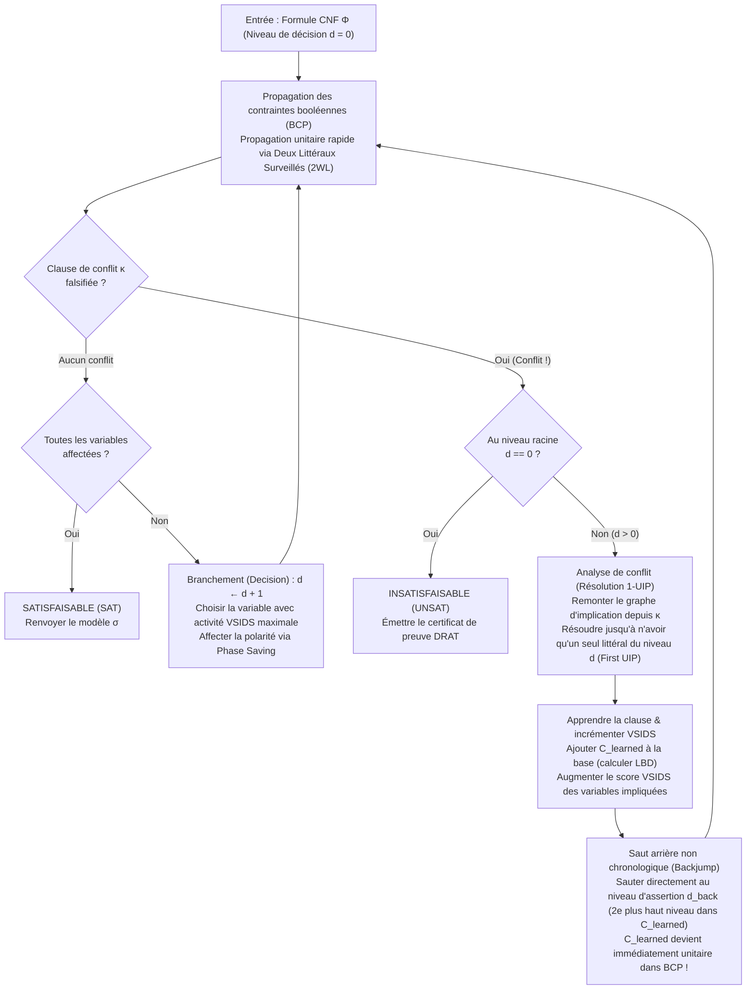
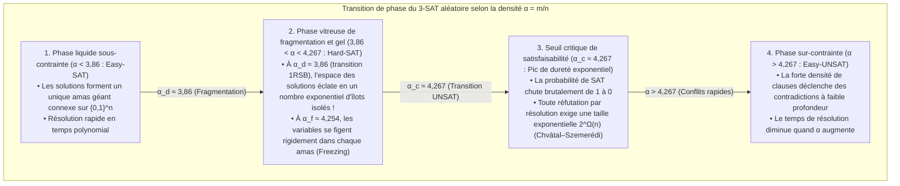

## 1. La révolution algorithmique silencieuse de l'informatique

Ouvrez n'importe quel manuel d'informatique théorique et vous y trouverez cet avertissement solennel :
<strong>« Le problème de satisfaisabilité booléenne (SAT) est NP-complet. Sa complexité temporelle dans le pire des cas croissant exponentiellement en $O(2^n)$ avec le nombre de variables $n$, les grandes instances sont fondamentalement intraitables. »</strong>

Sur le plan purement combinatoire, le constat semble sans appel. Une formule portant sur $n = 100$ variables booléennes admet $2^{100} \approx 1,26 \times 10^{30}$ affectations de vérité possibles. Même si un supercalculateur inspectait $10^{12}$ affectations par seconde depuis le Big Bang (il y a 13,8 milliards d'années), il aurait exploré moins de $10^{-8}$ de l'espace de recherche aujourd'hui. De fait, vers 1990, les meilleurs solveurs SAT butaient sur des formules d'à peine $100$ variables et $400$ clauses.

Pourtant, au XXIᵉ siècle, la pratique industrielle dément cette intuition des millions de fois par jour. Les solveurs SAT et SMT modernes — tels que <strong>MiniSat, Glucose, Lingeling, CaDiCaL, Kissat</strong> et <strong>Z3</strong> (Microsoft Research) — résolvent quotidiennement des instances de vérification formelle de microprocesseurs, d'optimisation de compilateurs et de gestion de paquets contenant <strong>$10\,000\,000$ ($10^7$) variables et $50\,000\,000$ ($5 \times 10^7$) clauses en quelques secondes</strong>.

Dans le volume 4B (section 7.2.2.2) de *The Art of Computer Programming* publié en 2015, Donald E. Knuth a consacré plus de 300 pages aux seuls solveurs SAT, saluant les avancées de la fin des années 1990 et du début des années 2000 comme <strong>l'une des plus grandes révolutions algorithmiques de l'histoire de l'informatique</strong>. Autrefois, réduire un problème à SAT revenait à prouver son insolubilité pratique ; aujourd'hui, traduire un problème combinatoire en SAT est la stratégie royale pour le résoudre instantanément.

---

## 2. Forme normale conjonctive (CNF), transformation de Tseitin et théorème de Cook-Levin (1971)

### 2.1 Forme normale conjonctive (CNF) et encodage linéaire de Tseitin

Un solveur SAT prend en entrée une formule propositionnelle $\Phi$ sur $n$ variables booléennes $V = \{x_1, \dots, x_n\}$ à valeurs dans $\{0, 1\}$. Un <strong>littéral</strong> $\ell \in \{x_v, \neg x_v\}$ est une variable ou sa négation ; une <strong>clause</strong> $C_i = \bigvee_{j=1}^{k_i} \ell_{i,j}$ est une disjonction (OU logique, $\lor$) de littéraux ; et une formule en <strong>forme normale conjonctive (CNF)</strong> est une conjonction (ET logique, $\land$) de $m$ clauses :

$$\Phi(x_1, \dots, x_n) = \bigwedge_{i=1}^m C_i = \bigwedge_{i=1}^m \left(\bigvee_{j=1}^{k_i} \ell_{i,j}\right)$$

Si l'on convertissait naïvement un circuit booléen arbitraire en CNF par application répétée de la distributivité $A \lor (B \land C) \equiv (A \lor B) \land (A \lor C)$, la taille de la formule exploserait exponentiellement. En 1968, <strong>Grigori Tseitin</strong> a résolu ce problème grâce à la <strong>transformation de Tseitin</strong> : on introduit une <strong>variable auxiliaire</strong> $y_g$ pour la sortie de chaque porte logique $g$ du circuit et l'on encode l'équivalence locale $y_g \leftrightarrow \text{porte}(a, b)$ en seulement 3 ou 4 clauses. Par exemple, une porte ET $y_g \leftrightarrow (a \land b)$ se traduit par exactement trois clauses :

$$\left(\neg y_g \lor a\right) \;\land\; \left(\neg y_g \lor b\right) \;\land\; \left(y_g \lor \neg a \lor \neg b\right)$$

Tout circuit comportant $|G|$ portes est ainsi converti en temps et en espace <strong>strictement linéaires $O(|G|)$</strong> en une formule 3-CNF <strong>équisatisfaisable</strong>.

### 2.2 Le théorème de Cook-Levin et la falaise de complexité entre 2-SAT et 3-SAT

En 1971, <strong>Stephen Cook</strong> et <strong>Leonid Levin</strong> ont démontré indépendamment le <strong>théorème de Cook-Levin</strong> : tout problème de décision appartenant à la classe $\text{NP}$ peut être réduit en temps polynomial à SAT en encodant le tableau de calcul d'une machine de Turing non déterministe sur $p(n)$ étapes (états $S_{t,q}$, positions de tête $H_{t,i}$, symboles du ruban $T_{t,i,\sigma}$) sous forme de clauses CNF.

Lorsque chaque clause contient au plus $k$ littéraux (<strong>$k$-SAT</strong>), une falaise abrupte sépare $k = 2$ et $k = 3$ :
- <strong>2-SAT se résout en temps linéaire $O(n + m)$</strong> : une clause binaire $(\ell_1 \lor \ell_2)$ équivaut à deux implications dirigées déterministes $(\neg \ell_1 \Rightarrow \ell_2) \land (\neg \ell_2 \Rightarrow \ell_1)$. Dans le <strong>graphe d'implication</strong> à $2n$ sommets, l'algorithme de Tarjan identifie les <strong>composantes fortement connexes (CFC / SCC)</strong> en temps $O(n+m)$ : la formule est satisfaisable si et seulement si aucune variable $x_v$ n'appartient à la même CFC que $\neg x_v$.
- <strong>3-SAT est NP-complet</strong> : une clause ternaire $(\ell_1 \lor \ell_2 \lor \ell_3)$ s'écrit $(\neg \ell_1 \land \neg \ell_2) \Rightarrow \ell_3$, une hyperarête nécessitant deux prémisses simultanées. Sous l'<strong>hypothèse du temps exponentiel (ETH)</strong>, aucun algorithme déterministe ne peut résoudre 3-SAT en temps sous-exponentiel $2^{o(n)}$ dans le pire cas.

---

## 3. L'algorithme DPLL classique (1962) et le piège du retour sur trace chronologique

L'algorithme <strong>DPLL</strong> (Davis, Putnam, Logemann, Loveland, 1962) repose sur la recherche en profondeur couplée à la <strong>propagation unitaire (Unit Propagation / Boolean Constraint Propagation, BCP)</strong> :

> <strong>Propagation unitaire (BCP)</strong> :
> Si, sous l'affectation partielle courante, tous les littéraux d'une clause $C = (\ell_1 \lor \dots \lor \ell_{k-1} \lor \ell_k)$ sauf $\ell_k$ valent `False` ($0$) et que $\ell_k$ est non affecté, $C$ est une <strong>clause unitaire</strong>. Le solveur force immédiatement $\ell_k = \text{True}$ ($1$), déclenchant une cascade domino d'implications jusqu'à saturation ou jusqu'à ce qu'une clause devienne entièrement fausse (<strong>Conflit</strong>).

<strong>Pourquoi DPLL plafonnait-il autour de 100 variables ?</strong>
À cause du <strong>retour sur trace chronologique (Chronological Backtracking)</strong>. Si le solveur fixe $x_1 = 0$ au <strong>niveau de décision $d = 1$</strong>, effectue 48 choix totalement indépendants $x_2, \dots, x_{49}$ aux niveaux $d = 2 \dots 49$, puis choisit $x_{50} = 1$ au <strong>niveau $d = 50$</strong>, provoquant un conflit local uniquement dû à $x_1 = 0$ et $x_{50}$ via les clauses $(x_1 \lor \neg x_{50} \lor \pm x_{51})$ et $(x_1 \lor x_{50} \lor \pm x_{52})$, DPLL est incapable d'identifier que la faute remonte au niveau 1. Il recule d'un seul cran au niveau $d = 49$, inverse l'innocente variable $x_{49}$ et répète exactement le même échec à travers <strong>$2^{48} \approx 2,81 \times 10^{14}$ sous-arbres inutiles</strong> (<strong>piétinement / thrashing</strong>) !

---

## 4. La révolution CDCL : graphe d'implication, résolution 1-UIP et saut arrière

Introduit dans <strong>GRASP</strong> (Marques-Silva & Sakallah, 1996) et porté à maturité dans <strong>Chaff</strong> (Moskewicz et al., 2001), l'<strong>apprentissage de clauses dirigé par les conflits (CDCL)</strong> remplace l'aveuglement chronologique par le diagnostic causal.



### 4.1 Graphe d'implication, résolution booléenne et premier point d'implication unique (1-UIP)

Chaque littéral affecté $\ell@d$ conserve son niveau de décision $d$ et sa <strong>clause antécédente (raison)</strong> $\text{reason}(\ell)$. Lorsqu'une clause $\kappa$ est falsifiée, CDCL initialise $C \leftarrow \kappa$ et remonte la pile d'affectation (Trail) au niveau courant $d_{\text{curr}}$ en appliquant itérativement la <strong>règle de résolution booléenne</strong> :

$$\frac{(A \lor x) \qquad (\neg x \lor B)}{(A \lor B)} = \text{Res}(C_1, C_2, x)$$

Dans le graphe d'implication, un sommet $u@d_{\text{curr}}$ est un <strong>point d'implication unique (Unique Implication Point, UIP)</strong> si *tout* chemin dirigé allant du littéral de décision $\ell_{\text{dec}}@d_{\text{curr}}$ au sommet de conflit $\Lambda$ passe obligatoirement par $u$ (dominateur). Le UIP le plus proche du conflit est appelé <strong>premier UIP (First UIP / 1-UIP)</strong>.
Algébriquement, la résolution arrière atteint le 1-UIP à l'instant précis où la clause de travail $C$ ne contient <strong>plus qu'un seul littéral appartenant au niveau de décision courant $d_{\text{curr}}$</strong> !

Dans notre exemple avec $x_1 = 0@1, x_2 = 0@2, x_3 = 1@3$, la décision $x_4 = 1@5$ et les clauses $\omega_1 = (x_1 \lor \neg x_4 \lor x_5)$, $\omega_2 = (\neg x_4 \lor \neg x_5 \lor x_6)$, $\omega_3 = (x_2 \lor \neg x_6 \lor x_7)$, $\omega_4 = (\neg x_3 \lor \neg x_6 \lor x_8)$ menant au conflit $\kappa = (\neg x_7 \lor \neg x_8)$, deux étapes de résolution de $\kappa$ avec $\omega_4$ (pivot $x_8$) puis $\omega_3$ (pivot $x_7$) isolent immédiatement la <strong>clause apprise 1-UIP</strong> :

$$C_{\text{learned}} = \left(x_2@2 \lor \neg x_3@3 \lor \neg x_6@5\right)$$

### 4.2 Saut arrière non chronologique (Backjumping) et niveau d'assertion

Les niveaux présents dans $C_{\text{learned}}$ étant $\{5, 3, 2\}$, le solveur saute directement au <strong>deuxième niveau de décision le plus élevé (niveau d'assertion) $d_{\text{back}} = 3$</strong> ! Au niveau $3$, $x_2@2$ et $\neg x_3@3$ sont toujours faux tandis que $\neg x_6$ redevient libre : $C_{\text{learned}}$ agit instantanément comme une <strong>clause unitaire asserteuse</strong> et force $\neg x_6 = 1@3$ ($x_6 = 0@3$) via BCP !

---

## 5. Miracles d'ingénierie : deux littéraux surveillés (2WL), VSIDS et LBD

1. <strong>Deux littéraux surveillés (Two-Watched Literals, 2WL, Chaff 2001)</strong> :
   Puisque $90\%$ du temps CPU est consacré à BCP, 2WL s'appuie sur l'invariant suivant : <strong>tant qu'une clause comporte au moins deux littéraux non falsifiés (libres ou vrais), elle ne peut devenir ni unitaire ni conflictuelle.</strong> Le solveur ne surveille donc que <strong>deux littéraux $w_1, w_2$ par clause</strong>. Lors d'un saut arrière (Backjump), la désaffectation des variables préserve automatiquement cet invariant : <strong>le retour arrière ne nécessite aucune mise à jour de pointeurs ($O(1)$, coût zéro)</strong> !
2. <strong>VSIDS (Variable State Independent Decaying Sum) & Phase Saving</strong> :
   Chaque variable impliquée dans la résolution d'un conflit reçoit un bonus d'activité $+\Delta$, tandis que $\Delta \leftarrow \Delta / \gamma$ ($\gamma = 0.95$) croît après chaque conflit. Cette moyenne mobile exponentielle concentre le branchement sur le goulot d'étranglement actif.
3. <strong>LBD (Literal Block Distance / Clauses « Glue ») & Redémarrages rapides</strong> :
   Glucose (Audemard & Simon, 2009) mesure la qualité d'une clause apprise par le nombre $\text{LBD}(C)$ de niveaux de décision distincts qu'elle contient. Les clauses avec $\text{LBD} = 2$ (<strong>clauses de colle / Glue Clauses</strong>) lient directement l'UIP courant à un unique bloc de décision passé et sont conservées indéfiniment.

| Dimension architecturale | DPLL classique (1962) | CDCL 1re génération (GRASP / Chaff 2001) | CDCL de pointe (Glucose / CaDiCaL / Kissat) |
| :--- | :--- | :--- | :--- |
| <strong>Structure BCP</strong> | Compteurs de littéraux sur chaque clause | <strong>Deux littéraux surveillés (2WL)</strong> (coût de backtrack $O(1)$ nul) | <strong>2WL avec littéraux bloquants en ligne</strong> + listes binaires dédiées |
| <strong>Gestion des conflits</strong> | <strong>Retour chronologique</strong> ($d-1$, thrashing en $2^k$) | <strong>Saut arrière non chronologique</strong> au niveau d'assertion $d_{\text{back}}$ | Hybride Backjumping + retour chronologique local (2018) |
| <strong>Apprentissage</strong> | Aucun (arbre sans mémoire) | <strong>Résolution 1-UIP</strong> + minimisation récursive des clauses | 1-UIP + auto-subsomption à la volée, vivification et élimination BVE |
| <strong>Heuristique de choix</strong> | Ordre statique / DLIS | <strong>VSIDS</strong> (score d'activité à décroissance exponentielle) | Alternance <strong>EVSIDS + VMTF</strong> + Phase Saving & recherche locale WalkSAT |
| <strong>Gestion de la base</strong> | N/A | Suppression périodique par taille et activité | <strong>Architecture à 3 niveaux basée sur LBD</strong> (clauses Glue $\text{LBD} \le 2$ permanentes) |

---

## 6. Implémentation Python complète d'un moteur CDCL

Voici une implémentation Python autonome et complète d'un solveur CDCL intégrant BCP, graphe d'implication, <strong>résolution 1-UIP</strong>, <strong>saut arrière non chronologique</strong> et <strong>VSIDS</strong> :

```python
from typing import List, Dict, Optional, Set, Tuple

class CDCLSolver:
    '''Minimal Conflict-Driven Clause Learning (CDCL) SAT Solver with 1-UIP & VSIDS.'''
    def __init__(self, num_vars: int, clauses: List[List[int]]):
        self.num_vars = num_vars
        self.clauses: List[List[int]] = [list(set(c)) for c in clauses]
        self.assigns: Dict[int, bool] = {}
        self.trail: List[int] = []
        self.level: Dict[int, int] = {}
        self.reason: Dict[int, Optional[List[int]]] = {}
        self.decision_level: int = 0
        self.activity: Dict[int, float] = {v: 0.0 for v in range(1, num_vars + 1)}
        for c in self.clauses:
            for lit in c:
                self.activity[abs(lit)] += 1.0
        self.var_inc: float = 1.0
        self.var_decay: float = 0.95

    def value_lit(self, lit: int) -> Optional[bool]:
        var = abs(lit)
        if var not in self.assigns:
            return None
        return self.assigns[var] if lit > 0 else not self.assigns[var]

    def assign(self, lit: int, level: int, reason: Optional[List[int]]) -> None:
        var = abs(lit)
        self.assigns[var] = (lit > 0)
        self.trail.append(lit)
        self.level[var] = level
        self.reason[var] = reason

    def bcp(self) -> Optional[List[int]]:
        changed = True
        while changed:
            changed = False
            for clause in self.clauses:
                unassigned_lit = None
                num_unassigned = 0
                satisfied = False
                for lit in clause:
                    val = self.value_lit(lit)
                    if val is True:
                        satisfied = True
                        break
                    elif val is None:
                        num_unassigned += 1
                        unassigned_lit = lit
                if satisfied:
                    continue
                if num_unassigned == 0:
                    return clause
                if num_unassigned == 1 and unassigned_lit is not None:
                    self.assign(unassigned_lit, self.decision_level, clause)
                    changed = True
        return None

    def analyze_conflict(self, conflict_clause: List[int]) -> Tuple[List[int], int]:
        learned: Set[int] = set(conflict_clause)
        def count_curr_level(cset: Set[int]) -> int:
            return sum(1 for lit in cset if self.level[abs(lit)] == self.decision_level)

        idx = len(self.trail) - 1
        while count_curr_level(learned) > 1:
            while True:
                pivot_lit = self.trail[idx]
                idx -= 1
                if -pivot_lit in learned and self.level[abs(pivot_lit)] == self.decision_level:
                    break
            pivot_var = abs(pivot_lit)
            antecedent = self.reason[pivot_var]
            assert antecedent is not None
            self.activity[pivot_var] += self.var_inc
            learned.remove(-pivot_lit)
            for lit in antecedent:
                if lit != pivot_lit:
                    learned.add(lit)

        learned_clause = list(learned)
        for lit in learned_clause:
            self.activity[abs(lit)] += self.var_inc
        self.var_inc /= self.var_decay
        levels = sorted({self.level[abs(lit)] for lit in learned_clause}, reverse=True)
        backjump_level = levels[1] if len(levels) > 1 else 0
        return learned_clause, backjump_level

    def backtrack(self, target_level: int) -> None:
        while self.trail and self.level[abs(self.trail[-1])] > target_level:
            lit = self.trail.pop()
            var = abs(lit)
            del self.assigns[var], self.level[var], self.reason[var]
        self.decision_level = target_level

    def solve(self) -> Tuple[bool, Optional[Dict[int, bool]]]:
        if self.bcp() is not None:
            return False, None
        while True:
            unassigned = [v for v in range(1, self.num_vars + 1) if v not in self.assigns]
            if not unassigned:
                return True, dict(self.assigns)
            branch_var = max(unassigned, key=lambda v: self.activity[v])
            self.decision_level += 1
            self.assign(branch_var, self.decision_level, reason=None)
            while True:
                conflict = self.bcp()
                if conflict is None:
                    break
                if self.decision_level == 0:
                    return False, None
                learned_clause, backjump_level = self.analyze_conflict(conflict)
                self.clauses.append(learned_clause)
                self.backtrack(backjump_level)
```

---

## 7. Physique statistique et transition de phase du $k$-SAT aléatoire ($\alpha_c \approx 4,267$)

Pourquoi les solveurs CDCL écrasent-ils des instances industrielles à $10^7$ variables mais échouent-ils sur des formules 3-SAT aléatoires de $700$ variables ?
Pour une formule 3-SAT aléatoire à $n$ variables et $m = \alpha n$ clauses (<strong>densité de contraintes $\alpha = m / n$</strong>), la méthode du premier moment donne l'espérance du nombre de solutions $Z$ :

$$\mathbb{E}[Z] = 2^n \left(1 - 2^{-3}\right)^m = \left(2 \cdot \left(\frac{7}{8}\right)^\alpha\right)^n \implies \alpha_{\text{recuit}} = \frac{\ln 2}{\ln(8/7)} \approx 5,191$$

Grâce à la <strong>méthode de la cavité</strong> et à la <strong>brisure de symétrie des répliques à une étape (1RSB)</strong> issue de la physique des verres de spin, Mézard, Parisi et Zecchina (2002) ont établi le seuil critique exact du 3-SAT aléatoire :

$$\alpha_c \approx 4,267$$



Au point critique $\alpha_c \approx 4,267$, l'hypergraphe aléatoire est un <strong>graphe expanseur</strong> dépourvu de goulots d'étranglement locaux, ce qui impose à toute preuve par résolution une longueur exponentielle $2^{\Omega(n)}$ (Chvátal & Szemerédi, 1988).
<strong>Les instances industrielles réelles possèdent au contraire une structure cachée</strong> :
1. <strong>Modularité et structure communautaire (Ansótegui et al. 2012)</strong> : les circuits et logiciels sont composés de modules faiblement couplés par un petit nombre de variables d'interface, que la résolution 1-UIP identifie immédiatement comme dominateurs pour générer des clauses Glue ($\text{LBD}=2$).
2. <strong>Petits ensembles « Backdoor » (Williams, Gomes, Selman 2003)</strong> : il suffit souvent d'affecter quelques dizaines de variables clés $B \subset V$ ($|B| \ll n$) pour que le reste de la formule à 10 millions de variables s'effondre intégralement par propagation unitaire !

---

## 8. Triomphes industriels et preuve mathématique de 200 téraoctets

1. <strong>Mathématiques assistées par ordinateur et preuve DRAT de 200 To (Heule, Kullmann, Marek 2016)</strong> :
   Peut-on bicolorer $\{1, \dots, N\}$ sans créer de triplet pythagoricien $a^2 + b^2 = c^2$ monochrome ? Par <strong>Cube-and-Conquer</strong>, Heule et al. ont prouvé sur 800 cœurs que $N = 7824$ est satisfaisable (<strong>SAT</strong>) mais que <strong>$N = 7825$ est insatisfaisable (UNSAT)</strong>, produisant un <strong>certificat de preuve formelle DRAT de 200 téraoctets</strong> vérifié bit à bit ! Ils ont ensuite résolu le nombre de Schur $S(5) = 160$ (2018) et la conjecture de Keller en dimension 7 (2020).
2. <strong>Vérification formelle EDA (CEC et BMC)</strong> : depuis le bogue FDIV du Pentium d'Intel (1994), chaque processeur est vérifié en construisant un <strong>circuit Miter</strong> (XOR entre spécification RTL et circuit synthétisé) soumis à un solveur SAT.
3. <strong>Gestionnaires de paquets (Debian apt, Rust Cargo, Dart PubGrub, uv)</strong> : l'algorithme <strong>PubGrub</strong> exécute directement CDCL sur les contraintes de versions et traduit le graphe de résolution 1-UIP en explications claires lors des conflits.
4. <strong>De SAT à SMT ($\text{DPLL}(T)$ : Z3 et cvc5)</strong> : en couplant CDCL avec des solveurs de théories (arithmétique linéaire, vecteurs de bits, tableaux), les solveurs SMT propulsent l'exécution symbolique et le moteur de sécurité cloud <strong>AWS Zelkova</strong>.
