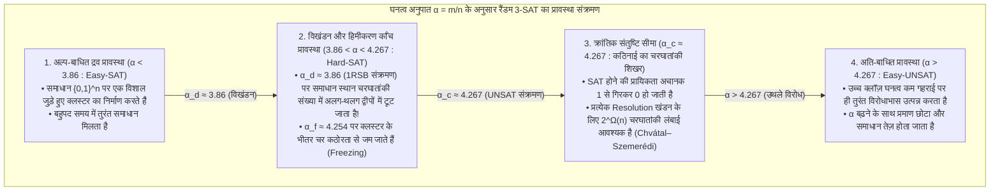

## 1. कंप्यूटर विज्ञान की "शांत एल्गोरिदमिक क्रांति"

सैद्धांतिक कंप्यूटर विज्ञान की लगभग किसी भी पाठ्यपुस्तक को खोलें, तो आपको यह गंभीर चेतावनी मिलेगी:
<strong>“बूलियन संतुष्टि समस्या (Boolean Satisfiability Problem - SAT) एक NP-Complete समस्या है। चूँकि चरों की संख्या $n$ के साथ इसकी सबसे खराब समय जटिलता $O(2^n)$ के रूप में चरघातांकी (exponential) रूप से बढ़ती है, इसलिए बड़े उदाहरणों को हल करना व्यावहारिक रूप से असंभव (intractable) है।”</strong>

शुद्ध संयोजन गणित (combinatorics) की दृष्टि से यह तर्क अकाट्य लगता है। केवल $n = 100$ बूलियन चरों वाले सूत्र में $2^{100} \approx 1.26 \times 10^{30}$ संभावित सत्य मान (truth assignments) होते हैं। यदि कोई सुपरकंप्यूटर बिग बैंग (13.8 अरब वर्ष पूर्व) से प्रति सेकंड $10^{12}$ मानों की जाँच करता आ रहा हो, तब भी वह आज तक खोज स्थान के $10^{-8}$ हिस्से को भी नहीं देख पाया होगा। वास्तव में, 1990 के दशक की शुरुआत में दुनिया के सर्वश्रेष्ठ SAT सॉल्वर मात्र $100$ चरों और $400$ क्लॉज़ (clauses) वाले सूत्रों पर ही दम तोड़ देते थे।

किंतु 21वीं सदी में इंजीनियरिंग की दुनिया प्रतिदिन लाखों बार इस सहज ज्ञान को गलत साबित करती है। आधुनिक औद्योगिक SAT और SMT सॉल्वर — जैसे <strong>MiniSat, Glucose, Lingeling, CaDiCaL, Kissat</strong> और माइक्रोसॉफ्ट रिसर्च का <strong>Z3</strong> — माइक्रोप्रोसेसर सत्यापन, कंपाइलर अनुकूलन और पैकेज निर्भरता समाधान में <strong>$1,00,00,000$ ($10^7$) चरों और $5,00,00,000$ ($5 \times 10^7$) क्लॉज़ वाले विशाल तार्किक सूत्रों को मात्र कुछ सेकंडों में हल कर देते हैं</strong>।

जब डोनाल्ड ई. नुथ (Donald E. Knuth) ने 2015 में *The Art of Computer Programming* का खंड 4B (अनुभाग 7.2.2.2) प्रकाशित किया, तो उन्होंने केवल SAT सॉल्वरों को 300 से अधिक पृष्ठ समर्पित किए और 1990 के दशक के अंत तथा 2000 के दशक की शुरुआत की इस सफलता को <strong>कंप्यूटर विज्ञान के इतिहास की सबसे महान एल्गोरिदमिक क्रांतियों में से एक</strong> बताया। पहले किसी समस्या को SAT में बदलने का अर्थ यह साबित करना होता था कि वह समस्या असाध्य है; आज किसी कठिन समस्या को SAT में अनूदित करना उसे तुरंत हल करने की सबसे शक्तिशाली इंजीनियरिंग रणनीति है।

---

## 2. संयोजक प्रसामान्य रूप (CNF), त्सेइतिन रूपांतरण और कुक-लेविन प्रमेय (1971)

### 2.1 संयोजक प्रसामान्य रूप (CNF) और रैखिक त्सेइतिन कोडिंग

एक SAT सॉल्वर $n$ बूलियन चरों $V = \{x_1, \dots, x_n\}$ (मान $\{0, 1\}$) पर परिभाषित सूत्र $\Phi$ को इनपुट के रूप में लेता है। किसी चर $x_v$ या उसके नकार $\neg x_v$ को <strong>लिटरल (Literal)</strong> $\ell$ कहा जाता है; लिटरलों के तार्किक योग (OR, $\lor$) को <strong>क्लॉज़ (Clause)</strong> $C_i = \bigvee_{j=1}^{k_i} \ell_{i,j}$ कहते हैं; और $m$ क्लॉज़ के तार्किक गुणन (AND, $\land$) को <strong>संयोजक प्रसामान्य रूप (Conjunctive Normal Form - CNF)</strong> कहते हैं:

$$\Phi(x_1, \dots, x_n) = \bigwedge_{i=1}^m C_i = \bigwedge_{i=1}^m \left(\bigvee_{j=1}^{k_i} \ell_{i,j}\right)$$

यदि किसी जटिल लॉजिक सर्किट को वितरण नियम $A \lor (B \land C) \equiv (A \lor B) \land (A \lor C)$ द्वारा सीधे CNF में बदला जाए, तो सूत्र का आकार चरघातांकी रूप से विस्फोट कर जाएगा। 1968 में रूसी गणितज्ञ <strong>ग्रिगोरी त्सेइतिन (Grigori Tseitin)</strong> ने <strong>त्सेइतिन रूपांतरण (Tseitin Transformation)</strong> द्वारा इसका समाधान किया: सर्किट के प्रत्येक लॉजिक गेट $g$ के आउटपुट के लिए एक नया <strong>सहायक चर (Auxiliary Variable)</strong> $y_g$ जोड़ा जाता है और स्थानीय तुल्यता $y_g \leftrightarrow \text{gate}(a, b)$ को केवल 3 या 4 क्लॉज़ में लिखा जाता है। उदाहरण के लिए, AND गेट $y_g \leftrightarrow (a \land b)$ केवल तीन क्लॉज़ के समतुल्य है:

$$\left(\neg y_g \lor a\right) \;\land\; \left(\neg y_g \lor b\right) \;\land\; \left(y_g \lor \neg a \lor \neg b\right)$$

इस प्रकार $|G|$ गेटों वाला कोई भी सर्किट <strong>पूर्णतः रैखिक समय और रैखिक आकार $O(|G|)$</strong> में एक <strong>समतुल्य-संतुष्टीय (Equisatisfiable)</strong> 3-CNF सूत्र में बदल जाता है।

### 2.2 कुक-लेविन प्रमेय और 2-SAT बनाम 3-SAT की जटिलता खाई

1971 में <strong>स्टीफन कुक (Stephen Cook)</strong> और <strong>लियोनिद लेविन (Leonid Levin)</strong> ने स्वतंत्र रूप से <strong>कुक-लेविन प्रमेय</strong> सिद्ध किया: वर्ग $\text{NP}$ की प्रत्येक निर्णय समस्या को गैर-नियतात्मक ट्यूरिंग मशीन के $p(n)$ चरणों के गणना इतिहास (अवस्था $S_{t,q}$, हेड की स्थिति $H_{t,i}$ और टेप प्रतीक $T_{t,i,\sigma}$) को CNF क्लॉज़ में कोडित करके बहुपद समय में SAT में बदला जा सकता है।

जब प्रत्येक क्लॉज़ में अधिकतम $k$ लिटरल हों (<strong>$k$-SAT</strong>), तो $k = 2$ और $k = 3$ के बीच एक विशाल खाई दिखाई देती है:
- <strong>2-SAT रैखिक समय $O(n + m)$ में हल होता है</strong>: द्विआधारी क्लॉज़ $(\ell_1 \lor \ell_2)$ दो निर्देशित निहितार्थों (implications) $(\neg \ell_1 \Rightarrow \ell_2) \land (\neg \ell_2 \Rightarrow \ell_1)$ के समतुल्य है। $2n$ लिटरलों के <strong>निहितार्थ ग्राफ (Implication Graph)</strong> पर टार्जन (Tarjan) के <strong>मजबूत रूप से जुड़े घटकों (SCC)</strong> के एल्गोरिदम द्वारा $O(n+m)$ समय में जाँचा जा सकता है कि क्या कोई चर $x_v$ और उसका नकार $\neg x_v$ एक ही SCC में हैं।
- <strong>3-SAT एक NP-Complete समस्या है</strong>: त्रिआधारी क्लॉज़ $(\ell_1 \lor \ell_2 \lor \ell_3)$ का अर्थ $(\neg \ell_1 \land \neg \ell_2) \Rightarrow \ell_3$ है, जो एक हाइपर-एज है। <strong>Exponential Time Hypothesis (ETH)</strong> के अंतर्गत 3-SAT के लिए कोई उप-चरघातांकी $2^{o(n)}$ एल्गोरिदम मौजूद नहीं है।

---

## 3. क्लासिकल DPLL एल्गोरिदम (1962) और कालानुक्रमिक बैकट्रैकिंग की त्रासदी

<strong>DPLL एल्गोरिदम</strong> (डेविस, पुटनाम, लोगेमान, लवलैंड, 1962) गहराई-प्रथम खोज (DFS) को <strong>इकाई संचरण (Unit Propagation / Boolean Constraint Propagation - BCP)</strong> के साथ जोड़ता है:

> <strong>इकाई संचरण (Unit Propagation / BCP)</strong>:
> यदि वर्तमान आंशिक असाइनमेंट के तहत किसी क्लॉज़ $C = (\ell_1 \lor \dots \lor \ell_{k-1} \lor \ell_k)$ में $\ell_k$ को छोड़कर सभी लिटरल `False` ($0$) हो चुके हैं और केवल $\ell_k$ अनिर्धारित है, तो $C$ को <strong>यूनिट क्लॉज़ (Unit Clause)</strong> कहा जाता है। सॉल्वर तुरंत $\ell_k = \text{True}$ ($1$) को बाध्य (force) करता है, जिससे डोमिनो प्रभाव की तरह नए यूनिट क्लॉज़ सक्रिय होते जाते हैं।

<strong>DPLL 100 चरों की दीवार क्यों नहीं पार कर सका?</strong>
<strong>कालानुक्रमिक बैकट्रैकिंग (Chronological Backtracking)</strong> के कारण! मान लीजिए सॉल्वर ने <strong>निर्णय स्तर (Decision Level) $d = 1$</strong> पर $x_1 = 0$ चुना, फिर स्तर $d = 2 \dots 49$ पर 48 पूर्णतः असंबंधित चरों $x_2, \dots, x_{49}$ को मान दिए, और <strong>स्तर $d = 50$</strong> पर $x_{50} = 1$ चुना, जिससे क्लॉज़ $(x_1 \lor \neg x_{50} \lor \pm x_{51})$ और $(x_1 \lor x_{50} \lor \pm x_{52})$ के कारण तुरंत विरोध (Conflict) उत्पन्न हो गया। अंधी कालानुक्रमिक बैकट्रैकिंग यह नहीं समझ पाती कि दोष स्तर 1 के $x_1 = 0$ का है; वह केवल एक कदम पीछे स्तर $d = 49$ पर जाती है, निर्दोष $x_{49}$ को पलटती है और <strong>$2^{48} \approx 2.81 \times 10^{14}$ व्यर्थ उप-वृक्षों</strong> में एक ही विफलता को 281 ट्रिलियन बार दोहराती रहती है (<strong>थ्रैशिंग / Thrashing</strong>)!

---

## 4. CDCL क्रांति: निहितार्थ ग्राफ, 1-UIP रेजोल्यूशन और गैर-कालानुक्रमिक बैकजंपिंग

```mermaid
flowchart TD
    Start["इनपुट: CNF सूत्र Φ (निर्णय स्तर d = 0)"] --> BCP["बूलियन बाधा संचरण (BCP)<br/>Two-Watched Literals (2WL) द्वारा तीव्र यूनिट संचरण"]
    BCP --> CheckConflict{"क्या कोई क्लॉज़ κ<br/>झूठा (Conflict) हुआ?"}
    CheckConflict -- "कोई विरोध नहीं" --> CheckAllAssigned{"क्या सभी चर<br/>निर्धारित हो गए?"}
    CheckAllAssigned -- "हाँ" --> SAT["संतुष्टीय (SAT)<br/>समाधान मॉडल σ लौटाएं"]
    CheckAllAssigned -- "नहीं" --> Branch["शाखा निर्णय (Decision): d ← d + 1<br/>अधिकतम VSIDS सक्रियता वाला चर चुनें<br/>Phase Saving से ध्रुवता तय करें"]
    Branch --> BCP
    CheckConflict -- "हाँ (विरोध!)" --> CheckLevelZero{"क्या मूल स्तर<br/>d == 0 है?"}
    CheckLevelZero -- "हाँ" --> UNSAT["असंतुष्टीय (UNSAT)<br/>DRAT प्रमाण पत्र जारी करें"]
    CheckLevelZero -- "नहीं (d > 0)" --> Analyze["विरोध विश्लेषण (1-UIP Resolution)<br/>κ से निहितार्थ ग्राफ में पीछे की ओर Resolution करें<br/>जब स्तर d का केवल 1 लिटरल बचे तब रुकें (First UIP)"]
    Analyze --> Learn["क्लॉज़ सीखें और VSIDS बढ़ाएं<br/>C_learned को डेटाबेस में जोड़ें (LBD गणना)<br/>संबंधित चरों का VSIDS स्कोर बढ़ाएं"]
    Learn --> Backjump["गैर-कालानुक्रमिक बैकजंप (Backjump)<br/>सीधे Assertion Level d_back (C_learned का दूसरा सर्वोच्च स्तर) पर कूदें!<br/>BCP में C_learned तुरंत यूनिट क्लॉज़ बनकर मान बाध्य करता है!"]
    Backjump --> BCP
```

<strong>GRASP</strong> (Marques-Silva & Sakallah, 1996) और <strong>Chaff</strong> (Moskewicz et al., 2001) द्वारा विकसित <strong>Conflict-Driven Clause Learning (CDCL)</strong> ने प्रत्येक विरोध को स्थायी ज्ञान में बदल दिया।



### 4.1 निहितार्थ ग्राफ, बूलियन रेजोल्यूशन और प्रथम अद्वितीय निहितार्थ बिंदु (1-UIP)

प्रत्येक निर्धारित लिटरल $\ell@d$ अपने निर्णय स्तर $d$ और अपने <strong>कारण क्लॉज़ (Antecedent / Reason Clause)</strong> $\text{reason}(\ell)$ को सहेजता है। जब कोई क्लॉज़ $\kappa$ झूठा होता है, तो CDCL $C \leftarrow \kappa$ से प्रारंभ कर वर्तमान स्तर $d_{\text{curr}}$ के असाइनमेंट ट्रेल पर पीछे चलते हुए बार-बार <strong>बूलियन रेजोल्यूशन नियम</strong> लगाता है:

$$\frac{(A \lor x) \qquad (\neg x \lor B)}{(A \lor B)} = \text{Res}(C_1, C_2, x)$$

निहितार्थ ग्राफ में कोई शीर्ष $u@d_{\text{curr}}$ <strong>अद्वितीय निहितार्थ बिंदु (UIP)</strong> कहलाता है यदि निर्णय शीर्ष $\ell_{\text{dec}}@d_{\text{curr}}$ से विरोध शीर्ष $\Lambda$ तक जाने वाला *प्रत्येक* निर्देशित पथ $u$ से होकर गुजरता है (Dominator)। विरोध के सबसे निकट स्थित UIP को <strong>First UIP (1-UIP)</strong> कहते हैं, और रेजोल्यूशन लूप ठीक उस क्षण 1-UIP पर पहुँच जाता है जब क्लॉज़ $C$ में <strong>वर्तमान निर्णय स्तर $d_{\text{curr}}$ का केवल एक ही लिटरल शेष रह जाता है</strong>!

हमारे उदाहरण ($x_1 = 0@1, x_2 = 0@2, x_3 = 1@3$, निर्णय $x_4 = 1@5$ तथा क्लॉज़ $\omega_1, \omega_2, \omega_3, \omega_4$ से विरोध $\kappa = (\neg x_7 \lor \neg x_8)$) में, $\kappa$ का $\omega_4$ (पिवट $x_8$) और फिर $\omega_3$ (पिवट $x_7$) के साथ रेजोल्यूशन करने पर तुरंत <strong>1-UIP सीखा गया क्लॉज़</strong> प्राप्त होता है:

$$C_{\text{learned}} = \left(x_2@2 \lor \neg x_3@3 \lor \neg x_6@5\right)$$

### 4.2 गैर-कालानुक्रमिक बैकजंपिंग और Assertion Level

चूँकि $C_{\text{learned}}$ में स्तर $\{5, 3, 2\}$ हैं, सॉल्वर सीधे <strong>दूसरे सर्वोच्च निर्णय स्तर (Assertion Level) $d_{\text{back}} = 3$</strong> पर छलांग लगाता है! स्तर $3$ पर उतरते ही $x_2@2$ और $\neg x_3@3$ अभी भी `False` हैं जबकि $\neg x_6$ अनिर्धारित हो जाता है, जिससे $C_{\text{learned}}$ तुरंत <strong>यूनिट क्लॉज़</strong> बनकर BCP द्वारा $\neg x_6 = 1@3$ ($x_6 = 0@3$) को बाध्य कर देता है!

---

## 5. इंजीनियरिंग चमत्कार: Two-Watched Literals (2WL), VSIDS और LBD

1. <strong>Two-Watched Literals (2WL, Chaff 2001)</strong>:
   जब तक किसी क्लॉज़ में कम से कम दो लिटरल `False` नहीं हैं, वह क्लॉज़ न तो यूनिट बन सकता है और न ही विरोध। इसलिए सॉल्वर <strong>प्रत्येक क्लॉज़ में केवल दो लिटरल $w_1, w_2$ की निगरानी (Watch) करता है</strong>। सबसे बड़ा चमत्कार <strong>बैकजंपिंग</strong> के समय होता है: चरों को अन-असाइन करने पर 2WL शर्त स्वतः बनी रहती है, इसलिए <strong>बैकट्रैकिंग में पॉइंटर अपडेट की लागत शून्य ($O(1)$) होती है</strong>!
2. <strong>VSIDS (Variable State Independent Decaying Sum) और Phase Saving</strong>:
   विरोध विश्लेषण में भाग लेने वाले प्रत्येक चर के स्कोर में $+\Delta$ जोड़ा जाता है और प्रत्येक विरोध के बाद $\Delta \leftarrow \Delta / \gamma$ ($\gamma = 0.95$) बढ़ाया जाता है, जिससे खोज वर्तमान बाधा पर केंद्रित रहती है।
3. <strong>LBD (Literal Block Distance / "Glue" क्लॉज़) और तीव्र रीस्टार्ट</strong>:
   Glucose (2009) किसी सीखे गए क्लॉज़ $C$ में मौजूद भिन्न निर्णय स्तरों की संख्या को $\text{LBD}(C)$ परिभाषित करता है। $\text{LBD} = 2$ वाले क्लॉज़ (<strong>Glue Clauses</strong>) वर्तमान UIP को सीधे एक पूर्व निर्णय ब्लॉक से जोड़ते हैं और इन्हें स्थायी रूप से सुरक्षित रखा जाता है।

| वास्तुशिल्प आयाम | क्लासिकल DPLL (1962) | प्रथम पीढ़ी CDCL (GRASP / Chaff 2001) | आधुनिकतम CDCL (Glucose / CaDiCaL / Kissat) |
| :--- | :--- | :--- | :--- |
| <strong>BCP डेटा संरचना</strong> | प्रत्येक क्लॉज़ में पूर्ण लिटरल काउंटर | <strong>Two-Watched Literals (2WL)</strong> (बैकट्रैक पर शून्य पॉइंटर अपडेट, $O(1)$) | <strong>इनलाइन ब्लॉकिंग लिटरल सहित 2WL</strong> + तीव्र बाइनरी क्लॉज़ सूचियाँ |
| <strong>विरोध से वापसी</strong> | <strong>कालानुक्रमिक बैकट्रैकिंग</strong> ($d-1$, $2^k$ थ्रैशिंग) | <strong>गैर-कालानुक्रमिक बैकजंपिंग</strong> (Assertion Level $d_{\text{back}}$ तक छलांग) | बैकजंपिंग + स्थानीय कालानुक्रमिक बैकट्रैकिंग हाइब्रिड (2018) |
| <strong>क्लॉज़ लर्निंग</strong> | कोई नहीं (स्मृतिहीन खोज वृक्ष) | <strong>1-UIP रेजोल्यूशन</strong> + पुनरावर्ती क्लॉज़ न्यूनीकरण | 1-UIP + ऑन-द-फ्लाई सबसम्प्शन, विविफिकेशन और चर विलोपन (BVE) |
| <strong>शाखा ह्यूरिस्टिक</strong> | स्थिर क्रम / DLIS | <strong>VSIDS</strong> (चरघातांकी क्षय वाली सक्रियता स्कोरिंग) | <strong>EVSIDS + VMTF</strong> प्रत्यावर्तन + Phase Saving और WalkSAT स्थानीय खोज |
| <strong>क्लॉज़ डेटाबेस प्रबंधन</strong> | लागू नहीं | आकार और सक्रियता आधारित आवधिक विलोपन | <strong>LBD आधारित 3-स्तरीय प्रबंधन</strong> (Glue Clauses $\text{LBD} \le 2$ स्थायी) |

---

## 6. Python में CDCL सॉल्वर कोर इंजन का पूर्ण कार्यान्वयन

नीचे BCP, निहितार्थ ग्राफ, <strong>1-UIP रेजोल्यूशन</strong>, <strong>गैर-कालानुक्रमिक बैकजंपिंग</strong> और <strong>VSIDS</strong> सहित एक कार्यशील CDCL सॉल्वर का पूर्ण Python कोड दिया गया है:

```python
from typing import List, Dict, Optional, Set, Tuple

class CDCLSolver:
    '''Minimal Conflict-Driven Clause Learning (CDCL) SAT Solver with 1-UIP & VSIDS.'''
    def __init__(self, num_vars: int, clauses: List[List[int]]):
        self.num_vars = num_vars
        self.clauses: List[List[int]] = [list(set(c)) for c in clauses]
        self.assigns: Dict[int, bool] = {}
        self.trail: List[int] = []
        self.level: Dict[int, int] = {}
        self.reason: Dict[int, Optional[List[int]]] = {}
        self.decision_level: int = 0
        self.activity: Dict[int, float] = {v: 0.0 for v in range(1, num_vars + 1)}
        for c in self.clauses:
            for lit in c:
                self.activity[abs(lit)] += 1.0
        self.var_inc: float = 1.0
        self.var_decay: float = 0.95

    def value_lit(self, lit: int) -> Optional[bool]:
        var = abs(lit)
        if var not in self.assigns:
            return None
        return self.assigns[var] if lit > 0 else not self.assigns[var]

    def assign(self, lit: int, level: int, reason: Optional[List[int]]) -> None:
        var = abs(lit)
        self.assigns[var] = (lit > 0)
        self.trail.append(lit)
        self.level[var] = level
        self.reason[var] = reason

    def bcp(self) -> Optional[List[int]]:
        changed = True
        while changed:
            changed = False
            for clause in self.clauses:
                unassigned_lit = None
                num_unassigned = 0
                satisfied = False
                for lit in clause:
                    val = self.value_lit(lit)
                    if val is True:
                        satisfied = True
                        break
                    elif val is None:
                        num_unassigned += 1
                        unassigned_lit = lit
                if satisfied:
                    continue
                if num_unassigned == 0:
                    return clause
                if num_unassigned == 1 and unassigned_lit is not None:
                    self.assign(unassigned_lit, self.decision_level, clause)
                    changed = True
        return None

    def analyze_conflict(self, conflict_clause: List[int]) -> Tuple[List[int], int]:
        learned: Set[int] = set(conflict_clause)
        def count_curr_level(cset: Set[int]) -> int:
            return sum(1 for lit in cset if self.level[abs(lit)] == self.decision_level)

        idx = len(self.trail) - 1
        while count_curr_level(learned) > 1:
            while True:
                pivot_lit = self.trail[idx]
                idx -= 1
                if -pivot_lit in learned and self.level[abs(pivot_lit)] == self.decision_level:
                    break
            pivot_var = abs(pivot_lit)
            antecedent = self.reason[pivot_var]
            assert antecedent is not None
            self.activity[pivot_var] += self.var_inc
            learned.remove(-pivot_lit)
            for lit in antecedent:
                if lit != pivot_lit:
                    learned.add(lit)

        learned_clause = list(learned)
        for lit in learned_clause:
            self.activity[abs(lit)] += self.var_inc
        self.var_inc /= self.var_decay
        levels = sorted({self.level[abs(lit)] for lit in learned_clause}, reverse=True)
        backjump_level = levels[1] if len(levels) > 1 else 0
        return learned_clause, backjump_level

    def backtrack(self, target_level: int) -> None:
        while self.trail and self.level[abs(self.trail[-1])] > target_level:
            lit = self.trail.pop()
            var = abs(lit)
            del self.assigns[var], self.level[var], self.reason[var]
        self.decision_level = target_level

    def solve(self) -> Tuple[bool, Optional[Dict[int, bool]]]:
        if self.bcp() is not None:
            return False, None
        while True:
            unassigned = [v for v in range(1, self.num_vars + 1) if v not in self.assigns]
            if not unassigned:
                return True, dict(self.assigns)
            branch_var = max(unassigned, key=lambda v: self.activity[v])
            self.decision_level += 1
            self.assign(branch_var, self.decision_level, reason=None)
            while True:
                conflict = self.bcp()
                if conflict is None:
                    break
                if self.decision_level == 0:
                    return False, None
                learned_clause, backjump_level = self.analyze_conflict(conflict)
                self.clauses.append(learned_clause)
                self.backtrack(backjump_level)
```

---

## 7. सांख्यिकीय भौतिकी और रैंडम $k$-SAT का प्रावस्था संक्रमण ($\alpha_c \approx 4.267$)

$n$ चरों और $m = \alpha n$ क्लॉज़ वाले रैंडम 3-SAT सूत्र (<strong>क्लॉज़-चर अनुपात $\alpha = m / n$</strong>) के लिए प्रथम आघूर्ण विधि (First Moment Method) से समाधानों की अपेक्षित संख्या $\mathbb{E}[Z]$ है:

$$\mathbb{E}[Z] = 2^n \left(1 - 2^{-3}\right)^m = \left(2 \cdot \left(\frac{7}{8}\right)^\alpha\right)^n \implies \alpha_{\text{annealed}} = \frac{\ln 2}{\ln(8/7)} \approx 5.191$$

स्पिन ग्लास भौतिकी की <strong>कैविटी विधि (Cavity Method)</strong> और <strong>One-Step Replica Symmetry Breaking (1RSB)</strong> का उपयोग करके मेज़ार्ड, पारिसी (2021 भौतिकी नोबेल पुरस्कार विजेता) और ज़ेकिना (2002) ने रैंडम 3-SAT का सटीक क्रांतिक प्रावस्था संक्रमण बिंदु ज्ञात किया:

$$\alpha_c \approx 4.267$$



$\alpha_c \approx 4.267$ पर रैंडम हाइपरग्राफ एक <strong>एक्सपैंडर ग्राफ (Expander Graph)</strong> होता है जिसमें कोई स्थानीय बाधा नहीं होती, इसलिए किसी भी रेजोल्यूशन प्रमाण की लंबाई $2^{\Omega(n)}$ होती है (Chvátal & Szemerédi, 1988)। इसके विपरीत, <strong>वास्तविक औद्योगिक समस्याओं में मॉड्यूलर सामुदायिक संरचना (Community Structure) और छोटे बैकडोर सेट (Backdoor Sets)</strong> होते हैं (Ansótegui et al. 2012; Williams, Gomes, Selman 2003), जिनका लाभ उठाकर CDCL 1 करोड़ चरों को सेकंडों में हल कर देता है।

---

## 8. वास्तविक दुनिया की उपलब्धियाँ और 200 टेराबाइट का गणितीय प्रमाण

1. <strong>कंप्यूटर-सहायता प्राप्त गणित और 200 TB का DRAT प्रमाण (Heule, Kullmann, Marek 2016)</strong>: <strong>Cube-and-Conquer</strong> पद्धति से 800 कोर पर उन्होंने सिद्ध किया कि बूलियन पाइथागोरियन ट्रिपल्स समस्या ($a^2 + b^2 = c^2$) <strong>$N = 7824$ तक संतुष्टीय (SAT)</strong> है किंतु <strong>$N = 7825$ पर असंभव (UNSAT)</strong> है, और इसके लिए मानव इतिहास का सबसे बड़ा <strong>200 टेराबाइट का औपचारिक DRAT प्रमाण</strong> उत्पन्न किया! इसी तकनीक से उन्होंने शूर संख्या $S(5) = 160$ (2018) और आयाम 7 में केलर के अनुमान (2020) को भी हल किया।
2. <strong>सेमीकंडक्टर EDA औपचारिक सत्यापन (CEC और BMC)</strong>: प्रत्येक आधुनिक CPU/GPU के निर्माण से पूर्व RTL विनिर्देश और गेट-स्तरीय सर्किट को XOR <strong>Miter सर्किट</strong> द्वारा जोड़कर SAT सॉल्वरों से सत्यापित किया जाता है।
3. <strong>पैकेज मैनेजर (Debian apt, Rust Cargo, Dart PubGrub, uv)</strong> और <strong>SMT सॉल्वर ($\text{DPLL}(T)$: Z3 व cvc5)</strong>: CDCL कोर को प्रथम-कोटि सिद्धांत सॉल्वरों के साथ जोड़कर ये प्रतीकात्मक निष्पादन (symbolic execution) और क्लाउड सुरक्षा इंजन (<strong>AWS Zelkova</strong>) को संचालित करते हैं।
