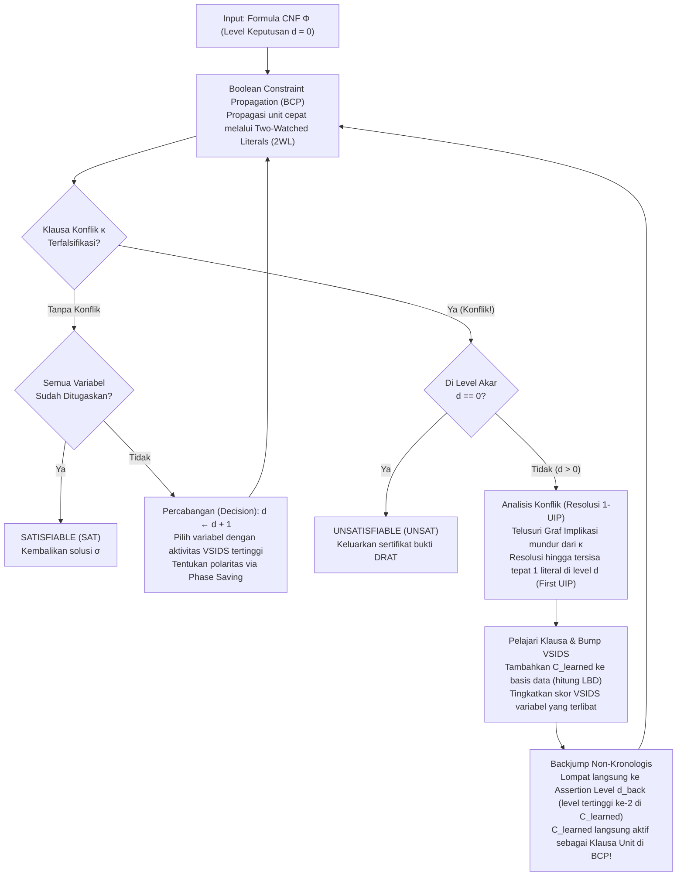
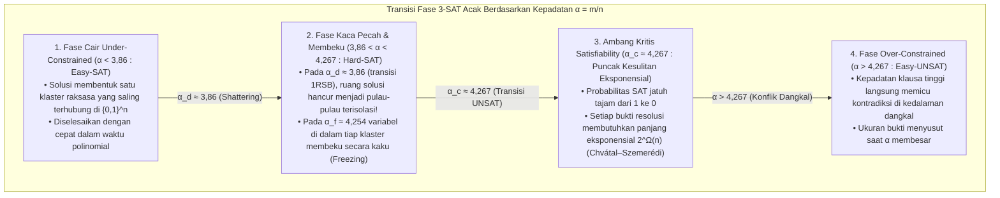

## 1. Revolusi Algoritmik Senyap dalam Ilmu Komputer

Buka hampir semua buku teks ilmu komputer teoretis dan Anda akan menemukan peringatan tegas:
<strong>“Masalah Kepuasan Boolean (Boolean Satisfiability Problem, SAT) adalah NP-Complete. Karena kompleksitas waktu kasus terburuknya tumbuh secara eksponensial sebesar $O(2^n)$ terhadap jumlah variabel $n$, instans berukuran besar pada dasarnya tidak dapat dipecahkan secara praktis (intractable).”</strong>

Secara kombinatorial murni, argumen tersebut tampak tak terbantahkan. Sebuah formula proposisional dengan $n = 100$ variabel Boolean memiliki $2^{100} \approx 1,26 \times 10^{30}$ kemungkinan penugasan nilai kebenaran. Bahkan jika sebuah superkomputer memeriksa $10^{12}$ penugasan per detik sejak Big Bang (13,8 miliar tahun lalu), hari ini ia baru menjelajahi kurang dari $10^{-8}$ ruang pencarian. Faktanya, sekitar tahun 1990, solver SAT terbaik dunia lumpuh ketika menghadapi formula dengan hanya $100$ variabel dan $400$ klausa.

Namun di abad ke-21, praktik rekayasa mematahkan intuisi buku teks tersebut jutaan kali setiap hari. Solver SAT dan SMT industri modern — seperti <strong>MiniSat, Glucose, Lingeling, CaDiCaL, Kissat</strong>, dan <strong>Z3</strong> dari Microsoft Research — secara rutin menyelesaikan instans verifikasi formal mikroprosesor, optimasi kompiler, dan resolusi dependensi paket yang memuat <strong>$10.000.000$ ($10^7$) variabel dan $50.000.000$ ($5 \times 10^7$) klausa hanya dalam hitungan detik</strong>.

Ketika Donald E. Knuth menerbitkan Volume 4B (Bagian 7.2.2.2) dari *The Art of Computer Programming* pada tahun 2015, beliau mendedikasikan lebih dari 300 halaman khusus untuk solver SAT, memuji terobosan akhir 1990-an dan awal 2000-an sebagai <strong>salah satu revolusi algoritmik terbesar dalam sejarah ilmu komputer</strong>. Jika dahulu mereduksi masalah ke SAT berarti membuktikan bahwa masalah itu mustahil diselesaikan, kini menerjemahkan masalah kombinatorial sulit ke SAT adalah strategi utama untuk menyelesaikannya secara instan.

---

## 2. Bentuk Normal Konjungtif (CNF), Transformasi Tseitin, dan Teorema Cook-Levin (1971)

### 2.1 Bentuk Normal Konjungtif (CNF) dan Pengodean Linear Tseitin

Sebuah solver SAT beroperasi pada formula proposisional $\Phi$ di atas $n$ variabel Boolean $V = \{x_1, \dots, x_n\}$ bernilai $\{0, 1\}$. Sebuah <strong>literal</strong> $\ell \in \{x_v, \neg x_v\}$ adalah variabel atau negasinya; sebuah <strong>klausa</strong> $C_i = \bigvee_{j=1}^{k_i} \ell_{i,j}$ adalah disjungsi (OR logis, $\lor$) dari literal-literal; dan sebuah formula dalam <strong>Bentuk Normal Konjungtif (CNF)</strong> adalah konjungsi (AND logis, $\land$) dari $m$ klausa:

$$\Phi(x_1, \dots, x_n) = \bigwedge_{i=1}^m C_i = \bigwedge_{i=1}^m \left(\bigvee_{j=1}^{k_i} \ell_{i,j}\right)$$

Jika kita mengubah sirkuit logika sembarang menjadi CNF secara naif menggunakan hukum distributif $A \lor (B \land C) \equiv (A \lor B) \land (A \lor C)$, ukuran formula akan meledak secara eksponensial. Pada tahun 1968, <strong>Grigori Tseitin</strong> mengatasi masalah ini melalui <strong>Transformasi Tseitin</strong>: setiap gerbang logika $g$ diberi satu <strong>variabel bantu (auxiliary variable)</strong> baru $y_g$ yang mengodekan ekuivalensi lokal $y_g \leftrightarrow \text{gate}(a, b)$ hanya dengan 3 atau 4 klausa. Misalnya, gerbang AND $y_g \leftrightarrow (a \land b)$ setara dengan tiga klausa:

$$\left(\neg y_g \lor a\right) \;\land\; \left(\neg y_g \lor b\right) \;\land\; \left(y_g \lor \neg a \lor \neg b\right)$$

Dengan demikian, sirkuit apa pun dengan $|G|$ gerbang dapat dikonversi dalam <strong>waktu dan ruang linear $O(|G|)$</strong> menjadi formula 3-CNF yang <strong>ekuisatisfiabel (equisatisfiable)</strong>.

### 2.2 Teorema Cook-Levin dan Jurang Kompleksitas antara 2-SAT vs. 3-SAT

Pada tahun 1971, <strong>Stephen Cook</strong> dan <strong>Leonid Levin</strong> secara independen membuktikan <strong>Teorema Cook-Levin</strong>: setiap masalah keputusan di kelas $\text{NP}$ dapat direduksi dalam waktu polinomial ke SAT dengan mengodekan tabel komputasi ruang-waktu mesin Turing nondeterministik selama $p(n)$ langkah (status $S_{t,q}$, posisi head $H_{t,i}$, simbol pita $T_{t,i,\sigma}$) sebagai formula CNF.

Ketika setiap klausa memiliki paling banyak $k$ literal (<strong>$k$-SAT</strong>), terdapat jurang tajam antara $k = 2$ dan $k = 3$:
- <strong>2-SAT dapat diselesaikan dalam waktu linear $O(n + m)$</strong>: klausa biner $(\ell_1 \lor \ell_2)$ ekuivalen dengan dua implikasi berarah deterministik $(\neg \ell_1 \Rightarrow \ell_2) \land (\neg \ell_2 \Rightarrow \ell_1)$. Pada <strong>Graf Implikasi</strong> dengan $2n$ literal, algoritma Tarjan menemukan <strong>Komponen Terhubung Kuat (SCC)</strong> dalam waktu $O(n+m)$: formula satisfiabel jika dan hanya jika tidak ada variabel $x_v$ yang berada di SCC yang sama dengan $\neg x_v$.
- <strong>3-SAT adalah NP-Complete</strong>: klausa terner $(\ell_1 \lor \ell_2 \lor \ell_3)$ setara dengan $(\neg \ell_1 \land \neg \ell_2) \Rightarrow \ell_3$, sebuah hiper-sisi yang membutuhkan dua premis sekaligus. Di bawah <strong>Exponential Time Hypothesis (ETH)</strong>, tidak ada algoritma deterministik yang menyelesaikan 3-SAT dalam waktu subeksponensial $2^{o(n)}$ pada kasus terburuk.

---

## 3. Algoritma DPLL Klasik (1962) dan Tragedi Backtracking Kronologis

Algoritma <strong>DPLL</strong> (Davis, Putnam, Logemann, Loveland, 1962) menggabungkan pencarian mendalam (DFS) dengan <strong>Unit Propagation (Boolean Constraint Propagation, BCP)</strong>:

> <strong>Unit Propagation (BCP)</strong>:
> Jika di bawah penugasan parsial saat ini semua literal dalam klausa $C = (\ell_1 \lor \dots \lor \ell_{k-1} \lor \ell_k)$ kecuali $\ell_k$ bernilai `False` ($0$) dan $\ell_k$ belum ditugaskan, maka $C$ disebut <strong>klausa unit (Unit Clause)</strong>. Solver segera memaksa $\ell_k = \text{True}$ ($1$) tanpa percabangan, memicu efek domino propagasi unit baru hingga mencapai titik tetap atau memalsukan seluruh literal suatu klausa (<strong>Konflik</strong>).

<strong>Mengapa DPLL mentok pada kisaran 100 variabel?</strong>
Karena <strong>backtracking kronologis</strong>. Jika solver menetapkan $x_1 = 0$ pada <strong>level keputusan $d = 1$</strong>, lalu membuat 48 keputusan independen pada $x_2, \dots, x_{49}$ di level $d = 2 \dots 49$, dan pada <strong>level $d = 50$</strong> memilih $x_{50} = 1$ yang langsung memicu konflik murni akibat $x_1 = 0$ dan $x_{50}$ melalui klausa $(x_1 \lor \neg x_{50} \lor \pm x_{51})$ dan $(x_1 \lor x_{50} \lor \pm x_{52})$, DPLL buta terhadap akar masalah di level 1. Ia hanya mundur satu langkah ke level $d = 49$, membalik variabel $x_{49}$ yang tidak bersalah, dan mengulangi kegagalan yang persis sama di <strong>$2^{48} \approx 2,81 \times 10^{14}$ subpohon sia-sia</strong> (<strong>thrashing</strong>)!

---

## 4. Revolusi CDCL: Graf Implikasi, Resolusi 1-UIP, dan Backjumping Non-Kronologis

Diperkenalkan pada <strong>GRASP</strong> (Marques-Silva & Sakallah, 1996) dan disempurnakan dalam <strong>Chaff</strong> (Moskewicz et al., 2001), <strong>Conflict-Driven Clause Learning (CDCL)</strong> mengubah setiap konflik menjadi klausa baru yang dipelajari secara permanen.



### 4.1 Graf Implikasi, Resolusi Boolean, dan First Unique Implication Point (1-UIP)

Setiap literal yang ditugaskan $\ell@d$ mencatat level keputusan $d$ dan <strong>klausa alasan (antecedent / reason clause)</strong> $\text{reason}(\ell)$. Saat klausa konflik $\kappa$ terfalsifikasi, CDCL menginisialisasi $C \leftarrow \kappa$ dan berjalan mundur mengikuti Trail pada level saat ini $d_{\text{curr}}$, menerapkan <strong>aturan Resolusi Boolean</strong> secara berulang:

$$\frac{(A \lor x) \qquad (\neg x \lor B)}{(A \lor B)} = \text{Res}(C_1, C_2, x)$$

Pada graf implikasi, sebuah simpul $u@d_{\text{curr}}$ adalah <strong>Unique Implication Point (UIP)</strong> jika *setiap* jalur berarah dari keputusan $\ell_{\text{dec}}@d_{\text{curr}}$ menuju simpul konflik $\Lambda$ wajib melewati $u$ (dominator). UIP yang paling dekat dengan konflik disebut <strong>First UIP (1-UIP)</strong>, yang tercapai tepat pada saat klausa kerja $C$ hanya menyisakan <strong>satu literal saja dari level keputusan saat ini $d_{\text{curr}}$</strong>!

Dengan $x_1 = 0@1, x_2 = 0@2, x_3 = 1@3$, keputusan $x_4 = 1@5$, serta klausa $\omega_1 = (x_1 \lor \neg x_4 \lor x_5)$, $\omega_2 = (\neg x_4 \lor \neg x_5 \lor x_6)$, $\omega_3 = (x_2 \lor \neg x_6 \lor x_7)$, $\omega_4 = (\neg x_3 \lor \neg x_6 \lor x_8)$ yang berujung pada konflik $\kappa = (\neg x_7 \lor \neg x_8)$, dua langkah resolusi $\kappa$ dengan $\omega_4$ (pivot $x_8$) dan $\omega_3$ (pivot $x_7$) langsung menghasilkan <strong>klausa terpelajar 1-UIP</strong>:

$$C_{\text{learned}} = \left(x_2@2 \lor \neg x_3@3 \lor \neg x_6@5\right)$$

### 4.2 Backjumping Non-Kronologis dan Assertion Level

Karena level dalam $C_{\text{learned}}$ adalah $\{5, 3, 2\}$, solver melompat langsung ke <strong>level keputusan tertinggi kedua (Assertion Level) $d_{\text{back}} = 3$</strong>! Di level $3$, $x_2@2$ dan $\neg x_3@3$ masih bernilai `False` sedangkan $\neg x_6$ kembali bebas, sehingga $C_{\text{learned}}$ langsung bertindak sebagai <strong>klausa unit penegas (asserting clause)</strong> dan memaksa $\neg x_6 = 1@3$ ($x_6 = 0@3$) melalui BCP!

---

## 5. Keajaiban Rekayasa: Two-Watched Literals (2WL), VSIDS, dan LBD

1. <strong>Two-Watched Literals (2WL, Chaff 2001)</strong>:
   Selama sebuah klausa memiliki sedikitnya dua literal yang belum bernilai `False`, klausa tersebut tidak mungkin menjadi klausa unit maupun konflik. Solver <strong>hanya memantau dua literal $w_1, w_2$ per klausa</strong>. Keajaiban terbesarnya terjadi saat <strong>backjumping</strong>: membatalkan penugasan variabel secara otomatis mempertahankan invarian 2WL, sehingga <strong>backtracking membutuhkan tepat nol pembaruan pointer ($O(1)$)</strong>!
2. <strong>VSIDS (Variable State Independent Decaying Sum) & Phase Saving</strong>:
   Setiap variabel yang terlibat dalam resolusi konflik mendapat tambahan skor $+\Delta$, sementara $\Delta \leftarrow \Delta / \gamma$ ($\gamma = 0,95$) membesar setiap kali terjadi konflik, memfokuskan pencarian pada titik kemacetan terbaru.
3. <strong>LBD (Literal Block Distance / Klausa «Glue») & Rapid Restarts</strong>:
   Glucose (Audemard & Simon, 2009) mendefinisikan $\text{LBD}(C)$ sebagai jumlah level keputusan berbeda dalam klausa $C$. Klausa dengan $\text{LBD} = 2$ (<strong>Glue Clauses</strong>) mengikat UIP saat ini langsung ke satu blok keputusan masa lalu dan disimpan secara permanen.

| Dimensi Arsitektur | DPLL Klasik (1962) | CDCL Generasi ke-1 (GRASP / Chaff 2001) | CDCL Mutakhir (Glucose / CaDiCaL / Kissat) |
| :--- | :--- | :--- | :--- |
| <strong>Struktur Data BCP</strong> | Penghitung literal penuh di tiap klausa | <strong>Two-Watched Literals (2WL)</strong> ($O(1)$ saat backtrack tanpa update pointer) | <strong>2WL dengan Inline Blocking Literals</strong> + daftar khusus klausa biner |
| <strong>Pemulihan Konflik</strong> | <strong>Backtracking Kronologis</strong> ($d-1$, thrashing $2^k$) | <strong>Backjumping Non-Kronologis</strong> ke Assertion Level $d_{\text{back}}$ | Hibrida Backjumping & Backtracking Kronologis Lokal (2018) |
| <strong>Pembelajaran Klausa</strong> | Tidak ada (pohon tanpa memori) | <strong>Resolusi 1-UIP</strong> + minimisasi klausa rekursif | 1-UIP + On-the-Fly Subsumption, Vivification & Eliminasi Variabel (BVE) |
| <strong>Heuristik Cabang</strong> | Urutan statis / DLIS | <strong>VSIDS</strong> (skor aktivitas peluruhan eksponensial) | Pergantian <strong>EVSIDS + VMTF</strong> + Phase Saving & pencarian lokal WalkSAT |
| <strong>Manajemen Basis Data</strong> | N/A | Penghapusan berkala berdasarkan ukuran & aktivitas | <strong>Manajemen 3-Tier berbasis LBD</strong> (Glue Clauses $\text{LBD} \le 2$ permanen) |

---

## 6. Implementasi Lengkap Mesin Inti CDCL dalam Python

Berikut adalah implementasi lengkap dan mandiri dari solver CDCL dalam bahasa Python yang mencakup BCP, graf implikasi, <strong>resolusi 1-UIP</strong>, <strong>backjumping non-kronologis</strong>, dan <strong>VSIDS</strong>:

```python
from typing import List, Dict, Optional, Set, Tuple

class CDCLSolver:
    '''Minimal Conflict-Driven Clause Learning (CDCL) SAT Solver with 1-UIP & VSIDS.'''
    def __init__(self, num_vars: int, clauses: List[List[int]]):
        self.num_vars = num_vars
        self.clauses: List[List[int]] = [list(set(c)) for c in clauses]
        self.assigns: Dict[int, bool] = {}
        self.trail: List[int] = []
        self.level: Dict[int, int] = {}
        self.reason: Dict[int, Optional[List[int]]] = {}
        self.decision_level: int = 0
        self.activity: Dict[int, float] = {v: 0.0 for v in range(1, num_vars + 1)}
        for c in self.clauses:
            for lit in c:
                self.activity[abs(lit)] += 1.0
        self.var_inc: float = 1.0
        self.var_decay: float = 0.95

    def value_lit(self, lit: int) -> Optional[bool]:
        var = abs(lit)
        if var not in self.assigns:
            return None
        return self.assigns[var] if lit > 0 else not self.assigns[var]

    def assign(self, lit: int, level: int, reason: Optional[List[int]]) -> None:
        var = abs(lit)
        self.assigns[var] = (lit > 0)
        self.trail.append(lit)
        self.level[var] = level
        self.reason[var] = reason

    def bcp(self) -> Optional[List[int]]:
        changed = True
        while changed:
            changed = False
            for clause in self.clauses:
                unassigned_lit = None
                num_unassigned = 0
                satisfied = False
                for lit in clause:
                    val = self.value_lit(lit)
                    if val is True:
                        satisfied = True
                        break
                    elif val is None:
                        num_unassigned += 1
                        unassigned_lit = lit
                if satisfied:
                    continue
                if num_unassigned == 0:
                    return clause
                if num_unassigned == 1 and unassigned_lit is not None:
                    self.assign(unassigned_lit, self.decision_level, clause)
                    changed = True
        return None

    def analyze_conflict(self, conflict_clause: List[int]) -> Tuple[List[int], int]:
        learned: Set[int] = set(conflict_clause)
        def count_curr_level(cset: Set[int]) -> int:
            return sum(1 for lit in cset if self.level[abs(lit)] == self.decision_level)

        idx = len(self.trail) - 1
        while count_curr_level(learned) > 1:
            while True:
                pivot_lit = self.trail[idx]
                idx -= 1
                if -pivot_lit in learned and self.level[abs(pivot_lit)] == self.decision_level:
                    break
            pivot_var = abs(pivot_lit)
            antecedent = self.reason[pivot_var]
            assert antecedent is not None
            self.activity[pivot_var] += self.var_inc
            learned.remove(-pivot_lit)
            for lit in antecedent:
                if lit != pivot_lit:
                    learned.add(lit)

        learned_clause = list(learned)
        for lit in learned_clause:
            self.activity[abs(lit)] += self.var_inc
        self.var_inc /= self.var_decay
        levels = sorted({self.level[abs(lit)] for lit in learned_clause}, reverse=True)
        backjump_level = levels[1] if len(levels) > 1 else 0
        return learned_clause, backjump_level

    def backtrack(self, target_level: int) -> None:
        while self.trail and self.level[abs(self.trail[-1])] > target_level:
            lit = self.trail.pop()
            var = abs(lit)
            del self.assigns[var], self.level[var], self.reason[var]
        self.decision_level = target_level

    def solve(self) -> Tuple[bool, Optional[Dict[int, bool]]]:
        if self.bcp() is not None:
            return False, None
        while True:
            unassigned = [v for v in range(1, self.num_vars + 1) if v not in self.assigns]
            if not unassigned:
                return True, dict(self.assigns)
            branch_var = max(unassigned, key=lambda v: self.activity[v])
            self.decision_level += 1
            self.assign(branch_var, self.decision_level, reason=None)
            while True:
                conflict = self.bcp()
                if conflict is None:
                    break
                if self.decision_level == 0:
                    return False, None
                learned_clause, backjump_level = self.analyze_conflict(conflict)
                self.clauses.append(learned_clause)
                self.backtrack(backjump_level)
```

---

## 7. Fisika Statistik dan Transisi Fase $k$-SAT Acak ($\alpha_c \approx 4,267$)

Untuk formula 3-SAT acak dengan $n$ variabel dan $m = \alpha n$ klausa (<strong>rasio kepadatan klausa terhadap variabel $\alpha = m / n$</strong>), metode momen pertama memberikan ekspektasi jumlah solusi $\mathbb{E}[Z]$:

$$\mathbb{E}[Z] = 2^n \left(1 - 2^{-3}\right)^m = \left(2 \cdot \left(\frac{7}{8}\right)^\alpha\right)^n \implies \alpha_{\text{annealed}} = \frac{\ln 2}{\ln(8/7)} \approx 5,191$$

Menggunakan <strong>Metode Rongga (Cavity Method)</strong> dan <strong>One-Step Replica Symmetry Breaking (1RSB)</strong> dari fisika kaca spin (spin glass), Mézard, Parisi, dan Zecchina (2002) menemukan ambang batas kritis sejati untuk 3-SAT acak:

$$\alpha_c \approx 4,267$$



Pada $\alpha_c \approx 4,267$, hipergraf acak bersifat <strong>graf ekspander</strong> tanpa leher botol lokal sehingga setiap bukti resolusi wajib berukuran eksponensial $2^{\Omega(n)}$ (Chvátal & Szemerédi, 1988). Sebaliknya, <strong>masalah industri nyata memiliki struktur komunitas modular (Community Structure) dan himpunan Backdoor kecil</strong> (Ansótegui et al. 2012; Williams, Gomes, Selman 2003), yang dieksploitasi oleh CDCL untuk memecahkan 10 juta variabel dalam hitungan detik.

---

## 8. Kejayaan di Dunia Nyata dan Bukti Matematika 200 Terabyte

1. <strong>Matematika Berbantuan Komputer & Bukti DRAT 200 TB (Heule, Kullmann, Marek 2016)</strong>: Menggunakan <strong>Cube-and-Conquer</strong> pada 800 core, mereka membuktikan bahwa Masalah Tripel Pythagoras Boolean ($a^2 + b^2 = c^2$) dapat dipenuhi hingga <strong>$N = 7824$ (SAT)</strong>, tetapi <strong>mustahil pada $N = 7825$ (UNSAT)</strong>, menghasilkan <strong>sertifikat bukti formal DRAT sebesar 200 Terabyte</strong>, serta menyelesaikan bilangan Schur $S(5) = 160$ (2018) dan konjektur Keller dimensi 7 (2020).
2. <strong>Verifikasi Formal Cip EDA (CEC & BMC)</strong>: sirkuit <strong>Miter</strong> (XOR antara spesifikasi RTL dan gerbang logika) diverifikasi dengan solver SAT sebelum produksi setiap prosesor modern.
3. <strong>Manajer Paket (Debian apt, Rust Cargo, Dart PubGrub, uv)</strong> dan <strong>Solver SMT ($\text{DPLL}(T)$: Z3 & cvc5)</strong>: menggabungkan inti CDCL dengan solver teori orde pertama untuk menggerakkan eksekusi simbolik dan mesin keamanan cloud <strong>AWS Zelkova</strong>.
