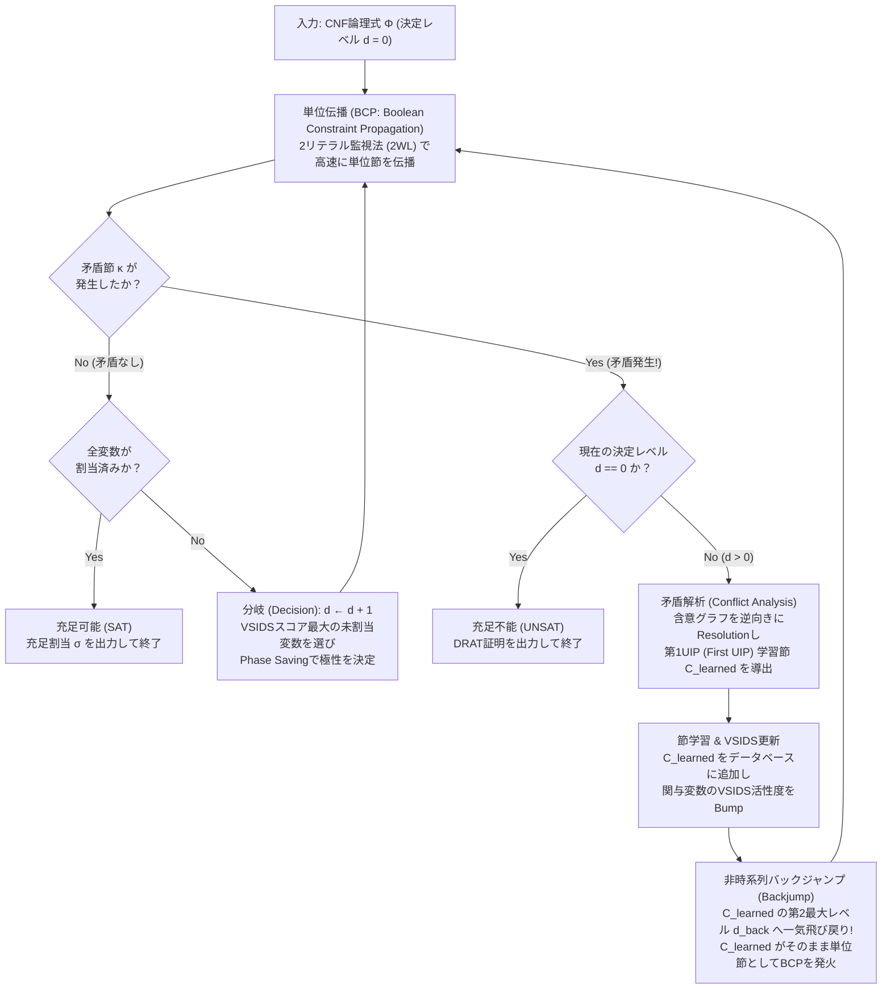
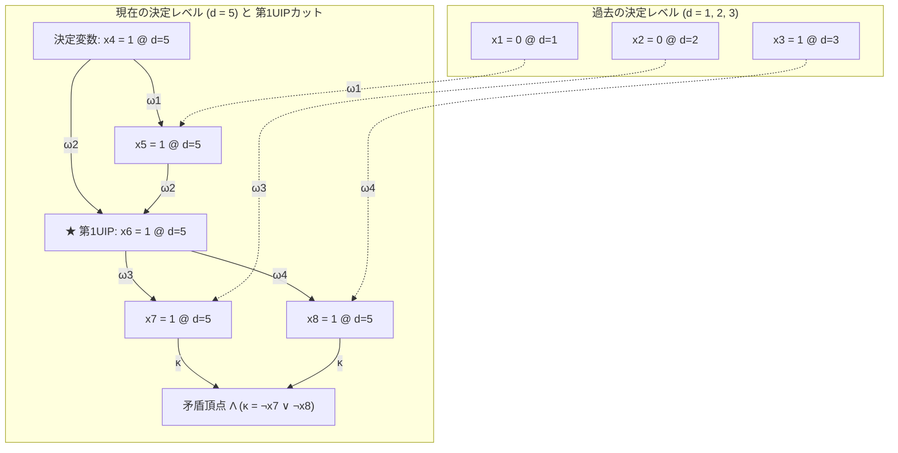
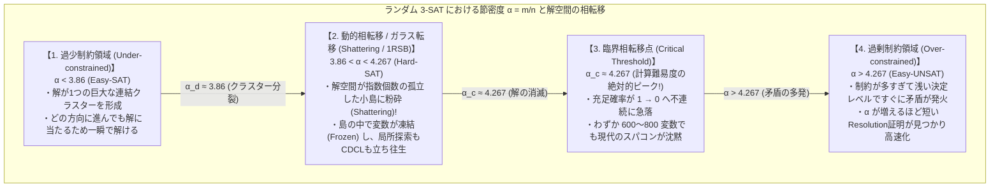

## 1. 計算機科学における「静かなるアルゴリズム革命」

計算機科学の教科書を開けば、必ずと言っていいほど次のような厳숙な事実が記されている。
<strong>「充足可能性問題（Boolean Satisfiability Problem: SAT）はNP完全（NP-Complete）であり、変数の数 $n$ に対して最悪ケースで $O(2^n)$ の指数時間を要するため、大規模なインスタンスを厳密に解くことは事実上不可能（Intractable）である」</strong>。

確かに単純な算術として、変数が $n = 100$ 個あれば真理値割当の組合せは $2^{100} \approx 1.26 \times 10^{30}$ 通りに達する。もし毎秒 $10^{12}$ 個の割当を検査できるスーパーコンピュータを宇宙誕生（約138億年前）から動かし続けていたとしても、今日までに全体の $0.00000001\%$ すら探索できていない計算になる。実際、1990年頃のSATソルバーにとって、変数 $100$ 個・節 $400$ 個程度の論理式は文字通り「越えられない壁」であった。

ところが21世紀の現在、私たちの目の前では教科書の素朴な直感を根底から覆す光景が日常的に繰り広げられている。
MiniSat、Glucose、Lingeling、CaDiCaL、Kissat、そしてMicrosoft ResearchのZ3といった現代の産業用SAT/SMTソルバーは、IntelやAMD、Appleの最新プロセッサの論理等価性検証や、Linuxパッケージの依存関係解決、さらには数学の未解決問題の証明において、<strong>変数 $1,000\text{万}$（$10^7$）個、節 $5,000\text{万}$（$5 \times 10^7$）個を超える巨大な論理式をわずか数秒から数分で厳密に解き明かしてしまう</strong>のである。

アルゴリズムの聖典『The Art of Computer Programming (TAOCP)』の著者ドナルド・クヌース（Donald E. Knuth）は、2015年に刊行されたVolume 4B（Section 7.2.2.2, *Satisfiability*）において、300ページ以上をSATソルバーただ一つのテーマに捧げ、1990年代後半から2000年代初頭にかけて起きたこのブレイクスルーを<strong>「現代の計算機科学における最も偉大なアルゴリズム革命の一つ」</strong>と激賞した。かつては「ある問題がSATに帰着できる」と示すことは「その問題は効率的に解けないから諦めろ」という死刑宣告を意味していたが、現代では正反対に<strong>「SATに翻訳できれば、人類最強の汎用ソルバーを使って一瞬で解ける」</strong>という勝利宣言へと意味が逆転したのである。

理論上は $2^{10,000,000}$ という天文学的どころか宇宙の記述能力を超越した探索空間を持つ難問を、なぜ現代のコンピュータは瞬時に切り裂くことができるのか？また、産業界の1,000万変数の問題は解けるのに、わずか数百変数の「ある特殊な人工問題」を与えると最新ソルバーでも完全に沈黙してしまうのはなぜなのか？

本稿では、スティーブン・クックとレオニード・レビンによる<strong>NP完全性の誕生（1971年）</strong>から出発し、古典的な<strong>DPLLアルゴリズム（1962年）</strong>が抱えていた致命的な弱点、それを克服した現代の革命<strong>CDCL（Conflict-Driven Clause Learning：矛盾駆動節学習）</strong>と<strong>第1UIP（First Unique Implication Point）</strong>、キャッシュ効率を極限まで高めたデータ構造<strong>2リテラル監視法（Two-Watched Literals: 2WL）</strong>、そして統計物理学のスピングラス理論と交差する<strong>ランダム $k$-SATの相転移現象（$\alpha_c \approx 4.267$）</strong>まで、数理と実装の両面から徹底的に解き明かす。

---

## 2. 論理充足問題（SAT）の数理定式化とクック＝レビンの定理

### 2.1 乗法標準形（CNF）とツァイティン変換（Tseitin Transformation）

SATソルバーが扱う入力は、$n$ 個のブール変数 $V = \{x_1, x_2, \dots, x_n\}$（各 $x_v \in \{0, 1\}$、すなわち $\{\text{False}, \text{True}\}$）上の命題論理式 $\Phi$ である。
変数 $x_v$ そのまま（肯定リテラル）、あるいはその否定 $\neg x_v$（否定リテラル）を総称して<strong>リテラル（Literal）</strong>と呼び、$\ell \in \{x_1, \neg x_1, \dots, x_n, \neg x_n\}$ と表記する。

複数のリテラルを論理和（OR, $\lor$）で結んだものを<strong>節（Clause）</strong>と呼ぶ。

$$C_i = \left(\ell_{i,1} \lor \ell_{i,2} \lor \dots \lor \ell_{i,k_i}\right) = \bigvee_{j=1}^{k_i} \ell_{i,j}$$

そして、$m$ 個の節をすべて論理積（AND, $\land$）で結んだ論理式を<strong>乗法標準形（Conjunctive Normal Form: CNF）</strong>または連言標準形と呼ぶ。

$$\Phi(x_1, \dots, x_n) = \bigwedge_{i=1}^m C_i = \bigwedge_{i=1}^m \left(\bigvee_{j=1}^{k_i} \ell_{i,j}\right)$$

<strong>SAT（充足可能性問題）</strong>とは、与えられたCNF論理式 $\Phi$ に対して、すべての節 $C_1, C_2, \dots, C_m$ を同時に真（$\Phi = 1$）にするような真理値割当 $\sigma: V \to \{0, 1\}$ が存在するかどうかを判定する問題である。そのような割当 $\sigma$ が存在するとき $\Phi$ は<strong>充足可能（Satisfiable: SAT）</strong>であるといい、存在しないとき<strong>充足不能（Unsatisfiable: UNSAT）</strong>であるという。

ここで一つの疑問が浮かぶ。「現実の論理回路やプログラムの条件式は、ANDやOR、NOT、XOR（排他的論理和）が幾重にも入れ子になった複雑な構文木をしている。それを無理やりCNFに展開したら、分配法則 $A \lor (B \land C) \equiv (A \lor B) \land (A \lor C)$ の繰り返しによって式のサイズが指数関数的に爆発してしまうのではないか？」

この問題を鮮やかに解決したのが、1968年にグリゴリー・ツァイティン（Grigori Tseitin）が考案した<strong>ツァイティン変換（Tseitin Transformation）</strong>である。
任意の論理回路に含まれる各論理ゲート $g$ の出力に対して、新しい<strong>補助変数（Auxiliary Variable）</strong> $y_g$ を1つ導入し、「$y_g$ とゲート $g$ の演算結果が論理的に同値である（$y_g \leftrightarrow \text{gate}(a, b)$）」という局所的な制約だけをCNF節として書き下すのである。

例えば、ANDゲート $y_g \leftrightarrow (a \land b)$ は、同値関係 $(y_g \to (a \land b)) \land ((a \land b) \to y_g)$ を展開することで、たった3つの節からなるCNFとして表現できる。

$$\left(\neg y_g \lor a\right) \land \left(\neg y_g \lor b\right) \land \left(y_g \lor \neg a \lor \neg b\right)$$

同様に、ORゲート $y_g \leftrightarrow (a \lor b)$ も3つの節、XORゲート $y_g \leftrightarrow (a \oplus b)$ も4つの節で表現できる。回路全体のゲート数を $|G|$ とすると、ツァイティン変換によって生成されるCNF論理式 $\Phi_{\text{CNF}}$ は、元の式と論理的に完全同値ではないものの、<strong>「元の回路を充足する割当が存在すること」と「$\Phi_{\text{CNF}}$ を充足する割当が存在すること」が必要十分条件で一致する（充足同値：Equisatisfiable）</strong>。しかも、追加される変数数は高々 $|G|$ 個、追加される節数は高々 $4|G|$ 個であり、<strong>回路サイズに対して完全に線形時間・線形サイズ $O(|G|)$ で3-CNFに変換できる</strong>のである。

### 2.2 クック＝レビンの定理（1971年）：すべてのNP問題の交差点

1971年、スティーブン・クック（Stephen Cook）は論文 *"The complexity of theorem-proving procedures"* において、また旧ソ連のレオニード・レビン（Leonid Levin）は独立に、計算量理論の歴史を永遠に変える定理を証明した。それが<strong>クック＝レビンの定理（Cook-Levin Theorem）</strong>である。

$$\text{定理（Cook-Levin, 1971）}: \quad \text{SAT は NP完全（NP-Complete）である。}$$

クラス $\text{NP}$（Nondeterministic Polynomial time）とは、「非決定性チューリングマシン（NDTM）によって多項式時間 $p(n)$ で受理される決定問題のクラス」、言い換えれば「解の候補（証拠 / Certificate）が与えられたとき、それが正しい解であるかどうかを決定性アルゴリズムで多項式時間内に検算（Verify）できる問題のクラス」である。

クックとレビンは、任意のNP問題 $L \in \text{NP}$ を解く非決定性チューリングマシン $M$ と長さ $n$ の入力文字列 $w$ が与えられたとき、マシン $M$ の計算履歴そのものを直接ブール変数群として符号化してみせた。
- 時刻 $t \in \{0, 1, \dots, p(n)\}$ において、マシン $M$ が状態 $q \in Q$ にあることを表す変数 $S_{t, q}$
- 時刻 $t$ において、テープのヘッドが位置 $i \in \{1, \dots, p(n)\}$ を指していることを表す変数 $H_{t, i}$
- 時刻 $t$ において、テープのセル $i$ に記号 $a \in \Gamma$ が書かれていることを表す変数 $T_{t, i, a}$

そして、「時刻 $t=0$ の初期テープ状態が入力 $w$ であること」「各時刻においてヘッド位置・状態・セル記号が一意であること」「時刻 $t$ から $t+1$ への変化がマシン $M$ の遷移規則 $\delta$ に従っていること」「時刻 $p(n)$ までに受理状態 $q_{\text{accept}}$ に到達すること」を、すべて局所的なCNF節の集合 $\Phi_{M, w}$ として書き下したのである。

この構成により、入力サイズ $n$ の多項式オーダー $O(p(n)^2)$ の変数と節を持つCNF論理式 $\Phi_{M, w}$ が生成され、「$w \in L$ であること」と「$\Phi_{M, w}$ が充足可能であること」が完全に同値になる。つまり、<strong>巡回セールスマン問題、グラフ彩色問題、整数計画問題、暗号解読、タンパク質の立体構造予測に至るまで、「答えが見つかれば多項式時間で検算できるあらゆる問題（NP）」は、多項式時間のオーバーヘッドで一切の情報損失なくSATへと翻訳できる</strong>のである。

### 2.3 2-SAT と 3-SAT の断崖絶壁：線形時間 $O(n+m)$ vs 指数時間 $O(2^n)$

各節に含まれるリテラル数が最大 $k$ 個に制限されたSATを <strong>$k$-SAT</strong> と呼ぶ。ここで極めて興味深い数学的現象が起きる。$k=2$ の <strong>2-SAT</strong> は多項式時間どころか<strong>線形時間 $O(n+m)$</strong> で簡単に解けるのに対し、リテラルがたった1つ増えて $k=3$ の <strong>3-SAT</strong> になった瞬間、問題はNP完全へと相転移し、最悪計算量が指数爆発するのである。

なぜこの「2と3の境界」にこれほど巨大な断崖が存在するのか？
2-SATの節 $(\ell_1 \lor \ell_2)$ を考えてみよう。ド・モルガンの法則と含意の定義 $(A \Rightarrow B) \equiv (\neg A \lor B)$ を使うと、2つのリテラルの論理和は、<strong>2本の有向エッジ（含意：Implication）</strong>と完全に同値になる。

$$(\ell_1 \lor \ell_2) \iff (\neg \ell_1 \Rightarrow \ell_2) \;\land\; (\neg \ell_2 \Rightarrow \ell_1)$$

「もし $\ell_1$ が偽（$\neg \ell_1$ が真）ならば、節を満たすために必ず $\ell_2$ が真でなければならない」という一対一の因果関係である。したがって、$2n$ 個のリテラル $\{x_1, \neg x_1, \dots, x_n, \neg x_n\}$ を頂点とし、各節から生成される2本の含意を有向辺とする<strong>含意グラフ（Implication Graph）</strong> $G_{\text{imp}} = (V, E)$ を構築すれば、含意の連鎖は単なるグラフ上の有向パスになる。
もしある変数 $x_v$ について、$x_v$ から $\neg x_v$ への有向パスが存在し、かつ $\neg x_v$ から $x_v$ への有向パスも存在する（すなわち $x_v$ と $\neg x_v$ が同じ<strong>強連結成分：Strongly Connected Component, SCC</strong> に属する）ならば、$x_v = 1 \Rightarrow \neg x_v = 1$ かつ $x_v = 0 \Rightarrow x_v = 1$ という矛盾が生じる。逆に、どの変数 $x_v$ も $\neg x_v$ と同じ強連結成分に属していなければ、ロバート・タージャン（Robert Tarjan, 1972）の強連結成分分解アルゴリズムを用いてトポロジカル順序の逆順に真理値を割り当てることで、<strong>計算量 $O(n+m)$ で必ず解を構成できる</strong>。

ところが、<strong>3-SAT</strong> の節 $(\ell_1 \lor \ell_2 \lor \ell_3)$ を含意の形に書き直すとどうなるか？

$$(\ell_1 \lor \ell_2 \lor \ell_3) \iff (\neg \ell_1 \land \neg \ell_2) \Rightarrow \ell_3$$

ここでは、$\ell_3$ を強制するために「$\neg \ell_1$ と $\neg \ell_2$ の<strong>両方が同時に真になる</strong>」という合流条件（ハイパーグラフの有向辺）が必要になる。もはや1つのリテラルを仮定しただけでは連鎖が確定せず、「$\ell_1$ と $\ell_2$ のどちらを真にするか」という<strong>分岐（Branching）</strong>が避けられない。インパリャッツォとパトゥリ（Impagliazzo & Paturi, 1999）が提唱した<strong>指数時間仮説（Exponential Time Hypothesis: ETH）</strong>の下では、3-SATを最悪ケースで $2^{o(n)}$ 時間（準指数時間）で解く決定性アルゴリズムすら存在しないと考えられている。

---

## 3. 古典的DPLLアルゴリズム（1962年）と「時系列バックトラック」の悲劇

### 3.1 デイビス・パトナム（1960年）からDPLL（1962年）へ

SATをコンピュータで解こうとする試みは、1960年のマーティン・デイビス（Martin Davis）とヒラリー・パトナム（Hilary Putnam）による<strong>DPアルゴリズム</strong>に遡る。DPアルゴリズムは、変数を1つずつ選んでは導出原理（Resolution）によってその変数を消去していく手法であったが、変数を消去するたびに節の数が二乗オーダーで膨れ上がり、当時のコンピュータのメモリを瞬く間に食い潰してしまった。

そのわずか2年後の1962年、デイビス、パトナムにジョージ・ロゲマン（George Logemann）とドナルド・ラブランド（Donald Loveland）が加わり、メモリ消費を線形 $O(n+m)$ に抑えた深さ優先探索（DFS）ベースのアルゴリズムを発表した。これが今日すべてのSATソルバーの祖先となる <strong>DPLL（Davis-Putnam-Logemann-Loveland）アルゴリズム</strong>である。

DPLLの核となる推論規則は次の2つ、特に1つ目の<strong>単位伝播</strong>である。

1. <strong>単位伝播（Unit Propagation / Boolean Constraint Propagation: BCP）</strong>：
   現在の部分割当のもとで、ある節 $C = (\ell_1 \lor \ell_2 \lor \dots \lor \ell_k)$ のうち $k-1$ 個のリテラルがすべて偽（$0$）と確定し、残り1つのリテラル $\ell_k$ だけが未割当であるとする。このような節を<strong>単位節（Unit Clause）</strong>と呼び、残されたリテラル $\ell_k$ を<strong>単位リテラル（Unit Literal）</strong>と呼ぶ。
   節 $C$ を真にするためには、選択の余地なく $\ell_k = 1$ を強制割当（Forced Assignment / Implication）するほかない。そして $\ell_k = 1$ と定まった瞬間、$\neg \ell_k$ を含む他の節から $\neg \ell_k$ が消去され、新たな単位節が次々と誕生する。このドミノ倒しのような連鎖推論を収束するまで繰り返す操作を <strong>BCP（ブール制約伝播）</strong>と呼ぶ。
2. <strong>純リテラル消去（Pure Literal Elimination: PLE）</strong>：
   未充足の節全体を見渡したとき、ある変数 $x_v$ が肯定リテラル $x_v$ としてのみ出現し（$\neg x_v$ が一切存在しない）、あるいは否定リテラル $\neg x_v$ としてのみ出現する場合、そのリテラルを真に割り当てても他の節を不利にすることは絶対にないため、直ちに真に固定できる。（※なお、現代のCDCLソルバーでは、バックトラックのたびに全節のリテラル出現回数を動的追跡するコストが後述の2WLの高速性を損なうため、探索中のPLEは省略され、前処理（Preprocessing / Inprocessing）でのみ実行されることが多い。）

DPLLは、「BCPを限界まで回す $\to$ まだ未割当の変数があれば1つ選んで仮の真偽値を決定（Decision）し、決定レベル（Decision Level） $d$ を1つ増やす $\to$ 再びBCPを回す $\to$ もしある節の全リテラルが偽になる<strong>矛盾（Conflict）</strong>が起きたら、直近の決定変数に戻って真偽値を反転させる」という再帰的な探索木（Search Tree）を辿る。

### 3.2 時系列バックトラック（Chronological Backtracking）の致命的欠陥：スラッシング（Thrashing）

DPLLの単位伝播（BCP）は強力だが、なぜDPLLは変数100個の壁を越えられなかったのか？
その最大の原因は、矛盾に突き当たったときに<strong>「直前に行った決定（Decision Level $d$）へ機械的に1段ずつ戻る」という時系列バックトラック（Chronological Backtracking）</strong>にあった。

具体例でその悲劇を見てみよう。変数が $x_1, x_2, \dots, x_{100}$ ある論理式を解いているとする。
論理式の中に、次の3つの節が含まれていたとしよう。

$$\begin{aligned}
C_{101} &= (x_1 \lor \neg x_{50} \lor x_{51}) \\
C_{102} &= (x_1 \lor \neg x_{50} \lor \neg x_{51}) \\
C_{103} &= (x_1 \lor x_{50} \lor x_{52}) \\
C_{104} &= (x_1 \lor x_{50} \lor \neg x_{52})
\end{aligned}$$

いま、DPLLソルバーが以下の順序で決定（Decision）を下していったとする。
- <strong>決定レベル $d = 1$</strong>：$x_1 = 0$ と仮定する。
- <strong>決定レベル $d = 2, 3, \dots, 49$</strong>：$x_1$ とは全く無関係な別モジュールの変数 $x_2, x_3, \dots, x_{49}$ に対して次々と仮の真偽値を割り当てていく（ここではまだ矛盾は起きない）。
- <strong>決定レベル $d = 50$</strong>：ついに変数 $x_{50}$ を選び、$x_{50} = 1$ と仮定する。

この瞬間何が起きるか？
$x_1 = 0$（レベル1）かつ $x_{50} = 1$（レベル50）となったため、節 $C_{101} = (0 \lor 0 \lor x_{51})$ が単位節となり、BCPによって $x_{51} = 1$ が強制される。すると直ちに節 $C_{102} = (0 \lor 0 \lor \neg x_{51})$ の全リテラルが偽となり、<strong>矛盾（Conflict）</strong>が発生する！

そこでDPLLは $x_{50}$ の値を反転させ、$x_{50} = 0$ を試す。すると今度は節 $C_{103}$ から $x_{52} = 1$ が単位伝播され、節 $C_{104}$ で再び矛盾が発生する。
$x_{50} = 1$ も $x_{50} = 0$ も失敗したため、DPLLは1つ上の<strong>決定レベル $d = 49$</strong> にバックトラックし、<strong>$x_{49}$ の値を反転させて、もう一度決定レベル $d = 50$ の探索をやり直す</strong>！

しかし、人間の目で見れば明らかなように、この矛盾の原因は<strong>レベル1の $x_1 = 0$ とレベル50の $x_{50}, x_{51}, x_{52}$ だけ</strong>にあり、途中の $x_2, x_3, \dots, x_{49}$ は矛盾に1ミリも関与していない！
にもかかわらず、時系列バックトラックしか持たないDPLLは、$x_{49}, x_{48}, \dots, x_2$ のすべての組合せ、すなわち

$$2^{48} \approx 2.81 \times 10^{14} \text{ 通り}$$

の全く無意味な部分木の中で、まったく同じ $(x_1 = 0)$ 起因の矛盾を281兆回も繰り返し体験し続けるのである。探索空間の無関係な変数の組合せによって同じ失敗を延々と反復するこの現象を<strong>スラッシング（Thrashing）</strong>と呼ぶ。しかもDPLLは「なぜ矛盾したのか」という記憶を一切持たないため、別の枝で再び同じ部分割当に出会えば、また一から同じ失敗を繰り返す。

---

## 4. 現代の革命：CDCL（矛盾駆動節学習）と第1UIP・非時系列バックジャンプ

このDPLLの呪縛を打ち破ったのが、1996年にジョアン・マルケス＝シルバ（João Marques-Silva）とカレム・サカラ（Karem Sakallah）がソルバー <strong>GRASP</strong> で導入し、2001年にマシュー・モスケウィッツ（Matthew Moskewicz）、コナー・マディガン（Conor Madigan）、シャラド・マリク（Sharad Malik）らがソルバー <strong>Chaff（zChaff）</strong> で完成させた <strong>CDCL（Conflict-Driven Clause Learning：矛盾駆動節学習）</strong>アーキテクチャである。

CDCLの核心的アイデアは3つに要約される。
1. <strong>含意グラフ（Implication Graph）の追跡</strong>：「どの決定とどの節が原因で、どの変数が単位伝播され、最終的にどの節が破壊されたのか」という因果関係の有向非巡回グラフ（DAG）を記録する。
2. <strong>導出原理（Resolution）と第1UIPによる節学習（Clause Learning）</strong>：矛盾が発生した瞬間、含意グラフを逆向きに辿って導出（Resolution）を繰り返し、矛盾の根本原因を要約した新しい節（<strong>学習節：Learned Clause</strong>）を合成して論理式に追加する。
3. <strong>非時系列バックジャンプ（Non-Chronological Backjumping）</strong>：学習節が「単位節」に変わる過去の決定レベル（たとえ49段前であっても！）へ一気に飛び戻り、無関係な $2^{48}$ 通りの探索空間をただの一跳びで枝刈りする。



### 4.1 含意グラフ（Implication Graph）と理由節（Antecedent / Reason Clause）

CDCLソルバーは、各リテラル $\ell$ が真に割り当てられたとき、次の2つのメタデータを記録する。
- <strong>決定レベル $\text{level}(\ell) \in \{0, 1, \dots, d\}$</strong>：そのリテラルが何回目の決定（Decision）の後に割り当てられたか（これを $\ell@d$ と表記する）。
- <strong>理由節（Antecedent / Reason Clause） $\text{reason}(\ell)$</strong>：
  - もし $\ell$ がソルバーの仮定（Decision）によって選ばれた決定リテラルならば、$\text{reason}(\ell) = \text{NIL}$。
  - もし $\ell$ が節 $C = (\ell_1 \lor \ell_2 \lor \dots \lor \ell_{k-1} \lor \ell)$ における単位伝播（BCP）によって強制されたならば、$\text{reason}(\ell) = C$。このとき、含意グラフ上には先行リテラル $\neg \ell_1, \neg \ell_2, \dots, \neg \ell_{k-1}$ の各頂点から頂点 $\ell$ へと向かう有向辺が張られる。

BCPの最中に、ある節 $\kappa = (\ell_1 \lor \ell_2 \lor \dots \lor \ell_k)$ のすべてのリテラルが偽になってしまうと、矛盾頂点 $\Lambda$（原因節 $\text{reason}(\Lambda) = \kappa$）が生成される。

### 4.2 ブール導出（Resolution）と第1UIP（First Unique Implication Point）

矛盾節 $\kappa$ から「なぜ矛盾が起きたのか」を抽出するために、CDCLはジョン・アラン・ロビンソン（J. Alan Robinson, 1965）の<strong>導出原理（Boolean Resolution）</strong>を用いる。
2つの節 $C_1 = (A \lor x)$ と $C_2 = (\neg x \lor B)$ があるとき、ピボット変数 $x$ が真であっても偽であっても必ず $A \lor B$ が成り立つ。

$$\text{Resolution Rule}: \quad \frac{(A \lor x) \qquad (\neg x \lor B)}{(A \lor B)} = \text{Res}(C_1, C_2, x)$$

CDCLの矛盾解析（Conflict Analysis）は、矛盾節 $C \leftarrow \kappa$ から出発し、現在の決定レベル $d_{\text{curr}}$ で最も遅く（直近に）単位伝播されたリテラル $\ell$（ただし $\neg \ell \in C$）を選び、その理由節 $\text{reason}(\ell)$ と現在の節 $C$ を変数 $\text{var}(\ell)$ をピボットとして導出（Resolve）する操作を反復する。

$$C \leftarrow \text{Res}\big(C,\; \text{reason}(\ell),\; \text{var}(\ell)\big)$$

では、この導出ループを<strong>いつ止めればよいのか？</strong>
現在の決定レベル $d_{\text{curr}}$ の最初の決定リテラル $\ell_{\text{dec}}@d_{\text{curr}}$ に到達するまで最後まで戻すこともできる。しかし、含意グラフの構造をよく観察すると、もっと手前に遥かに優れた停止点が存在することに気づく。それが<strong>UIP（Unique Implication Point：単一含意点）</strong>である。

> <strong>定義（Unique Implication Point: UIP）</strong>：
> 含意グラフにおいて、現在の決定レベル $d_{\text{curr}}$ に属する頂点 $u@d_{\text{curr}}$ が<strong>UIP</strong>であるとは、レベル $d_{\text{curr}}$ の決定頂点 $\ell_{\text{dec}}@d_{\text{curr}}$ から矛盾頂点 $\Lambda$ へと至る<strong>すべての有向パスが必ず頂点 $u$ を通過する</strong>ことをいう（グラフ理論における支配点 / Dominator）。

定義より、決定頂点 $\ell_{\text{dec}}@d_{\text{curr}}$ 自身は常にUIPである。しかし、矛盾頂点 $\Lambda$ に最も近いUIP——これを<strong>第1UIP（First UIP / 1-UIP）</strong>と呼ぶ——は、決定頂点よりも矛盾に近い中間頂点になり得る。
導出ループを回しているとき、第1UIPに到達した瞬間はどう判定できるのか？驚くほど簡単である。
<strong>「導出中の節 $C$ に含まれる、現在の決定レベル $d_{\text{curr}}$ のリテラルがちょうど1個だけになった瞬間」</strong>、その残されたただ1つのリテラル（の否定）こそが<strong>第1UIP</strong>なのである！

### 4.3 具体的な数値トレースで見る第1UIP学習節の導出

具体的な含意グラフと節を使って、第1UIPによる学習節の導出をトレースしてみよう。
過去の決定レベル $d=1, 2, 3$ において、すでに $x_1 = 0@1,\; x_2 = 0@2,\; x_3 = 1@3$ が割り当てられているとする。
ここで<strong>現在の決定レベル $d = 5$</strong> において、ソルバーが $x_4 = 1@5$ と決定（Decision）したとしよう。すると、以下の5つの節が次々と単位伝播（BCP）を引き起こし、最後に矛盾が発生したとする。

$$\begin{aligned}
\omega_1 &= (x_1 \lor \neg x_4 \lor x_5) &\implies&\quad x_5 = 1@5 \quad (\because x_1=0@1,\; x_4=1@5) \\
\omega_2 &= (\neg x_4 \lor \neg x_5 \lor x_6) &\implies&\quad x_6 = 1@5 \quad (\because x_4=1@5,\; x_5=1@5) \\
\omega_3 &= (x_2 \lor \neg x_6 \lor x_7) &\implies&\quad x_7 = 1@5 \quad (\because x_2=0@2,\; x_6=1@5) \\
\omega_4 &= (\neg x_3 \lor \neg x_6 \lor x_8) &\implies&\quad x_8 = 1@5 \quad (\because x_3=1@3,\; x_6=1@5) \\
\kappa &= (\neg x_7 \lor \neg x_8) &\implies&\quad \mathbf{\text{CONFLICT!}} \quad (\because x_7=1@5,\; x_8=1@5)
\end{aligned}$$

この含意グラフを描いてみると、決定頂点 $x_4@5$ から出たパスは $x_5@5$ を経て <strong>$x_6@5$</strong> に合流し、そこから $x_7@5$ と $x_8@5$ に枝分かれして矛盾 $\kappa$ に至っている。つまり、$x_4@5$ から矛盾へ至るすべてのパスは必ず $x_6@5$ を通るため、<strong>$x_6@5$ が第1UIP</strong>である！



実際に導出（Resolution）の計算手順を1ステップずつ追ってみよう。
- <strong>初期状態</strong>：矛盾節 $C^{(0)} = \kappa = (\neg x_7@5 \lor \neg x_8@5)$。
  現在レベル $d=5$ のリテラルは $\neg x_7@5$ と $\neg x_8@5$ の<strong>2個</strong>ある（まだ1個ではないので続行）。
- <strong>ステップ1</strong>：$C^{(0)}$ の中で最も直近に割り当てられた $x_8@5$ の理由節 $\text{reason}(x_8) = \omega_4 = (\neg x_3@3 \lor \neg x_6@5 \lor x_8@5)$ と、ピボット $x_8$ で導出を行う。
  $$C^{(1)} = \text{Res}\big((\neg x_7@5 \lor \neg x_8@5),\; (\neg x_3@3 \lor \neg x_6@5 \lor x_8@5),\; x_8\big) = \left(\neg x_3@3 \lor \neg x_6@5 \lor \neg x_7@5\right)$$
  現在レベル $d=5$ のリテラルは $\neg x_6@5$ と $\neg x_7@5$ の<strong>2個</strong>ある（まだ続行）。
- <strong>ステップ2</strong>：$C^{(1)}$ の中でレベル $d=5$ の直近リテラル $x_7@5$ の理由節 $\text{reason}(x_7) = \omega_3 = (x_2@2 \lor \neg x_6@5 \lor x_7@5)$ と、ピボット $x_7$ で導出を行う。
  $$C^{(2)} = \text{Res}\big((\neg x_3@3 \lor \neg x_6@5 \lor \neg x_7@5),\; (x_2@2 \lor \neg x_6@5 \lor x_7@5),\; x_7\big) = \left(x_2@2 \lor \neg x_3@3 \lor \neg x_6@5\right)$$
  ここで $C^{(2)}$ を見よ！現在レベル $d=5$ に属するリテラルは <strong>$\neg x_6@5$ のみ（ちょうど1個！）</strong>となった！

この瞬間、導出ループは停止し、<strong>第1UIP学習節（1-UIP Learned Clause）</strong>として次の節が確定する。

$$C_{\text{learned}} = \left(x_2@2 \lor \neg x_3@3 \lor \neg x_6@5\right)$$

なぜ $x_4@5$ まで戻さずに第1UIPの $\neg x_6@5$ で止める方が良いのか？
もしさらに $\omega_2, \omega_1$ と導出を続けて決定変数 $x_4@5$ まで戻してしまうと、得られる節は $(x_1@1 \lor x_2@2 \lor \neg x_3@3 \lor \neg x_4@5)$ となり、リテラル数が増えて条件が弱まる（より特殊な状況でしか発火しない節になる）うえ、無関係な $x_1@1$ まで巻き込んでしまう。第1UIPで止めることで、<strong>より短く、より汎用性が高く、かつ現在の決定レベルの根幹（ボトルネック頂点 $x_6$）を直接否定する最強の学習節</strong>が得られるのである。

### 4.4 非時系列バックジャンプ（Non-Chronological Backjumping）と表明レベル（Assertion Level）

学習節 $C_{\text{learned}} = (x_2@2 \lor \neg x_3@3 \lor \neg x_6@5)$ を手に入れたCDCLソルバーは、次にどこへバックトラックするのか？
一般の学習節が、異なる決定レベルのリテラルから構成されているとする（降順にソートして $d_{\text{curr}} > d_1 \ge d_2 \ge \dots \ge d_r$）。

$$C_{\text{learned}} = \left(\ell_{\text{UIP}}@d_{\text{curr}} \lor \ell_{i_1}@d_1 \lor \ell_{i_2}@d_2 \lor \dots \lor \ell_{i_r}@d_r\right)$$

このとき、CDCLは直前のレベル $d_{\text{curr}} - 1$ には戻らない。学習節の中で<strong>2番目に高い決定レベル $d_{\text{back}} = d_1$</strong>（もし $C_{\text{learned}}$ がリテラル1個だけの単位節なら $d_{\text{back}} = 0$）へと、途中のレベルをすべて飛び越えて一気にジャンプする！この $d_{\text{back}} = d_1$ を<strong>表明レベル（Assertion Level / Backjump Level）</strong>と呼ぶ。

上記の例 $C_{\text{learned}} = (x_2@2 \lor \neg x_3@3 \lor \neg x_6@5)$ に含まれるレベルは $\{2, 3, 5\}$ なので、2番目に高いレベルは <strong>$d_{\text{back}} = 3$</strong> である。
ソルバーが決定レベル $d = 3$ までジャンプ（レベル4とレベル5の割当をすべて破棄）すると、何が起きるか？
レベル3の時点では、$x_2 = 0@2$ によりリテラル $x_2$ は偽（$0$）、$x_3 = 1@3$ によりリテラル $\neg x_3$ も偽（$0$）である。一方、レベル5で割り当てられていた $x_6$ は未割当に戻っている。
つまり、<strong>レベル $d = 3$ に降り立った瞬間、学習節 $C_{\text{learned}} = (0 \lor 0 \lor \neg x_6)$ は即座に「単位節（Unit Clause）」として機能し、BCPによって $\neg x_6 = 1$（すなわち $x_6 = 0@3$）をレベル3で強制割当（Assert）する</strong>のである！

これを<strong>表明節（Asserting Clause）</strong>と呼ぶ。CDCLは単に「ダメだったから過去に戻る」のではない。「<strong>過去にまだ知らなかった新しい定理 $C_{\text{learned}}$ を証明して持ち帰り、過去のレベル $d_{\text{back}}$ でその定理を単位伝播させて新しい事実 $\neg x_6@3$ を確定させる</strong>」という、前方推論と学習の融合を実現しているのである。

---

## 5. ソルバーを数千倍に加速させたエンジニアリングの奇跡：2WL・VSIDS・LBD

CDCLの理論的骨格だけでも劇的な進化だが、1,000万変数の壁を突破するには、CPUのキャッシュ階層とメモリアクセスを極限まで最適化するデータ構造とヒューリスティクスの発明が不可欠だった。

### 5.1 2リテラル監視法（Two-Watched Literals: 2WL, Chaff 2001）

プロファイリングを行うと、SATソルバーの実行時間の実に <strong>$85\% \sim 90\%$ 以上が単位伝播（BCP）に費やされている</strong>ことがわかる。
もし5,000万個の節があるとき、ある変数 $x_v$ に真偽値を1つ割り当てるたびに「$x_v$ や $\neg x_v$ を含むすべての節」を走査して、未割当リテラルの残り個数カウンタをデクリメントしていたらどうなるか？さらにバックジャンプで1,000個の変数の割当を取り消すたびに、すべての節のカウンタをインクリメントして戻していたら、メモリアクセスの帯域幅（Memory Bandwidth）とキャッシュミス（Cache Miss）によってCPUは完全に麻痺してしまう。

2001年、Chaff（Moskewicz et al.）が導入した<strong>2リテラル監視法（Two-Watched Literals: 2WL）</strong>（※先駆的アイデアは1997年のZhangのSATOにおけるHead/Tailポインタ）は、次の極めてシンプルな不変条件（Invariant）に着目することでこの問題を完全に解決した。

> <strong>2WLの核心原理</strong>：
> 長さ $k \ge 2$ の節 $C$ において、<strong>「まだ偽（False）と確定していないリテラル（すなわち未割当かTrueのリテラル）が少なくとも2つ存在する限り、その節は絶対に単位節にも矛盾節にもなり得ない！」</strong>

したがって、各節 $C$（たとえリテラルが100個含まれていようとも！）について、ソルバーは<strong>たった2つの非偽リテラル $w_1, w_2$ だけを「監視リテラル（Watched Literals）」として指名</strong>し、それぞれの否定リテラルが偽になる瞬間だけを待ち構えるウォッチリスト $\text{Watch}[\ell]$ に節 $C$ を登録しておく。

あるリテラル $\ell$ が真に割り当てられたとき（つまり否定リテラル $\neg \ell$ が<strong>偽</strong>になったとき）、ソルバーは $\neg \ell$ を監視していた節のリスト $\text{Watch}[\neg \ell]$ <strong>だけ</strong>を調べる。
（仮に $w_1 = \neg \ell$ が偽になったとしよう。もう一方の監視リテラルを $w_2$ とする。）
1. もしもう一方の監視リテラル $w_2$ がすでに `True` ならば、この節はすでに充足されているので何もしない。
2. そうでなければ、節 $C$ の中の監視されていない残りのリテラル $\ell' \notin \{w_1, w_2\}$ を先頭から走査し、<strong>「偽ではない（未割当またはTrueの）リテラル $\ell'$」</strong>を探す。
   - <strong>見つかった場合</strong>：監視対象を $w_1$ からその新しいリテラル $\ell'$ へと付け替える（$w_1 \leftarrow \ell'$）。このとき、節 $C$ はまだ最低2つの非偽リテラル（$\ell'$ と $w_2$）を持っているため、単位節ではない！
   - <strong>1つも見つからなかった場合</strong>：節 $C$ の $w_2$ 以外のすべてのリテラルが偽であることが確定した！したがって、
     - もし $w_2$ が未割当ならば、節 $C$ は<strong>単位節</strong>となり、直ちに $w_2 = \text{True}$ をBCPキューに追加する。
     - もし $w_2$ がすでに偽ならば、節 $C$ は<strong>矛盾節（Conflict）</strong>となり、矛盾解析を開始する。

そして、2WLがもたらす<strong>最大の魔法はバックトラック（Backjumping）時</strong>に発揮される。
バックジャンプによって変数の割当を取り消す（偽だったリテラルを未割当に戻す）とき、各節の2つの監視リテラル $w_1, w_2$ を更新する必要はあるだろうか？
<strong>一切ない！完全にゼロ（$O(1)$）である！</strong>
なぜなら、割当を取り消す前は「$w_1$ と $w_2$ はどちらも偽ではなかった」のであり、割当を取り消して変数を未割当に戻しても「$w_1$ と $w_2$ が偽ではない」という不変条件は100%保たれたままだからである。ポインタを1つも書き換えることなく、割当スタック（Trail）のインデックスを戻すだけで、1万段のバックジャンプが一瞬で完了する！

### 5.2 VSIDS（Variable State Independent Decaying Sum）とPhase Saving

次に重要なのが、「BCPが止まったとき、数百万個の未割当変数の中から<strong>どの変数を次の決定変数（Decision Variable）として選ぶか？</strong>」という分岐ヒューリスティクスである。

古典的なDPLLでは、「現在の未充足節の中に最も多く出現する変数を選ぶ（DLIS: Dynamic Largest Individual Sum）」といった指標が使われていたが、これも全節の走査が必要で重すぎた。
Chaffが導入し、MiniSatが洗練させた <strong>VSIDS（Variable State Independent Decaying Sum）</strong>は、驚くほど軽量で、しかもCDCLの学習メカニズムと完璧に共鳴するアルゴリズムである。

1. 各変数 $x_v$ に活性度スコア（Activity Score） $A(x_v) \ge 0$ を持たせ、それを二分ヒープ（Priority Queue）で管理する。
2. <strong>Conflict Bump</strong>：矛盾が発生し、第1UIP学習節を導出する過程（Resolution）で関与したすべての変数 $x_v$ に対して、スコアに増分 $\Delta$ を加算する：
   $$A(x_v) \leftarrow A(x_v) + \Delta$$
3. <strong>Decay（減衰）</strong>：1回矛盾が起きるごとに、すべての変数のスコアを減衰係数 $\gamma \in (0, 1)$（例えば $\gamma = 0.95$）で割り引く。実装上は全変数を毎回掛け算する代わりに、<strong>加算する増分 $\Delta$ の側を $\Delta \leftarrow \Delta / \gamma$ で膨らませる</strong>（そして浮動小数点数が $10^{100}$ を超えたら全スコアを一括で $10^{-100}$ 倍にリスケールする）ことで、$O(1)$ で指数移動平均（Exponential Moving Average: EMA）を実現する！

VSIDSの本質は、<strong>「直近の矛盾（Conflict）を引き起こしている局所的な戦場（ホットスポット）の変数群に、レーザーのように探索を集中させること」</strong>にある。無関係な変数のスコアは指数関数的に減衰して忘れ去られ、今まさに矛盾節を生み出し続けている核心的な変数だけが繰り返し選ばれるため、学習節の導出がさらに加速する正のフィードバックループが生まれる。

さらに、選んだ変数を `True` と `False` のどちらに割り当てるかについては、ピパットスリサワットとダルウィーシュ（Pipatsrisawat & Darwiche, 2007）による <strong>Phase Saving（極性保存）</strong>が標準となっている。これは「その変数が過去に最後に割り当てられていた真偽値（Phase）を記憶しておき、次回分岐するときも同じ真偽値を優先的に試す」という手法である。なぜなら、非時系列バックジャンプで大きく飛び戻った際、矛盾に関与しなかった別の部分問題（コンポーネント）について過去に苦労して見つけた局所的な充足割当をそのまま再利用できるからである。

### 5.3 LBD（Literal Block Distance）による学習節の剪定と高速リスタート（Restarts）

CDCLソルバーが毎秒数千回の矛盾を起こすと、1分間で数十万個の学習節がデータベースに蓄積される。学習節が増えすぎると、2WLといえどもウォッチリストの走査コストが増大し、メモリがあふれてソルバーが減速してしまう。どの学習節が「一生残すべき宝」で、どの学習節が「捨ててよいゴミ」なのか？

2009年、ジル・オーデマール（Gilles Audemard）とローラン・シモン（Laurent Simon）はソルバー <strong>Glucose</strong> において、学習節の品質を測る決定的な指標 <strong>LBD（Literal Block Distance）</strong>を導入した。

> <strong>定義（LBD: Literal Block Distance）</strong>：
> 節 $C$ に含まれるリテラル群が属する<strong>「互いに異なる決定レベル（Decision Levels）の個数」</strong>を $\text{LBD}(C)$ と定義する。

例えば、10個のリテラルを含む長い学習節であっても、それらのリテラルの決定レベルが $\{2, 2, 2, 5, 5, 5, 5, 5, 5, 9\}$ の3種類しかなければ $\text{LBD}(C) = 3$ である。
特に <strong>$\text{LBD}(C) = 2$</strong> の学習節は、現在の決定レベルのUIPリテラルと、過去の<strong>ただ1つの決定レベルのブロック</strong>とを直接結びつける接着剤のような役割を果たすため、オーデマールとシモンはこれを<strong>グルー節（Glue Clause）</strong>と名付けた。
グルー節（$\text{LBD} \le 2$）は今後の探索でも極めて高い確率で再び単位伝播を引き起こすため、<strong>絶対に削除せず永久保存（Tier 1 / Core DB）</strong>し、逆にLBDが大きい節は定期的に削除（Clause Database Reduction）することで、ソルバーの速度を劇的に維持できる。

また、ゴメスとセルマン（Gomes, Selman, Crato, 1997）は、SATソルバーの実行時間分布が正規分布ではなく<strong>ファットテール（Heavy-Tailed Distribution / べき乗則裾）</strong>に従うことを発見した。つまり、最初の数ステップの決定変数の選び方がたまたま悪かっただけで、ソルバーが泥沼の部分木にハマり込み、何時間も抜け出せなくなることがある。
そこで現代のソルバーは、マイケル・ルビー（Michael Luby, 1993）の<strong>普遍リスタート数列（Luby Sequence）</strong>：

$$t_i = 1, 1, 2, 1, 1, 2, 4, 1, 1, 2, 1, 1, 2, 4, 8, \dots \quad (\times \text{基本単位矛盾数})$$

あるいはLBDの短期移動平均が長期平均を上回った瞬間（Glucose方式）に、<strong>決定レベル $d=0$ まで全ての決定を一旦白紙に戻す「リスタート（Rapid Restart）」</strong>を頻繁に実行する。ただし、これまでに獲得した<strong>学習節・VSIDSスコア・Phase Savingの記憶はすべて保持したまま</strong>リスタートするため、過去の知識を武装した状態でより良い初期分岐から探索を再開できるのである。

| 手法・コンポーネント | 古典的 DPLL (1962) | 初期 CDCL (GRASP 1996 / Chaff 2001) | 現代の最新 CDCL (Glucose / CaDiCaL / Kissat) |
| :--- | :--- | :--- | :--- |
| <strong>単位伝播 (BCP) の実装</strong> | 全節のリテラルカウンタ更新（バックトラック時も更新必須） | <strong>2リテラル監視法 (2WL)</strong>（バックトラック時の更新コスト $O(1)$） | ブロッキングリテラル付き2WL + インライン二項節（Binary Clauses）高速伝播 |
| <strong>矛盾時の戻り方</strong> | <strong>時系列バックトラック</strong>（直前のレベル $d-1$ へ1段戻るのみ） | <strong>非時系列バックジャンプ</strong>（第1UIP学習節の第2最大レベル $d_{\text{back}}$ へ跳躍） | 非時系列バックジャンプ + Chronological Backtrackingとのハイブリッド (Nadel & Ryvchin 2018) |
| <strong>矛盾からの学習</strong> | なし（同じ部分割当の失敗を $2^k$ 回繰り返すスラッシング） | <strong>第1UIP (First UIP) 導出による節学習</strong> + 学習節の自己包摂簡約 (Self-Subsumption) | 第1UIP + オンザフライ自己包摂 + Vivification（節の強化）・BVA（有界変数追加） |
| <strong>変数選択 (Branching)</strong> | 静的出現順 / DLIS（未充足節内の最大出現リテラル） | <strong>VSIDS</strong>（矛盾関与変数の指数減衰移動平均スコア） | <strong>EVSIDS / VMTF</strong> + <strong>Target Phases / Local Search (WalkSAT) ハイブリッド</strong> |
| <strong>学習節の管理 (GC)</strong> | 学習節なし | 節の長さとアクティビティによる定期削除 | <strong>LBD (Glue Level)</strong> による3階層（Core / Tier2 / Local）データベース管理 |

---

## 6. PythonによるCDCLソルバー・コアエンジンの完全実装

理論をコードとして結晶化させよう。以下に、単位伝播（BCP）、含意グラフの追跡、導出原理（Resolution）による<strong>第1UIP学習節の生成</strong>、<strong>非時系列バックジャンプ</strong>、および<strong>VSIDSスコアによる変数選択</strong>を備えたミニマルかつ完全に動作するCDCLソルバーのPython実装を示す。

```python
from typing import List, Dict, Optional, Set, Tuple

class CDCLSolver:
    '''
    現代のSATソルバーの核心である CDCL (Conflict-Driven Clause Learning) エンジン。
    - 単位伝播 (BCP) と理由節 (Antecedent Reason) の記録
    - 導出原理 (Resolution) による第1UIP (First Unique Implication Point) 学習節の計算
    - 表明レベル (Assertion Level) への非時系列バックジャンプ
    - VSIDS (Variable State Independent Decaying Sum) ヒューリスティクス
    '''
    def __init__(self, num_vars: int, clauses: List[List[int]]):
        self.num_vars = num_vars
        # 元のCNF節 + 学習節を格納するデータベース
        self.clauses: List[List[int]] = [list(set(c)) for c in clauses]
        
        # 現在の割当状態: var -> True / False (未割当はキーなし)
        self.assigns: Dict[int, bool] = {}
        # 割当履歴 (Trail): 割り当てられた順にリテラル (符号付き整数) を記録
        self.trail: List[int] = []
        # 各変数が割り当てられた決定レベル: var -> level
        self.level: Dict[int, int] = {}
        # 各変数を強制した理由節 (Decisionの場合は None): var -> clause
        self.reason: Dict[int, Optional[List[int]]] = {}
        # 現在の決定レベル
        self.decision_level: int = 0
        
        # VSIDS 活性度スコアと減衰パラメータ
        self.activity: Dict[int, float] = {v: 0.0 for v in range(1, num_vars + 1)}
        for c in self.clauses:
            for lit in c:
                self.activity[abs(lit)] += 1.0
        self.var_inc: float = 1.0
        self.var_decay: float = 0.95
        
        # 統計カウンタ
        self.num_conflicts: int = 0
        self.learned_clauses: List[List[int]] = []

    def value_lit(self, lit: int) -> Optional[bool]:
        '''リテラル lit の現在の真偽値を返す (True / False / None)'''
        var = abs(lit)
        if var not in self.assigns:
            return None
        val = self.assigns[var]
        return val if lit > 0 else not val

    def assign(self, lit: int, level: int, reason: Optional[List[int]]) -> None:
        '''リテラル lit を真に割り当て、Trailと含意グラフ情報を記録する'''
        var = abs(lit)
        self.assigns[var] = (lit > 0)
        self.trail.append(lit)
        self.level[var] = level
        self.reason[var] = reason

    def bcp(self) -> Optional[List[int]]:
        '''
        単位伝播 (Boolean Constraint Propagation: BCP) を収束するまで実行する。
        矛盾節が発生した場合はその節 (Conflict Clause) を返し、矛盾がなければ None を返す。
        '''
        changed = True
        while changed:
            changed = False
            for clause in self.clauses:
                unassigned_lit: Optional[int] = None
                num_unassigned = 0
                satisfied = False

                for lit in clause:
                    val = self.value_lit(lit)
                    if val is True:
                        satisfied = True
                        break
                    elif val is None:
                        num_unassigned += 1
                        unassigned_lit = lit

                if satisfied:
                    continue
                # 全リテラルが False -> 矛盾発生!
                if num_unassigned == 0:
                    return clause
                # 未割当が1個だけで残りがすべて False -> 単位節 (Unit Clause)!
                if num_unassigned == 1 and unassigned_lit is not None:
                    self.assign(unassigned_lit, self.decision_level, clause)
                    changed = True
        return None

    def analyze_conflict(self, conflict_clause: List[int]) -> Tuple[List[int], int]:
        '''
        矛盾節から含意グラフを逆向きに辿り、Resolutionを繰り返して
        第1UIP (First Unique Implication Point) 学習節とバックジャンプ先レベルを求める。
        '''
        learned: Set[int] = set(conflict_clause)
        
        def count_current_level_lits(clause_set: Set[int]) -> int:
            return sum(1 for lit in clause_set if self.level[abs(lit)] == self.decision_level)

        # 現在の決定レベルのリテラルが1個だけ (第1UIP) になるまで逆向きにResolution
        trail_idx = len(self.trail) - 1
        while count_current_level_lits(learned) > 1:
            # Trailを末尾（直近の割当）から逆順に走査し、learnedに含まれる現在レベルの変数を探す
            while True:
                pivot_lit = self.trail[trail_idx]
                trail_idx -= 1
                if -pivot_lit in learned and self.level[abs(pivot_lit)] == self.decision_level:
                    break
            
            pivot_var = abs(pivot_lit)
            antecedent = self.reason[pivot_var]
            assert antecedent is not None, "UIP到達前にDecision変数に突き当たることはない"
            
            # VSIDS: 矛盾解析に関与した変数のスコアをBump
            self.activity[pivot_var] += self.var_inc
            
            # Boolean Resolution: (learned \ {-pivot_lit}) ∪ (antecedent \ {pivot_lit})
            learned.remove(-pivot_lit)
            for lit in antecedent:
                if lit != pivot_lit:
                    learned.add(lit)

        learned_clause = list(learned)
        for lit in learned_clause:
            self.activity[abs(lit)] += self.var_inc
        self.var_inc /= self.var_decay  # 減衰 (Decay)

        # バックジャンプ先 (Assertion Level): 学習節内で2番目に高い決定レベル
        levels = sorted({self.level[abs(lit)] for lit in learned_clause}, reverse=True)
        backjump_level = levels[1] if len(levels) > 1 else 0
        return learned_clause, backjump_level

    def backtrack(self, target_level: int) -> None:
        '''target_level より大きい決定レベルの割当をすべて破棄して非時系列バックジャンプする'''
        while self.trail and self.level[abs(self.trail[-1])] > target_level:
            lit = self.trail.pop()
            var = abs(lit)
            del self.assigns[var]
            del self.level[var]
            del self.reason[var]
        self.decision_level = target_level

    def pick_branch_lit(self) -> Optional[int]:
        '''VSIDSスコアが最大の未割当変数を選択する'''
        unassigned = [v for v in range(1, self.num_vars + 1) if v not in self.assigns]
        if not unassigned:
            return None
        best_var = max(unassigned, key=lambda v: self.activity[v])
        return best_var  # デフォルトで正極性 (+best_var) を試す

    def solve(self) -> Tuple[bool, Optional[Dict[int, bool]]]:
        '''CDCLメインループ'''
        # 初期レベル (d=0) での単位伝播
        conflict = self.bcp()
        if conflict is not None:
            return False, None

        while True:
            branch_lit = self.pick_branch_lit()
            if branch_lit is None:
                # すべての変数が矛盾なく割り当てられた -> SAT!
                return True, dict(self.assigns)

            # 新しい決定レベルを作って分岐
            self.decision_level += 1
            self.assign(branch_lit, self.decision_level, reason=None)

            # 単位伝播と矛盾解決のループ
            while True:
                conflict = self.bcp()
                if conflict is None:
                    break  # 矛盾なし、次の分岐へ

                self.num_conflicts += 1
                if self.decision_level == 0:
                    # 決定レベル0で矛盾 -> 論理式は絶対的に充足不能 (UNSAT)!
                    return False, None

                # 第1UIP学習節とバックジャンプ先レベルを計算
                learned_clause, backjump_level = self.analyze_conflict(conflict)
                self.clauses.append(learned_clause)
                self.learned_clauses.append(learned_clause)

                # 非時系列バックジャンプを実行!
                # 戻った先で learned_clause が自動的に単位節となり、次の bcp() で即座に伝播される
                self.backtrack(backjump_level)


if __name__ == "__main__":
    # 4.3節で解説した含意グラフの具体例を含むインスタンスを解く
    sample_clauses = [
        [1, -4, 5],     # ω1: (x1 ∨ ¬x4 ∨ x5)
        [-4, -5, 6],    # ω2: (¬x4 ∨ ¬x5 ∨ x6)
        [2, -6, 7],     # ω3: (x2 ∨ ¬x6 ∨ x7)
        [-3, -6, 8],    # ω4: (¬x3 ∨ ¬x6 ∨ x8)
        [-7, -8],       # κ : (¬x7 ∨ ¬x8)
        [-1, -2, 3],    # 追加制約
        [1, 4, -6],     # 追加制約
    ]
    solver = CDCLSolver(num_vars=8, clauses=sample_clauses)
    is_sat, model = solver.solve()
    print(f"Satisfiable: {is_sat}")
    print(f"Conflicts: {solver.num_conflicts}, Learned Clauses: {solver.learned_clauses}")
    if is_sat and model:
        print("Model:", {f"x{k}": v for k, v in sorted(model.items())})
```

このコードの `solve()` メソッド内の内側の `while True:` ループに注目してほしい。`analyze_conflict()` が第1UIP学習節 `learned_clause` をデータベース `self.clauses` に追加し、`self.backtrack(backjump_level)` で過去の決定レベルへ一気にジャンプした直後、明示的に `assign()` を呼ぶ必要すらなく、次のイテレーションの `self.bcp()` がその `learned_clause` を<strong>自動的に単位節として検知し、第1UIPの否定リテラルを強制伝播させる</strong>。この美しさと簡潔さこそがCDCLの真髄である。

---

## 7. 統計物理学と計算機科学の交差点：ランダム $k$-SAT の相転移現象

### 7.1 節と変数の比率 $\alpha = m / n$ と「Easy–Hard–Easy」の臨界ピーク

ここで、冒頭で投げかけたもう一つの根源的な謎に立ち返ろう。
<strong>「なぜ現代のCDCLソルバーは、産業界の1,000万変数の問題は数秒で解けるのに、わずか数百変数のランダム生成問題では手も足も出なくなるのか？」</strong>

この謎を解き明かしたのが、1990年代初頭にピーター・チーズマン（Peter Cheeseman, 1991）やスコット・カークパトリックとバート・セルマン（Scott Kirkpatrick & Bart Selman, 1994）が発見し、後にノーベル物理学賞受賞者ジョルジョ・パリージ（Giorgio Parisi）らのスピングラス理論（レプリカ対称性の破れ）によって精密に解明された<strong>ランダム $k$-SATの相転移現象（Phase Transition）</strong>である。

$n$ 個の変数から一様ランダムに3つのリテラルを選んで節を作る操作を独立に $m$ 回繰り返して生成されるランダム3-SAT論理式 $F_3(n, m)$ を考えよう。ここで、<strong>変数あたりの節の密度（Clause-to-Variable Ratio）</strong>をパラメータ $\alpha$ として定義する。

$$\alpha = \frac{m}{n}$$

まず、確率論の<strong>一次モーメント法（First Moment Method / Annealed Approximation）</strong>を使って、解の個数 $Z$ の期待値 $\mathbb{E}[Z]$ を計算してみよう。
全体で $2^n$ 通りの真理値割当が存在し、長さ $k=3$ のランダムな1つの節が特定の割当によって偽になってしまう確率は $(1/2)^3 = 1/8$、充足される確率は $1 - 1/8 = 7/8$ である。$m = \alpha n$ 個の節は独立に選ばれるため、期待値の線形性より、充足割当の総数 $Z$ の期待値は次のようになる。

$$\mathbb{E}[Z] = 2^n \left(1 - 2^{-k}\right)^m = 2^n \left(\frac{7}{8}\right)^{\alpha n} = \left(2 \cdot \left(\frac{7}{8}\right)^\alpha\right)^n$$

もし $2 \cdot (7/8)^\alpha < 1$、すなわち

$$\alpha > \frac{\ln 2}{\ln(8/7)} \approx 5.191$$

であれば、$n \to \infty$ の極限で期待値 $\mathbb{E}[Z] \to 0$ となり、マルコフの不等式 $\Pr(Z \ge 1) \le \mathbb{E}[Z]$ から、論理式が充足可能である確率は $0$ に収束する。
しかし、実際には節同士の相関によってクラスターが生じるため、真の相転移点 $\alpha_c$ は $5.191$ よりも低い位置に現れる。メザール、パリージ、ゼッキーナ（Mézard, Parisi, Zecchina, 2002）のキャビティ法（Cavity Method / Survey Propagation）および数値実験によって特定されたランダム3-SATの<strong>臨界相転移点（Critical Threshold）</strong>は次の値である（※一般の大きな $k$ に対する厳密証明は2015年に Ding, Sly, Sun によって達成された）。

$$\alpha_c \approx 4.267 \quad (\text{Random 3-SAT})$$

水が $0^\circ\text{C}$ を境に液体から氷へと不連続に相転移するのとまったく同じように、変数数 $n \to \infty$ の極限において、ランダム3-SATが充足可能である確率 $\Pr[\text{SAT}]$ は $\alpha = \alpha_c \approx 4.267$ を境にして <strong>$1$（ほぼ確実にSAT）から $0$（ほぼ確実にUNSAT）へと階段関数のように急落する</strong>！
そして驚くべきことに、SATソルバーの計算時間（難易度）を横軸 $\alpha$ に対してプロットすると、$\alpha_c \approx 4.267$ の直上で<strong>天を衝くような指数関数的なスパイク（Easy–Hard–Easy パターン）</strong>が現れるのである。



### 7.2 レプリカ対称性の破れ（RSB）と解空間の粉砕（Shattering）

なぜ $\alpha_c \approx 4.267$ の近傍でこれほどまでに問題が難しくなるのか？スピングラス理論は、解空間（超立方体 $\{0, 1\}^n$ 上の部分グラフ）の幾何学的構造が $\alpha$ の増加に伴って劇的な変貌を遂げることを明らかにした。

1. <strong>$\alpha < \alpha_d \approx 3.86$（液体相 / Giant Cluster）</strong>：
   充足解は無数に存在し、しかも1つの解から1ビット（ハミング距離1）ずつ変数を反転させるだけで別の解へと移動できる<strong>1つの巨大な連結クラスター</strong>をなしている。どこへ向かって分岐しても解が溢れているため、ソルバーは迷うことなく一瞬で解に到達する（<strong>Easy-SAT</strong>）。
2. <strong>$\alpha_d \approx 3.86 < \alpha < \alpha_c \approx 4.267$（粉砕相転移 / Shattering & Freezing Transition）</strong>：
   $\alpha_d \approx 3.86$ を超えた瞬間、巨大だった解空間が突如として<strong>指数関数的な個数の小さな孤立した島（クラスター）へと粉々に砕け散る（Shattering / 1-step Replica Symmetry Breaking: 1RSB）</strong>！
   ある島から別の島へ移るには、一度に $O(n)$ 個の変数を同時に反転させなければならない深いエネルギー障壁（偽になる節の谷）が立ちはだかる。さらに $\alpha_f \approx 4.254$ を超えると、各クラスター内部でほとんどの変数が同じ値に固定されて動けなくなる<strong>凍結現象（Freezing / Rigidity）</strong>が発生する。
3. <strong>$\alpha \approx \alpha_c \approx 4.267$（臨界点：Hardest Peak）</strong>：
   解の島が消滅する寸前、あるいは消滅した直後である。しかもランダムグラフには局所的なボトルネックが存在しない（エクスパンダーグラフの性質を持つ）ため、チェヴァタールとセメレディ（Chvátal & Szemerédi, 1988）およびベン＝サッソンとウィグダーソン（Ben-Sasson & Wigderson, 2001）が証明した通り、<strong>ランダム3-SATのUNSAT証明には、いかなる導出（Resolution）ベースのソルバーであっても必ず指数関数的な長さ $2^{\Omega(n)}$ の学習節列が必要になる</strong>！つまり、CDCLがどれだけ賢く第1UIPを計算しようとも、幅の狭い短い学習節を作ることが数学的に不可能になるのである。
4. <strong>$\alpha \gg 4.267$（過剰制約領域：Easy-UNSAT）</strong>：
   節の密度が高くなりすぎると、変数を数個割り当てただけで至るところで単位伝播と矛盾が同時に爆発するため、浅い探索木で簡単にUNSATが証明できるようになる。

### 7.3 なぜ「現実の産業問題」は1,000万変数でも一瞬で解けるのか？

では、なぜ半導体回路検証やソフトウェア解析から生まれる1,000万変数の産業用SATインスタンス（Industrial Instances）は、ランダム3-SATのような指数爆発を起こさずにCDCLで瞬殺できるのか？
その答えは、<strong>「人間が設計した現実世界のシステムは、決して一様ランダムなハイパーグラフではない」</strong>という構造的特徴にある。

1. <strong>高いモジュラリティとコミュニティ構造（Community Structure）</strong>：
   アンソテギら（Ansótegui, Giráldez-Cru, Levy, 2012）がグラフ理論のモジュラリティ指標 $Q$ を用いて解明したように、CPU回路やプログラムのCNFは、加算器、キャッシュ制御、デコーダといった<strong>「内部では密に結合しているが、外部とはごく少数のインターフェース変数だけで疎に繋がっているモジュール（コミュニティ）」</strong>の集合体である。
   CDCLのVSIDSと第1UIPは、このモジュール間の細いインターフェース変数を自動的に第1UIP（支配点）として特定し、モジュール間の結合を短い学習節（低LBDのグルー節）で分断して問題を独立な小問題へと分解してしまう！
2. <strong>スケールフリー（べき乗則）な変数出現分布</strong>：
   ランダムSATではすべての変数がほぼ同じ回数（ポアソン分布）出現するのに対し、産業問題ではクロック信号やリセット信号、制御フラグのような一部の「ハブ変数」が何万回も出現するべき乗則（Scale-Free）構造を持つ。VSIDSはこのハブ変数を真っ先に捕捉して固定する。
3. <strong>極小のバックドア集合（Backdoor Sets, Williams, Gomes & Selman 2003）</strong>：
   現実の1,000万変数の問題には、実は<strong>たった数十個〜数百個の「鍵となる変数群（Strong Backdoor Set $B \subset V, |B| \ll n$）」</strong>が存在し、そのわずかな変数に正しい値が割り当てられた瞬間、残りの999万9千個の変数はすべて2-SATやホーン節（Horn-SAT）に退化し、<strong>単位伝播（BCP）のドミノ倒しだけで一意に解が確定してしまう</strong>構造が隠されているのである。

---

## 8. 現実世界を動かすSATソルバーの応用と「200テラバイトの数学証明」

現代のSATソルバー（およびその上位拡張であるSMTソルバー）は、私たちが日常使うあらゆるデジタルインフラの根底を静かに支えている。

### 8.1 コンピュータ支援数学：200テラバイトのDRAT証明と未解決問題の解決

数学の歴史において最も劇的なSATソルバーの勝利の一つが、2016年にマライン・ホイule（Marijn Heule）、オリバー・クルマン（Oliver Kullmann）、ヴィクター・マレク（Victor Marek）が達成した<strong>「ブール・ピタゴラス数問題（Boolean Pythagorean Triples Problem）」</strong>の解決である。

> <strong>問題（エルデシュ・グラハムが懸賞金をかけたラムゼー理論の難問）</strong>：
> 自然数の集合 $\{1, 2, \dots, N\}$ を赤と青の2色に塗り分けるとき、ピタゴラスの定理 $a^2 + b^2 = c^2$ を満たすどんな3つ組 $(a, b, c)$ も「3つとも同じ色」にはならないように塗り分けることは可能か？

ホイuleらは、各自然数 $i \in \{1, \dots, N\}$ にブール変数 $x_i \in \{0, 1\}$（赤＝$1$、青＝$0$）を割り当て、$a^2 + b^2 = c^2$ を満たすすべての組に対して「3つとも赤ではない、かつ3つとも青ではない」を表す2つの3-SAT節：

$$\left(\neg x_a \lor \neg x_b \lor \neg x_c\right) \;\land\; \left(x_a \lor x_b \lor x_c\right)$$

を生成した。そして、ルックアヘッド（Lookahead）ソルバーで探索空間を100万個の部分問題（Cube）に分割し、それぞれをCDCLソルバー（Glucoseの改良版）で並列に解く<strong>Cube-and-Conquer法</strong>を用い、テキサス大学のスーパーコンピュータ Stampede（800コア）で計算を実行した。

その結果、<strong>$N = 7824$ までは2色塗り分けが存在する（SAT）が、$N = 7825$ になった瞬間に塗り分けが絶対に不可能になる（UNSAT）</strong>ことを完全に証明したのである！
しかも、SATソルバーが「UNSAT」と出力しただけでは、「もしかしてソルバーのC++コードにバグがあったのではないか？」という疑念が残る。そのため現代のSAT競技会（SAT Competition）や数学証明では、ソルバーが学習・削除したすべての節の導出過程を <strong>DRAT（Deletion Resolution Asymmetric Tautology）</strong>という形式証明ログとして出力させ、定理証明支援系（CoqやACL2、CakeML）で<strong>数学的に無謬性が完全保証された独立な検証器（Verified Proof Checker）</strong>にかけることが義務付けられている。
$N = 7825$ のUNSAT証明ファイルは、非圧縮で実に<strong>200テラバイト（人類史上最大の数学証明）</strong>に達したが、検証器によって1ビットの誤りもないことが完全に確認された。その後もホイuleらは同じ手法で、100年来の未解決問題であった<strong>シューア数 $S(5) = 160$ の決定（2018年）</strong>や、90年間未解決だった幾何学の難問<strong>ケラーの予想（Keller's Conjecture, 7次元ケース, 2020年）</strong>を次々と陥落させている。

### 8.2 半導体設計（EDA：論理等価性検証・有界モデル検査）

1994年、IntelのPentiumプロセッサの浮動小数点除算回路にバグ（FDIVバグ）が発見され、Intelは4億7500万ドル（当時の約500億円）ものリコール損失を被った。この事件を機に、半導体業界ではテストケースをランダムに流すだけのシミュレーション検証から、数学的にバグの不在を証明する<strong>形式的検証（Formal Verification）</strong>への大転換が起きた。

例えば、論理合成ツールが最適化を行う前の回路 $C_{\text{spec}}$ と、ゲートレベルに最適化した後の回路 $C_{\text{impl}}$ が「いかなる64ビット入力に対しても100%同じ出力を返すか？」を検証する<strong>組合せ論理等価性検証（Combinational Equivalence Checking: CEC）</strong>では、両回路に同じ入力を与え、両者の出力をXORゲートで結んだ<strong>マイター回路（Miter Circuit）</strong>を作る。
このマイター回路をツァイティン変換でCNFに変換し、「出力が $1$（＝2つの回路の出力が食い違う）になる入力が存在するか？」をSATソルバーに問いかける。もしソルバーが <strong>UNSAT</strong> を返せば、全 $2^{64}$ 通りの入力に対してバグが1つも存在しないことが数学的に完全証明され、もし <strong>SAT</strong> を返せば、その充足割当 $\sigma$ がそのまま<strong>「バグを再現する具体的な入力ビット列（反例：Counterexample）」</strong>として設計者の画面に表示されるのである！

### 8.3 パッケージマネージャ（Linux apt / Rust Cargo / Dart PubGrub）

私たちが日々実行する `apt install` や `cargo build`、`pip`、`opam` の裏側でも、CDCLのアルゴリズムがそのまま動いている。
例えばパッケージ $A$ のバージョン `1.2` が「パッケージ $B$ の `2.0` 以上または `2.1`」を必要とし（$\neg A_{1.2} \lor B_{2.0} \lor B_{2.1}$）、同時にパッケージ $B$ の複数バージョンは共存できない（$\neg B_{2.0} \lor \neg B_{2.1}$）という依存関係と排他制約は、そのまますべてCNF論理式である（ディ・コスモらが確立した <strong>CUDF / Debian EDOS プロジェクト</strong>）。
特にDart言語やSwift Package Manager、Pythonの高速パッケージマネージャ `uv` などで採用されている <strong>PubGrub</strong> アルゴリズム（Natalie Weizenbaum考案）は、<strong>CDCLの単位伝播・第1UIP節学習・非時系列バックジャンプをパッケージバージョン制約向けに直接実装したもの</strong>であり、依存関係が衝突してインストールできない場合には、CDCLが生成した「矛盾の導出グラフ（Implication / Resolution Graph）」を逆向きに自然言語へ翻訳することで、「なぜパッケージAとパッケージCが同時にインストールできないのか」を人間にとって最もわかりやすい論理ステップで説明する機能を実現している。

### 8.4 SATからSMT（Satisfiability Modulo Theories: DPLL($T$)）へ

最後に、現代の形式手法の最前線である <strong>SMTソルバー（Satisfiability Modulo Theories）</strong>——Microsoft Researchのレオナルド・デ・モウラ（Leonardo de Moura）とニコライ・ビョルナー（Nikolaj Bjørner）が開発した <strong>Z3</strong> や、スタンフォード大学・アイオワ大学の <strong>cvc5</strong>——に触れておこう。

SATソルバーは命題変数（True / False）しか扱えないため、「32ビット整数 $x, y$ の加算や乗算」「実数線形不等式 $3x + 2y \le 5$」「配列 $A[i] = v$ の読み書き」「文字列の正規表現一致」などをすべてビット単位のCNFに展開（Bit-blasting）すると、式が巨大になりすぎることがある。
そこでSMTソルバーが採用する <strong>DPLL($T$) / CDCL($T$) アーキテクチャ</strong>では、次のような美しい分業を行う。

1. 数式原子論理式（例えば $x + y > 5$ や $x \le 2$、$y \le 2$）を、一旦抽象的なブール変数 $p_1, p_2, p_3$ に置き換えた「ブール骨格（Boolean Skeleton）」を<strong>CDCL SATソルバー</strong>に解かせる。
2. CDCLソルバーが命題論理として矛盾のない割当（例えば $p_1 = 1, p_2 = 1, p_3 = 1$）を見つけてくると、背後に控えている<strong>専用理論ソルバー（Theory Solver $T$：シンプレックス法、合同閉包アルゴリズム、ビットベクトルソルバーなど）</strong>に「$x + y > 5 \land x \le 2 \land y \le 2$ は実数/整数理論の上で本当に両立するか？」を問い合わせる。
3. 理論ソルバーが「算術的に不可能である（矛盾！）」と判定すると、その矛盾の最小原因を<strong>理論補題（Theory Lemma / $T$-Conflict Clause）</strong>：
   $$C_T = (\neg p_1 \lor \neg p_2 \lor \neg p_3)$$
   としてCDCLソルバーに送り返す。CDCLソルバーはこれを新しい節として学習し、第1UIP解析と非時系列バックジャンプを行って探索を続行する！

今日、Amazon Web Services（AWS）のデータセンターでは、クラウドのIAMアクセス権限ポリシーや仮想ネットワーク（VPC）のセキュリティ検証エンジン <strong>Zelkova</strong> および <strong>Tiros</strong> が毎日数十億回もZ3やcvc5、CaDiCaLを呼び出し、「世界中のどのハッカーも意図しないバケットにアクセスできないこと」を数学的に証明し続けている。

---

## 9. 結論：最悪計算量の壁を越える「構造の発見」

1971年にクックとレビンがSATのNP完全性を証明したとき、人類は「論理と探索の普遍的な限界」に突き当たったかに見えた。実際、一様ランダムに作られた $\alpha_c \approx 4.267$ の3-SATが示すように、一切の構造を持たない混沌とした論理式に対しては、どれほど優れたアルゴリズムをもってしても指数関数の壁を越えることはできない。

しかし、私たちが生きる物理世界や、人間の知性が設計した回路・ソフトウェア・数学の命題には、必ず<strong>局所的な因果関係（含意）、モジュール構造、そして少数の支配的なボトルネック（UIPとバックドア）</strong>が内在している。
CDCLソルバーとは、単位伝播と2リテラル監視法によって光速で論理の連鎖を駆け抜け、矛盾という「失敗」に突き当たるたびに導出原理によってその失敗の本質（第1UIP学習節）を定理として結晶化させ、VSIDSによって問題の急所を自動的に炙り出す<strong>「構造発見エンジン」</strong>に他ならない。

「最悪ケースで $O(2^n)$ だから解けない」という思考停止を捨て去り、問題が持つ隠れた構造と失敗からの学習を極限まで突き詰めたとき、理論上は爆発するはずの難問は、数秒で解ける実用的な道具へと姿を変えたのである。

---

## 参考文献（References）

1. <strong>Cook, S. A.</strong> (1971). "The complexity of theorem-proving procedures." *Proceedings of the 3rd Annual ACM Symposium on Theory of Computing (STOC)*, 151–158.
2. <strong>Davis, M., Logemann, G., & Loveland, D.</strong> (1962). "A machine program for theorem-proving." *Communications of the ACM*, 5(7), 394–397.
3. <strong>Marques-Silva, J. P., & Sakallah, K. A.</strong> (1999 / prelim. 1996). "GRASP: A search algorithm for propositional satisfiability." *IEEE Transactions on Computers*, 48(5), 506–521.
4. <strong>Moskewicz, M. W., Madigan, C. F., Zhao, Y., Zhang, L., & Malik, S.</strong> (2001). "Chaff: Engineering an efficient SAT solver." *Proceedings of the 38th Design Automation Conference (DAC)*, 530–535.
5. <strong>Eén, N., & Sörensson, N.</strong> (2003). "An extensible SAT-solver [MiniSat]." *International Conference on Theory and Applications of Satisfiability Testing (SAT)*, 502–518.
6. <strong>Audemard, G., & Simon, L.</strong> (2009). "Predicting learnt clauses quality in modern SAT solvers [Glucose]." *Proceedings of the 21st International Joint Conference on Artificial Intelligence (IJCAI)*, 399–404.
7. <strong>Knuth, D. E.</strong> (2015). *The Art of Computer Programming, Volume 4B, Fascicle 6: Satisfiability*. Addison-Wesley Professional.
8. <strong>Kirkpatrick, S., & Selman, B.</strong> (1994). "Critical behavior in the satisfiability of random boolean expressions." *Science*, 264(5163), 1297–1301.
9. <strong>Mézard, M., Parisi, G., & Zecchina, R.</strong> (2002). "Analytic and algorithmic solution of random satisfiability problems." *Science*, 297(5582), 812–815.
10. <strong>Ding, J., Sly, A., & Sun, N.</strong> (2015). "Proof of the satisfiability conjecture for large $k$." *Proceedings of the 47th Annual ACM Symposium on Theory of Computing (STOC)*, 59–68.
11. <strong>Heule, M. J. H., Kullmann, O., & Marek, V. W.</strong> (2016). "Solving and verifying the boolean Pythagorean Triples problem via Cube-and-Conquer." *International Conference on Theory and Applications of Satisfiability Testing (SAT)*, 228–245.
12. <strong>Biere, A., Heule, M., van Maaren, H., & Walsh, T. (Eds.)</strong> (2021). *Handbook of Satisfiability* (2nd Edition). IOS Press.
