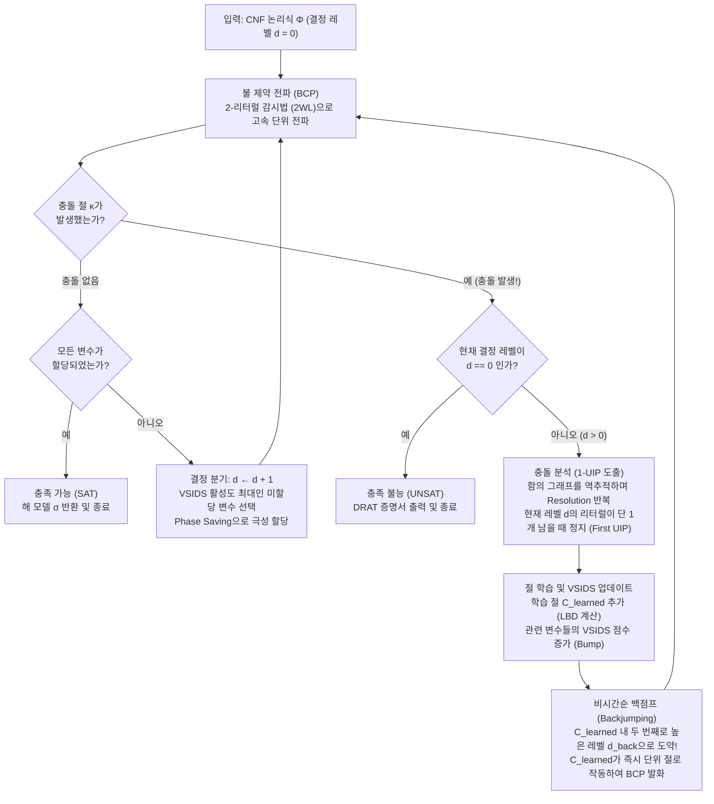
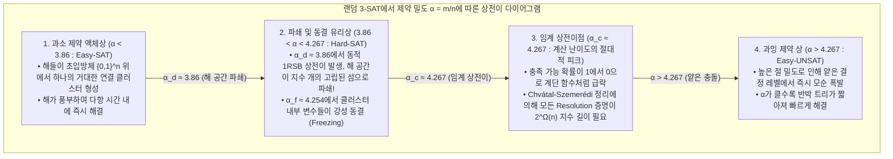

## 1. 컴퓨터 과학의 ‘조용한 알고리즘 혁명’

컴퓨터 과학 교과서를 펼치면 예외 없이 다음과 같은 엄중한 경고가 등장한다.
<strong>“불 충족 가능성 문제(Boolean Satisfiability Problem, SAT)는 NP-완전(NP-Complete) 문제이며, 변수의 개수 $n$에 대해 최악의 경우 $O(2^n)$의 지수 시간이 소요되므로 대규모 인스턴스를 엄밀하게 푸는 것은 사실상 불가능(Intractable)하다.”</strong>

단순한 조합론으로 계산해 보아도, 변수 $n = 100$개만 있으면 진릿값 할당의 경우의 수는 $2^{100} \approx 1.26 \times 10^{30}$에 달한다. 초당 $10^{12}$개의 할당을 검사하는 슈퍼컴퓨터를 빅뱅(약 138억 년 전)부터 지금까지 가동했더라도 전체 탐색 공간의 $10^{-8}$조차 확인하지 못했을 것이다. 실제로 1990년 무렵의 SAT 솔버에게 변수 100개, 절(Clause) 400개짜리 논리식은 넘을 수 없는 거대한 벽이었다.

그러나 21세기 현재, 산업 현장에서는 교과서의 직관을 정면으로 뒤집는 기적이 매일 일어나고 있다. <strong>MiniSat, Glucose, Lingeling, CaDiCaL, Kissat</strong>, 그리고 마이크로소프트 리서치의 <strong>Z3</strong>와 같은 현대 산업용 SAT/SMT 솔버들은 반도체 논리 동치성 검증, 컴파일러 최적화, Linux/Rust 패키지 의존성 해결 과정에서 <strong>변수 $1,000\text{만}$($10^7$) 개, 절 $5,000\text{만}$($5 \times 10^7$) 개가 넘는 거대한 논리식을 단 몇 초에서 몇 분 만에 엄밀하게 풀어낸다.</strong>

도널드 크누스(Donald E. Knuth)는 2015년 출간된 《컴퓨터 프로그래밍의 예술(TAOCP)》 제4B권(섹션 7.2.2.2)에서 무려 300페이지 이상을 SAT 솔버에 할애하며, 1990년대 후반에서 2000년대 초반 사이에 일어난 이 돌파구를 <strong>“현대 컴퓨터 과학 역사상 가장 위대한 알고리즘 혁명 중 하나”</strong>라고 극찬했다. 과거에는 어떤 문제를 SAT로 환원하는 것이 “이 문제는 효율적으로 풀 수 없으니 포기하라”는 선고였지만, 오늘날에는 반대로 <strong>“SAT로 번역할 수만 있다면 인류 최강의 범용 추론 엔진으로 순식간에 풀 수 있다”</strong>는 승리 선언으로 그 의미가 완전히 역전되었다.

---

## 2. 논리곱 정규형(CNF), 체이틴 변환, 그리고 쿡-레빈 정리(1971)

### 2.1 논리곱 정규형(CNF)과 체이틴(Tseitin) 선형 변환

SAT 솔버의 표준 입력은 $n$개의 불 변수 $x_1, \dots, x_n \in \{0, 1\}$ 위에 정의된 <strong>논리곱 정규형(Conjunctive Normal Form, CNF)</strong> 논리식 $\Phi$이다. 변수 $x_v$ 또는 그 부정 $\neg x_v$를 <strong>리터럴(Literal)</strong> $\ell$이라 부르고, 리터럴들의 논리합(OR, $\lor$)을 <strong>절(Clause)</strong> $C_i = \bigvee_{j=1}^{k_i} \ell_{i,j}$이라 하며, $m$개의 절을 모두 논리곱(AND, $\land$)으로 연결한 식을 CNF라 한다.

$$\Phi(x_1, \dots, x_n) = \bigwedge_{i=1}^m C_i = \bigwedge_{i=1}^m \left(\bigvee_{j=1}^{k_i} \ell_{i,j}\right)$$

임의의 논리 회로를 분배법칙 $A \lor (B \land C) \equiv (A \lor B) \land (A \lor C)$만으로 무작정 CNF로 전개하면 절의 개수가 지수적으로 폭발한다. 1968년 그리고리 체이틴(Grigori Tseitin)이 고안한 <strong>체이틴 변환(Tseitin Transformation)</strong>은 회로 내의 각 논리 게이트 $g$마다 새로운 <strong>보조 변수(Auxiliary Variable)</strong> $y_g$를 도입하고, 동치 관계 $y_g \leftrightarrow \text{gate}(a, b)$를 국소적인 3-CNF 절로 인코딩한다. 예를 들어 AND 게이트 $y_g \leftrightarrow (a \land b)$는 단 3개의 절로 표현된다.

$$\left(\neg y_g \lor a\right) \;\land\; \left(\neg y_g \lor b\right) \;\land\; \left(y_g \lor \neg a \lor \neg b\right)$$

이를 통해 게이트 수가 $|G|$개인 모든 복잡한 논리 회로는 원래 회로와 <strong>충족 동치(Equisatisfiable)</strong>인 3-CNF 공식으로 <strong>선형 시간 및 선형 크기 $O(|G|)$</strong> 만에 변환된다.

### 2.2 쿡-레빈 정리와 2-SAT vs. 3-SAT의 복잡도 절벽

1971년 스티븐 쿡(Stephen Cook)과 레오니드 레빈(Leonid Levin)은 독립적으로 <strong>쿡-레빈 정리(Cook-Levin Theorem)</strong>를 증명했다. 복잡도 클래스 $\text{NP}$에 속하는 모든 결정 문제(비결정론적 튜링 기계가 다항 시간 $p(n)$ 내에 수리하는 문제)는 튜링 기계의 상태 $S_{t,q}$, 헤드 위치 $H_{t,i}$, 테이프 기호 $T_{t,i,\sigma}$의 전이 과정을 부울 변수로 인코딩함으로써 다항 시간 내에 SAT로 환원될 수 있다. 즉, <strong>SAT는 역사상 최초로 증명된 NP-완전 문제</strong>이다.

각 절의 리터럴 수가 최대 $k$개인 <strong>k-SAT</strong>에서 $k=2$와 $k=3$ 사이에는 거대한 복잡도 절벽이 존재한다.
- <strong>2-SAT는 선형 시간 $O(n+m)$에 풀린다</strong>: 이항 절 $(\ell_1 \lor \ell_2)$는 두 개의 확정적 함의(Implication) $(\neg \ell_1 \Rightarrow \ell_2) \land (\neg \ell_2 \Rightarrow \ell_1)$와 동치이다. $2n$개의 리터럴을 정점으로 하는 <strong>함의 그래프(Implication Graph)</strong>를 구성한 뒤 타잔(Tarjan)의 강연결 요소(SCC) 알고리즘을 돌리면, 어떤 변수 $x_v$와 $\neg x_v$가 같은 SCC에 속하는지 여부를 $O(n+m)$ 시간에 판별할 수 있다.
- <strong>3-SAT는 NP-완전이다</strong>: 삼항 절 $(\ell_1 \lor \ell_2 \lor \ell_3)$는 $(\neg \ell_1 \land \neg \ell_2) \Rightarrow \ell_3$가 되어 두 전제가 동시에 참이어야만 결과가 강제되는 하이퍼그래프 간선이 된다. 지수 시간 가설(ETH) 하에서 3-SAT를 $2^{o(n)}$ 시간에 푸는 최악 케이스 알고리즘은 존재하지 않는다.

---

## 3. 고전적 DPLL 알고리즘(1962)과 ‘시간순 백트래킹’의 비극

1962년 데이비스(Davis), 로게만(Logemann), 러블랜드(Loveland)가 발표한 <strong>DPLL 알고리즘</strong>의 핵심 추론 규칙은 <strong>단위 전파(Unit Propagation / Boolean Constraint Propagation, BCP)</strong>이다.

> <strong>단위 전파(Unit Propagation / BCP)</strong>:
> 현재 부분 할당 하에서 어떤 절 $C = (\ell_1 \lor \ell_2 \lor \dots \lor \ell_k)$의 $k-1$개 리터럴이 모두 `False`($0$)로 확정되고 단 하나의 리터럴 $\ell_k$만 미할당 상태라면, $C$를 <strong>단위 절(Unit Clause)</strong>이라 부른다. 절 $C$를 만족시키기 위해 솔버는 분기 없이 즉시 $\ell_k = \text{True}$($1$)를 강제 할당하며, 이로 인해 연쇄적으로 발생하는 새로운 단위 절들을 도미노처럼 전파시킨다.

<strong>왜 고전적 DPLL은 변수 100개의 벽을 넘지 못했는가?</strong>
모순(Conflict)이 발생했을 때 직전 결정 단계로 한 칸씩 기계적으로 되돌아가는 <strong>시간순 백트래킹(Chronological Backtracking)</strong> 때문이었다.
예를 들어 솔버가 <strong>결정 레벨(Decision Level) $d=1$</strong>에서 $x_1 = 0$을 선택한 뒤, $d = 2, \dots, 49$에서 $x_1$과 전혀 무관한 변수 $x_2, \dots, x_{49}$를 할당하고, <strong>$d = 50$</strong>에서 $x_{50} = 1$을 선택했다고 하자. 만약 논리식에 $(x_1 \lor \neg x_{50} \lor x_{51})$, $(x_1 \lor \neg x_{50} \lor \neg x_{51})$, $(x_1 \lor x_{50} \lor x_{52})$, $(x_1 \lor x_{50} \lor \neg x_{52})$가 들어 있다면, $x_1 = 0$인 상태에서는 $x_{50}$이 $1$이든 $0$이든 즉시 모순이 터진다!
그러나 시간순 백트래킹은 모순의 진짜 원인이 레벨 1의 $x_1 = 0$에 있다는 사실을 전혀 알지 못한 채, 레벨 49로 돌아가 무고한 $x_{49}$를 뒤집고, 무관한 변수 $x_2, \dots, x_{49}$가 만드는 <strong>$2^{48} \approx 2.81 \times 10^{14}$개의 무의미한 부분 트리</strong> 속에서 똑같은 실패를 281조 번 반복하는 <strong>스래싱(Thrashing)</strong>에 빠진다.

---

## 4. 현대의 혁명: CDCL(충돌 주도 절 학습), 제1 UIP, 비시간순 백점프

1996년 마르케스-실바(Marques-Silva)와 사칼라(Sakallah)의 <strong>GRASP</strong>, 그리고 2001년 프린스턴 대학교 모스케위츠(Moskewicz) 팀의 <strong>Chaff(zChaff)</strong>가 완성한 <strong>CDCL(Conflict-Driven Clause Learning)</strong>은 이 문제를 근본적으로 해결했다.



### 4.1 함의 그래프와 제1 유일 함의점(First UIP / 1-UIP) 도출

CDCL은 각 리터럴 $\ell@d$가 할당될 때 결정 레벨 $d$와 이를 강제한 <strong>이유 절(Antecedent / Reason Clause)</strong> $\text{reason}(\ell)$을 기록한다. 충돌 절 $\kappa$가 거짓이 되면, 솔버는 $C \leftarrow \kappa$에서 시작하여 현재 결정 레벨 $d_{\text{curr}}$에서 가장 최근에 전파된 변수를 피벗으로 삼아 로빈슨의 <strong>도출 원리(Boolean Resolution)</strong>를 역방향으로 반복 적용한다.

$$\frac{(A \lor x) \qquad (\neg x \lor B)}{(A \lor B)} = \text{Res}(C_1, C_2, x)$$

함의 그래프에서 현재 레벨의 결정 정점 $\ell_{\text{dec}}@d_{\text{curr}}$로부터 충돌 정점 $\Lambda$로 가는 <strong>모든 유향 경로가 반드시 거쳐야 하는 정점</strong>을 <strong>유일 함의점(Unique Implication Point, UIP)</strong>이라 하며, 충돌에 가장 가까운 UIP를 <strong>제1 UIP(First UIP / 1-UIP)</strong>라 부른다.
놀랍게도 역방향 도출 과정에서 <strong>현재 결정 레벨 $d_{\text{curr}}$에 속하는 리터럴이 절 $C$ 안에 딱 1개만 남는 순간</strong>, 그 리터럴이 바로 <strong>제1 UIP</strong>이다!

예를 들어 $x_1 = 0@1, x_2 = 0@2, x_3 = 1@3$ 상태에서 레벨 $d=5$의 결정 $x_4 = 1@5$ 이후 $\omega_1 = (x_1 \lor \neg x_4 \lor x_5)$, $\omega_2 = (\neg x_4 \lor \neg x_5 \lor x_6)$, $\omega_3 = (x_2 \lor \neg x_6 \lor x_7)$, $\omega_4 = (\neg x_3 \lor \neg x_6 \lor x_8)$를 거쳐 $\kappa = (\neg x_7 \lor \neg x_8)$에서 충돌이 발생하면:
1. $C^{(0)} = (\neg x_7@5 \lor \neg x_8@5)$와 $\omega_4$를 $x_8$에 대해 도출 $\to C^{(1)} = (\neg x_3@3 \lor \neg x_6@5 \lor \neg x_7@5)$.
2. $C^{(1)}$과 $\omega_3$를 $x_7$에 대해 도출 $\to C^{(2)} = (x_2@2 \lor \neg x_3@3 \lor \neg x_6@5)$.
이제 레벨 5의 리터럴이 $\neg x_6@5$ <strong>단 하나</strong>만 남았으므로 도출을 멈추고 <strong>1-UIP 학습 절</strong> $C_{\text{learned}} = (x_2@2 \lor \neg x_3@3 \lor \neg x_6@5)$를 얻는다!

### 4.2 비시간순 백점프(Non-Chronological Backjumping)

학습 절 $C_{\text{learned}}$에 포함된 결정 레벨들이 $\{5, 3, 2\}$이므로, 솔버는 직전 레벨 4가 아니라 <strong>두 번째로 높은 결정 레벨(단언 레벨, Assertion Level) $d_{\text{back}} = 3$</strong>으로 단숨에 점프한다! 레벨 3으로 돌아간 순간 $x_2@2$와 $\neg x_3@3$는 여전히 거짓이고 $\neg x_6$만 미할당 상태가 되므로, $C_{\text{learned}}$는 즉시 <strong>단위 절(Asserting Clause)</strong>이 되어 BCP를 통해 $\neg x_6 = 1@3$($x_6 = 0@3$)을 강제 할당한다.

---

## 5. 솔버를 수천 배 가속한 엔지니어링의 기적: 2WL, VSIDS, LBD

1. <strong>2-리터럴 감시법(Two-Watched Literals, 2WL, Chaff 2001)</strong>:
   절 $C$ 안에 <strong>거짓(`False`)으로 확정되지 않은 리터럴이 최소 2개 이상 남아 있는 한, 그 절은 절대 단위 절이나 충돌 절이 될 수 없다.</strong> 따라서 각 절마다 단 2개의 리터럴 $w_1, w_2$만 감시(Watch)한다. 감시되지 않은 리터럴이 거짓이 될 때는 절을 아예 방문하지 않으며, 특히 <strong>백점프로 변수 할당을 취소할 때는 감시 포인터를 수정할 필요가 전혀 없어 백트래킹 비용이 $O(1)$(완전한 제로)</strong>이 된다!
2. <strong>VSIDS(Variable State Independent Decaying Sum)와 Phase Saving</strong>:
   1-UIP 충돌 분석에 관여한 변수들의 활성도 점수에 $\Delta$를 더하고 매 충돌마다 $\Delta \leftarrow \Delta / \gamma$($\gamma = 0.95$)로 증분을 키워 지수 이동 평균(EMA)을 유지한다. 이를 통해 최근 충돌을 일으키는 핵심 병목 변수들에 레이저처럼 분기를 집중시킨다.
3. <strong>LBD(Literal Block Distance, 글루 절)와 고속 재시작(Rapid Restarts)</strong>:
   Glucose 솔버(2009)는 학습 절 내의 서로 다른 결정 레벨 개수를 <strong>LBD</strong>로 정의했다. $\text{LBD} = 2$인 <strong>글루 절(Glue Clause)</strong>은 현재 UIP를 과거의 단일 결정 블록과 직접 접착시키는 핵심 정리이므로 영구 보존(Core Tier)하고, LBD가 큰 절은 주기적으로 삭제한다.

| 비교 항목 | 고전적 DPLL (1962) | 1세대 CDCL (GRASP / Chaff 2001) | 최신 CDCL (Glucose / CaDiCaL / Kissat) |
| :--- | :--- | :--- | :--- |
| <strong>BCP 데이터 구조</strong> | 전체 절 리터럴 카운터 (할당 및 백트래킹 시 모두 갱신) | <strong>2-리터럴 감시법 (2WL)</strong> (백트래킹 시 포인터 갱신 비용 $0$) | <strong>블로킹 리터럴 내장 2WL</strong> + 이항 절 전용 고속 감시 리스트 |
| <strong>충돌 복구 방식</strong> | <strong>시간순 백트래킹</strong> ($d-1$로 이동, $2^k$ 스래싱 발생) | <strong>비시간순 백점프</strong> (1-UIP 절의 제2 최대 레벨 $d_{\text{back}}$으로 도약) | 비시간순 백점프 + 국소 시간순 백트래킹 하이브리드 (2018) |
| <strong>절 학습 (Learning)</strong> | 없음 (기억 없는 탐색) | <strong>제1 UIP (1-UIP) 도출</strong> + 재귀적 절 최소화 | 1-UIP + 온더플라이 자기포섭, 절 강화(Vivification), 변수 제거(BVE) |
| <strong>변수 선택 휴리스틱</strong> | 정적 순서 / DLIS | <strong>VSIDS</strong> (충돌 관여 변수 지수 감쇠 활성도 점수) | <strong>EVSIDS + VMTF</strong> 교대 탐색 + Phase Saving / WalkSAT 결합 |
| <strong>학습 절 관리 (GC)</strong> | 해당 없음 | 절 길이 및 활성도 기반 삭제 | <strong>LBD (글루 레벨) 3계층 관리</strong> ($\text{LBD} \le 2$ 영구 보존) |

---

## 6. Python을 이용한 CDCL 솔버 코어 엔진 완벽 구현

다음은 BCP, 함의 그래프 추적, <strong>제1 UIP 도출 학습</strong>, <strong>비시간순 백점프</strong>, <strong>VSIDS</strong>를 모두 갖춘 CDCL 솔버의 Python 구현이다.

```python
from typing import List, Dict, Optional, Set, Tuple

class CDCLSolver:
    '''Minimal Conflict-Driven Clause Learning (CDCL) SAT Solver with 1-UIP & VSIDS.'''
    def __init__(self, num_vars: int, clauses: List[List[int]]):
        self.num_vars = num_vars
        self.clauses: List[List[int]] = [list(set(c)) for c in clauses]
        self.assigns: Dict[int, bool] = {}
        self.trail: List[int] = []
        self.level: Dict[int, int] = {}
        self.reason: Dict[int, Optional[List[int]]] = {}
        self.decision_level: int = 0
        self.activity: Dict[int, float] = {v: 0.0 for v in range(1, num_vars + 1)}
        for c in self.clauses:
            for lit in c:
                self.activity[abs(lit)] += 1.0
        self.var_inc: float = 1.0
        self.var_decay: float = 0.95

    def value_lit(self, lit: int) -> Optional[bool]:
        var = abs(lit)
        if var not in self.assigns:
            return None
        return self.assigns[var] if lit > 0 else not self.assigns[var]

    def assign(self, lit: int, level: int, reason: Optional[List[int]]) -> None:
        var = abs(lit)
        self.assigns[var] = (lit > 0)
        self.trail.append(lit)
        self.level[var] = level
        self.reason[var] = reason

    def bcp(self) -> Optional[List[int]]:
        changed = True
        while changed:
            changed = False
            for clause in self.clauses:
                unassigned_lit = None
                num_unassigned = 0
                satisfied = False
                for lit in clause:
                    val = self.value_lit(lit)
                    if val is True:
                        satisfied = True
                        break
                    elif val is None:
                        num_unassigned += 1
                        unassigned_lit = lit
                if satisfied:
                    continue
                if num_unassigned == 0:
                    return clause
                if num_unassigned == 1 and unassigned_lit is not None:
                    self.assign(unassigned_lit, self.decision_level, clause)
                    changed = True
        return None

    def analyze_conflict(self, conflict_clause: List[int]) -> Tuple[List[int], int]:
        learned: Set[int] = set(conflict_clause)
        def count_curr_level(cset: Set[int]) -> int:
            return sum(1 for lit in cset if self.level[abs(lit)] == self.decision_level)

        idx = len(self.trail) - 1
        while count_curr_level(learned) > 1:
            while True:
                pivot_lit = self.trail[idx]
                idx -= 1
                if -pivot_lit in learned and self.level[abs(pivot_lit)] == self.decision_level:
                    break
            pivot_var = abs(pivot_lit)
            antecedent = self.reason[pivot_var]
            assert antecedent is not None
            self.activity[pivot_var] += self.var_inc
            learned.remove(-pivot_lit)
            for lit in antecedent:
                if lit != pivot_lit:
                    learned.add(lit)

        learned_clause = list(learned)
        for lit in learned_clause:
            self.activity[abs(lit)] += self.var_inc
        self.var_inc /= self.var_decay
        levels = sorted({self.level[abs(lit)] for lit in learned_clause}, reverse=True)
        backjump_level = levels[1] if len(levels) > 1 else 0
        return learned_clause, backjump_level

    def backtrack(self, target_level: int) -> None:
        while self.trail and self.level[abs(self.trail[-1])] > target_level:
            lit = self.trail.pop()
            var = abs(lit)
            del self.assigns[var], self.level[var], self.reason[var]
        self.decision_level = target_level

    def solve(self) -> Tuple[bool, Optional[Dict[int, bool]]]:
        if self.bcp() is not None:
            return False, None
        while True:
            unassigned = [v for v in range(1, self.num_vars + 1) if v not in self.assigns]
            if not unassigned:
                return True, dict(self.assigns)
            branch_var = max(unassigned, key=lambda v: self.activity[v])
            self.decision_level += 1
            self.assign(branch_var, self.decision_level, reason=None)
            while True:
                conflict = self.bcp()
                if conflict is None:
                    break
                if self.decision_level == 0:
                    return False, None
                learned_clause, backjump_level = self.analyze_conflict(conflict)
                self.clauses.append(learned_clause)
                self.backtrack(backjump_level)
```

---

## 7. 랜덤 $k$-SAT의 상전이 현상($\alpha_c \approx 4.267$)과 산업용 문제의 비밀

변수 $n$개와 무작위 절 $m = \alpha n$개로 이루어진 랜덤 3-SAT에서 <strong>절-변수 밀도비 $\alpha = m / n$</strong>을 정의하자. 1차 모멘트 방법(First Moment Method)으로 구한 해의 개수 $Z$의 기댓값은 다음과 같다.

$$\mathbb{E}[Z] = 2^n \left(1 - 2^{-3}\right)^m = \left(2 \cdot \left(\frac{7}{8}\right)^\alpha\right)^n \implies \alpha_{\text{annealed}} = \frac{\ln 2}{\ln(8/7)} \approx 5.191$$

통계물리학자 메자르(Mézard), 파리지(Parisi, 2021 노벨 물리학상 수상자), 제키나(Zecchina)는 스핀 글라스 이론의 <strong>공동 방법(Cavity Method)과 복제 대칭성 깨짐(1RSB)</strong>을 통해 랜덤 3-SAT의 실제 임계 상전이점을 규명했다(Ding, Sly, Sun 2015 엄밀 증명).

$$\alpha_c \approx 4.267$$



$\alpha_c \approx 4.267$ 부근의 랜덤 하이퍼그래프는 병목이 없는 <strong>익스팬더 그래프(Expander Graph)</strong>이므로 모든 Resolution 반박 증명이 $2^{\Omega(n)}$의 지수적 길이를 요구한다(Chvátal & Szemerédi, 1988).
반면 <strong>인간이 설계한 $10^7$ 변수의 산업용 문제는 결코 균일한 랜덤 그래프가 아니다!</strong>
1. <strong>높은 모듈성과 커뮤니티 구조(Community Structure, Ansótegui et al. 2012)</strong>: 반도체 회로와 소프트웨어는 내부적으로만 조밀하게 연결되고 외부 모듈과는 소수의 인터페이스 변수로만 소통한다. CDCL의 1-UIP와 VSIDS는 이 좁은 인터페이스 변수를 정확히 포착해 짧은 글루 절($\text{LBD}=2$)로 모듈을 분할 정복한다.
2. <strong>작은 백도어 집합(Backdoor Sets, Williams, Gomes & Selman 2003)</strong>: 수백만 변수의 산업 문제에는 단 수십~수백 개의 핵심 제어 변수로 이루어진 <strong>강한 백도어 집합 $B$($|B| \ll n$)</strong>가 존재하여, 이 변수들만 결정되면 나머지 99.99%의 변수는 BCP 도미노 전파만으로 순식간에 결정된다.

---

## 8. 현실 세계를 움직이는 응용과 200테라바이트의 수학 증명

1. <strong>200TB DRAT 증명을 통한 불 피타고라스 세 수 문제 해결(Heule, Kullmann, Marek 2016)</strong>:
   자연수 집합 $\{1, \dots, N\}$을 두 색으로 칠해 $a^2 + b^2 = c^2$를 만족하는 단색 세 수가 없도록 할 수 있는가? 연구진은 <strong>Cube-and-Conquer</strong> 기법으로 <strong>$N = 7824$는 가능(SAT)하지만 $N = 7825$는 불가능(UNSAT)</strong>함을 증명하고, 형식 검증기로 완벽히 검산된 인류 역사상 최대의 <strong>200테라바이트 DRAT 증명 파일</strong>을 생성했다. 이후 슈어 수 $S(5)=160$(2018)과 7차원 켈러의 추측(2020)도 연달아 해결했다.
2. <strong>반도체 EDA 형식 검증(CEC 및 BMC)</strong>: 1994년 인텔 펜티엄 FDIV 버그 이후 모든 최신 프로세서는 합성 전후 회로를 XOR로 묶은 <strong>마이터 회로(Miter Circuit)</strong>를 SAT 솔버에 넣어 $100\%$ 동치성을 검증한다.
3. <strong>현대 패키지 매니저(Linux apt, Rust Cargo, Dart PubGrub, uv)</strong>: 버전 의존성과 충돌 제약을 CDCL과 1-UIP로 풀어내며, 설치 불가 시 Resolution 증명 그래프를 역번역해 명확한 충돌 원인을 출력한다.
4. <strong>SAT에서 SMT 솔버($\text{DPLL}(T)$: Z3, cvc5)로</strong>: CDCL 코어와 선형 산술·비트벡터·배열 이론 솔버를 결합하여 프로그램 기호 실행과 AWS 클라우드 보안 엔진(<strong>Zelkova</strong>)의 핵심 두뇌로 활약하고 있다.
