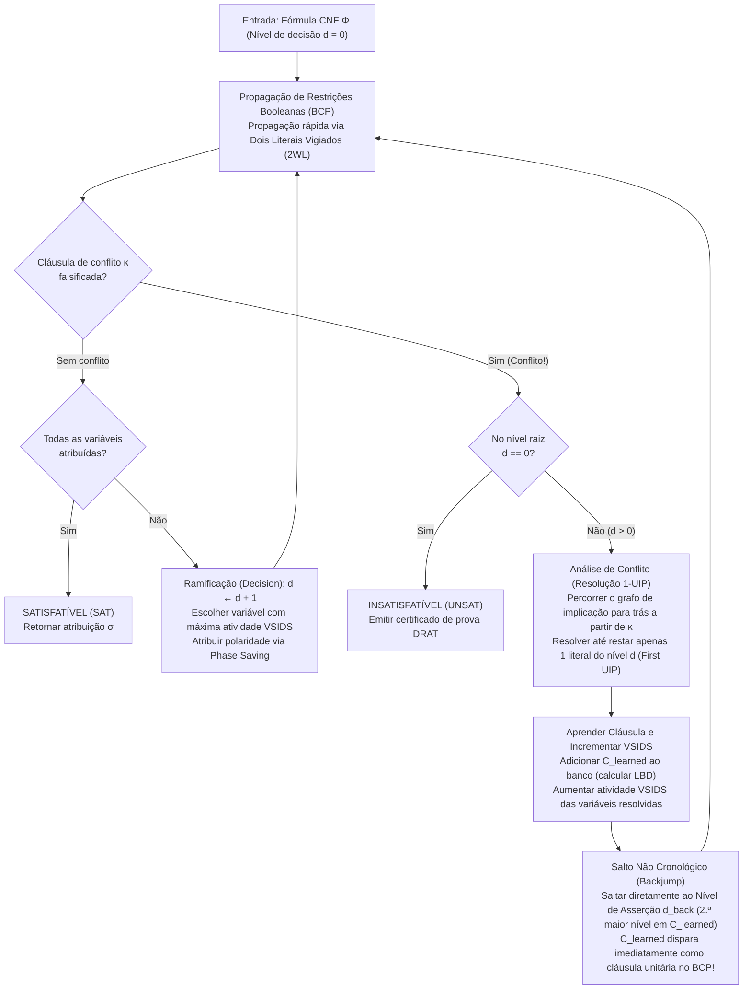
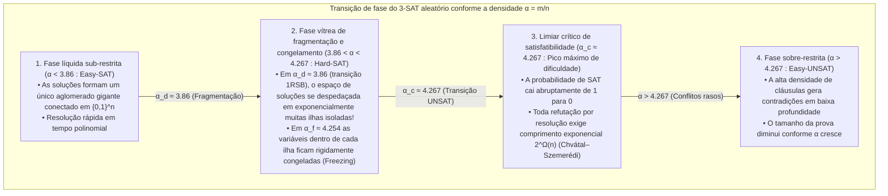

## 1. A revolução algorítmica silenciosa da ciência da computação

Abra quase qualquer livro de ciência da computação teórica e você encontrará um aviso solene:
<strong>«O Problema da Satisfatibilidade Booleana (SAT) é NP-completo. Como sua complexidade de tempo no pior caso cresce exponencialmente como $O(2^n)$ em relação ao número de variáveis $n$, instâncias grandes são fundamentalmente intratáveis.»</strong>

Do ponto de vista puramente combinatório, o argumento parece irrefutável. Uma fórmula proposicional sobre $n = 100$ variáveis booleanas admite $2^{100} \approx 1.26 \times 10^{30}$ atribuições de verdade possíveis. Mesmo que um supercomputador pudesse verificar $10^{12}$ atribuições por segundo desde o Big Bang (há 13,8 bilhões de anos), teria explorado menos de $10^{-8}$ do espaço de busca até hoje. De fato, por volta de 1990, os melhores solucionadores SAT travavam diante de fórmulas com apenas $100$ variáveis e $400$ cláusulas.

No entanto, no século XXI, a engenharia desafia essa intuição milhões de vezes por dia. Solucionadores SAT e SMT industriais modernos — como <strong>MiniSat, Glucose, Lingeling, CaDiCaL, Kissat</strong> e o <strong>Z3</strong> da Microsoft Research — resolvem rotineiramente instâncias de verificação formal de microprocessadores, otimização de compiladores e resolução de dependências de pacotes com <strong>$10.000.000$ ($10^7$) de variáveis e $50.000.000$ ($5 \times 10^7$) de cláusulas em questão de segundos</strong>.

Quando Donald E. Knuth publicou o Volume 4B (Seção 7.2.2.2) de *The Art of Computer Programming* em 2015, dedicou mais de 300 páginas exclusivamente aos solucionadores SAT, saudando os avanços do final dos anos 1990 e início dos anos 2000 como <strong>uma das maiores revoluções algorítmicas da história da computação</strong>. Se antes reduzir um problema a SAT significava provar sua intratabilidade prática, hoje traduzir um problema combinatório difícil para SAT é a estratégia definitiva para resolvê-lo instantaneamente.

---

## 2. Forma Normal Conjuntiva (CNF), transformação de Tseitin e o teorema de Cook-Levin (1971)

### 2.1 Forma Normal Conjuntiva (CNF) e codificação linear de Tseitin

Um solucionador SAT opera sobre uma fórmula proposicional $\Phi$ definida sobre $n$ variáveis booleanas $V = \{x_1, \dots, x_n\}$ com valores em $\{0, 1\}$. Um <strong>literal</strong> $\ell \in \{x_v, \neg x_v\}$ é uma variável ou sua negação; uma <strong>cláusula</strong> $C_i = \bigvee_{j=1}^{k_i} \ell_{i,j}$ é uma disjunção (OR lógico, $\lor$) de literais; e uma fórmula na <strong>Forma Normal Conjuntiva (CNF)</strong> é uma conjunção (AND lógico, $\land$) de $m$ cláusulas:

$$\Phi(x_1, \dots, x_n) = \bigwedge_{i=1}^m C_i = \bigwedge_{i=1}^m \left(\bigvee_{j=1}^{k_i} \ell_{i,j}\right)$$

Se convertêssemos ingenuamente um circuito lógico arbitrário para CNF aplicando repetidamente a lei distributiva $A \lor (B \land C) \equiv (A \lor B) \land (A \lor C)$, o tamanho da fórmula explodiria exponencialmente. Em 1968, <strong>Grigori Tseitin</strong> eliminou essa explosão com a <strong>transformação de Tseitin</strong>: introduz-se uma nova <strong>variável auxiliar</strong> $y_g$ para a saída de cada porta lógica $g$ do circuito e codifica-se a equivalência local $y_g \leftrightarrow \text{porta}(a, b)$ com apenas 3 ou 4 cláusulas. Por exemplo, uma porta AND $y_g \leftrightarrow (a \land b)$ equivale exatamente a três cláusulas:

$$\left(\neg y_g \lor a\right) \;\land\; \left(\neg y_g \lor b\right) \;\land\; \left(y_g \lor \neg a \lor \neg b\right)$$

Assim, qualquer circuito com $|G|$ portas é convertido em <strong>tempo e espaço estritamente lineares $O(|G|)$</strong> em uma fórmula 3-CNF <strong>equissatisfatível</strong>.

### 2.2 O teorema de Cook-Levin e o abismo de complexidade entre 2-SAT e 3-SAT

Em 1971, <strong>Stephen Cook</strong> e <strong>Leonid Levin</strong> provaram independentemente o <strong>teorema de Cook-Levin</strong>: todo problema de decisão na classe $\text{NP}$ pode ser reduzido em tempo polinomial a SAT codificando o quadro de computação espaço-temporal de uma máquina de Turing não determinística durante $p(n)$ passos (estados $S_{t,q}$, posição da cabeça $H_{t,i}$, símbolos de fita $T_{t,i,\sigma}$) como uma fórmula CNF.

Quando cada cláusula possui no máximo $k$ literais (<strong>$k$-SAT</strong>), existe um abismo entre $k = 2$ e $k = 3$:
- <strong>2-SAT é resolvido em tempo linear $O(n + m)$</strong>: uma cláusula binária $(\ell_1 \lor \ell_2)$ equivale a duas implicações direcionadas determinísticas $(\neg \ell_1 \Rightarrow \ell_2) \land (\neg \ell_2 \Rightarrow \ell_1)$. No <strong>grafo de implicação</strong> sobre os $2n$ literais, o algoritmo de Tarjan calcula as <strong>componentes fortemente conexas (SCC)</strong> em tempo $O(n+m)$: a fórmula é satisfatível se e somente se nenhuma variável $x_v$ pertence à mesma SCC que $\neg x_v$.
- <strong>3-SAT é NP-completo</strong>: uma cláusula ternária $(\ell_1 \lor \ell_2 \lor \ell_3)$ equivale a $(\neg \ell_1 \land \neg \ell_2) \Rightarrow \ell_3$, uma hiperaresta que exige duas premissas simultâneas. Sob a <strong>Hipótese do Tempo Exponencial (ETH)</strong>, nenhum algoritmo determinístico resolve 3-SAT em tempo subexponencial $2^{o(n)}$ no pior caso.

---

## 3. O algoritmo DPLL clássico (1962) e a tragédia do backtracking cronológico

O algoritmo <strong>DPLL</strong> (Davis, Putnam, Logemann, Loveland, 1962) combina busca em profundidade com a <strong>propagação unitária (Unit Propagation / Boolean Constraint Propagation, BCP)</strong>:

> <strong>Propagação Unitária (BCP)</strong>:
> Se sob a atribuição parcial atual todos os literais de uma cláusula $C = (\ell_1 \lor \dots \lor \ell_{k-1} \lor \ell_k)$ exceto $\ell_k$ forem avaliados como `False` ($0$) e $\ell_k$ permanecer não atribuído, $C$ é uma <strong>cláusula unitária</strong>. O solucionador força imediatamente $\ell_k = \text{True}$ ($1$), disparando uma cascata em dominó de novas propagações unitárias até a saturação ou até falsificar todos os literais de alguma cláusula (<strong>Conflito</strong>).

<strong>Por que o DPLL esbarrava na barreira de 100 variáveis?</strong>
Por causa do <strong>backtracking cronológico</strong>. Se o solucionador define $x_1 = 0$ no <strong>nível de decisão $d = 1$</strong>, faz 48 escolhas totalmente independentes $x_2, \dots, x_{49}$ nos níveis $d = 2 \dots 49$, e no <strong>nível $d = 50$</strong> escolhe $x_{50} = 1$, gerando um conflito imediato causado unicamente por $x_1 = 0$ e $x_{50}$ através das cláusulas $(x_1 \lor \neg x_{50} \lor \pm x_{51})$ e $(x_1 \lor x_{50} \lor \pm x_{52})$, o DPLL recua apenas um nível para $d = 49$, inverte a variável inocente $x_{49}$ e repete exatamente o mesmo fracasso em <strong>$2^{48} \approx 2.81 \times 10^{14}$ subárvores inúteis</strong> (<strong>thrashing</strong>)!

---

## 4. A revolução CDCL: grafos de implicação, resolução 1-UIP e salto não cronológico

Introduzido no <strong>GRASP</strong> (Marques-Silva & Sakallah, 1996) e consagrado no <strong>Chaff</strong> (Moskewicz et al., 2001), o <strong>Aprendizado de Cláusulas Dirigido por Conflitos (CDCL)</strong> transformou cada contradição em aprendizado permanente.



### 4.1 Grafo de implicação, resolução booleana e o Primeiro Ponto de Implicação Único (1-UIP)

Cada literal atribuído $\ell@d$ registra seu nível de decisão $d$ e sua <strong>cláusula antecedente (razão)</strong> $\text{reason}(\ell)$. Quando $\kappa$ é falsificada, o CDCL inicializa $C \leftarrow \kappa$ e percorre para trás a pilha de atribuições (Trail) no nível atual $d_{\text{curr}}$, aplicando iterativamente a <strong>regra de resolução booleana</strong>:

$$\frac{(A \lor x) \qquad (\neg x \lor B)}{(A \lor B)} = \text{Res}(C_1, C_2, x)$$

No grafo de implicação, um vértice $u@d_{\text{curr}}$ é um <strong>Ponto de Implicação Único (UIP)</strong> se *todo* caminho direcionado da decisão $\ell_{\text{dec}}@d_{\text{curr}}$ até o conflito $\Lambda$ passa obrigatoriamente por $u$ (dominador). O UIP mais próximo do conflito é o <strong>Primeiro UIP (1-UIP)</strong>, alcançado no exato instante em que a cláusula de trabalho $C$ contém <strong>apenas um único literal pertencente ao nível de decisão atual $d_{\text{curr}}$</strong>!

Com $x_1 = 0@1, x_2 = 0@2, x_3 = 1@3$, a decisão $x_4 = 1@5$ e as cláusulas $\omega_1 = (x_1 \lor \neg x_4 \lor x_5)$, $\omega_2 = (\neg x_4 \lor \neg x_5 \lor x_6)$, $\omega_3 = (x_2 \lor \neg x_6 \lor x_7)$, $\omega_4 = (\neg x_3 \lor \neg x_6 \lor x_8)$ gerando o conflito $\kappa = (\neg x_7 \lor \neg x_8)$, duas etapas de resolução de $\kappa$ com $\omega_4$ (pivô $x_8$) e $\omega_3$ (pivô $x_7$) produzem a <strong>cláusula aprendida 1-UIP</strong>:

$$C_{\text{learned}} = \left(x_2@2 \lor \neg x_3@3 \lor \neg x_6@5\right)$$

### 4.2 Salto não cronológico (Backjumping) e nível de asserção

Como os níveis em $C_{\text{learned}}$ são $\{5, 3, 2\}$, o solucionador salta diretamente para o <strong>segundo nível de decisão mais alto (nível de asserção) $d_{\text{back}} = 3$</strong>! No nível $3$, $x_2@2$ e $\neg x_3@3$ continuam falsos enquanto $\neg x_6$ volta a ficar livre, fazendo com que $C_{\text{learned}}$ atue imediatamente como <strong>cláusula unitária assertiva</strong> e force $\neg x_6 = 1@3$ ($x_6 = 0@3$) via BCP!

---

## 5. Milagres de engenharia: Dois Literais Vigiados (2WL), VSIDS e LBD

1. <strong>Dois Literais Vigiados (Two-Watched Literals, 2WL, Chaff 2001)</strong>:
   Enquanto uma cláusula tiver pelo menos dois literais não falsificados, ela nunca poderá se tornar unitária nem conflitante. O solucionador vigia <strong>apenas dois literais $w_1, w_2$ por cláusula</strong>. Ao realizar um <strong>backjump</strong>, desatribuir variáveis preserva automaticamente o invariante 2WL: <strong>o backtracking exige exatamente zero atualizações de ponteiros ($O(1)$)</strong>!
2. <strong>VSIDS (Variable State Independent Decaying Sum) e Phase Saving</strong>:
   Variáveis envolvidas na resolução de conflitos recebem um bônus $+\Delta$, enquanto $\Delta \leftarrow \Delta / \gamma$ ($\gamma = 0.95$) cresce após cada conflito, focando a busca no gargalo ativo.
3. <strong>LBD (Literal Block Distance / Cláusulas «Glue») e reinícios rápidos</strong>:
   O Glucose (Audemard & Simon, 2009) define $\text{LBD}(C)$ como o número de níveis de decisão distintos em $C$. Cláusulas com $\text{LBD} = 2$ (<strong>Glue Clauses</strong>) conectam diretamente o UIP atual a um único bloco passado e são mantidas permanentemente.

| Dimensão arquitetural | DPLL clássico (1962) | CDCL de 1.ª geração (GRASP / Chaff 2001) | CDCL de ponta (Glucose / CaDiCaL / Kissat) |
| :--- | :--- | :--- | :--- |
| <strong>Estrutura BCP</strong> | Contadores completos por cláusula | <strong>Dois Literais Vigiados (2WL)</strong> ($O(1)$ no backtrack sem tocar ponteiros) | <strong>2WL com literais de bloqueio inline</strong> + listas binárias dedicadas |
| <strong>Recuperação</strong> | <strong>Backtracking cronológico</strong> ($d-1$, thrashing $2^k$) | <strong>Salto não cronológico</strong> ao nível de asserção $d_{\text{back}}$ | Híbrido de Backjumping e backtracking cronológico local (2018) |
| <strong>Aprendizado</strong> | Nenhum (árvore sem memória) | <strong>Resolução 1-UIP</strong> + minimização recursiva | 1-UIP + autossunção on-the-fly, vivificação e eliminação BVE |
| <strong>Heurística de ramo</strong> | Ordem estática / DLIS | <strong>VSIDS</strong> (atividade com decaimento exponencial) | Alternância <strong>EVSIDS + VMTF</strong> + Phase Saving e busca local WalkSAT |
| <strong>Gestão de cláusulas</strong> | N/A | Exclusão por tamanho e atividade | <strong>Gestão em 3 níveis por LBD</strong> (cláusulas Glue $\text{LBD} \le 2$ permanentes) |

---

## 6. Implementação completa em Python de um motor CDCL

Abaixo está uma implementação completa em Python de um solucionador CDCL com BCP, grafo de implicação, <strong>resolução 1-UIP</strong>, <strong>salto não cronológico</strong> e <strong>VSIDS</strong>:

```python
from typing import List, Dict, Optional, Set, Tuple

class CDCLSolver:
    '''Minimal Conflict-Driven Clause Learning (CDCL) SAT Solver with 1-UIP & VSIDS.'''
    def __init__(self, num_vars: int, clauses: List[List[int]]):
        self.num_vars = num_vars
        self.clauses: List[List[int]] = [list(set(c)) for c in clauses]
        self.assigns: Dict[int, bool] = {}
        self.trail: List[int] = []
        self.level: Dict[int, int] = {}
        self.reason: Dict[int, Optional[List[int]]] = {}
        self.decision_level: int = 0
        self.activity: Dict[int, float] = {v: 0.0 for v in range(1, num_vars + 1)}
        for c in self.clauses:
            for lit in c:
                self.activity[abs(lit)] += 1.0
        self.var_inc: float = 1.0
        self.var_decay: float = 0.95

    def value_lit(self, lit: int) -> Optional[bool]:
        var = abs(lit)
        if var not in self.assigns:
            return None
        return self.assigns[var] if lit > 0 else not self.assigns[var]

    def assign(self, lit: int, level: int, reason: Optional[List[int]]) -> None:
        var = abs(lit)
        self.assigns[var] = (lit > 0)
        self.trail.append(lit)
        self.level[var] = level
        self.reason[var] = reason

    def bcp(self) -> Optional[List[int]]:
        changed = True
        while changed:
            changed = False
            for clause in self.clauses:
                unassigned_lit = None
                num_unassigned = 0
                satisfied = False
                for lit in clause:
                    val = self.value_lit(lit)
                    if val is True:
                        satisfied = True
                        break
                    elif val is None:
                        num_unassigned += 1
                        unassigned_lit = lit
                if satisfied:
                    continue
                if num_unassigned == 0:
                    return clause
                if num_unassigned == 1 and unassigned_lit is not None:
                    self.assign(unassigned_lit, self.decision_level, clause)
                    changed = True
        return None

    def analyze_conflict(self, conflict_clause: List[int]) -> Tuple[List[int], int]:
        learned: Set[int] = set(conflict_clause)
        def count_curr_level(cset: Set[int]) -> int:
            return sum(1 for lit in cset if self.level[abs(lit)] == self.decision_level)

        idx = len(self.trail) - 1
        while count_curr_level(learned) > 1:
            while True:
                pivot_lit = self.trail[idx]
                idx -= 1
                if -pivot_lit in learned and self.level[abs(pivot_lit)] == self.decision_level:
                    break
            pivot_var = abs(pivot_lit)
            antecedent = self.reason[pivot_var]
            assert antecedent is not None
            self.activity[pivot_var] += self.var_inc
            learned.remove(-pivot_lit)
            for lit in antecedent:
                if lit != pivot_lit:
                    learned.add(lit)

        learned_clause = list(learned)
        for lit in learned_clause:
            self.activity[abs(lit)] += self.var_inc
        self.var_inc /= self.var_decay
        levels = sorted({self.level[abs(lit)] for lit in learned_clause}, reverse=True)
        backjump_level = levels[1] if len(levels) > 1 else 0
        return learned_clause, backjump_level

    def backtrack(self, target_level: int) -> None:
        while self.trail and self.level[abs(self.trail[-1])] > target_level:
            lit = self.trail.pop()
            var = abs(lit)
            del self.assigns[var], self.level[var], self.reason[var]
        self.decision_level = target_level

    def solve(self) -> Tuple[bool, Optional[Dict[int, bool]]]:
        if self.bcp() is not None:
            return False, None
        while True:
            unassigned = [v for v in range(1, self.num_vars + 1) if v not in self.assigns]
            if not unassigned:
                return True, dict(self.assigns)
            branch_var = max(unassigned, key=lambda v: self.activity[v])
            self.decision_level += 1
            self.assign(branch_var, self.decision_level, reason=None)
            while True:
                conflict = self.bcp()
                if conflict is None:
                    break
                if self.decision_level == 0:
                    return False, None
                learned_clause, backjump_level = self.analyze_conflict(conflict)
                self.clauses.append(learned_clause)
                self.backtrack(backjump_level)
```

---

## 7. Física estatística e a transição de fase do $k$-SAT aleatório ($\alpha_c \approx 4.267$)

Em uma fórmula 3-SAT aleatória com $n$ variáveis e $m = \alpha n$ cláusulas (<strong>densidade $\alpha = m / n$</strong>), o método do primeiro momento fornece o valor esperado do número de soluções $\mathbb{E}[Z]$:

$$\mathbb{E}[Z] = 2^n \left(1 - 2^{-3}\right)^m = \left(2 \cdot \left(\frac{7}{8}\right)^\alpha\right)^n \implies \alpha_{\text{annealed}} = \frac{\ln 2}{\ln(8/7)} \approx 5.191$$

Por meio do <strong>método da cavidade</strong> e da <strong>quebra de simetria de réplicas de um passo (1RSB)</strong> da física de vidros de spin, Mézard, Parisi e Zecchina (2002) determinaram o limiar crítico exato do 3-SAT aleatório:

$$\alpha_c \approx 4.267$$



Em $\alpha_c \approx 4.267$, o hipergrafo aleatório é um <strong>grafo expansor</strong> sem gargalos locais, exigindo refutações por resolução de comprimento exponencial $2^{\Omega(n)}$ (Chvátal & Szemerédi, 1988). Já <strong>os problemas industriais reais possuem estrutura modular e conjuntos «Backdoor» pequenos</strong> (Ansótegui et al. 2012; Williams, Gomes, Selman 2003), permitindo que o CDCL decomponha 10 milhões de variáveis em segundos.

---

## 8. Triunfos no mundo real e a prova matemática de 200 Terabytes

1. <strong>Matemática assistida por computador e a prova DRAT de 200 TB (Heule, Kullmann, Marek 2016)</strong>: Usando <strong>Cube-and-Conquer</strong>, provaram que o Problema Booleano dos Ternos Pitagóricos ($a^2 + b^2 = c^2$) é satisfatível até <strong>$N = 7824$ (SAT)</strong>, mas <strong>insatisfatível em $N = 7825$ (UNSAT)</strong>, gerando um <strong>certificado formal DRAT de 200 Terabytes</strong>, além de resolverem o número de Schur $S(5) = 160$ (2018) e a conjectura de Keller na dimensão 7 (2020).
2. <strong>Verificação formal de chips EDA (CEC e BMC)</strong>: circuitos <strong>Miter</strong> (XOR entre especificação RTL e portas lógicas) garantem equivalência exata antes da fabricação de qualquer CPU/GPU moderna.
3. <strong>Gerenciadores de pacotes (Debian apt, Rust Cargo, Dart PubGrub, uv)</strong> e <strong>Solucionadores SMT ($\text{DPLL}(T)$: Z3 e cvc5)</strong>: acoplando CDCL a solucionadores de teorias de primeira ordem, impulsionam a execução simbólica e a verificação de segurança em nuvem (<strong>AWS Zelkova</strong>).
