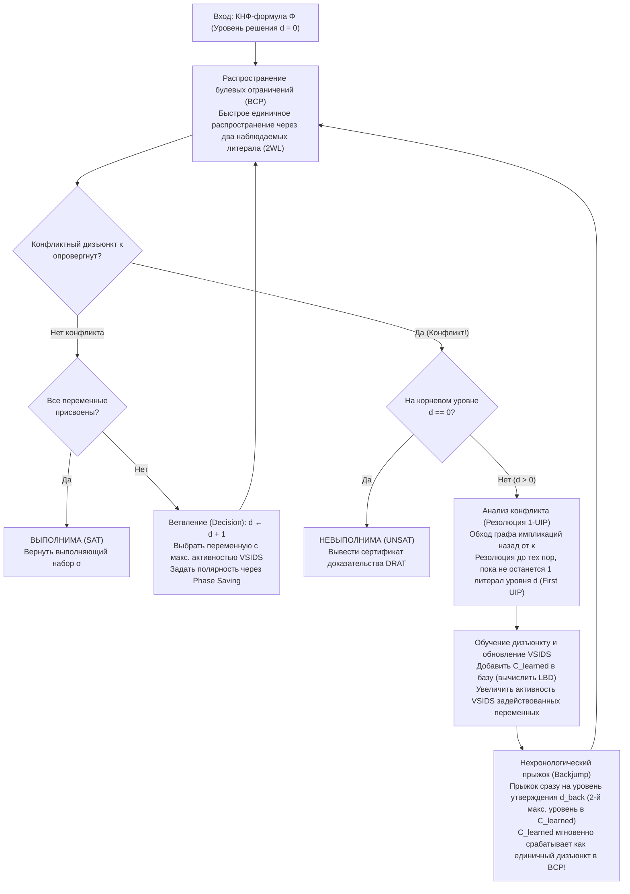
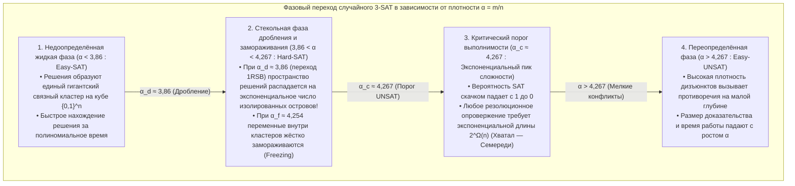

## 1. Тихая алгоритмическая революция в информатике

Откройте любой учебник по теоретической информатике, и вы увидите суровое предупреждение:
<strong>«Задача выполнимости булевых формул (Boolean Satisfiability Problem, SAT) является NP-полной. Поскольку её временная сложность в худшем случае растёт экспоненциально как $O(2^n)$ от числа переменных $n$, крупные экземпляры задачи практически неразрешимы (intractable)».</strong>

С точки зрения чистой комбинаторики этот вывод кажется неоспоримым. Формула всего лишь со $n = 100$ булевыми переменными допускает $2^{100} \approx 1,26 \times 10^{30}$ возможных наборов значений истинности. Даже если бы суперкомпьютер проверял по $10^{12}$ наборов в секунду с момента Большого взрыва (13,8 млрд лет назад), к сегодняшнему дню он исследовал бы менее $10^{-8}$ пространства поиска. И действительно, около 1990 года лучшие в мире SAT-солверы заходили в тупик на формулах из $100$ переменных и $400$ дизъюнктов (клауз).

Однако в XXI веке инженерная реальность опровергает эту интуицию миллионы раз в день. Современные промышленные SAT- и SMT-солверы — такие как <strong>MiniSat, Glucose, Lingeling, CaDiCaL, Kissat</strong> и <strong>Z3</strong> от Microsoft Research — при формальной верификации микропроцессоров, оптимизации компиляторов и разрешении зависимостей пакетов буднично решают гигантские формулы, содержащие <strong>$10\,000\,000$ ($10^7$) переменных и $50\,000\,000$ ($5 \times 10^7$) дизъюнктов, всего за несколько секунд</strong>.

Когда Дональд Кнут (Donald E. Knuth) в 2015 году опубликовал том 4B (раздел 7.2.2.2) «Искусства программирования» (*TAOCP*), он посвятил SAT-солверам более 300 страниц, назвав прорыв конца 1990-х — начала 2000-х годов <strong>одной из величайших алгоритмических революций в истории компьютерных наук</strong>. Если раньше сведение задачи к SAT означало приговор о её практической неразрешимости, то сегодня трансляция комбинаторной задачи в SAT — это главный инженерный способ мгновенно решить её с помощью универсального решателя.

---

## 2. Конъюнктивная нормальная форма (КНФ), преобразование Цейтина и теорема Кука — Левина (1971)

### 2.1 Конъюнктивная нормальная форма (КНФ) и линейное кодирование Цейтина

На вход SAT-солверу подаётся пропозициональная формула $\Phi$ над $n$ булевыми переменными $V = \{x_1, \dots, x_n\}$ со значениями в $\{0, 1\}$. Переменная $x_v$ или её отрицание $\neg x_v$ называется <strong>литералом</strong> $\ell$; дизъюнкция (логическое ИЛИ, $\lor$) литералов образует <strong>дизъюнкт (клаузу / Clause)</strong> $C_i = \bigvee_{j=1}^{k_i} \ell_{i,j}$; а конъюнкция (логическое И, $\land$) $m$ дизъюнктов образует формулу в <strong>конъюнктивной нормальной форме (КНФ / CNF)</strong>:

$$\Phi(x_1, \dots, x_n) = \bigwedge_{i=1}^m C_i = \bigwedge_{i=1}^m \left(\bigvee_{j=1}^{k_i} \ell_{i,j}\right)$$

При наивном раскрытии скобок по закону дистрибутивности $A \lor (B \land C) \equiv (A \lor B) \land (A \lor C)$ размер произвольной логической схемы в КНФ взрывается экспоненциально. В 1968 году советский математик <strong>Григорий Самуилович Цейтин</strong> предложил <strong>преобразование Цейтина (Tseitin Transformation)</strong>: для выхода каждого логического вентиля $g$ вводится новая <strong>вспомогательная переменная</strong> $y_g$, а локальная эквивалентность $y_g \leftrightarrow \text{gate}(a, b)$ записывается всего 3–4 дизъюнктами. Например, вентиль И $y_g \leftrightarrow (a \land b)$ кодируется тремя дизъюнктами:

$$\left(\neg y_g \lor a\right) \;\land\; \left(\neg y_g \lor b\right) \;\land\; \left(y_g \lor \neg a \lor \neg b\right)$$

Благодаря преобразованию Цейтина любая булева схема из $|G|$ вентилей за строго <strong>линейное время и линейную память $O(|G|)$</strong> переводится в <strong>равновыполнимую (equisatisfiable)</strong> 3-КНФ формулу.

### 2.2 Теорема Кука — Левина и пропасть сложности между 2-SAT и 3-SAT

В 1971 году <strong>Стивен Кук</strong> и <strong>Леонид Левин</strong> независимо доказали <strong>теорему Кука — Левина</strong>: любая задача распознавания из класса $\text{NP}$ сводится за полиномиальное время к SAT путём кодирования пространственно-временной таблицы вычислений недетерминированной машины Тьюринга за $p(n)$ шагов (состояний $S_{t,q}$, положения головки $H_{t,i}$ и символов на ленте $T_{t,i,\sigma}$) в виде КНФ-формулы.

Между $k = 2$ и $k = 3$ литералами в каждом дизъюнкте (<strong>$k$-SAT</strong>) лежит пропасть:
- <strong>2-SAT решается за линейное время $O(n + m)$</strong>: бинарный дизъюнкт $(\ell_1 \lor \ell_2)$ эквивалентен двум направленным импликациям $(\neg \ell_1 \Rightarrow \ell_2) \land (\neg \ell_2 \Rightarrow \ell_1)$. В <strong>графе импликаций</strong> над $2n$ литералами алгоритм Тарьяна находит <strong>компоненты сильной связности (SCC)</strong> за время $O(n+m)$: формула выполнима тогда и только тогда, когда ни одна переменная $x_v$ не лежит в одной компоненте сильной связности со своим отрицанием $\neg x_v$.
- <strong>3-SAT является NP-полной</strong>: тернарный дизъюнкт $(\ell_1 \lor \ell_2 \lor \ell_3)$ эквивалентен $(\neg \ell_1 \land \neg \ell_2) \Rightarrow \ell_3$ — гиперребру, требующему одновременной истинности двух посылок. Согласно <strong>гипотезе экспоненциального времени (ETH)</strong>, для 3-SAT не существует субэкспоненциального алгоритма $2^{o(n)}$ в худшем случае.

---

## 3. Классический алгоритм DPLL (1962) и трагедия хронологического возврата

Алгоритм <strong>DPLL</strong> (Davis, Putnam, Logemann, Loveland, 1962) сочетает поиск в глубину с <strong>единичным распространением (Unit Propagation / Boolean Constraint Propagation, BCP)</strong>:

> <strong>Единичное распространение (BCP)</strong>:
> Если при текущем частичном присваивании все литералы дизъюнкта $C = (\ell_1 \lor \dots \lor \ell_{k-1} \lor \ell_k)$, кроме $\ell_k$, приняли значение `False` ($0$), а $\ell_k$ ещё не присвоен, то $C$ называется <strong>единичным дизъюнктом (Unit Clause)</strong>. Солвер немедленно принудительно полагает $\ell_k = \text{True}$ ($1$), запуская цепную реакцию домино до насыщения или до обращения всех литералов некоторого дизъюнкта в `False` (<strong>Конфликт</strong>).

<strong>Почему DPLL не мог преодолеть барьер в 100 переменных?</strong>
Из-за <strong>хронологического бэктрекинга (Chronological Backtracking)</strong>. Если на <strong>уровне решения $d = 1$</strong> выбрано $x_1 = 0$, затем на уровнях $d = 2 \dots 49$ сделаны 48 независимых присваиваний переменным $x_2, \dots, x_{49}$, а на <strong>уровне $d = 50$</strong> присвоено $x_{50} = 1$, что немедленно вызывает конфликт исключительно из-за $x_1 = 0$ и $x_{50}$ в дизъюнктах $(x_1 \lor \neg x_{50} \lor \pm x_{51})$ и $(x_1 \lor x_{50} \lor \pm x_{52})$, то DPLL слепо откатывается лишь на один шаг к уровню $d = 49$, инвертирует ни в чём не повинную переменную $x_{49}$ и повторяет одно и то же фиаско во всех <strong>$2^{48} \approx 2,81 \times 10^{14}$ бесполезных поддеревьях</strong> (<strong>пробуксовка / thrashing</strong>)!

---

## 4. Революция CDCL: граф импликаций, резолюция 1-UIP и нехронологический прыжок

Предложенная в <strong>GRASP</strong> (Marques-Silva & Sakallah, 1996) и доведённая до совершенства в <strong>Chaff</strong> (Moskewicz et al., 2001) архитектура <strong>CDCL (Conflict-Driven Clause Learning — обучение дизъюнктам, управляемое конфликтами)</strong> заменила слепой откат анализом первопричин конфликта.



### 4.1 Граф импликаций, булева резолюция и первая уникальная точка импликации (1-UIP)

Каждый присвоенный литерал $\ell@d$ хранит свой уровень решения $d$ и <strong>дизъюнкт-причину (Antecedent / Reason Clause)</strong> $\text{reason}(\ell)$. При опровержении дизъюнкта $\kappa$ CDCL инициализирует $C \leftarrow \kappa$ и движется назад по стеку присваиваний (Trail) текущего уровня $d_{\text{curr}}$, последовательно применяя <strong>правило булевой резолюции</strong>:

$$\frac{(A \lor x) \qquad (\neg x \lor B)}{(A \lor B)} = \text{Res}(C_1, C_2, x)$$

Вершина $u@d_{\text{curr}}$ графа импликаций называется <strong>уникальной точкой импликации (UIP)</strong>, если *любой* ориентированный путь от вершины решения $\ell_{\text{dec}}@d_{\text{curr}}$ к вершине конфликта $\Lambda$ проходит через $u$ (доминатор). Ближайшая к конфликту точка UIP называется <strong>первой UIP (First UIP / 1-UIP)</strong>.
Алгебраически обратная резолюция достигает 1-UIP в тот самый момент, когда в рабочем дизъюнкте $C$ остаётся <strong>ровно один литерал текущего уровня решения $d_{\text{curr}}$</strong>!

При $x_1 = 0@1, x_2 = 0@2, x_3 = 1@3$, решении $x_4 = 1@5$ и дизъюнктах $\omega_1 = (x_1 \lor \neg x_4 \lor x_5)$, $\omega_2 = (\neg x_4 \lor \neg x_5 \lor x_6)$, $\omega_3 = (x_2 \lor \neg x_6 \lor x_7)$, $\omega_4 = (\neg x_3 \lor \neg x_6 \lor x_8)$, ведущих к конфликту $\kappa = (\neg x_7 \lor \neg x_8)$, два шага резолюции $\kappa$ с $\omega_4$ (по $x_8$) и с $\omega_3$ (по $x_7$) сразу дают <strong>обученный дизъюнкт 1-UIP</strong>:

$$C_{\text{learned}} = \left(x_2@2 \lor \neg x_3@3 \lor \neg x_6@5\right)$$

### 4.2 Нехронологический прыжок назад (Backjumping) и уровень утверждения

Поскольку уровни в $C_{\text{learned}}$ равны $\{5, 3, 2\}$, солвер прыгает сразу на <strong>второй по величине уровень решения (уровень утверждения) $d_{\text{back}} = 3$</strong>! На уровне $3$ литералы $x_2@2$ и $\neg x_3@3$ остаются ложными, а $\neg x_6$ становится свободным, благодаря чему $C_{\text{learned}}$ мгновенно становится <strong>утверждающим единичным дизъюнктом</strong> и принудительно устанавливает $\neg x_6 = 1@3$ ($x_6 = 0@3$) через BCP!

---

## 5. Инженерные чудеса: два наблюдаемых литерала (2WL), VSIDS и LBD

1. <strong>Два наблюдаемых литерала (Two-Watched Literals, 2WL, Chaff 2001)</strong>:
   Пока в дизъюнкте есть хотя бы два неопровергнутых литерала, он не может стать ни единичным, ни конфликтным. Поэтому солвер следит <strong>только за двумя литералами $w_1, w_2$ в каждом дизъюнкте</strong>. Самое главное: при <strong>прыжке назад (Backjump)</strong> отмена присваиваний автоматически сохраняет инвариант 2WL, поэтому <strong>откат требует ровно ноль обновлений указателей ($O(1)$)</strong>!
2. <strong>VSIDS (Variable State Independent Decaying Sum) и Phase Saving</strong>:
   Переменные, участвующие в резолюции конфликта, получают прибавку $+\Delta$ к активности, а $\Delta \leftarrow \Delta / \gamma$ ($\gamma = 0.95$) растёт после каждого конфликта, фокусируя ветвление на текущем «горячем» узле.
3. <strong>LBD (Literal Block Distance / «Клеевые дизъюнкты») и быстрые рестарты</strong>:
   Солвер Glucose (Audemard & Simon, 2009) определяет $\text{LBD}(C)$ как число различных уровней решений в дизъюнкте $C$. Дизъюнкты с $\text{LBD} = 2$ (<strong>Glue Clauses</strong>) связывают текущую точку UIP напрямую с одним прошлым блоком решений и сохраняются в базе навсегда.

| Архитектурное измерение | Классический DPLL (1962) | CDCL 1-го поколения (GRASP / Chaff 2001) | Современный CDCL (Glucose / CaDiCaL / Kissat) |
| :--- | :--- | :--- | :--- |
| <strong>Структура данных BCP</strong> | Полные счётчики литералов в каждом дизъюнкте | <strong>Два наблюдаемых литерала (2WL)</strong> ($O(1)$ при откате без обновления указателей) | <strong>2WL со встроенными блокирующими литералами</strong> + быстрые списки бинарных клауз |
| <strong>Возврат при конфликте</strong> | <strong>Хронологический откат</strong> ($d-1$, пробуксовка $2^k$) | <strong>Нехронологический прыжок</strong> на уровень утверждения $d_{\text{back}}$ | Гибрид Backjumping и локального хронологического отката (2018) |
| <strong>Обучение клаузам</strong> | Отсутствует (дерево без памяти) | <strong>Резолюция 1-UIP</strong> + рекурсивная минимизация | 1-UIP + самопоглощение на лету, вивификация и элиминация переменных (BVE) |
| <strong>Эвристика ветвления</strong> | Статический порядок / DLIS | <strong>VSIDS</strong> (экспоненциально затухающая конфликтная активность) | Чередование <strong>EVSIDS + VMTF</strong> + Phase Saving и локальный поиск WalkSAT |
| <strong>Управление базой</strong> | Н/Д | Удаление по длине и активности | <strong>3-уровневая база по LBD</strong> (клеевые клаузы $\text{LBD} \le 2$ хранятся вечно) |

---

## 6. Полная реализация ядра CDCL-солвера на Python

Ниже приведена полная автономная реализация CDCL-солвера на Python с поддержкой BCP, графа импликаций, <strong>резолюции 1-UIP</strong>, <strong>нехронологического прыжка</strong> и <strong>VSIDS</strong>:

```python
from typing import List, Dict, Optional, Set, Tuple

class CDCLSolver:
    '''Minimal Conflict-Driven Clause Learning (CDCL) SAT Solver with 1-UIP & VSIDS.'''
    def __init__(self, num_vars: int, clauses: List[List[int]]):
        self.num_vars = num_vars
        self.clauses: List[List[int]] = [list(set(c)) for c in clauses]
        self.assigns: Dict[int, bool] = {}
        self.trail: List[int] = []
        self.level: Dict[int, int] = {}
        self.reason: Dict[int, Optional[List[int]]] = {}
        self.decision_level: int = 0
        self.activity: Dict[int, float] = {v: 0.0 for v in range(1, num_vars + 1)}
        for c in self.clauses:
            for lit in c:
                self.activity[abs(lit)] += 1.0
        self.var_inc: float = 1.0
        self.var_decay: float = 0.95

    def value_lit(self, lit: int) -> Optional[bool]:
        var = abs(lit)
        if var not in self.assigns:
            return None
        return self.assigns[var] if lit > 0 else not self.assigns[var]

    def assign(self, lit: int, level: int, reason: Optional[List[int]]) -> None:
        var = abs(lit)
        self.assigns[var] = (lit > 0)
        self.trail.append(lit)
        self.level[var] = level
        self.reason[var] = reason

    def bcp(self) -> Optional[List[int]]:
        changed = True
        while changed:
            changed = False
            for clause in self.clauses:
                unassigned_lit = None
                num_unassigned = 0
                satisfied = False
                for lit in clause:
                    val = self.value_lit(lit)
                    if val is True:
                        satisfied = True
                        break
                    elif val is None:
                        num_unassigned += 1
                        unassigned_lit = lit
                if satisfied:
                    continue
                if num_unassigned == 0:
                    return clause
                if num_unassigned == 1 and unassigned_lit is not None:
                    self.assign(unassigned_lit, self.decision_level, clause)
                    changed = True
        return None

    def analyze_conflict(self, conflict_clause: List[int]) -> Tuple[List[int], int]:
        learned: Set[int] = set(conflict_clause)
        def count_curr_level(cset: Set[int]) -> int:
            return sum(1 for lit in cset if self.level[abs(lit)] == self.decision_level)

        idx = len(self.trail) - 1
        while count_curr_level(learned) > 1:
            while True:
                pivot_lit = self.trail[idx]
                idx -= 1
                if -pivot_lit in learned and self.level[abs(pivot_lit)] == self.decision_level:
                    break
            pivot_var = abs(pivot_lit)
            antecedent = self.reason[pivot_var]
            assert antecedent is not None
            self.activity[pivot_var] += self.var_inc
            learned.remove(-pivot_lit)
            for lit in antecedent:
                if lit != pivot_lit:
                    learned.add(lit)

        learned_clause = list(learned)
        for lit in learned_clause:
            self.activity[abs(lit)] += self.var_inc
        self.var_inc /= self.var_decay
        levels = sorted({self.level[abs(lit)] for lit in learned_clause}, reverse=True)
        backjump_level = levels[1] if len(levels) > 1 else 0
        return learned_clause, backjump_level

    def backtrack(self, target_level: int) -> None:
        while self.trail and self.level[abs(self.trail[-1])] > target_level:
            lit = self.trail.pop()
            var = abs(lit)
            del self.assigns[var], self.level[var], self.reason[var]
        self.decision_level = target_level

    def solve(self) -> Tuple[bool, Optional[Dict[int, bool]]]:
        if self.bcp() is not None:
            return False, None
        while True:
            unassigned = [v for v in range(1, self.num_vars + 1) if v not in self.assigns]
            if not unassigned:
                return True, dict(self.assigns)
            branch_var = max(unassigned, key=lambda v: self.activity[v])
            self.decision_level += 1
            self.assign(branch_var, self.decision_level, reason=None)
            while True:
                conflict = self.bcp()
                if conflict is None:
                    break
                if self.decision_level == 0:
                    return False, None
                learned_clause, backjump_level = self.analyze_conflict(conflict)
                self.clauses.append(learned_clause)
                self.backtrack(backjump_level)
```

---

## 7. Статистическая физика и фазовый переход в случайном $k$-SAT ($\alpha_c \approx 4,267$)

Для случайной формулы 3-SAT с $n$ переменными и $m = \alpha n$ дизъюнктами (<strong>плотность ограничений $\alpha = m / n$</strong>) метод первого момента даёт математическое ожидание числа решений $\mathbb{E}[Z]$:

$$\mathbb{E}[Z] = 2^n \left(1 - 2^{-3}\right)^m = \left(2 \cdot \left(\frac{7}{8}\right)^\alpha\right)^n \implies \alpha_{\text{annealed}} = \frac{\ln 2}{\ln(8/7)} \approx 5,191$$

Используя <strong>метод полости (Cavity Method)</strong> и <strong>одношаговое нарушение репличной симметрии (1RSB)</strong> из теории спиновых стёкол, Мезар, Паризи и Дзеккина (2002) нашли точный критический порог фазового перехода случайного 3-SAT:

$$\alpha_c \approx 4,267$$



В точке $\alpha_c \approx 4,267$ случайный гиперграф является <strong>экспандером</strong> без узких мест, поэтому любое резолюционное опровержение имеет экспоненциальную длину $2^{\Omega(n)}$ (Chvátal & Szemerédi, 1988). Напротив, <strong>реальные промышленные задачи обладают модульной структурой сообществ (Community Structure) и малыми множествами «чёрного хода» (Backdoor Sets)</strong> (Ansótegui et al. 2012; Williams, Gomes, Selman 2003), что позволяет CDCL расщеплять формулы с 10 миллионами переменных за секунды.

---

## 8. Триумфы в реальном мире и 200-терабайтное математическое доказательство

1. <strong>Компьютерная математика и 200-ТБ доказательство DRAT (Heule, Kullmann, Marek 2016)</strong>: С помощью метода <strong>Cube-and-Conquer</strong> на 800 ядрах было доказано, что булева проблема пифагоровых троек ($a^2 + b^2 = c^2$) выполнима при <strong>$N = 7824$ (SAT)</strong>, но <strong>невыполнима при $N = 7825$ (UNSAT)</strong>, с генерацией формально верифицированного <strong>DRAT-сертификата объёмом 200 Терабайт</strong>, а также решены число Шура $S(5) = 160$ (2018) и гипотеза Келлера в размерности 7 (2020).
2. <strong>Формальная верификация микросхем EDA (CEC и BMC)</strong>: схемы <strong>Miter</strong> (XOR между RTL-спецификацией и вентильной реализацией) проверяются SAT-солверами перед выпуском каждого современного процессора.
3. <strong>Пакетные менеджеры (Debian apt, Rust Cargo, Dart PubGrub, uv)</strong> и <strong>SMT-солверы ($\text{DPLL}(T)$: Z3 и cvc5)</strong>: объединяя ядро CDCL с решателями теорий первого порядка, они лежат в основе символьного исполнения и облачного движка безопасности <strong>AWS Zelkova</strong>.
