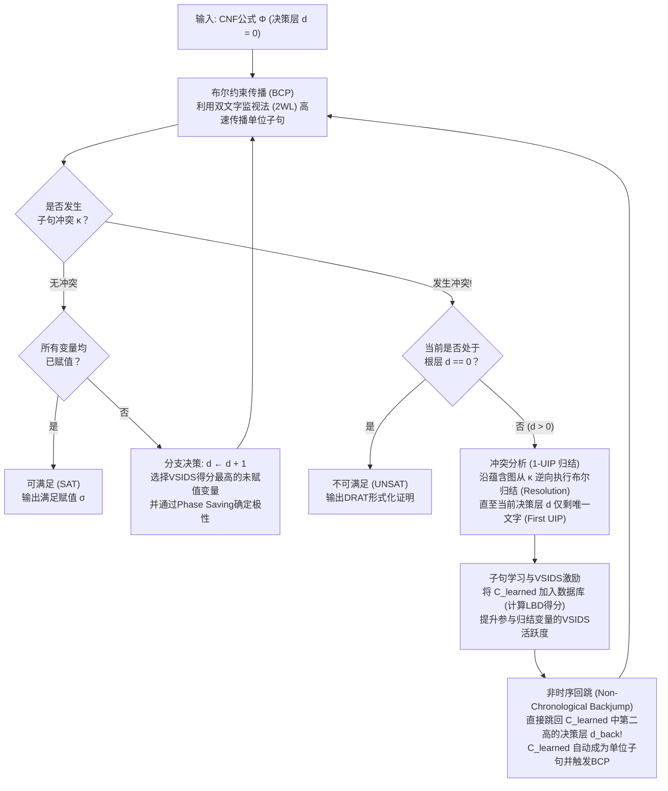
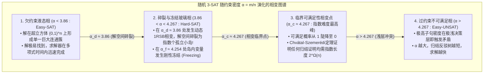

## 1. 计算机科学中“寂静的算法革命”

几乎所有计算理论教材都会给出一个令人敬畏的结论：<strong>布尔可满足性问题（Boolean Satisfiability Problem, SAT）是NP完全（NP-Complete）问题；由于其最坏情况下的时间复杂度随变量数 $n$ 呈指数级增长 $O(2^n)$，大规模实例在计算上是不可行的（Intractable）。</strong>

从纯组合数学来看，当变量数 $n = 100$ 时，真值指派的组合总数高达 $2^{100} \approx 1.26 \times 10^{30}$。即使一台超级计算机从宇宙大爆炸（138亿年前）起每秒检查 $10^{12}$ 个赋值，至今也无法遍历 $10^{-8}$ 的搜索空间。事实上，在1990年左右，面对仅有100个变量、400个子句的布尔公式，当时最先进的SAT求解器也会陷入停滞。

然而在21世纪的今天，工业界每天都在上演颠覆直觉的奇迹。<strong>MiniSat、Glucose、Lingeling、CaDiCaL、Kissat</strong> 以及微软研究院的 <strong>Z3</strong> 等现代工业级SAT/SMT求解器，在芯片逻辑等价性验证、编译器优化和Linux/Rust包依赖解析中，日常处理包含 <strong>$10,000,000$（$10^7$）个变量和 $50,000,000$（$5 \times 10^7$）个子句</strong> 的庞大逻辑公式，并在<strong>短短几秒到几分钟内</strong>给出严格的数学解答。

高德纳（Donald E. Knuth）在2015年出版的巨著《计算机程序设计艺术》（TAOCP）第4B卷（第7.2.2.2节）中，用整整300多页的篇幅专门论述SAT求解器，将20世纪90年代末至21世纪初的这一突破誉为<strong>“现代计算机科学最伟大的算法革命之一”</strong>。过去，将一个问题归约为SAT意味着证明它“无法高效求解”；而今天，将一个组合难题编译为SAT公式，则意味着你可以直接调用人类最强大的通用推理引擎瞬间将其攻克。

---

## 2. 合取范式（CNF）、Tseitin变换与库克-列文定理（1971）

### 2.1 合取范式（CNF）与Tseitin线性编码

SAT求解器的标准输入是定义在 $n$ 个布尔变量 $x_1, \dots, x_n \in \{0, 1\}$ 上的<strong>合取范式（Conjunctive Normal Form, CNF）</strong>公式 $\Phi$。变量 $x_v$ 或其否定 $\neg x_v$ 统称为<strong>文字（Literal）</strong> $\ell$；若干文字的析取（逻辑或 $\lor$）构成一个<strong>子句（Clause）</strong> $C_i = \bigvee_{j=1}^{k_i} \ell_{i,j}$；而 $m$ 个子句的合取（逻辑与 $\land$）则构成CNF公式：

$$\Phi(x_1, \dots, x_n) = \bigwedge_{i=1}^m C_i = \bigwedge_{i=1}^m \left(\bigvee_{j=1}^{k_i} \ell_{i,j}\right)$$

如果直接用分配律 $A \lor (B \land C) \equiv (A \lor B) \land (A \lor C)$ 将任意数字电路展开为CNF，公式规模会发生指数级爆炸。1968年，格里戈里·蔡廷（Grigori Tseitin）提出了<strong>Tseitin变换（Tseitin Transformation）</strong>：为电路中每个逻辑门 $g$ 引入一个<strong>辅助变量（Auxiliary Variable）</strong> $y_g$，仅用3到4个局部子句编码等价关系 $y_g \leftrightarrow \text{gate}(a, b)$。例如，与门 $y_g \leftrightarrow (a \land b)$ 等价于三个子句：

$$\left(\neg y_g \lor a\right) \;\land\; \left(\neg y_g \lor b\right) \;\land\; \left(y_g \lor \neg a \lor \neg b\right)$$

通过Tseitin变换，任何包含 $|G|$ 个逻辑门的复杂布尔电路都能在严格的<strong>线性时间与线性空间 $O(|G|)$</strong> 内转化为<strong>等可满足（Equisatisfiable）</strong>的3-CNF公式。

### 2.2 库克-列文定理与 2-SAT vs. 3-SAT 的复杂度断崖

1971年，斯蒂芬·库克（Stephen Cook）与列昂尼德·列文（Leonid Levin）独立证明了<strong>库克-列文定理（Cook-Levin Theorem）</strong>：任何属于复杂度类 $\text{NP}$ 的判定问题（即由非确定性图灵机在多项式时间 $p(n)$ 内可判定的问题），都可以通过编码图灵机在 $p(n)$ 步内的状态 $S_{t,q}$、读写头位置 $H_{t,i}$ 和纸带符号 $T_{t,i,\sigma}$，在多项式时间内归约为一个CNF公式的可满足性问题。因此，<strong>SAT是人类历史上第一个被证明为NP完全的问题</strong>。

当每个子句最多包含 $k$ 个文字时，称为 <strong>$k$-SAT</strong>。在 $k=2$ 与 $k=3$ 之间存在着惊人的复杂度断崖：
- <strong>2-SAT 属于线性时间 $O(n+m)$</strong>：因为二元子句 $(\ell_1 \lor \ell_2)$ 完全等价于两条确定性的有向蕴含边 $(\neg \ell_1 \Rightarrow \ell_2) \land (\neg \ell_2 \Rightarrow \ell_1)$。在由 $2n$ 个文字构成的<strong>蕴含图（Implication Graph）</strong>上，利用Tarjan强连通分量（SCC）算法，只需检验是否存在某个变量 $x_v$ 与其否定 $\neg x_v$ 处于同一个强连通分量中，即可在 $O(n+m)$ 时间内求解。
- <strong>3-SAT 是NP完全问题</strong>：三元子句 $(\ell_1 \lor \ell_2 \lor \ell_3)$ 等价于 $(\neg \ell_1 \land \neg \ell_2) \Rightarrow \ell_3$，这是一个需要两个前提同时成立的超图有向边（Hyperedge），一旦单靠蕴含无法推进，就必须进行分支搜索。在指数时间假设（ETH）下，3-SAT不存在亚指数时间 $2^{o(n)}$ 的最坏情况算法。

---

## 3. 古典DPLL算法（1962）与“时序回溯”的致命缺陷

1962年，Martin Davis、George Logemann 和 Donald Loveland（以及 Hilary Putnam）提出了基于深度优先搜索的 <strong>DPLL算法</strong>，其核心推理引擎是<strong>布尔约束传播（Boolean Constraint Propagation, BCP）</strong>，又称<strong>单位传播（Unit Propagation）</strong>：

> <strong>单位传播（Unit Propagation / BCP）</strong>：
> 如果在当前部分赋值下，某个子句 $C = (\ell_1 \lor \ell_2 \lor \dots \lor \ell_k)$ 中除 $\ell_k$ 外的 $k-1$ 个文字均已赋值为 `False`（$0$），而 $\ell_k$ 尚未赋值，则称 $C$ 为<strong>单位子句（Unit Clause）</strong>。为使 $C$ 为真，必须立即强制赋值 $\ell_k = \text{True}$（$1$），并像多米诺骨牌一样触发后续的连锁单位传播，直到不再产生新的单位子句或某个子句的所有文字均变为 `False`（发生<strong>冲突 Conflict</strong>）。

<strong>为什么古典DPLL无法突破百余个变量的瓶颈？</strong>
因为DPLL采用的是机械的<strong>时序回溯（Chronological Backtracking）</strong>。假设求解器在<strong>决策层（Decision Level） $d=1$</strong> 令 $x_1 = 0$，随后在 $d = 2, 3, \dots, 49$ 层对48个与 $x_1$ 毫无关系的独立变量 $x_2, \dots, x_{49}$ 进行了赋值，最后在 <strong>$d = 50$ 层</strong>令 $x_{50} = 1$，而公式中恰好包含以下四个仅与 $x_1, x_{50}, x_{51}, x_{52}$ 相关的子句：

$$C_{101} = (x_1 \lor \neg x_{50} \lor x_{51}), \quad C_{102} = (x_1 \lor \neg x_{50} \lor \neg x_{51}), \quad C_{103} = (x_1 \lor x_{50} \lor x_{52}), \quad C_{104} = (x_1 \lor x_{50} \lor \neg x_{52})$$

当 $x_1 = 0$ 时，无论 $x_{50} = 1$ 还是 $x_{50} = 0$，都会立即通过BCP引发冲突！然而，盲目的时序回溯并不知道冲突的罪魁祸首远在第1层的 $x_1 = 0$，它只会退回到第49层翻转无辜的 $x_{49}$，然后在 $x_2, \dots, x_{49}$ 构成的 <strong>$2^{48} \approx 2.81 \times 10^{14}$ 棵完全无关的子树</strong>中，将同一个冲突重复经历281万亿次！这种灾难性的现象被称为<strong>颠簸（Thrashing）</strong>。

---

## 4. 现代革命：CDCL（冲突驱动子句学习）、第一UIP与非时序回跳

1996年，João Marques-Silva 与 Karem Sakallah 在求解器 <strong>GRASP</strong> 中提出了<strong>冲突驱动子句学习（Conflict-Driven Clause Learning, CDCL）</strong>；2001年，普林斯顿大学的 Matthew Moskewicz 等人在 <strong>Chaff（zChaff）</strong> 中将其与惰性数据结构结合，彻底改写了SAT求解的历史。



### 4.1 蕴含图、布尔归结（Resolution）与第一唯一蕴含点（1-UIP）

在CDCL中，每个被赋值的文字 $\ell@d$ 都会记录其所在的<strong>决策层 $d$</strong> 以及迫使其赋值的<strong>原因子句（Antecedent / Reason Clause）</strong> $\text{reason}(\ell)$（决策变量的原因记为 $\text{NIL}$）。当冲突子句 $\kappa$ 的所有文字均为假时，求解器从 $C \leftarrow \kappa$ 出发，沿着当前决策层 $d_{\text{curr}}$ 的赋值轨迹（Trail）从后往前逆向回溯，利用罗宾逊的<strong>布尔归结规则（Boolean Resolution）</strong>不断消去中间传播变量 $x$：

$$\frac{(A \lor x) \qquad (\neg x \lor B)}{(A \lor B)} = \text{Res}(C_1, C_2, x)$$

归结何时停止？在蕴含图中，如果从当前层决策文字 $\ell_{\text{dec}}@d_{\text{curr}}$ 到冲突节点 $\Lambda$ 的<strong>所有有向路径都必须经过某个节点 $u@d_{\text{curr}}$</strong>，则称 $u$ 为<strong>唯一蕴含点（Unique Implication Point, UIP）</strong>。距离冲突最近的一个UIP称为<strong>第一唯一蕴含点（First UIP / 1-UIP）</strong>。
在代数归结过程中，<strong>当工作子句 $C$ 中属于当前决策层 $d_{\text{curr}}$ 的文字恰好只剩下1个时</strong>，这唯一剩下的文字（的否定）就是 <strong>1-UIP</strong>！

例如，设早期决策层已赋值 $x_1 = 0@1, x_2 = 0@2, x_3 = 1@3$。在第 $d=5$ 层决策 $x_4 = 1@5$ 后，子句 $\omega_1 = (x_1 \lor \neg x_4 \lor x_5)$、$\omega_2 = (\neg x_4 \lor \neg x_5 \lor x_6)$、$\omega_3 = (x_2 \lor \neg x_6 \lor x_7)$、$\omega_4 = (\neg x_3 \lor \neg x_6 \lor x_8)$ 依次传播得到 $x_5=1@5, x_6=1@5, x_7=1@5, x_8=1@5$，并使冲突子句 $\kappa = (\neg x_7 \lor \neg x_8)$ 为假：
1. 初始冲突子句：$C^{(0)} = (\neg x_7@5 \lor \neg x_8@5)$（包含2个第5层文字）。
2. 与 $\text{reason}(x_8) = \omega_4$ 归结消去 $x_8$：$C^{(1)} = (\neg x_3@3 \lor \neg x_6@5 \lor \neg x_7@5)$（仍含2个第5层文字）。
3. 与 $\text{reason}(x_7) = \omega_3$ 归结消去 $x_7$：$C^{(2)} = (x_2@2 \lor \neg x_3@3 \lor \neg x_6@5)$。此时属于第5层的文字<strong>只剩下 $\neg x_6@5$ 一个</strong>！

于是归结立即停止，生成 <strong>1-UIP学习子句</strong>：

$$C_{\text{learned}} = \left(x_2@2 \lor \neg x_3@3 \lor \neg x_6@5\right)$$

### 4.2 非时序回跳（Non-Chronological Backjumping）与断言层

将学习子句按决策层从高到低排列为 $C_{\text{learned}} = (\ell_{\text{UIP}}@d_{\text{curr}} \lor \ell_{i_1}@d_1 \lor \dots \lor \ell_{i_r}@d_r)$（其中 $d_{\text{curr}} > d_1 \ge \dots \ge d_r$）。CDCL不会退回到 $d_{\text{curr}} - 1$，而是直接跨越中间所有无关层级，一步跳回到学习子句中<strong>第二高的决策层（断言层 Assertion Level）$d_{\text{back}} = d_1$</strong>（在上例中为 $d_{\text{back}} = 3$）！
一旦回到第 $d_1 = 3$ 层，$x_2@2$ 与 $\neg x_3@3$ 依然为假，而 $\neg x_6$ 恢复为未赋值状态，因此学习子句 $C_{\text{learned}}$ 在第3层<strong>立即变成一个单位子句（Asserting Clause）</strong>，直接通过BCP强制推导 $\neg x_6 = 1@3$（即 $x_6 = 0@3$）！

---

## 5. 工程奇迹：双文字监视法（2WL）、VSIDS与LBD胶水子句

1. <strong>Chaff的双文字监视法（Two-Watched Literals, 2WL, 2001）</strong>：
   SAT求解器约 $90\%$ 的运行时间消耗在BCP上。2WL利用了一个绝妙的不变式：<strong>只要一个长度 $\ge 2$ 的子句中至少还有2个文字未被赋值为 `False`（即处于未赋值或 `True` 状态），该子句就绝对不可能变成单位子句或冲突子句！</strong>
   因此，求解器在每个子句中<strong>仅仅监视2个非假文字 $w_1, w_2$</strong>。只要被赋值为假的文字不是 $w_1$ 或 $w_2$，求解器甚至连看都不会看这个子句一眼；当 $w_1$ 变为假时，只需在子句剩余位置寻找另一个非假文字 $\ell'$ 替换监视即可。<strong>最神奇的是回溯（Backjump）之时</strong>：撤销变量赋值只会把 `False`/`True` 变回未赋值，原本非假的 $w_1, w_2$ 依然非假，因此<strong>回溯时指针更新开销严格为零（$O(1)$）</strong>！
2. <strong>VSIDS（Variable State Independent Decaying Sum）与极性保存（Phase Saving）</strong>：
   每次冲突分析时，参与1-UIP归结的变量活跃度得分增加 $\Delta$，随后步长按衰减因子 $\gamma = 0.95$ 放大（$\Delta \leftarrow \Delta / \gamma$）。这种指数移动平均机制如激光般将分支焦点锁定在当前引发冲突的核心瓶颈变量上。配合 <strong>Phase Saving</strong>（记忆变量上一次被擦除前的真值极性），回跳后能瞬间重建已解子模块的局部满足解。
3. <strong>LBD（Literal Block Distance，胶水子句）与快速重启（Restarts）</strong>：
   Glucose求解器（Audemard & Simon, 2009）定义了学习子句 $C$ 中包含的<strong>不同决策层级的数量 $\text{LBD}(C)$</strong>。其中 $\text{LBD}(C) = 2$ 的子句被称为<strong>胶水子句（Glue Clauses）</strong>，它们将当前层的UIP与过去唯一一个决策层直接绑定，具有极高的传播价值，会被永久保留在核心数据库中；而高LBD的冗余学习子句则被定期清理。

| 核心维度 | 古典 DPLL (1962) | 第一代 CDCL (GRASP / Chaff 2001) | 现代顶尖 CDCL (Glucose / CaDiCaL / Kissat) |
| :--- | :--- | :--- | :--- |
| <strong>BCP数据结构</strong> | 全子句文字计数器（赋值与回溯均需遍历更新） | <strong>双文字监视法 (2WL)</strong>（回溯更新开销为 $0$，即 $O(1)$） | <strong>带内联阻塞文字 (Blocking Literal) 的2WL</strong> + 二元子句快速通道 |
| <strong>冲突恢复机制</strong> | <strong>时序回溯</strong>（仅退回 $d-1$ 层，导致 $2^k$ 颠簸） | <strong>非时序回跳</strong>至1-UIP学习子句的第二高决策层 $d_{\text{back}}$ | 非时序回跳与局部时序回溯混合机制 (Nadel & Ryvchin 2018) |
| <strong>子句学习机制</strong> | 无（无记忆搜索树） | <strong>第一唯一蕴含点 (1-UIP) 归结</strong> + 递归子句极小化 | 1-UIP + 动态自包含化简、子句活化 (Vivification) 与有界变量消去 |
| <strong>分支启发式</strong> | 静态顺序 / DLIS（最大出现次数文字） | <strong>VSIDS</strong>（冲突驱动的指数衰减活跃度得分） | <strong>EVSIDS + VMTF</strong> 双模式切换 + Phase Saving / WalkSAT局部搜索融合 |
| <strong>子句库管理</strong> | 无学习子句 | 基于子句长度与活跃度定期删除 | <strong>基于LBD（胶水层级）的三级分层管理</strong>（$\text{LBD}\le 2$ 永久保留） |

---

## 6. Python实现：完整的CDCL求解器核心引擎

下面给出包含单位传播（BCP）、蕴含图追踪、<strong>1-UIP归结学习</strong>、<strong>非时序回跳</strong>以及<strong>VSIDS分支启发式</strong>的完整Python实现：

```python
from typing import List, Dict, Optional, Set, Tuple

class CDCLSolver:
    '''Minimal Conflict-Driven Clause Learning (CDCL) SAT Solver with 1-UIP & VSIDS.'''
    def __init__(self, num_vars: int, clauses: List[List[int]]):
        self.num_vars = num_vars
        self.clauses: List[List[int]] = [list(set(c)) for c in clauses]
        self.assigns: Dict[int, bool] = {}
        self.trail: List[int] = []
        self.level: Dict[int, int] = {}
        self.reason: Dict[int, Optional[List[int]]] = {}
        self.decision_level: int = 0
        self.activity: Dict[int, float] = {v: 0.0 for v in range(1, num_vars + 1)}
        for c in self.clauses:
            for lit in c:
                self.activity[abs(lit)] += 1.0
        self.var_inc: float = 1.0
        self.var_decay: float = 0.95

    def value_lit(self, lit: int) -> Optional[bool]:
        var = abs(lit)
        if var not in self.assigns:
            return None
        return self.assigns[var] if lit > 0 else not self.assigns[var]

    def assign(self, lit: int, level: int, reason: Optional[List[int]]) -> None:
        var = abs(lit)
        self.assigns[var] = (lit > 0)
        self.trail.append(lit)
        self.level[var] = level
        self.reason[var] = reason

    def bcp(self) -> Optional[List[int]]:
        changed = True
        while changed:
            changed = False
            for clause in self.clauses:
                unassigned_lit = None
                num_unassigned = 0
                satisfied = False
                for lit in clause:
                    val = self.value_lit(lit)
                    if val is True:
                        satisfied = True
                        break
                    elif val is None:
                        num_unassigned += 1
                        unassigned_lit = lit
                if satisfied:
                    continue
                if num_unassigned == 0:
                    return clause
                if num_unassigned == 1 and unassigned_lit is not None:
                    self.assign(unassigned_lit, self.decision_level, clause)
                    changed = True
        return None

    def analyze_conflict(self, conflict_clause: List[int]) -> Tuple[List[int], int]:
        learned: Set[int] = set(conflict_clause)
        def count_curr_level(cset: Set[int]) -> int:
            return sum(1 for lit in cset if self.level[abs(lit)] == self.decision_level)

        idx = len(self.trail) - 1
        while count_curr_level(learned) > 1:
            while True:
                pivot_lit = self.trail[idx]
                idx -= 1
                if -pivot_lit in learned and self.level[abs(pivot_lit)] == self.decision_level:
                    break
            pivot_var = abs(pivot_lit)
            antecedent = self.reason[pivot_var]
            assert antecedent is not None
            self.activity[pivot_var] += self.var_inc
            learned.remove(-pivot_lit)
            for lit in antecedent:
                if lit != pivot_lit:
                    learned.add(lit)

        learned_clause = list(learned)
        for lit in learned_clause:
            self.activity[abs(lit)] += self.var_inc
        self.var_inc /= self.var_decay
        levels = sorted({self.level[abs(lit)] for lit in learned_clause}, reverse=True)
        backjump_level = levels[1] if len(levels) > 1 else 0
        return learned_clause, backjump_level

    def backtrack(self, target_level: int) -> None:
        while self.trail and self.level[abs(self.trail[-1])] > target_level:
            lit = self.trail.pop()
            var = abs(lit)
            del self.assigns[var], self.level[var], self.reason[var]
        self.decision_level = target_level

    def solve(self) -> Tuple[bool, Optional[Dict[int, bool]]]:
        if self.bcp() is not None:
            return False, None
        while True:
            unassigned = [v for v in range(1, self.num_vars + 1) if v not in self.assigns]
            if not unassigned:
                return True, dict(self.assigns)
            branch_var = max(unassigned, key=lambda v: self.activity[v])
            self.decision_level += 1
            self.assign(branch_var, self.decision_level, reason=None)
            while True:
                conflict = self.bcp()
                if conflict is None:
                    break
                if self.decision_level == 0:
                    return False, None
                learned_clause, backjump_level = self.analyze_conflict(conflict)
                self.clauses.append(learned_clause)
                self.backtrack(backjump_level)
```

---

## 7. 随机 $k$-SAT 的相变现象（$\alpha_c \approx 4.267$）与工业实例的结构秘密

为什么现代CDCL求解器能在几秒内解开 $10^7$ 变量的工业电路，却在仅有 $700$ 个变量的均匀随机3-SAT面前败下阵来？
设随机3-SAT公式包含 $n$ 个变量和 $m = \alpha n$ 个随机子句，定义<strong>子句-变量密度比 $\alpha = m / n$</strong>。由一阶矩方法（First Moment Method），满足解个数 $Z$ 的数学期望为：

$$\mathbb{E}[Z] = 2^n \left(1 - 2^{-3}\right)^m = \left(2 \cdot \left(\frac{7}{8}\right)^\alpha\right)^n \implies \alpha_{\text{annealed}} = \frac{\ln 2}{\ln(8/7)} \approx 5.191$$

统计物理学家 Mézard、Parisi（2021年诺贝尔物理学奖得主）与 Zecchina（2002）利用自旋玻璃理论中的<strong>腔方法（Cavity Method）与一步副本对称性破缺（1RSB）</strong>证明，随机3-SAT的真实临界相变点位于：

$$\alpha_c \approx 4.267$$



在 $\alpha_c \approx 4.267$ 附近，随机超图具有<strong>扩展图（Expander Graph）</strong>性质，没有任何局部瓶颈，导致任何基于归结（Resolution）的证明都必须包含宽度为 $\Omega(n)$ 的长子句，证明长度呈指数爆炸 $2^{\Omega(n)}$（Chvátal & Szemerédi, 1988）。
相反，<strong>人类设计的工业级问题绝非均匀随机噪声</strong>！它们具有：
1. <strong>高模块度与社区结构（Community Structure, Ansótegui et al. 2012）</strong>：芯片和软件由内部紧密耦合、模块间仅通过极少数接口变量通信的子系统构成。CDCL的1-UIP归结能精准捕获这些接口变量作为支配点（Dominators），生成 $\text{LBD}=2$ 的短胶水子句将问题分解。
2. <strong>极小的后门集合（Backdoor Sets, Williams, Gomes & Selman 2003）</strong>：在数百万变量的工业公式中，往往存在仅由几十到几百个关键控制变量组成的<strong>强后门集合 $B$（$|B| \ll n$）</strong>；一旦VSIDS优先将 $B$ 赋值，剩余99.99%的变量便瞬间退化为2-SAT或Horn-SAT，仅靠BCP多米诺骨牌即可在一秒内全部确定！

---

## 8. 改变世界的工业应用与200TB的数学证明

1. <strong>计算数学与200TB的布尔毕达哥拉斯三元组证明（Heule, Kullmann, Marek 2016）</strong>：
   能否将正整数集合 $\{1, 2, \dots, N\}$ 染成红蓝两色，使得任意满足 $a^2 + b^2 = c^2$ 的毕达哥拉斯三元组 $(a, b, c)$ 都不同色？Heule等人结合Lookahead拆解与CDCL（<strong>Cube-and-Conquer</strong>），在800核超算上证明了 <strong>$N = 7824$ 可满足（SAT），而 $N = 7825$ 不可满足（UNSAT）</strong>，并生成了人类历史上最大的、经形式化验证器逐比特检验的 <strong>200 TB DRAT形式化数学证明</strong>！随后他们又用同样方法攻克了五号舒尔数 $S(5) = 160$（2018）和困扰数学界90年的7维凯勒猜想（Keller's Conjecture, 2020）。
2. <strong>芯片EDA形式化验证（等价性检验CEC与有界模型检验BMC）</strong>：
   自1994年Intel奔腾FDIV浮点除法漏洞（损失4.75亿美元）以来，所有现代CPU/GPU在流片前都必须将RTL设计与门级网表构建为异或比较电路（<strong>Miter Circuit</strong>），经Tseitin变换输入SAT求解器验证全输入空间下的严格等价性。
3. <strong>现代包管理器（Debian apt / Rust Cargo / Dart PubGrub / uv）</strong>：
   软件包的版本依赖与互斥约束本质上就是CNF公式。现代包管理器广泛采用的 <strong>PubGrub</strong> 算法直接在版本区间上运行CDCL与1-UIP冲突分析，并将归结证明树逆向翻译为人类可读的依赖冲突错误报告。
4. <strong>从SAT到SMT求解器（$\text{DPLL}(T)$：Z3 与 cvc5）</strong>：
   通过将CDCL布尔核心与一阶理论求解器（线性算术Simplex、未解释函数EUF、位向量BV、数组理论）耦合，SMT求解器支撑着程序符号执行、Rust形式化验证工具（Kani、Verus）以及AWS云安全引擎 <strong>Zelkova</strong> 每天数十亿次的权限策略数学验证。
