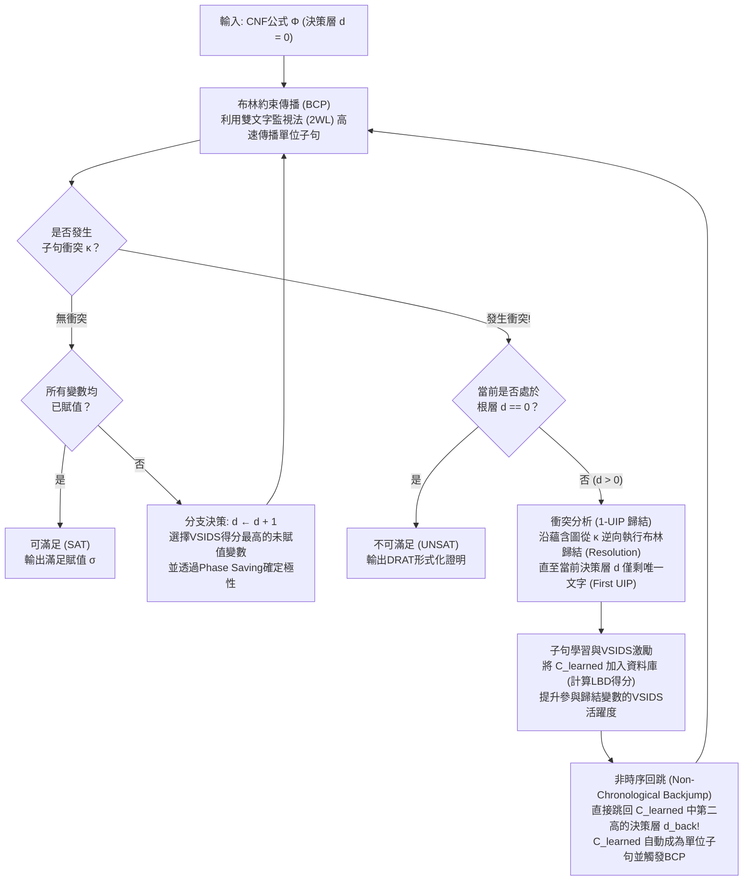
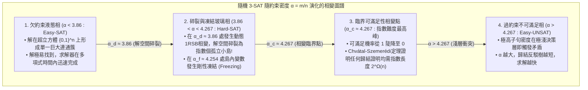

## 1. 電腦科學中「寂靜的演算法革命」

幾乎所有計算理論教科書都會給出一個令人敬畏的結論：<strong>布林可滿足性問題（Boolean Satisfiability Problem, SAT）是NP完全（NP-Complete）問題；由於其最壞情況下的時間複雜度隨變數數量 $n$ 呈指數級成長 $O(2^n)$，大規模實例在計算上是不可行的（Intractable）。</strong>

從純組合數學來看，當變數數量 $n = 100$ 時，真值指派的組合總數高達 $2^{100} \approx 1.26 \times 10^{30}$。即使一台超級電腦從宇宙大爆炸（138億年前）起每秒檢查 $10^{12}$ 個賦值，至今也無法走訪 $10^{-8}$ 的搜尋空間。事實上，在1990年左右，面對僅有100個變數、400個子句的布林公式，當時最先進的SAT求解器也會陷入停滯。

然而在21世紀的今天，工業界每天都在上演顛覆直覺的奇蹟。<strong>MiniSat、Glucose、Lingeling、CaDiCaL、Kissat</strong> 以及微軟研究院的 <strong>Z3</strong> 等現代工業級SAT/SMT求解器，在晶片邏輯等價性驗證、編譯器最佳化和Linux/Rust套件相依性解析中，日常處理包含 <strong>$10,000,000$（$10^7$）個變數和 $50,000,000$（$5 \times 10^7$）個子句</strong> 的龐大邏輯公式，並在<strong>短短幾秒到幾分鐘內</strong>給出嚴格的數學解答。

高德納（Donald E. Knuth）在2015年出版的巨著《電腦程式設計藝術》（TAOCP）第4B卷（第7.2.2.2節）中，用整整300多頁的篇幅專門論述SAT求解器，將1990年代末至2000年代初的這一突破譽為<strong>「現代電腦科學最偉大的演算法革命之一」</strong>。過去，將一個問題歸約為SAT意味著證明它「無法高效求解」；而今天，將一個組合難題編譯為SAT公式，則意味著你可以直接調用人類最強大的通用推理引擎瞬間將其攻克。

---

## 2. 合取範式（CNF）、Tseitin變換與庫克-列文定理（1971）

### 2.1 合取範式（CNF）與Tseitin線性編碼

SAT求解器的標準輸入是定義在 $n$ 個布林變數 $x_1, \dots, x_n \in \{0, 1\}$ 上的<strong>合取範式（Conjunctive Normal Form, CNF）</strong>公式 $\Phi$。變數 $x_v$ 或其否定 $\neg x_v$ 統稱為<strong>文字（Literal）</strong> $\ell$；若干文字的析取（邏輯或 $\lor$）構成一個<strong>子句（Clause）</strong> $C_i = \bigvee_{j=1}^{k_i} \ell_{i,j}$；而 $m$ 個子句的合取（邏輯與 $\land$）則構成CNF公式：

$$\Phi(x_1, \dots, x_n) = \bigwedge_{i=1}^m C_i = \bigwedge_{i=1}^m \left(\bigvee_{j=1}^{k_i} \ell_{i,j}\right)$$

如果直接用分配律 $A \lor (B \land C) \equiv (A \lor B) \land (A \lor C)$ 將任意數位電路展開為CNF，公式規模會發生指數級爆炸。1968年，格里戈里·蔡廷（Grigori Tseitin）提出了<strong>Tseitin變換（Tseitin Transformation）</strong>：為電路中每個邏輯閘 $g$ 引入一個<strong>輔助變數（Auxiliary Variable）</strong> $y_g$，僅用3到4個局部子句編碼等價關係 $y_g \leftrightarrow \text{gate}(a, b)$。例如，AND閘 $y_g \leftrightarrow (a \land b)$ 等價於三個子句：

$$\left(\neg y_g \lor a\right) \;\land\; \left(\neg y_g \lor b\right) \;\land\; \left(y_g \lor \neg a \lor \neg b\right)$$

透過Tseitin變換，任何包含 $|G|$ 個邏輯閘的複雜布林電路都能在嚴格的<strong>線性時間與線性空間 $O(|G|)$</strong> 內轉化為<strong>等可滿足（Equisatisfiable）</strong>的3-CNF公式。

### 2.2 庫克-列文定理與 2-SAT vs. 3-SAT 的複雜度斷崖

1971年，史蒂芬·庫克（Stephen Cook）與列昂尼德·列文（Leonid Levin）獨立證明了<strong>庫克-列文定理（Cook-Levin Theorem）</strong>：任何屬於複雜度類 $\text{NP}$ 的判定問題（即由非確定性圖靈機在多項式時間 $p(n)$ 內可判定的問題），都可以透過編碼圖靈機在 $p(n)$ 步內的狀態 $S_{t,q}$、讀寫頭位置 $H_{t,i}$ 和紙帶符號 $T_{t,i,\sigma}$，在多項式時間內歸約為一個CNF公式的可滿足性問題。因此，<strong>SAT是人類歷史上第一個被證明為NP完全的問題</strong>。

當每個子句最多包含 $k$ 個文字時，稱為 <strong>$k$-SAT</strong>。在 $k=2$ 與 $k=3$ 之間存在著驚人的複雜度斷崖：
- <strong>2-SAT 屬於線性時間 $O(n+m)$</strong>：因為二元子句 $(\ell_1 \lor \ell_2)$ 完全等價於兩條確定性的有向蘊含邊 $(\neg \ell_1 \Rightarrow \ell_2) \land (\neg \ell_2 \Rightarrow \ell_1)$。在由 $2n$ 個文字構成的<strong>蘊含圖（Implication Graph）</strong>上，利用Tarjan強連通分量（SCC）演算法，只需檢驗是否存在某個變數 $x_v$ 與其否定 $\neg x_v$ 處於同一個強連通分量中，即可在 $O(n+m)$ 時間內求解。
- <strong>3-SAT 是NP完全問題</strong>：三元子句 $(\ell_1 \lor \ell_2 \lor \ell_3)$ 等價於 $(\neg \ell_1 \land \neg \ell_2) \Rightarrow \ell_3$，這是一個需要兩個前提同時成立的超圖有向邊（Hyperedge），一旦單靠蘊含無法推進，就必須進行分支搜尋。在指數時間假設（ETH）下，3-SAT不存在亞指數時間 $2^{o(n)}$ 的最壞情況演算法。

---

## 3. 古典DPLL演算法（1962）與「時序回溯」的致命缺陷

1962年，Martin Davis、George Logemann 和 Donald Loveland（以及 Hilary Putnam）提出了基於深度優先搜尋的 <strong>DPLL演算法</strong>，其核心推理引擎是<strong>布林約束傳播（Boolean Constraint Propagation, BCP）</strong>，又稱<strong>單位傳播（Unit Propagation）</strong>：

> <strong>單位傳播（Unit Propagation / BCP）</strong>：
> 如果在當前部分賦值下，某個子句 $C = (\ell_1 \lor \ell_2 \lor \dots \lor \ell_k)$ 中除 $\ell_k$ 外的 $k-1$ 個文字均已賦值為 `False`（$0$），而 $\ell_k$ 尚未賦值，則稱 $C$ 為<strong>單位子句（Unit Clause）</strong>。為使 $C$ 為真，必須立即強制賦值 $\ell_k = \text{True}$（$1$），並像骨牌效應一樣觸發後續的連鎖單位傳播，直到不再產生新的單位子句或某個子句的所有文字均變為 `False`（發生<strong>衝突 Conflict</strong>）。

<strong>為什麼古典DPLL無法突破百餘個變數的瓶頸？</strong>
因為DPLL採用的是機械的<strong>時序回溯（Chronological Backtracking）</strong>。假設求解器在<strong>決策層（Decision Level） $d=1$</strong> 令 $x_1 = 0$，隨後在 $d = 2, 3, \dots, 49$ 層對48個與 $x_1$ 毫無關係的獨立變數 $x_2, \dots, x_{49}$ 進行了賦值，最後在 <strong>$d = 50$ 層</strong>令 $x_{50} = 1$，而公式中恰好包含以下四個僅與 $x_1, x_{50}, x_{51}, x_{52}$ 相關的子句：

$$C_{101} = (x_1 \lor \neg x_{50} \lor x_{51}), \quad C_{102} = (x_1 \lor \neg x_{50} \lor \neg x_{51}), \quad C_{103} = (x_1 \lor x_{50} \lor x_{52}), \quad C_{104} = (x_1 \lor x_{50} \lor \neg x_{52})$$

當 $x_1 = 0$ 時，無論 $x_{50} = 1$ 還是 $x_{50} = 0$，都會立即透過BCP引發衝突！然而，盲目的時序回溯並不知道衝突的罪魁禍首遠在第1層的 $x_1 = 0$，它只會退回到第49層翻轉無辜的 $x_{49}$，然後在 $x_2, \dots, x_{49}$ 構成的 <strong>$2^{48} \approx 2.81 \times 10^{14}$ 棵完全無關的子樹</strong>中，將同一個衝突重複經歷281兆次！這種災難性的現象被稱為<strong>顛簸（Thrashing）</strong>。

---

## 4. 現代革命：CDCL（衝突驅動子句學習）、第一UIP與非時序回跳

1996年，João Marques-Silva 與 Karem Sakallah 在求解器 <strong>GRASP</strong> 中提出了<strong>衝突驅動子句學習（Conflict-Driven Clause Learning, CDCL）</strong>；2001年，普林斯頓大學的 Matthew Moskewicz 等人在 <strong>Chaff（zChaff）</strong> 中將其與惰性資料結構結合，徹底改寫了SAT求解的歷史。



### 4.1 蘊含圖、布林歸結（Resolution）與第一唯一蘊含點（1-UIP）

在CDCL中，每個被賦值的文字 $\ell@d$ 都會記錄其所在的<strong>決策層 $d$</strong> 以及迫使其賦值的<strong>原因子句（Antecedent / Reason Clause）</strong> $\text{reason}(\ell)$（決策變數的原因記為 $\text{NIL}$）。當衝突子句 $\kappa$ 的所有文字均為假時，求解器從 $C \leftarrow \kappa$ 出發，沿著當前決策層 $d_{\text{curr}}$ 的賦值軌跡（Trail）從後往前逆向回溯，利用羅賓遜的<strong>布林歸結規則（Boolean Resolution）</strong>不斷消去中間傳播變數 $x$：

$$\frac{(A \lor x) \qquad (\neg x \lor B)}{(A \lor B)} = \text{Res}(C_1, C_2, x)$$

歸結何時停止？在蘊含圖中，如果從當前層決策文字 $\ell_{\text{dec}}@d_{\text{curr}}$ 到衝突節點 $\Lambda$ 的<strong>所有有向路徑都必須經過某個節點 $u@d_{\text{curr}}$</strong>，則稱 $u$ 為<strong>唯一蘊含點（Unique Implication Point, UIP）</strong>。距離衝突最近的一個UIP稱為<strong>第一唯一蘊含點（First UIP / 1-UIP）</strong>。
在代數歸結過程中，<strong>當工作子句 $C$ 中屬於當前決策層 $d_{\text{curr}}$ 的文字恰好只剩下1個時</strong>，這唯一剩下的文字（的否定）就是 <strong>1-UIP</strong>！

例如，設早期決策層已賦值 $x_1 = 0@1, x_2 = 0@2, x_3 = 1@3$。在第 $d=5$ 層決策 $x_4 = 1@5$ 後，子句 $\omega_1 = (x_1 \lor \neg x_4 \lor x_5)$、$\omega_2 = (\neg x_4 \lor \neg x_5 \lor x_6)$、$\omega_3 = (x_2 \lor \neg x_6 \lor x_7)$、$\omega_4 = (\neg x_3 \lor \neg x_6 \lor x_8)$ 依次傳播得到 $x_5=1@5, x_6=1@5, x_7=1@5, x_8=1@5$，並使衝突子句 $\kappa = (\neg x_7 \lor \neg x_8)$ 為假：
1. 初始衝突子句：$C^{(0)} = (\neg x_7@5 \lor \neg x_8@5)$（包含2個第5層文字）。
2. 與 $\text{reason}(x_8) = \omega_4$ 歸結消去 $x_8$：$C^{(1)} = (\neg x_3@3 \lor \neg x_6@5 \lor \neg x_7@5)$（仍含2個第5層文字）。
3. 與 $\text{reason}(x_7) = \omega_3$ 歸結消去 $x_7$：$C^{(2)} = (x_2@2 \lor \neg x_3@3 \lor \neg x_6@5)$。此時屬於第5層的文字<strong>只剩下 $\neg x_6@5$ 一個</strong>！

於是歸結立即停止，生成 <strong>1-UIP學習子句</strong>：

$$C_{\text{learned}} = \left(x_2@2 \lor \neg x_3@3 \lor \neg x_6@5\right)$$

### 4.2 非時序回跳（Non-Chronological Backjumping）與斷言層

將學習子句按決策層從高到低排列為 $C_{\text{learned}} = (\ell_{\text{UIP}}@d_{\text{curr}} \lor \ell_{i_1}@d_1 \lor \dots \lor \ell_{i_r}@d_r)$（其中 $d_{\text{curr}} > d_1 \ge \dots \ge d_r$）。CDCL不會退回到 $d_{\text{curr}} - 1$，而是直接跨越中間所有無關層級，一步跳回到學習子句中<strong>第二高的決策層（斷言層 Assertion Level）$d_{\text{back}} = d_1$</strong>（在上例中為 $d_{\text{back}} = 3$）！
一旦回到第 $d_1 = 3$ 層，$x_2@2$ 與 $\neg x_3@3$ 依然為假，而 $\neg x_6$ 恢復為未賦值狀態，因此學習子句 $C_{\text{learned}}$ 在第3層<strong>立即變成一個單位子句（Asserting Clause）</strong>，直接透過BCP強制推導 $\neg x_6 = 1@3$（即 $x_6 = 0@3$）！

---

## 5. 工程奇蹟：雙文字監視法（2WL）、VSIDS與LBD膠水子句

1. <strong>Chaff的雙文字監視法（Two-Watched Literals, 2WL, 2001）</strong>：
   SAT求解器約 $90\%$ 的執行時間消耗在BCP上。2WL利用了一個絕妙的不變式：<strong>只要一個長度 $\ge 2$ 的子句中至少還有2個文字未被賦值為 `False`（即處於未賦值或 `True` 狀態），該子句就絕對不可能變成單位子句或衝突子句！</strong>
   因此，求解器在每個子句中<strong>僅僅監視2個非假文字 $w_1, w_2$</strong>。只要被賦值為假的文字不是 $w_1$ 或 $w_2$，求解器甚至連看都不會看這個子句一眼；當 $w_1$ 變為假時，只需在子句剩餘位置尋找另一個非假文字 $\ell'$ 替換監視即可。<strong>最神奇的是回溯（Backjump）之時</strong>：撤銷變數賦值只會把 `False`/`True` 變回未賦值，原本非假的 $w_1, w_2$ 依然非假，因此<strong>回溯時指標更新開銷嚴格為零（$O(1)$）</strong>！
2. <strong>VSIDS（Variable State Independent Decaying Sum）與極性保存（Phase Saving）</strong>：
   每次衝突分析時，參與1-UIP歸結的變數活躍度得分增加 $\Delta$，隨後步長按衰減因子 $\gamma = 0.95$ 放大（$\Delta \leftarrow \Delta / \gamma$）。這種指數移動平均機制如雷射般將分支焦點鎖定在當前引發衝突的核心瓶頸變數上。配合 <strong>Phase Saving</strong>（記憶變數上一次被擦除前的真值極性），回跳後能瞬間重建已解子模組的局部滿足解。
3. <strong>LBD（Literal Block Distance，膠水子句）與快速重啟（Restarts）</strong>：
   Glucose求解器（Audemard & Simon, 2009）定義了學習子句 $C$ 中包含的<strong>不同決策層級的數量 $\text{LBD}(C)$</strong>。其中 $\text{LBD}(C) = 2$ 的子句被稱為<strong>膠水子句（Glue Clauses）</strong>，它們將當前層的UIP與過去唯一一個決策層直接綁定，具有極高的傳播價值，會被永久保留在核心資料庫中；而高LBD的冗餘學習子句則被定期清理。

| 核心維度 | 古典 DPLL (1962) | 第一代 CDCL (GRASP / Chaff 2001) | 現代頂尖 CDCL (Glucose / CaDiCaL / Kissat) |
| :--- | :--- | :--- | :--- |
| <strong>BCP資料結構</strong> | 全子句文字計數器（賦值與回溯均需走訪更新） | <strong>雙文字監視法 (2WL)</strong>（回溯更新開銷為 $0$，即 $O(1)$） | <strong>帶內聯阻塞文字 (Blocking Literal) 的2WL</strong> + 二元子句快速通道 |
| <strong>衝突恢復機制</strong> | <strong>時序回溯</strong>（僅退回 $d-1$ 層，導致 $2^k$ 顛簸） | <strong>非時序回跳</strong>至1-UIP學習子句的第二高決策層 $d_{\text{back}}$ | 非時序回跳與局部時序回溯混合機制 (Nadel & Ryvchin 2018) |
| <strong>子句學習機制</strong> | 無（無記憶搜尋樹） | <strong>第一唯一蘊含點 (1-UIP) 歸結</strong> + 遞迴子句極小化 | 1-UIP + 動態自包含化簡、子句活化 (Vivification) 與有界變數消去 |
| <strong>分支啟發式</strong> | 靜態順序 / DLIS（最大出現次數文字） | <strong>VSIDS</strong>（衝突驅動的指數衰減活躍度得分） | <strong>EVSIDS + VMTF</strong> 雙模式切換 + Phase Saving / WalkSAT局部搜尋融合 |
| <strong>子句庫管理</strong> | 無學習子句 | 基於子句長度與活躍度定期刪除 | <strong>基於LBD（膠水層級）的三級分層管理</strong>（$\text{LBD}\le 2$ 永久保留） |

---

## 6. Python實作：完整的CDCL求解器核心引擎

下面給出包含單位傳播（BCP）、蘊含圖追蹤、<strong>1-UIP歸結學習</strong>、<strong>非時序回跳</strong>以及<strong>VSIDS分支啟發式</strong>的完整Python實作：

```python
from typing import List, Dict, Optional, Set, Tuple

class CDCLSolver:
    '''Minimal Conflict-Driven Clause Learning (CDCL) SAT Solver with 1-UIP & VSIDS.'''
    def __init__(self, num_vars: int, clauses: List[List[int]]):
        self.num_vars = num_vars
        self.clauses: List[List[int]] = [list(set(c)) for c in clauses]
        self.assigns: Dict[int, bool] = {}
        self.trail: List[int] = []
        self.level: Dict[int, int] = {}
        self.reason: Dict[int, Optional[List[int]]] = {}
        self.decision_level: int = 0
        self.activity: Dict[int, float] = {v: 0.0 for v in range(1, num_vars + 1)}
        for c in self.clauses:
            for lit in c:
                self.activity[abs(lit)] += 1.0
        self.var_inc: float = 1.0
        self.var_decay: float = 0.95

    def value_lit(self, lit: int) -> Optional[bool]:
        var = abs(lit)
        if var not in self.assigns:
            return None
        return self.assigns[var] if lit > 0 else not self.assigns[var]

    def assign(self, lit: int, level: int, reason: Optional[List[int]]) -> None:
        var = abs(lit)
        self.assigns[var] = (lit > 0)
        self.trail.append(lit)
        self.level[var] = level
        self.reason[var] = reason

    def bcp(self) -> Optional[List[int]]:
        changed = True
        while changed:
            changed = False
            for clause in self.clauses:
                unassigned_lit = None
                num_unassigned = 0
                satisfied = False
                for lit in clause:
                    val = self.value_lit(lit)
                    if val is True:
                        satisfied = True
                        break
                    elif val is None:
                        num_unassigned += 1
                        unassigned_lit = lit
                if satisfied:
                    continue
                if num_unassigned == 0:
                    return clause
                if num_unassigned == 1 and unassigned_lit is not None:
                    self.assign(unassigned_lit, self.decision_level, clause)
                    changed = True
        return None

    def analyze_conflict(self, conflict_clause: List[int]) -> Tuple[List[int], int]:
        learned: Set[int] = set(conflict_clause)
        def count_curr_level(cset: Set[int]) -> int:
            return sum(1 for lit in cset if self.level[abs(lit)] == self.decision_level)

        idx = len(self.trail) - 1
        while count_curr_level(learned) > 1:
            while True:
                pivot_lit = self.trail[idx]
                idx -= 1
                if -pivot_lit in learned and self.level[abs(pivot_lit)] == self.decision_level:
                    break
            pivot_var = abs(pivot_lit)
            antecedent = self.reason[pivot_var]
            assert antecedent is not None
            self.activity[pivot_var] += self.var_inc
            learned.remove(-pivot_lit)
            for lit in antecedent:
                if lit != pivot_lit:
                    learned.add(lit)

        learned_clause = list(learned)
        for lit in learned_clause:
            self.activity[abs(lit)] += self.var_inc
        self.var_inc /= self.var_decay
        levels = sorted({self.level[abs(lit)] for lit in learned_clause}, reverse=True)
        backjump_level = levels[1] if len(levels) > 1 else 0
        return learned_clause, backjump_level

    def backtrack(self, target_level: int) -> None:
        while self.trail and self.level[abs(self.trail[-1])] > target_level:
            lit = self.trail.pop()
            var = abs(lit)
            del self.assigns[var], self.level[var], self.reason[var]
        self.decision_level = target_level

    def solve(self) -> Tuple[bool, Optional[Dict[int, bool]]]:
        if self.bcp() is not None:
            return False, None
        while True:
            unassigned = [v for v in range(1, self.num_vars + 1) if v not in self.assigns]
            if not unassigned:
                return True, dict(self.assigns)
            branch_var = max(unassigned, key=lambda v: self.activity[v])
            self.decision_level += 1
            self.assign(branch_var, self.decision_level, reason=None)
            while True:
                conflict = self.bcp()
                if conflict is None:
                    break
                if self.decision_level == 0:
                    return False, None
                learned_clause, backjump_level = self.analyze_conflict(conflict)
                self.clauses.append(learned_clause)
                self.backtrack(backjump_level)
```

---

## 7. 隨機 $k$-SAT 的相變現象（$\alpha_c \approx 4.267$）與工業實例的結構秘密

為什麼現代CDCL求解器能在幾秒內解開 $10^7$ 變數的工業電路，卻在僅有 $700$ 個變數的均勻隨機3-SAT面前敗下陣來？
設隨機3-SAT公式包含 $n$ 個變數和 $m = \alpha n$ 個隨機子句，定義<strong>子句-變數密度比 $\alpha = m / n$</strong>。由一階矩方法（First Moment Method），滿足解個數 $Z$ 的數學期望為：

$$\mathbb{E}[Z] = 2^n \left(1 - 2^{-3}\right)^m = \left(2 \cdot \left(\frac{7}{8}\right)^\alpha\right)^n \implies \alpha_{\text{annealed}} = \frac{\ln 2}{\ln(8/7)} \approx 5.191$$

統計物理學家 Mézard、Parisi（2021年諾貝爾物理學獎得主）與 Zecchina（2002）利用自旋玻璃理論中的<strong>腔方法（Cavity Method）與一步副本對稱性破缺（1RSB）</strong>證明，隨機3-SAT的真實臨界相變點位於：

$$\alpha_c \approx 4.267$$



在 $\alpha_c \approx 4.267$ 附近，隨機超圖具有<strong>擴展圖（Expander Graph）</strong>性質，沒有任何局部瓶頸，導致任何基於歸結（Resolution）的證明都必須包含寬度為 $\Omega(n)$ 的長子句，證明長度呈指數爆炸 $2^{\Omega(n)}$（Chvátal & Szemerédi, 1988）。
相反，<strong>人類設計的工業級問題絕非均勻隨機雜訊</strong>！它們具有：
1. <strong>高模組度與社群結構（Community Structure, Ansótegui et al. 2012）</strong>：晶片和軟體由內部緊密耦合、模組間僅透過極少數介面變數通訊的子系統構成。CDCL的1-UIP歸結能精準捕獲這些介面變數作為支配點（Dominators），生成 $\text{LBD}=2$ 的短膠水子句將問題分解。
2. <strong>極小的後門集合（Backdoor Sets, Williams, Gomes & Selman 2003）</strong>：在數百萬變數的工業公式中，往往存在僅由幾十到幾百個關鍵控制變數組成的<strong>強後門集合 $B$（$|B| \ll n$）</strong>；一旦VSIDS優先將 $B$ 賦值，剩餘99.99%的變數便瞬間退化為2-SAT或Horn-SAT，僅靠BCP骨牌效應即可在一秒內全部確定！

---

## 8. 改變世界的工業應用與200TB的數學證明

1. <strong>計算數學與200TB的布林畢氏三元組證明（Heule, Kullmann, Marek 2016）</strong>：
   能否將正整數集合 $\{1, 2, \dots, N\}$ 染成紅藍兩色，使得任意滿足 $a^2 + b^2 = c^2$ 的畢氏三元組 $(a, b, c)$ 都不同色？Heule等人結合Lookahead拆解與CDCL（<strong>Cube-and-Conquer</strong>），在800核超算上證明了 <strong>$N = 7824$ 可滿足（SAT），而 $N = 7825$ 不可滿足（UNSAT）</strong>，並生成了人類歷史上最大的、經形式化驗證器逐位元檢驗的 <strong>200 TB DRAT形式化數學證明</strong>！隨後他們又用同樣方法攻克了五號舒爾數 $S(5) = 160$（2018）和困擾數學界90年的7維凱勒猜想（Keller's Conjecture, 2020）。
2. <strong>晶片EDA形式化驗證（等價性檢驗CEC與有界模型檢驗BMC）</strong>：
   自1994年Intel奔騰FDIV浮點除法漏洞（損失4.75億美元）以來，所有現代CPU/GPU在流片前都必須將RTL設計與閘級網表建構為互斥或比較電路（<strong>Miter Circuit</strong>），經Tseitin變換輸入SAT求解器驗證全輸入空間下的嚴格等價性。
3. <strong>現代套件管理器（Debian apt / Rust Cargo / Dart PubGrub / uv）</strong>：
   軟體套件的版本相依與互斥約束本質上就是CNF公式。現代套件管理器廣泛採用的 <strong>PubGrub</strong> 演算法直接在版本區間上執行CDCL與1-UIP衝突分析，並將歸結證明樹逆向翻譯為人類可讀的相依衝突錯誤報告。
4. <strong>從SAT到SMT求解器（$\text{DPLL}(T)$：Z3 與 cvc5）</strong>：
   透過將CDCL布林核心與一階理論求解器（線性算術Simplex、未解釋函數EUF、位元向量BV、陣列理論）耦合，SMT求解器支撐著程式符號執行、Rust形式化驗證工具（Kani、Verus）以及AWS雲端安全引擎 <strong>Zelkova</strong> 每天數十億次的權限策略數學驗證。
