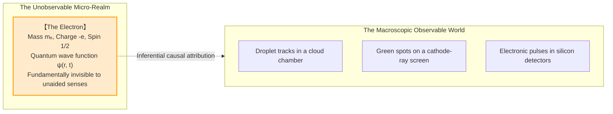
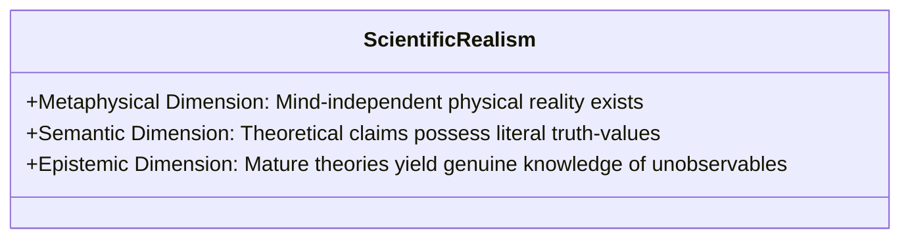
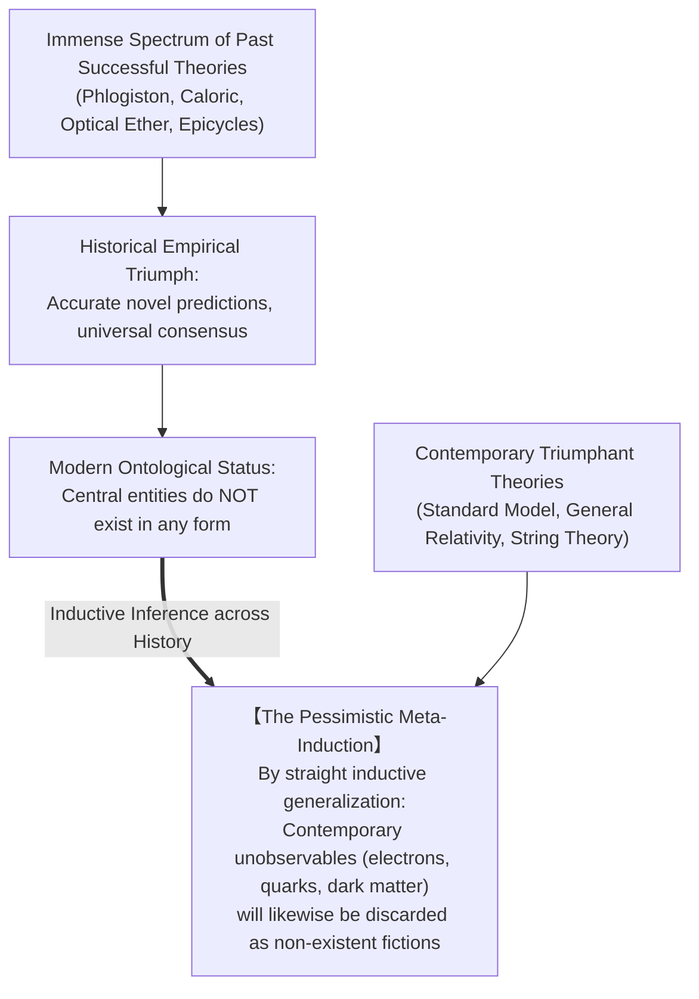
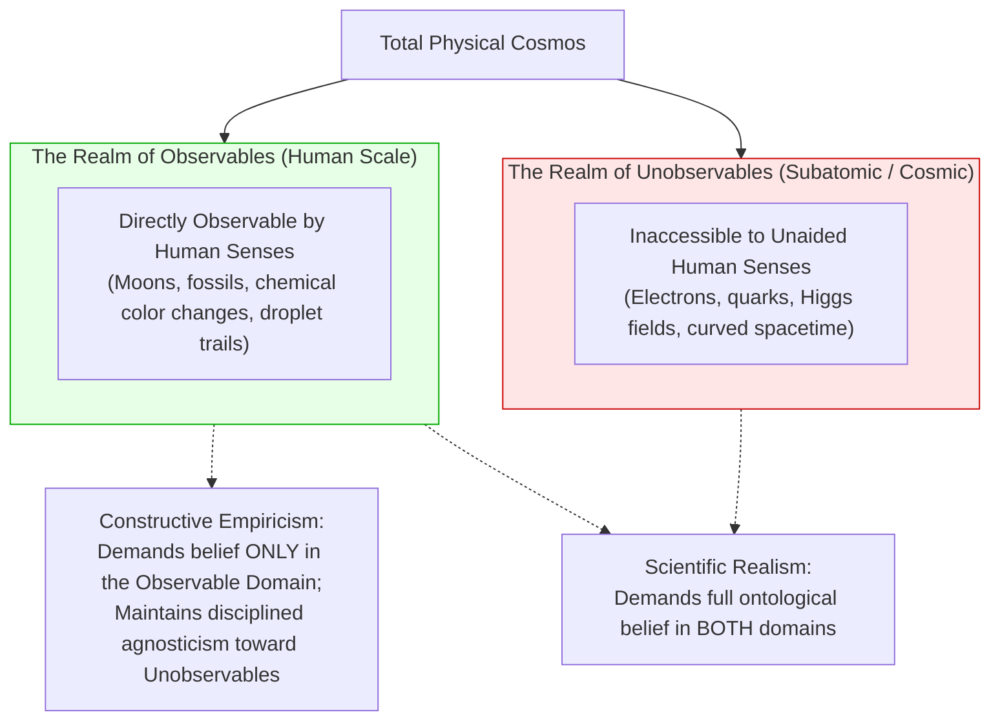
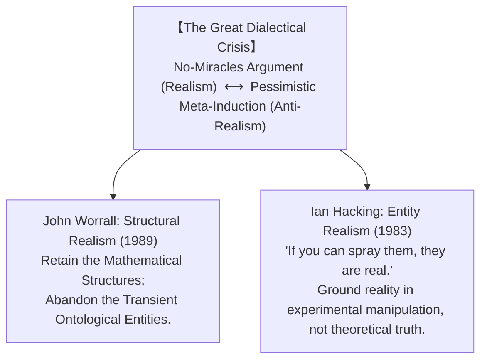
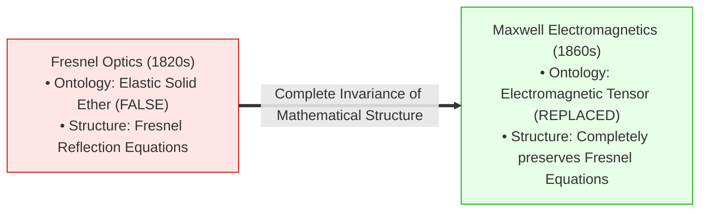

## Introduction: The Mystery of the Unseen Subatomic World

Look at any modern digital microchip powering a smartphone or supercomputer. Across a fingernail-sized wafer of silicon, tens of billions of nanoscale field-effect transistors switch states billions of times per second by manipulating the coordinated flow of <strong>electrons</strong>. According to the Standard Model of particle physics, the electron is a fundamental lepton of spin-$\frac{1}{2}$, electric charge $-e \approx -1.602 \times 10^{-19}\text{ C}$, and rest mass $m_e \approx 9.109 \times 10^{-31}\text{ kg}$.

Yet, let us pose the most haunting, foundational question in the philosophy of science:

> <strong>"Does the electron genuinely exist as an objective, mind-independent physical entity, in the exact same sense that tables, rocks, and apples exist?"</strong>

The startling historical reality is that <strong>no human being has ever directly observed an electron.</strong>

What human observers and instruments actually register are macroscopic causal traces: thin, vaporous condensation tracks in a supersaturated Wilson cloud chamber; fluorescent green pinpricks on a zinc sulfide phosphor screen; or discrete microvoltage deflections on an oscilloscope. Everything we know about the subatomic realm is mediated through complex theoretical chains of inferential reasoning.



Faced with this epistemic chasm between macro-observations and micro-entities, philosophy of science fractures into two warring camps:

1. <strong>Scientific Realism</strong>:
   Mature, empirically successful scientific theories provide an approximately true description of the objective world. The unobservable entities postulated by these theories—electrons, quarks, gravitational waves, DNA helices—literally exist. To claim otherwise is to reduce the astonishing predictive and technological triumph of modern science to an inexplicable cosmic miracle.
2. <strong>Anti-Realism / Instrumentalism</strong>:
   Science is not in the business of delivering metaphysical truth about unobservable reality. Theories are <strong>useful instruments (conceptual calculating tools and mathematical fictions)</strong> designed solely to systematize, categorize, and predict observable empirical phenomena. Just as Ptolemaic epicycles successfully predicted planetary motions for centuries without being physically real, predictive success provides zero guarantee of ontological truth.

This treatise conducts an exhaustive exploration of the century-long war between Scientific Realism and Anti-Realism. We analyze Hilary Putnam’s famous <strong>No-Miracles Argument (NMA)</strong> and Larry Laudan’s devastating <strong>Pessimistic Meta-Induction (PMI)</strong>; unpack the Quine-Duhem thesis of <strong>Underdetermination</strong>; explore Bas van Fraassen’s <strong>Constructive Empiricism</strong>; examine the contemporary mediator paradigms of John Worrall’s <strong>Structural Realism</strong> and Ian Hacking’s <strong>Entity Realism</strong>; and confront the dissolution of the classical concept of "particles" within modern Quantum Field Theory.

---

## 1. The Architecture of Scientific Realism and the "No-Miracles" Argument

### 1.1 The Tripartite Definition of Scientific Realism
Modern scientific realism is not a naive, dogmatic belief in textbook diagrams. Following the standard contemporary formulation (e.g., Psillos 1999, Chakravartty 2007), scientific realism consists of three interconnected commitments:



1. <strong>The Metaphysical Claim</strong>: The physical world exists independently of human cognitive structures, conceptual frameworks, linguistic practices, and observational verification.
2. <strong>The Semantic Claim</strong>: Theoretical assertions concerning unobservable entities possess literal truth-conditions. The term "electron" is not an instrumental shorthand or syntactic metaphor; it is a genuine referring term designating a mind-independent physical entity.
3. <strong>The Epistemic Claim</strong>: In mature, non-ad-hoc, predictive scientific disciplines, theories are approximately true. We possess justified, reliable epistemic grounds for believing in the existence of unobservable entities.

### 1.2 Hilary Putnam and the No-Miracles Argument (NMA)
The central, most celebrated pillar of the realist defense was formulated by philosopher Hilary Putnam in 1975:

> *"The positive argument for realism is that it is the only philosophy that doesn't make the success of science a <strong>miracle</strong>."*

The force of the argument rests on the sheer, staggering magnitude of scientific predictive success.
Consider <strong>Quantum Electrodynamics (QED)</strong>. The theoretical prediction for the anomalous magnetic dipole moment of the electron ($a_e$) matches experimental measurement with precision exceeding one part in a trillion ($10^{-12}$):

$$a_e^{\text{exp}} = 0.001\,159\,652\,180\,73(28)$$

$$a_e^{\text{theory}} = 0.001\,159\,652\,181\,64(76)$$

The realist challenges the anti-realist:
If there are no such things as electrons, if the Dirac equation and Feynman diagrams are mere arbitrary fictions, <strong>how on earth does this mathematical apparatus anticipate the physical behavior of the cosmos to twelve decimal places?</strong>

If theories were merely useful fictions, the continual, routine operational success of nuclear reactors, semiconductor microchips, magnetic resonance imaging (MRI), and particle colliders would be an ongoing, occult miracle. 

Invoking <strong>Inference to the Best Explanation (IBE)</strong>—often dubbed the ultimate meta-inductive argument—the realist concludes that the only rational, non-miraculous explanation for why science works so breathtakingly well is that <strong>the theories are tracking the actual causal structure of physical reality</strong>.

---

## 2. The Anti-Realist Counter-Offensive: The Pessimistic Meta-Induction

In 1981, philosopher Larry Laudan dropped an intellectual bombshell onto the realist camp with his seminal paper, *"A Confutation of Convergent Realism"*. Laudan demonstrated that when examined through the lens of actual historical scholarship, the No-Miracles Argument collapses under the weight of empirical historical facts.

### 2.1 The Graveyard of Discarded Successful Theories
Laudan challenged the realist's core premise: that empirical success is a reliable indicator of approximate truth.
He compiled a famous, devastating historical catalog of past scientific theories that were <strong>wildly successful in their era</strong>—predicting new phenomena, generating technological breakthroughs, and enjoying universal scientific consensus—yet whose central ontological terms are now recognized as <strong>complete, non-existent fictions</strong>:

| Historical Theory | Historical Empirical Success | Postulated Central Entity | Modern Scientific Verdict |
|---|---|---|---|
| <strong>The Phlogiston Theory</strong> | Explained combustion, metallurgy, respiration, and calcination | <strong>Phlogiston</strong> | <strong>Completely non-existent</strong> |
| <strong>The Caloric Theory of Heat</strong> | Accurately modeled heat conduction, Carnot cycle, and adiabatic gas laws | <strong>Caloric Fluid</strong> | <strong>Completely non-existent</strong> (heat is kinetic motion) |
| <strong>The Luminiferous Optical Ether</strong> | Accurately predicted wave diffraction, interference, and polarization | <strong>Elastic Solid Ether</strong> | <strong>Completely non-existent</strong> (vacuum electromagnetic field) |
| <strong>Ptolemaic Astronomy</strong> | Accurately predicted retrograde planetary motion, solar/lunar eclipses | <strong>Crystalline Spheres & Epicycles</strong> | <strong>Completely non-existent</strong> (heliocentrism) |
| <strong>The Miasma Theory of Disease</strong> | Successfully informed sanitary reforms and quarantine practices | <strong>Miasma (toxic vapor)</strong> | <strong>Completely non-existent</strong> (pathogenic microbiology) |
| <strong>Vitalism</strong> | Systematized biological organic synthesis | <strong>Vital Force (Élan vital)</strong> | <strong>Completely non-existent</strong> (molecular biochemistry) |



### 2.2 The Logical Structure of the Pessimistic Meta-Induction (PMI)
Laudan's argument can be formalized as an inductive syllogism over the history of ideas:

$$\begin{aligned}
\mathbf{Premise\; 1:} & \quad \text{The history of science demonstrates that the vast majority of empirically successful} \\
& \quad \text{past theories have turned out to be false, and their central theoretical terms failed to refer.} \\
\mathbf{Premise\; 2:} & \quad \text{Contemporary scientific theories are epistemically on par with past theories;} \\
& \quad \text{they are products of the same fallible human cognitive and empirical methods.} \\
\mathbf{Inductive\; Conclusion:} & \quad \text{Therefore, contemporary theories are likely false, and their central postulated} \\
& \quad \text{unobservable entities (electrons, dark energy, quarks) likely do not exist.}
\end{aligned}$$

The PMI breaks the link between empirical success and ontological truth. If caloric and optical ether could produce miraculous mathematical predictions while being entirely imaginary, the electron may well be nothing more than our generation's caloric fluid.

---

## 3. Epistemic Underdetermination and Constructive Empiricism

A second fundamental pillar of anti-realism emerges from analytic epistemology: the realization that empirical evidence is logically insufficient to uniquely isolate a single true theory.

### 3.1 The Quine-Duhem Thesis of Underdetermination
Developed by physicist Pierre Duhem (1906) and logician Willard Van Orman Quine (1951), the <strong>Underdetermination of Theory by Evidence (UTE)</strong> establishes that:

$$\forall \mathcal{E} \text{ (finite empirical evidence)}, \quad \exists \{T_1, T_2, \dots, T_\infty\} \quad \text{such that} \quad T_i \not\cong T_j \quad \text{and} \quad \mathcal{E}(T_i) = \mathcal{E}(T_j) = \mathcal{E}$$

For any set of observational data, there exist infinitely many mutually incompatible theoretical models that yield precisely the identical observable predictions.

When scientists choose between empirically equivalent theories, their decision is governed not by objective empirical proof, but by pragmatic, aesthetic, or socio-historical criteria: <strong>mathematical simplicity (Occam's razor), computational tractability, elegance, and conservativism</strong>. But simplicity is an aesthetic preference of the human mind, not an objective law of the cosmos.

### 3.2 Bas van Fraassen's Constructive Empiricism
In his 1980 masterpiece *The Scientific Image*, Dutch-American philosopher <strong>Bas van Fraassen</strong> formulated the most sophisticated alternative to scientific realism: <strong>Constructive Empiricism</strong>.

Van Fraassen redefined the aim of science with surgeon-like philosophical precision:

> *"Science aims to give us theories which are <strong>empirically adequate</strong>; and acceptance of a theory involves as belief only that it is empirically adequate."*



### The Boundary of "Observable"
Crucial to van Fraassen’s position is the definition of <strong>"observable"</strong>:
- <strong>Observable</strong>: That which can be detected by an unaided normal human sensory apparatus in suitable epistemic circumstances. The moons of Jupiter are observable because an astronaut could travel near them and view them with naked eyes.
- <strong>Unobservable</strong>: That which cannot, even in principle, be perceived by unaided human senses without instrumental transformation. Electrons, neutrinos, and fields are unobservable.

When a physicist uses a cloud chamber to "see an electron," van Fraassen insists that what the physicist actually observes is a condensation streak of water droplets. Believing that the cloud chamber is empirically adequate means believing that it will reliably produce droplet streaks under specified conditions. Believing that there is an invisible metaphysical entity called an "electron" causing the streak is an act of unwarranted, non-scientific faith. Science requires empirical adequacy, not metaphysical dogma.

---

## 4. The Contemporary Synthesis: Structural Realism and Entity Realism

The intellectual stalemate between the No-Miracles Argument and the Pessimistic Meta-Induction brought the realism debate to a state of crisis. In response, two revolutionary paradigms emerged to reconcile these conflicting historical insights.



### 4.1 John Worrall's Structural Realism: The Best of Both Worlds
In his landmark 1989 paper, *"Best of Both Worlds? Why Structural Realism Should Be Every Realist's Creed"*, John Worrall proposed a brilliant reconciliation.

Worrall analyzed the historic transition from <strong>Augustin-Jean Fresnel’s wave optics (1820s)</strong> to <strong>James Clerk Maxwell’s electromagnetic theory (1860s)</strong>:
- <strong>Fresnel's Ontology</strong>: Light is a mechanical vibration traveling through an all-pervading elastic solid called the luminiferous ether. From a modern perspective, this ontology was completely, hopelessly false. The ether does not exist. (Vindication of the Pessimistic Meta-Induction).
- <strong>Fresnel's Mathematics</strong>: Fresnel derived mathematical equations governing the reflection, refraction, and phase shifts of polarized light.
- <strong>The Miracle of Continuity</strong>: When Maxwell developed electromagnetic field theory, Fresnel's ether was completely discarded. Yet, <strong>Fresnel's mathematical equations were preserved in their entirety as exact structural subsets of Maxwell's equations!</strong> Today, optical engineers still use Fresnel's original equations.



Worrall deduced the central axiom of Structural Realism:
> <strong>"Do not commit your realism to the nature of the mysterious entities (the ontology); commit your realism to the mathematical and relational STRUCTURE of the world."</strong>

Science does not accumulate "objects"; science uncovers and preserves the objective geometric and relational structure of the cosmos across theoretical revolutions.

#### Epistemic versus Ontic Structural Realism
Structural realism subsequently branched into two distinct schools:
1. <strong>Epistemic Structural Realism (ESR)</strong>: Objects exist, but we can only ever know the structural relations between them.
2. <strong>Ontic Structural Realism (OSR)</strong> (promoted by James Ladyman, Don Ross, and Steven French): The ultimate metaphysical conclusion of modern physics is that <strong>there are no objects at all</strong>. At the subatomic level, "particles" are merely mathematical representations of group-theoretic symmetries. Structure is all there is.

### 4.2 Ian Hacking and Entity Realism: "If You Can Spray Them..."
Taking an entirely different approach, Canadian philosopher <strong>Ian Hacking</strong> (1983) published *Representing and Intervening*, rejecting the academic obsession with passive theories in favor of active <strong>experimental manipulation</strong>.

Hacking documented experiments at Stanford University where physicists were hunting for fractional charges (free quarks). The experimenters varied the electric charge on tiny niobium spheres by shooting "electrons" or "positrons" at them:

> *"We spray them with positrons to increase the charge, or with electrons to decrease the charge... From that day forth, I was a realist. <strong>If you can spray them, then they are real.</strong>"*

Hacking’s insight breaks the deadlock:
- We do not need to believe that our current high-level theories of the electron are eternally true.
- But when an unobservable entity is harnessed as an <strong>experimental tool</strong>—when its well-understood causal powers are systematically manipulated to intervene in and alter other physical systems—doubt regarding its existence becomes performatively self-defeating.
- Realism is grounded not in the truth of representations, but in the physical reality of causal intervention.

---

## 5. Quantum Mechanics and the Dissolution of Particle Ontology

The ultimate test for scientific realism is modern <strong>Quantum Field Theory (QFT)</strong>, where the classical intuitive concept of an "electron" dissolves entirely.

In non-relativistic quantum mechanics, the electron is described by a state vector $|\psi\rangle$ evolving in Hilbert space according to the Schrödinger equation:

$$i\hbar \frac{\partial}{\partial t}\psi(\mathbf{r}, t) = \left( -\frac{\hbar^2}{2m}\nabla^2 + V(\mathbf{r}, t) \right)\psi(\mathbf{r}, t)$$

The Heisenberg uncertainty principle:

$$\Delta x \cdot \Delta p_x \ge \frac{\hbar}{2}$$

forbids the electron from possessing simultaneous definite position and momentum coordinates prior to measurement.

In <strong>Quantum Field Theory</strong>, the ontology shifts even more radically: <strong>fields are fundamental; particles are merely quantized excitations of fields</strong>.
The electron is an excitation of the universal electron-positron Dirac spinor field $\psi(x)$:

$$\psi(x) = \int \frac{d^3p}{(2\pi)^3 \sqrt{2E_{\mathbf{p}}}} \sum_{s=1,2} \left( a_{\mathbf{p}}^s u^s(p)e^{-ip\cdot x} + b_{\mathbf{p}}^{s\dagger} v^s(p)e^{ip\cdot x} \right)$$

In curved spacetime, the <strong>Unruh effect</strong> and <strong>Hawking radiation</strong> reveal that the very number of particles present in a state is observer-dependent! An inertial observer sees an empty quantum vacuum ($N|0\rangle = 0$), while an accelerating observer in the exact same region detects a thermal bath of particles at temperature:

$$T_{\text{Unruh}} = \frac{\hbar a}{2\pi c k_B}$$

How can the "electron" be a fundamental, independent object if whether it exists at all depends upon the acceleration of the observer? Modern physics forces scientific realism away from naive atomism and directly into the relational mathematics of Ontic Structural Realism.

---

## 6. Formalization: Inter-Theoretical Reduction and Category Theory

Let us formalize the structuralist continuity thesis using category-theoretic model theory.

Let a physical theory $T$ be represented as a category $\mathbf{C}_T$, where objects are theoretical state-spaces $\mathcal{S}$ and morphisms are physical dynamical transformations or symmetries $f: \mathcal{S}_1 \to \mathcal{S}_2$.

Let $\mathbf{Obs}$ be the concrete category of macroscopic observable data streams. An empirical interpretation is a functor:

$$\mathcal{F}_{\text{emp}}: \mathbf{C}_T \to \mathbf{Obs}$$

Van Fraassen's constructive empiricism demands merely that the empirical image $\mathcal{F}_{\text{emp}}(\mathbf{C}_T)$ faithfully embeds the observational data $\mathcal{D}_{\text{real}}$:

$$\mathcal{D}_{\text{real}} \hookrightarrow \mathcal{F}_{\text{emp}}(\mathbf{C}_T)$$

In contrast, Structural Realism asserts that when a theoretical paradigm shift occurs from $T_1$ to $T_2$, there exists an asymptotic structural functor $\mathcal{G}: \mathbf{C}_{T_2} \to \mathbf{C}_{T_1}$ such that under a physical scaling parameter $\epsilon \to 0$ (e.g., $v/c \to 0$, or $\hbar \to 0$):

$$\lim_{\epsilon \to 0} \mathcal{G}(T_2(\epsilon)) \cong T_1$$

```mermaid
flowchart TD
    T2["Modern Theory T₂ (Quantum Electrodynamics)"]
    T1["Classical Theory T₁ (Maxwell-Lorentz Electromagnetism)"]
    Data["Empirical Observations (Obs)"]

    T2 -->|Functor G: Structural Limit (ħ → 0)| T1
    T2 -->|Functor F₂| Data
    T1 -->|Functor F₁| Data
    
    style T2 fill:#e6f3ff,stroke:#0066cc
    style T1 fill:#fff0b3,stroke:#e6b800
    style Data fill:#d4ffd4,stroke:#00aa00
```

The preservation of this mathematical category equivalence across scientific revolutions guarantees that science converges upon the relational invariant structure of the universe, shielding realism from the historical wrecking-ball of the Pessimistic Meta-Induction.

---

## 7. Conclusion: The Cartography of the Cosmos

Do electrons really exist, or are they useful fictions?

The contemporary philosophical consensus provides a nuanced, profound verdict:

1. <strong>The Death of Naive Realism</strong>: If by "electron" one envisions a tiny, spherical, impenetrable billiard ball orbiting a nucleus like a miniature planet, that entity <strong>does not exist</strong>. It is a pedagogical cartoon, a mental crutch.
2. <strong>The Triumph of Structural and Causal Reality</strong>: Yet, if by "electron" one refers to a stubborn, invariant bundle of mathematical symmetries, field excitations, and causal powers that can be reliably steered through particle accelerators, focused in electron microscopes, and calculated to twelve decimal places, <strong>that reality is indisputable.</strong>

Scientific theories are the maps humanity constructs to navigate the wild, uncharted terrain of the cosmos.
The ink lines and contour shadings on a topographical map are human conventions. But when that map guides you safely across a mountain pass and prevents you from plummeting over a precipice, its success is no accident. The map works because its structural topology corresponds to the granite reality of the mountain.

Science may never deliver absolute, final metaphysical certainty. But in its relentless dialogue with nature, it remains the most magnificent, disciplined, and sublime quest for truth humanity has ever undertaken.
