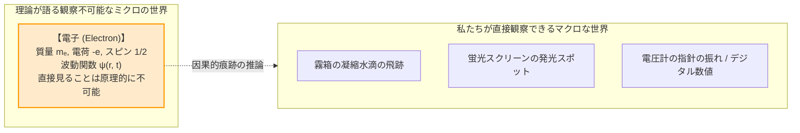
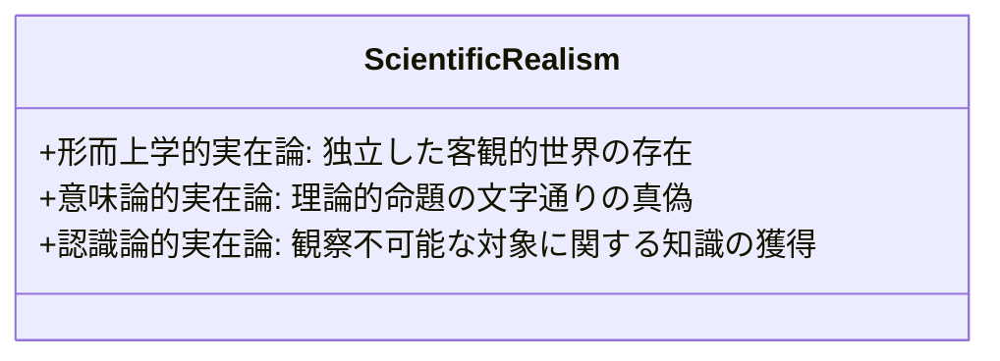
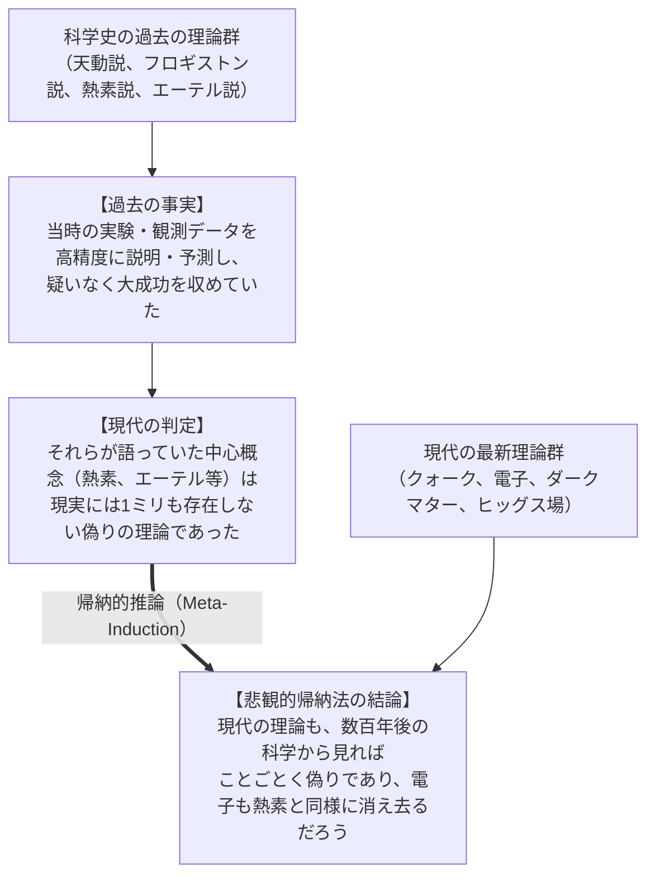
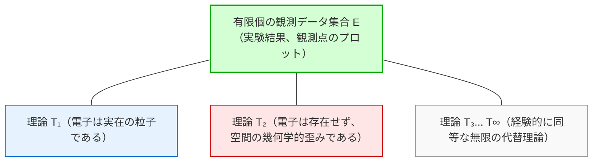
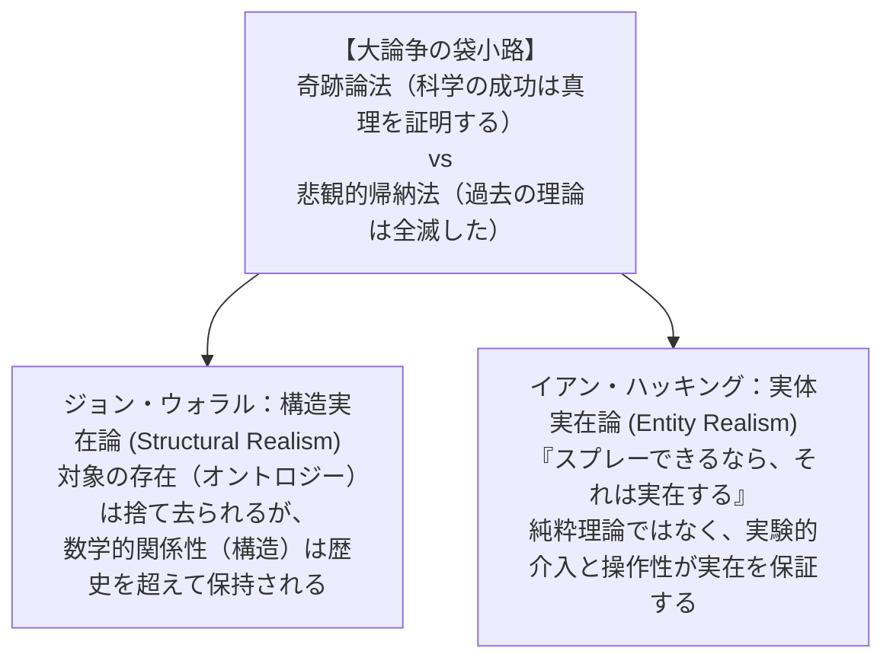
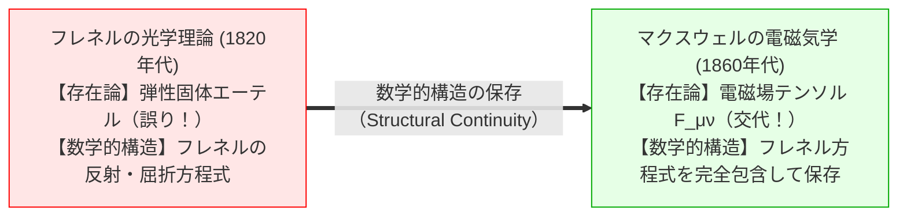
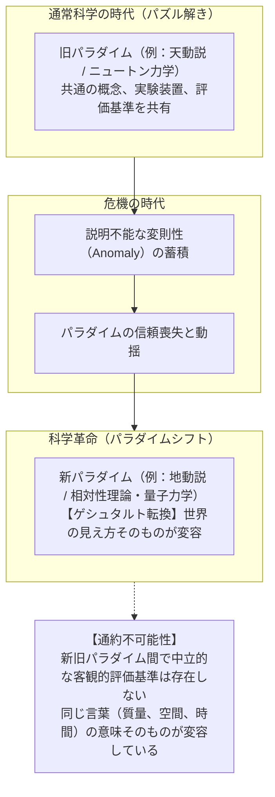

## 序論：私たちは何を見ているのか？

あなたのスマートフォンを開いてみてください。その内部にあるシリコン半導体チップの上では、数十億個のトランジスタが毎秒数十億回にわたって「電子（Electron）」を移動させ、論理演算を行っています。現代の素粒子物理学の標準模型（Standard Model）によれば、電子はスピン $\frac{1}{2}$、電荷 $-e \approx -1.602 \times 10^{-19} \text{ C}$、静止質量 $m_e \approx 9.109 \times 10^{-31} \text{ kg}$ を持つレプトン（軽子）の一種であり、現代物理学の最も基礎的な構成要素とされています。

しかし、ここで科学哲学における最も深遠な問いを投げかけてみましょう。

> <strong>「電子は、あなたの目の前にある机やリンゴと同じように、客観的な物理的実在として本当に存在しているのでしょうか？」</strong>

驚くべきことに、<strong>人類の歴史の中で「電子そのもの」を直接目で見た人は一人もいません。</strong>

私たちが見ているのは、霧箱の中に現れる一筋の白い飛行機雲のような凝縮水滴の列であり、ブラウン管の蛍光スクリーンに光る緑色の輝点であり、シリコン検出器の微小な電圧パルスの振幅に過ぎません。それらはすべて、マクロな観測装置が記録した「間接的な観測データ」です。

ここで、科学哲学の陣営は2つの真っ向から対立する立場に分裂します：

1. <strong>科学的実在論（Scientific Realism）</strong>:
   「電子は文字通り客観的に実在する。科学理論の驚異的な予測成功は、現代の理論が自然の真の姿をおおむね正しく捉えているからに他ならない。電子を単なる架空の道具と見なすならば、科学の驚異的な成功は説明不能な『奇跡』になってしまう。」
2. <strong>反実在論／道具主義（Anti-Realism / Instrumentalism）</strong>:
   「電子が実在するかどうかは人間には不可知であり、問うこと自体が無意味である。科学理論とは、観察可能な現象を整理し、未来の実験結果を正確に予測するための<strong>『有用な計算ツール（道具・フィクション）』</strong>に過ぎない。天動説もかつて惑星の運行を完璧に予測していたように、予測の成功は対象の実在性をいささかも保証しない。」

本稿では、科学的実在論と反実在論（道具主義）のあいだで戦わされてきた百年論争を徹底的に解き明かします。ヒラリー・パトナムの「奇跡論法（No-Miracles Argument）」、ラリー・ラウダンの「悲観的帰納法（Pessimistic Meta-Induction）」、クワイン＝デュエムの「経験的不十分決定性（Underdetermination）」、バス・ファン・フラーセンの「構成的経験主義（Constructive Empiricism）」、そして現代の調停案である「構造実在論（Structural Realism）」と「実体実在論（Entity Realism）」に至るまで、人類の知性が紡ぎ出した「実在（Reality）」の極限の境界線を探求します。

---

## 1. 科学的実在論のテーゼと「奇跡論法」

### 1.1 実在論の3つの次元
現代科学哲学において、科学的実在論（Scientific Realism）は単一の素朴な主張ではなく、認識論・意味論・形而上学の3つの次元が統合された包括的な立場です。

1. <strong>形而上学的次元（Metaphysical Dimension）</strong>:
   人間や観測者の意識・言語・概念枠組から完全に独立した、客観的な物理的世界が存在する。
2. <strong>意味論的次元（Semantic Dimension）</strong>:
   科学理論の言明は、文字通り（Literally）真または偽であると解釈されるべきである。理論に登場する「電子」「重力波」「クォーク」といった理論用語（Theoretical terms）は、実在する客観的対象を直接指し示す（指示する）名辞である。
3. <strong>認識論的次元（Epistemic Dimension）</strong>:
   十分に成熟し、予測的に成功した科学理論は、「近似的に真（Approximately true）」である。私たちは、電子のような観察不可能な対象（Unobservables）について、客観的で信頼できる知識を獲得することができる。

### 1.2 ヒラリー・パトナムの「奇跡論法（No-Miracles Argument）」
実在論者が掲げる最も直感的に強力で、歴史上最も有名な論拠が、哲学者ヒラリー・パトナム（Hilary Putnam）が1975年に提示した<strong>「奇跡論法（The No-Miracles Argument: NMA）」</strong>です。

パトナムは著書『数学・物質・方法』の中で、不朽のテーゼを述べました：

> <strong>「科学的実在論は、科学の成功を『奇跡（Miracle）』にしない唯一の哲学である。」</strong>

パトナムの論理展開は極めて明快です：
- 現代の物理学理論（例えば量子電磁力学: QED）は、電子の異常磁気モーメント $g/2$ の値を、理論計算と実験測定の間で<strong>小数点以下12桁という驚異的な精度</strong>で一致させています。

$$a_e^{\text{exp}} = 0.001\,159\,652\,180\,73(28)$$

$$a_e^{\text{theory}} = 0.001\,159\,652\,181\,64(76)$$

- もし電子が存在せず、電磁場の方程式が世界の構造とおおむね一致していない架空のフィクションに過ぎないとしたら、<strong>なぜこれほど狂気的な精度の予測が次々と的中するのでしょうか？</strong>
- 架空の物語（おとぎ話）に基づいて計算を繰り返した結果、原子爆弾が爆発し、半導体トランジスタが動作し、レーザー光線が発振し、GPS衛星がナノ秒単位で同期する――そんなことが偶然に起こると主張するならば、それこそがオカルト的な「奇跡」に他なりません。
- したがって、科学の圧倒的な予測・工学的成功に対する最善の最尤説明（Inference to the Best Explanation: IBE）は、<strong>「電子は本当に実在し、理論は真理を言い当てているからだ」</strong>という結論以外にあり得ない、とパトナムは論じました。

---

## 2. 反実在論からの反撃：科学史の墓場と「悲観的帰納法」

しかし、この実在論者の自信に満ちた凱歌に対し、歴史主義科学哲学の陣営から冷徹で致命的な反撃が加えられました。その筆頭が、ラリー・ラウダン（Larry Laudan）が1981年の論文『A Confutation of Convergent Realism』で提示した<strong>「悲観的帰納法（The Pessimistic Meta-Induction: PMI）」</strong>です。

### 2.1 ラウダンの反証リスト：成功したが捨て去られた理論たち
ラウダンは、科学の歴史を冷徹に振り返るように促します。科学史は、「かつて大成功を収め、あらゆる実験データを説明し、当時の最高峰の知性全員が真実だと信じていたにもかかわらず、後世に完全な誤りとして廃棄された理論」の巨大な墓場ではないでしょうか。

ラウダンは、過去に予測的大成功を収めたが、現在では存在しないと判明した「架空の理論対象」の代表例を提示しました：

| 過去の科学理論 | 当時の予測成功と説明力 | 信じられていた理論対象 | 現代科学の判定 |
|---|---|---|---|
| <strong>フロギストン説</strong> | 燃焼・金属製錬・呼吸の化学変化を統一的に説明 | <strong>フロギストン（燃素）</strong> | <strong>存在しない</strong>（完全な虚構） |
| <strong>カロリック説</strong> | 熱伝導、気体の比熱比（ポアソンの法則）、熱機関効率を正確に予測 | <strong>カロリック（熱素）</strong> | <strong>存在しない</strong>（熱は分子の運動） |
| <strong>光の波動エーテル説</strong> | フレネルの回折理論、光の干渉、反射率の精密な数学的計算に成功 | <strong>光学的エーテル（発光エーテル）</strong> | <strong>存在しない</strong>（真空中の電磁場） |
| <strong>天動説（プトレマイオス体系）</strong> | 周転円を用いて惑星の逆行運動や日食・月食を高精度に予測 | <strong>結晶天球と周転円</strong> | <strong>存在しない</strong>（太陽中心地動説へ） |
| <strong>生気論（Vitalism）</strong> | 生体内の有機化合物合成の特殊性を説明 | <strong>生気（Élan vital）</strong> | <strong>存在しない</strong>（通常の生化学反応） |

### 2.2 悲観的帰納法の論理構造
ラウダンの議論は、科学史的事実に基づくメタレベル（理論の歴史についての）帰納推論です：

$$\begin{aligned}
\mathbf{前提 1:} & \quad \text{科学史において、予測的に大成功した過去の理論の圧倒的多数は、} \\
& \quad \text{後代において偽であることが判明し、その理論用語（指示対象）は消滅した。} \\
\mathbf{前提 2:} & \quad \text{現代の科学理論と過去の科学理論の間に、知識論的な本質的特権の差はない。} \\
\mathbf{帰納的推論:} & \quad \text{したがって、現代の最新理論（標準模型や量子重力理論）の理論対象（電子や時空）も、} \\
& \quad \text{将来の科学革命によって完全な誤りとして廃棄される可能性が極めて高い。}
\end{aligned}$$

もしラウダンの悲観的帰納法が正しいならば、パトナムの「奇跡論法」は完全に破綻します。「予測の成功」は「理論の真理」や「対象の実在」を何一つ保証しないことになります。フロギストンやカロリックの成功が奇跡でなかったのと同様に、現代の電子の成功もまた、真理ではない便利なフィクションの成功に過ぎないかもしれないのです。

---

## 3. 経験的不十分決定性と構成的経験主義

実在論に対するもうひとつの強力な哲学的鉄槌が、分析哲学と認識論から提起された<strong>「経験的不十分決定性（Underdetermination of Theory by Evidence）」</strong>と、バス・ファン・フラーセン（Bas van Fraassen）の<strong>「構成的経験主義（Constructive Empiricism）」</strong>です。

### 3.1 クワイン＝デュエムのテーゼと経験的不十分決定性
ピエール・デュエム（Pierre Duhem）とW. V. O. クワイン（Willard Van Orman Quine）が明らかにしたのは、<strong>「いかなる有限個の観測データに対しても、そのデータと完全に両立する、互いに矛盾した理論が論理的に無数に存在する」</strong>という事実です。

観測事実 $E$ は、どの理論が「真」であるかを一意に決定（Determine）できません。
私たちが特定の理論を選び取るのは、それが客観的真理だからではなく、数学的な「単純さ（Simplicity）」「扱いやすさ」「既存の信念との整合性」といったプラグマティックな都合（プラグマティック・美徳）に過ぎません。

### 3.2 バス・ファン・フラーセンの「構成的経験主義」
1980年の記念碑的著作『科学的画像（The Scientific Image）』において、ファン・フラーセンは科学的実在論に対する極めて洗練された代替案として<strong>「構成的経験主義（Constructive Empiricism）」</strong>を提唱しました。

ファン・フラーセンは、科学の目的を次のように再定義しました：

> <strong>「科学の目的は、真実の理論を与えることではなく、経験的に適切な理論を与えることである。そして理論の受容とは、それが真であると信じることではなく、それが経験的に適切であると信じることだけを含む。」</strong>

| 概念 | 科学的実在論 (Realism) | 構成的経験主義 (Van Fraassen) |
|---|---|---|
| <strong>科学の究極の目的</strong> | 世界の隠された真理（真実の姿）を解明すること。 | 観察可能な現象を正確に救うこと（Saving the phenomena）。 |
| <strong>理論を受け入れる態度</strong> | 理論はおおむね「真（True）」であると信じる。 | 理論は「経験的に適切（Empirically adequate）」であると信じる。 |
| <strong>観察不可能な対象（電子など）</strong> | 実在すると信じる（Belief in unobservables）。 | 実在性について判断を保留・不可知論に留まる（Agnosticism）。 |

ここで極めて重要なのが、ファン・フラーセンによる<strong>「観察可能（Observable）」と「観察不可能（Unobservable）」の厳格な認識論的境界線</strong>です：

- <strong>観察可能</strong>: 人間が肉眼、素手、生身の感覚器官（Unaided human senses）で直接知覚できる対象。例えば、月、恐竜の化石、木、肉眼で見える水滴。
- <strong>観察不可能</strong>: 顕微鏡、検出器、ガイガーカウンターなどの機器を媒介しなければ感知できないミクロの対象。例えば、電子、DNAの二重螺旋、クォーク。

木星の衛星を肉眼に近い望遠鏡で見ることは「直接宇宙船に乗って近づけば肉眼で見える」ため観察可能ですが、電子は原理的に人間が素手で直接見ることはできません。
ファン・フラーセンによれば、科学者が電子の理論を信じるべきなのは「電子が実在する」からではなく、その理論が「電圧計の針の動きという観察可能な現象を100%見事に予測してくれる（経験的に適切である）」からに過ぎません。それ以上の形而上学的実在論に飛びつくのは、認識論的な過剰信仰（教条主義）であると批判しました。

---

## 4. 現代の調停案：構造実在論と実体実在論

「奇跡論法」の圧倒的な直観的説得力と、「悲観的帰納法」の冷徹な歴史的事実。この2つの巨人の衝突によって袋小路に陥った科学哲学界に、救世主として現れたのが<strong>「構造実在論（Structural Realism）」</strong>と<strong>「実体実在論（Entity Realism）」</strong>です。

### 4.1 ジョン・ウォラルの構造実在論（Structural Realism）
哲学者ジョン・ウォラル（John Worrall）は1989年の画期的な論文『Best of Both Worlds? Why Structural Realism Should Be Every Realist's Creed』において、奇跡論法と悲観的帰納法の両者を同時に救い出す「第三の道」を提示しました。

ウォラルは、科学史における<strong>オーギュスタン・フレネルの光の波動論からジェームズ・クラーク・マクスウェルの電磁場理論への移行</strong>を検証しました：
- <strong>フレネルの理論</strong>: 光は「力学的な発光エーテルという弾性固体の中を伝わる横波」であると考えた。現代の視点から見れば、エーテルなど存在せず、フレネルの存在論（オントロジー）は完全に誤りであった（悲観的帰納法の勝利に見える）。
- <strong>しかし</strong>: フレネルが導き出した「光の反射と屈折に関する数学的方程式（フレネルの式）」は、驚くべきことに、マクスウェルの電磁気学理論の中へ<strong>数学的構造として完全にそのまま継承され、現在も全く同一の数式として光学工学で使用されている</strong>。

ウォラルはこの歴史的事実から導きました：
> <strong>「科学理論が世代を超えて捉え、蓄積し、発展させている真理とは、対象の本質（Nature of things）ではなく、対象間の数学的関係性の『構造（Structure）』である。」</strong>

科学革命が起きても、数学的構造は近似的極限（Correspondence Principle: 対応原理）として次の理論に受け継がれます。ニュートン力学の運動方程式はアインシュタインの相対性理論において低速の極限として数学的に保存されているのです。

#### 認識的構造実在論 vs 存在論的構造実在論
構造実在論はその後、さらに2つの立場に深まりました：
1. <strong>認識的構造実在論（Epistemic Structural Realism: ESR）</strong>:
   世界には何らかの対象（個体）が存在するが、私たちが知り得るのはその対象が織りなす「関係性の構造」だけである。
2. <strong>存在論的構造実在論（Ontic Structural Realism: OSR / ジェームズ・レディマンら）</strong>:
   現代の量子力学（素粒子が個体性を持たないボース・アインシュタイン統計やフェルミ・ディラック統計）が示すように、<strong>そもそも世界には『独立した個体や粒子』など初めから存在しない。存在するのは『客観的な構造（物理的関係性・対称群の表現）』のみである。</strong>

### 4.2 イアン・ハッキングの実体実在論（Entity Realism）
一方、イアン・ハッキング（Ian Hacking）は1983年の名著『表象と介入（Representing and Intervening）』において、理論中心の哲学を痛烈に批判し、<strong>実験室における物理的介入（Intervention）</strong>に実在性の根拠を見出しました。

ハッキングはスタンフォード大学の実験室で、物理学者たちが分数電荷（クォークの探索）を測定するために、微小なニオブ球に「陽電子」や「電子」を吹き付けて電荷を微調整している光景を目撃しました。

ハッキングは叫びました：

> <strong>「もしあなたがそれらにスプレーできるなら、それらは実在する！（If you can spray them, then they are real.）」</strong>

ハッキングの論理は明快です：
- 私たちが電子の「大統一理論」や理論方程式の完全な真理性を信じていなくても構わない。理論は将来書き換わるかもしれない。
- しかし、ある未知の現象を解明するために、<strong>電子を『道具（Tool/Instrument）』として他方の物理系に意図的にぶつけ、期待通りの因果的効果を引き起こすことができるならば、その電子の実在性を疑うことはもはや不可能である。</strong>
- 実在性は、理論の真理性（Theory-realism）からではなく、因果的介入の操作性（Entity-realism）から直接保証されるのです。

---

## 5. 量子力学の衝撃：粒子という概念自体の融解

実在論争が最も過激な形で問われる最前線こそが、<strong>量子力学の基礎論（Foundations of Quantum Mechanics）</strong>です。

### 5.1 電子は「粒子」でも「波」でもない
古典的な意味での「実在（Real thing）」とは、ある特定の時刻 $t$ において、空間の確定した座標 $(x, y, z)$ に位置を占める局所的実体（Local entity）を意味していました。

しかし量子力学において、電子の状態はヒルベルト空間上の状態ベクトル $|\psi\rangle$、あるいは連続空間上の確率振幅波動関数 $\psi(\mathbf{r}, t)$ によって記述されます：

$$i\hbar \frac{\partial}{\partial t}\psi(\mathbf{r}, t) = \left( -\frac{\hbar^2}{2m}\nabla^2 + V(\mathbf{r}, t) \right)\psi(\mathbf{r}, t)$$

ボルンの確率解釈によれば、位置 $\mathbf{r}$ において電子が発見される確率は確率密度関数 $P(\mathbf{r}) = |\psi(\mathbf{r}, t)|^2$ によって与えられます。

ハイゼンベルクの不確定性原理：

$$\Delta x \cdot \Delta p_x \ge \frac{\hbar}{2}$$

が明示するように、電子は「観測される前」において確定した位置も確定した運動量も持っていません。
二重スリット実験において、電子は2つのスリットを「同時に通り抜けて」自己干渉を起こします。

物理学者ニールス・ボーア（Niels Bohr）はかつて断言しました：
> <strong>「量子世界などというものは存在しない。そこにあるのは、抽象的な量子力学的物理記述のみである。物理学の任務は、自然がどのようであるかを発見することではなく、私たちが自然について何を語り得るかを見出すことである。」</strong>

ボーアのこのコペンハーゲン解釈は、極限まで推し進められた道具主義そのものです。量子力学において「電子」という古典的粒子はもはや実在せず、測定装置と観測行為の文脈においてのみ立ち現れる確率的現象に分解されてしまうのです。

---

## 6. 数理的・形式的定式化：理論間の還元の形式論理

科学的実在論と理論の連続性を巡る議論を、数理論理学およびモデル論を用いて形式化してみましょう。

### 6.1 形式理論と指示のモデル論
言語 $\mathcal{L}_T$ における科学理論 $T$ を、公理集合 $\mathcal{A}$ からの演繹閉包 $T = \text{Cn}(\mathcal{A})$ とします。
理論用語の集合を $\mathcal{V}_T$、観察用語の集合を $\mathcal{V}_O$ とします（$\mathcal{V}_T \cap \mathcal{V}_O = \emptyset$）。

理論 $T$ の経験的帰結（Empirical content）は、観察言語のみで表現される定理の集合です：

$$\mathcal{E}(T) = \{ \phi \in T \mid \text{Vocab}(\phi) \subseteq \mathcal{V}_O \}$$

ファン・フラーセンの「経験的適切性」とは、現実の観察可能な全現象の世界構造 $\mathcal{W}_O$ が、理論 $T$ のあるモデル $\mathcal{M} \models T$ の観察可能部分構造へと同型埋め込み（Isomorphic embedding）できることを意味します：

$$\mathcal{W}_O \hookrightarrow \mathcal{M}|_{\mathcal{V}_O}$$

### 6.2 構造的保存の数学的表現
古い理論 $T_{\text{old}}$ から新しい理論 $T_{\text{new}}$ への移行において、構造実在論が主張する「構造的保存」は、ある適切なパラメータ極限 $\epsilon \to 0$（例えば $\frac{v}{c} \to 0$ や $\hbar \to 0$）において、方程式の圏論的射（Functor）あるいは微分同相写像が保存される漸近的構造として数学的に定式化されます：

$$\lim_{\epsilon \to 0} \Phi(T_{\text{new}}(\epsilon)) \cong T_{\text{old}}$$

この数学的同型性（Isomorphism）こそが、存在論的な「電子」という言葉の意味が変化したとしても、方程式が世界の客観的構造を捉え続けているという構造実在論の厳密な数理的裏付けです。

---

## 7. 結論：真理を求める旅の途上で

「電子は本当に存在するのか、それとも便利な説明なのか？」

この問いに対する現代科学哲学の最も誠実で成熟した回答は、おそらく次のような二重の洞察に要約されるでしょう：

1. <strong>素朴な実在論の終焉</strong>:
   電子を「目に見える小さなビリヤードの球」のような古典的実体としてイメージする素朴な実在論は、現代物理学によって完全に葬り去られました。その意味において、私たちが想像する「電子」は、人間が理解しやすいように作られたひとつの概念モデル（比喩・フィクション）です。
2. <strong>客観的実在への堅固なアンカー</strong>:
   しかし同時に、電子を単なる「人間が恣意的に作った便利な言葉のゲーム」に還元する極端な相対主義もまた、科学の実践を説明できません。私たちが粒子加速器でビームを制御し、走査型トンネル顕微鏡（STM）で個々の原子を配列し、量子コンピュータで量子ビットを操作するとき、<strong>私たちは疑いなく、私たち自身の意志を超えた「客観的自然の強固な構造と因果力」と直接格闘しています。</strong>

科学理論とは、自然という巨大で神秘的な未踏の山脈を旅するための<strong>「地図」</strong>です。
地図の上に描かれた等高線や記号（電子、クォーク、時空の曲率）は人間が描いたインクの線に過ぎませんが、その地図が正しい登頂ルートを指示し、崖から転落するのを防いでくれるのは、<strong>その地図の構造が実際の山の地形と真に一致しているから</strong>に他なりません。

科学の営みとは、時代とともに地図の精度を極限まで高め、宇宙の深淵なる構造へと手を伸ばし続ける、人類の最も勇敢で敬虔な知的情熱そのものなのです。
---

## 8. トーマス・クーンのパラダイムシフトと通約不可能性の挑戦

科学的実在論に対して、科学社会学および科学史の観点から最もラディカルな揺さぶりをかけたのが、トーマス・クーン（Thomas Kuhn）が1962年の主著『科学革命の構造（The Structure of Scientific Revolutions）』で提示した<strong>「パラダイムシフト」</strong>と<strong>「通約不可能性（Incommensurability）」</strong>の概念でした。

### 8.1 概念の通約不可能性
クーンによれば、ニュートン力学における「質量（Mass）」と、アインシュタインの相対性理論における「質量」は、単に数式が変わっただけではありません。
- ニュートン力学において、質量は速度に依存しない物質固有の不変量です。
- 相対性理論において、質量はエネルギーと等価であり（$E=mc^2$）、速度や座標系に依存して変化する相対的な物理量です。

同じ「質量」という単語を使っていても、その概念的ネットワーク（文脈）全体が激変しているため、新旧の理論を共通の物差しで直接比較（通約）することは不可能です。
もし通約不可能性が真であるならば、「科学は真理に向かって累積的・直線的に進歩している」という実在論の素朴な進歩史観は幻想であり、科学革命とは「世界の見方（ゲシュタルト）の不連続な乗り換え」に過ぎないことになります。

---

## 9. 場の量子論（QFT）における実在：粒子から「場」へ

さらに現代物理学の最前線である<strong>場の量子論（Quantum Field Theory: QFT）</strong>に目を向けると、「電子とは何か」という問いはさらに形而上学的な深みへと突入します。

現代物理学において、世界を構成する最も基礎的な実在は「粒子」ではなく<strong>「場（Field）」</strong>です。
- 電子とは、全宇宙に遍在する「ディラック場（電子場 $\psi(x)$）」の量子化された励起状態（Excited state）に過ぎません。
- 真空（Vacuum state $|0\rangle$）とは何もない空虚ではなく、生成演算子 $a^\dagger$ と消滅演算子 $a$ によって絶えず仮想粒子が対生成・対消滅を繰り返しているエネルギーの基底状態です。

$$|1_{\mathbf{p}}\rangle = a^\dagger(\mathbf{p})|0\rangle$$

曲がった時空における場の量子論（ウンルー効果やホーキング放射）が明らかにしているように、<strong>「粒子が何個存在するか」という数（粒子数演算子 $N$ の期待値）すらも、観測者の加速度や座標系に依存して相対的に変化します。</strong>
慣性系の観測者にとって「粒子がゼロの真空」であっても、一様加速運動をする観測者にとっては「熱的な粒子が充満した温泉」に見えるのです。

この物理学的真実は、科学的実在論者に対して究極の問いを突きつけます。「観測者の運動状態によって存在したり消滅したりするものを、私たちはなおも『客観的実在』と呼び得るのか？」
実在論は、素朴な物質観を脱ぎ捨て、ゲージ対称性や場の数理という、より抽象的な幾何学的・数学的構造の探求へと進化を余儀なくされているのです。
