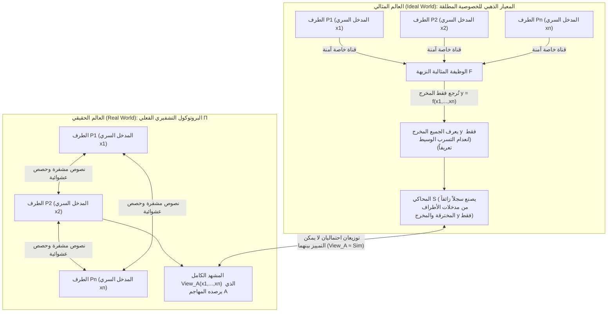
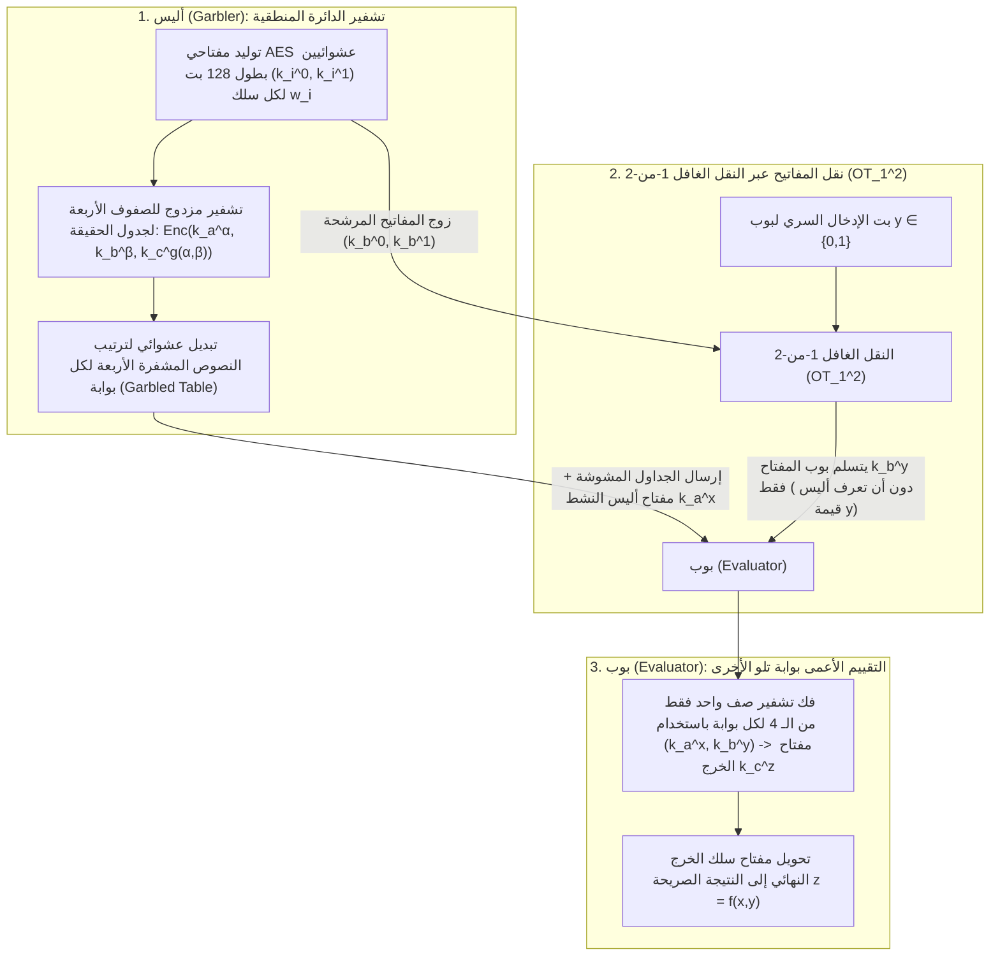

«ترغب عدة مستشفيات بحثية في دمج التسلسلات الجينومية لمرضى السرطان لإجراء دراسة ارتباط جينومي إحصائية (GWAS)، لكن قوانين الخصوصية (GDPR / HIPAA) تحظر تماماً خروج بايت واحد من بيانات المرضى الخام خارج جدران المستشفى.»
«تريد بنوك تجارية متنافسة تتبع شبكات غسيل الأموال العابرة للبنوك بشكل مشترك دون الكشف عن قوائم عملائها أو مخططات معاملاتها الداخلية لبعضها البعض.»

للوهلة الأولى، يبدو هذا مطلباً مستحيلاً منطقياً: لحساب أي دالة $f(x_1, x_2, \dots, x_n)$، ألا يجب أن يقوم <strong>طرف ثالث موثوق (Trusted Third Party - TTP)</strong> بجمع كل المدخلات السرية $x_i$ كنص واضح أولاً؟ غير أن علم التشفير الحديث أثبت في أواخر الثمانينيات مبرهنة مذهلة: <strong>حتى في غياب أي طرف ثالث موثوق، يمكن لأطراف لا يثق بعضهم ببعض أن يحسبوا معاً أي دالة قابلة للحساب $f(x_1, \dots, x_n)$ بحيث يعرف الجميع النتيجة الصحيحة دون أن يتعلم أي طرف بتاً واحداً إضافياً عن المدخل السري $x_i$ لأي طرف آخر.</strong>

يُعرف هذا المجال باسم <strong>الحوسبة الآمنة متعددة الأطراف (Secure Multi-Party Computation - MPC)</strong>. في هذا المقال ننطلق من تجربتين فكريتين كلاسيكيتين لنشتق المحركين الرياضيين الأساسيين لـ MPC: <strong>مشاركة السر العتبية $(t, n)$ لآدي شامير (استيفاء لاغرانج، بروتوكول BGW، وثلاثيات بيفر)</strong>، ومنهج الدوائر المنطقية عبر <strong>النقل الغافل ($\text{OT}_1^2$) لرابين والدوائر المشوشة (Garbled Circuits) لياو</strong>.

---

## 1. تجربتان فكريتان مدهشتان: «متوسط الرواتب بلا مدير» و«مسألة المليونيرات لياو»

### 1.1 التجربة الفكرية 1: حساب متوسط الرواتب دون كشف راتب أي فرد

يجلس ثلاثة مهندسين $A, B, C$ ويريدون معرفة <strong>متوسط رواتبهم السنوية $\bar{x} = \frac{x_A + x_B + x_C}{3}$</strong> دون أن يعرف أي منهم الراتب الفردي $x_A$ أو $x_B$ أو $x_C$ للآخرين. باستخدام <strong>مشاركة السر الجمعية (التقنيع بلوحة المرة الواحدة One-Time Pad)</strong>، يمكنهم تحقيق ذلك بالورقة والقلم فقط:

1. <strong>القناع العشوائي والهمسة الأولى ($A \to B$)</strong>: يتفق الثلاثة على معيار عددي عام كبير $M$ (مثلاً $M = 10^9$). يختار المهندس $A$ سراً عدداً عشوائياً منتظماً $r \xleftarrow{\$} \mathbb{Z}_M$، ويجمعه مع راتبه $x_A$، ثم يهمس فقط بالقيمة $s_1 = (x_A + r) \bmod M$ للمهندس $B$. وبما أن $r$ موزع بانتظام في $\mathbb{Z}_M$، فإن $s_1$ موزع بانتظام تام أيضاً بغض النظر عن قيمة $x_A$: وبموجب مبرهنة شانون للسرية التامة، فإن المعلومات المتبادلة تساوي صفراً ($I(X_A; S_1) = 0$). لا يتعلم $B$ حرفياً <strong>أي بت</strong> عن $x_A$.
2. <strong>الجمع المتسلسل ($B \to C \to A$)</strong>: يضيف $B$ راتبه $x_B$ ويهمس بالقيمة $s_2 = (x_A + x_B + r) \bmod M$ إلى $C$؛ ثم يضيف $C$ راتبه $x_C$ ويعيد $s_3 = (x_A + x_B + x_C + r) \bmod M$ إلى $A$.
3. <strong>إزالة القناع وإعلان المتوسط</strong>: يطرح $A$ رقمه العشوائي $r$ بمعيار $M$، فيحصل على المجموع الدقيق $S = x_A + x_B + x_C$ ويعلن المتوسط $\bar{x} = S / 3$.

> [!NOTE]
> <strong>لماذا نحتاج إلى 3 مشاركين على الأقل ($n \ge 3$)؟</strong>
> لو كان هناك شخصان فقط ($A$ و$B$)، فحتى لو أخبرهما ملاك أمين بالمتوسط $\bar{x} = \frac{x_A + x_B}{2}$ فقط، لاستنتج $A$ فوراً راتب $B$ عبر المعادلة $x_B = 2\bar{x} - x_A$. هذا ليس عيباً في البروتوكول، بل خاصية رياضية للدالة نفسها. <strong>تضمن MPC عدم تسرب أي بت إضافي يتجاوز ما يُستنتج منطقياً من مدخل الطرف نفسه والنتيجة النهائية.</strong>

### 1.2 التجربة الفكرية 2: «مسألة المليونيرات» لأندرو ياو (1982)

الجمع عملية خطية، فماذا عن <strong>المقارنة غير الخطية</strong>؟
في عام 1982، نشر عالم الحاسوب الحائز لاحقاً على جائزة تورينغ <strong>أندرو تشي-تشي ياو (Andrew Yao)</strong> ورقته الرائدة *"Protocols for Secure Computations"*، طارحاً <strong>مسألة المليونيرات (Millionaires' Problem)</strong>: يريد مليونيران، أليس (ثروتها $x$ مليون دولار) وبوب (ثروته $y$ مليون دولار)، حساب بت منطقي واحد فقط $f(x, y) = [x > y] \in \{0, 1\}$ (من الأغنى؟) دون طرف ثالث ودون كشف قيمتي $x$ أو $y$ أو حتى الفرق بينهما $x - y$.

---

## 2. الصياغة الرياضية للأمان: نموذج المحاكاة بين العالم المثالي والعالم الحقيقي

لإثبات عدم تسرب أي معلومات، صاغ غولدرايخ وميكالي وويغدرسون (GMW 1987) <strong>نموذج المحاكاة بين العالم المثالي والعالم الحقيقي (Ideal/Real Simulation Paradigm)</strong>:



يكون البروتوكول الحقيقي $\Pi$ آمناً إذا وُجدت خوارزمية كفؤة تُسمى <strong>المحاكي $\mathcal{S}$</strong> تستطيع، <em>بالاعتماد فقط على مدخلات $\{x_i\}_{i \in I}$ ومخرجات $\{y_i\}_{i \in I}$ الأطراف المخترقة</em>، توليد سجل رسائل اصطناعي لا يمكن تمييز توزيعه الاحتمالي عن المشهد الحقيقي $\text{View}_I^\Pi(x_1, \dots, x_n)$:
$$\left\{ \mathcal{S}\left(I, \{x_i\}_{i \in I}, \{y_i\}_{i \in I}\right) \right\} \stackrel{c}{\approx} \left\{ \text{View}_I^\Pi(x_1, \dots, x_n) \right\}$$
ويُفرَّق هنا بين المهاجم <strong>شبه النزيه (Semi-Honest / Passive)</strong> الذي يتبع خطوات البروتوكول لكنه يحلل الرسائل، والمهاجم <strong>الخبيث (Malicious / Active)</strong> الذي يزور الرسائل عمداً.

---

## 3. المحرك الأول: مشاركة السر العتبية $(t, n)$ لشامير، واستيفاء لاغرانج، وبروتوكول BGW / SPDZ

### 3.1 كثيرات الحدود على الحقل المنتهي $\mathbb{F}_p$ واستيفاء لاغرانج
في عام 1979، اقترح <strong>آدي شامير (Adi Shamir)</strong> إخفاء السر $s \in \mathbb{F}_p$ ($p > n$ عدد أولي) كحد ثابت في كثيرة حدود عشوائية من الدرجة $t - 1$ على الحقل المنتهي $\mathbb{F}_p$:
$$P(x) = s + a_1 x + a_2 x^2 + \dots + a_{t-1} x^{t-1} \pmod p$$
يحصل كل طرف $P_i$ على النقطة $(x_i = i,\, y_i = P(x_i))$. وتستطيع أي مجموعة جزئية $T$ تضم $t$ أطراف على الأقل استعادة السر $s = P(0)$ بدقة عبر <strong>صيغة استيفاء لاغرانج</strong>:
$$s = P(0) = \sum_{i \in T} y_i \prod_{j \in T,\, j \ne i} \frac{-x_j}{x_i - x_j} \pmod p$$
أما مع $t - 1$ حصص أو أقل، فإن كل سر مرشح $s' \in \mathbb{F}_p$ متساوي الاحتمال تماماً ($H(S \mid \text{Shares}_{t-1}) = H(S)$، أمان معلوماتي مطلق).

### 3.2 بروتوكول BGW وثلاثيات الضرب لبيفر
في <strong>بروتوكول BGW (1988)</strong>، يتم <strong>الجمع $[a] + [b] = [a + b]$ محلياً دون أي اتصال</strong>. أما <strong>الضرب $[a] \cdot [b]$</strong> فيضاعف درجة كثيرة الحدود $P(x)Q(x)$ إلى $2(t-1)$، مما يتطلب شرط $2t - 1 \le n$ (<strong>أغلبية نزيهة Honest Majority</strong>) وجولة تخفيض للدرجة.
حل <strong>دونالد بيفر (Donald Beaver, 1991)</strong> هذه العقبة عبر <strong>ثلاثيات الضرب $([u], [v], [w = u \cdot v \bmod p])$</strong> المولدة مسبقاً في مرحلة غير متصلة (جوهر بروتوكول <strong>SPDZ</strong>). وفي المرحلة المتصلة، لضرب $[x]$ و$[y]$، يكشف الأطراف فقط الفروق المقنَّعة $d = (x - u) \bmod p$ و$e = (y - v) \bmod p$، ثم يحسبون التركيب الخطي محلياً:
$$[x \cdot y] = [w] + d \cdot [v] + e \cdot [u] + d \cdot e \pmod p$$

---

## 4. المحرك الثاني: النقل الغافل ($\text{OT}_1^2$) لرابين والدوائر المشوشة (Garbled Circuits) لياو

للمقارنات الثنائية ($x > y$)، ينفذ منهج الدوائر المنطقية التقييم في عدد ثابت $O(1)$ من جولات الاتصال:



بفضل <strong>النقل الغافل 1-من-2 ($\text{OT}_1^2$) لمايكل رابين</strong>، يحصل بوب على المفتاح $k_b^y$ الموافق لبته السري $y$ دون أن تعرف أليس $y$. وقد أدت التحسينات الثلاثة الحديثة — <strong>Point-and-Permute</strong> (بتات اللون تشير مباشرة إلى الصف المطلوب فك تشفيره)، و<strong>Free-XOR</strong> ($k_i^1 = k_i^0 \oplus \Delta$ يجعل جميع بوابات `XOR` بلا نصوص مشفرة وبلا عمليات AES)، و<strong>Half-Gates</strong> (تقليص كل بوابة `AND` إلى نصين مشفرين فقط) — إلى تسريع الدوائر المشوشة بأكثر من $1000$ ضعف.

---

## 5. تطبيق كامل بلغة Python: مشاركة شامير وثلاثيات بيفر على الحقل $\mathbb{F}_p$

```python
import secrets
from typing import List, Tuple

PRIME = (1 << 61) - 1  # عدد ميرسين الأولي بطول 61 بت p = 2^61 - 1

def mod_inv(a: int, p: int = PRIME) -> int:
    return pow(a % p, -1, p)

def shamir_share(secret: int, t: int, n: int, p: int = PRIME) -> List[Tuple[int, int]]:
    coeffs = [secret % p] + [secrets.randbelow(p) for _ in range(t - 1)]
    shares = []
    for i in range(1, n + 1):
        y = 0
        for c in reversed(coeffs):
            y = (y * i + c) % p
        shares.append((i, y))
    return shares

def lagrange_reconstruct(shares: List[Tuple[int, int]], p: int = PRIME) -> int:
    secret = 0
    k = len(shares)
    for i in range(k):
        xi, yi = shares[i]
        num, den = 1, 1
        for j in range(k):
            if i != j:
                xj, _ = shares[j]
                num = (num * (-xj)) % p
                den = (den * (xi - xj)) % p
        secret = (secret + yi * num * mod_inv(den, p)) % p
    return secret

def mpc_add(sa, sb, p=PRIME):
    return [(xa, (ya + yb) % p) for (xa, ya), (_, yb) in zip(sa, sb)]

def mpc_sub(sa, sb, p=PRIME):
    return [(xa, (ya - yb) % p) for (xa, ya), (_, yb) in zip(sa, sb)]

def mpc_scalar_mul(c, sa, p=PRIME):
    return [(xa, (c * ya) % p) for xa, ya in sa]

def mpc_add_const(c, sa, p=PRIME):
    return [(xa, (ya + c) % p) for xa, ya in sa]

def generate_beaver_triple(t: int, n: int, p: int = PRIME):
    u, v = secrets.randbelow(p), secrets.randbelow(p)
    return shamir_share(u, t, n, p), shamir_share(v, t, n, p), shamir_share((u * v) % p, t, n, p)

def mpc_beaver_mul(sx, sy, triple, t: int, p: int = PRIME):
    su, sv, sw = triple
    d = lagrange_reconstruct(mpc_sub(sx, su, p)[:t], p)
    e = lagrange_reconstruct(mpc_sub(sy, sv, p)[:t], p)
    res = mpc_add(mpc_add(sw, mpc_scalar_mul(d, sv, p), p), mpc_scalar_mul(e, su, p), p)
    return mpc_add_const((d * e) % p, res, p)

if __name__ == "__main__":
    t, n = 3, 5
    salaries = [85000, 92000, 78000]
    shared = [shamir_share(s, t, n) for s in salaries]
    total_shares = shared[0]
    for s in shared[1:]:
        total_shares = mpc_add(total_shares, s)
    print("إجمالي الرواتب المستعاد:", lagrange_reconstruct(total_shares[:t]))
```

---

## 6. مقارنة تقنيات تعزيز الخصوصية (PETs) والتطبيقات الواقعية

| المعيار | الحوسبة متعددة الأطراف (MPC) | التشفير المتماثل بالكامل (FHE) | إثباتات المعرفة الصفرية (ZKP) | بيئة التنفيذ الموثوقة (TEE) |
| :--- | :--- | :--- | :--- | :--- |
| <strong>المشكلة الأساسية</strong> | <strong>حساب مشترك</strong> على مدخلات سرية موزعة $x_1, \dots, x_n$ | <strong>حساب أعمى على خادم واحد</strong> فوق النصوص المشفرة $\text{Enc}(x) \mapsto \text{Enc}(f(x))$ | <strong>إثبات أن سراً $w$ يعرفه المُثبِت مسبقاً</strong> يحقق $f(x, w)=1$ | <strong>تنفيذ معزول عتادياً</strong> كنص واضح داخل جيب محمي في المعالج (Enclave) |
| <strong>عنق الزجاجة</strong> | حسابات المعالج خفيفة جداً، لكنها <strong>تتطلب اتصالاً شبكياً لكل طبقة ضرب</strong> | جولة اتصال واحدة، لكن <strong>حسابات المعالج أبطأ بـ $10^3$ إلى $10^5$ مرة</strong> | تحقق فوري، وتوليد الإثبات مكلف حسابياً (MSM / FFT) | سرعة تقارب السرعة الأصلية، لكن ذاكرة الجيب محدودة |
| <strong>نموذج الثقة</strong> | <strong>عدم التواطؤ</strong> (أقل من $t$ خوادم تتواطأ) | <strong>صعوبة مسائل الشبكات الرياضية (RLWE)</strong> | <strong>السلامة الرياضية</strong> (لا يدمج وحده أسرار عدة أطراف) | <strong>الثقة بمصنّع المعالج (Intel/AMD)</strong>؛ عرضة لهجمات القنوات الجانبية |

من <strong>المزاد الدنماركي المزدوج لحصص بنجر السكر عام 2008</strong> إلى <strong>دراسة فجوة الأجور في مدينة بوسطن (BWWC)</strong>، و<strong>فحص تسرب كلمات المرور في Google Chrome وApple iCloud (تقاطع المجموعات الخاص PSI)</strong>، و<strong>الدراسات الجينومية المشتركة بين المستشفيات (Secure GWAS)</strong>، وصولاً إلى <strong>محافظ العملات المشفرة المعتمدة على توقيع العتبة MPC (مثل Fireblocks وCoinbase)</strong>، تستبدل تقنية MPC اليوم الثقة المؤسسية الهشة باليقين الرياضي الصارم.
