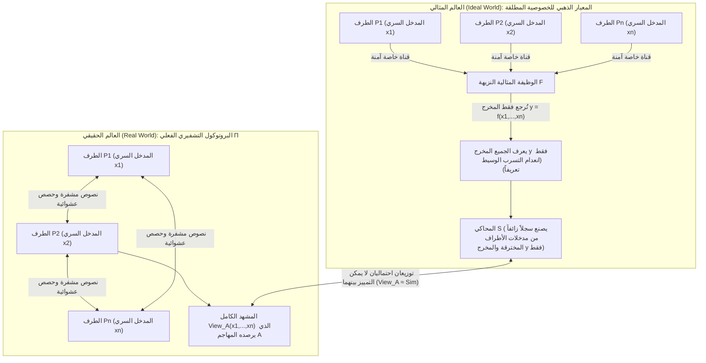
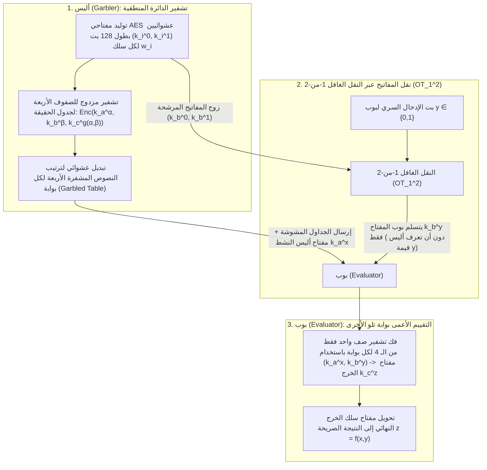

«ترغب عدة مستشفيات في تحليل جينومات المرضى معًا، مع الالتزام بالمتطلبات القانونية والتعاقدية والأخلاقية السارية على معالجة هذه البيانات».
«تريد بنوك تجارية متنافسة تتبع شبكات غسيل الأموال العابرة للبنوك بشكل مشترك دون الكشف عن قوائم عملائها أو مخططات معاملاتها الداخلية لبعضها البعض.»

للوهلة الأولى، يبدو هذا مطلباً مستحيلاً منطقياً: لحساب أي دالة $f(x_1, x_2, \dots, x_n)$، ألا يجب أن يقوم <strong>طرف ثالث موثوق (Trusted Third Party - TTP)</strong> بجمع كل المدخلات السرية $x_i$ كنص واضح أولاً؟ غير أن علم التشفير الحديث أثبت في أواخر الثمانينيات مبرهنة مذهلة: <strong>ضمن نموذج خصم وافتراضات تشفيرية محددة، يمكن للأطراف حساب دالة مع الحد من المعلومات الإضافية التي تكشفها البروتوكولات، باستثناء ما تسمح به المدخلات والمخرجات.</strong>

يُعرف هذا المجال باسم <strong>الحوسبة الآمنة متعددة الأطراف (Secure Multi-Party Computation - MPC)</strong>. في هذا المقال ننطلق من تجربتين فكريتين كلاسيكيتين لنشتق المحركين الرياضيين الأساسيين لـ MPC: <strong>مشاركة السر العتبية $(t, n)$ لآدي شامير (استيفاء لاغرانج، بروتوكول BGW، وثلاثيات بيفر)</strong>، ومنهج الدوائر المنطقية عبر <strong>النقل الغافل (OT) والدوائر المشوشة (Garbled Circuits) لياو</strong>.

---


**كيفية فهم ضمانات الأمان:** لا تنطبق عبارات مثل «لا يُكشف السر» إلا ضمن نموذج الخصم وتعريف الأمان والافتراضات التشفيرية المحددة. ويُقيّم عادةً التسرب الإضافي عما يمكن استنتاجه من المدخلات والمخرجات المسموح بها؛ أما الاستدلال من النتائج والتنفيذ والتشغيل والتوافر والقنوات الجانبية فتحتاج إلى تحليل منفصل.

## 1. تجربتان فكريتان مدهشتان: «متوسط الرواتب بلا مدير» و«مسألة المليونيرات لياو»

### 1.1 التجربة الفكرية 1: حساب متوسط الرواتب دون كشف راتب أي فرد

يجلس ثلاثة مهندسين $A, B, C$ ويريدون معرفة <strong>متوسط رواتبهم السنوية $\bar{x} = \frac{x_A + x_B + x_C}{3}$</strong> دون أن يعرف أي منهم الراتب الفردي $x_A$ أو $x_B$ أو $x_C$ للآخرين. باستخدام <strong>مشاركة السر الجمعية (التقنيع بلوحة المرة الواحدة One-Time Pad)</strong>، يمكنهم تحقيق ذلك بالورقة والقلم فقط:

1. <strong>القناع العشوائي والهمسة الأولى ($A \to B$)</strong>: يتفق الثلاثة على معيار عددي عام كبير $M$ (مثلاً $M = 10^9$). يختار المهندس $A$ سراً عدداً عشوائياً منتظماً $r \xleftarrow{\$} \mathbb{Z}_M$، ويجمعه مع راتبه $x_A$، ثم يهمس فقط بالقيمة $s_1 = (x_A + r) \bmod M$ للمهندس $B$. وبما أن $r$ موزع بانتظام في $\mathbb{Z}_M$، فإن $s_1$ موزع بانتظام تام أيضاً بغض النظر عن قيمة $x_A$: وبموجب مبرهنة شانون للسرية التامة، فإن المعلومات المتبادلة تساوي صفراً ($I(X_A; S_1) = 0$). لا يتعلم $B$ حرفياً <strong>أي بت</strong> عن $x_A$.
2. <strong>الجمع المتسلسل ($B \to C \to A$)</strong>: يضيف $B$ راتبه $x_B$ ويهمس بالقيمة $s_2 = (x_A + x_B + r) \bmod M$ إلى $C$؛ ثم يضيف $C$ راتبه $x_C$ ويعيد $s_3 = (x_A + x_B + x_C + r) \bmod M$ إلى $A$.
3. <strong>إزالة القناع وإعلان المتوسط</strong>: يطرح $A$ رقمه العشوائي $r$ بمعيار $M$، فيحصل على المجموع الدقيق $S = x_A + x_B + x_C$ ويعلن المتوسط $\bar{x} = S / 3$.

> **حدود مثال الهمس:** هذا مثال تعليمي وليس بروتوكول MPC آمناً. يفترض قنوات خاصة بين الجيران، والتزام المشاركين، وعدم تواطئهم. فمثلاً، إذا تبادل بوب وكارول ما لديهما، فيمكنهما مع المجموع المعلن استعادة مدخل أليس. يتطلب الاستخدام الفعلي بروتوكولاً مثبت الأمان وفق نموذج التهديد المقصود. ويجب أن يكون $M$ أكبر من مجموع المدخلات لتجنب الالتفاف المعياري.

> [!NOTE]
> <strong>لماذا نحتاج إلى 3 مشاركين على الأقل ($n \ge 3$)؟</strong>
> لو كان هناك شخصان فقط ($A$ و$B$)، فحتى لو أخبرهما ملاك أمين بالمتوسط $\bar{x} = \frac{x_A + x_B}{2}$ فقط، لاستنتج $A$ فوراً راتب $B$ عبر المعادلة $x_B = 2\bar{x} - x_A$. هذا ليس عيباً في البروتوكول، بل خاصية رياضية للدالة نفسها. <strong>تضمن MPC عدم تسرب أي بت إضافي يتجاوز ما يُستنتج منطقياً من مدخل الطرف نفسه والنتيجة النهائية.</strong>

### 1.2 التجربة الفكرية 2: «مسألة المليونيرات» لأندرو ياو (1982)

الجمع عملية خطية، فماذا عن <strong>المقارنة غير الخطية</strong>؟
في عام 1982، نشر عالم الحاسوب الحائز لاحقاً على جائزة تورينغ <strong>أندرو تشي-تشي ياو (Andrew Yao)</strong> ورقته الرائدة *"Protocols for Secure Computations"*، طارحاً <strong>مسألة المليونيرات (Millionaires' Problem)</strong>: يريد مليونيران، أليس (ثروتها $x$ مليون دولار) وبوب (ثروته $y$ مليون دولار)، حساب بت منطقي واحد فقط $f(x, y) = [x > y] \in \{0, 1\}$ (من الأغنى؟) دون طرف ثالث ودون كشف قيمتي $x$ أو $y$ أو حتى الفرق بينهما $x - y$.

---

## 2. الصياغة الرياضية للأمان: نموذج المحاكاة بين العالم المثالي والعالم الحقيقي

لإثبات عدم تسرب أي معلومات، صاغ غولدرايخ وميكالي وويغدرسون (GMW 1987) <strong>نموذج المحاكاة بين العالم المثالي والعالم الحقيقي (Ideal/Real Simulation Paradigm)</strong>:



يكون البروتوكول الحقيقي $\Pi$ آمناً إذا وُجدت خوارزمية كفؤة تُسمى <strong>المحاكي $\mathcal{S}$</strong> تستطيع، <em>بالاعتماد فقط على مدخلات $\{x_i\}_{i \in I}$ ومخرجات $\{y_i\}_{i \in I}$ الأطراف المخترقة</em>، توليد سجل رسائل اصطناعي لا يمكن تمييز توزيعه الاحتمالي عن المشهد الحقيقي $\text{View}_I^\Pi(x_1, \dots, x_n)$:
$$\left\{ \mathcal{S}\left(I, \{x_i\}_{i \in I}, \{y_i\}_{i \in I}\right) \right\} \stackrel{c}{\approx} \left\{ \text{View}_I^\Pi(x_1, \dots, x_n) \right\}$$
ويُفرَّق هنا بين المهاجم <strong>شبه النزيه (Semi-Honest / Passive)</strong> الذي يتبع خطوات البروتوكول لكنه يحلل الرسائل، والمهاجم <strong>الخبيث (Malicious / Active)</strong> الذي يزور الرسائل عمداً.

---

## 3. المحرك الأول: مشاركة السر العتبية $(t, n)$ لشامير، واستيفاء لاغرانج، وبروتوكول BGW / SPDZ

### 3.1 كثيرات الحدود على الحقل المنتهي $\mathbb{F}_p$ واستيفاء لاغرانج
في عام 1979، اقترح <strong>آدي شامير (Adi Shamir)</strong> إخفاء السر $s \in \mathbb{F}_p$ ($p > n$ عدد أولي) كحد ثابت في كثيرة حدود عشوائية من الدرجة $t - 1$ على الحقل المنتهي $\mathbb{F}_p$:
$$P(x) = s + a_1 x + a_2 x^2 + \dots + a_{t-1} x^{t-1} \pmod p$$
يحصل كل طرف $P_i$ على النقطة $(x_i = i,\, y_i = P(x_i))$. وتستطيع أي مجموعة جزئية $T$ تضم $t$ أطراف على الأقل استعادة السر $s = P(0)$ بدقة عبر <strong>صيغة استيفاء لاغرانج</strong>:
$$s = P(0) = \sum_{i \in T} y_i \prod_{j \in T,\, j \ne i} \frac{-x_j}{x_i - x_j} \pmod p$$
أما مع $t - 1$ حصص أو أقل، فإن كل سر مرشح $s' \in \mathbb{F}_p$ متساوي الاحتمال تماماً ($H(S \mid \text{Shares}_{t-1}) = H(S)$، أمان معلوماتي مطلق).

### 3.2 بروتوكول BGW وثلاثيات الضرب لبيفر
في <strong>بروتوكول BGW (1988)</strong>، يتم <strong>الجمع $[a] + [b] = [a + b]$ محلياً دون أي اتصال</strong>. أما <strong>الضرب $[a] \cdot [b]$</strong> فيضاعف درجة كثيرة الحدود $P(x)Q(x)$ إلى $2(t-1)$، مما يتطلب شرط $2t - 1 \le n$ (<strong>أغلبية نزيهة Honest Majority</strong>) وجولة تخفيض للدرجة.
حل <strong>دونالد بيفر (Donald Beaver, 1991)</strong> هذه العقبة عبر <strong>ثلاثيات الضرب $([u], [v], [w = u \cdot v \bmod p])$</strong> المولدة مسبقاً في مرحلة غير متصلة (جوهر بروتوكول <strong>SPDZ</strong>). وفي المرحلة المتصلة، لضرب $[x]$ و$[y]$، يكشف الأطراف فقط الفروق المقنَّعة $d = (x - u) \bmod p$ و$e = (y - v) \bmod p$، ثم يحسبون التركيب الخطي محلياً:
$$[x \cdot y] = [w] + d \cdot [v] + e \cdot [u] + d \cdot e \pmod p$$

---

**تعتمد عتبات التحمل على نموذج الخصم:** في BGW الكلاسيكي، يمكن للنموذج السلبي (المشارك الصادق لكن الفضولي) تحمّل $c < n/2$؛ أما الأمن المعلوماتي ضد المشاركين الخبيثين فيتطلب عادةً $c < n/3$ مع افتراضات اتصال مناسبة. ثلاثية Beaver وحدها لا تحدد حدّ التحمل أو تضمن الأمان النشط.

## 4. المحرك الثاني: النقل الغافل (OT) والدوائر المشوشة لياو

في بعض البنى، يمكن تقييم بوابات الدائرة دون اتصال لكل بوابة بعد نقل المدخلات؛ لكن عدد جولات الاتصال الكلي يعتمد على بروتوكول OT والإعداد المستخدم.



يحدد <strong>Point-and-Permute</strong> الصف المطلوب فك تشفيره، ويتجنب <strong>Free-XOR</strong> تمويه بوابات XOR، وتقلل <strong>Half-Gates</strong> الاتصال اللازم لبوابات AND. يعتمد التحسن على الدائرة والتنفيذ والأجهزة والشبكة، ولا يوجد معامل تسريع ثابت ينطبق على الجميع.

---

## 5. تطبيق كامل بلغة Python: مشاركة شامير وثلاثيات بيفر على الحقل $\mathbb{F}_p$

يوضح المثال أيضاً تربيع كل راتب باستخدام ثلاثية Beaver جديدة، ثم فتح المجموع ومجموع المربعات لحساب المتوسط والتباين السكاني. تُفتح هذه المخرجات للطرف الذي يعيد بناءها؛ فالمثال محاكاة تعليمية في عملية واحدة.

```python
import secrets
from typing import List, Tuple

# 61-bit Mersenne prime p = 2^61 - 1 for our prime finite field F_p
PRIME = (1 << 61) - 1

def mod_inv(a: int, p: int = PRIME) -> int:
    # Modular inverse in F_p via Extended Euclidean Algorithm (Python 3.8+ pow(a, -1, p))
    return pow(a % p, -1, p)

def shamir_share(secret: int, t: int, n: int, p: int = PRIME) -> List[Tuple[int, int]]:
    # Shamir's (t, n) Threshold Secret Sharing:
    # Samples a random degree-(t-1) polynomial P(x) with P(0) = secret and evaluates it at x = 1..n.
    assert 1 <= t <= n < p, "Threshold t and party count n must satisfy 1 <= t <= n < p"
    # P(x) = s + a_1 * x + a_2 * x^2 + ... + a_{t-1} * x^{t-1} (mod p)
    coeffs = [secret % p] + [secrets.randbelow(p) for _ in range(t - 1)]

    shares = []
    for i in range(1, n + 1):
        # Evaluate P(i) using Horner's method
        y = 0
        for c in reversed(coeffs):
            y = (y * i + c) % p
        shares.append((i, y))
    return shares

def lagrange_reconstruct(shares: List[Tuple[int, int]], p: int = PRIME) -> int:
    # Reconstructs P(0) = s from any subset of >= t shares using Lagrange Polynomial Interpolation:
    # s = sum_{i in T} y_i * prod_{j in T, j != i} (-x_j) / (x_i - x_j) (mod p)
    secret = 0
    k = len(shares)
    for i in range(k):
        xi, yi = shares[i]
        num = 1
        den = 1
        for j in range(k):
            if i == j:
                continue
            xj, _ = shares[j]
            num = (num * (-xj)) % p
            den = (den * (xi - xj)) % p
        lambda_i = (num * mod_inv(den, p)) % p
        secret = (secret + yi * lambda_i) % p
    return secret

def mpc_add(shares_a: List[Tuple[int, int]], shares_b: List[Tuple[int, int]], p: int = PRIME) -> List[Tuple[int, int]]:
    # Local homomorphic addition [a] + [b] = [a + b] (Zero communication)
    return [(xa, (ya + yb) % p) for (xa, ya), (xb, yb) in zip(shares_a, shares_b)]

def mpc_sub(shares_a: List[Tuple[int, int]], shares_b: List[Tuple[int, int]], p: int = PRIME) -> List[Tuple[int, int]]:
    # Local homomorphic subtraction [a] - [b] = [a - b] (Zero communication)
    return [(xa, (ya - yb) % p) for (xa, ya), (xb, yb) in zip(shares_a, shares_b)]

def mpc_scalar_mul(scalar: int, shares_a: List[Tuple[int, int]], p: int = PRIME) -> List[Tuple[int, int]]:
    # Local multiplication by a public scalar c * [a] = [c * a] (Zero communication)
    return [(xa, (scalar * ya) % p) for xa, ya in shares_a]

def mpc_add_constant(const: int, shares_a: List[Tuple[int, int]], p: int = PRIME) -> List[Tuple[int, int]]:
    # Adding a public constant [a] + c = [a + c] shifts P(x) by +c at every evaluation point
    return [(xa, (ya + const) % p) for xa, ya in shares_a]

def generate_beaver_triple(t: int, n: int, p: int = PRIME):
    # Offline Preprocessing Phase: Generates a shared random multiplication triple ([u], [v], [w = u * v])
    u = secrets.randbelow(p)
    v = secrets.randbelow(p)
    w = (u * v) % p
    return shamir_share(u, t, n, p), shamir_share(v, t, n, p), shamir_share(w, t, n, p)

def mpc_beaver_mul(
    shares_x: List[Tuple[int, int]],
    shares_y: List[Tuple[int, int]],
    triple: Tuple[List[Tuple[int, int]], List[Tuple[int, int]], List[Tuple[int, int]]],
    t: int,
    p: int = PRIME
) -> List[Tuple[int, int]]:
    # Online Phase: Evaluates [x * y] using a Beaver Multiplication Triple ([u], [v], [w]):
    # 1. Locally compute [d] = [x] - [u] and [e] = [y] - [v]
    # 2. Open masked differences; security depends on fresh, valid, single-use triples and the threat model
    # 3. Locally compute the linear combination [x * y] = [w] + d * [v] + e * [u] + d * e
    shares_u, shares_v, shares_w = triple
    shares_d = mpc_sub(shares_x, shares_u, p)
    shares_e = mpc_sub(shares_y, shares_v, p)

    # Open the masked differences d = x - u and e = y - v using t shares
    d = lagrange_reconstruct(shares_d[:t], p)
    e = lagrange_reconstruct(shares_e[:t], p)

    # Linear combination to obtain degree-(t-1) shares of [x * y]
    term1 = shares_w
    term2 = mpc_scalar_mul(d, shares_v, p)
    term3 = mpc_scalar_mul(e, shares_u, p)
    res = mpc_add(mpc_add(term1, term2, p), term3, p)
    res = mpc_add_constant((d * e) % p, res, p)
    return res

if __name__ == "__main__":
    # 5 MPC servers (n = 5) with reconstruction threshold t = 3 (any 2 servers learn 0 bits)
    t, n = 3, 5
    salaries = [850, 920, 780]  # Example salary units

    # Each engineer splits their secret salary across the 5 servers
    shared_salaries = [shamir_share(s, t, n) for s in salaries]

    # 1. Compute the sum of salaries locally with zero inter-server communication
    sum_shares = shared_salaries[0]
    for s_share in shared_salaries[1:]:
        sum_shares = mpc_add(sum_shares, s_share)

    # Reconstruct the total from any 3 servers (e.g., servers 1, 3, and 5)
    subset_3 = [sum_shares[0], sum_shares[2], sum_shares[4]]
    total_salary = lagrange_reconstruct(subset_3)
    mean_salary = total_salary / len(salaries)
    print(f"Reconstructed total (units): {total_salary:,} (mean: {mean_salary:,.2f})")

    # 2. Compute the sum of squares S_2 = x_A^2 + x_B^2 + x_C^2 using Beaver Multiplication Triples
    sq_sum_shares = shamir_share(0, t, n)
    for s_share in shared_salaries:
        triple = generate_beaver_triple(t, n)
        sq_share = mpc_beaver_mul(s_share, s_share, triple, t)
        sq_sum_shares = mpc_add(sq_sum_shares, sq_share)

    total_sq = lagrange_reconstruct(sq_sum_shares[:t])
    variance = (total_sq / len(salaries)) - (mean_salary ** 2)
    print(f"Reconstructed sum of squares: {total_sq:,} (population variance: {variance:,.2f})")
```

---

## 6. مقارنة تقنيات تعزيز الخصوصية (PETs) والتطبيقات الواقعية

| المعيار | الحوسبة متعددة الأطراف (MPC) | التشفير المتماثل بالكامل (FHE) | إثباتات المعرفة الصفرية (ZKP) | بيئة التنفيذ الموثوقة (TEE) |
| :--- | :--- | :--- | :--- | :--- |
| <strong>المشكلة الأساسية</strong> | <strong>حساب مشترك</strong> على مدخلات سرية موزعة $x_1, \dots, x_n$ | <strong>حساب أعمى على خادم واحد</strong> فوق النصوص المشفرة $\text{Enc}(x) \mapsto \text{Enc}(f(x))$ | <strong>إثبات أن سراً $w$ يعرفه المُثبِت مسبقاً</strong> يحقق $f(x, w)=1$ | <strong>تنفيذ معزول عتادياً</strong> كنص واضح داخل جيب محمي في المعالج (Enclave) |
| <strong>عنق الزجاجة</strong> | تتباين كلفة الاتصال باختلاف البروتوكول وعمق الدائرة والشبكة | تتباين كلفة الحساب والاتصال باختلاف المخطط والعتاد؛ لا توجد نسبة تباطؤ عامة ثابتة | تختلف كلفة الإثبات والتحقق باختلاف النظام والبيان | تختلف السرعة والذاكرة الآمنة باختلاف المنصة والحمل |
| <strong>نموذج الثقة</strong> | يتحدد أمان MPC بعتبة التواطؤ ونموذج الخصم الخاص بالبروتوكول؛ كما يجب تقييم تسرب المخرجات والتوافر والإنصاف منفصلة. | <strong>صعوبة مسائل الشبكات الرياضية (RLWE)</strong> | <strong>السلامة الرياضية</strong> (لا يدمج وحده أسرار عدة أطراف) | <strong>الثقة بمصنّع المعالج (Intel/AMD)</strong>؛ عرضة لهجمات القنوات الجانبية |

تشمل الأمثلة تطبيقات ودراسات في مزادات البنجر بالدنمارك، وقياس فجوة الأجور في بوسطن، وفحوص كلمات المرور المسربة، وأبحاث الجينوم، والتوقيعات الموزعة. تختلف درجة النشر الفعلي والنموذج الأمني والمخاطر المتبقية بين هذه الحالات؛ ولا تستبدل MPC الثقة المؤسسية بيقين مطلق.

## 7. تقنيات PET أخرى وحدودها

ملاحظة تاريخية: يختلف OT الذي اقترحه رابن عام 1981 (يتلقى المستقبل الرسالة باحتمال 1/2) عن وظيفة OT واحد من اثنين التي صاغها Even وGoldreich وLempel عام 1985.
يوزّع MPC المدخلات، وتعتمد ضماناته على البروتوكول ونموذج الخصم. يتيح FHE الحساب على النصوص المشفرة، لكنه لا يتحقق تلقائيًا من صحة الحساب ولا يمنع تسرب المعلومات من النتائج. تثبت براهين المعرفة الصفرية عبارة دون كشف الشاهد، لكنها لا تحل محل الحساب المشترك. وتعالج TEE النص الصريح في عتاد محمي، ما يتطلب الثقة بالعتاد والتصديق. يمكن الجمع بين التقنيات، وتختلف الكلفة والضمانات حسب الاستخدام.

## 8. أمثلة
استخدم مزاد الشمندر السكري الدنماركي عام 2008 نظام MPC بثلاثة أطراف؛ ويذكر البحث نحو 1,200 مدخل وحسابًا استغرق قرابة 30 دقيقة ونقل نحو 25,000 طن من حقوق الإنتاج. ينشر BWWC وجامعة بوسطن تقارير فجوات الأجور كل عامين؛ وذكر BWWC أن تقرير 2023 شمل 103 أصحاب عمل و165,000 موظف بدوام كامل. توثّق Google Chrome وApple فحوص كلمات مرور مختلفة قائمة على PSI. وأبلغ بحث USENIX لعام 2023 عن قنوات جانبية في تنفيذ Chrome المدروس. أُثبتت GWAS باستخدام MPC في أبحاث، لكن النتائج قد تكشف معلومات. تخفي Secure Aggregation المساهمات الفردية ولا تزيل كل مخاطر الاستدلال. وللتوقيعات العتبية وتحديث الحصص شروط بروتوكول وتشغيل.

## 9. الخلاصة
يقلل MPC الحاجة إلى تجميع البيانات المكشوفة، لكنه لا يزيل تسرب المعلومات عبر النتائج أو المخاطر التشغيلية والقانونية ومخاطر التوافر. وتعتمد ضماناته على نموذج الخصم والافتراضات التشفيرية والتنفيذ والتشغيل.

**نطاق مثال الشيفرة:** هذا المثال بلغة Python محاكاة تعليمية داخل عملية واحدة لمشاركة الأسرار والحساب على حقل منتهٍ. وليس نظام MPC شبكيًا يحتفظ فيه كل طرف بحصته فقط. لا يتضمن التحقق من المشاركين الخبيثين، أو المصادقة والنقل الآمن، أو المعالجة المسبقة الموثوقة، أو ضبط نطاق المدخلات والتجاوز الحسابي. القيم التي تستعيدها `lagrange_reconstruct` تُكشف للطرف الذي يستعيدها. لا تستخدم المثال لحماية بيانات أو أصول حقيقية.


## Sources

- [Rabin, “How to Exchange Secrets with Oblivious Transfer” (1981)](https://eprint.iacr.org/2005/187.pdf)
- [Even, Goldreich, and Lempel, “A Randomized Protocol for Signing Contracts” (1985)](https://luca-giuzzi.unibs.it/corsi/Support/papers-cryptography/SigningContracts.pdf)

- [Bogetoft et al., “Secure Multiparty Computation Goes Live” (2009)](https://www.acsu.buffalo.edu/~mblanton/cse715/sugar-beet-auction.pdf)
- [Boston Women’s Workforce Council: Wage Gap Studies](https://thebwwc.org/wage-gap-studies)
- [Google: Better password protections in Chrome](https://security.googleblog.com/2019/12/better-password-protections-in-chrome.html)
- [Apple Platform Security: Password Monitoring](https://support.apple.com/guide/security/password-monitoring-sec78e79fc3b/web)
- [Kwong et al., USENIX Security 2023: Chrome password-check side channels](https://www.usenix.org/conference/usenixsecurity23/presentation/kwong)
- [Cho et al., “Secure genome-wide association analysis using multiparty computation” (2018)](https://pmc.ncbi.nlm.nih.gov/articles/PMC5990440/)
- [Bonawitz et al., Google Research: Practical Secure Aggregation](https://research.google/pubs/practical-secure-aggregation-for-federated-learning-on-user-held-data/)
- [Canetti et al., “UC Non-Interactive, Proactive, Threshold ECDSA” (2020)](https://eprint.iacr.org/2020/492)
- [Kumar et al., “Understanding Information Disclosure from Secure Computation Output” (2025)](https://doi.org/10.1145/3705004)
- [Kolesnikov and Schneider, “Improved Garbled Circuit: Free XOR Gates and Applications” (2008)](https://encrypto.de/papers/KS08XOR.pdf)
- [Zahur, Rosulek, and Evans, “Two Halves Make a Whole: Reducing Data Transfer in Garbled Circuits using Half Gates” (2015)](https://www.cs.virginia.edu/~evans/pubs/ec2015/halfgates.pdf)

- [Stanford University cryptography notes: Oblivious Transfer](https://crypto.stanford.edu/pbc/notes/crypto/ot.html)

- [A Full Proof of the BGW Protocol for Perfectly Secure MPC](https://doi.org/10.1007/S00145-015-9214-4)

- [Yao, “Protocols for Secure Computations” (FOCS 1982)](https://doi.org/10.1109/SFCS.1982.38)
