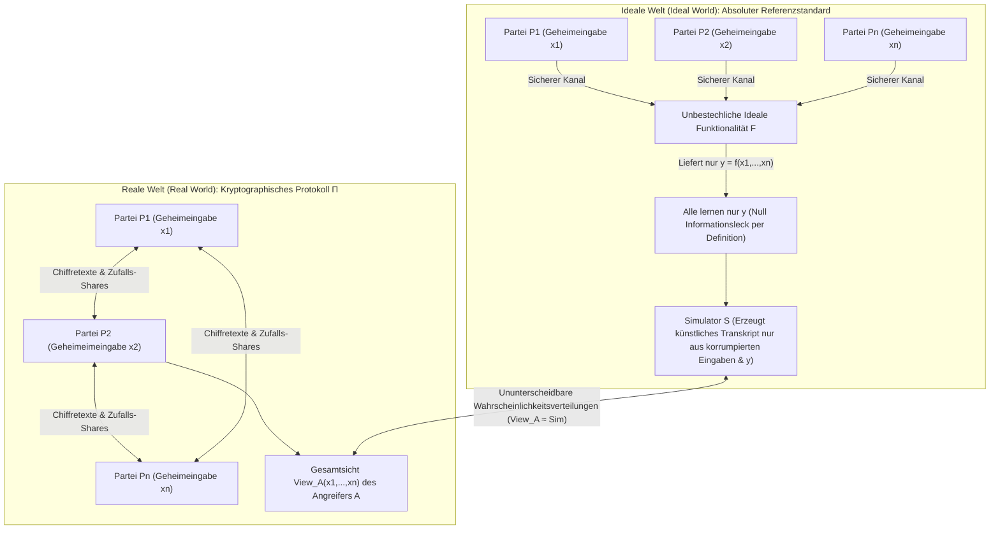
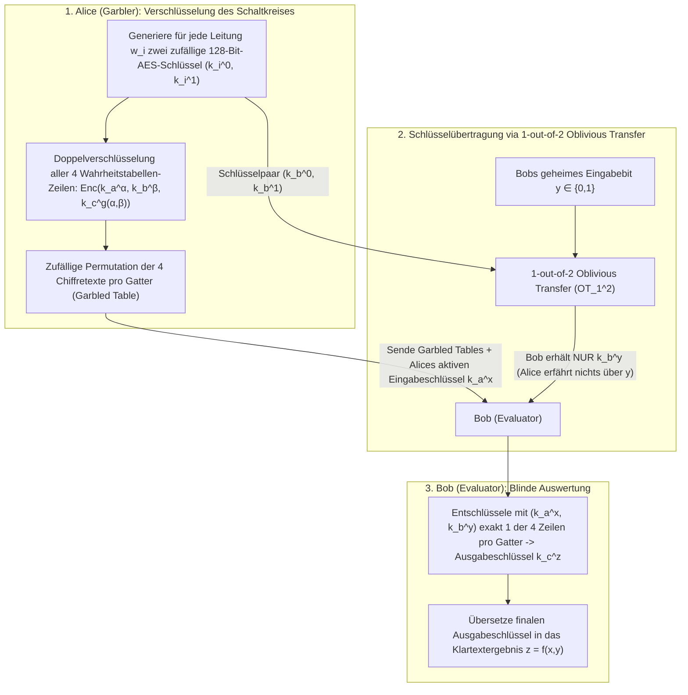

„Mehrere Krankenhäuser möchten Patientengenome gemeinsam analysieren und müssen dabei die geltenden gesetzlichen, vertraglichen und ethischen Anforderungen an die Datenverarbeitung beachten.“
„Konkurrierende Geschäftsbanken wollen gemeinsam Geldwäschenetzwerke aufdecken, ohne sich gegenseitig ihre Kundenlisten oder internen Transaktionsgraphen offenzulegen.“

Auf den ersten Blick scheint dies logisch unmöglich zu sein: Um eine Funktion $f(x_1, x_2, \dots, x_n)$ zu berechnen, müsste doch eine <strong>vertrauenswürdige dritte Partei (Trusted Third Party, TTP)</strong> zunächst alle geheimen Eingaben $x_i$ im Klartext sammeln. Doch Ende der 1980er-Jahre bewies die moderne Kryptographie ein revolutionäres Theorem: <strong>Unter einem ausdrücklich festgelegten Angreifermodell und kryptografischen Annahmen können Parteien gemeinsam eine Funktion berechnen; die Sicherheitsdefinition begrenzt zusätzliche Offenlegung über das durch erlaubte Ein- und Ausgaben Ableitbare hinaus.</strong>

Dieses Fachgebiet heißt <strong>Secure Multi-Party Computation (MPC, sichere Mehrparteienberechnung)</strong>. In diesem Artikel entwickeln wir ausgehend von zwei klassischen Gedankenexperimenten die beiden mathematischen Hauptmotoren von MPC: das <strong>arithmetische Secret-Sharing-Verfahren nach Adi Shamir (Lagrange-Interpolation, BGW und Beaver-Tripel)</strong> sowie den <strong>Booleschen Schaltkreis-Ansatz mittels Oblivious Transfer ($\text{OT}_1^2$) und Yaos Garbled Circuits</strong>.

---


**Einordnung der Sicherheitsangaben:** Aussagen, ein Geheimnis werde „nicht offengelegt“, gelten nur im jeweiligen Angreifermodell, der Sicherheitsdefinition und den kryptografischen Annahmen. Bewertet wird üblicherweise zusätzliche Offenlegung über zulässige Eingaben und Ausgaben hinaus; Rückschlüsse aus Ausgaben, Implementierung, Betrieb, Verfügbarkeit und Seitenkanäle erfordern eine eigene Prüfung.

## 1. Zwei paradoxe Gedankenexperimente: „Durchschnittsgehalt ohne Chef“ und „Yaos Millionärsproblem“

### 1.1 Gedankenexperiment 1: Das Durchschnittsgehalt berechnen, ohne Einzelgehälter zu verraten

Drei Ingenieure $A, B$ und $C$ möchten ihr <strong>durchschnittliches Jahresgehalt $\bar{x} = \frac{x_A + x_B + x_C}{3}$</strong> ermitteln, ohne dass jemand das individuelle Gehalt $x_A, x_B$ oder $x_C$ einer anderen Person erfährt. Mit <strong>additivem Secret Sharing (One-Time-Pad-Maskierung)</strong> gelingt dies allein mit Stift und Papier:

1. <strong>Zufallsmaske und erstes Flüstern ($A \to B$)</strong>: Alle einigen sich auf einen großen Modul $M$ (z. B. $M = 10^9$). Ingenieur $A$ wählt geheim eine gleichverteilte Zufallszahl $r \xleftarrow{\$} \mathbb{Z}_M$, addiert sein Gehalt $x_A$ und flüstert nur $s_1 = (x_A + r) \bmod M$ an $B$. Da $r$ gleichverteilt ist, ist auch $s_1$ in $\mathbb{Z}_M$ perfekt gleichverteilt – nach Shannons Theorem über das One-Time Pad beträgt die Transinformation $I(X_A; S_1) = 0$. $B$ lernt exakt <strong>null Bits</strong> über $x_A$.
2. <strong>Weitergabe ($B \to C \to A$)</strong>: $B$ addiert sein Gehalt $x_B$ und flüstert $s_2 = (x_A + x_B + r) \bmod M$ an $C$. $C$ addiert $x_C$ und nennt $s_3 = (x_A + x_B + x_C + r) \bmod M$ zurück an $A$.
3. <strong>Demaskierung</strong>: $A$ subtrahiert seine Zufallszahl $r$, erhält die exakte Summe $S = (s_3 - r) \bmod M = x_A + x_B + x_C$ und verkündet den Durchschnitt $\bar{x} = S / 3$.

> **Grenzen dieses Flüsterbeispiels:** Es ist eine Lehrillustration, kein sicheres MPC-Protokoll. Vorausgesetzt werden private Nachbarkanäle, ehrliches Verhalten und keine Kollusion. Teilen Bob und Carol beispielsweise ihre Beobachtungen, können sie zusammen mit der veröffentlichten Summe Alices Eingabe rekonstruieren. Für den Einsatz ist ein für das Bedrohungsmodell nachweislich sicheres Protokoll nötig. Außerdem muss $M$ größer als die Eingabesumme sein, damit kein modularer Überlauf entsteht.

> [!NOTE]
> <strong>Warum sind mindestens 3 Parteien ($n \ge 3$) nötig?</strong>
> Bei nur zwei Personen ($A$ und $B$) würde selbst ein Engel, der nur den Durchschnitt $\bar{x} = \frac{x_A + x_B}{2}$ verkündet, es $A$ erlauben, sofort $x_B = 2\bar{x} - x_A$ auszurechnen. Das ist kein Fehler des Protokolls, sondern eine Eigenschaft der Funktion selbst. <strong>MPC garantiert, dass über das hinaus, was logisch aus der eigenen Eingabe und dem Endergebnis folgt, während der Berechnung null Bits durchsickern.</strong>

### 1.2 Gedankenexperiment 2: Andrew Yaos „Millionärsproblem“ (1982)

Addition ist linear; doch was ist mit einem nichtlinearen <strong>Größenvergleich</strong>?
1982 formulierte der spätere Turing-Preisträger <strong>Andrew Chi-Chih Yao</strong> in seiner Arbeit *"Protocols for Secure Computations"* das berühmte <strong>Millionärsproblem</strong>: Alice ($x$ Millionen Dollar) und Bob ($y$ Millionen Dollar) wollen ohne Dritte lediglich das einzelne Wahrheitsbit $f(x, y) = [x > y] \in \{0, 1\}$ bestimmen, ohne den genauen Betrag oder auch nur die Differenz $x - y$ preiszugeben.

---

## 2. Mathematische Sicherheitsdefinition: Das Ideal/Real-Simulationsparadigma

Um Sicherheit mathematisch rigoros zu fassen, führten Goldreich, Micali und Wigderson (GMW 1987) das <strong>Ideal/Real-Simulationsparadigma</strong> ein:



Ein reales Protokoll $\Pi$ ist genau dann sicher, wenn ein effizienter <strong>Simulator $\mathcal{S}$</strong> existiert, der <em>allein aus den Eingaben und Ausgaben der korrumpierten Parteien $I$</em> ein künstliches Kommunikationsprotokoll erzeugt, das von der realen Sicht $\text{View}_I^\Pi(x_1, \dots, x_n)$ ununterscheidbar ist:
$$\left\{ \mathcal{S}\left(I, \{x_i\}_{i \in I}, \{y_i\}_{i \in I}\right) \right\} \stackrel{c}{\approx} \left\{ \text{View}_I^\Pi(x_1, \dots, x_n) \right\}$$
Man unterscheidet dabei zwischen <strong>semi-ehrlichen Angreifern (Semi-Honest / Passive)</strong>, die dem Protokoll folgen, aber alle Nachrichten analysieren, und <strong>bösartigen Angreifern (Malicious / Active)</strong>, die aktiv Nachrichten verfälschen.

---

## 3. Motor 1: Shamirs $(t, n)$-Secret-Sharing, Lagrange-Interpolation und BGW / SPDZ

### 3.1 Polynom-Sharing über $\mathbb{F}_p$ und Lagrange-Rekonstruktion
<strong>Adi Shamir (1979)</strong> bettet das Geheimnis $s \in \mathbb{F}_p$ ($p > n$ prim) als konstanten Term in ein zufälliges Polynom vom Grad $t - 1$ über dem endlichen Körper $\mathbb{F}_p$ ein:
$$P(x) = s + a_1 x + a_2 x^2 + \dots + a_{t-1} x^{t-1} \pmod p$$
Jede Partei $P_i$ erhält den Punkt $(x_i = i,\, y_i = P(x_i))$. Jede Teilmenge $T$ von mindestens $t$ Parteien rekonstruiert $s = P(0)$ exakt über die <strong>Lagrange-Interpolationsformel</strong>:
$$s = P(0) = \sum_{i \in T} y_i \prod_{j \in T,\, j \ne i} \frac{-x_j}{x_i - x_j} \pmod p$$
Für $t - 1$ oder weniger Parteien ist jedes $s' \in \mathbb{F}_p$ exakt gleich wahrscheinlich ($H(S \mid \text{Shares}_{t-1}) = H(S)$ – perfekte informationstheoretische Sicherheit).

### 3.2 BGW-Protokoll und Beavers Multiplikationstripel
Im <strong>BGW-Protokoll (1988)</strong> ist die <strong>Addition $[a] + [b] = [a + b]$ komplett kommunikationsfrei</strong> (lokale Addition der Shares). Bei der <strong>Multiplikation $[a] \cdot [b]$</strong> verdoppelt sich der Polynomgrad von $P(x)Q(x)$ auf $2(t-1)$, was $2t - 1 \le n$ (eine <strong>ehrliche Mehrheit, Honest Majority</strong>) sowie einen Gradreduktionsschritt erfordert.
<strong>Donald Beaver (1991)</strong> löste dieses Problem durch <strong>Multiplikationstripel $([u], [v], [w = u \cdot v \bmod p])$</strong>, die in einer Offline-Phase vorab erzeugt werden. In der Online-Phase öffnen die Parteien nur die mit den Einmal-Masken $u, v$ verschleierten Differenzen $d = (x - u) \bmod p$ und $e = (y - v) \bmod p$ und berechnen das Produkt rein lokal und linear:
$$[x \cdot y] = [w] + d \cdot [v] + e \cdot [u] + d \cdot e \pmod p$$

---

**Die Toleranzgrenzen hängen vom Angreifermodell ab:** Das klassische BGW toleriert im passiven Modell (ehrlich, aber neugierig) $c < n/2$; informationstheoretische Sicherheit gegen bösartige Parteien erfordert üblicherweise $c < n/3$ und passende Kommunikationsannahmen. Ein Beaver-Tripel allein legt keine Toleranzgrenze fest und garantiert keine aktive Sicherheit.

## 4. Motor 2: Oblivious Transfer (OT) und Yaos Garbled Circuits

Bei manchen Konstruktionen erfolgt die Auswertung der Schaltung nach der Eingabeübertragung lokal; die gesamte Zahl der Kommunikationsrunden hängt jedoch vom OT-Protokoll und der konkreten Ausführung ab.



<strong>Point-and-Permute</strong> bestimmt die zu entschlüsselnde Zeile, <strong>Free-XOR</strong> vermeidet das Garbling von XOR-Gattern und <strong>Half-Gates</strong> reduzieren die Kommunikation für AND-Gatter. Die Effizienz hängt von Schaltung, Implementierung, Hardware und Netzwerk ab; ein fester Geschwindigkeitsfaktor gilt nicht allgemein.

---

## 5. Vollständige Python-Implementierung: Shamir Secret Sharing & Beaver-Tripel über $\mathbb{F}_p$

Das Beispiel quadriert außerdem jedes Gehalt mit einem neuen Beaver-Tripel und gibt anschließend Summe und Quadratsumme frei, um Mittelwert und Populationsvarianz zu berechnen. Die Ausgaben werden der rekonstruierenden Partei offengelegt; die Demonstration ist eine Lehrsimulation in einem Prozess.

```python
import secrets
from typing import List, Tuple

# 61-bit Mersenne prime p = 2^61 - 1 for our prime finite field F_p
PRIME = (1 << 61) - 1

def mod_inv(a: int, p: int = PRIME) -> int:
    # Modular inverse in F_p via Extended Euclidean Algorithm (Python 3.8+ pow(a, -1, p))
    return pow(a % p, -1, p)

def shamir_share(secret: int, t: int, n: int, p: int = PRIME) -> List[Tuple[int, int]]:
    # Shamir's (t, n) Threshold Secret Sharing:
    # Samples a random degree-(t-1) polynomial P(x) with P(0) = secret and evaluates it at x = 1..n.
    assert 1 <= t <= n < p, "Threshold t and party count n must satisfy 1 <= t <= n < p"
    # P(x) = s + a_1 * x + a_2 * x^2 + ... + a_{t-1} * x^{t-1} (mod p)
    coeffs = [secret % p] + [secrets.randbelow(p) for _ in range(t - 1)]

    shares = []
    for i in range(1, n + 1):
        # Evaluate P(i) using Horner's method
        y = 0
        for c in reversed(coeffs):
            y = (y * i + c) % p
        shares.append((i, y))
    return shares

def lagrange_reconstruct(shares: List[Tuple[int, int]], p: int = PRIME) -> int:
    # Reconstructs P(0) = s from any subset of >= t shares using Lagrange Polynomial Interpolation:
    # s = sum_{i in T} y_i * prod_{j in T, j != i} (-x_j) / (x_i - x_j) (mod p)
    secret = 0
    k = len(shares)
    for i in range(k):
        xi, yi = shares[i]
        num = 1
        den = 1
        for j in range(k):
            if i == j:
                continue
            xj, _ = shares[j]
            num = (num * (-xj)) % p
            den = (den * (xi - xj)) % p
        lambda_i = (num * mod_inv(den, p)) % p
        secret = (secret + yi * lambda_i) % p
    return secret

def mpc_add(shares_a: List[Tuple[int, int]], shares_b: List[Tuple[int, int]], p: int = PRIME) -> List[Tuple[int, int]]:
    # Local homomorphic addition [a] + [b] = [a + b] (Zero communication)
    return [(xa, (ya + yb) % p) for (xa, ya), (xb, yb) in zip(shares_a, shares_b)]

def mpc_sub(shares_a: List[Tuple[int, int]], shares_b: List[Tuple[int, int]], p: int = PRIME) -> List[Tuple[int, int]]:
    # Local homomorphic subtraction [a] - [b] = [a - b] (Zero communication)
    return [(xa, (ya - yb) % p) for (xa, ya), (xb, yb) in zip(shares_a, shares_b)]

def mpc_scalar_mul(scalar: int, shares_a: List[Tuple[int, int]], p: int = PRIME) -> List[Tuple[int, int]]:
    # Local multiplication by a public scalar c * [a] = [c * a] (Zero communication)
    return [(xa, (scalar * ya) % p) for xa, ya in shares_a]

def mpc_add_constant(const: int, shares_a: List[Tuple[int, int]], p: int = PRIME) -> List[Tuple[int, int]]:
    # Adding a public constant [a] + c = [a + c] shifts P(x) by +c at every evaluation point
    return [(xa, (ya + const) % p) for xa, ya in shares_a]

def generate_beaver_triple(t: int, n: int, p: int = PRIME):
    # Offline Preprocessing Phase: Generates a shared random multiplication triple ([u], [v], [w = u * v])
    u = secrets.randbelow(p)
    v = secrets.randbelow(p)
    w = (u * v) % p
    return shamir_share(u, t, n, p), shamir_share(v, t, n, p), shamir_share(w, t, n, p)

def mpc_beaver_mul(
    shares_x: List[Tuple[int, int]],
    shares_y: List[Tuple[int, int]],
    triple: Tuple[List[Tuple[int, int]], List[Tuple[int, int]], List[Tuple[int, int]]],
    t: int,
    p: int = PRIME
) -> List[Tuple[int, int]]:
    # Online Phase: Evaluates [x * y] using a Beaver Multiplication Triple ([u], [v], [w]):
    # 1. Locally compute [d] = [x] - [u] and [e] = [y] - [v]
    # 2. Open masked differences; security depends on fresh, valid, single-use triples and the threat model
    # 3. Locally compute the linear combination [x * y] = [w] + d * [v] + e * [u] + d * e
    shares_u, shares_v, shares_w = triple
    shares_d = mpc_sub(shares_x, shares_u, p)
    shares_e = mpc_sub(shares_y, shares_v, p)

    # Open the masked differences d = x - u and e = y - v using t shares
    d = lagrange_reconstruct(shares_d[:t], p)
    e = lagrange_reconstruct(shares_e[:t], p)

    # Linear combination to obtain degree-(t-1) shares of [x * y]
    term1 = shares_w
    term2 = mpc_scalar_mul(d, shares_v, p)
    term3 = mpc_scalar_mul(e, shares_u, p)
    res = mpc_add(mpc_add(term1, term2, p), term3, p)
    res = mpc_add_constant((d * e) % p, res, p)
    return res

if __name__ == "__main__":
    # 5 MPC servers (n = 5) with reconstruction threshold t = 3 (any 2 servers learn 0 bits)
    t, n = 3, 5
    salaries = [850, 920, 780]  # Example salary units

    # Each engineer splits their secret salary across the 5 servers
    shared_salaries = [shamir_share(s, t, n) for s in salaries]

    # 1. Compute the sum of salaries locally with zero inter-server communication
    sum_shares = shared_salaries[0]
    for s_share in shared_salaries[1:]:
        sum_shares = mpc_add(sum_shares, s_share)

    # Reconstruct the total from any 3 servers (e.g., servers 1, 3, and 5)
    subset_3 = [sum_shares[0], sum_shares[2], sum_shares[4]]
    total_salary = lagrange_reconstruct(subset_3)
    mean_salary = total_salary / len(salaries)
    print(f"Reconstructed total (units): {total_salary:,} (mean: {mean_salary:,.2f})")

    # 2. Compute the sum of squares S_2 = x_A^2 + x_B^2 + x_C^2 using Beaver Multiplication Triples
    sq_sum_shares = shamir_share(0, t, n)
    for s_share in shared_salaries:
        triple = generate_beaver_triple(t, n)
        sq_share = mpc_beaver_mul(s_share, s_share, triple, t)
        sq_sum_shares = mpc_add(sq_sum_shares, sq_share)

    total_sq = lagrange_reconstruct(sq_sum_shares[:t])
    variance = (total_sq / len(salaries)) - (mean_salary ** 2)
    print(f"Reconstructed sum of squares: {total_sq:,} (population variance: {variance:,.2f})")
```

---

## 6. Vergleich der Privacy-Enhancing Technologies (PETs) und reale Anwendungen

| Kriterium | Secure Multi-Party Computation (MPC) | Volle Homomorphe Verschlüsselung (FHE) | Zero-Knowledge-Beweise (ZKP) | Trusted Execution Environment (TEE) |
| :--- | :--- | :--- | :--- | :--- |
| <strong>Kernproblem</strong> | <strong>Gemeinsame Berechnung</strong> über verteilte Geheimeingaben $x_1, \dots, x_n$ | <strong>Blinde Cloud-Berechnung</strong> auf Chiffretexten $\text{Enc}(x) \mapsto \text{Enc}(f(x))$ | <strong>Verifikation einer Aussage $f(x, w)=1$</strong> durch einen Beweiser, der $w$ bereits kennt | <strong>Hardware-isolierte Ausführung</strong> im Klartext innerhalb einer CPU-Enklave |
| <strong>Hauptengpass</strong> | Kommunikationsaufwand hängt von Protokoll, Schaltungstiefe und Netzwerk ab | Rechen- und Kommunikationsaufwand hängen von Verfahren, Schaltung und Hardware ab; ein allgemeiner fester Verlangsamungsfaktor gilt nicht | Aufwand für Erzeugung und Prüfung hängt vom Beweissystem und der Aussage ab | Leistung und sicherer Speicher hängen von Plattform und Arbeitslast ab |
| <strong>Vertrauensmodell</strong> | Die MPC-Sicherheit hängt von Schwelle und Angreifermodell des Protokolls ab; Ausgabebezogene Lecks, Verfügbarkeit und Fairness sind gesondert zu bewerten. | <strong>Kryptographische Gitterannahmen (RLWE)</strong> | <strong>Mathematische Soundness</strong> (kombiniert allein keine fremden Geheimnisse) | <strong>Vertrauen in Chip-Hersteller (Intel/AMD)</strong>; anfällig für Seitenkanalangriffe |

Beispiele aus Forschung und Anwendung reichen von der dänischen Zuckerrübenauktion und der Messung des Lohngefälles in Boston bis zu Passwortprüfungen, Genomik und verteilten Signaturen. Reifegrad, Sicherheitsmodell und verbleibende Risiken unterscheiden sich; MPC ersetzt institutionelles Vertrauen nicht durch absolute Gewissheit.

## 7. Weitere PETs und ihre Grenzen

Historischer Hinweis: Rabins OT von 1981 (Empfang mit Wahrscheinlichkeit 1/2) unterscheidet sich von der 1-aus-2-OT-Funktion, die Even, Goldreich und Lempel 1985 formulierten.
MPC verteilt Eingaben auf Parteien; seine Garantien hängen vom Protokoll und Angreifermodell ab. FHE ermöglicht Berechnungen auf Chiffretexten, prüft aber nicht automatisch die Berechnung und schützt nicht vor Informationslecks aus Ergebnissen. Zero-Knowledge-Beweise belegen Aussagen ohne Offenlegung des Zeugen, ersetzen aber keine gemeinsame Berechnung. TEE verarbeitet Klartext in geschützter Hardware und setzt Vertrauen in Hardware und Attestierung voraus. Verfahren können kombiniert werden; Kosten und Garantien sind anwendungsabhängig.

## 8. Beispiele
Die dänische Zuckerrübenauktion von 2008 verwendete Drei-Parteien-MPC; die Veröffentlichung berichtet von etwa 1.200 Eingaben, rund 30 Minuten Berechnung und 25.000 Tonnen übertragenen Rechten. BWWC und Boston University veröffentlichen Lohnlückenberichte alle zwei Jahre; 2023 umfasste der Bericht laut BWWC 103 Arbeitgeber und 165.000 Vollzeitbeschäftigte. Google Chrome und Apple dokumentieren unterschiedliche PSI-basierte Passwortprüfungen. Eine USENIX-Studie von 2023 meldete Seitenkanäle in der untersuchten Chrome-Implementierung. MPC-GWAS wurden in Forschung demonstriert; Ergebnisse können dennoch Informationen offenbaren. Secure Aggregation schützt einzelne Updates, aber nicht alle Rückschlüsse aus Aggregaten. Schwellensignaturen und proaktives Teilen-Refresh haben protokoll- und betriebsabhängige Voraussetzungen.

## 9. Fazit
MPC reduziert die zentrale Sammlung von Klartextdaten, beseitigt aber weder Informationslecks aus Ergebnissen noch betriebliche, rechtliche und Verfügbarkeitsrisiken. Die Garantien hängen von Angreifermodell, kryptografischen Annahmen, Implementierung und Betrieb ab.

**Umfang des Codebeispiels:** Der Python-Code ist eine Lehrsimulation in einem einzelnen Prozess für Secret Sharing und Rechnen über einem endlichen Körper. Er ist kein vernetztes MPC-System, in dem jede Partei nur ihre eigenen Anteile hält. Prüfungen gegen böswillige Teilnehmer, Authentifizierung und sichere Übertragung, vertrauenswürdige Vorverarbeitung sowie Eingabebereichs- und Überlaufkontrollen fehlen. Von `lagrange_reconstruct` rekonstruierte Werte werden der rekonstruierenden Partei offengelegt. Verwenden Sie das Beispiel nicht zum Schutz realer Daten oder Vermögenswerte.


## Sources

- [Rabin, “How to Exchange Secrets with Oblivious Transfer” (1981)](https://eprint.iacr.org/2005/187.pdf)
- [Even, Goldreich, and Lempel, “A Randomized Protocol for Signing Contracts” (1985)](https://luca-giuzzi.unibs.it/corsi/Support/papers-cryptography/SigningContracts.pdf)

- [Bogetoft et al., “Secure Multiparty Computation Goes Live” (2009)](https://www.acsu.buffalo.edu/~mblanton/cse715/sugar-beet-auction.pdf)
- [Boston Women’s Workforce Council: Wage Gap Studies](https://thebwwc.org/wage-gap-studies)
- [Google: Better password protections in Chrome](https://security.googleblog.com/2019/12/better-password-protections-in-chrome.html)
- [Apple Platform Security: Password Monitoring](https://support.apple.com/guide/security/password-monitoring-sec78e79fc3b/web)
- [Kwong et al., USENIX Security 2023: Chrome password-check side channels](https://www.usenix.org/conference/usenixsecurity23/presentation/kwong)
- [Cho et al., “Secure genome-wide association analysis using multiparty computation” (2018)](https://pmc.ncbi.nlm.nih.gov/articles/PMC5990440/)
- [Bonawitz et al., Google Research: Practical Secure Aggregation](https://research.google/pubs/practical-secure-aggregation-for-federated-learning-on-user-held-data/)
- [Canetti et al., “UC Non-Interactive, Proactive, Threshold ECDSA” (2020)](https://eprint.iacr.org/2020/492)
- [Kumar et al., “Understanding Information Disclosure from Secure Computation Output” (2025)](https://doi.org/10.1145/3705004)
- [Kolesnikov and Schneider, “Improved Garbled Circuit: Free XOR Gates and Applications” (2008)](https://encrypto.de/papers/KS08XOR.pdf)
- [Zahur, Rosulek, and Evans, “Two Halves Make a Whole: Reducing Data Transfer in Garbled Circuits using Half Gates” (2015)](https://www.cs.virginia.edu/~evans/pubs/ec2015/halfgates.pdf)

- [Stanford University cryptography notes: Oblivious Transfer](https://crypto.stanford.edu/pbc/notes/crypto/ot.html)

- [A Full Proof of the BGW Protocol for Perfectly Secure MPC](https://doi.org/10.1007/S00145-015-9214-4)

- [Yao, “Protocols for Secure Computations” (FOCS 1982)](https://doi.org/10.1109/SFCS.1982.38)
