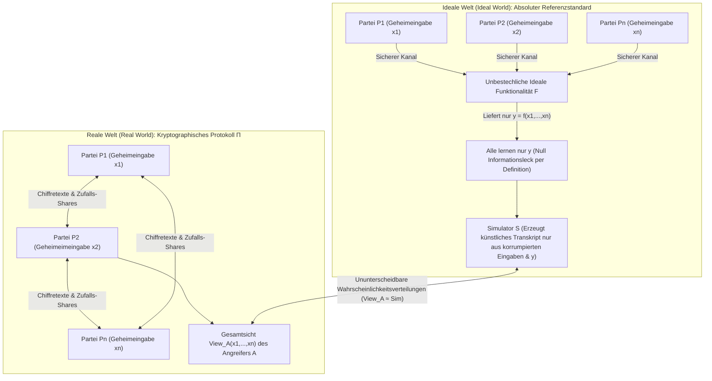
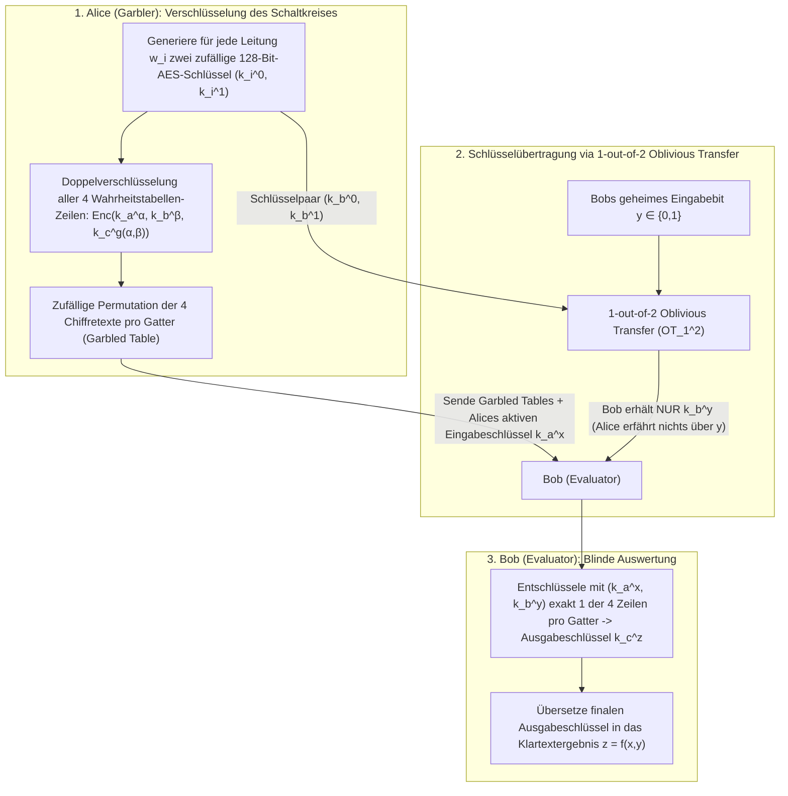

„Mehrere Universitätskliniken möchten die Genomdaten ihrer Krebspatienten für eine gemeinsame statistische Studie (GWAS) zusammenführen, doch Datenschutzgesetze (DSGVO / HIPAA) verbieten es strikt, auch nur ein einziges Byte an Rohdaten nach außen zu geben.“
„Konkurrierende Geschäftsbanken wollen gemeinsam Geldwäschenetzwerke aufdecken, ohne sich gegenseitig ihre Kundenlisten oder internen Transaktionsgraphen offenzulegen.“

Auf den ersten Blick scheint dies logisch unmöglich zu sein: Um eine Funktion $f(x_1, x_2, \dots, x_n)$ zu berechnen, müsste doch eine <strong>vertrauenswürdige dritte Partei (Trusted Third Party, TTP)</strong> zunächst alle geheimen Eingaben $x_i$ im Klartext sammeln. Doch Ende der 1980er-Jahre bewies die moderne Kryptographie ein revolutionäres Theorem: <strong>Selbst ohne jede vertrauenswürdige Instanz können einander misstrauende Parteien gemeinsam jede berechenbare Funktion $f(x_1, \dots, x_n)$ auswerten, sodass jeder das korrekte Ergebnis erfährt, aber niemand auch nur ein einziges zusätzliches Bit über die geheimen Eingaben $x_i$ der anderen lernt.</strong>

Dieses Fachgebiet heißt <strong>Secure Multi-Party Computation (MPC, sichere Mehrparteienberechnung)</strong>. In diesem Artikel entwickeln wir ausgehend von zwei klassischen Gedankenexperimenten die beiden mathematischen Hauptmotoren von MPC: das <strong>arithmetische Secret-Sharing-Verfahren nach Adi Shamir (Lagrange-Interpolation, BGW und Beaver-Tripel)</strong> sowie den <strong>Booleschen Schaltkreis-Ansatz mittels Oblivious Transfer ($\text{OT}_1^2$) und Yaos Garbled Circuits</strong>.

---

## 1. Zwei paradoxe Gedankenexperimente: „Durchschnittsgehalt ohne Chef“ und „Yaos Millionärsproblem“

### 1.1 Gedankenexperiment 1: Das Durchschnittsgehalt berechnen, ohne Einzelgehälter zu verraten

Drei Ingenieure $A, B$ und $C$ möchten ihr <strong>durchschnittliches Jahresgehalt $\bar{x} = \frac{x_A + x_B + x_C}{3}$</strong> ermitteln, ohne dass jemand das individuelle Gehalt $x_A, x_B$ oder $x_C$ einer anderen Person erfährt. Mit <strong>additivem Secret Sharing (One-Time-Pad-Maskierung)</strong> gelingt dies allein mit Stift und Papier:

1. <strong>Zufallsmaske und erstes Flüstern ($A \to B$)</strong>: Alle einigen sich auf einen großen Modul $M$ (z. B. $M = 10^9$). Ingenieur $A$ wählt geheim eine gleichverteilte Zufallszahl $r \xleftarrow{\$} \mathbb{Z}_M$, addiert sein Gehalt $x_A$ und flüstert nur $s_1 = (x_A + r) \bmod M$ an $B$. Da $r$ gleichverteilt ist, ist auch $s_1$ in $\mathbb{Z}_M$ perfekt gleichverteilt – nach Shannons Theorem über das One-Time Pad beträgt die Transinformation $I(X_A; S_1) = 0$. $B$ lernt exakt <strong>null Bits</strong> über $x_A$.
2. <strong>Weitergabe ($B \to C \to A$)</strong>: $B$ addiert sein Gehalt $x_B$ und flüstert $s_2 = (x_A + x_B + r) \bmod M$ an $C$. $C$ addiert $x_C$ und nennt $s_3 = (x_A + x_B + x_C + r) \bmod M$ zurück an $A$.
3. <strong>Demaskierung</strong>: $A$ subtrahiert seine Zufallszahl $r$, erhält die exakte Summe $S = (s_3 - r) \bmod M = x_A + x_B + x_C$ und verkündet den Durchschnitt $\bar{x} = S / 3$.

> [!NOTE]
> <strong>Warum sind mindestens 3 Parteien ($n \ge 3$) nötig?</strong>
> Bei nur zwei Personen ($A$ und $B$) würde selbst ein Engel, der nur den Durchschnitt $\bar{x} = \frac{x_A + x_B}{2}$ verkündet, es $A$ erlauben, sofort $x_B = 2\bar{x} - x_A$ auszurechnen. Das ist kein Fehler des Protokolls, sondern eine Eigenschaft der Funktion selbst. <strong>MPC garantiert, dass über das hinaus, was logisch aus der eigenen Eingabe und dem Endergebnis folgt, während der Berechnung null Bits durchsickern.</strong>

### 1.2 Gedankenexperiment 2: Andrew Yaos „Millionärsproblem“ (1982)

Addition ist linear; doch was ist mit einem nichtlinearen <strong>Größenvergleich</strong>?
1982 formulierte der spätere Turing-Preisträger <strong>Andrew Chi-Chih Yao</strong> in seiner Arbeit *"Protocols for Secure Computations"* das berühmte <strong>Millionärsproblem</strong>: Alice ($x$ Millionen Dollar) und Bob ($y$ Millionen Dollar) wollen ohne Dritte lediglich das einzelne Wahrheitsbit $f(x, y) = [x > y] \in \{0, 1\}$ bestimmen, ohne den genauen Betrag oder auch nur die Differenz $x - y$ preiszugeben.

---

## 2. Mathematische Sicherheitsdefinition: Das Ideal/Real-Simulationsparadigma

Um Sicherheit mathematisch rigoros zu fassen, führten Goldreich, Micali und Wigderson (GMW 1987) das <strong>Ideal/Real-Simulationsparadigma</strong> ein:



Ein reales Protokoll $\Pi$ ist genau dann sicher, wenn ein effizienter <strong>Simulator $\mathcal{S}$</strong> existiert, der <em>allein aus den Eingaben und Ausgaben der korrumpierten Parteien $I$</em> ein künstliches Kommunikationsprotokoll erzeugt, das von der realen Sicht $\text{View}_I^\Pi(x_1, \dots, x_n)$ ununterscheidbar ist:
$$\left\{ \mathcal{S}\left(I, \{x_i\}_{i \in I}, \{y_i\}_{i \in I}\right) \right\} \stackrel{c}{\approx} \left\{ \text{View}_I^\Pi(x_1, \dots, x_n) \right\}$$
Man unterscheidet dabei zwischen <strong>semi-ehrlichen Angreifern (Semi-Honest / Passive)</strong>, die dem Protokoll folgen, aber alle Nachrichten analysieren, und <strong>bösartigen Angreifern (Malicious / Active)</strong>, die aktiv Nachrichten verfälschen.

---

## 3. Motor 1: Shamirs $(t, n)$-Secret-Sharing, Lagrange-Interpolation und BGW / SPDZ

### 3.1 Polynom-Sharing über $\mathbb{F}_p$ und Lagrange-Rekonstruktion
<strong>Adi Shamir (1979)</strong> bettet das Geheimnis $s \in \mathbb{F}_p$ ($p > n$ prim) als konstanten Term in ein zufälliges Polynom vom Grad $t - 1$ über dem endlichen Körper $\mathbb{F}_p$ ein:
$$P(x) = s + a_1 x + a_2 x^2 + \dots + a_{t-1} x^{t-1} \pmod p$$
Jede Partei $P_i$ erhält den Punkt $(x_i = i,\, y_i = P(x_i))$. Jede Teilmenge $T$ von mindestens $t$ Parteien rekonstruiert $s = P(0)$ exakt über die <strong>Lagrange-Interpolationsformel</strong>:
$$s = P(0) = \sum_{i \in T} y_i \prod_{j \in T,\, j \ne i} \frac{-x_j}{x_i - x_j} \pmod p$$
Für $t - 1$ oder weniger Parteien ist jedes $s' \in \mathbb{F}_p$ exakt gleich wahrscheinlich ($H(S \mid \text{Shares}_{t-1}) = H(S)$ – perfekte informationstheoretische Sicherheit).

### 3.2 BGW-Protokoll und Beavers Multiplikationstripel
Im <strong>BGW-Protokoll (1988)</strong> ist die <strong>Addition $[a] + [b] = [a + b]$ komplett kommunikationsfrei</strong> (lokale Addition der Shares). Bei der <strong>Multiplikation $[a] \cdot [b]$</strong> verdoppelt sich der Polynomgrad von $P(x)Q(x)$ auf $2(t-1)$, was $2t - 1 \le n$ (eine <strong>ehrliche Mehrheit, Honest Majority</strong>) sowie einen Gradreduktionsschritt erfordert.
<strong>Donald Beaver (1991)</strong> löste dieses Problem durch <strong>Multiplikationstripel $([u], [v], [w = u \cdot v \bmod p])$</strong>, die in einer Offline-Phase vorab erzeugt werden. In der Online-Phase öffnen die Parteien nur die mit den Einmal-Masken $u, v$ verschleierten Differenzen $d = (x - u) \bmod p$ und $e = (y - v) \bmod p$ und berechnen das Produkt rein lokal und linear:
$$[x \cdot y] = [w] + d \cdot [v] + e \cdot [u] + d \cdot e \pmod p$$

---

## 4. Motor 2: Oblivious Transfer ($\text{OT}_1^2$) und Yaos Garbled Circuits

Für bitweise Vergleiche ($x > y$) nutzt MPC Boolesche Schaltkreise in konstanter Rundenzahl $O(1)$:



Mittels <strong>Michael Rabins 1-out-of-2 Oblivious Transfer ($\text{OT}_1^2$)</strong> erhält Bob genau den Schlüssel $k_b^y$ für sein geheimes Bit $y \in \{0, 1\}$, ohne dass Alice $y$ erfährt. Durch die modernen Optimierungen <strong>Point-and-Permute</strong> (Farbbits zeigen direkt auf die einzige zu entschlüsselnde Zeile), <strong>Free-XOR</strong> ($k_i^1 = k_i^0 \oplus \Delta$ macht alle `XOR`-Gatter komplett chiffren- und rechenfrei) und <strong>Half-Gates</strong> (nur 2 Chiffretexte pro `AND`-Gatter) wurden Garbled Circuits um den Faktor $1000$ beschleunigt.

---

## 5. Vollständige Python-Implementierung: Shamir Secret Sharing & Beaver-Tripel über $\mathbb{F}_p$

```python
import secrets
from typing import List, Tuple

PRIME = (1 << 61) - 1  # 61-Bit-Mersenne-Primzahl p = 2^61 - 1

def mod_inv(a: int, p: int = PRIME) -> int:
    return pow(a % p, -1, p)

def shamir_share(secret: int, t: int, n: int, p: int = PRIME) -> List[Tuple[int, int]]:
    coeffs = [secret % p] + [secrets.randbelow(p) for _ in range(t - 1)]
    shares = []
    for i in range(1, n + 1):
        y = 0
        for c in reversed(coeffs):
            y = (y * i + c) % p
        shares.append((i, y))
    return shares

def lagrange_reconstruct(shares: List[Tuple[int, int]], p: int = PRIME) -> int:
    secret = 0
    k = len(shares)
    for i in range(k):
        xi, yi = shares[i]
        num, den = 1, 1
        for j in range(k):
            if i != j:
                xj, _ = shares[j]
                num = (num * (-xj)) % p
                den = (den * (xi - xj)) % p
        secret = (secret + yi * num * mod_inv(den, p)) % p
    return secret

def mpc_add(sa, sb, p=PRIME):
    return [(xa, (ya + yb) % p) for (xa, ya), (_, yb) in zip(sa, sb)]

def mpc_sub(sa, sb, p=PRIME):
    return [(xa, (ya - yb) % p) for (xa, ya), (_, yb) in zip(sa, sb)]

def mpc_scalar_mul(c, sa, p=PRIME):
    return [(xa, (c * ya) % p) for xa, ya in sa]

def mpc_add_const(c, sa, p=PRIME):
    return [(xa, (ya + c) % p) for xa, ya in sa]

def generate_beaver_triple(t: int, n: int, p: int = PRIME):
    u, v = secrets.randbelow(p), secrets.randbelow(p)
    return shamir_share(u, t, n, p), shamir_share(v, t, n, p), shamir_share((u * v) % p, t, n, p)

def mpc_beaver_mul(sx, sy, triple, t: int, p: int = PRIME):
    su, sv, sw = triple
    d = lagrange_reconstruct(mpc_sub(sx, su, p)[:t], p)
    e = lagrange_reconstruct(mpc_sub(sy, sv, p)[:t], p)
    res = mpc_add(mpc_add(sw, mpc_scalar_mul(d, sv, p), p), mpc_scalar_mul(e, su, p), p)
    return mpc_add_const((d * e) % p, res, p)

if __name__ == "__main__":
    t, n = 3, 5
    salaries = [85000, 92000, 78000]
    shared = [shamir_share(s, t, n) for s in salaries]
    total_shares = shared[0]
    for s in shared[1:]:
        total_shares = mpc_add(total_shares, s)
    print("Rekonstruierte Gesamtsumme:", lagrange_reconstruct(total_shares[:t]))
```

---

## 6. Vergleich der Privacy-Enhancing Technologies (PETs) und reale Anwendungen

| Kriterium | Secure Multi-Party Computation (MPC) | Volle Homomorphe Verschlüsselung (FHE) | Zero-Knowledge-Beweise (ZKP) | Trusted Execution Environment (TEE) |
| :--- | :--- | :--- | :--- | :--- |
| <strong>Kernproblem</strong> | <strong>Gemeinsame Berechnung</strong> über verteilte Geheimeingaben $x_1, \dots, x_n$ | <strong>Blinde Cloud-Berechnung</strong> auf Chiffretexten $\text{Enc}(x) \mapsto \text{Enc}(f(x))$ | <strong>Verifikation einer Aussage $f(x, w)=1$</strong> durch einen Beweiser, der $w$ bereits kennt | <strong>Hardware-isolierte Ausführung</strong> im Klartext innerhalb einer CPU-Enklave |
| <strong>Hauptengpass</strong> | Extrem schnelle CPU-Operationen, aber <strong>Netzwerkkommunikation pro Multiplikationsschicht</strong> | Nur 1 Nachrichtenrunde, aber <strong>CPU-Rechenzeit $10^3$- bis $10^5$-mal langsamer</strong> | Schnelle Verifikation, hoher Rechenaufwand beim Beweiser (MSM / FFT) | Nahezu native Geschwindigkeit, aber begrenzte Enklaven-Speichergröße |
| <strong>Vertrauensmodell</strong> | <strong>Nicht-Kollusions-Annahme</strong> (weniger als $t$ Server kolludieren) | <strong>Kryptographische Gitterannahmen (RLWE)</strong> | <strong>Mathematische Soundness</strong> (kombiniert allein keine fremden Geheimnisse) | <strong>Vertrauen in Chip-Hersteller (Intel/AMD)</strong>; anfällig für Seitenkanalangriffe |

Von der historischen <strong>dänischen Zuckerrüben-Doppelauktion 2008</strong> über die <strong>Gehaltslücken-Studie der Stadt Boston (BWWC)</strong>, den <strong>Passwort-Leck-Check in Google Chrome und Apple iCloud (Private Set Intersection, PSI)</strong> und <strong>klinische Genomstudien (Secure GWAS)</strong> bis hin zu <strong>MPC-Threshold-Krypto-Wallets (Fireblocks, Coinbase)</strong> ersetzt MPC heute blindes Vertrauen durch mathematische Gewissheit.
