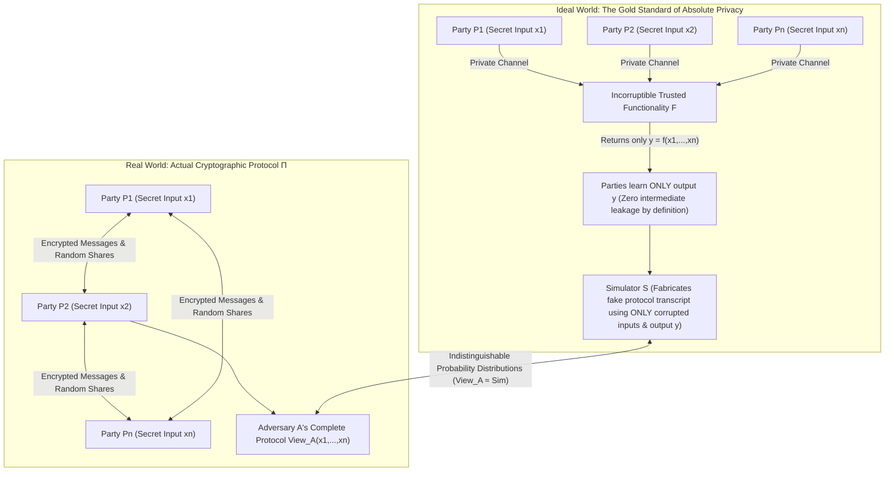
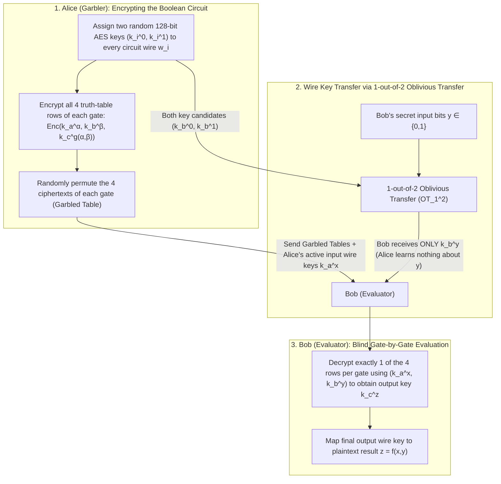
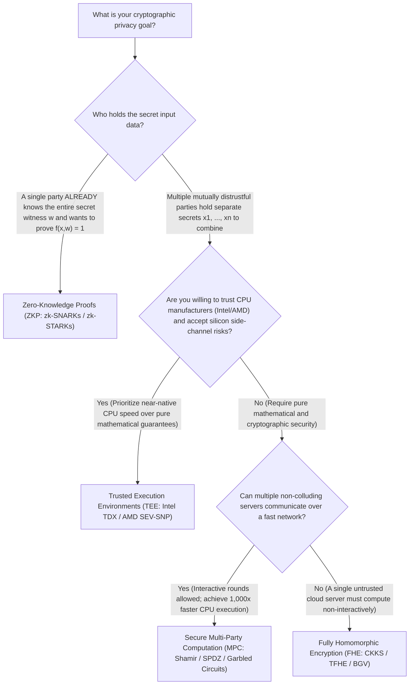

"Multiple research hospitals want to pool their oncology patients' genomic sequences to run a statistically significant genome-wide association study (GWAS), yet strict privacy regulations (HIPAA and GDPR) forbid any hospital from exposing a single byte of raw patient data outside its firewall."
"Competing commercial banks want to jointly trace cross-institutional money-laundering rings without revealing their proprietary customer lists or internal transaction graphs to one another."

At first glance, these requirements appear to violate the laws of logic. To evaluate any nontrivial function $f(x_1, x_2, \dots, x_n)$, surely someone—or some central server—must first collect all the inputs $x_1, x_2, \dots, x_n$, decrypt them into plaintext in memory, and execute the algorithm. For centuries, humanity solved this dilemma only by relying on a <strong>Trusted Third Party (TTP)</strong>—an escrow agent, central bank, auditor, or cloud provider who promises never to peek at or leak the raw inputs.

Yet in the late 1980s, modern cryptography proved one of the most counterintuitive theorems in computer science: <strong>even in a world with zero trusted third parties, mutually distrustful participants can jointly evaluate any computable function $f(x_1, \dots, x_n)$ such that everyone learns the correct output, while no participant learns a single bit of information about anyone else's private input $x_i$ beyond what is logically implied by the output itself.</strong>

This discipline is known as <strong>Secure Multi-Party Computation (MPC)</strong>. In this article, we begin with two deceptively simple thought experiments that require nothing more than pen and paper. From there, we derive the two foundational mathematical engines of MPC:
1. <strong>The Arithmetic Circuit Engine</strong>: <strong>Adi Shamir's $(t, n)$ Threshold Secret Sharing</strong> over a finite field $\mathbb{F}_p$ via <strong>Lagrange Polynomial Interpolation</strong>, the <strong>BGW Protocol</strong>, and <strong>Donald Beaver's Multiplication Triples</strong> (the backbone of modern <strong>SPDZ</strong>).
2. <strong>The Boolean Circuit Engine</strong>: <strong>Michael Rabin's 1-out-of-2 Oblivious Transfer ($\text{OT}_1^2$)</strong> and <strong>Andrew Yao's Garbled Circuits</strong>, together with the modern breakthroughs (<strong>Point-and-Permute</strong>, <strong>Free-XOR</strong>, and <strong>Half-Gates</strong>) that accelerated encrypted circuit evaluation by three orders of magnitude.

Finally, we provide a complete, runnable Python implementation from scratch, contrast MPC against <strong>Fully Homomorphic Encryption (FHE)</strong>, <strong>Zero-Knowledge Proofs (ZKPs)</strong>, and <strong>Trusted Execution Environments (TEEs)</strong>, and examine how MPC powers everything from the historic 2008 Danish sugar beet auction to browser password leak checks and institutional crypto custody wallets.

---

## 1. Two Paradoxical Thought Experiments: "The Salary Average Without a Boss" and "Yao's Millionaires' Problem"

To build an intuitive feel for computing on invisible data, let us examine two classic puzzles that gave birth to multi-party cryptography.

### 1.1 Thought Experiment 1: Computing the Average Salary Without Revealing Individual Salaries

Three software engineers—Alice ($A$), Bob ($B$), and Carol ($C$)—are sitting around a coffee table. They want to know their <strong>average annual salary</strong>
$$\bar{x} = \frac{x_A + x_B + x_C}{3}$$
to see how their compensation compares to the market. However, out of personal privacy and company policy, <strong>none of them is willing to let either of the other two learn their individual salary $x_A, x_B,$ or $x_C$</strong>. There is no manager, HR representative, or trusted third party available. Using only pen, paper, and private whispers between pairs of engineers, how can they compute the exact sum $S = x_A + x_B + x_C$ without leaking a single bit of any individual's salary?

If Alice simply whispers her salary $x_A = \$120,000$ to Bob so he can add $x_B$, Alice's privacy is immediately destroyed. Instead, Alice uses a foundational cryptographic trick: <strong>masking her input with a uniform random number (a one-time pad) over a finite ring</strong>.

1. <strong>Random Mask Generation and First Whisper ($A \to B$)</strong>:
   The three engineers agree publicly on a modulus $M$ that is guaranteed to be strictly larger than the sum of all three salaries (for instance, $M = 10^9$). All arithmetic will be performed modulo $M$, inside the ring $\mathbb{Z}_M = \{0, 1, \dots, M-1\}$.
   Alice secretly generates a uniformly distributed random integer $r \xleftarrow{\$} \mathbb{Z}_M$ (say, $r = 742,918,305$) known only to herself. She adds this random mask $r$ to her true salary $x_A$ modulo $M$:
   $$s_1 = (x_A + r) \bmod M$$
   and whispers only the single number $s_1$ to Bob.
   Pause and consider what Bob sees. Because $r$ is drawn uniformly at random from $\mathbb{Z}_M$, the sum $s_1 = (x_A + r) \bmod M$ is also <strong>uniformly distributed over $\mathbb{Z}_M$ regardless of the value of $x_A$</strong>! Whether Alice earns $\$0$ or $\$500,000$, every possible value of $s_1 \in \mathbb{Z}_M$ occurs with exact probability $1/M$. By Claude Shannon's theorem on the perfect secrecy of the One-Time Pad, the mutual information between Alice's salary and the message Bob receives is identically zero:
   $$I(X_A; S_1) = 0$$
   Bob literally learns <strong>zero bits</strong> of information about $x_A$.
2. <strong>Second Addition and Whisper ($B \to C$)</strong>:
   Bob takes the mysterious number $s_1$ he received from Alice, adds his own secret salary $x_B$ modulo $M$:
   $$s_2 = (s_1 + x_B) \bmod M = (x_A + x_B + r) \bmod M$$
   and whispers $s_2$ to Carol. Because Carol does not know Alice's random mask $r$, $s_2$ is still a completely uniform random element of $\mathbb{Z}_M$ from Carol's perspective. Carol learns zero bits about $x_A + x_B$.
3. <strong>Third Addition and Return ($C \to A$)</strong>:
   Carol adds her own secret salary $x_C$ to $s_2$ modulo $M$:
   $$s_3 = (s_2 + x_C) \bmod M = (x_A + x_B + x_C + r) \bmod M$$
   and hands $s_3$ back to Alice.
4. <strong>Unmasking the Final Sum</strong>:
   Alice—the only person on Earth who knows the random mask $r$—subtracts $r$ from $s_3$ modulo $M$:
   $$S = (s_3 - r) \bmod M = x_A + x_B + x_C$$
   Alice divides $S$ by $3$ and announces the average salary $\bar{x} = S / 3$ to the table!

Look at what was revealed during the entire execution. Bob saw only $x_A + r$ and the final sum $S$; without $r$, he cannot separate $x_A$ from $x_C$ (he only knows $x_A + x_C = S - x_B$, which is inevitably implied by knowing the average and his own salary). Carol saw only $x_A + x_B + r$ and $S$; she cannot separate $x_A$ from $x_B$. And Alice saw only $s_3 - r = x_A + x_B + x_C$, which tells her $x_B + x_C = S - x_A$, leaving the individual values of $x_B$ and $x_C$ completely hidden!

> [!NOTE]
> <strong>Why Do We Need at Least Three Engineers ($n \ge 3$) to Hide Individual Salaries?</strong>
> Suppose only two people—Alice and Bob—wanted to compute their average salary $\bar{x} = \frac{x_A + x_B}{2}$. Even if an incorruptible angel descended from heaven, collected $x_A$ and $x_B$, and whispered back only the average $\bar{x}$, Alice could immediately compute $x_B = 2\bar{x} - x_A$ and discover Bob's exact salary! This is not a flaw in any cryptographic protocol; it is an intrinsic mathematical property of the function $f(x_A, x_B) = \frac{x_A + x_B}{2}$ itself. <strong>Secure Multi-Party Computation guarantees that the protocol reveals nothing beyond what can be inferred from one's own input and the final output $f(x_1, \dots, x_n)$.</strong> With $n \ge 3$ participants, knowing $x_A$ and the sum $x_A + x_B + x_C$ leaves a line of $M$ equally possible pairs $(x_B, x_C)$ satisfying $x_B + x_C = S - x_A$, preserving individual privacy.

We can also make this protocol completely symmetric using <strong>Additive Secret Sharing</strong>: each engineer $i \in \{A, B, C\}$ splits their own salary $x_i$ into three random additive shares $x_{i,A}, x_{i,B}, x_{i,C} \in \mathbb{Z}_M$ such that
$$x_i \equiv x_{i,A} + x_{i,B} + x_{i,C} \pmod M$$
by picking two shares uniformly at random and setting the third to $x_i$ minus the first two. Each engineer keeps one piece and sends the other two pieces to their colleagues. Then each engineer locally sums the three pieces they hold—$S_A = \sum_i x_{i,A}$, $S_B = \sum_i x_{i,B}$, $S_C = \sum_i x_{i,C}$—and broadcasts that local sum. Adding $S_A + S_B + S_C \bmod M$ yields the exact total salary $x_A + x_B + x_C$!

---

### 1.2 Thought Experiment 2: Andrew Yao's 1982 "Millionaires' Problem"

Computing a sum over a ring was remarkably easy because addition is a <strong>linear operation</strong>: random masks commute with addition ($(x_A + r_A) + (x_B + r_B) = (x_A + x_B) + (r_A + r_B)$). But what if we want to compute a <strong>nonlinear comparison</strong>?

In 1982, computer scientist <strong>Andrew Chi-Chih Yao</strong> (later recipient of the ACM Turing Award) published a landmark paper titled *"Protocols for Secure Computations"*, which single-handedly launched the field of Secure Multi-Party Computation. In it, Yao posed his famous <strong>Millionaires' Problem</strong>:

* <strong>The Setup</strong>: Two millionaires, Alice (worth $x$ million dollars) and Bob (worth $y$ million dollars), want to determine <strong>who is richer—that is, the single Boolean bit $f(x, y) = [x > y] \in \{0, 1\}$</strong>—without relying on any third party, and without revealing a single extra bit of information about their actual net worths $x$ and $y$, or even how close $x$ and $y$ are!

Notice why the two-party objection from the average-salary puzzle does <strong>not</strong> block the Millionaires' Problem: knowing the single bit $[x > y] = 1$ only tells Alice that Bob's wealth $y$ lies somewhere in the interval $[0, x-1]$, leaving its exact value hidden.
However, notice why the additive masking trick from Section 1.1 completely fails here! If Alice and Bob compute and reveal the difference $d = x - y$, then Alice immediately learns $y = x - d$ and Bob learns $x = y + d$. They must somehow keep the magnitude of $x - y$ completely secret while extracting only its <strong>most significant sign bit</strong>! Expressing $x > y$ in binary requires evaluating a cascade of nonlinear `AND` and `XOR` logic gates across every bit position from most significant to least significant. How can two parties evaluate `AND` gates on secret bits without ever seeing the bits themselves?

Before we unveil the engines that solve this problem, let us establish the rigorous mathematical definition of what it means for a multi-party protocol to be "secure."

---

## 2. Formalizing MPC Security: The Ideal/Real Simulation Paradigm

In cryptography, informal claims like "Bob cannot figure out Alice's input from the messages" are dangerous. What if a ciphertext leaks that Alice's input $x$ is prime with probability $0.51$? What if a malicious participant deviates from the protocol instructions to force an error that only occurs when Alice's top bit is `1`?

To capture <em>all</em> possible information leaks in a single mathematical definition, <strong>Oded Goldreich, Silvio Micali, and Avi Wigderson (GMW 1987)</strong>—and later <strong>Ran Canetti</strong> in his <strong>Universal Composability (UC)</strong> framework—formulated the <strong>Ideal/Real Simulation Paradigm</strong>.



### 2.1 The Ideal World vs. The Real World

Suppose $n$ parties $P_1, P_2, \dots, P_n$ hold private inputs $x_1, x_2, \dots, x_n$ and wish to jointly evaluate a function $f(x_1, \dots, x_n) = (y_1, \dots, y_n)$. An adversary $\mathcal{A}$ corrupts a subset of colluding parties $I \subset \{1, \dots, n\}$ and pools all their internal states and received messages in an attempt to learn something about the honest parties' inputs $\{x_j\}_{j \notin I}$.

1. <strong>The Ideal World</strong>:
   We imagine an idealized universe containing an incorruptible, mathematically perfect angel or vault called the <strong>Ideal Functionality $\mathcal{F}$</strong>. Every party $P_i$ hands their private input $x_i$ to $\mathcal{F}$ over an unbreakable private channel. $\mathcal{F}$ computes $(y_1, \dots, y_n) = f(x_1, \dots, x_n)$ inside its black box and hands each party $P_i$ only their designated output $y_i$.
   In this Ideal World, no party ever speaks to any other party. Therefore, by definition, the colluding adversary $\mathcal{A}$ learns <strong>nothing beyond the corrupted parties' own inputs $\{x_i\}_{i \in I}$ and their designated outputs $\{y_i\}_{i \in I}$</strong>.
2. <strong>The Real World</strong>:
   In reality, $\mathcal{F}$ does not exist. Instead, the parties execute a multi-round cryptographic protocol $\Pi$, exchanging messages over a network. At the end of the protocol, the adversary $\mathcal{A}$ possesses the <strong>Joint View</strong> of all corrupted parties, denoted $\text{View}_I^\Pi(x_1, \dots, x_n)$, which consists of their inputs $\{x_i\}_{i \in I}$, their internal random coins, and every message they received from the honest parties throughout the protocol.

### 2.2 Security via the Existence of a Simulator $\mathcal{S}$

We say that a real-world protocol $\Pi$ securely realizes the ideal functionality $\mathcal{F}$ if <strong>there exists an efficient probabilistic polynomial-time algorithm $\mathcal{S}$—called the Simulator—living in the Ideal World such that, given ONLY the corrupted parties' inputs $\{x_i\}_{i \in I}$ and outputs $\{y_i\}_{i \in I}$, $\mathcal{S}$ can generate a synthetic "fake transcript" whose probability distribution is indistinguishable from the real-world view $\text{View}_I^\Pi(x_1, \dots, x_n)$</strong>:

$$\left\{ \mathcal{S}\left(I, \{x_i\}_{i \in I}, \{y_i\}_{i \in I}\right) \right\} \stackrel{c}{\approx} \left\{ \text{View}_I^\Pi(x_1, \dots, x_n) \right\}$$

If the two distributions are identical ($\equiv$) even to an adversary with unbounded computational power, the protocol achieves <strong>Information-Theoretic (or Perfect) Security</strong>; if they are indistinguishable to any polynomial-time algorithm ($\stackrel{c}{\approx}$) under a cryptographic hardness assumption (such as the Discrete Logarithm or Learning With Errors problem), it achieves <strong>Computational Security</strong>.

Why is the Simulator definition so profound? Because if the adversary $\mathcal{A}$ could generate a transcript with the exact same statistical distribution as $\text{View}_I^\Pi$ <em>in their own bedroom using only a random number generator and the final output $y$</em>, then the actual messages sent by the honest parties over the network cannot possibly contain any hidden information about the honest inputs $\{x_j\}_{j \notin I}$! Receiving messages in protocol $\Pi$ teaches the adversary no more than rolling dice by themselves.

### 2.3 Taxonomy of Adversary Models and Corruption Thresholds

Every MPC protocol is classified along two orthogonal axes: how badly corrupted parties behave, and how many parties can collude.

| Axis | Model Name | Formal Definition & Capabilities | Canonical Protocols & Defenses |
| :--- | :--- | :--- | :--- |
| <strong>Adversarial Behavior</strong> | <strong>Semi-Honest Adversary</strong><br>(Honest-but-Curious / Passive) | Corrupted parties follow every step of the protocol specification faithfully, but pool their recorded transcripts afterward to infer honest inputs. | Basic Shamir BGW, Basic Yao's Garbled Circuits, GMW Protocol |
| <strong>Adversarial Behavior</strong> | <strong>Malicious Adversary</strong><br>(Byzantine / Active) | Corrupted parties may arbitrarily deviate from the protocol: injecting forged shares, substituting inconsistent inputs, or aborting selectively based on intermediate bits. | Verifiable Secret Sharing (VSS), SPDZ (Information-Theoretic MACs), Cut-and-Choose GC, Zero-Knowledge Proofs |
| <strong>Collusion Threshold</strong> | <strong>Honest Majority</strong><br>($t_{\text{corrupt}} < n/2$ or $n/3$) | Strictly fewer than half of the $n$ parties collude (e.g., at most 1 out of 3 servers is compromised). Enables ultra-fast, information-theoretically secure arithmetic MPC without public-key cryptography. | BGW Protocol, 3-Party Replicated Secret Sharing (ABY3, Falcon, Astra) |
| <strong>Collusion Threshold</strong> | <strong>Dishonest Majority</strong><br>($t_{\text{corrupt}} \le n - 1$, includes 2PC) | Up to $n-1$ out of $n$ parties may collude against a single honest party. Information-theoretic security is impossible (by Cleve's 1986 impossibility theorem for fairness); requires Oblivious Transfer or Homomorphic Encryption. | Yao's Garbled Circuits (2PC), GMW, SPDZ / MASCOT / Overdrive |

---

## 3. Engine 1: Adi Shamir's $(t, n)$ Threshold Secret Sharing, Lagrange Interpolation, and the BGW Protocol

Let us now construct the first major mathematical engine of MPC: <strong>Arithmetic Circuit MPC based on Shamir's Secret Sharing</strong>.

The simple additive secret sharing we used in Section 1.1 ($s \equiv s_1 + s_2 + \dots + s_n \pmod M$) suffers from two limitations: first, it is an $(n, n)$ scheme—if even a single server crashes or disconnects, the secret $s$ is lost forever; second, multiplying two additively shared secrets directly does not yield a clean degree-reduction mechanism.

In 1979, <strong>Adi Shamir</strong> (the "S" in RSA) published a two-page masterpiece titled *"How to share a secret"*, introducing <strong>$(t, n)$ Threshold Secret Sharing</strong>. Shamir's scheme splits a secret $s$ among $n$ parties such that:
1. <strong>Availability / Threshold Reconstruction</strong>: Any subset of $t$ or more parties can pool their shares and uniquely reconstruct $s$.
2. <strong>Perfect Information-Theoretic Secrecy</strong>: Any subset of $t - 1$ or fewer colluding parties learns <strong>zero bits</strong> of information about $s$.

### 3.1 Polynomial Construction over a Finite Field $\mathbb{F}_p$

Shamir's insight rests on a fundamental theorem of algebra: <strong>a univariate polynomial of degree $t - 1$ is uniquely determined by its values at $t$ distinct points</strong>.
* Two distinct points $(x_1, y_1), (x_2, y_2)$ uniquely define a line (degree $1$). With only one point $(x_1, y_1)$, infinitely many lines pass through it—one for every possible $y$-intercept $s$.
* Three distinct points uniquely define a parabola (degree $2$). With only two points, every possible $y$-intercept $s$ is equally consistent with a unique parabola passing through those two points.

To eliminate floating-point rounding errors and prevent the magnitude of coordinates from leaking bounds on the secret (which happens over the real numbers $\mathbb{R}$), all arithmetic is performed over a <strong>prime finite field (Galois field) $\mathbb{F}_p = \{0, 1, 2, \dots, p-1\}$</strong>, where $p > n$ is a large prime number and all additions, subtractions, multiplications, and divisions (via modular inverses $b^{-1} \equiv b^{p-2} \pmod p$) are taken modulo $p$.

<strong>【Shamir's $(t, n)$ Share Generation Algorithm】</strong>
To share a secret $s \in \mathbb{F}_p$ among $n$ parties with reconstruction threshold $t$ ($1 \le t \le n < p$):

1. The dealer draws $t - 1$ independent, uniformly distributed random coefficients $a_1, a_2, \dots, a_{t-1} \xleftarrow{\$} \mathbb{F}_p$ and constructs a degree-$(t-1)$ polynomial $P(x) \in \mathbb{F}_p[x]$ whose constant term ($y$-intercept) is the secret $s$:
   $$P(x) = s + a_1 x + a_2 x^2 + \dots + a_{t-1} x^{t-1} \pmod p$$
   Notice that evaluating $P(x)$ at $x = 0$ yields the secret: $P(0) = s$.
2. For each party $P_i$ ($i = 1, 2, \dots, n$), the dealer chooses a distinct, publicly known non-zero field element $x_i \in \mathbb{F}_p \setminus \{0\}$ (conventionally $x_i = i$) and evaluates the polynomial at $x_i$:
   $$y_i = P(x_i) \pmod p$$
   Party $P_i$ is privately given the evaluation point $(x_i, y_i)$ as their share, which we denote by $[s]_i$.

### 3.2 Exact Secret Reconstruction via Lagrange Polynomial Interpolation

Suppose a subset of $t$ parties $T \subset \{1, \dots, n\}$ ($|T| = t$) brings together their shares $\{(x_i, y_i)\}_{i \in T}$. How do they recover $s = P(0)$?
We use <strong>Lagrange Polynomial Interpolation</strong>. For each party index $i \in T$, we construct the <strong>Lagrange basis polynomial $\ell_i(x)$</strong> of degree $t - 1$, which is engineered to equal $1$ at $x = x_i$ and $0$ at every other evaluation point $x = x_j$ ($j \in T \setminus \{i\}$):

$$\ell_i(x) = \prod_{j \in T,\, j \ne i} \frac{x - x_j}{x_i - x_j} \pmod p$$

Let us verify this property:
* When $x = x_i$, every factor in the product becomes $\frac{x_i - x_j}{x_i - x_j} = 1$, so $\ell_i(x_i) = 1$.
* When $x = x_k$ for any $k \in T$ with $k \ne i$, the factor corresponding to $j = k$ has numerator $x_k - x_k = 0$, so the entire product vanishes: $\ell_i(x_k) = 0$.

Therefore, taking the linear combination of these basis polynomials weighted by the share values $y_i$ gives:
$$P(x) = \sum_{i \in T} y_i \cdot \ell_i(x) \pmod p$$
Since both sides are polynomials of degree at most $t - 1$ that agree at $t$ distinct points $\{x_k\}_{k \in T}$, they must be identically equal everywhere over $\mathbb{F}_p$.

Because we only care about recovering the secret $s = P(0)$ at $x = 0$, we simply plug $x = 0$ into the formula above:

$$s = P(0) = \sum_{i \in T} y_i \cdot \ell_i(0) = \sum_{i \in T} y_i \left( \prod_{j \in T,\, j \ne i} \frac{-x_j}{x_i - x_j} \right) \pmod p$$

Notice a crucial structural fact: the <strong>Lagrange interpolation coefficients</strong>
$$\lambda_i = \ell_i(0) = \prod_{j \in T,\, j \ne i} \frac{-x_j}{x_i - x_j} \pmod p$$
depend <em>only</em> on the public party identifiers $\{x_i\}_{i \in T}$, not on the secret shares $y_i$! Thus, <strong>reconstructing a Shamir-shared secret at $x = 0$ is a purely linear operation—a dot product $s = \sum_{i \in T} \lambda_i y_i \pmod p$ between the vector of shares and a public constant vector.</strong>

### 3.3 Proof of Information-Theoretic Secrecy for $t - 1$ Colluding Parties

Why do $t - 1$ shares reveal literally zero bits of information about $s$?
Suppose an adversary corrupts $t - 1$ parties and obtains their points $(x_1, y_1), \dots, (x_{t-1}, y_{t-1})$. Now pick <em>any</em> candidate secret $s' \in \mathbb{F}_p$. That candidate corresponds to the $y$-intercept point $(0, s')$.
Because $0, x_1, x_2, \dots, x_{t-1}$ are $t$ mutually distinct coordinates in $\mathbb{F}_p$, Lagrange interpolation guarantees that there exists <strong>one and only one</strong> polynomial $P_{s'}(x)$ of degree at most $t - 1$ that passes through $(0, s')$ and all $t - 1$ observed points $(x_1, y_1), \dots, (x_{t-1}, y_{t-1})$!

Since the dealer chose the $t - 1$ random coefficients $(a_1, \dots, a_{t-1}) \in \mathbb{F}_p^{t-1}$ uniformly at random, every single candidate secret $s' \in \mathbb{F}_p$ corresponds to exactly one valid tuple of random coefficients $(a_1, \dots, a_{t-1})$, which occurs with identical probability $1 / p^{t-1}$. Consequently, the conditional probability distribution of the secret $S$ given $t - 1$ shares is identical to its prior distribution:
$$\Pr[S = s' \mid Y_1 = y_1, \dots, Y_{t-1} = y_{t-1}] = \Pr[S = s'] \quad \Longrightarrow \quad H(S \mid Y_1, \dots, Y_{t-1}) = H(S)$$
Even an adversary with infinite computing power cannot rule out a single value of $s$.

---

### 3.4 The BGW Protocol (1988): Computing Additions and Multiplications on Shares

In 1988, <strong>Michael Ben-Or, Shafi Goldwasser, and Avi Wigderson</strong> proved that Shamir's secret sharing is not merely a storage mechanism—it is a complete homomorphic computation engine over $\mathbb{F}_p$. Suppose two secrets $a, b \in \mathbb{F}_p$ are shared among $n$ parties via degree-$(t-1)$ polynomials $P(x)$ and $Q(x)$ with $P(0) = a$ and $Q(0) = b$, so party $P_i$ holds $y_i^{(a)} = P(x_i)$ and $y_i^{(b)} = Q(x_i)$.

#### 1. Addition of Secrets ($[a] + [b] = [a + b]$) and Scalar Multiplication ($c \cdot [a] = [c \cdot a]$): Zero Communication!
Consider the sum polynomial $R(x) = P(x) + Q(x) \pmod p$.
* Its degree is still at most $t - 1$.
* Its constant term is $R(0) = P(0) + Q(0) = a + b \pmod p$.
* Its value at party $P_i$'s coordinate $x_i$ is simply $R(x_i) = P(x_i) + Q(x_i) = y_i^{(a)} + y_i^{(b)} \pmod p$.

Therefore, to compute a sharing $[a + b]$ of the sum of two secrets, <strong>each party $P_i$ simply adds their two local shares together modulo $p$ without sending a single bit over the network!</strong> Similarly, multiplying a secret by a public constant $c \in \mathbb{F}_p$ requires only multiplying each local share by $c \pmod p$.

#### 2. Multiplication of Secrets ($[a] \cdot [b] = [a \cdot b]$): Degree Doubling and BGW Degree Reduction
What happens if each party $P_i$ locally multiplies their two shares together to form
$$z_i = y_i^{(a)} \cdot y_i^{(b)} = P(x_i) \cdot Q(x_i) \pmod p \quad ?$$
These values $z_i$ lie on the product polynomial $H(x) = P(x) \cdot Q(x) \pmod p$, whose constant term is indeed the desired product:
$$H(0) = P(0) \cdot Q(0) = a \cdot b \pmod p$$
However, two mathematical obstacles arise:
1. <strong>Degree Doubling</strong>: Because $P(x)$ and $Q(x)$ each have degree $t - 1$, their product $H(x) = P(x)Q(x)$ has degree <strong>$2(t - 1)$</strong>! If we keep multiplying without reducing the degree, the polynomial degree will double with every multiplication gate ($2(t-1), 4(t-1), 8(t-1), \dots$) and quickly exceed the total number of parties $n$, making reconstruction impossible.
2. <strong>Non-Uniform Coefficients</strong>: The product of two random degree-$(t-1)$ polynomials is <em>not</em> a uniformly distributed degree-$2(t-1)$ polynomial (since it is reducible into two factors), so its higher-order coefficients leak structural information about $P(x)$ and $Q(x)$.

To interpolate a polynomial $H(x)$ of degree $2(t - 1)$, we need at least $2(t - 1) + 1 = 2t - 1$ evaluation points. This gives the fundamental <strong>Honest Majority</strong> requirement of the BGW protocol:
$$2t - 1 \le n \iff t \le \left\lfloor \frac{n + 1}{2} \right\rfloor$$
Since up to $t - 1$ parties may be corrupted, $t - 1 < n / 2$ means <strong>strictly more than half of the participating parties must be honest</strong> (for example, with threshold $t = 2$, we can tolerate $t - 1 = 1$ corrupted party and require at least $n = 2(2) - 1 = 3$ parties total).

Assuming $n \ge 2t - 1$, let us fix the first $2t - 1$ parties $i \in \{1, \dots, 2t-1\}$ and let $\lambda_1, \dots, \lambda_{2t-1}$ be their public Lagrange interpolation coefficients for degree $2(t-1)$. By Lagrange's formula, the constant term $a \cdot b = H(0)$ is a <strong>linear combination</strong> of the local products $z_i = P(x_i)Q(x_i)$:
$$a \cdot b = H(0) = \sum_{i=1}^{2t-1} \lambda_i z_i \pmod p$$
Because $a \cdot b$ is a linear function of $z_1, \dots, z_{2t-1}$, the parties can reduce the polynomial degree from $2(t-1)$ back down to $t-1$ and re-randomize all coefficients in a single communication round:

1. <strong>Sub-sharing</strong>: Each party $P_i$ ($i = 1, \dots, 2t-1$) treats their local product $z_i = y_i^{(a)} y_i^{(b)} \pmod p$ as a brand-new secret and shares it using a fresh, independent degree-$(t-1)$ Shamir polynomial $R_i(x)$ with $R_i(0) = z_i$, sending the sub-share $s_{i \to k} = R_i(x_k) \pmod p$ to every party $P_k$ ($k = 1, \dots, n$).
2. <strong>Local Lagrange Linear Combination</strong>: Each party $P_k$ ($k = 1, \dots, n$) takes the $2t - 1$ sub-shares they received and computes their Lagrange-weighted sum locally:
   $$y_k^{(a \cdot b)} = \sum_{i=1}^{2t-1} \lambda_i \cdot s_{i \to k} = \sum_{i=1}^{2t-1} \lambda_i R_i(x_k) \pmod p$$
3. <strong>Result</strong>: Define $R_{\text{new}}(x) = \sum_{i=1}^{2t-1} \lambda_i R_i(x) \pmod p$. Because each $R_i(x)$ has degree $t - 1$ with fresh uniform random coefficients, their linear combination $R_{\text{new}}(x)$ is a <strong>uniformly random polynomial of degree $t - 1$</strong> whose constant term is
   $$R_{\text{new}}(0) = \sum_{i=1}^{2t-1} \lambda_i R_i(0) = \sum_{i=1}^{2t-1} \lambda_i z_i = H(0) = a \cdot b \pmod p$$
   and each party $P_k$ now holds $y_k^{(a \cdot b)} = R_{\text{new}}(x_k)$, a clean degree-$(t-1)$ share of the product $a \cdot b$!

---

## 4. The Offline/Online Revolution: Donald Beaver's Multiplication Triples and the SPDZ Protocol

While BGW is a theoretical triumph, it requires an Honest Majority ($n \ge 2t - 1$, ruling out 2-party computation) and sends $O(n^2)$ field elements over the network for every multiplication gate during live execution.

In 1991, <strong>Donald Beaver</strong> introduced a paradigm shift that powers almost all modern arithmetic MPC frameworks (including <strong>SPDZ, MASCOT, Overdrive, and ABY</strong>): <strong>decoupling the protocol into an input-independent Offline Preprocessing Phase and an ultra-fast Online Phase using Beaver's Multiplication Triples</strong>.

### 4.1 How Beaver's Multiplication Triples $([u], [v], [w])$ Linearize Multiplication

Suppose that before the parties even know what inputs $x$ and $y$ they want to compute on, they run an <strong>Offline Preprocessing Phase</strong> that generates shared random triples $([u], [v], [w])$ where:
* $u \xleftarrow{\$} \mathbb{F}_p$ and $v \xleftarrow{\$} \mathbb{F}_p$ are uniformly random field elements unknown to any party, and
* $w = u \cdot v \pmod p$ is their exact product in $\mathbb{F}_p$.

Notice that this sharing $[ \cdot ]$ can be Shamir secret sharing <em>or</em> $n$-out-of-$n$ additive secret sharing (which tolerates up to $n - 1$ colluding parties!).
Now, in the <strong>Online Phase</strong>, the parties hold secret shares $[x]$ and $[y]$ and wish to compute a sharing $[x \cdot y]$ of their product. Watch how a single Beaver triple $([u], [v], [w])$ reduces the nonlinear multiplication $[x] \cdot [y]$ to pure linear operations plus opening two masked scalars:

1. <strong>Local Masking (Zero Communication)</strong>:
   The parties locally subtract $[u]$ from $[x]$ and $[v]$ from $[y]$:
   $$[d] = [x] - [u] \pmod p, \qquad [e] = [y] - [v] \pmod p$$
2. <strong>Opening the Masked Differences $d$ and $e$</strong>:
   The parties broadcast their shares of $[d]$ and $[e]$ to reconstruct the plaintext scalars
   $$d = (x - u) \bmod p, \qquad e = (y - v) \bmod p$$
   Why is it 100% safe to reveal $d$ and $e$ in plaintext to everyone? Because $u$ and $v$ are fresh, uniformly random field elements unknown to anyone! They act as information-theoretic <strong>one-time pads</strong> masking $x$ and $y$. Provided the triple $([u], [v], [w])$ is never reused for another multiplication, learning $d = x - u$ and $e = y - v$ reveals <strong>zero bits</strong> of information about $x$ or $y$!
3. <strong>Local Linear Combination (Zero Communication)</strong>:
   Since $x = u + d$ and $y = v + e$, we can algebraically expand the target product $x \cdot y$:
   $$\begin{aligned} x \cdot y &= (u + d)(v + e) \\ &= u \cdot v + d \cdot v + e \cdot u + d \cdot e \\ &= w + d \cdot v + e \cdot u + d \cdot e \pmod p \end{aligned}$$
   Look closely at the right-hand side: $d$ and $e$ are now <strong>publicly known constants</strong>, while $[w], [v],$ and $[u]$ are secret shares already held by the parties! There are no "secret times secret" multiplications left—only scalar multiplications by public constants ($d \cdot [v]$ and $e \cdot [u]$) and additions!
   Therefore, each party locally computes:
   $$[x \cdot y] = [w] + d \cdot [v] + e \cdot [u] + d \cdot e \pmod p$$
   and immediately obtains a valid share of the exact product $x \cdot y$!

In the <strong>SPDZ Protocol</strong> (Damgård, Pastro, Smart, Zakarias 2012), Beaver triples are generated in the offline phase using Lattice-based Somewhat Homomorphic Encryption (or Oblivious Transfer in <strong>MASCOT</strong>), and every secret share $[x]$ is paired with an <strong>information-theoretic Message Authentication Code (MAC) share $[\alpha \cdot x]$</strong> under a global shared secret key $[\alpha]$. If up to $n - 1$ malicious parties attempt to lie when opening $d$ or $e$ during the online phase, the MAC check $\alpha \cdot d - (\alpha d) \equiv 0 \pmod p$ catches the forgery with probability $1 - 1/p$!

---

## 5. Engine 2: Michael Rabin's Oblivious Transfer ($\text{OT}_1^2$) and Yao's Garbled Circuits

Arithmetic circuits over $\mathbb{F}_p$ excel at additions, dot products, polynomials, and matrix multiplications. However, if we want to solve <strong>Yao's Millionaires' Problem ($x > y$)</strong>, evaluate bitwise cryptographic hashes (SHA-256, AES), or execute conditional branches (`MUX`), converting bit-level comparisons into high-degree polynomials over $\mathbb{F}_p$ requires many sequential rounds of communication.

This brings us to the second foundational pillar of MPC: <strong>Boolean Circuit MPC</strong>, powered by <strong>Michael Rabin's Oblivious Transfer</strong> and <strong>Andrew Yao's Garbled Circuits</strong>, which can evaluate an arbitrarily deep Boolean circuit in a <strong>constant number of communication rounds ($O(1)$ rounds—essentially a single message exchange!)</strong>.

### 5.1 Michael Rabin's 1-out-of-2 Oblivious Transfer ($\text{OT}_1^2$)

Introduced by Turing Award laureate <strong>Michael O. Rabin</strong> in 1981 and formulated in its 1-out-of-2 variant by <strong>Shimon Even, Oded Goldreich, and Abraham Lempel (1985)</strong>, <strong>1-out-of-2 Oblivious Transfer ($\text{OT}_1^2$)</strong> is a two-party cryptographic box with a seemingly paradoxical specification:

* <strong>The $\text{OT}_1^2$ Functionality</strong>:
  * <strong>Alice (the Sender)</strong> inputs two secret messages $(m_0, m_1)$.
  * <strong>Bob (the Receiver)</strong> inputs a secret choice bit $b \in \{0, 1\}$.
  * At the end of the protocol:
    1. <strong>Sender's Privacy</strong>: Bob learns his chosen message $m_b$, and learns <strong>zero bits of information about the unchosen message $m_{1-b}$</strong>.
    2. <strong>Receiver's Privacy</strong>: Alice learns <strong>zero bits of information about which message Bob chose (the bit $b$)</strong>.

How is it mathematically possible for Alice to send Bob whichever of $m_0$ or $m_1$ he wants without Alice knowing which one he took, and without Bob being able to read both? Let us derive the classic <strong>Bellare-Micali (1989) Diffie-Hellman / ElGamal construction</strong> over a cyclic group $\mathbb{G}$ of prime order $q$ with generator $g$:

1. <strong>Alice's Random Group Challenge</strong>:
   Alice picks a random group element $C \xleftarrow{\$} \mathbb{G}$ whose discrete logarithm $\log_g C$ is unknown to Bob (e.g., sampled via a random oracle hash into $\mathbb{G}$, or chosen by Alice) and sends $C$ to Bob.
2. <strong>Bob's Trapdoor Key Pair Generation</strong>:
   Bob chooses a random secret exponent $k \xleftarrow{\$} \mathbb{Z}_q$ and constructs two ElGamal public keys $(PK_0, PK_1)$ depending on his secret choice bit $b \in \{0, 1\}$:
   * If Bob wants message <strong>$b = 0$</strong>, he sets:
     $$PK_0 = g^k, \qquad PK_1 = \frac{C}{g^k}$$
   * If Bob wants message <strong>$b = 1$</strong>, he sets:
     $$PK_0 = \frac{C}{g^k}, \qquad PK_1 = g^k$$
   Bob sends $PK_0$ to Alice (who computes $PK_1 = C / PK_0$ herself).
   Look at the symmetry of this construction:
   * <strong>Why Alice learns nothing about $b$ (Perfect Receiver Privacy)</strong>: Because $k$ is chosen uniformly at random from $\mathbb{Z}_q$, $g^k$ is a uniformly random element of $\mathbb{G}$, and $C / g^k$ is also a uniformly random element of $\mathbb{G}$. Regardless of whether $b = 0$ or $b = 1$, Alice sees a uniformly random group element $PK_0 \in \mathbb{G}$! Thus, Alice has <strong>zero information-theoretic knowledge</strong> of which key $PK_b$ Bob knows the secret key for.
   * <strong>Why Bob cannot decrypt both messages (Computational Sender Privacy)</strong>: Suppose Bob knew the discrete logarithms (secret keys) $k_0 = \log_g PK_0$ and $k_1 = \log_g PK_1$ for <em>both</em> public keys simultaneously. Since $PK_0 \cdot PK_1 = C$, we would have $g^{k_0 + k_1} = C$, meaning Bob could compute $\log_g C = (k_0 + k_1) \bmod q$—solving the Discrete Logarithm Problem on Alice's random challenge $C$! Under the Computational Diffie-Hellman (CDH) assumption, Bob can know the secret key $k$ for <strong>at most one</strong> of the two public keys $PK_0, PK_1$.
3. <strong>Alice's Dual Encryption and Bob's Single Decryption</strong>:
   Alice encrypts $m_0$ under $PK_0$ and $m_1$ under $PK_1$ using ElGamal encryption: for random $r_0, r_1 \xleftarrow{\$} \mathbb{Z}_q$, she sends
   $$E_0 = \left(g^{r_0},\; m_0 \oplus H\left(PK_0^{r_0}\right)\right), \qquad E_1 = \left(g^{r_1},\; m_1 \oplus H\left(PK_1^{r_1}\right)\right)$$
   Bob uses his secret key $k$ to compute $\left(g^{r_b}\right)^k = \left(g^k\right)^{r_b} = PK_b^{r_b}$ and recovers $m_b$, while $E_{1-b}$ remains completely indecipherable!

In 1988, <strong>Joe Kilian</strong> proved a foundational theorem: <strong>Oblivious Transfer is complete for Secure Multi-Party Computation</strong>—given an ideal implementation of $\text{OT}_1^2$, one can securely compute any function against any number of corrupted parties without any additional cryptographic assumptions. Moreover, <strong>Yuval Ishai, Joe Kilian, Kobbi Nissim, and Erez Petrank (IKNP 2003)</strong> discovered <strong>OT Extension</strong>, showing how a mere $128$ public-key "base OTs" can be extended into <strong>tens of millions of OTs per second</strong> using only fast symmetric-key hashes!

---

### 5.2 Anatomy of Yao's Garbled Circuits

Now let us see how Andrew Yao combined symmetric encryption with $\text{OT}_1^2$ to create <strong>Garbled Circuits</strong>, solving the Millionaires' Problem in a single constant-round pass.



Any computable function $f(x, y)$ (such as the 64-bit comparator $x > y$) can be compiled into a directed acyclic graph (DAG) of Boolean logic gates (`AND`, `XOR`, `OR`). Let us trace how Alice (the <strong>Garbler</strong>) and Bob (the <strong>Evaluator</strong>) securely evaluate a single 2-input <strong>`AND` gate</strong> with input wires $w_a, w_b$ and output wire $w_c$:

#### Step 1: Generating Random Wire Labels (Keys)
For every wire $w_i$ in the circuit, Alice independently generates two random 128-bit symmetric cryptographic keys (called <strong>wire labels</strong>):
* $k_i^0 \xleftarrow{\$} \{0, 1\}^{128}$, representing the Boolean value `0` on wire $w_i$, and
* $k_i^1 \xleftarrow{\$} \{0, 1\}^{128}$, representing the Boolean value `1` on wire $w_i$.

Crucially, $k_i^0$ and $k_i^1$ are random 128-bit strings. If you hand someone a single label $k_i^\alpha$, <strong>it is information-theoretically impossible for them to tell whether that random string represents `0` or `1`</strong>!

#### Step 2: Double-Encrypting and Shuffling the Truth Table (Garbling)
An ordinary `AND` gate maps $(\alpha, \beta) \in \{0, 1\}^2$ to $\gamma = \alpha \land \beta \in \{0, 1\}$. Alice replaces every `0` and `1` in the truth table with its corresponding wire label, and then <strong>double-encrypts</strong> each row's output label $k_c^{\alpha \land \beta}$ under the pair of input labels $(k_a^\alpha, k_b^\beta)$ (for instance, using a dual-key pseudorandom function $\text{Enc}_{k_a^\alpha, k_b^\beta}(m) = m \oplus \text{AES}_{k_a^\alpha}(\text{gate\_id}) \oplus \text{AES}_{k_b^\beta}(\text{gate\_id})$):

| Plaintext Input $(\alpha, \beta)$ | Plaintext Output $\alpha \land \beta$ | Double-Encrypted Output Wire Key (Before Shuffling) |
| :---: | :---: | :--- |
| $(0, 0)$ | $0$ | $c_{0,0} = \text{Enc}_{k_a^0, k_b^0}\left(k_c^0\right)$ |
| $(0, 1)$ | $0$ | $c_{0,1} = \text{Enc}_{k_a^0, k_b^1}\left(k_c^0\right)$ |
| $(1, 0)$ | $0$ | $c_{1,0} = \text{Enc}_{k_a^1, k_b^0}\left(k_c^0\right)$ |
| $(1, 1)$ | $1$ | $c_{1,1} = \text{Enc}_{k_a^1, k_b^1}\left(k_c^1\right)$ |

If Alice sent these four ciphertexts in canonical order $(c_{0,0}, c_{0,1}, c_{1,0}, c_{1,1})$, Bob would immediately know which input pair $(\alpha, \beta)$ unlocked the gate by seeing which row index succeeded! Therefore, Alice <strong>randomly permutes (shuffles) the 4 ciphertexts</strong> before sending the resulting 4-row <strong>Garbled Table</strong> to Bob.

#### Step 3: Transferring Active Input Wire Keys via $\text{OT}_1^2$
To evaluate the garbled circuit, Bob needs exactly one active label per input wire: $k_a^x$ for Alice's input bit $x \in \{0, 1\}$, and $k_b^y$ for Bob's input bit $y \in \{0, 1\}$.
* <strong>Alice's Input Wire $w_a$</strong>: Since Alice knows her own bit $x$, she simply sends the single label $k_a^x$ to Bob alongside the garbled circuit. Because $k_a^x$ is a uniform random 128-bit string, Bob learns nothing about whether $x = 0$ or $x = 1$.
* <strong>Bob's Input Wire $w_b$</strong>: Alice holds the pair of labels $(k_b^0, k_b^1)$, and Bob holds his secret input bit $y \in \{0, 1\}$. Bob cannot tell Alice $y$ (that would leak Bob's input), and Alice cannot send Bob both $k_b^0$ and $k_b^1$ (that would let Bob evaluate the circuit on both inputs and learn Alice's secret).
  So Alice and Bob execute <strong>1-out-of-2 Oblivious Transfer ($\text{OT}_1^2$)</strong>! Alice inputs $(m_0 = k_b^0,\, m_1 = k_b^1)$ and Bob inputs his choice bit $b = y$. By the security of $\text{OT}_1^2$, <strong>Bob receives only $k_b^y$, Alice learns nothing about $y$, and Bob learns nothing about $k_b^{1-y}$!</strong>

#### Step 4: Blind Gate-by-Gate Evaluation
Now Bob holds the garbled tables for the entire circuit and the active input labels $(k_a^x, k_b^y)$. At each gate, Bob uses his two active input labels $(k_a^x, k_b^y)$ to decrypt the single matching ciphertext row in the garbled table, unlocking the active output wire label $k_c^{x \land y}$.
Bob feeds that output label directly as the input label to the next layer of gates, propagating the evaluation across thousands of gates locally on his CPU <strong>without any further communication with Alice, and without ever knowing whether any intermediate wire label represents `0` or `1`</strong>! Only at the very final output wire $w_{\text{out}}$ does an output translation table map $k_{\text{out}}^0 \mapsto 0$ and $k_{\text{out}}^1 \mapsto 1$, revealing the single output bit $z = f(x, y)$.

---

### 5.3 Three Modern Optimizations That Made Garbled Circuits $1000\times$ Faster

Early garbled circuits required trial decryption of 4 ciphertexts per gate (both for `AND` and `XOR` gates). Three landmark cryptographic inventions transformed Yao's protocol into a blazingly fast engine:

1. <strong>Point-and-Permute (Beaver, Micali, Rogaway 1990) — Eliminating Trial Decryption</strong>:
   Alice appends a random <strong>color bit (select bit)</strong> $\pi_i \in \{0, 1\}$ to $k_i^0$ and its complement $\pi_i \oplus 1$ to $k_i^1$. Instead of shuffling the 4 rows blindly, Alice orders the 4 ciphertexts according to the 2-bit index $(p_a, p_b) \in \{0, 1\}^2$ formed by the color bits of the two input labels. When Bob evaluates the gate, he simply reads the color bits $(p_a, p_b)$ at the end of his two active keys $k_a^x, k_b^y$, which point him directly to the exact row $2 p_a + p_b \in \{0, 1, 2, 3\}$ he needs to decrypt! Trial decryption of 4 rows drops to <strong>exactly 1 decryption per gate</strong>, and because $\pi_i$ is uniform and independent of the semantic bit $\alpha$, the color bit reveals nothing!
2. <strong>Free-XOR (Kolesnikov & Schneider 2008) — Zero Ciphertexts and Zero Crypto Operations for `XOR` Gates</strong>:
   Alice chooses a single circuit-wide secret random offset $\Delta \xleftarrow{\$} \{0, 1\}^{127} \parallel 1$. For every wire $w_i$ in the circuit, Alice picks the `0`-label $k_i^0 \xleftarrow{\$} \{0, 1\}^{128}$ at random, and defines the `1`-label by the global invariant:
   $$k_i^1 = k_i^0 \oplus \Delta \quad \Longleftrightarrow \quad k_i^\alpha = k_i^0 \oplus \alpha \Delta \;\;\forall \alpha \in \{0, 1\}$$
   Now consider any `XOR` gate $w_c = w_a \oplus w_b$. If Alice defines the output wire's `0`-label as $k_c^0 = k_a^0 \oplus k_b^0$, then when Bob simply XORs his two active input labels $k_a^\alpha$ and $k_b^\beta$ together, the global offset $\Delta$ factors out linearly:
   $$\begin{aligned} k_a^\alpha \oplus k_b^\beta &= \left(k_a^0 \oplus \alpha \Delta\right) \oplus \left(k_b^0 \oplus \beta \Delta\right) \\ &= \left(k_a^0 \oplus k_b^0\right) \oplus (\alpha \oplus \beta)\Delta \\ &= k_c^0 \oplus (\alpha \oplus \beta)\Delta = k_c^{\alpha \oplus \beta} \end{aligned}$$
   <strong>Every `XOR` gate in the circuit now requires ZERO ciphertexts sent over the network and ZERO AES evaluations—just a single 128-bit bitwise XOR instruction in CPU registers!</strong> Consequently, circuit designers for MPC (such as AES or comparator compilers) optimize solely to minimize the number of nonlinear `AND` gates (known as the <strong>multiplicative complexity</strong> of the circuit).
3. <strong>Half-Gates (Zahur, Rosulek, Evans 2015) — Halving `AND` Gate Ciphertexts from 4 to 2</strong>:
   Using the identity $\alpha \land \beta = (\alpha \land r) \oplus (\alpha \land (\beta \oplus r))$ where $r$ is the color bit of wire $w_b$ known to Alice, Zahur, Rosulek, and Evans decomposed every general `AND` gate into the XOR of two "half-gates": one `AND` gate where the Garbler (Alice) knows one input $r$, and one `AND` gate where the Evaluator (Bob) knows one input $\beta \oplus r$ (the color bit on his active wire). Each half-gate requires only <strong>1 ciphertext</strong>, and their XOR is free via Free-XOR—reducing every `AND` gate from 4 ciphertexts down to the proven information-theoretic minimum of <strong>2 ciphertexts (32 bytes) per `AND` gate</strong>!

---

## 6. Complete Python Implementation: Shamir's Secret Sharing, Lagrange Interpolation, and Beaver's Multiplication Triples over $\mathbb{F}_p$

Below is a complete, self-contained Python implementation over the 61-bit Mersenne prime field $\mathbb{F}_p$ ($p = 2^{61} - 1$). It implements Shamir's $(t, n)$ threshold secret sharing, exact secret reconstruction via Lagrange interpolation, zero-communication homomorphic addition, and Beaver's multiplication triples to compute both the <strong>mean</strong> and the <strong>variance</strong> of three engineers' secret salaries without any server ever seeing an individual salary or its square.

```python
import secrets
from typing import List, Tuple

# 61-bit Mersenne prime p = 2^61 - 1 for our prime finite field F_p
PRIME = (1 << 61) - 1

def mod_inv(a: int, p: int = PRIME) -> int:
    # Modular inverse in F_p via Extended Euclidean Algorithm (Python 3.8+ pow(a, -1, p))
    return pow(a % p, -1, p)

def shamir_share(secret: int, t: int, n: int, p: int = PRIME) -> List[Tuple[int, int]]:
    # Shamir's (t, n) Threshold Secret Sharing:
    # Samples a random degree-(t-1) polynomial P(x) with P(0) = secret and evaluates it at x = 1..n.
    assert 1 <= t <= n < p, "Threshold t and party count n must satisfy 1 <= t <= n < p"
    # P(x) = s + a_1 * x + a_2 * x^2 + ... + a_{t-1} * x^{t-1} (mod p)
    coeffs = [secret % p] + [secrets.randbelow(p) for _ in range(t - 1)]
    
    shares = []
    for i in range(1, n + 1):
        # Evaluate P(i) using Horner's method
        y = 0
        for c in reversed(coeffs):
            y = (y * i + c) % p
        shares.append((i, y))
    return shares

def lagrange_reconstruct(shares: List[Tuple[int, int]], p: int = PRIME) -> int:
    # Reconstructs P(0) = s from any subset of >= t shares using Lagrange Polynomial Interpolation:
    # s = sum_{i in T} y_i * prod_{j in T, j != i} (-x_j) / (x_i - x_j) (mod p)
    secret = 0
    k = len(shares)
    for i in range(k):
        xi, yi = shares[i]
        num = 1
        den = 1
        for j in range(k):
            if i == j:
                continue
            xj, _ = shares[j]
            num = (num * (-xj)) % p
            den = (den * (xi - xj)) % p
        lambda_i = (num * mod_inv(den, p)) % p
        secret = (secret + yi * lambda_i) % p
    return secret

def mpc_add(shares_a: List[Tuple[int, int]], shares_b: List[Tuple[int, int]], p: int = PRIME) -> List[Tuple[int, int]]:
    # Local homomorphic addition [a] + [b] = [a + b] (Zero communication)
    return [(xa, (ya + yb) % p) for (xa, ya), (xb, yb) in zip(shares_a, shares_b)]

def mpc_sub(shares_a: List[Tuple[int, int]], shares_b: List[Tuple[int, int]], p: int = PRIME) -> List[Tuple[int, int]]:
    # Local homomorphic subtraction [a] - [b] = [a - b] (Zero communication)
    return [(xa, (ya - yb) % p) for (xa, ya), (xb, yb) in zip(shares_a, shares_b)]

def mpc_scalar_mul(scalar: int, shares_a: List[Tuple[int, int]], p: int = PRIME) -> List[Tuple[int, int]]:
    # Local multiplication by a public scalar c * [a] = [c * a] (Zero communication)
    return [(xa, (scalar * ya) % p) for xa, ya in shares_a]

def mpc_add_constant(const: int, shares_a: List[Tuple[int, int]], p: int = PRIME) -> List[Tuple[int, int]]:
    # Adding a public constant [a] + c = [a + c] shifts P(x) by +c at every evaluation point
    return [(xa, (ya + const) % p) for xa, ya in shares_a]

def generate_beaver_triple(t: int, n: int, p: int = PRIME):
    # Offline Preprocessing Phase: Generates a shared random multiplication triple ([u], [v], [w = u * v])
    u = secrets.randbelow(p)
    v = secrets.randbelow(p)
    w = (u * v) % p
    return shamir_share(u, t, n, p), shamir_share(v, t, n, p), shamir_share(w, t, n, p)

def mpc_beaver_mul(
    shares_x: List[Tuple[int, int]],
    shares_y: List[Tuple[int, int]],
    triple: Tuple[List[Tuple[int, int]], List[Tuple[int, int]], List[Tuple[int, int]]],
    t: int,
    p: int = PRIME
) -> List[Tuple[int, int]]:
    # Online Phase: Evaluates [x * y] using a Beaver Multiplication Triple ([u], [v], [w]):
    # 1. Locally compute [d] = [x] - [u] and [e] = [y] - [v]
    # 2. Reconstruct (open) only the masked scalars d and e (leaks 0 bits of x, y)
    # 3. Locally compute the linear combination [x * y] = [w] + d * [v] + e * [u] + d * e
    shares_u, shares_v, shares_w = triple
    shares_d = mpc_sub(shares_x, shares_u, p)
    shares_e = mpc_sub(shares_y, shares_v, p)
    
    # Open the masked differences d = x - u and e = y - v using t shares
    d = lagrange_reconstruct(shares_d[:t], p)
    e = lagrange_reconstruct(shares_e[:t], p)
    
    # Linear combination to obtain degree-(t-1) shares of [x * y]
    term1 = shares_w
    term2 = mpc_scalar_mul(d, shares_v, p)
    term3 = mpc_scalar_mul(e, shares_u, p)
    res = mpc_add(mpc_add(term1, term2, p), term3, p)
    res = mpc_add_constant((d * e) % p, res, p)
    return res

if __name__ == "__main__":
    # 5 MPC servers (n = 5) with reconstruction threshold t = 3 (any 2 servers learn 0 bits)
    t, n = 3, 5
    salaries = [120_000, 150_000, 135_000]  # Secret salaries in USD
    
    # Each engineer splits their secret salary across the 5 servers
    shared_salaries = [shamir_share(s, t, n) for s in salaries]
    
    # 1. Compute the sum of salaries locally with zero inter-server communication
    sum_shares = shared_salaries[0]
    for s_share in shared_salaries[1:]:
        sum_shares = mpc_add(sum_shares, s_share)
    
    # Reconstruct the total from any 3 servers (e.g., servers 1, 3, and 5)
    subset_3 = [sum_shares[0], sum_shares[2], sum_shares[4]]
    total_salary = lagrange_reconstruct(subset_3)
    mean_salary = total_salary / len(salaries)
    print(f"Reconstructed Total Salary: ${total_salary:,} (Average: ${mean_salary:,.2f})")
    
    # 2. Compute the sum of squares S_2 = x_A^2 + x_B^2 + x_C^2 using Beaver Multiplication Triples
    sq_sum_shares = shamir_share(0, t, n)
    for s_share in shared_salaries:
        triple = generate_beaver_triple(t, n)
        sq_share = mpc_beaver_mul(s_share, s_share, triple, t)
        sq_sum_shares = mpc_add(sq_sum_shares, sq_share)
        
    total_sq = lagrange_reconstruct(sq_sum_shares[:t])
    variance = (total_sq / len(salaries)) - (mean_salary ** 2)
    print(f"Reconstructed Sum of Squares: {total_sq:,} -> Salary Variance: {variance:,.2f}")
```

---

## 7. Comparing the Privacy-Enhancing Technologies (PETs) Quartet: MPC vs. FHE vs. ZKP vs. TEE

In modern systems architecture, <strong>Secure Multi-Party Computation (MPC)</strong> is one of four pillar technologies often grouped under <strong>Privacy-Enhancing Technologies (PETs)</strong>, alongside <strong>Fully Homomorphic Encryption (FHE)</strong>, <strong>Zero-Knowledge Proofs (ZKPs)</strong>, and <strong>Trusted Execution Environments (TEEs)</strong>. Because they all involve "computing without exposing secrets," they are frequently conflated. However, their mathematical models, trust assumptions, and performance bottlenecks are fundamentally distinct:

| Dimension | Secure Multi-Party Computation (MPC) | Fully Homomorphic Encryption (FHE) | Zero-Knowledge Proofs (ZKP) | Trusted Execution Environment (TEE) |
| :--- | :--- | :--- | :--- | :--- |
| <strong>Core Problem Solved</strong> | <strong>Joint Computation over Distributed Inputs</strong>: $n$ parties holding separate private inputs $x_1, \dots, x_n$ compute $f(x_1, \dots, x_n)$ without revealing $x_i$ to one another. | <strong>Outsourced Blind Computation</strong>: A single untrusted server computes an arbitrary function directly on ciphertexts $\text{Enc}(x) \mapsto \text{Enc}(f(x))$ without the secret key. | <strong>Verifiable Computation Without Leakage</strong>: A single prover who <em>already knows</em> a secret witness $w$ convinces a verifier that $f(x, w) = 1$ without revealing $w$. | <strong>Hardware-Isolated Enclave Execution</strong>: Encrypted data is sent into a CPU-protected memory enclave, decrypted into plaintext inside the chip, and computed at native speed. |
| <strong>Canonical Algorithms</strong> | Shamir BGW, SPDZ / MASCOT, Yao's Garbled Circuits, GMW | Gentry (2009), BGV / BFV, CKKS (approximate reals), TFHE (fast Boolean bootstrapping) | Groth16, PlonK, Halo2 (zk-SNARKs), StarkWare / RISC Zero (zk-STARKs) | Intel SGX / TDX, AMD SEV-SNP, ARM CCA / TrustZone, AWS Nitro Enclaves |
| <strong>Computation Overhead (CPU)</strong> | <strong>Very Low to Moderate</strong><br>(Secret sharing uses native 64-bit modular arithmetic; GC uses hardware AES-NI instructions) | <strong>Extremely High ($10^3\times$ to $10^5\times$ slower than plaintext)</strong><br>(High-degree polynomial ring arithmetic over lattices + noise bootstrapping) | <strong>High for Prover, Microseconds for Verifier</strong><br>(Prover computes massive Multi-Scalar Multiplications [MSM] and Number-Theoretic Transforms [NTT]) | <strong>Near-Native Speed ($1\times$ to $1.2\times$)</strong><br>(Executes standard unencrypted CPU instructions inside isolated cache/RAM) |
| <strong>Communication Overhead (Network)</strong> | <strong>The Primary Bottleneck</strong><br>(Requires interactive communication rounds per multiplication layer or high bandwidth for garbled tables) | <strong>Minimal (1 Round Trip)</strong><br>(Zero interaction during evaluation; only client-to-server ciphertext upload/download) | <strong>Minimal (Non-Interactive: 1 Message)</strong><br>(zk-SNARK proofs are only ~200 bytes to a few kilobytes) | <strong>Minimal</strong><br>(Standard TLS channel after cryptographic Remote Attestation) |
| <strong>Trust Model & Failure Mode</strong> | <strong>Non-Collusion Assumption</strong><br>Privacy holds as long as at most $t-1$ servers collude (no hardware trust required). | <strong>Cryptographic Hardness Only (RLWE)</strong><br>Even if the single cloud server is 100% malicious, it learns zero bits of $x$. | <strong>Mathematical Soundness</strong><br>Cannot combine secrets from multiple parties unless combined with MPC/FHE, because the prover must know $w$. | <strong>Hardware Vendor Trust & Side Channels</strong><br>Vulnerable to physical/microarchitectural side-channel attacks (Foreshadow, Plundervolt, ÆPIC Leak, cache timing) and vendor key compromise. |



---

## 8. Five Landmark Real-World Deployments of MPC

Far from being a theoretical curiosity, Secure Multi-Party Computation is deployed at planetary scale across agriculture, labor economics, consumer web browsers, clinical genomics, and institutional finance.

### 8.1 The 2008 Danish Sugar Beet Double Auction (First Commercial Deployment of MPC)
In January 2008, following European Union sugar market reforms, more than 1,200 Danish farmers needed to reallocate tens of thousands of tons of sugar beet production quotas with <strong>Danisco</strong>, the sole sugar processor in Denmark. To find the nationwide <strong>Market Clearing Price</strong> where aggregate supply equals aggregate demand, farmers had to submit their complete supply and demand curves (how many tons they were willing to buy or sell at every possible price point).
However, farmers refused to hand their raw bid curves to Danisco, because revealing their marginal production costs would allow Danisco to squeeze them in future contract negotiations. Hiring an external auditing firm to run the auction was prohibitively expensive.

Cryptographers from <strong>Aarhus University</strong> (led by Peter Bogetoft and Ivan Damgård) deployed a <strong>3-server Shamir Secret Sharing + comparison MPC system</strong>:
1. Inside each farmer's web browser, their bid vector was split into three Shamir secret shares and encrypted to three independent servers: one controlled by <strong>Danisco</strong>, one by the <strong>Danish Sugar Beet Growers' Association (DKS)</strong>, and one by <strong>Aarhus University</strong>.
2. Without any server ever reconstructing a single farmer's bid, the three servers jointly added the secret-shared supply and demand curves and executed a secure binary search using comparison circuits to pinpoint the exact market clearing price.
3. Roughly 25,000 tons of production quotas changed hands flawlessly—proving to the world that mathematical cryptography could replace human auctioneers and trusted escrow agents.

### 8.2 The Boston Women's Workforce Council (BWWC) Gender & Racial Wage Gap Study
Since 2015, the City of Boston and Boston University have partnered with the <strong>Boston Women's Workforce Council (BWWC)</strong> to measure the real gender and racial wage gap across Greater Boston employers. Previously, private corporations refused to submit raw payroll spreadsheets to city agencies or university researchers due to legal liability and fear of leaking executive and engineering compensation structures to competitors.
Using an additive secret-sharing web platform developed at Boston University, over 100 major employers split their payroll figures into random cryptographic shares inside their browsers before upload. The MPC protocol aggregates compensation across job categories, seniority levels, gender, and race covering more than 150,000 employees (~15% of the Greater Boston workforce) while mathematically guaranteeing that no company's individual payroll data can ever be inspected.

### 8.3 Google Chrome & Apple iCloud Password Leak Check (Private Set Intersection: PSI)
Whenever you log into a website on Google Chrome or Apple Safari, the browser automatically checks whether your username and password appear in a database of <strong>billions of credentials leaked in dark-web data breaches</strong>.
How does Google or Apple perform this check without learning your password, and without sending their multi-gigabyte database of leaked passwords to your phone? They run a specialized two-party MPC protocol called <strong>Private Set Intersection (PSI)</strong> based on <strong>Commutative Encryption over Elliptic Curves</strong>:
1. Your browser hashes your credential $x$ into an elliptic curve point $H(x)$, masks it with a secret random exponent $\alpha$ to form $H(x)^\alpha$, and sends it to the server (alongside a short hash bucket prefix).
2. The server holds its database of breached credentials $\{y_1, \dots, y_N\}$ pre-encrypted under its own secret key $\beta$ as $\{H(y_i)^\beta\}$. The server raises your masked query to the power $\beta$, returning $\left(H(x)^\alpha\right)^\beta = H(x)^{\alpha \beta}$, along with the matching bucket of $\left\{H(y_i)^\beta\right\}$.
3. Your browser raises the server's bucket items to $\alpha$ (or unblinds $H(x)^{\alpha \beta}$ by multiplying by $\alpha^{-1}$) to obtain $H(x)^\beta$ and checks locally whether $H(x)^\beta \in \left\{H(y_i)^\beta\right\}$!
Thus, the server never sees $x$, your browser only learns passwords that match your own, and this MPC protocol executes billions of times every single day.

### 8.4 Cross-Hospital Genomic Association Studies (Secure GWAS) and Federated Learning
Identifying genetic variants linked to rare cancers requires running Principal Component Analysis (PCA) and logistic regression across hundreds of thousands of patient genomes. Using SPDZ-style arithmetic secret sharing and Beaver triples (as pioneered by Cho, Wu, and Berger in *Nature Biotechnology* 2018), multiple medical centers keep their patient biobanks on-premise, distribute secret shares across non-colluding compute nodes, and compute exact GWAS $p$-values across combined cohorts with zero genomic leakage. Similarly, in mobile <strong>Federated Learning</strong>, Google's <strong>Secure Aggregation</strong> protocol (Bonawitz et al. 2017) uses Shamir secret sharing and pairwise additive masks so that the central AI server learns only the sum of millions of phones' neural network gradient updates $\sum_i \nabla \theta_i$, preventing gradient-inversion attacks from reconstructing any individual user's private text messages.

### 8.5 Threshold MPC Crypto Wallets (Fireblocks, Coinbase WaaS, ZenGo)
In blockchain custody, a single private key $sk \in \mathbb{Z}_q$ controls millions or billions of dollars in Bitcoin or Ethereum. Traditional cold storage or hardware security modules (HSMs) suffer from a <strong>Single Point of Failure</strong>: at the moment a transaction is signed, the complete private key $sk$ must exist in a single physical location.
Modern institutional custodians (such as <strong>Fireblocks</strong> and <strong>Coinbase</strong>) replace single-key ECDSA/Schnorr signing with <strong>Threshold MPC Signatures</strong> (Gennaro & Goldfeder 2018; Lindell 2017; CGGMP21).
1. During <strong>Distributed Key Generation (DKG)</strong>, the private key $sk$ is born already split into Shamir shares $(sk_1, sk_2, sk_3)$ across the user's mobile enclave and two independent cloud environments—the full key $sk$ has literally <em>never existed in any memory chip in the universe</em>.
2. When a transaction must be signed, the devices run an interactive MPC protocol (using Paillier homomorphic encryption or OT-based Beaver triples to handle the nonlinear modular inverse $k^{-1} \bmod q$ inside the ECDSA equation $s = k^{-1}(H(m) + r \cdot sk) \bmod q$) and output only the standard public signature $(r, s)$.
3. Furthermore, via <strong>Proactive Secret Sharing (Share Refresh)</strong>, the servers periodically add shares of a random zero-intercept polynomial $Z(x)$ with $Z(0) = 0$ to their existing shares, rotating all shares every few minutes so that an attacker who compromises Server 1 today and Server 2 tomorrow gains two incompatible shares from different epochs and learns nothing!

---

## 9. Conclusion: Replacing Institutional Trust with Mathematical Certainty

For decades, information security operated under a fatalistic assumption: to compute on data, you must expose it to the party performing the computation. Privacy and utility were treated as a zero-sum game.

Secure Multi-Party Computation demolishes that trade-off. By combining:
* <strong>Shamir's $(t, n)$ Threshold Secret Sharing and Lagrange Interpolation</strong> to dissolve sensitive numbers into information-theoretically meaningless points on random polynomials over $\mathbb{F}_p$,
* <strong>The BGW Protocol and Beaver's Multiplication Triples</strong> to evaluate arbitrary arithmetic additions and multiplications while keeping every intermediate wire secret-shared, and
* <strong>Rabin's Oblivious Transfer ($\text{OT}_1^2$) and Yao's Garbled Circuits (with Free-XOR and Half-Gates)</strong> to evaluate nonlinear Boolean logic in a single constant-round pass,

MPC transforms "trust" from a fragile legal or institutional promise into a verifiable mathematical theorem. What began in 1982 as Andrew Yao's playful puzzle about two curious millionaires has become the cryptographic foundation for a world that can collaborate on its most sensitive medical, financial, and scientific datasets without ever surrendering a single bit of human privacy.
