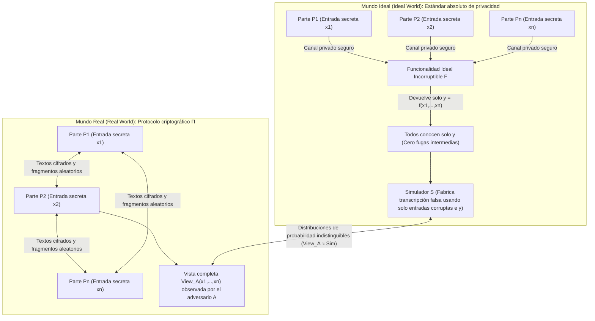
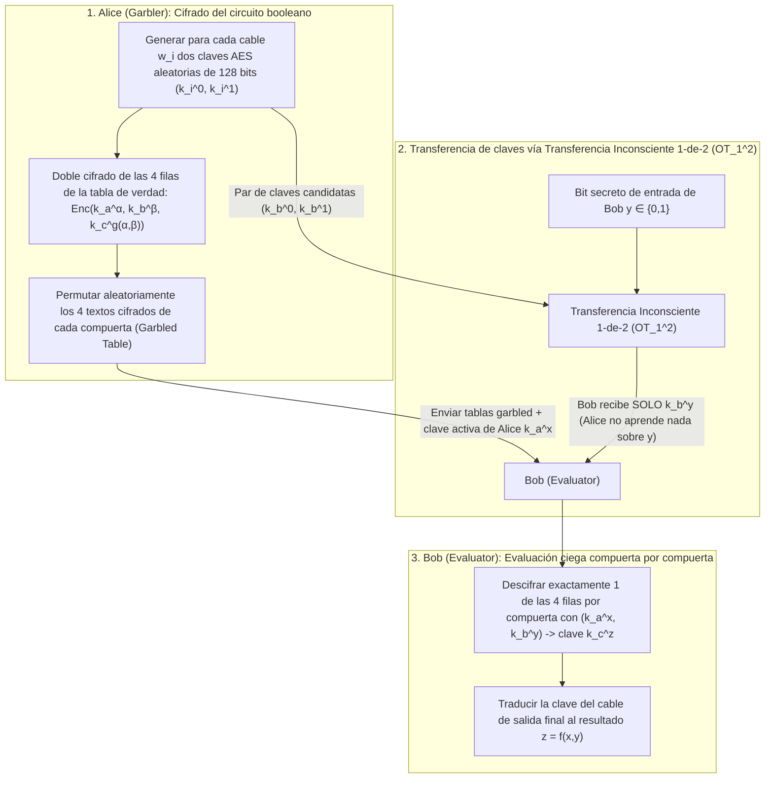

«Varios hospitales oncológicos desean combinar las secuencias genómicas de sus pacientes para realizar un estudio estadístico de asociación (GWAS), pero las leyes de privacidad (RGPD / HIPAA) prohíben estrictamente que un solo byte de datos clínicos salga de cada hospital».
«Bancos comerciales competidores quieren rastrear conjuntamente redes de lavado de dinero interbancario sin revelar jamás sus listas de clientes ni sus grafos de transacciones internas».

A primera vista, esto parece lógicamente imposible: para evaluar una función $f(x_1, x_2, \dots, x_n)$, ¿no es imprescindible que un <strong>tercero de confianza (Trusted Third Party, TTP)</strong> reúna primero todas las entradas $x_i$ en texto plano? Sin embargo, a finales de los años ochenta, la criptografía moderna demostró un teorema extraordinario: <strong>incluso sin ningún tercero de confianza, múltiples participantes que desconfían entre sí pueden evaluar conjuntamente cualquier función computable $f(x_1, \dots, x_n)$ de modo que todos conozcan el resultado exacto sin que nadie descubra ni un solo bit adicional sobre la entrada secreta $x_i$ de los demás.</strong>

Esta disciplina se denomina <strong>Computación Multiparte Segura (Secure Multi-Party Computation, MPC)</strong>. En este artículo partimos de dos experimentos mentales clásicos para deducir los dos motores matemáticos fundamentales de MPC: la <strong>compartición de secretos por umbral $(t, n)$ de Adi Shamir (interpolación de Lagrange, protocolo BGW y tripletas de Beaver)</strong> y el enfoque de circuitos booleanos mediante la <strong>transferencia inconsciente ($\text{OT}_1^2$) de Rabin y los circuitos cifrados (Garbled Circuits) de Yao</strong>.

---

## 1. Dos experimentos mentales paradójicos: «El salario medio sin jefe» y «El problema de los millonarios de Yao»

### 1.1 Experimento mental 1: Calcular el salario medio sin revelar ningún salario individual

Tres ingenieros $A, B$ y $C$ quieren conocer su <strong>salario anual medio $\bar{x} = \frac{x_A + x_B + x_C}{3}$</strong> sin que ninguno descubra el salario individual $x_A, x_B$ o $x_C$ de los otros dos. Mediante la <strong>compartición aditiva de secretos (enmascaramiento One-Time Pad)</strong>, pueden lograrlo usando solo papel y lápiz:

1. <strong>Máscara aleatoria y primer susurro ($A \to B$)</strong>: Los tres acuerdan un módulo público grande $M$ (por ejemplo, $M = 10^9$). El ingeniero $A$ elige en secreto un número aleatorio uniforme $r \xleftarrow{\$} \mathbb{Z}_M$, le suma su salario $x_A$ y susurra únicamente $s_1 = (x_A + r) \bmod M$ a $B$. Como $r$ es uniforme en $\mathbb{Z}_M$, $s_1$ también está perfectamente distribuido de forma uniforme sin importar cuánto gane $A$: por el teorema de Shannon sobre la libreta de un solo uso, la información mutua es $I(X_A; S_1) = 0$. $B$ aprende literalmente <strong>cero bits</strong> sobre $x_A$.
2. <strong>Sumas sucesivas ($B \to C \to A$)</strong>: $B$ suma su propio salario $x_B$ y susurra $s_2 = (x_A + x_B + r) \bmod M$ a $C$; $C$ suma $x_C$ y entrega $s_3 = (x_A + x_B + x_C + r) \bmod M$ de vuelta a $A$.
3. <strong>Eliminación de la máscara</strong>: $A$ resta su número aleatorio $r$ módulo $M$, obtiene la suma exacta $S = x_A + x_B + x_C$ y anuncia el promedio $\bar{x} = S / 3$.

> [!NOTE]
> <strong>¿Por qué se necesitan al menos 3 participantes ($n \ge 3$)?</strong>
> Si solo participaran dos personas ($A$ y $B$), aunque un ángel incorruptible les revelara únicamente el promedio $\bar{x} = \frac{x_A + x_B}{2}$, $A$ deduciría de inmediato $x_B = 2\bar{x} - x_A$. Esto no es un fallo del protocolo, sino una propiedad matemática de la propia función. <strong>MPC garantiza que no se filtre ni un bit más allá de lo que se deduce lógicamente de la propia entrada y del resultado final.</strong>

### 1.2 Experimento mental 2: El «problema de los millonarios» de Andrew Yao (1982)

La suma es lineal, pero ¿qué ocurre con una <strong>comparación no lineal</strong>?
En 1982, el científico de la computación <strong>Andrew Chi-Chih Yao</strong> (posterior Premio Turing) publicó *"Protocols for Secure Computations"*, planteando el famoso <strong>problema de los millonarios</strong>: dos millonarios, Alice ($x$ millones de dólares) y Bob ($y$ millones de dólares), desean calcular únicamente el bit booleano $f(x, y) = [x > y] \in \{0, 1\}$ (¿quién es más rico?) sin revelar el valor de $x$ ni de $y$, ni siquiera su diferencia $x - y$.

---

## 2. Formalización matemática de la seguridad: El paradigma de simulación Ideal/Real

Para demostrar rigurosamente la ausencia de fugas de información, Goldreich, Micali y Wigderson (GMW 1987) establecieron el <strong>paradigma de simulación Mundo Ideal / Mundo Real</strong>:



Un protocolo real $\Pi$ es seguro si existe un algoritmo eficiente llamado <strong>Simulador $\mathcal{S}$</strong> capaz de generar, <em>usando únicamente las entradas $\{x_i\}_{i \in I}$ y salidas $\{y_i\}_{i \in I}$ de las partes corruptas</em>, una transcripción sintética indistinguible de la vista real $\text{View}_I^\Pi(x_1, \dots, x_n)$:
$$\left\{ \mathcal{S}\left(I, \{x_i\}_{i \in I}, \{y_i\}_{i \in I}\right) \right\} \stackrel{c}{\approx} \left\{ \text{View}_I^\Pi(x_1, \dots, x_n) \right\}$$
Se distingue entre adversarios <strong>semihonestos (Semi-Honest / Passive)</strong>, que siguen las reglas pero analizan los registros, y adversarios <strong>maliciosos (Malicious / Active)</strong>, que alteran mensajes activamente.

---

## 3. Motor 1: Compartición de secretos por umbral $(t, n)$ de Shamir, interpolación de Lagrange y BGW / SPDZ

### 3.1 Polinomios sobre $\mathbb{F}_p$ y reconstrucción de Lagrange
En 1979, <strong>Adi Shamir</strong> propuso ocultar el secreto $s \in \mathbb{F}_p$ ($p > n$ primo) como el término constante de un polinomio aleatorio de grado $t - 1$ sobre el cuerpo finito $\mathbb{F}_p$:
$$P(x) = s + a_1 x + a_2 x^2 + \dots + a_{t-1} x^{t-1} \pmod p$$
Cada parte $P_i$ recibe el punto $(x_i = i,\, y_i = P(x_i))$. Cualquier subconjunto $T$ de al menos $t$ partes reconstruye exactamente $s = P(0)$ mediante la <strong>fórmula de interpolación polinómica de Lagrange</strong>:
$$s = P(0) = \sum_{i \in T} y_i \prod_{j \in T,\, j \ne i} \frac{-x_j}{x_i - x_j} \pmod p$$
Con $t - 1$ fragmentos o menos, todo secreto candidato $s' \in \mathbb{F}_p$ es exactamente igual de probable ($H(S \mid \text{Shares}_{t-1}) = H(S)$, seguridad incondicional en teoría de la información).

### 3.2 Protocolo BGW y tripletas de multiplicación de Beaver
En el <strong>protocolo BGW (1988)</strong>, la <strong>suma $[a] + [b] = [a + b]$ es local y sin comunicación</strong>. En cambio, la <strong>multiplicación $[a] \cdot [b]$</strong> duplica el grado del polinomio producto $P(x)Q(x)$ a $2(t-1)$, requiriendo $2t - 1 \le n$ (una <strong>mayoría honesta</strong>) y una ronda de reducción de grado.
<strong>Donald Beaver (1991)</strong> resolvió este cuello de botella mediante <strong>tripletas de multiplicación $([u], [v], [w = u \cdot v \bmod p])$</strong> generadas en una fase offline (base de <strong>SPDZ</strong>). En la fase online, para multiplicar $[x]$ e $[y]$, las partes abren solo las diferencias enmascaradas $d = (x - u) \bmod p$ y $e = (y - v) \bmod p$, y calculan localmente la combinación lineal:
$$[x \cdot y] = [w] + d \cdot [v] + e \cdot [u] + d \cdot e \pmod p$$

---

## 4. Motor 2: Transferencia inconsciente ($\text{OT}_1^2$) de Rabin y circuitos garbled de Yao

Para comparaciones binarias ($x > y$), el enfoque de circuitos booleanos opera en un número constante $O(1)$ de rondas:



Mediante la <strong>transferencia inconsciente 1-de-2 ($\text{OT}_1^2$) de Michael Rabin</strong>, Bob obtiene únicamente la clave $k_b^y$ correspondiente a su bit secreto $y$ sin que Alice descubra $y$. Las tres optimizaciones modernas —<strong>Point-and-Permute</strong> (bits de color que señalan directamente la única fila a descifrar), <strong>Free-XOR</strong> ($k_i^1 = k_i^0 \oplus \Delta$, que hace que todas las compuertas `XOR` requieran cero textos cifrados y cero operaciones AES) y <strong>Half-Gates</strong> (que reduce cada compuerta `AND` a solo 2 textos cifrados)— aceleraron los circuitos garbled más de $1000$ veces.

---

## 5. Implementación completa en Python: Shamir Secret Sharing y tripletas de Beaver sobre $\mathbb{F}_p$

```python
import secrets
from typing import List, Tuple

PRIME = (1 << 61) - 1  # Primo de Mersenne de 61 bits p = 2^61 - 1

def mod_inv(a: int, p: int = PRIME) -> int:
    return pow(a % p, -1, p)

def shamir_share(secret: int, t: int, n: int, p: int = PRIME) -> List[Tuple[int, int]]:
    coeffs = [secret % p] + [secrets.randbelow(p) for _ in range(t - 1)]
    shares = []
    for i in range(1, n + 1):
        y = 0
        for c in reversed(coeffs):
            y = (y * i + c) % p
        shares.append((i, y))
    return shares

def lagrange_reconstruct(shares: List[Tuple[int, int]], p: int = PRIME) -> int:
    secret = 0
    k = len(shares)
    for i in range(k):
        xi, yi = shares[i]
        num, den = 1, 1
        for j in range(k):
            if i != j:
                xj, _ = shares[j]
                num = (num * (-xj)) % p
                den = (den * (xi - xj)) % p
        secret = (secret + yi * num * mod_inv(den, p)) % p
    return secret

def mpc_add(sa, sb, p=PRIME):
    return [(xa, (ya + yb) % p) for (xa, ya), (_, yb) in zip(sa, sb)]

def mpc_sub(sa, sb, p=PRIME):
    return [(xa, (ya - yb) % p) for (xa, ya), (_, yb) in zip(sa, sb)]

def mpc_scalar_mul(c, sa, p=PRIME):
    return [(xa, (c * ya) % p) for xa, ya in sa]

def mpc_add_const(c, sa, p=PRIME):
    return [(xa, (ya + c) % p) for xa, ya in sa]

def generate_beaver_triple(t: int, n: int, p: int = PRIME):
    u, v = secrets.randbelow(p), secrets.randbelow(p)
    return shamir_share(u, t, n, p), shamir_share(v, t, n, p), shamir_share((u * v) % p, t, n, p)

def mpc_beaver_mul(sx, sy, triple, t: int, p: int = PRIME):
    su, sv, sw = triple
    d = lagrange_reconstruct(mpc_sub(sx, su, p)[:t], p)
    e = lagrange_reconstruct(mpc_sub(sy, sv, p)[:t], p)
    res = mpc_add(mpc_add(sw, mpc_scalar_mul(d, sv, p), p), mpc_scalar_mul(e, su, p), p)
    return mpc_add_const((d * e) % p, res, p)

if __name__ == "__main__":
    t, n = 3, 5
    salaries = [85000, 92000, 78000]
    shared = [shamir_share(s, t, n) for s in salaries]
    total_shares = shared[0]
    for s in shared[1:]:
        total_shares = mpc_add(total_shares, s)
    print("Suma salarial total reconstruida:", lagrange_reconstruct(total_shares[:t]))
```

---

## 6. Comparativa de Tecnologías de Mejora de la Privacidad (PETs) y aplicaciones reales

| Criterio | Computación Multiparte Segura (MPC) | Cifrado Totalmente Homomórfico (FHE) | Pruebas de Conocimiento Cero (ZKP) | Entorno de Ejecución Confiable (TEE) |
| :--- | :--- | :--- | :--- | :--- |
| <strong>Problema central</strong> | <strong>Cálculo conjunto</strong> sobre entradas privadas distribuidas $x_1, \dots, x_n$ | <strong>Cálculo ciego en un servidor</strong> sobre textos cifrados $\text{Enc}(x) \mapsto \text{Enc}(f(x))$ | <strong>Demostrar que un secreto $w$ ya conocido</strong> por el probador cumple $f(x, w)=1$ | <strong>Ejecución aislada por hardware</strong> en texto plano dentro de un enclave de CPU |
| <strong>Cuello de botella</strong> | CPU ultraligera, pero requiere <strong>comunicación en red por capa multiplicativa</strong> | Solo 1 viaje de red, pero <strong>cálculo de CPU $10^3$ a $10^5$ veces más lento</strong> | Verificación instantánea, generación de prueba costosa (MSM / FFT) | Velocidad casi nativa, pero memoria de enclave limitada |
| <strong>Modelo de confianza</strong> | <strong>Supuesto de no colusión</strong> (menos de $t$ servidores coluden) | <strong>Dureza criptográfica en retículos (RLWE)</strong> | <strong>Solidez matemática</strong> (no combina por sí solo secretos de múltiples partes) | <strong>Confianza en el fabricante (Intel/AMD)</strong>; vulnerable a ataques de canal lateral |

Desde la histórica <strong>subasta doble de remolacha azucarera en Dinamarca en 2008</strong> hasta el <strong>estudio de brecha salarial de Boston (BWWC)</strong>, la <strong>verificación de contraseñas filtradas en Google Chrome y Apple iCloud (Private Set Intersection, PSI)</strong>, los <strong>estudios genómicos interhospitalarios (Secure GWAS)</strong> y las <strong>billeteras criptográficas MPC por umbral (Fireblocks, Coinbase)</strong>, la MPC está reemplazando la confianza institucional por certeza matemática.
