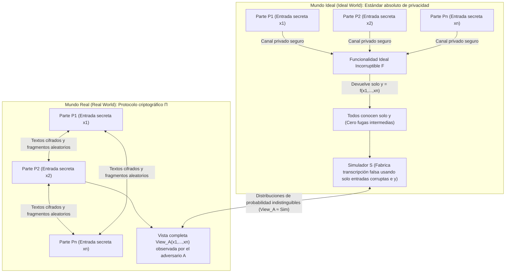
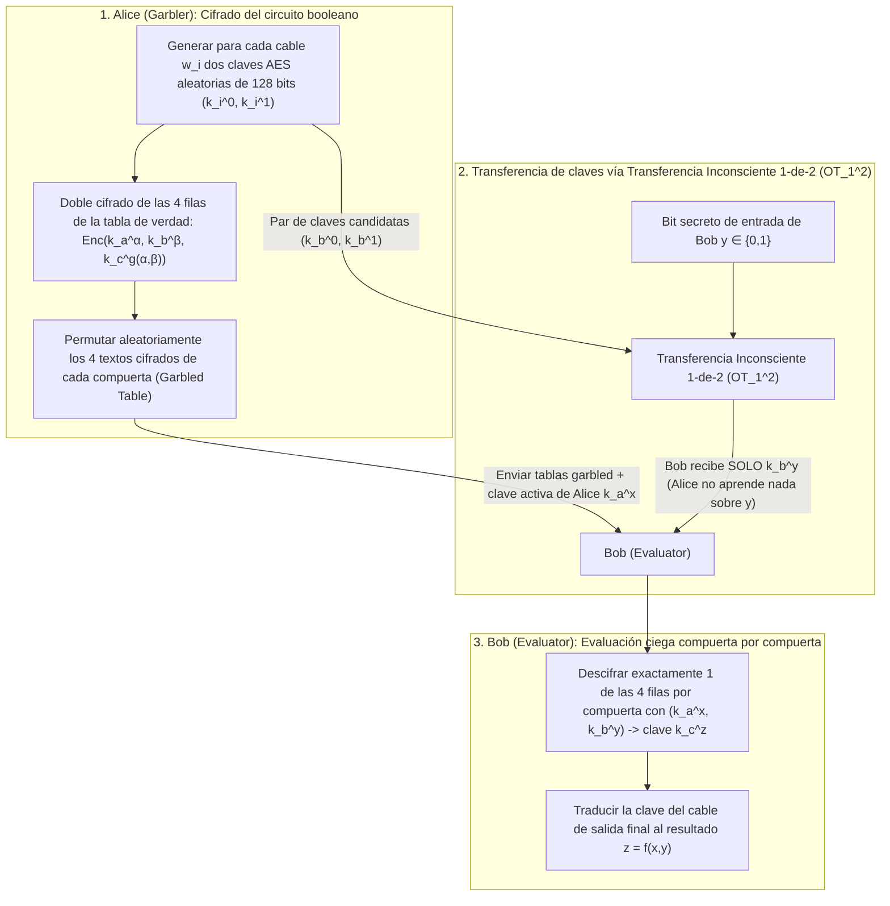

«Varios hospitales quieren analizar conjuntamente genomas de pacientes y deben respetar los requisitos legales, contractuales y éticos aplicables al tratamiento de esos datos».
«Bancos comerciales competidores quieren rastrear conjuntamente redes de lavado de dinero interbancario sin revelar jamás sus listas de clientes ni sus grafos de transacciones internas».

A primera vista, esto parece lógicamente imposible: para evaluar una función $f(x_1, x_2, \dots, x_n)$, ¿no es imprescindible que un <strong>tercero de confianza (Trusted Third Party, TTP)</strong> reúna primero todas las entradas $x_i$ en texto plano? Sin embargo, a finales de los años ochenta, la criptografía moderna demostró un teorema extraordinario: <strong>Bajo un modelo de adversario y supuestos criptográficos explícitos, los participantes pueden calcular conjuntamente una función; la definición de seguridad limita la divulgación adicional más allá de lo que ya permiten inferir las entradas y salidas autorizadas.</strong>

Esta disciplina se denomina <strong>Computación Multiparte Segura (Secure Multi-Party Computation, MPC)</strong>. En este artículo partimos de dos experimentos mentales clásicos para deducir los dos motores matemáticos fundamentales de MPC: la <strong>compartición de secretos por umbral $(t, n)$ de Adi Shamir (interpolación de Lagrange, protocolo BGW y tripletas de Beaver)</strong> y el enfoque de circuitos booleanos mediante la <strong>transferencia inconsciente (OT) y los circuitos cifrados (Garbled Circuits) de Yao</strong>.

---


**Cómo interpretar las garantías:** Las afirmaciones de que un secreto «no se revela» solo valen para el modelo de adversario, la definición de seguridad y los supuestos criptográficos indicados. Normalmente se evalúa la fuga adicional a la información deducible de entradas y salidas permitidas; las inferencias desde los resultados, la implementación, la operación, la disponibilidad y los canales laterales requieren un análisis aparte.

## 1. Dos experimentos mentales paradójicos: «El salario medio sin jefe» y «El problema de los millonarios de Yao»

### 1.1 Experimento mental 1: Calcular el salario medio sin revelar ningún salario individual

Tres ingenieros $A, B$ y $C$ quieren conocer su <strong>salario anual medio $\bar{x} = \frac{x_A + x_B + x_C}{3}$</strong> sin que ninguno descubra el salario individual $x_A, x_B$ o $x_C$ de los otros dos. Mediante la <strong>compartición aditiva de secretos (enmascaramiento One-Time Pad)</strong>, pueden lograrlo usando solo papel y lápiz:

1. <strong>Máscara aleatoria y primer susurro ($A \to B$)</strong>: Los tres acuerdan un módulo público grande $M$ (por ejemplo, $M = 10^9$). El ingeniero $A$ elige en secreto un número aleatorio uniforme $r \xleftarrow{\$} \mathbb{Z}_M$, le suma su salario $x_A$ y susurra únicamente $s_1 = (x_A + r) \bmod M$ a $B$. Como $r$ es uniforme en $\mathbb{Z}_M$, $s_1$ también está perfectamente distribuido de forma uniforme sin importar cuánto gane $A$: por el teorema de Shannon sobre la libreta de un solo uso, la información mutua es $I(X_A; S_1) = 0$. $B$ aprende literalmente <strong>cero bits</strong> sobre $x_A$.
2. <strong>Sumas sucesivas ($B \to C \to A$)</strong>: $B$ suma su propio salario $x_B$ y susurra $s_2 = (x_A + x_B + r) \bmod M$ a $C$; $C$ suma $x_C$ y entrega $s_3 = (x_A + x_B + x_C + r) \bmod M$ de vuelta a $A$.
3. <strong>Eliminación de la máscara</strong>: $A$ resta su número aleatorio $r$ módulo $M$, obtiene la suma exacta $S = x_A + x_B + x_C$ y anuncia el promedio $\bar{x} = S / 3$.

> **Límite de este ejemplo de susurros:** Es una ilustración didáctica, no un protocolo MPC seguro. Supone canales privados entre vecinos, comportamiento honesto y ausencia de colusión. Por ejemplo, si Bob y Carol comparten lo que observan, pueden combinarlo con la suma publicada y recuperar la entrada de Alice. Un uso real requiere un protocolo demostrado seguro para el modelo de amenaza previsto. Además, $M$ debe superar la suma de las entradas para evitar el desbordamiento modular.

> [!NOTE]
> <strong>¿Por qué se necesitan al menos 3 participantes ($n \ge 3$)?</strong>
> Si solo participaran dos personas ($A$ y $B$), aunque un ángel incorruptible les revelara únicamente el promedio $\bar{x} = \frac{x_A + x_B}{2}$, $A$ deduciría de inmediato $x_B = 2\bar{x} - x_A$. Esto no es un fallo del protocolo, sino una propiedad matemática de la propia función. <strong>MPC garantiza que no se filtre ni un bit más allá de lo que se deduce lógicamente de la propia entrada y del resultado final.</strong>

### 1.2 Experimento mental 2: El «problema de los millonarios» de Andrew Yao (1982)

La suma es lineal, pero ¿qué ocurre con una <strong>comparación no lineal</strong>?
En 1982, el científico de la computación <strong>Andrew Chi-Chih Yao</strong> (posterior Premio Turing) publicó *"Protocols for Secure Computations"*, planteando el famoso <strong>problema de los millonarios</strong>: dos millonarios, Alice ($x$ millones de dólares) y Bob ($y$ millones de dólares), desean calcular únicamente el bit booleano $f(x, y) = [x > y] \in \{0, 1\}$ (¿quién es más rico?) sin revelar el valor de $x$ ni de $y$, ni siquiera su diferencia $x - y$.

---

## 2. Formalización matemática de la seguridad: El paradigma de simulación Ideal/Real

Para demostrar rigurosamente la ausencia de fugas de información, Goldreich, Micali y Wigderson (GMW 1987) establecieron el <strong>paradigma de simulación Mundo Ideal / Mundo Real</strong>:



Un protocolo real $\Pi$ es seguro si existe un algoritmo eficiente llamado <strong>Simulador $\mathcal{S}$</strong> capaz de generar, <em>usando únicamente las entradas $\{x_i\}_{i \in I}$ y salidas $\{y_i\}_{i \in I}$ de las partes corruptas</em>, una transcripción sintética indistinguible de la vista real $\text{View}_I^\Pi(x_1, \dots, x_n)$:
$$\left\{ \mathcal{S}\left(I, \{x_i\}_{i \in I}, \{y_i\}_{i \in I}\right) \right\} \stackrel{c}{\approx} \left\{ \text{View}_I^\Pi(x_1, \dots, x_n) \right\}$$
Se distingue entre adversarios <strong>semihonestos (Semi-Honest / Passive)</strong>, que siguen las reglas pero analizan los registros, y adversarios <strong>maliciosos (Malicious / Active)</strong>, que alteran mensajes activamente.

---

## 3. Motor 1: Compartición de secretos por umbral $(t, n)$ de Shamir, interpolación de Lagrange y BGW / SPDZ

### 3.1 Polinomios sobre $\mathbb{F}_p$ y reconstrucción de Lagrange
En 1979, <strong>Adi Shamir</strong> propuso ocultar el secreto $s \in \mathbb{F}_p$ ($p > n$ primo) como el término constante de un polinomio aleatorio de grado $t - 1$ sobre el cuerpo finito $\mathbb{F}_p$:
$$P(x) = s + a_1 x + a_2 x^2 + \dots + a_{t-1} x^{t-1} \pmod p$$
Cada parte $P_i$ recibe el punto $(x_i = i,\, y_i = P(x_i))$. Cualquier subconjunto $T$ de al menos $t$ partes reconstruye exactamente $s = P(0)$ mediante la <strong>fórmula de interpolación polinómica de Lagrange</strong>:
$$s = P(0) = \sum_{i \in T} y_i \prod_{j \in T,\, j \ne i} \frac{-x_j}{x_i - x_j} \pmod p$$
Con $t - 1$ fragmentos o menos, todo secreto candidato $s' \in \mathbb{F}_p$ es exactamente igual de probable ($H(S \mid \text{Shares}_{t-1}) = H(S)$, seguridad incondicional en teoría de la información).

### 3.2 Protocolo BGW y tripletas de multiplicación de Beaver
En el <strong>protocolo BGW (1988)</strong>, la <strong>suma $[a] + [b] = [a + b]$ es local y sin comunicación</strong>. En cambio, la <strong>multiplicación $[a] \cdot [b]$</strong> duplica el grado del polinomio producto $P(x)Q(x)$ a $2(t-1)$, requiriendo $2t - 1 \le n$ (una <strong>mayoría honesta</strong>) y una ronda de reducción de grado.
<strong>Donald Beaver (1991)</strong> resolvió este cuello de botella mediante <strong>tripletas de multiplicación $([u], [v], [w = u \cdot v \bmod p])$</strong> generadas en una fase offline (base de <strong>SPDZ</strong>). En la fase online, para multiplicar $[x]$ e $[y]$, las partes abren solo las diferencias enmascaradas $d = (x - u) \bmod p$ y $e = (y - v) \bmod p$, y calculan localmente la combinación lineal:
$$[x \cdot y] = [w] + d \cdot [v] + e \cdot [u] + d \cdot e \pmod p$$

---

**Los umbrales dependen del modelo de adversario:** El BGW clásico tolera $c < n/2$ corrupciones en el modelo pasivo (honesto pero curioso); la seguridad de información frente a participantes maliciosos suele requerir $c < n/3$ y supuestos de comunicación adecuados. Una tripleta de Beaver por sí sola no fija el umbral ni aporta seguridad activa.

## 4. Motor 2: Transferencia inconsciente (OT) y circuitos garbled de Yao

En algunas construcciones, la evaluación de las puertas se realiza localmente tras transferir las entradas; el número total de rondas de comunicación depende del protocolo OT y de su configuración.



<strong>Point-and-Permute</strong> identifica la fila que se debe descifrar, <strong>Free-XOR</strong> evita garblear las compuertas XOR y <strong>Half-Gates</strong> reducen la comunicación de las compuertas AND. La mejora depende del circuito, la implementación, el hardware y la red; no existe un factor de aceleración universal.

---

## 5. Implementación completa en Python: Shamir Secret Sharing y tripletas de Beaver sobre $\mathbb{F}_p$

El ejemplo también eleva cada salario al cuadrado con una nueva tripleta de Beaver y revela la suma y la suma de cuadrados para calcular la media y la varianza poblacional. Estos resultados se abren a quien los reconstruye; es una simulación educativa en un solo proceso.

```python
import secrets
from typing import List, Tuple

# 61-bit Mersenne prime p = 2^61 - 1 for our prime finite field F_p
PRIME = (1 << 61) - 1

def mod_inv(a: int, p: int = PRIME) -> int:
    # Modular inverse in F_p via Extended Euclidean Algorithm (Python 3.8+ pow(a, -1, p))
    return pow(a % p, -1, p)

def shamir_share(secret: int, t: int, n: int, p: int = PRIME) -> List[Tuple[int, int]]:
    # Shamir's (t, n) Threshold Secret Sharing:
    # Samples a random degree-(t-1) polynomial P(x) with P(0) = secret and evaluates it at x = 1..n.
    assert 1 <= t <= n < p, "Threshold t and party count n must satisfy 1 <= t <= n < p"
    # P(x) = s + a_1 * x + a_2 * x^2 + ... + a_{t-1} * x^{t-1} (mod p)
    coeffs = [secret % p] + [secrets.randbelow(p) for _ in range(t - 1)]

    shares = []
    for i in range(1, n + 1):
        # Evaluate P(i) using Horner's method
        y = 0
        for c in reversed(coeffs):
            y = (y * i + c) % p
        shares.append((i, y))
    return shares

def lagrange_reconstruct(shares: List[Tuple[int, int]], p: int = PRIME) -> int:
    # Reconstructs P(0) = s from any subset of >= t shares using Lagrange Polynomial Interpolation:
    # s = sum_{i in T} y_i * prod_{j in T, j != i} (-x_j) / (x_i - x_j) (mod p)
    secret = 0
    k = len(shares)
    for i in range(k):
        xi, yi = shares[i]
        num = 1
        den = 1
        for j in range(k):
            if i == j:
                continue
            xj, _ = shares[j]
            num = (num * (-xj)) % p
            den = (den * (xi - xj)) % p
        lambda_i = (num * mod_inv(den, p)) % p
        secret = (secret + yi * lambda_i) % p
    return secret

def mpc_add(shares_a: List[Tuple[int, int]], shares_b: List[Tuple[int, int]], p: int = PRIME) -> List[Tuple[int, int]]:
    # Local homomorphic addition [a] + [b] = [a + b] (Zero communication)
    return [(xa, (ya + yb) % p) for (xa, ya), (xb, yb) in zip(shares_a, shares_b)]

def mpc_sub(shares_a: List[Tuple[int, int]], shares_b: List[Tuple[int, int]], p: int = PRIME) -> List[Tuple[int, int]]:
    # Local homomorphic subtraction [a] - [b] = [a - b] (Zero communication)
    return [(xa, (ya - yb) % p) for (xa, ya), (xb, yb) in zip(shares_a, shares_b)]

def mpc_scalar_mul(scalar: int, shares_a: List[Tuple[int, int]], p: int = PRIME) -> List[Tuple[int, int]]:
    # Local multiplication by a public scalar c * [a] = [c * a] (Zero communication)
    return [(xa, (scalar * ya) % p) for xa, ya in shares_a]

def mpc_add_constant(const: int, shares_a: List[Tuple[int, int]], p: int = PRIME) -> List[Tuple[int, int]]:
    # Adding a public constant [a] + c = [a + c] shifts P(x) by +c at every evaluation point
    return [(xa, (ya + const) % p) for xa, ya in shares_a]

def generate_beaver_triple(t: int, n: int, p: int = PRIME):
    # Offline Preprocessing Phase: Generates a shared random multiplication triple ([u], [v], [w = u * v])
    u = secrets.randbelow(p)
    v = secrets.randbelow(p)
    w = (u * v) % p
    return shamir_share(u, t, n, p), shamir_share(v, t, n, p), shamir_share(w, t, n, p)

def mpc_beaver_mul(
    shares_x: List[Tuple[int, int]],
    shares_y: List[Tuple[int, int]],
    triple: Tuple[List[Tuple[int, int]], List[Tuple[int, int]], List[Tuple[int, int]]],
    t: int,
    p: int = PRIME
) -> List[Tuple[int, int]]:
    # Online Phase: Evaluates [x * y] using a Beaver Multiplication Triple ([u], [v], [w]):
    # 1. Locally compute [d] = [x] - [u] and [e] = [y] - [v]
    # 2. Open masked differences; security depends on fresh, valid, single-use triples and the threat model
    # 3. Locally compute the linear combination [x * y] = [w] + d * [v] + e * [u] + d * e
    shares_u, shares_v, shares_w = triple
    shares_d = mpc_sub(shares_x, shares_u, p)
    shares_e = mpc_sub(shares_y, shares_v, p)

    # Open the masked differences d = x - u and e = y - v using t shares
    d = lagrange_reconstruct(shares_d[:t], p)
    e = lagrange_reconstruct(shares_e[:t], p)

    # Linear combination to obtain degree-(t-1) shares of [x * y]
    term1 = shares_w
    term2 = mpc_scalar_mul(d, shares_v, p)
    term3 = mpc_scalar_mul(e, shares_u, p)
    res = mpc_add(mpc_add(term1, term2, p), term3, p)
    res = mpc_add_constant((d * e) % p, res, p)
    return res

if __name__ == "__main__":
    # 5 MPC servers (n = 5) with reconstruction threshold t = 3 (any 2 servers learn 0 bits)
    t, n = 3, 5
    salaries = [850, 920, 780]  # Example salary units

    # Each engineer splits their secret salary across the 5 servers
    shared_salaries = [shamir_share(s, t, n) for s in salaries]

    # 1. Compute the sum of salaries locally with zero inter-server communication
    sum_shares = shared_salaries[0]
    for s_share in shared_salaries[1:]:
        sum_shares = mpc_add(sum_shares, s_share)

    # Reconstruct the total from any 3 servers (e.g., servers 1, 3, and 5)
    subset_3 = [sum_shares[0], sum_shares[2], sum_shares[4]]
    total_salary = lagrange_reconstruct(subset_3)
    mean_salary = total_salary / len(salaries)
    print(f"Reconstructed total (units): {total_salary:,} (mean: {mean_salary:,.2f})")

    # 2. Compute the sum of squares S_2 = x_A^2 + x_B^2 + x_C^2 using Beaver Multiplication Triples
    sq_sum_shares = shamir_share(0, t, n)
    for s_share in shared_salaries:
        triple = generate_beaver_triple(t, n)
        sq_share = mpc_beaver_mul(s_share, s_share, triple, t)
        sq_sum_shares = mpc_add(sq_sum_shares, sq_share)

    total_sq = lagrange_reconstruct(sq_sum_shares[:t])
    variance = (total_sq / len(salaries)) - (mean_salary ** 2)
    print(f"Reconstructed sum of squares: {total_sq:,} (population variance: {variance:,.2f})")
```

---

## 6. Comparativa de Tecnologías de Mejora de la Privacidad (PETs) y aplicaciones reales

| Criterio | Computación Multiparte Segura (MPC) | Cifrado Totalmente Homomórfico (FHE) | Pruebas de Conocimiento Cero (ZKP) | Entorno de Ejecución Confiable (TEE) |
| :--- | :--- | :--- | :--- | :--- |
| <strong>Problema central</strong> | <strong>Cálculo conjunto</strong> sobre entradas privadas distribuidas $x_1, \dots, x_n$ | <strong>Cálculo ciego en un servidor</strong> sobre textos cifrados $\text{Enc}(x) \mapsto \text{Enc}(f(x))$ | <strong>Demostrar que un secreto $w$ ya conocido</strong> por el probador cumple $f(x, w)=1$ | <strong>Ejecución aislada por hardware</strong> en texto plano dentro de un enclave de CPU |
| <strong>Cuello de botella</strong> | El coste de comunicación depende del protocolo, la profundidad del circuito y la red | El coste de cómputo y comunicación depende del esquema, el circuito y el hardware; no existe un factor de lentitud universal | El coste de probar y verificar depende del sistema y del enunciado | El rendimiento y la memoria protegida dependen de la plataforma y la carga |
| <strong>Modelo de confianza</strong> | La seguridad de MPC depende del umbral y del modelo de adversario del protocolo; las fugas por resultados, la disponibilidad y la equidad requieren análisis aparte. | <strong>Dureza criptográfica en retículos (RLWE)</strong> | <strong>Solidez matemática</strong> (no combina por sí solo secretos de múltiples partes) | <strong>Confianza en el fabricante (Intel/AMD)</strong>; vulnerable a ataques de canal lateral |

Entre los ejemplos estudiados o desplegados figuran la subasta danesa de remolacha azucarera, la medición de la brecha salarial de Boston, las comprobaciones de contraseñas, la investigación genómica y las firmas distribuidas. El grado de despliegue, el modelo de seguridad y los riesgos restantes varían; MPC no sustituye la confianza institucional por una certeza absoluta.

## 7. Otras PET y sus límites

Nota histórica: el OT de Rabin de 1981 (recepción con probabilidad 1/2) es distinto de la funcionalidad OT 1-de-2 formulada por Even, Goldreich y Lempel en 1985.
MPC distribuye las entradas y sus garantías dependen del protocolo y del modelo de adversario. FHE permite calcular sobre datos cifrados, pero no verifica automáticamente el cálculo ni evita fugas desde los resultados. Las pruebas de conocimiento cero demuestran afirmaciones sin revelar el testigo, pero no sustituyen el cálculo conjunto. Una TEE procesa texto claro en hardware protegido y exige confiar en este y en la atestación. Se pueden combinar técnicas; costes y garantías dependen del caso.

## 8. Ejemplos
La subasta danesa de remolacha de 2008 usó MPC entre tres partes; el artículo informa de unas 1.200 entradas, alrededor de 30 minutos de cálculo y 25.000 toneladas de derechos transferidos. BWWC y Boston University publican brechas salariales cada dos años; BWWC indica 103 empleadores y 165.000 trabajadores a tiempo completo en 2023. Google Chrome y Apple documentan comprobaciones de contraseñas distintas basadas en PSI. Un estudio de USENIX de 2023 informó de canales laterales en la implementación de Chrome analizada. GWAS con MPC se ha demostrado en investigación, aunque sus resultados pueden revelar información. Secure Aggregation oculta aportaciones individuales, pero no todo riesgo de inferencia. Las firmas de umbral y la renovación proactiva dependen del protocolo y de las condiciones operativas.

## 9. Conclusión
MPC reduce la centralización de datos en claro, pero no elimina las fugas desde resultados ni los riesgos operativos, legales o de disponibilidad. Sus garantías dependen del modelo de adversario, los supuestos criptográficos, la implementación y la operación.

**Alcance del ejemplo de código:** Este código Python es una simulación educativa, en un solo proceso, del reparto de secretos y los cálculos en un cuerpo finito. No es un sistema MPC en red donde cada participante conserva únicamente sus propias partes. No implementa controles frente a participantes maliciosos, autenticación ni transporte seguro, preprocesamiento confiable ni límites de entrada y desbordamiento. Los valores reconstruidos por `lagrange_reconstruct` se revelan a quien los reconstruye. No use este ejemplo para proteger datos o activos reales.


## Sources

- [Rabin, “How to Exchange Secrets with Oblivious Transfer” (1981)](https://eprint.iacr.org/2005/187.pdf)
- [Even, Goldreich, and Lempel, “A Randomized Protocol for Signing Contracts” (1985)](https://luca-giuzzi.unibs.it/corsi/Support/papers-cryptography/SigningContracts.pdf)

- [Bogetoft et al., “Secure Multiparty Computation Goes Live” (2009)](https://www.acsu.buffalo.edu/~mblanton/cse715/sugar-beet-auction.pdf)
- [Boston Women’s Workforce Council: Wage Gap Studies](https://thebwwc.org/wage-gap-studies)
- [Google: Better password protections in Chrome](https://security.googleblog.com/2019/12/better-password-protections-in-chrome.html)
- [Apple Platform Security: Password Monitoring](https://support.apple.com/guide/security/password-monitoring-sec78e79fc3b/web)
- [Kwong et al., USENIX Security 2023: Chrome password-check side channels](https://www.usenix.org/conference/usenixsecurity23/presentation/kwong)
- [Cho et al., “Secure genome-wide association analysis using multiparty computation” (2018)](https://pmc.ncbi.nlm.nih.gov/articles/PMC5990440/)
- [Bonawitz et al., Google Research: Practical Secure Aggregation](https://research.google/pubs/practical-secure-aggregation-for-federated-learning-on-user-held-data/)
- [Canetti et al., “UC Non-Interactive, Proactive, Threshold ECDSA” (2020)](https://eprint.iacr.org/2020/492)
- [Kumar et al., “Understanding Information Disclosure from Secure Computation Output” (2025)](https://doi.org/10.1145/3705004)
- [Kolesnikov and Schneider, “Improved Garbled Circuit: Free XOR Gates and Applications” (2008)](https://encrypto.de/papers/KS08XOR.pdf)
- [Zahur, Rosulek, and Evans, “Two Halves Make a Whole: Reducing Data Transfer in Garbled Circuits using Half Gates” (2015)](https://www.cs.virginia.edu/~evans/pubs/ec2015/halfgates.pdf)

- [Stanford University cryptography notes: Oblivious Transfer](https://crypto.stanford.edu/pbc/notes/crypto/ot.html)

- [A Full Proof of the BGW Protocol for Perfectly Secure MPC](https://doi.org/10.1007/S00145-015-9214-4)

- [Yao, “Protocols for Secure Computations” (FOCS 1982)](https://doi.org/10.1109/SFCS.1982.38)
