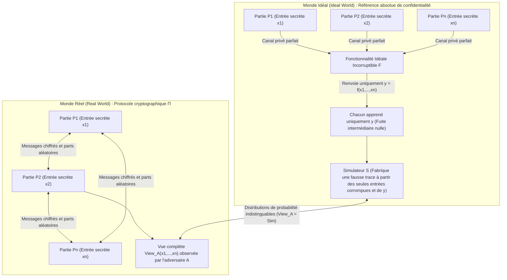
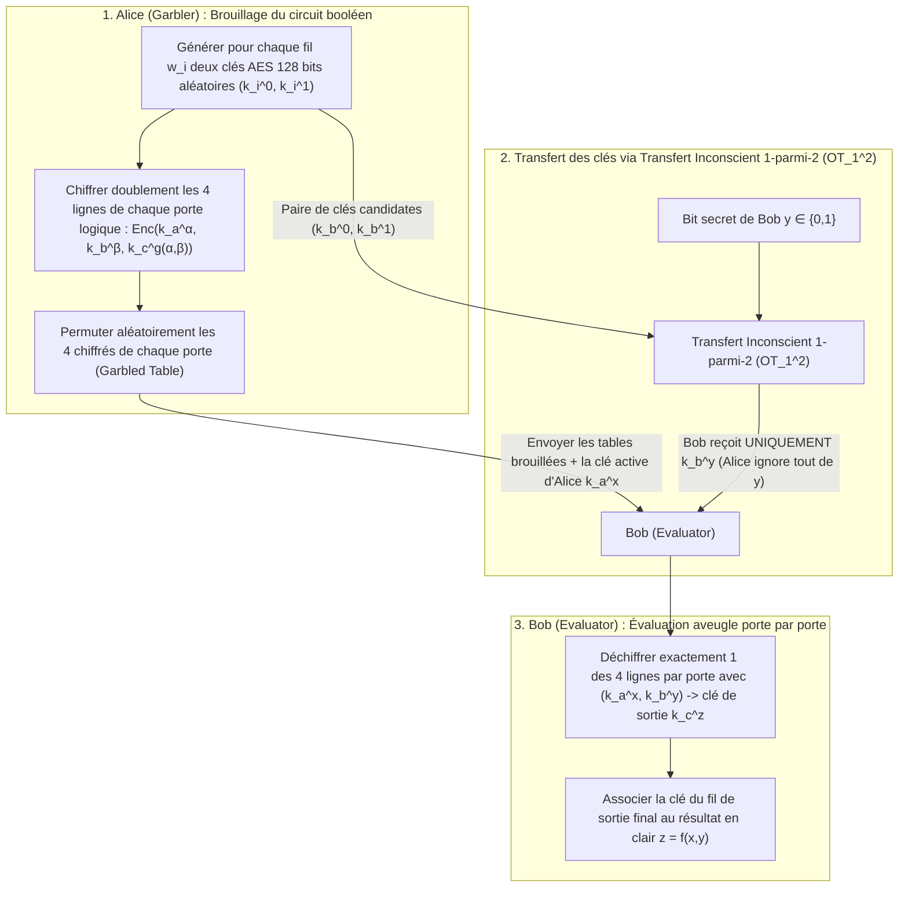

« Plusieurs hôpitaux souhaitent analyser ensemble des génomes de patients, tout en respectant les exigences juridiques, contractuelles et éthiques applicables au traitement de ces données. »
« Des banques concurrentes veulent détecter conjointement des réseaux de blanchiment d'argent interbancaires sans jamais dévoiler leurs listes de clients ni leurs graphes de transactions. »

À première vue, ces exigences semblent contradictoires : pour évaluer une fonction $f(x_1, x_2, \dots, x_n)$, ne faut-il pas qu'un <strong>tiers de confiance (Trusted Third Party, TTP)</strong> rassemble d'abord toutes les entrées $x_i$ en clair ? Pourtant, à la fin des années 1980, la cryptographie moderne a démontré un théorème fascinant : <strong>Sous un modèle d’adversaire et des hypothèses cryptographiques explicités, les participants peuvent calculer une fonction ensemble ; la définition de sécurité limite les informations supplémentaires au-delà de ce que les entrées et sorties autorisées permettent déjà de déduire.</strong>

Cette discipline s'appelle le <strong>calcul multipartite sécurisé (Secure Multi-Party Computation, MPC)</strong>. Dans cet article, nous partons de deux expériences de pensée célèbres pour démontrer les deux grands moteurs mathématiques du MPC : le <strong>partage de secret à seuil $(t, n)$ d'Adi Shamir (interpolation de Lagrange, protocole BGW et triplets de Beaver)</strong> et l'approche par circuits booléens via le <strong>transfert inconscient (OT) et les circuits brouillés (Garbled Circuits) de Yao</strong>.

---


**Comment interpréter les garanties :** les affirmations selon lesquelles un secret « n’est pas révélé » ne valent que dans le modèle d’adversaire, la définition de sécurité et les hypothèses cryptographiques indiqués. L’analyse porte généralement sur les fuites supplémentaires par rapport aux entrées et sorties autorisées ; les inférences tirées des résultats, l’implémentation, l’exploitation, la disponibilité et les canaux auxiliaires doivent être étudiés séparément.

## 1. Deux expériences de pensée paradoxales : « Le salaire moyen sans patron » et « Le problème des millionnaires de Yao »

### 1.1 Expérience de pensée 1 : Calculer le salaire moyen sans révéler aucun salaire individuel

Trois ingénieurs $A, B$ et $C$ veulent connaître leur <strong>salaire annuel moyen $\bar{x} = \frac{x_A + x_B + x_C}{3}$</strong> sans qu'aucun ne découvre le salaire individuel $x_A, x_B$ ou $x_C$ d'un autre. Grâce au <strong>partage de secret additif (masquage par masque jetable / One-Time Pad)</strong>, ils y parviennent sans aucun tiers :

1. <strong>Masque aléatoire et premier murmure ($A \to B$)</strong> : Les trois ingénieurs choisissent un grand entier public $M$ (par exemple $M = 10^9$). L'ingénieur $A$ tire secrètement un nombre aléatoire uniforme $r \xleftarrow{\$} \mathbb{Z}_M$, l'ajoute à son salaire $x_A$ et murmure uniquement $s_1 = (x_A + r) \bmod M$ à $B$. Comme $r$ est uniformément distribué sur $\mathbb{Z}_M$, $s_1$ l'est aussi quel que soit $x_A$ : par le théorème de Shannon sur le secret parfait, l'information mutuelle est nulle ($I(X_A; S_1) = 0$). $B$ n'apprend littéralement <strong>zéro bit</strong> sur $x_A$.
2. <strong>Additions successives ($B \to C \to A$)</strong> : $B$ ajoute son propre salaire $x_B$ et murmure $s_2 = (x_A + x_B + r) \bmod M$ à $C$ ; $C$ ajoute $x_C$ et transmet $s_3 = (x_A + x_B + x_C + r) \bmod M$ à $A$.
3. <strong>Démasquage</strong> : $A$ soustrait son masque secret $r$ modulo $M$, obtient la somme exacte $S = x_A + x_B + x_C$ et annonce la moyenne $\bar{x} = S / 3$.

> **Limite de cet exemple chuchoté :** il s’agit d’une illustration pédagogique, pas d’un protocole MPC sûr. Il suppose des canaux privés entre voisins, un comportement honnête et l’absence de collusion. Si Bob et Carol partagent leurs observations, ils peuvent par exemple retrouver l’entrée d’Alice à l’aide de la somme publiée. Un déploiement réel exige un protocole prouvé sûr pour le modèle de menace visé. De plus, $M$ doit dépasser la somme des entrées pour éviter un rebouclage modulaire.

> [!NOTE]
> <strong>Pourquoi faut-il au moins 3 participants ($n \ge 3$) ?</strong>
> S'il n'y avait que deux personnes ($A$ et $B$), même si un ange parfait leur révélait uniquement la moyenne $\bar{x} = \frac{x_A + x_B}{2}$, $A$ déduirait immédiatement $x_B = 2\bar{x} - x_A$. Ce n'est pas une faille du protocole, mais une propriété intrinsèque de la fonction. <strong>Le MPC garantit qu'aucune information supplémentaire n'est révélée au-delà de ce qui découle logiquement de sa propre entrée et du résultat final.</strong>

### 1.2 Expérience de pensée 2 : Le « problème des millionnaires » d'Andrew Yao (1982)

L'addition est linéaire, mais qu'en est-il d'une <strong>comparaison d'ordre non linéaire</strong> ?
En 1982, l'informaticien <strong>Andrew Chi-Chih Yao</strong> (futur prix Turing) a publié *"Protocols for Secure Computations"*, posant le célèbre <strong>problème des millionnaires</strong> : deux millionnaires, Alice ($x$ millions de dollars) et Bob ($y$ millions de dollars), veulent calculer uniquement le bit de vérité $f(x, y) = [x > y] \in \{0, 1\}$ (qui est le plus riche ?) sans révéler la valeur de $x$ ou $y$, ni même leur écart $x - y$.

---

## 2. Formalisation mathématique de la sécurité : Le paradigme de simulation Idéal/Réel

Pour prouver mathématiquement l'absence totale de fuite d'information, Goldreich, Micali et Wigderson (GMW 1987) ont introduit le <strong>paradigme de simulation Monde Idéal / Monde Réel</strong> :



Un protocole réel $\Pi$ est sécurisé s'il existe un algorithme polynomial appelé <strong>Simulateur $\mathcal{S}$</strong> capable, à partir des <em>seules entrées $\{x_i\}_{i \in I}$ et sorties $\{y_i\}_{i \in I}$ des parties corrompues</em>, de générer une trace synthétique indistinguable de la vue réelle $\text{View}_I^\Pi(x_1, \dots, x_n)$ :
$$\left\{ \mathcal{S}\left(I, \{x_i\}_{i \in I}, \{y_i\}_{i \in I}\right) \right\} \stackrel{c}{\approx} \left\{ \text{View}_I^\Pi(x_1, \dots, x_n) \right\}$$
On distingue les adversaires <strong>semi-honnêtes (Semi-Honest / Passive)</strong>, qui suivent le protocole mais analysent les échanges, et les adversaires <strong>malveillants (Malicious / Active)</strong>, qui tentent de tricher activement.

---

## 3. Moteur 1 : Partage de secret à seuil $(t, n)$ de Shamir, interpolation de Lagrange et BGW / SPDZ

### 3.1 Partage polynomial sur $\mathbb{F}_p$ et reconstruction de Lagrange
En 1979, <strong>Adi Shamir</strong> a conçu un schéma où le secret $s \in \mathbb{F}_p$ ($p > n$ premier) est le terme constant d'un polynôme aléatoire de degré $t - 1$ sur le corps fini $\mathbb{F}_p$ :
$$P(x) = s + a_1 x + a_2 x^2 + \dots + a_{t-1} x^{t-1} \pmod p$$
Chaque partie $P_i$ reçoit le point $(x_i = i,\, y_i = P(x_i))$. Tout sous-ensemble $T$ d'au moins $t$ parties reconstruit exactement $s = P(0)$ grâce à la <strong>formule d'interpolation de Lagrange</strong> :
$$s = P(0) = \sum_{i \in T} y_i \prod_{j \in T,\, j \ne i} \frac{-x_j}{x_i - x_j} \pmod p$$
À l'inverse, avec $t - 1$ parts ou moins, chaque secret candidat $s' \in \mathbb{F}_p$ correspond à un unique polynôme de degré $t - 1$ équiprobable ($H(S \mid \text{Shares}_{t-1}) = H(S)$, sécurité inconditionnelle au sens de la théorie de l'information).

### 3.2 Protocole BGW et triplets de multiplication de Beaver
Dans le <strong>protocole BGW (1988)</strong>, l'<strong>addition $[a] + [b] = [a + b]$ est 100 % locale et sans communication</strong>. En revanche, la <strong>multiplication $[a] \cdot [b]$</strong> double le degré du polynôme produit $P(x)Q(x)$ à $2(t-1)$, exigeant $2t - 1 \le n$ (une <strong>majorité honnête</strong>) et une étape de réduction de degré par repartage.
<strong>Donald Beaver (1991)</strong> a révolutionné cette étape grâce aux <strong>triplets de multiplication $([u], [v], [w = u \cdot v \bmod p])$</strong> précalculés hors ligne (cœur du protocole <strong>SPDZ</strong>). En ligne, pour multiplier $[x]$ et $[y]$, les parties ouvrent uniquement les différences masquées $d = (x - u) \bmod p$ et $e = (y - v) \bmod p$, puis calculent localement la combinaison linéaire :
$$[x \cdot y] = [w] + d \cdot [v] + e \cdot [u] + d \cdot e \pmod p$$

---

**Ces seuils dépendent du modèle d’adversaire :** le BGW classique tolère $c < n/2$ corruptions dans le modèle passif (honnête mais curieux) ; la sécurité informationnelle contre des parties malveillantes exige généralement $c < n/3$ et des hypothèses de communication adaptées. Un triplet de Beaver seul ne fixe pas le seuil et ne fournit pas de sécurité active.

## 4. Moteur 2 : Transfert inconscient (OT) et circuits brouillés de Yao

Dans certaines constructions, l’évaluation des portes se fait localement après le transfert des entrées ; le nombre total de tours de communication dépend toutefois du protocole OT et de sa configuration.



<strong>Point-and-Permute</strong> désigne la ligne à déchiffrer, <strong>Free-XOR</strong> évite le garbling des portes XOR et <strong>Half-Gates</strong> réduisent la communication pour les portes AND. Le gain dépend du circuit, de l’implémentation, du matériel et du réseau ; aucun facteur d’accélération universel ne s’applique.

---

## 5. Implémentation complète en Python : Partage de Shamir et triplets de Beaver sur $\mathbb{F}_p$

L’exemple calcule aussi le carré de chaque salaire avec un nouveau triplet de Beaver, puis ouvre la somme et la somme des carrés pour obtenir la moyenne et la variance de population. Ces résultats sont révélés à la partie qui les reconstruit ; il s’agit d’une simulation pédagogique dans un seul processus.

```python
import secrets
from typing import List, Tuple

# 61-bit Mersenne prime p = 2^61 - 1 for our prime finite field F_p
PRIME = (1 << 61) - 1

def mod_inv(a: int, p: int = PRIME) -> int:
    # Modular inverse in F_p via Extended Euclidean Algorithm (Python 3.8+ pow(a, -1, p))
    return pow(a % p, -1, p)

def shamir_share(secret: int, t: int, n: int, p: int = PRIME) -> List[Tuple[int, int]]:
    # Shamir's (t, n) Threshold Secret Sharing:
    # Samples a random degree-(t-1) polynomial P(x) with P(0) = secret and evaluates it at x = 1..n.
    assert 1 <= t <= n < p, "Threshold t and party count n must satisfy 1 <= t <= n < p"
    # P(x) = s + a_1 * x + a_2 * x^2 + ... + a_{t-1} * x^{t-1} (mod p)
    coeffs = [secret % p] + [secrets.randbelow(p) for _ in range(t - 1)]

    shares = []
    for i in range(1, n + 1):
        # Evaluate P(i) using Horner's method
        y = 0
        for c in reversed(coeffs):
            y = (y * i + c) % p
        shares.append((i, y))
    return shares

def lagrange_reconstruct(shares: List[Tuple[int, int]], p: int = PRIME) -> int:
    # Reconstructs P(0) = s from any subset of >= t shares using Lagrange Polynomial Interpolation:
    # s = sum_{i in T} y_i * prod_{j in T, j != i} (-x_j) / (x_i - x_j) (mod p)
    secret = 0
    k = len(shares)
    for i in range(k):
        xi, yi = shares[i]
        num = 1
        den = 1
        for j in range(k):
            if i == j:
                continue
            xj, _ = shares[j]
            num = (num * (-xj)) % p
            den = (den * (xi - xj)) % p
        lambda_i = (num * mod_inv(den, p)) % p
        secret = (secret + yi * lambda_i) % p
    return secret

def mpc_add(shares_a: List[Tuple[int, int]], shares_b: List[Tuple[int, int]], p: int = PRIME) -> List[Tuple[int, int]]:
    # Local homomorphic addition [a] + [b] = [a + b] (Zero communication)
    return [(xa, (ya + yb) % p) for (xa, ya), (xb, yb) in zip(shares_a, shares_b)]

def mpc_sub(shares_a: List[Tuple[int, int]], shares_b: List[Tuple[int, int]], p: int = PRIME) -> List[Tuple[int, int]]:
    # Local homomorphic subtraction [a] - [b] = [a - b] (Zero communication)
    return [(xa, (ya - yb) % p) for (xa, ya), (xb, yb) in zip(shares_a, shares_b)]

def mpc_scalar_mul(scalar: int, shares_a: List[Tuple[int, int]], p: int = PRIME) -> List[Tuple[int, int]]:
    # Local multiplication by a public scalar c * [a] = [c * a] (Zero communication)
    return [(xa, (scalar * ya) % p) for xa, ya in shares_a]

def mpc_add_constant(const: int, shares_a: List[Tuple[int, int]], p: int = PRIME) -> List[Tuple[int, int]]:
    # Adding a public constant [a] + c = [a + c] shifts P(x) by +c at every evaluation point
    return [(xa, (ya + const) % p) for xa, ya in shares_a]

def generate_beaver_triple(t: int, n: int, p: int = PRIME):
    # Offline Preprocessing Phase: Generates a shared random multiplication triple ([u], [v], [w = u * v])
    u = secrets.randbelow(p)
    v = secrets.randbelow(p)
    w = (u * v) % p
    return shamir_share(u, t, n, p), shamir_share(v, t, n, p), shamir_share(w, t, n, p)

def mpc_beaver_mul(
    shares_x: List[Tuple[int, int]],
    shares_y: List[Tuple[int, int]],
    triple: Tuple[List[Tuple[int, int]], List[Tuple[int, int]], List[Tuple[int, int]]],
    t: int,
    p: int = PRIME
) -> List[Tuple[int, int]]:
    # Online Phase: Evaluates [x * y] using a Beaver Multiplication Triple ([u], [v], [w]):
    # 1. Locally compute [d] = [x] - [u] and [e] = [y] - [v]
    # 2. Open masked differences; security depends on fresh, valid, single-use triples and the threat model
    # 3. Locally compute the linear combination [x * y] = [w] + d * [v] + e * [u] + d * e
    shares_u, shares_v, shares_w = triple
    shares_d = mpc_sub(shares_x, shares_u, p)
    shares_e = mpc_sub(shares_y, shares_v, p)

    # Open the masked differences d = x - u and e = y - v using t shares
    d = lagrange_reconstruct(shares_d[:t], p)
    e = lagrange_reconstruct(shares_e[:t], p)

    # Linear combination to obtain degree-(t-1) shares of [x * y]
    term1 = shares_w
    term2 = mpc_scalar_mul(d, shares_v, p)
    term3 = mpc_scalar_mul(e, shares_u, p)
    res = mpc_add(mpc_add(term1, term2, p), term3, p)
    res = mpc_add_constant((d * e) % p, res, p)
    return res

if __name__ == "__main__":
    # 5 MPC servers (n = 5) with reconstruction threshold t = 3 (any 2 servers learn 0 bits)
    t, n = 3, 5
    salaries = [850, 920, 780]  # Example salary units

    # Each engineer splits their secret salary across the 5 servers
    shared_salaries = [shamir_share(s, t, n) for s in salaries]

    # 1. Compute the sum of salaries locally with zero inter-server communication
    sum_shares = shared_salaries[0]
    for s_share in shared_salaries[1:]:
        sum_shares = mpc_add(sum_shares, s_share)

    # Reconstruct the total from any 3 servers (e.g., servers 1, 3, and 5)
    subset_3 = [sum_shares[0], sum_shares[2], sum_shares[4]]
    total_salary = lagrange_reconstruct(subset_3)
    mean_salary = total_salary / len(salaries)
    print(f"Reconstructed total (units): {total_salary:,} (mean: {mean_salary:,.2f})")

    # 2. Compute the sum of squares S_2 = x_A^2 + x_B^2 + x_C^2 using Beaver Multiplication Triples
    sq_sum_shares = shamir_share(0, t, n)
    for s_share in shared_salaries:
        triple = generate_beaver_triple(t, n)
        sq_share = mpc_beaver_mul(s_share, s_share, triple, t)
        sq_sum_shares = mpc_add(sq_sum_shares, sq_share)

    total_sq = lagrange_reconstruct(sq_sum_shares[:t])
    variance = (total_sq / len(salaries)) - (mean_salary ** 2)
    print(f"Reconstructed sum of squares: {total_sq:,} (population variance: {variance:,.2f})")
```

---

## 6. Comparaison des technologies de protection de la vie privée (PETs) et applications réelles

| Critère | Calcul Multipartite Sécurisé (MPC) | Chiffrement Totalement Homomorphe (FHE) | Preuves à Divulgation Nulle (ZKP) | Environnement d'Exécution de Confiance (TEE) |
| :--- | :--- | :--- | :--- | :--- |
| <strong>Problème résolu</strong> | <strong>Calcul conjoint</strong> sur des entrées secrètes distribuées $x_1, \dots, x_n$ | <strong>Calcul aveugle externalisé</strong> sur chiffrés $\text{Enc}(x) \mapsto \text{Enc}(f(x))$ | <strong>Prouver qu'un secret $w$ connu du prouveur</strong> vérifie $f(x, w)=1$ | <strong>Exécution isolée matériellement</strong> en clair dans une enclave CPU |
| <strong>Goulot d'étranglement</strong> | Le coût de communication dépend du protocole, de la profondeur du circuit et du réseau | Les coûts de calcul et de communication dépendent du schéma, du circuit et du matériel ; il n’existe pas de facteur de ralentissement universel | Les coûts de preuve et de vérification dépendent du système et de l’énoncé | Les performances et la mémoire protégée dépendent de la plateforme et de la charge |
| <strong>Modèle de confiance</strong> | La sécurité du MPC dépend du seuil et du modèle d’adversaire du protocole ; les fuites par les sorties, la disponibilité et l’équité doivent être évaluées séparément. | <strong>Hypothèse cryptographique sur les réseaux euclidiens (RLWE)</strong> | <strong>Solidité mathématique</strong> (ne combine pas à lui seul les secrets de plusieurs parties) | <strong>Confiance envers le fondeur (Intel/AMD)</strong> ; vulnérable aux canaux auxiliaires physiques |

Les exemples étudiés ou déployés vont de la vente aux enchères de betteraves sucrières au Danemark et à la mesure de l’écart salarial à Boston aux vérifications de mots de passe, à la génomique et aux signatures distribuées. Le degré de déploiement, le modèle de sécurité et les risques résiduels varient ; le MPC ne remplace pas la confiance institutionnelle par une certitude absolue.

## 7. Autres PET et limites

Note historique : l’OT de Rabin (1981), où le récepteur reçoit avec une probabilité de 1/2, est distinct de la fonctionnalité OT 1-parmi-2 formulée par Even, Goldreich et Lempel en 1985.
Le MPC répartit les entrées ; ses garanties dépendent du protocole et du modèle d’adversaire. Le FHE permet de calculer sur des données chiffrées, mais ne vérifie pas automatiquement le calcul et n’empêche pas les fuites dans les résultats. Les preuves à divulgation nulle prouvent sans révéler le témoin, mais ne remplacent pas le calcul conjoint. Une TEE traite le clair dans du matériel protégé et suppose de faire confiance au matériel et à l’attestation. Ces techniques peuvent se combiner ; coûts et garanties dépendent du cas.

## 8. Exemples
La vente danoise de betteraves sucrières de 2008 utilisait un MPC à trois parties ; l’article rapporte environ 1 200 entrées, 30 minutes de calcul et 25 000 tonnes de droits transférés. Le BWWC et Boston University publient des écarts salariaux tous les deux ans ; le rapport 2023 du BWWC indique 103 employeurs et 165 000 salariés à temps plein. Google Chrome et Apple documentent des contrôles de mots de passe PSI distincts. Une étude USENIX de 2023 a signalé des canaux auxiliaires dans la version de Chrome étudiée. Des GWAS par MPC ont été démontrés en recherche, mais les résultats peuvent révéler des informations. Secure Aggregation masque les contributions individuelles sans supprimer tout risque d’inférence. Les signatures à seuil et leur rafraîchissement dépendent du protocole et de ses conditions opérationnelles.

## 9. Conclusion
Le MPC réduit la centralisation des données en clair, sans supprimer les fuites par les résultats ni les risques opérationnels, juridiques ou de disponibilité. Ses garanties reposent sur le modèle d’adversaire, les hypothèses cryptographiques, l’implémentation et l’exploitation.

**Portée de l’exemple de code :** ce code Python est une simulation pédagogique dans un seul processus du partage de secret et des calculs sur un corps fini. Ce n’est pas un système MPC en réseau où chaque partie ne détient que ses propres parts. Il n’implémente ni contrôles contre les participants malveillants, ni authentification ou transport sécurisé, ni prétraitement de confiance, ni contrôles des plages d’entrée et des dépassements. Les valeurs reconstruites par `lagrange_reconstruct` sont révélées à la partie qui les reconstruit. N’utilisez pas cet exemple pour protéger des données ou des actifs réels.


## Sources

- [Rabin, “How to Exchange Secrets with Oblivious Transfer” (1981)](https://eprint.iacr.org/2005/187.pdf)
- [Even, Goldreich, and Lempel, “A Randomized Protocol for Signing Contracts” (1985)](https://luca-giuzzi.unibs.it/corsi/Support/papers-cryptography/SigningContracts.pdf)

- [Bogetoft et al., “Secure Multiparty Computation Goes Live” (2009)](https://www.acsu.buffalo.edu/~mblanton/cse715/sugar-beet-auction.pdf)
- [Boston Women’s Workforce Council: Wage Gap Studies](https://thebwwc.org/wage-gap-studies)
- [Google: Better password protections in Chrome](https://security.googleblog.com/2019/12/better-password-protections-in-chrome.html)
- [Apple Platform Security: Password Monitoring](https://support.apple.com/guide/security/password-monitoring-sec78e79fc3b/web)
- [Kwong et al., USENIX Security 2023: Chrome password-check side channels](https://www.usenix.org/conference/usenixsecurity23/presentation/kwong)
- [Cho et al., “Secure genome-wide association analysis using multiparty computation” (2018)](https://pmc.ncbi.nlm.nih.gov/articles/PMC5990440/)
- [Bonawitz et al., Google Research: Practical Secure Aggregation](https://research.google/pubs/practical-secure-aggregation-for-federated-learning-on-user-held-data/)
- [Canetti et al., “UC Non-Interactive, Proactive, Threshold ECDSA” (2020)](https://eprint.iacr.org/2020/492)
- [Kumar et al., “Understanding Information Disclosure from Secure Computation Output” (2025)](https://doi.org/10.1145/3705004)
- [Kolesnikov and Schneider, “Improved Garbled Circuit: Free XOR Gates and Applications” (2008)](https://encrypto.de/papers/KS08XOR.pdf)
- [Zahur, Rosulek, and Evans, “Two Halves Make a Whole: Reducing Data Transfer in Garbled Circuits using Half Gates” (2015)](https://www.cs.virginia.edu/~evans/pubs/ec2015/halfgates.pdf)

- [Stanford University cryptography notes: Oblivious Transfer](https://crypto.stanford.edu/pbc/notes/crypto/ot.html)

- [A Full Proof of the BGW Protocol for Perfectly Secure MPC](https://doi.org/10.1007/S00145-015-9214-4)

- [Yao, “Protocols for Secure Computations” (FOCS 1982)](https://doi.org/10.1109/SFCS.1982.38)
