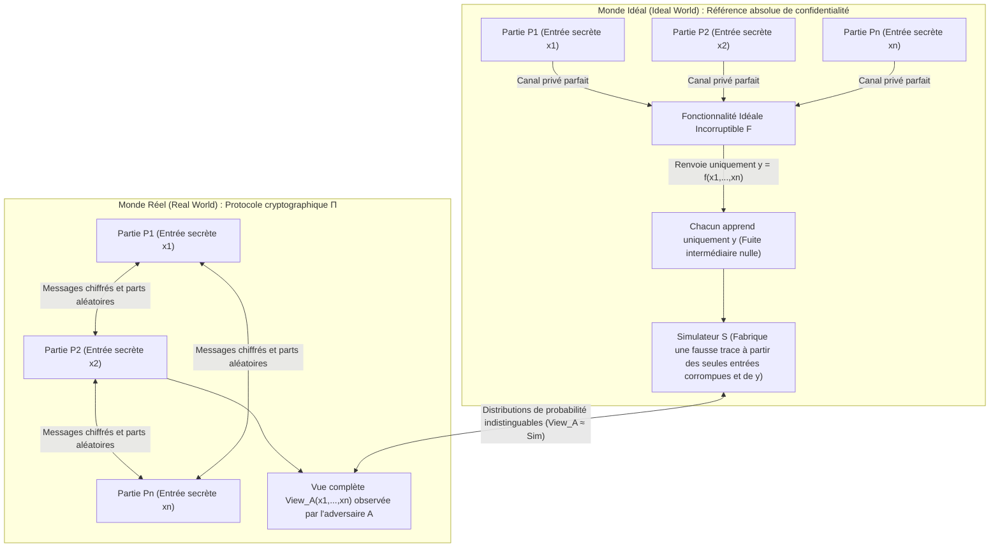
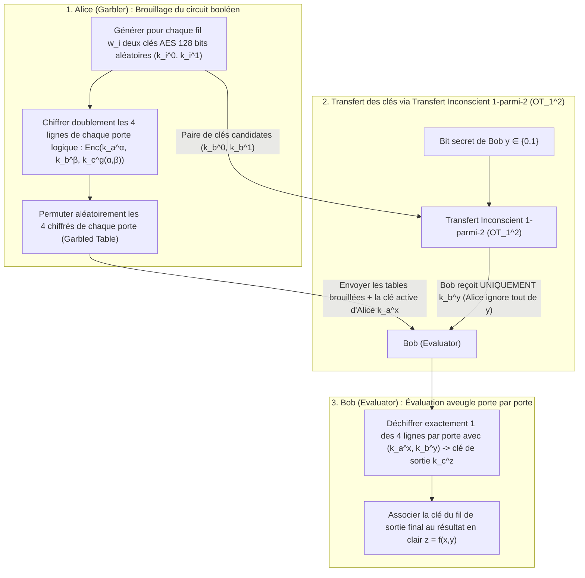

« Plusieurs centres hospitaliers souhaitent croiser les séquences génomiques de leurs patients atteints de cancer pour mener une étude statistique (GWAS), mais la réglementation (RGPD / HIPAA) interdit formellement qu'un seul octet de donnée brute ne sorte de chaque hôpital. »
« Des banques concurrentes veulent détecter conjointement des réseaux de blanchiment d'argent interbancaires sans jamais dévoiler leurs listes de clients ni leurs graphes de transactions. »

À première vue, ces exigences semblent contradictoires : pour évaluer une fonction $f(x_1, x_2, \dots, x_n)$, ne faut-il pas qu'un <strong>tiers de confiance (Trusted Third Party, TTP)</strong> rassemble d'abord toutes les entrées $x_i$ en clair ? Pourtant, à la fin des années 1980, la cryptographie moderne a démontré un théorème fascinant : <strong>même en l'absence totale de tiers de confiance, des participants mutuellement méfiants peuvent évaluer conjointement n'importe quelle fonction calculable $f(x_1, \dots, x_n)$ de sorte que chacun apprenne le résultat exact sans qu'aucun participant ne découvre un seul bit d'information supplémentaire sur l'entrée secrète $x_i$ des autres.</strong>

Cette discipline s'appelle le <strong>calcul multipartite sécurisé (Secure Multi-Party Computation, MPC)</strong>. Dans cet article, nous partons de deux expériences de pensée célèbres pour démontrer les deux grands moteurs mathématiques du MPC : le <strong>partage de secret à seuil $(t, n)$ d'Adi Shamir (interpolation de Lagrange, protocole BGW et triplets de Beaver)</strong> et l'approche par circuits booléens via le <strong>transfert inconscient ($\text{OT}_1^2$) de Rabin et les circuits brouillés (Garbled Circuits) de Yao</strong>.

---

## 1. Deux expériences de pensée paradoxales : « Le salaire moyen sans patron » et « Le problème des millionnaires de Yao »

### 1.1 Expérience de pensée 1 : Calculer le salaire moyen sans révéler aucun salaire individuel

Trois ingénieurs $A, B$ et $C$ veulent connaître leur <strong>salaire annuel moyen $\bar{x} = \frac{x_A + x_B + x_C}{3}$</strong> sans qu'aucun ne découvre le salaire individuel $x_A, x_B$ ou $x_C$ d'un autre. Grâce au <strong>partage de secret additif (masquage par masque jetable / One-Time Pad)</strong>, ils y parviennent sans aucun tiers :

1. <strong>Masque aléatoire et premier murmure ($A \to B$)</strong> : Les trois ingénieurs choisissent un grand entier public $M$ (par exemple $M = 10^9$). L'ingénieur $A$ tire secrètement un nombre aléatoire uniforme $r \xleftarrow{\$} \mathbb{Z}_M$, l'ajoute à son salaire $x_A$ et murmure uniquement $s_1 = (x_A + r) \bmod M$ à $B$. Comme $r$ est uniformément distribué sur $\mathbb{Z}_M$, $s_1$ l'est aussi quel que soit $x_A$ : par le théorème de Shannon sur le secret parfait, l'information mutuelle est nulle ($I(X_A; S_1) = 0$). $B$ n'apprend littéralement <strong>zéro bit</strong> sur $x_A$.
2. <strong>Additions successives ($B \to C \to A$)</strong> : $B$ ajoute son propre salaire $x_B$ et murmure $s_2 = (x_A + x_B + r) \bmod M$ à $C$ ; $C$ ajoute $x_C$ et transmet $s_3 = (x_A + x_B + x_C + r) \bmod M$ à $A$.
3. <strong>Démasquage</strong> : $A$ soustrait son masque secret $r$ modulo $M$, obtient la somme exacte $S = x_A + x_B + x_C$ et annonce la moyenne $\bar{x} = S / 3$.

> [!NOTE]
> <strong>Pourquoi faut-il au moins 3 participants ($n \ge 3$) ?</strong>
> S'il n'y avait que deux personnes ($A$ et $B$), même si un ange parfait leur révélait uniquement la moyenne $\bar{x} = \frac{x_A + x_B}{2}$, $A$ déduirait immédiatement $x_B = 2\bar{x} - x_A$. Ce n'est pas une faille du protocole, mais une propriété intrinsèque de la fonction. <strong>Le MPC garantit qu'aucune information supplémentaire n'est révélée au-delà de ce qui découle logiquement de sa propre entrée et du résultat final.</strong>

### 1.2 Expérience de pensée 2 : Le « problème des millionnaires » d'Andrew Yao (1982)

L'addition est linéaire, mais qu'en est-il d'une <strong>comparaison d'ordre non linéaire</strong> ?
En 1982, l'informaticien <strong>Andrew Chi-Chih Yao</strong> (futur prix Turing) a publié *"Protocols for Secure Computations"*, posant le célèbre <strong>problème des millionnaires</strong> : deux millionnaires, Alice ($x$ millions de dollars) et Bob ($y$ millions de dollars), veulent calculer uniquement le bit de vérité $f(x, y) = [x > y] \in \{0, 1\}$ (qui est le plus riche ?) sans révéler la valeur de $x$ ou $y$, ni même leur écart $x - y$.

---

## 2. Formalisation mathématique de la sécurité : Le paradigme de simulation Idéal/Réel

Pour prouver mathématiquement l'absence totale de fuite d'information, Goldreich, Micali et Wigderson (GMW 1987) ont introduit le <strong>paradigme de simulation Monde Idéal / Monde Réel</strong> :



Un protocole réel $\Pi$ est sécurisé s'il existe un algorithme polynomial appelé <strong>Simulateur $\mathcal{S}$</strong> capable, à partir des <em>seules entrées $\{x_i\}_{i \in I}$ et sorties $\{y_i\}_{i \in I}$ des parties corrompues</em>, de générer une trace synthétique indistinguable de la vue réelle $\text{View}_I^\Pi(x_1, \dots, x_n)$ :
$$\left\{ \mathcal{S}\left(I, \{x_i\}_{i \in I}, \{y_i\}_{i \in I}\right) \right\} \stackrel{c}{\approx} \left\{ \text{View}_I^\Pi(x_1, \dots, x_n) \right\}$$
On distingue les adversaires <strong>semi-honnêtes (Semi-Honest / Passive)</strong>, qui suivent le protocole mais analysent les échanges, et les adversaires <strong>malveillants (Malicious / Active)</strong>, qui tentent de tricher activement.

---

## 3. Moteur 1 : Partage de secret à seuil $(t, n)$ de Shamir, interpolation de Lagrange et BGW / SPDZ

### 3.1 Partage polynomial sur $\mathbb{F}_p$ et reconstruction de Lagrange
En 1979, <strong>Adi Shamir</strong> a conçu un schéma où le secret $s \in \mathbb{F}_p$ ($p > n$ premier) est le terme constant d'un polynôme aléatoire de degré $t - 1$ sur le corps fini $\mathbb{F}_p$ :
$$P(x) = s + a_1 x + a_2 x^2 + \dots + a_{t-1} x^{t-1} \pmod p$$
Chaque partie $P_i$ reçoit le point $(x_i = i,\, y_i = P(x_i))$. Tout sous-ensemble $T$ d'au moins $t$ parties reconstruit exactement $s = P(0)$ grâce à la <strong>formule d'interpolation de Lagrange</strong> :
$$s = P(0) = \sum_{i \in T} y_i \prod_{j \in T,\, j \ne i} \frac{-x_j}{x_i - x_j} \pmod p$$
À l'inverse, avec $t - 1$ parts ou moins, chaque secret candidat $s' \in \mathbb{F}_p$ correspond à un unique polynôme de degré $t - 1$ équiprobable ($H(S \mid \text{Shares}_{t-1}) = H(S)$, sécurité inconditionnelle au sens de la théorie de l'information).

### 3.2 Protocole BGW et triplets de multiplication de Beaver
Dans le <strong>protocole BGW (1988)</strong>, l'<strong>addition $[a] + [b] = [a + b]$ est 100 % locale et sans communication</strong>. En revanche, la <strong>multiplication $[a] \cdot [b]$</strong> double le degré du polynôme produit $P(x)Q(x)$ à $2(t-1)$, exigeant $2t - 1 \le n$ (une <strong>majorité honnête</strong>) et une étape de réduction de degré par repartage.
<strong>Donald Beaver (1991)</strong> a révolutionné cette étape grâce aux <strong>triplets de multiplication $([u], [v], [w = u \cdot v \bmod p])$</strong> précalculés hors ligne (cœur du protocole <strong>SPDZ</strong>). En ligne, pour multiplier $[x]$ et $[y]$, les parties ouvrent uniquement les différences masquées $d = (x - u) \bmod p$ et $e = (y - v) \bmod p$, puis calculent localement la combinaison linéaire :
$$[x \cdot y] = [w] + d \cdot [v] + e \cdot [u] + d \cdot e \pmod p$$

---

## 4. Moteur 2 : Transfert inconscient ($\text{OT}_1^2$) de Rabin et circuits brouillés (Garbled Circuits) de Yao

Pour les comparaisons binaires ($x > y$), l'approche par circuits booléens s'exécute en un nombre constant $O(1)$ de tours :



Grâce au <strong>transfert inconscient 1-parmi-2 ($\text{OT}_1^2$) de Michael Rabin</strong>, Bob récupère la clé $k_b^y$ correspondant à son bit secret $y$ sans qu'Alice ne découvre $y$ et sans que Bob ne découvre $k_b^{1-y}$. Les trois optimisations modernes — <strong>Point-and-Permute</strong> (bits de couleur indiquant directement la ligne à déchiffrer), <strong>Free-XOR</strong> ($k_i^1 = k_i^0 \oplus \Delta$ rendant toutes les portes `XOR` gratuites sans chiffré ni calcul AES) et <strong>Half-Gates</strong> (réduisant chaque porte `AND` à 2 chiffrés) — ont accéléré les circuits brouillés d'un facteur $1000$.

---

## 5. Implémentation complète en Python : Partage de Shamir et triplets de Beaver sur $\mathbb{F}_p$

```python
import secrets
from typing import List, Tuple

PRIME = (1 << 61) - 1  # Nombre premier de Mersenne de 61 bits p = 2^61 - 1

def mod_inv(a: int, p: int = PRIME) -> int:
    return pow(a % p, -1, p)

def shamir_share(secret: int, t: int, n: int, p: int = PRIME) -> List[Tuple[int, int]]:
    coeffs = [secret % p] + [secrets.randbelow(p) for _ in range(t - 1)]
    shares = []
    for i in range(1, n + 1):
        y = 0
        for c in reversed(coeffs):
            y = (y * i + c) % p
        shares.append((i, y))
    return shares

def lagrange_reconstruct(shares: List[Tuple[int, int]], p: int = PRIME) -> int:
    secret = 0
    k = len(shares)
    for i in range(k):
        xi, yi = shares[i]
        num, den = 1, 1
        for j in range(k):
            if i != j:
                xj, _ = shares[j]
                num = (num * (-xj)) % p
                den = (den * (xi - xj)) % p
        secret = (secret + yi * num * mod_inv(den, p)) % p
    return secret

def mpc_add(sa, sb, p=PRIME):
    return [(xa, (ya + yb) % p) for (xa, ya), (_, yb) in zip(sa, sb)]

def mpc_sub(sa, sb, p=PRIME):
    return [(xa, (ya - yb) % p) for (xa, ya), (_, yb) in zip(sa, sb)]

def mpc_scalar_mul(c, sa, p=PRIME):
    return [(xa, (c * ya) % p) for xa, ya in sa]

def mpc_add_const(c, sa, p=PRIME):
    return [(xa, (ya + c) % p) for xa, ya in sa]

def generate_beaver_triple(t: int, n: int, p: int = PRIME):
    u, v = secrets.randbelow(p), secrets.randbelow(p)
    return shamir_share(u, t, n, p), shamir_share(v, t, n, p), shamir_share((u * v) % p, t, n, p)

def mpc_beaver_mul(sx, sy, triple, t: int, p: int = PRIME):
    su, sv, sw = triple
    d = lagrange_reconstruct(mpc_sub(sx, su, p)[:t], p)
    e = lagrange_reconstruct(mpc_sub(sy, sv, p)[:t], p)
    res = mpc_add(mpc_add(sw, mpc_scalar_mul(d, sv, p), p), mpc_scalar_mul(e, su, p), p)
    return mpc_add_const((d * e) % p, res, p)

if __name__ == "__main__":
    t, n = 3, 5
    salaries = [85000, 92000, 78000]
    shared = [shamir_share(s, t, n) for s in salaries]
    total_shares = shared[0]
    for s in shared[1:]:
        total_shares = mpc_add(total_shares, s)
    print("Somme totale reconstruite :", lagrange_reconstruct(total_shares[:t]))
```

---

## 6. Comparaison des technologies de protection de la vie privée (PETs) et applications réelles

| Critère | Calcul Multipartite Sécurisé (MPC) | Chiffrement Totalement Homomorphe (FHE) | Preuves à Divulgation Nulle (ZKP) | Environnement d'Exécution de Confiance (TEE) |
| :--- | :--- | :--- | :--- | :--- |
| <strong>Problème résolu</strong> | <strong>Calcul conjoint</strong> sur des entrées secrètes distribuées $x_1, \dots, x_n$ | <strong>Calcul aveugle externalisé</strong> sur chiffrés $\text{Enc}(x) \mapsto \text{Enc}(f(x))$ | <strong>Prouver qu'un secret $w$ connu du prouveur</strong> vérifie $f(x, w)=1$ | <strong>Exécution isolée matériellement</strong> en clair dans une enclave CPU |
| <strong>Goulot d'étranglement</strong> | Calcul CPU ultra-léger, mais <strong>bande passante et tours réseau par multiplication</strong> | Un seul aller-retour réseau, mais <strong>calcul CPU $10^3$ à $10^5$ fois plus lent</strong> | Vérification quasi instantanée, génération de preuve coûteuse (MSM / FFT) | Vitesse quasi native, mais mémoire d'enclave limitée |
| <strong>Modèle de confiance</strong> | <strong>Non-collusion</strong> (moins de $t$ serveurs corrompus) | <strong>Hypothèse cryptographique sur les réseaux euclidiens (RLWE)</strong> | <strong>Solidité mathématique</strong> (ne combine pas à lui seul les secrets de plusieurs parties) | <strong>Confiance envers le fondeur (Intel/AMD)</strong> ; vulnérable aux canaux auxiliaires physiques |

De la <strong>double enchère danoise sur les quotas de betteraves sucrières en 2008</strong> à l'<strong>étude sur les écarts salariaux de la ville de Boston (BWWC)</strong>, en passant par la <strong>vérification des mots de passe compromis dans Google Chrome et Apple iCloud (Private Set Intersection, PSI)</strong>, les <strong>études génomiques inter-hospitalières (Secure GWAS)</strong> et les <strong>portefeuilles cryptographiques à seuil MPC (Fireblocks, Coinbase)</strong>, le MPC remplace aujourd'hui la confiance institutionnelle par la certitude mathématique.
