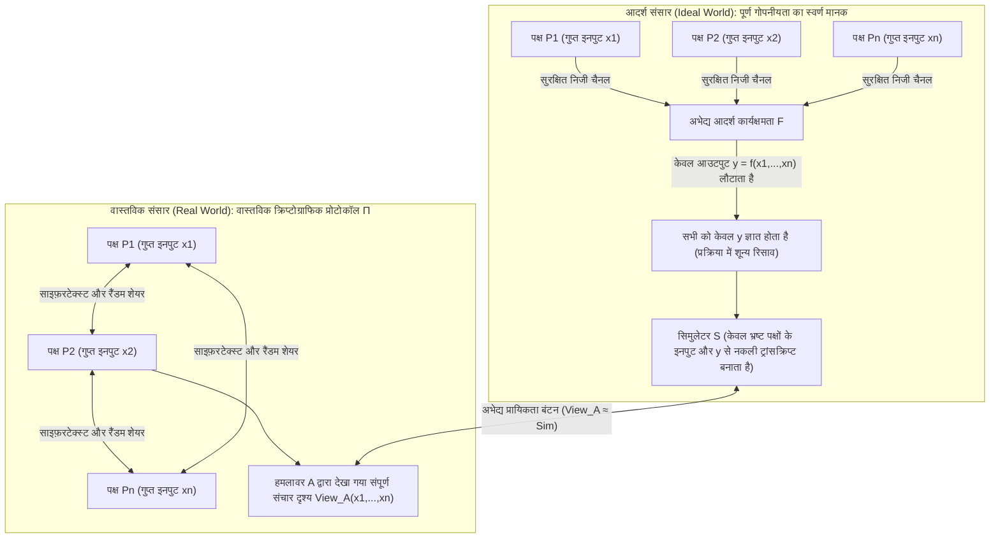
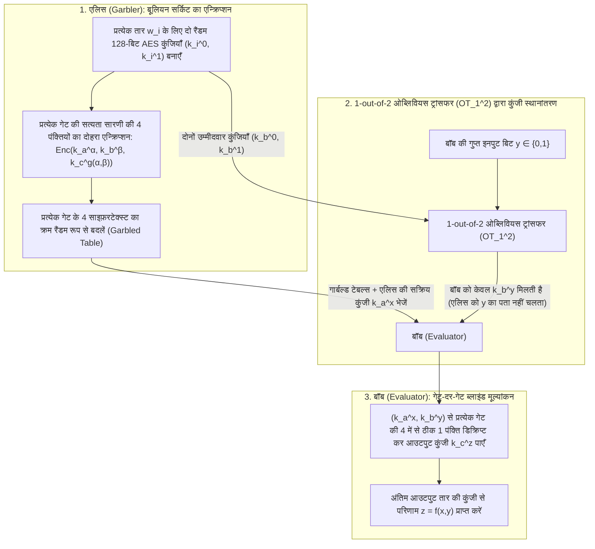

"कई अस्पताल रोगियों के जीनोम का संयुक्त विश्लेषण करना चाहते हैं और उन्हें डेटा प्रसंस्करण के लागू कानूनी, संविदात्मक तथा नैतिक नियमों का पालन करना होगा।"
"प्रतिस्पर्धी वाणिज्यिक बैंक अपनी ग्राहक सूचियों या आंतरिक लेनदेन ग्राफ़ को एक-दूसरे के सामने उजागर किए बिना, संयुक्त रूप से अंतर-बैंक मनी लॉन्ड्रिंग नेटवर्क का पता लगाना चाहते हैं।"

पहली नज़र में यह तार्किक रूप से असंभव लगता है: किसी फ़ंक्शन $f(x_1, x_2, \dots, x_n)$ की गणना करने के लिए, क्या किसी <strong>विश्वसनीय तृतीय पक्ष (Trusted Third Party, TTP)</strong> को पहले सभी इनपुट $x_i$ को प्लेनटेक्स्ट में एकत्र नहीं करना पड़ेगा? फिर भी, 1980 के दशक के उत्तरार्ध में आधुनिक क्रिप्टोग्राफी ने एक अद्भुत प्रमेय सिद्ध किया: <strong>स्पष्ट प्रतिद्वंद्वी-मॉडल और क्रिप्टोग्राफ़िक मान्यताओं के अंतर्गत प्रतिभागी मिलकर फ़ंक्शन की गणना कर सकते हैं; सुरक्षा-परिभाषा अनुमत इनपुट और आउटपुट से निकाली जा सकने वाली जानकारी से आगे के अतिरिक्त प्रकटीकरण को सीमित करती है।</strong>

इस तकनीक को <strong>सुरक्षित बहु-पक्षीय संगणना (Secure Multi-Party Computation, MPC)</strong> कहा जाता है। इस लेख में हम दो प्रसिद्ध विचार प्रयोगों से शुरुआत करते हुए MPC के दो मुख्य गणितीय इंजनों की व्युत्पत्ति करेंगे: <strong>आदि शामिर (Adi Shamir) की $(t, n)$ थ्रेशोल्ड सीक्रेट शेयरिंग (लैग्रेंज इंटरपोलेशन, BGW प्रोटोकॉल और बीवर के गुणन ट्रिपल्स)</strong> तथा <strong>ओब्लिवियस ट्रांसफर (OT) और एंड्रयू याओ के गार्बल्ड सर्किट्स (Garbled Circuits)</strong> पर आधारित बूलियन सर्किट इंजन।

---


**सुरक्षा दावों को कैसे समझें:** “गुप्त जानकारी उजागर नहीं होती” जैसे कथन केवल बताए गए हमलावर मॉडल, सुरक्षा परिभाषा और क्रिप्टोग्राफिक मान्यताओं के अंतर्गत लागू हैं। आम तौर पर अनुमत इनपुट और आउटपुट से अनुमानित जानकारी से अतिरिक्त खुलासे का मूल्यांकन होता है; परिणामों से अनुमान, कार्यान्वयन, संचालन, उपलब्धता और साइड-चैनल की अलग जाँच जरूरी है।

## 1. दो विरोधाभासी विचार प्रयोग: "बॉस के बिना औसत वेतन की गणना" और "याओ की करोड़पति समस्या"

### 1.1 विचार प्रयोग 1: किसी को अपना वेतन बताए बिना तीनों का 'औसत वेतन' कैसे निकालें?

तीन इंजीनियर $A, B$ और $C$ अपना <strong>औसत वार्षिक वेतन $\bar{x} = \frac{x_A + x_B + x_C}{3}$</strong> जानना चाहते हैं, लेकिन कोई भी अपना व्यक्तिगत वेतन $x_A, x_B$ या $x_C$ अन्य दो को नहीं बताना चाहता। <strong>एडिटिव सीक्रेट शेयरिंग (वन-टाइम पैड मास्किंग)</strong> की मदद से वे केवल कागज और कलम से इसे हल कर सकते हैं:

1. <strong>रैंडम मास्क और पहली फुसफुसाहट ($A \to B$)</strong>: तीनों एक बड़ी सार्वजनिक संख्या $M$ (जैसे $M = 10^9$) तय करते हैं। इंजीनियर $A$ गुप्त रूप से एक समान रैंडम संख्या $r \xleftarrow{\$} \mathbb{Z}_M$ चुनता है, उसमें अपना वेतन $x_A$ जोड़ता है, और केवल $s_1 = (x_A + r) \bmod M$ को $B$ के कान में बताता है। चूँकि $r$ रिंग $\mathbb{Z}_M$ में समान रूप से वितरित है, इसलिए $x_A$ का मान कुछ भी हो, $s_1$ भी पूरी तरह समान रूप से वितरित होता है—शैनन के पूर्ण गोपनीयता प्रमेय के अनुसार पारस्परिक सूचना शून्य है ($I(X_A; S_1) = 0$)। $B$ को $x_A$ के बारे में <strong>शून्य बिट</strong> जानकारी मिलती है।
2. <strong>क्रमिक योग ($B \to C \to A$)</strong>: $B$ इसमें अपना वेतन $x_B$ जोड़कर $s_2 = (x_A + x_B + r) \bmod M$ को $C$ को बताता है; $C$ अपना वेतन $x_C$ जोड़कर $s_3 = (x_A + x_B + x_C + r) \bmod M$ वापस $A$ को देता है।
3. <strong>मास्क हटाना</strong>: $A$ अपने रैंडम नंबर $r$ को घटाकर सटीक योग $S = (s_3 - r) \bmod M = x_A + x_B + x_C$ प्राप्त करता है और औसत $\bar{x} = S / 3$ घोषित करता है!

> **इस फुसफुसाहट वाले उदाहरण की सीमा:** यह शिक्षण के लिए उदाहरण है, सुरक्षित MPC प्रोटोकॉल नहीं। इसमें पड़ोसी प्रतिभागियों के बीच निजी चैनल, ईमानदार व्यवहार और मिलीभगत का अभाव माना गया है। उदाहरण के लिए, Bob और Carol अपनी जानकारी साझा करके घोषित योग के साथ Alice का इनपुट निकाल सकते हैं। वास्तविक उपयोग में लक्षित खतरा-मॉडल के लिए प्रमाणित सुरक्षित प्रोटोकॉल चाहिए। मॉड्यूलर रैपअराउंड से बचने के लिए $M$ इनपुट के योग से बड़ा होना चाहिए।

> [!NOTE]
> <strong>कम से कम 3 प्रतिभागियों ($n \ge 3$) की आवश्यकता क्यों है?</strong>
> यदि केवल दो लोग ($A$ और $B$) होते, तो भले ही कोई देवता उन्हें केवल औसत $\bar{x} = \frac{x_A + x_B}{2}$ बताता, $A$ तुरंत $x_B = 2\bar{x} - x_A$ से $B$ का वेतन निकाल लेता। यह प्रोटोकॉल की कमी नहीं, बल्कि स्वयं फ़ंक्शन का गुण है। <strong>MPC यह गारंटी देता है कि अपने स्वयं के इनपुट और अंतिम आउटपुट से तार्किक रूप से निकलने वाली जानकारी के अलावा गणना के दौरान एक भी अतिरिक्त बिट लीक न हो।</strong>

### 1.2 विचार प्रयोग 2: एंड्रयू याओ की 'करोड़पति समस्या' (1982)

योग एक रैखिक (linear) संक्रिया है, परंतु <strong>अरैखिक तुलना (nonlinear comparison)</strong> का क्या?
1982 में ट्यूरिंग पुरस्कार विजेता कंप्यूटर वैज्ञानिक <strong>एंड्रयू ची-ची याओ (Andrew Yao)</strong> ने अपने ऐतिहासिक शोधपत्र *"Protocols for Secure Computations"* में प्रसिद्ध <strong>करोड़पति समस्या (Millionaires' Problem)</strong> प्रस्तुत की: दो करोड़पति, एलिस ($x$ मिलियन डॉलर) और बॉब ($y$ मिलियन डॉलर), बिना किसी तीसरे पक्ष के केवल यह 1-बिट बूलियन मान $f(x, y) = [x > y] \in \{0, 1\}$ (कौन अधिक अमीर है?) जानना चाहते हैं, बिना $x, y$ या उनके अंतर $x - y$ को उजागर किए।

---

## 2. MPC सुरक्षा की गणितीय परिभाषा: आदर्श/वास्तविक सिमुलेशन प्रतिमान

सूचना के शून्य रिसाव को गणितीय रूप से सिद्ध करने के लिए गोल्डराइख, मिकाली और विग्डरसन (GMW 1987) ने <strong>आदर्श/वास्तविक सिमुलेशन प्रतिमान (Ideal/Real Simulation Paradigm)</strong> स्थापित किया:



एक वास्तविक प्रोटोकॉल $\Pi$ तब सुरक्षित कहलाता है जब एक दक्ष एल्गोरिदम अर्थात <strong>सिमुलेटर $\mathcal{S}$</strong> का अस्तित्व हो, जो <em>केवल भ्रष्ट पक्षों के इनपुट $\{x_i\}_{i \in I}$ और आउटपुट $\{y_i\}_{i \in I}$ की सहायता से</em> ऐसा नकली संचार लॉग उत्पन्न कर सके जो वास्तविक दृश्य $\text{View}_I^\Pi(x_1, \dots, x_n)$ से प्रायिकता बंटन में अभेद्य हो:
$$\left\{ \mathcal{S}\left(I, \{x_i\}_{i \in I}, \{y_i\}_{i \in I}\right) \right\} \stackrel{c}{\approx} \left\{ \text{View}_I^\Pi(x_1, \dots, x_n) \right\}$$
यहाँ हमलावरों को दो श्रेणियों में बाँटा जाता है: <strong>अर्ध-ईमानदार (Semi-Honest / Passive)</strong> जो प्रोटोकॉल का पालन करते हैं किंतु लॉग का विश्लेषण करते हैं, और <strong>दुर्भावनापूर्ण (Malicious / Active)</strong> जो संदेशों में सक्रिय रूप से हेरफेर करते हैं।

---

## 3. इंजन 1: शामिर की $(t, n)$ थ्रेशोल्ड सीक्रेट शेयरिंग, लैग्रेंज इंटरपोलेशन और BGW / SPDZ

### 3.1 परिमित क्षेत्र $\mathbb{F}_p$ पर बहुपद और लैग्रेंज पुनर्निर्माण
1979 में <strong>आदि शामिर (Adi Shamir)</strong> ने गुप्त संख्या $s \in \mathbb{F}_p$ ($p > n$ अभाज्य) को परिमित क्षेत्र $\mathbb{F}_p$ पर $t - 1$ घात वाले रैंडम बहुपद के अचर पद के रूप में छिपाने की विधि दी:
$$P(x) = s + a_1 x + a_2 x^2 + \dots + a_{t-1} x^{t-1} \pmod p$$
प्रत्येक पक्ष $P_i$ को बिंदु $(x_i = i,\, y_i = P(x_i))$ मिलता है। कम से कम $t$ पक्षों का कोई भी उपसमुच्चय $T$ <strong>लैग्रेंज बहुपद इंटरपोलेशन सूत्र</strong> द्वारा $s = P(0)$ को पुनः प्राप्त कर सकता है:
$$s = P(0) = \sum_{i \in T} y_i \prod_{j \in T,\, j \ne i} \frac{-x_j}{x_i - x_j} \pmod p$$
किंतु $t - 1$ या कम शेयरों के साथ प्रत्येक संभावित रहस्य $s' \in \mathbb{F}_p$ की प्रायिकता बिल्कुल समान रहती है ($H(S \mid \text{Shares}_{t-1}) = H(S)$, पूर्ण सूचना-सैद्धांतिक सुरक्षा)।

### 3.2 BGW प्रोटोकॉल और बीवर के गुणन ट्रिपल्स
<strong>BGW प्रोटोकॉल (1988)</strong> में <strong>योग $[a] + [b] = [a + b]$ पूर्णतः स्थानीय और शून्य-संचार</strong> है। किंतु <strong>गुणन $[a] \cdot [b]$</strong> बहुपद की घात को दोगुना कर $2(t-1)$ कर देता है, जिसके लिए $2t - 1 \le n$ (<strong>ईमानदार बहुमत, Honest Majority</strong>) और घात-न्यूनीकरण (Degree Reduction) राउंड आवश्यक होता है।
<strong>डोनाल्ड बीवर (1991)</strong> ने ऑफ़लाइन चरण में पूर्व-निर्मित रैंडम <strong>गुणन ट्रिपल्स $([u], [v], [w = u \cdot v \bmod p])$</strong> (आधुनिक <strong>SPDZ प्रोटोकॉल</strong> की रीढ़) द्वारा इसे हल किया। ऑनलाइन चरण में $[x \cdot y]$ निकालने के लिए केवल मास्क किए गए अंतर $d = (x - u) \bmod p$ और $e = (y - v) \bmod p$ खोले जाते हैं और स्थानीय रैखिक संयोजन किया जाता है:
$$[x \cdot y] = [w] + d \cdot [v] + e \cdot [u] + d \cdot e \pmod p$$

---

**ये सीमाएँ प्रतिद्वंद्वी-मॉडल पर निर्भर करती हैं:** क्लासिक BGW निष्क्रिय (ईमानदार लेकिन जिज्ञासु) मॉडल में $c < n/2$ भ्रष्ट प्रतिभागियों को सहता है; दुर्भावनापूर्ण प्रतिभागियों के विरुद्ध सूचना-सैद्धांतिक सुरक्षा के लिए आम तौर पर $c < n/3$ और उपयुक्त संचार मान्यताएँ चाहिए। Beaver ट्रिपल अकेले भ्रष्टाचार सीमा तय नहीं करता और सक्रिय सुरक्षा नहीं देता।

## 4. इंजन 2: ओब्लिवियस ट्रांसफर (OT) और याओ के गार्बल्ड सर्किट

कुछ संरचनाओं में इनपुट स्थानांतरित होने के बाद गेटों का मूल्यांकन स्थानीय रूप से होता है; कुल संचार राउंड OT प्रोटोकॉल और उसकी व्यवस्था पर निर्भर करते हैं।



<strong>Point-and-Permute</strong> डिक्रिप्ट की जाने वाली पंक्ति पहचानता है, <strong>Free-XOR</strong> XOR गेट को garble करने की आवश्यकता घटाता है, और <strong>Half-Gates</strong> AND गेट के लिए संचार कम करता है। वास्तविक दक्षता सर्किट, कार्यान्वयन, हार्डवेयर और नेटवर्क पर निर्भर करती है; कोई एक निश्चित गति-वृद्धि सभी पर लागू नहीं होती।

---

## 5. संपूर्ण Python कार्यान्वयन: $\mathbb{F}_p$ पर शामिर सीक्रेट शेयरिंग और बीवर गुणन ट्रिपल्स

यह उदाहरण प्रत्येक वेतन का वर्ग निकालने के लिए नया Beaver ट्रिपल भी उपयोग करता है, फिर औसत और जनसंख्या-विचरण की गणना हेतु योग तथा वर्गों का योग खोलता है। ये परिणाम पुनर्निर्माण करने वाले पक्ष को दिखाए जाते हैं; यह एक ही प्रक्रिया में शैक्षिक सिमुलेशन है।

```python
import secrets
from typing import List, Tuple

# 61-bit Mersenne prime p = 2^61 - 1 for our prime finite field F_p
PRIME = (1 << 61) - 1

def mod_inv(a: int, p: int = PRIME) -> int:
    # Modular inverse in F_p via Extended Euclidean Algorithm (Python 3.8+ pow(a, -1, p))
    return pow(a % p, -1, p)

def shamir_share(secret: int, t: int, n: int, p: int = PRIME) -> List[Tuple[int, int]]:
    # Shamir's (t, n) Threshold Secret Sharing:
    # Samples a random degree-(t-1) polynomial P(x) with P(0) = secret and evaluates it at x = 1..n.
    assert 1 <= t <= n < p, "Threshold t and party count n must satisfy 1 <= t <= n < p"
    # P(x) = s + a_1 * x + a_2 * x^2 + ... + a_{t-1} * x^{t-1} (mod p)
    coeffs = [secret % p] + [secrets.randbelow(p) for _ in range(t - 1)]

    shares = []
    for i in range(1, n + 1):
        # Evaluate P(i) using Horner's method
        y = 0
        for c in reversed(coeffs):
            y = (y * i + c) % p
        shares.append((i, y))
    return shares

def lagrange_reconstruct(shares: List[Tuple[int, int]], p: int = PRIME) -> int:
    # Reconstructs P(0) = s from any subset of >= t shares using Lagrange Polynomial Interpolation:
    # s = sum_{i in T} y_i * prod_{j in T, j != i} (-x_j) / (x_i - x_j) (mod p)
    secret = 0
    k = len(shares)
    for i in range(k):
        xi, yi = shares[i]
        num = 1
        den = 1
        for j in range(k):
            if i == j:
                continue
            xj, _ = shares[j]
            num = (num * (-xj)) % p
            den = (den * (xi - xj)) % p
        lambda_i = (num * mod_inv(den, p)) % p
        secret = (secret + yi * lambda_i) % p
    return secret

def mpc_add(shares_a: List[Tuple[int, int]], shares_b: List[Tuple[int, int]], p: int = PRIME) -> List[Tuple[int, int]]:
    # Local homomorphic addition [a] + [b] = [a + b] (Zero communication)
    return [(xa, (ya + yb) % p) for (xa, ya), (xb, yb) in zip(shares_a, shares_b)]

def mpc_sub(shares_a: List[Tuple[int, int]], shares_b: List[Tuple[int, int]], p: int = PRIME) -> List[Tuple[int, int]]:
    # Local homomorphic subtraction [a] - [b] = [a - b] (Zero communication)
    return [(xa, (ya - yb) % p) for (xa, ya), (xb, yb) in zip(shares_a, shares_b)]

def mpc_scalar_mul(scalar: int, shares_a: List[Tuple[int, int]], p: int = PRIME) -> List[Tuple[int, int]]:
    # Local multiplication by a public scalar c * [a] = [c * a] (Zero communication)
    return [(xa, (scalar * ya) % p) for xa, ya in shares_a]

def mpc_add_constant(const: int, shares_a: List[Tuple[int, int]], p: int = PRIME) -> List[Tuple[int, int]]:
    # Adding a public constant [a] + c = [a + c] shifts P(x) by +c at every evaluation point
    return [(xa, (ya + const) % p) for xa, ya in shares_a]

def generate_beaver_triple(t: int, n: int, p: int = PRIME):
    # Offline Preprocessing Phase: Generates a shared random multiplication triple ([u], [v], [w = u * v])
    u = secrets.randbelow(p)
    v = secrets.randbelow(p)
    w = (u * v) % p
    return shamir_share(u, t, n, p), shamir_share(v, t, n, p), shamir_share(w, t, n, p)

def mpc_beaver_mul(
    shares_x: List[Tuple[int, int]],
    shares_y: List[Tuple[int, int]],
    triple: Tuple[List[Tuple[int, int]], List[Tuple[int, int]], List[Tuple[int, int]]],
    t: int,
    p: int = PRIME
) -> List[Tuple[int, int]]:
    # Online Phase: Evaluates [x * y] using a Beaver Multiplication Triple ([u], [v], [w]):
    # 1. Locally compute [d] = [x] - [u] and [e] = [y] - [v]
    # 2. Open masked differences; security depends on fresh, valid, single-use triples and the threat model
    # 3. Locally compute the linear combination [x * y] = [w] + d * [v] + e * [u] + d * e
    shares_u, shares_v, shares_w = triple
    shares_d = mpc_sub(shares_x, shares_u, p)
    shares_e = mpc_sub(shares_y, shares_v, p)

    # Open the masked differences d = x - u and e = y - v using t shares
    d = lagrange_reconstruct(shares_d[:t], p)
    e = lagrange_reconstruct(shares_e[:t], p)

    # Linear combination to obtain degree-(t-1) shares of [x * y]
    term1 = shares_w
    term2 = mpc_scalar_mul(d, shares_v, p)
    term3 = mpc_scalar_mul(e, shares_u, p)
    res = mpc_add(mpc_add(term1, term2, p), term3, p)
    res = mpc_add_constant((d * e) % p, res, p)
    return res

if __name__ == "__main__":
    # 5 MPC servers (n = 5) with reconstruction threshold t = 3 (any 2 servers learn 0 bits)
    t, n = 3, 5
    salaries = [850, 920, 780]  # Example salary units

    # Each engineer splits their secret salary across the 5 servers
    shared_salaries = [shamir_share(s, t, n) for s in salaries]

    # 1. Compute the sum of salaries locally with zero inter-server communication
    sum_shares = shared_salaries[0]
    for s_share in shared_salaries[1:]:
        sum_shares = mpc_add(sum_shares, s_share)

    # Reconstruct the total from any 3 servers (e.g., servers 1, 3, and 5)
    subset_3 = [sum_shares[0], sum_shares[2], sum_shares[4]]
    total_salary = lagrange_reconstruct(subset_3)
    mean_salary = total_salary / len(salaries)
    print(f"Reconstructed total (units): {total_salary:,} (mean: {mean_salary:,.2f})")

    # 2. Compute the sum of squares S_2 = x_A^2 + x_B^2 + x_C^2 using Beaver Multiplication Triples
    sq_sum_shares = shamir_share(0, t, n)
    for s_share in shared_salaries:
        triple = generate_beaver_triple(t, n)
        sq_share = mpc_beaver_mul(s_share, s_share, triple, t)
        sq_sum_shares = mpc_add(sq_sum_shares, sq_share)

    total_sq = lagrange_reconstruct(sq_sum_shares[:t])
    variance = (total_sq / len(salaries)) - (mean_salary ** 2)
    print(f"Reconstructed sum of squares: {total_sq:,} (population variance: {variance:,.2f})")
```

---

## 6. गोपनीयता संवर्धन प्रौद्योगिकियों (PETs) की तुलना और वास्तविक अनुप्रयोग

| मानदंड | सुरक्षित बहु-पक्षीय संगणना (MPC) | पूर्ण होमोमोर्फिक एन्क्रिप्शन (FHE) | शून्य-ज्ञान प्रमाण (ZKP) | विश्वसनीय निष्पादन वातावरण (TEE) |
| :--- | :--- | :--- | :--- | :--- |
| <strong>मुख्य समस्या</strong> | विभिन्न पक्षों के गुप्त इनपुट $x_1, \dots, x_n$ पर <strong>संयुक्त गणना</strong> | एकल सर्वर पर साइफ़रटेक्स्ट के ऊपर <strong>ब्लाइंड गणना</strong> $\text{Enc}(x) \mapsto \text{Enc}(f(x))$ | <strong>सिद्धकर्ता को पहले से ज्ञात रहस्य $w$</strong> के लिए $f(x, w)=1$ सिद्ध करना | CPU एन्क्लेव के भीतर प्लेनटेक्स्ट में <strong>हार्डवेयर-पृथक निष्पादन</strong> |
| <strong>मुख्य बाधा</strong> | संचार लागत प्रोटोकॉल, सर्किट की गहराई और नेटवर्क पर निर्भर करती है | गणना और संचार लागत स्कीम, सर्किट और हार्डवेयर पर निर्भर करती है; धीमेपन का कोई सार्वभौमिक निश्चित गुणक नहीं है | प्रमाण और सत्यापन की लागत प्रणाली तथा कथन पर निर्भर करती है | प्रदर्शन और सुरक्षित मेमोरी प्लेटफ़ॉर्म तथा कार्यभार पर निर्भर करते हैं |
| <strong>विश्वास मॉडल</strong> | MPC की सुरक्षा प्रोटोकॉल की सीमा और प्रतिद्वंद्वी-मॉडल पर निर्भर करती है; आउटपुट से रिसाव, उपलब्धता और निष्पक्षता का अलग मूल्यांकन चाहिए। | <strong>लैटिस क्रिप्टोग्राफिक कठिनाई (RLWE)</strong> | <strong>गणितीय सुदृढ़ता</strong> (अकेले कई पक्षों के रहस्य नहीं जोड़ता) | <strong>चिप निर्माता (Intel/AMD) पर विश्वास</strong>; साइड-चैनल हमलों के प्रति संवेदनशील |

अध्ययन या उपयोग के उदाहरणों में डेनमार्क की चुकंदर नीलामी, बोस्टन वेतन-अंतर मापन, पासवर्ड जाँच, जीनोमिक्स अनुसंधान और वितरित हस्ताक्षर शामिल हैं। इनके वास्तविक उपयोग का स्तर, सुरक्षा-मॉडल और शेष जोखिम अलग-अलग हैं; MPC संस्थागत भरोसे को पूर्ण निश्चितता से नहीं बदलता।

## 7. अन्य PET तकनीकें और उनकी सीमाएँ

ऐतिहासिक टिप्पणी: 1981 का Rabin OT (जिसमें संदेश मिलने की संभावना 1/2 होती है) 1985 में Even, Goldreich और Lempel द्वारा परिभाषित 1-out-of-2 OT से अलग है।
MPC इनपुट को बाँटता है; इसकी गारंटी प्रोटोकॉल और हमलावर मॉडल पर निर्भर करती है। FHE एन्क्रिप्टेड डेटा पर गणना की अनुमति देता है, पर गणना की जाँच या परिणामों से सूचना का खुलासा अपने-आप नहीं रोकता। शून्य-ज्ञान प्रमाण गवाह उजागर किए बिना कथन सिद्ध करते हैं, पर संयुक्त गणना का विकल्प नहीं हैं। TEE सुरक्षित हार्डवेयर में स्पष्ट-पाठ संसाधित करता है और हार्डवेयर तथा अटेस्टेशन पर भरोसा माँगता है। तकनीकें मिल सकती हैं; लागत और गारंटी उपयोग पर निर्भर हैं।

## 8. उदाहरण
2008 की डेनिश चुकंदर नीलामी में तीन-पक्षीय MPC था; शोधपत्र लगभग 1,200 इनपुट, करीब 30 मिनट की गणना और 25,000 टन अधिकार हस्तांतरण बताता है। BWWC और Boston University हर दो साल में वेतन-अंतर रिपोर्ट करते हैं; BWWC के अनुसार 2023 में 103 नियोक्ता और 165,000 पूर्णकालिक कर्मचारी शामिल थे। Google Chrome और Apple अलग-अलग PSI-आधारित पासवर्ड जाँच बताते हैं। 2023 के USENIX अध्ययन ने जाँचे गए Chrome कार्यान्वयन में साइड-चैनल बताए। MPC-GWAS शोध में प्रदर्शित हैं, पर परिणाम सूचना प्रकट कर सकते हैं। Secure Aggregation व्यक्तिगत अपडेट छिपाता है, पर अनुमान के सभी जोखिम नहीं। थ्रेशोल्ड हस्ताक्षर और शेयर अपडेट प्रोटोकॉल व संचालन की शर्तों पर निर्भर हैं।

## 9. निष्कर्ष
MPC स्पष्ट-पाठ डेटा केंद्रीकरण घटाता है, लेकिन परिणामों से खुलासा या संचालन, कानून और उपलब्धता के जोखिम नहीं मिटाता। गारंटी हमलावर मॉडल, क्रिप्टोग्राफिक मान्यताओं, कार्यान्वयन और संचालन पर निर्भर है।

**कोड उदाहरण का दायरा:** यह Python कोड सीमित क्षेत्र में सीक्रेट शेयरिंग और गणना का एक ही प्रक्रिया में चलने वाला शैक्षिक सिमुलेशन है। यह ऐसा नेटवर्क MPC सिस्टम नहीं है जिसमें हर पक्ष के पास केवल अपने शेयर हों। इसमें दुर्भावनापूर्ण प्रतिभागियों के विरुद्ध जाँच, प्रमाणीकरण या सुरक्षित संचार, विश्वसनीय प्रीप्रोसेसिंग, तथा इनपुट सीमा और ओवरफ़्लो नियंत्रण शामिल नहीं हैं। `lagrange_reconstruct` से पुनर्निर्मित मान पुनर्निर्माण करने वाले पक्ष को दिखाई देते हैं। वास्तविक डेटा या संपत्ति की सुरक्षा के लिए इस उदाहरण का उपयोग न करें।


## Sources

- [Rabin, “How to Exchange Secrets with Oblivious Transfer” (1981)](https://eprint.iacr.org/2005/187.pdf)
- [Even, Goldreich, and Lempel, “A Randomized Protocol for Signing Contracts” (1985)](https://luca-giuzzi.unibs.it/corsi/Support/papers-cryptography/SigningContracts.pdf)

- [Bogetoft et al., “Secure Multiparty Computation Goes Live” (2009)](https://www.acsu.buffalo.edu/~mblanton/cse715/sugar-beet-auction.pdf)
- [Boston Women’s Workforce Council: Wage Gap Studies](https://thebwwc.org/wage-gap-studies)
- [Google: Better password protections in Chrome](https://security.googleblog.com/2019/12/better-password-protections-in-chrome.html)
- [Apple Platform Security: Password Monitoring](https://support.apple.com/guide/security/password-monitoring-sec78e79fc3b/web)
- [Kwong et al., USENIX Security 2023: Chrome password-check side channels](https://www.usenix.org/conference/usenixsecurity23/presentation/kwong)
- [Cho et al., “Secure genome-wide association analysis using multiparty computation” (2018)](https://pmc.ncbi.nlm.nih.gov/articles/PMC5990440/)
- [Bonawitz et al., Google Research: Practical Secure Aggregation](https://research.google/pubs/practical-secure-aggregation-for-federated-learning-on-user-held-data/)
- [Canetti et al., “UC Non-Interactive, Proactive, Threshold ECDSA” (2020)](https://eprint.iacr.org/2020/492)
- [Kumar et al., “Understanding Information Disclosure from Secure Computation Output” (2025)](https://doi.org/10.1145/3705004)
- [Kolesnikov and Schneider, “Improved Garbled Circuit: Free XOR Gates and Applications” (2008)](https://encrypto.de/papers/KS08XOR.pdf)
- [Zahur, Rosulek, and Evans, “Two Halves Make a Whole: Reducing Data Transfer in Garbled Circuits using Half Gates” (2015)](https://www.cs.virginia.edu/~evans/pubs/ec2015/halfgates.pdf)

- [Stanford University cryptography notes: Oblivious Transfer](https://crypto.stanford.edu/pbc/notes/crypto/ot.html)

- [A Full Proof of the BGW Protocol for Perfectly Secure MPC](https://doi.org/10.1007/S00145-015-9214-4)

- [Yao, “Protocols for Secure Computations” (FOCS 1982)](https://doi.org/10.1109/SFCS.1982.38)
