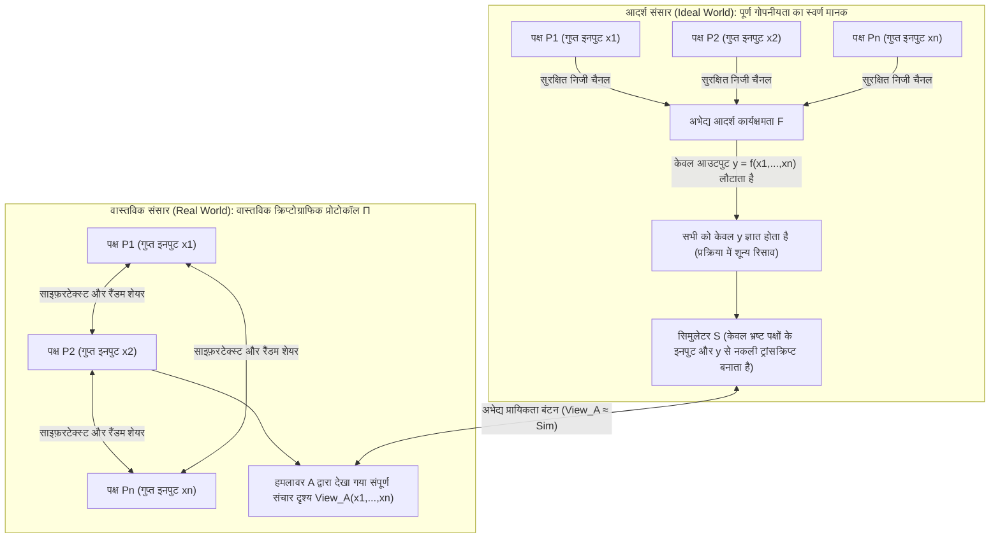
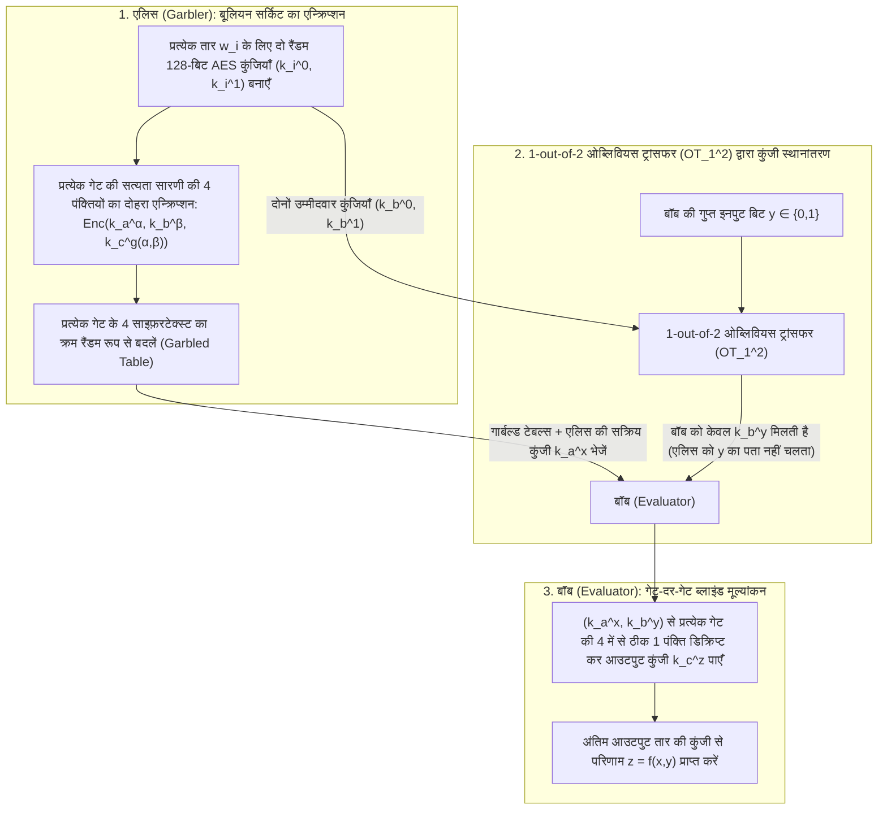

"कई कैंसर अनुसंधान अस्पताल नई दवाओं के सांख्यिकीय विश्लेषण (GWAS) के लिए अपने रोगियों के जीनोम डेटा को जोड़ना चाहते हैं, लेकिन गोपनीयता कानून (GDPR / HIPAA) किसी भी अस्पताल से रोगी के कच्चे डेटा का एक बाइट भी बाहर भेजने पर सख्त प्रतिबंध लगाते हैं।"
"प्रतिस्पर्धी वाणिज्यिक बैंक अपनी ग्राहक सूचियों या आंतरिक लेनदेन ग्राफ़ को एक-दूसरे के सामने उजागर किए बिना, संयुक्त रूप से अंतर-बैंक मनी लॉन्ड्रिंग नेटवर्क का पता लगाना चाहते हैं।"

पहली नज़र में यह तार्किक रूप से असंभव लगता है: किसी फ़ंक्शन $f(x_1, x_2, \dots, x_n)$ की गणना करने के लिए, क्या किसी <strong>विश्वसनीय तृतीय पक्ष (Trusted Third Party, TTP)</strong> को पहले सभी इनपुट $x_i$ को प्लेनटेक्स्ट में एकत्र नहीं करना पड़ेगा? फिर भी, 1980 के दशक के उत्तरार्ध में आधुनिक क्रिप्टोग्राफी ने एक अद्भुत प्रमेय सिद्ध किया: <strong>विश्वसनीय तृतीय पक्ष के पूर्ण अभाव में भी, एक-दूसरे पर अविश्वास करने वाले प्रतिभागी मिलकर किसी भी गणनीय फ़ंक्शन $f(x_1, \dots, x_n)$ का मूल्यांकन इस प्रकार कर सकते हैं कि सभी को सटीक परिणाम प्राप्त हो, लेकिन किसी को भी दूसरे के गुप्त इनपुट $x_i$ के बारे में एक भी अतिरिक्त बिट की जानकारी न मिले।</strong>

इस तकनीक को <strong>सुरक्षित बहु-पक्षीय संगणना (Secure Multi-Party Computation, MPC)</strong> कहा जाता है। इस लेख में हम दो प्रसिद्ध विचार प्रयोगों से शुरुआत करते हुए MPC के दो मुख्य गणितीय इंजनों की व्युत्पत्ति करेंगे: <strong>आदि शामिर (Adi Shamir) की $(t, n)$ थ्रेशोल्ड सीक्रेट शेयरिंग (लैग्रेंज इंटरपोलेशन, BGW प्रोटोकॉल और बीवर के गुणन ट्रिपल्स)</strong> तथा <strong>माइकल राबिन के ओब्लिवियस ट्रांसफर ($\text{OT}_1^2$) और एंड्रयू याओ के गार्बल्ड सर्किट्स (Garbled Circuits)</strong> पर आधारित बूलियन सर्किट इंजन।

---

## 1. दो विरोधाभासी विचार प्रयोग: "बॉस के बिना औसत वेतन की गणना" और "याओ की करोड़पति समस्या"

### 1.1 विचार प्रयोग 1: किसी को अपना वेतन बताए बिना तीनों का 'औसत वेतन' कैसे निकालें?

तीन इंजीनियर $A, B$ और $C$ अपना <strong>औसत वार्षिक वेतन $\bar{x} = \frac{x_A + x_B + x_C}{3}$</strong> जानना चाहते हैं, लेकिन कोई भी अपना व्यक्तिगत वेतन $x_A, x_B$ या $x_C$ अन्य दो को नहीं बताना चाहता। <strong>एडिटिव सीक्रेट शेयरिंग (वन-टाइम पैड मास्किंग)</strong> की मदद से वे केवल कागज और कलम से इसे हल कर सकते हैं:

1. <strong>रैंडम मास्क और पहली फुसफुसाहट ($A \to B$)</strong>: तीनों एक बड़ी सार्वजनिक संख्या $M$ (जैसे $M = 10^9$) तय करते हैं। इंजीनियर $A$ गुप्त रूप से एक समान रैंडम संख्या $r \xleftarrow{\$} \mathbb{Z}_M$ चुनता है, उसमें अपना वेतन $x_A$ जोड़ता है, और केवल $s_1 = (x_A + r) \bmod M$ को $B$ के कान में बताता है। चूँकि $r$ रिंग $\mathbb{Z}_M$ में समान रूप से वितरित है, इसलिए $x_A$ का मान कुछ भी हो, $s_1$ भी पूरी तरह समान रूप से वितरित होता है—शैनन के पूर्ण गोपनीयता प्रमेय के अनुसार पारस्परिक सूचना शून्य है ($I(X_A; S_1) = 0$)। $B$ को $x_A$ के बारे में <strong>शून्य बिट</strong> जानकारी मिलती है।
2. <strong>क्रमिक योग ($B \to C \to A$)</strong>: $B$ इसमें अपना वेतन $x_B$ जोड़कर $s_2 = (x_A + x_B + r) \bmod M$ को $C$ को बताता है; $C$ अपना वेतन $x_C$ जोड़कर $s_3 = (x_A + x_B + x_C + r) \bmod M$ वापस $A$ को देता है।
3. <strong>मास्क हटाना</strong>: $A$ अपने रैंडम नंबर $r$ को घटाकर सटीक योग $S = (s_3 - r) \bmod M = x_A + x_B + x_C$ प्राप्त करता है और औसत $\bar{x} = S / 3$ घोषित करता है!

> [!NOTE]
> <strong>कम से कम 3 प्रतिभागियों ($n \ge 3$) की आवश्यकता क्यों है?</strong>
> यदि केवल दो लोग ($A$ और $B$) होते, तो भले ही कोई देवता उन्हें केवल औसत $\bar{x} = \frac{x_A + x_B}{2}$ बताता, $A$ तुरंत $x_B = 2\bar{x} - x_A$ से $B$ का वेतन निकाल लेता। यह प्रोटोकॉल की कमी नहीं, बल्कि स्वयं फ़ंक्शन का गुण है। <strong>MPC यह गारंटी देता है कि अपने स्वयं के इनपुट और अंतिम आउटपुट से तार्किक रूप से निकलने वाली जानकारी के अलावा गणना के दौरान एक भी अतिरिक्त बिट लीक न हो।</strong>

### 1.2 विचार प्रयोग 2: एंड्रयू याओ की 'करोड़पति समस्या' (1982)

योग एक रैखिक (linear) संक्रिया है, परंतु <strong>अरैखिक तुलना (nonlinear comparison)</strong> का क्या?
1982 में ट्यूरिंग पुरस्कार विजेता कंप्यूटर वैज्ञानिक <strong>एंड्रयू ची-ची याओ (Andrew Yao)</strong> ने अपने ऐतिहासिक शोधपत्र *"Protocols for Secure Computations"* में प्रसिद्ध <strong>करोड़पति समस्या (Millionaires' Problem)</strong> प्रस्तुत की: दो करोड़पति, एलिस ($x$ मिलियन डॉलर) और बॉब ($y$ मिलियन डॉलर), बिना किसी तीसरे पक्ष के केवल यह 1-बिट बूलियन मान $f(x, y) = [x > y] \in \{0, 1\}$ (कौन अधिक अमीर है?) जानना चाहते हैं, बिना $x, y$ या उनके अंतर $x - y$ को उजागर किए।

---

## 2. MPC सुरक्षा की गणितीय परिभाषा: आदर्श/वास्तविक सिमुलेशन प्रतिमान

सूचना के शून्य रिसाव को गणितीय रूप से सिद्ध करने के लिए गोल्डराइख, मिकाली और विग्डरसन (GMW 1987) ने <strong>आदर्श/वास्तविक सिमुलेशन प्रतिमान (Ideal/Real Simulation Paradigm)</strong> स्थापित किया:



एक वास्तविक प्रोटोकॉल $\Pi$ तब सुरक्षित कहलाता है जब एक दक्ष एल्गोरिदम अर्थात <strong>सिमुलेटर $\mathcal{S}$</strong> का अस्तित्व हो, जो <em>केवल भ्रष्ट पक्षों के इनपुट $\{x_i\}_{i \in I}$ और आउटपुट $\{y_i\}_{i \in I}$ की सहायता से</em> ऐसा नकली संचार लॉग उत्पन्न कर सके जो वास्तविक दृश्य $\text{View}_I^\Pi(x_1, \dots, x_n)$ से प्रायिकता बंटन में अभेद्य हो:
$$\left\{ \mathcal{S}\left(I, \{x_i\}_{i \in I}, \{y_i\}_{i \in I}\right) \right\} \stackrel{c}{\approx} \left\{ \text{View}_I^\Pi(x_1, \dots, x_n) \right\}$$
यहाँ हमलावरों को दो श्रेणियों में बाँटा जाता है: <strong>अर्ध-ईमानदार (Semi-Honest / Passive)</strong> जो प्रोटोकॉल का पालन करते हैं किंतु लॉग का विश्लेषण करते हैं, और <strong>दुर्भावनापूर्ण (Malicious / Active)</strong> जो संदेशों में सक्रिय रूप से हेरफेर करते हैं।

---

## 3. इंजन 1: शामिर की $(t, n)$ थ्रेशोल्ड सीक्रेट शेयरिंग, लैग्रेंज इंटरपोलेशन और BGW / SPDZ

### 3.1 परिमित क्षेत्र $\mathbb{F}_p$ पर बहुपद और लैग्रेंज पुनर्निर्माण
1979 में <strong>आदि शामिर (Adi Shamir)</strong> ने गुप्त संख्या $s \in \mathbb{F}_p$ ($p > n$ अभाज्य) को परिमित क्षेत्र $\mathbb{F}_p$ पर $t - 1$ घात वाले रैंडम बहुपद के अचर पद के रूप में छिपाने की विधि दी:
$$P(x) = s + a_1 x + a_2 x^2 + \dots + a_{t-1} x^{t-1} \pmod p$$
प्रत्येक पक्ष $P_i$ को बिंदु $(x_i = i,\, y_i = P(x_i))$ मिलता है। कम से कम $t$ पक्षों का कोई भी उपसमुच्चय $T$ <strong>लैग्रेंज बहुपद इंटरपोलेशन सूत्र</strong> द्वारा $s = P(0)$ को पुनः प्राप्त कर सकता है:
$$s = P(0) = \sum_{i \in T} y_i \prod_{j \in T,\, j \ne i} \frac{-x_j}{x_i - x_j} \pmod p$$
किंतु $t - 1$ या कम शेयरों के साथ प्रत्येक संभावित रहस्य $s' \in \mathbb{F}_p$ की प्रायिकता बिल्कुल समान रहती है ($H(S \mid \text{Shares}_{t-1}) = H(S)$, पूर्ण सूचना-सैद्धांतिक सुरक्षा)।

### 3.2 BGW प्रोटोकॉल और बीवर के गुणन ट्रिपल्स
<strong>BGW प्रोटोकॉल (1988)</strong> में <strong>योग $[a] + [b] = [a + b]$ पूर्णतः स्थानीय और शून्य-संचार</strong> है। किंतु <strong>गुणन $[a] \cdot [b]$</strong> बहुपद की घात को दोगुना कर $2(t-1)$ कर देता है, जिसके लिए $2t - 1 \le n$ (<strong>ईमानदार बहुमत, Honest Majority</strong>) और घात-न्यूनीकरण (Degree Reduction) राउंड आवश्यक होता है।
<strong>डोनाल्ड बीवर (1991)</strong> ने ऑफ़लाइन चरण में पूर्व-निर्मित रैंडम <strong>गुणन ट्रिपल्स $([u], [v], [w = u \cdot v \bmod p])$</strong> (आधुनिक <strong>SPDZ प्रोटोकॉल</strong> की रीढ़) द्वारा इसे हल किया। ऑनलाइन चरण में $[x \cdot y]$ निकालने के लिए केवल मास्क किए गए अंतर $d = (x - u) \bmod p$ और $e = (y - v) \bmod p$ खोले जाते हैं और स्थानीय रैखिक संयोजन किया जाता है:
$$[x \cdot y] = [w] + d \cdot [v] + e \cdot [u] + d \cdot e \pmod p$$

---

## 4. इंजन 2: राबिन का ओब्लिवियस ट्रांसफर ($\text{OT}_1^2$) और याओ के गार्बल्ड सर्किट्स

द्विआधारी तुलना ($x > y$) के लिए बूलियन सर्किट इंजन अचर संचार राउंड $O(1)$ में मूल्यांकन पूरा करता है:



<strong>माइकल राबिन के 1-out-of-2 ओब्लिवियस ट्रांसफर ($\text{OT}_1^2$)</strong> की मदद से बॉब अपनी गुप्त बिट $y$ की कुंजी $k_b^y$ प्राप्त करता है बिना एलिस को $y$ बताए। तीन आधुनिक अनुकूलनों — <strong>Point-and-Permute</strong> (रंग बिट से सीधे डिक्रिप्ट होने वाली पंक्ति की पहचान), <strong>Free-XOR</strong> ($k_i^1 = k_i^0 \oplus \Delta$ से सभी `XOR` गेट शून्य साइफ़रटेक्स्ट व शून्य AES संक्रिया में संपन्न) और <strong>Half-Gates</strong> (प्रत्येक `AND` गेट को केवल 2 साइफ़रटेक्स्ट तक घटाना) — ने गार्बल्ड सर्किट्स को $1000$ गुना तेज कर दिया।

---

## 5. संपूर्ण Python कार्यान्वयन: $\mathbb{F}_p$ पर शामिर सीक्रेट शेयरिंग और बीवर गुणन ट्रिपल्स

```python
import secrets
from typing import List, Tuple

PRIME = (1 << 61) - 1  # 61-बिट मर्सेन अभाज्य संख्या p = 2^61 - 1

def mod_inv(a: int, p: int = PRIME) -> int:
    return pow(a % p, -1, p)

def shamir_share(secret: int, t: int, n: int, p: int = PRIME) -> List[Tuple[int, int]]:
    coeffs = [secret % p] + [secrets.randbelow(p) for _ in range(t - 1)]
    shares = []
    for i in range(1, n + 1):
        y = 0
        for c in reversed(coeffs):
            y = (y * i + c) % p
        shares.append((i, y))
    return shares

def lagrange_reconstruct(shares: List[Tuple[int, int]], p: int = PRIME) -> int:
    secret = 0
    k = len(shares)
    for i in range(k):
        xi, yi = shares[i]
        num, den = 1, 1
        for j in range(k):
            if i != j:
                xj, _ = shares[j]
                num = (num * (-xj)) % p
                den = (den * (xi - xj)) % p
        secret = (secret + yi * num * mod_inv(den, p)) % p
    return secret

def mpc_add(sa, sb, p=PRIME):
    return [(xa, (ya + yb) % p) for (xa, ya), (_, yb) in zip(sa, sb)]

def mpc_sub(sa, sb, p=PRIME):
    return [(xa, (ya - yb) % p) for (xa, ya), (_, yb) in zip(sa, sb)]

def mpc_scalar_mul(c, sa, p=PRIME):
    return [(xa, (c * ya) % p) for xa, ya in sa]

def mpc_add_const(c, sa, p=PRIME):
    return [(xa, (ya + c) % p) for xa, ya in sa]

def generate_beaver_triple(t: int, n: int, p: int = PRIME):
    u, v = secrets.randbelow(p), secrets.randbelow(p)
    return shamir_share(u, t, n, p), shamir_share(v, t, n, p), shamir_share((u * v) % p, t, n, p)

def mpc_beaver_mul(sx, sy, triple, t: int, p: int = PRIME):
    su, sv, sw = triple
    d = lagrange_reconstruct(mpc_sub(sx, su, p)[:t], p)
    e = lagrange_reconstruct(mpc_sub(sy, sv, p)[:t], p)
    res = mpc_add(mpc_add(sw, mpc_scalar_mul(d, sv, p), p), mpc_scalar_mul(e, su, p), p)
    return mpc_add_const((d * e) % p, res, p)

if __name__ == "__main__":
    t, n = 3, 5
    salaries = [85000, 92000, 78000]
    shared = [shamir_share(s, t, n) for s in salaries]
    total_shares = shared[0]
    for s in shared[1:]:
        total_shares = mpc_add(total_shares, s)
    print("पुनर्निर्मित कुल वेतन:", lagrange_reconstruct(total_shares[:t]))
```

---

## 6. गोपनीयता संवर्धन प्रौद्योगिकियों (PETs) की तुलना और वास्तविक अनुप्रयोग

| मानदंड | सुरक्षित बहु-पक्षीय संगणना (MPC) | पूर्ण होमोमोर्फिक एन्क्रिप्शन (FHE) | शून्य-ज्ञान प्रमाण (ZKP) | विश्वसनीय निष्पादन वातावरण (TEE) |
| :--- | :--- | :--- | :--- | :--- |
| <strong>मुख्य समस्या</strong> | विभिन्न पक्षों के गुप्त इनपुट $x_1, \dots, x_n$ पर <strong>संयुक्त गणना</strong> | एकल सर्वर पर साइफ़रटेक्स्ट के ऊपर <strong>ब्लाइंड गणना</strong> $\text{Enc}(x) \mapsto \text{Enc}(f(x))$ | <strong>सिद्धकर्ता को पहले से ज्ञात रहस्य $w$</strong> के लिए $f(x, w)=1$ सिद्ध करना | CPU एन्क्लेव के भीतर प्लेनटेक्स्ट में <strong>हार्डवेयर-पृथक निष्पादन</strong> |
| <strong>मुख्य बाधा</strong> | CPU गणना अत्यंत हल्की, किंतु <strong>प्रत्येक गुणन परत पर नेटवर्क संचार आवश्यक</strong> | केवल 1 नेटवर्क राउंड, किंतु <strong>CPU गणना $10^3$ से $10^5$ गुना धीमी</strong> | सत्यापन अत्यंत तीव्र, किंतु प्रमाण निर्माण भारी (MSM / FFT) | लगभग नेटिव गति, किंतु एन्क्लेव मेमोरी सीमित |
| <strong>विश्वास मॉडल</strong> | <strong>गैर-मिलीभगत (Non-collusion)</strong> ($t$ से कम सर्वर मिलीभगत करें) | <strong>लैटिस क्रिप्टोग्राफिक कठिनाई (RLWE)</strong> | <strong>गणितीय सुदृढ़ता</strong> (अकेले कई पक्षों के रहस्य नहीं जोड़ता) | <strong>चिप निर्माता (Intel/AMD) पर विश्वास</strong>; साइड-चैनल हमलों के प्रति संवेदनशील |

<strong>2008 के डेनिश चुकंदर कोटा डबल नीलामी</strong> से लेकर <strong>बोस्टन शहर (BWWC) के वेतन अंतराल अध्ययन</strong>, <strong>Google Chrome और Apple iCloud के पासवर्ड लीक जांच (Private Set Intersection, PSI)</strong>, <strong>अंतर-अस्पताल जीनोमिक अध्ययन (Secure GWAS)</strong> और <strong>MPC थ्रेशोल्ड क्रिप्टो वॉलेट (Fireblocks, Coinbase)</strong> तक, MPC आज संस्थागत विश्वास को गणितीय निश्चितता से बदल रहा है।
