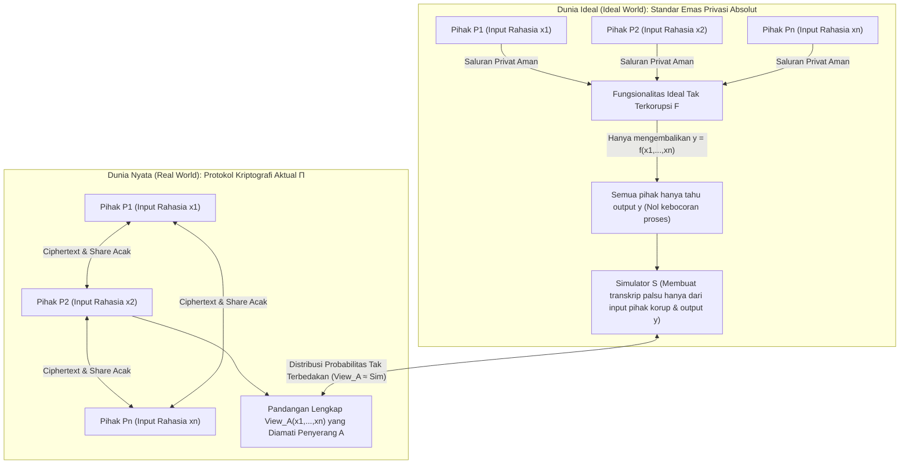
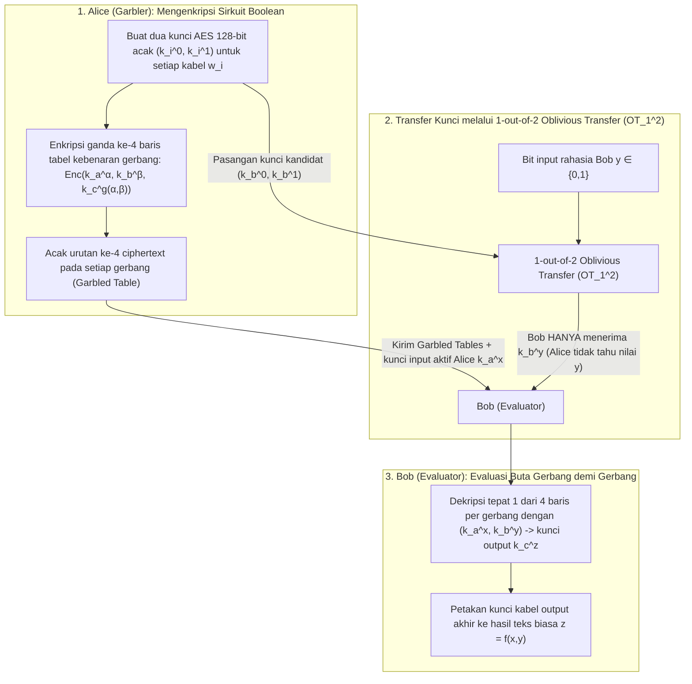

"Beberapa rumah sakit riset ingin menggabungkan data sekuens genom pasien kanker mereka untuk menjalankan studi asosiasi genomik (GWAS), namun undang-undang privasi (GDPR / HIPAA) melarang keras keluarnya satu byte pun data mentah pasien dari rumah sakit."
"Bank-bank komersial yang saling bersaing ingin melacak jaringan pencucian uang lintas bank secara bersama-sama tanpa pernah mengungkap daftar nasabah atau grafik transaksi internal mereka satu sama lain."

Sekilas, tuntutan ini tampak mustahil secara logika: untuk menghitung fungsi $f(x_1, x_2, \dots, x_n)$, bukankah harus ada <strong>Pihak Ketiga Tepercaya (Trusted Third Party, TTP)</strong> yang mengumpulkan seluruh input $x_i$ dalam bentuk teks biasa terlebih dahulu? Namun pada akhir 1980-an, kriptografi modern membuktikan teorema yang luar biasa: <strong>bahkan tanpa pihak ketiga tepercaya sama sekali, para peserta yang saling tidak percaya dapat menghitung fungsi apa pun $f(x_1, \dots, x_n)$ secara bersama-sama sehingga setiap pihak memperoleh hasil yang tepat tanpa mempelajari satu bit pun informasi tambahan mengenai input rahasia $x_i$ milik pihak lain.</strong>

Bidang ini disebut <strong>Komputasi Multi-Pihak Aman (Secure Multi-Party Computation, MPC)</strong>. Dalam artikel ini, kita berangkat dari dua eksperimen pikiran klasik untuk menurunkan dua mesin matematika utama MPC: <strong>pembagian rahasia ambang batas $(t, n)$ Adi Shamir (interpolasi Lagrange, protokol BGW, dan tripel Beaver)</strong> serta pendekatan sirkuit Boolean melalui <strong>Oblivious Transfer ($\text{OT}_1^2$) Rabin dan Garbled Circuits Yao</strong>.

---

## 1. Dua Eksperimen Pikiran Paradoksal: "Rata-Rata Gaji Tanpa Bos" dan "Masalah Jutawan Yao"

### 1.1 Eksperimen Pikiran 1: Menghitung Rata-Rata Gaji Tanpa Mengungkap Gaji Individu

Tiga insinyur $A, B,$ dan $C$ ingin mengetahui <strong>rata-rata gaji tahunan mereka $\bar{x} = \frac{x_A + x_B + x_C}{3}$</strong> tanpa seorang pun mengetahui gaji individu $x_A, x_B,$ atau $x_C$ milik rekan lainnya. Dengan <strong>pembagian rahasia aditif (masking One-Time Pad)</strong>, mereka dapat melakukannya hanya dengan kertas dan pena:

1. <strong>Masker Acak dan Bisikan Pertama ($A \to B$)</strong>: Ketiganya menyepakati modulus publik besar $M$ (misalnya $M = 10^9$). Insinyur $A$ memilih angka acak seragam $r \xleftarrow{\$} \mathbb{Z}_M$ secara rahasia, menambahkannya ke gajinya $x_A$, dan membisikkan hanya $s_1 = (x_A + r) \bmod M$ kepada $B$. Karena $r$ terdistribusi seragam di $\mathbb{Z}_M$, maka $s_1$ juga terdistribusi seragam sempurna berapa pun nilai $x_A$: menurut teorema Shannon tentang One-Time Pad, informasi bersama adalah $I(X_A; S_1) = 0$. $B$ mempelajari tepat <strong>nol bit</strong> tentang $x_A$.
2. <strong>Penjumlahan Berantai ($B \to C \to A$)</strong>: $B$ menambahkan gajinya sendiri $x_B$ dan membisikkan $s_2 = (x_A + x_B + r) \bmod M$ kepada $C$; $C$ menambahkan $x_C$ dan menyerahkan $s_3 = (x_A + x_B + x_C + r) \bmod M$ kembali kepada $A$.
3. <strong>Pelepasan Masker</strong>: $A$ mengurangi angka acaknya $r$ modulo $M$, memperoleh total eksak $S = x_A + x_B + x_C$, dan mengumumkan rata-rata $\bar{x} = S / 3$.

> [!NOTE]
> <strong>Mengapa Diperlukan Minimal 3 Peserta ($n \ge 3$)?</strong>
> Jika hanya ada dua orang ($A$ dan $B$), meskipun malaikat jujur memberi tahu mereka rata-rata $\bar{x} = \frac{x_A + x_B}{2}$, $A$ dapat langsung menghitung $x_B = 2\bar{x} - x_A$. Ini bukan kelemahan protokol, melainkan sifat matematis dari fungsi itu sendiri. <strong>MPC menjamin tidak ada bit tambahan yang bocor selain apa yang secara logis dapat disimpulkan dari input sendiri dan hasil akhir.</strong>

### 1.2 Eksperimen Pikiran 2: "Masalah Jutawan" Andrew Yao (1982)

Penjumlahan bersifat linear, tetapi bagaimana dengan <strong>perbandingan ukuran non-linear</strong>?
Pada tahun 1982, ilmuwan komputer <strong>Andrew Chi-Chih Yao</strong> (peraih Turing Award) menerbitkan *"Protocols for Secure Computations"* dan mengajukan <strong>Masalah Jutawan (Millionaires' Problem)</strong>: dua jutawan, Alice (kekayaan $x$ juta dolar) dan Bob (kekayaan $y$ juta dolar), ingin menghitung hanya satu bit kebenaran $f(x, y) = [x > y] \in \{0, 1\}$ (siapa yang lebih kaya?) tanpa pihak ketiga dan tanpa mengungkap nilai $x, y$ maupun selisihnya $x - y$.

---

## 2. Formalisasi Keamanan MPC: Paradigma Simulasi Dunia Ideal/Nyata

Untuk membuktikan secara matematis tidak adanya kebocoran informasi, Goldreich, Micali, dan Wigderson (GMW 1987) merumuskan <strong>Paradigma Simulasi Dunia Ideal / Dunia Nyata (Ideal/Real Simulation Paradigm)</strong>:



Sebuah protokol nyata $\Pi$ dikatakan aman jika terdapat algoritma waktu polinomial bernama <strong>Simulator $\mathcal{S}$</strong> yang, <em>hanya dengan diberikan input $\{x_i\}_{i \in I}$ dan output $\{y_i\}_{i \in I}$ dari pihak-pihak yang korup</em>, mampu menghasilkan transkrip sintetis yang distribusinya tak terbedakan dari pandangan dunia nyata $\text{View}_I^\Pi(x_1, \dots, x_n)$:
$$\left\{ \mathcal{S}\left(I, \{x_i\}_{i \in I}, \{y_i\}_{i \in I}\right) \right\} \stackrel{c}{\approx} \left\{ \text{View}_I^\Pi(x_1, \dots, x_n) \right\}$$
Dalam model musuh, dibedakan antara musuh <strong>semi-jujur (Semi-Honest / Passive)</strong> yang mematuhi aturan protokol tetapi menganalisis log pesan, dan musuh <strong>jahat (Malicious / Active)</strong> yang secara aktif memalsukan pesan.

---

## 3. Mesin 1: Pembagian Rahasia Ambang Batas $(t, n)$ Shamir, Interpolasi Lagrange, dan BGW / SPDZ

### 3.1 Polinomial di Atas Medan Hingga $\mathbb{F}_p$ dan Rekonstruksi Lagrange
Pada tahun 1979, <strong>Adi Shamir</strong> menyembunyikan rahasia $s \in \mathbb{F}_p$ ($p > n$ bilangan prima) sebagai suku konstanta dari polinomial acak berderajat $t - 1$ di atas medan hingga $\mathbb{F}_p$:
$$P(x) = s + a_1 x + a_2 x^2 + \dots + a_{t-1} x^{t-1} \pmod p$$
Setiap pihak $P_i$ menerima titik evaluasi $(x_i = i,\, y_i = P(x_i))$.Setiap himpunan bagian $T$ yang terdiri dari minimal $t$ pihak dapat merekonstruksi $s = P(0)$ secara eksak melalui <strong>rumus interpolasi polinomial Lagrange</strong>:
$$s = P(0) = \sum_{i \in T} y_i \prod_{j \in T,\, j \ne i} \frac{-x_j}{x_i - x_j} \pmod p$$
Sebaliknya, dengan $t - 1$ bagian atau kurang, setiap kandidat rahasia $s' \in \mathbb{F}_p$ memiliki peluang yang sama persis ($H(S \mid \text{Shares}_{t-1}) = H(S)$, keamanan teoritis-informasi sempurna).

### 3.2 Protokol BGW dan Tripel Perkalian Beaver
Dalam <strong>protokol BGW (1988)</strong>, <strong>penjumlahan $[a] + [b] = [a + b]$ dilakukan secara lokal tanpa komunikasi</strong>. Namun, <strong>perkalian $[a] \cdot [b]$</strong> menggandakan derajat polinomial hasil kali $P(x)Q(x)$ menjadi $2(t-1)$, sehingga mensyaratkan $2t - 1 \le n$ (<strong>mayoritas jujur, Honest Majority</strong>) serta satu putaran reduksi derajat.
<strong>Donald Beaver (1991)</strong> mengatasi hambatan ini melalui <strong>tripel perkalian $([u], [v], [w = u \cdot v \bmod p])$</strong> yang dihasilkan pada fase offline (inti dari protokol <strong>SPDZ</strong>). Pada fase online, untuk mengalikan $[x]$ dan $[y]$, para pihak hanya membuka selisih berpenutup $d = (x - u) \bmod p$ dan $e = (y - v) \bmod p$, lalu menghitung kombinasi linear secara lokal:
$$[x \cdot y] = [w] + d \cdot [v] + e \cdot [u] + d \cdot e \pmod p$$

---

## 4. Mesin 2: Oblivious Transfer ($\text{OT}_1^2$) Rabin dan Garbled Circuits Yao

Untuk perbandingan biner ($x > y$), pendekatan sirkuit Boolean menyelesaikan evaluasi hanya dalam jumlah putaran konstan $O(1)$:



Melalui <strong>1-out-of-2 Oblivious Transfer ($\text{OT}_1^2$) Michael Rabin</strong>, Bob memperoleh kunci $k_b^y$ yang sesuai dengan bit rahasianya $y$ tanpa Alice mengetahui $y$. Tiga optimasi modern — <strong>Point-and-Permute</strong> (bit warna menunjuk langsung baris yang harus didekripsi), <strong>Free-XOR</strong> ($k_i^1 = k_i^0 \oplus \Delta$ membuat semua gerbang `XOR` bebas ciphertext dan bebas operasi AES), serta <strong>Half-Gates</strong> (memangkas setiap gerbang `AND` menjadi hanya 2 ciphertext) — mempercepat Garbled Circuits lebih dari $1000$ kali lipat.

---

## 5. Implementasi Lengkap Python: Shamir Secret Sharing & Tripel Beaver di Atas $\mathbb{F}_p$

```python
import secrets
from typing import List, Tuple

PRIME = (1 << 61) - 1  # Bilangan prima Mersenne 61-bit p = 2^61 - 1

def mod_inv(a: int, p: int = PRIME) -> int:
    return pow(a % p, -1, p)

def shamir_share(secret: int, t: int, n: int, p: int = PRIME) -> List[Tuple[int, int]]:
    coeffs = [secret % p] + [secrets.randbelow(p) for _ in range(t - 1)]
    shares = []
    for i in range(1, n + 1):
        y = 0
        for c in reversed(coeffs):
            y = (y * i + c) % p
        shares.append((i, y))
    return shares

def lagrange_reconstruct(shares: List[Tuple[int, int]], p: int = PRIME) -> int:
    secret = 0
    k = len(shares)
    for i in range(k):
        xi, yi = shares[i]
        num, den = 1, 1
        for j in range(k):
            if i != j:
                xj, _ = shares[j]
                num = (num * (-xj)) % p
                den = (den * (xi - xj)) % p
        secret = (secret + yi * num * mod_inv(den, p)) % p
    return secret

def mpc_add(sa, sb, p=PRIME):
    return [(xa, (ya + yb) % p) for (xa, ya), (_, yb) in zip(sa, sb)]

def mpc_sub(sa, sb, p=PRIME):
    return [(xa, (ya - yb) % p) for (xa, ya), (_, yb) in zip(sa, sb)]

def mpc_scalar_mul(c, sa, p=PRIME):
    return [(xa, (c * ya) % p) for xa, ya in sa]

def mpc_add_const(c, sa, p=PRIME):
    return [(xa, (ya + c) % p) for xa, ya in sa]

def generate_beaver_triple(t: int, n: int, p: int = PRIME):
    u, v = secrets.randbelow(p), secrets.randbelow(p)
    return shamir_share(u, t, n, p), shamir_share(v, t, n, p), shamir_share((u * v) % p, t, n, p)

def mpc_beaver_mul(sx, sy, triple, t: int, p: int = PRIME):
    su, sv, sw = triple
    d = lagrange_reconstruct(mpc_sub(sx, su, p)[:t], p)
    e = lagrange_reconstruct(mpc_sub(sy, sv, p)[:t], p)
    res = mpc_add(mpc_add(sw, mpc_scalar_mul(d, sv, p), p), mpc_scalar_mul(e, su, p), p)
    return mpc_add_const((d * e) % p, res, p)

if __name__ == "__main__":
    t, n = 3, 5
    salaries = [85000, 92000, 78000]
    shared = [shamir_share(s, t, n) for s in salaries]
    total_shares = shared[0]
    for s in shared[1:]:
        total_shares = mpc_add(total_shares, s)
    print("Total gaji yang direkonstruksi:", lagrange_reconstruct(total_shares[:t]))
```

---

## 6. Perbandingan Teknologi Peningkatan Privasi (PETs) dan Aplikasi Industri

| Kriteria | Komputasi Multi-Pihak Aman (MPC) | Enkripsi Homomorfik Penuh (FHE) | Bukti Tanpa Pengetahuan (ZKP) | Lingkungan Eksekusi Tepercaya (TEE) |
| :--- | :--- | :--- | :--- | :--- |
| <strong>Masalah Utama</strong> | <strong>Komputasi gabungan</strong> atas input rahasia terdistribusi $x_1, \dots, x_n$ | <strong>Komputasi buta di satu server</strong> atas ciphertext $\text{Enc}(x) \mapsto \text{Enc}(f(x))$ | <strong>Membuktikan bahwa rahasia $w$ yang sudah diketahui</strong> pembukti memenuhi $f(x, w)=1$ | <strong>Eksekusi terisolasi perangkat keras</strong> dalam teks biasa di dalam enclave CPU |
| <strong>Hambatan Utama</strong> | Komputasi CPU sangat ringan, tetapi <strong>butuh komunikasi jaringan per lapisan perkalian</strong> | Hanya 1 putaran jaringan, tetapi <strong>komputasi CPU $10^3$ hingga $10^5$ kali lebih lambat</strong> | Verifikasi instan, pembuatan bukti berat (MSM / FFT) | Kecepatan mendekati native, namun memori enclave terbatas |
| <strong>Model Kepercayaan</strong> | <strong>Asumsi non-kolusi</strong> (kurang dari $t$ server berkolusi) | <strong>Kekerasan kriptografi kisi (RLWE)</strong> | <strong>Kesahihan matematis</strong> (tidak menggabungkan rahasia banyak pihak sendirian) | <strong>Kepercayaan pada vendor chip (Intel/AMD)</strong>; rentan terhadap serangan kanal samping |

Mulai dari <strong>lelang ganda kuota bit gula Denmark tahun 2008</strong> hingga <strong>studi kesenjangan upah Boston (BWWC)</strong>, <strong>pemeriksaan kebocoran kata sandi di Google Chrome dan Apple iCloud (Private Set Intersection, PSI)</strong>, <strong>studi genomik lintas rumah sakit (Secure GWAS)</strong>, serta <strong>dompet kripto ambang batas MPC (Fireblocks, Coinbase)</strong>, MPC kini menggantikan kepercayaan institusional dengan kepastian matematika.
