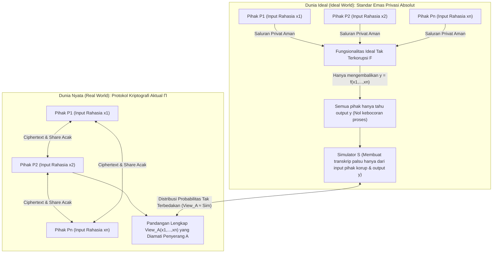
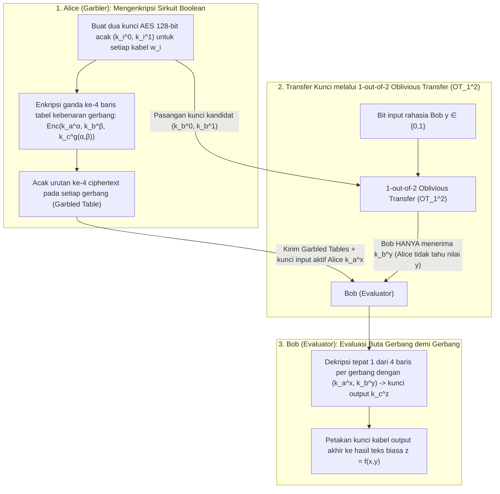

"Beberapa rumah sakit ingin menganalisis genom pasien secara bersama dan harus mematuhi persyaratan hukum, kontrak, serta etika yang berlaku untuk pemrosesan data."
"Bank-bank komersial yang saling bersaing ingin melacak jaringan pencucian uang lintas bank secara bersama-sama tanpa pernah mengungkap daftar nasabah atau grafik transaksi internal mereka satu sama lain."

Sekilas, tuntutan ini tampak mustahil secara logika: untuk menghitung fungsi $f(x_1, x_2, \dots, x_n)$, bukankah harus ada <strong>Pihak Ketiga Tepercaya (Trusted Third Party, TTP)</strong> yang mengumpulkan seluruh input $x_i$ dalam bentuk teks biasa terlebih dahulu? Namun pada akhir 1980-an, kriptografi modern membuktikan teorema yang luar biasa: <strong>Dengan model lawan dan asumsi kriptografis yang dinyatakan secara jelas, para peserta dapat menghitung fungsi bersama-sama; definisi keamanan membatasi pengungkapan tambahan di luar informasi yang sudah dapat disimpulkan dari input dan output yang diizinkan.</strong>

Bidang ini disebut <strong>Komputasi Multi-Pihak Aman (Secure Multi-Party Computation, MPC)</strong>. Dalam artikel ini, kita berangkat dari dua eksperimen pikiran klasik untuk menurunkan dua mesin matematika utama MPC: <strong>pembagian rahasia ambang batas $(t, n)$ Adi Shamir (interpolasi Lagrange, protokol BGW, dan tripel Beaver)</strong> serta pendekatan sirkuit Boolean melalui <strong>Oblivious Transfer (OT) dan Garbled Circuits Yao</strong>.

---


**Cara membaca klaim keamanan:** Pernyataan bahwa rahasia “tidak terungkap” hanya berlaku dalam model penyerang, definisi keamanan, dan asumsi kriptografi yang dinyatakan. Analisis biasanya menilai kebocoran tambahan di luar informasi yang dapat disimpulkan dari input dan output yang diizinkan; inferensi dari hasil, implementasi, operasi, ketersediaan, dan side channel perlu ditinjau terpisah.

## 1. Dua Eksperimen Pikiran Paradoksal: "Rata-Rata Gaji Tanpa Bos" dan "Masalah Jutawan Yao"

### 1.1 Eksperimen Pikiran 1: Menghitung Rata-Rata Gaji Tanpa Mengungkap Gaji Individu

Tiga insinyur $A, B,$ dan $C$ ingin mengetahui <strong>rata-rata gaji tahunan mereka $\bar{x} = \frac{x_A + x_B + x_C}{3}$</strong> tanpa seorang pun mengetahui gaji individu $x_A, x_B,$ atau $x_C$ milik rekan lainnya. Dengan <strong>pembagian rahasia aditif (masking One-Time Pad)</strong>, mereka dapat melakukannya hanya dengan kertas dan pena:

1. <strong>Masker Acak dan Bisikan Pertama ($A \to B$)</strong>: Ketiganya menyepakati modulus publik besar $M$ (misalnya $M = 10^9$). Insinyur $A$ memilih angka acak seragam $r \xleftarrow{\$} \mathbb{Z}_M$ secara rahasia, menambahkannya ke gajinya $x_A$, dan membisikkan hanya $s_1 = (x_A + r) \bmod M$ kepada $B$. Karena $r$ terdistribusi seragam di $\mathbb{Z}_M$, maka $s_1$ juga terdistribusi seragam sempurna berapa pun nilai $x_A$: menurut teorema Shannon tentang One-Time Pad, informasi bersama adalah $I(X_A; S_1) = 0$. $B$ mempelajari tepat <strong>nol bit</strong> tentang $x_A$.
2. <strong>Penjumlahan Berantai ($B \to C \to A$)</strong>: $B$ menambahkan gajinya sendiri $x_B$ dan membisikkan $s_2 = (x_A + x_B + r) \bmod M$ kepada $C$; $C$ menambahkan $x_C$ dan menyerahkan $s_3 = (x_A + x_B + x_C + r) \bmod M$ kembali kepada $A$.
3. <strong>Pelepasan Masker</strong>: $A$ mengurangi angka acaknya $r$ modulo $M$, memperoleh total eksak $S = x_A + x_B + x_C$, dan mengumumkan rata-rata $\bar{x} = S / 3$.

> **Batas contoh bisik-bisik ini:** Ini ilustrasi untuk pembelajaran, bukan protokol MPC yang aman. Contoh ini mengasumsikan kanal privat antartetangga, perilaku jujur, dan tidak ada kolusi. Misalnya, jika Bob dan Carol berbagi pengamatan mereka, keduanya dapat menggabungkannya dengan jumlah yang diumumkan untuk memulihkan input Alice. Penggunaan nyata memerlukan protokol yang terbukti aman untuk model ancaman yang dituju. Selain itu, $M$ harus lebih besar daripada jumlah input agar tidak terjadi lilitan modulo.

> [!NOTE]
> <strong>Mengapa Diperlukan Minimal 3 Peserta ($n \ge 3$)?</strong>
> Jika hanya ada dua orang ($A$ dan $B$), meskipun malaikat jujur memberi tahu mereka rata-rata $\bar{x} = \frac{x_A + x_B}{2}$, $A$ dapat langsung menghitung $x_B = 2\bar{x} - x_A$. Ini bukan kelemahan protokol, melainkan sifat matematis dari fungsi itu sendiri. <strong>MPC menjamin tidak ada bit tambahan yang bocor selain apa yang secara logis dapat disimpulkan dari input sendiri dan hasil akhir.</strong>

### 1.2 Eksperimen Pikiran 2: "Masalah Jutawan" Andrew Yao (1982)

Penjumlahan bersifat linear, tetapi bagaimana dengan <strong>perbandingan ukuran non-linear</strong>?
Pada tahun 1982, ilmuwan komputer <strong>Andrew Chi-Chih Yao</strong> (peraih Turing Award) menerbitkan *"Protocols for Secure Computations"* dan mengajukan <strong>Masalah Jutawan (Millionaires' Problem)</strong>: dua jutawan, Alice (kekayaan $x$ juta dolar) dan Bob (kekayaan $y$ juta dolar), ingin menghitung hanya satu bit kebenaran $f(x, y) = [x > y] \in \{0, 1\}$ (siapa yang lebih kaya?) tanpa pihak ketiga dan tanpa mengungkap nilai $x, y$ maupun selisihnya $x - y$.

---

## 2. Formalisasi Keamanan MPC: Paradigma Simulasi Dunia Ideal/Nyata

Untuk membuktikan secara matematis tidak adanya kebocoran informasi, Goldreich, Micali, dan Wigderson (GMW 1987) merumuskan <strong>Paradigma Simulasi Dunia Ideal / Dunia Nyata (Ideal/Real Simulation Paradigm)</strong>:



Sebuah protokol nyata $\Pi$ dikatakan aman jika terdapat algoritma waktu polinomial bernama <strong>Simulator $\mathcal{S}$</strong> yang, <em>hanya dengan diberikan input $\{x_i\}_{i \in I}$ dan output $\{y_i\}_{i \in I}$ dari pihak-pihak yang korup</em>, mampu menghasilkan transkrip sintetis yang distribusinya tak terbedakan dari pandangan dunia nyata $\text{View}_I^\Pi(x_1, \dots, x_n)$:
$$\left\{ \mathcal{S}\left(I, \{x_i\}_{i \in I}, \{y_i\}_{i \in I}\right) \right\} \stackrel{c}{\approx} \left\{ \text{View}_I^\Pi(x_1, \dots, x_n) \right\}$$
Dalam model musuh, dibedakan antara musuh <strong>semi-jujur (Semi-Honest / Passive)</strong> yang mematuhi aturan protokol tetapi menganalisis log pesan, dan musuh <strong>jahat (Malicious / Active)</strong> yang secara aktif memalsukan pesan.

---

## 3. Mesin 1: Pembagian Rahasia Ambang Batas $(t, n)$ Shamir, Interpolasi Lagrange, dan BGW / SPDZ

### 3.1 Polinomial di Atas Medan Hingga $\mathbb{F}_p$ dan Rekonstruksi Lagrange
Pada tahun 1979, <strong>Adi Shamir</strong> menyembunyikan rahasia $s \in \mathbb{F}_p$ ($p > n$ bilangan prima) sebagai suku konstanta dari polinomial acak berderajat $t - 1$ di atas medan hingga $\mathbb{F}_p$:
$$P(x) = s + a_1 x + a_2 x^2 + \dots + a_{t-1} x^{t-1} \pmod p$$
Setiap pihak $P_i$ menerima titik evaluasi $(x_i = i,\, y_i = P(x_i))$.Setiap himpunan bagian $T$ yang terdiri dari minimal $t$ pihak dapat merekonstruksi $s = P(0)$ secara eksak melalui <strong>rumus interpolasi polinomial Lagrange</strong>:
$$s = P(0) = \sum_{i \in T} y_i \prod_{j \in T,\, j \ne i} \frac{-x_j}{x_i - x_j} \pmod p$$
Sebaliknya, dengan $t - 1$ bagian atau kurang, setiap kandidat rahasia $s' \in \mathbb{F}_p$ memiliki peluang yang sama persis ($H(S \mid \text{Shares}_{t-1}) = H(S)$, keamanan teoritis-informasi sempurna).

### 3.2 Protokol BGW dan Tripel Perkalian Beaver
Dalam <strong>protokol BGW (1988)</strong>, <strong>penjumlahan $[a] + [b] = [a + b]$ dilakukan secara lokal tanpa komunikasi</strong>. Namun, <strong>perkalian $[a] \cdot [b]$</strong> menggandakan derajat polinomial hasil kali $P(x)Q(x)$ menjadi $2(t-1)$, sehingga mensyaratkan $2t - 1 \le n$ (<strong>mayoritas jujur, Honest Majority</strong>) serta satu putaran reduksi derajat.
<strong>Donald Beaver (1991)</strong> mengatasi hambatan ini melalui <strong>tripel perkalian $([u], [v], [w = u \cdot v \bmod p])$</strong> yang dihasilkan pada fase offline (inti dari protokol <strong>SPDZ</strong>). Pada fase online, untuk mengalikan $[x]$ dan $[y]$, para pihak hanya membuka selisih berpenutup $d = (x - u) \bmod p$ dan $e = (y - v) \bmod p$, lalu menghitung kombinasi linear secara lokal:
$$[x \cdot y] = [w] + d \cdot [v] + e \cdot [u] + d \cdot e \pmod p$$

---

**Ambang ini bergantung pada model lawan:** BGW klasik menoleransi $c < n/2$ pihak korup dalam model pasif (jujur tetapi ingin tahu); keamanan teoretis-informasi terhadap pihak berbahaya biasanya mensyaratkan $c < n/3$ serta asumsi komunikasi yang sesuai. Tripel Beaver saja tidak menentukan ambang korupsi atau memberi keamanan aktif.

## 4. Mesin 2: Oblivious Transfer (OT) dan Garbled Circuits Yao

Pada beberapa konstruksi, evaluasi gerbang dilakukan secara lokal setelah input ditransfer; jumlah total putaran komunikasi bergantung pada protokol OT dan konfigurasinya.



<strong>Point-and-Permute</strong> menunjukkan baris yang perlu didekripsi, <strong>Free-XOR</strong> menghindari proses garbling pada gerbang XOR, dan <strong>Half-Gates</strong> mengurangi komunikasi untuk gerbang AND. Peningkatan efisiensi bergantung pada rangkaian, implementasi, perangkat keras, dan jaringan; tidak ada faktor percepatan universal.

---

## 5. Implementasi Lengkap Python: Shamir Secret Sharing & Tripel Beaver di Atas $\mathbb{F}_p$

Contoh ini juga menguadratkan setiap gaji dengan tripel Beaver baru, lalu membuka jumlah dan jumlah kuadrat untuk menghitung rata-rata serta varians populasi. Hasil tersebut diungkapkan kepada pihak yang merekonstruksinya; contoh ini adalah simulasi edukatif dalam satu proses.

```python
import secrets
from typing import List, Tuple

# 61-bit Mersenne prime p = 2^61 - 1 for our prime finite field F_p
PRIME = (1 << 61) - 1

def mod_inv(a: int, p: int = PRIME) -> int:
    # Modular inverse in F_p via Extended Euclidean Algorithm (Python 3.8+ pow(a, -1, p))
    return pow(a % p, -1, p)

def shamir_share(secret: int, t: int, n: int, p: int = PRIME) -> List[Tuple[int, int]]:
    # Shamir's (t, n) Threshold Secret Sharing:
    # Samples a random degree-(t-1) polynomial P(x) with P(0) = secret and evaluates it at x = 1..n.
    assert 1 <= t <= n < p, "Threshold t and party count n must satisfy 1 <= t <= n < p"
    # P(x) = s + a_1 * x + a_2 * x^2 + ... + a_{t-1} * x^{t-1} (mod p)
    coeffs = [secret % p] + [secrets.randbelow(p) for _ in range(t - 1)]

    shares = []
    for i in range(1, n + 1):
        # Evaluate P(i) using Horner's method
        y = 0
        for c in reversed(coeffs):
            y = (y * i + c) % p
        shares.append((i, y))
    return shares

def lagrange_reconstruct(shares: List[Tuple[int, int]], p: int = PRIME) -> int:
    # Reconstructs P(0) = s from any subset of >= t shares using Lagrange Polynomial Interpolation:
    # s = sum_{i in T} y_i * prod_{j in T, j != i} (-x_j) / (x_i - x_j) (mod p)
    secret = 0
    k = len(shares)
    for i in range(k):
        xi, yi = shares[i]
        num = 1
        den = 1
        for j in range(k):
            if i == j:
                continue
            xj, _ = shares[j]
            num = (num * (-xj)) % p
            den = (den * (xi - xj)) % p
        lambda_i = (num * mod_inv(den, p)) % p
        secret = (secret + yi * lambda_i) % p
    return secret

def mpc_add(shares_a: List[Tuple[int, int]], shares_b: List[Tuple[int, int]], p: int = PRIME) -> List[Tuple[int, int]]:
    # Local homomorphic addition [a] + [b] = [a + b] (Zero communication)
    return [(xa, (ya + yb) % p) for (xa, ya), (xb, yb) in zip(shares_a, shares_b)]

def mpc_sub(shares_a: List[Tuple[int, int]], shares_b: List[Tuple[int, int]], p: int = PRIME) -> List[Tuple[int, int]]:
    # Local homomorphic subtraction [a] - [b] = [a - b] (Zero communication)
    return [(xa, (ya - yb) % p) for (xa, ya), (xb, yb) in zip(shares_a, shares_b)]

def mpc_scalar_mul(scalar: int, shares_a: List[Tuple[int, int]], p: int = PRIME) -> List[Tuple[int, int]]:
    # Local multiplication by a public scalar c * [a] = [c * a] (Zero communication)
    return [(xa, (scalar * ya) % p) for xa, ya in shares_a]

def mpc_add_constant(const: int, shares_a: List[Tuple[int, int]], p: int = PRIME) -> List[Tuple[int, int]]:
    # Adding a public constant [a] + c = [a + c] shifts P(x) by +c at every evaluation point
    return [(xa, (ya + const) % p) for xa, ya in shares_a]

def generate_beaver_triple(t: int, n: int, p: int = PRIME):
    # Offline Preprocessing Phase: Generates a shared random multiplication triple ([u], [v], [w = u * v])
    u = secrets.randbelow(p)
    v = secrets.randbelow(p)
    w = (u * v) % p
    return shamir_share(u, t, n, p), shamir_share(v, t, n, p), shamir_share(w, t, n, p)

def mpc_beaver_mul(
    shares_x: List[Tuple[int, int]],
    shares_y: List[Tuple[int, int]],
    triple: Tuple[List[Tuple[int, int]], List[Tuple[int, int]], List[Tuple[int, int]]],
    t: int,
    p: int = PRIME
) -> List[Tuple[int, int]]:
    # Online Phase: Evaluates [x * y] using a Beaver Multiplication Triple ([u], [v], [w]):
    # 1. Locally compute [d] = [x] - [u] and [e] = [y] - [v]
    # 2. Open masked differences; security depends on fresh, valid, single-use triples and the threat model
    # 3. Locally compute the linear combination [x * y] = [w] + d * [v] + e * [u] + d * e
    shares_u, shares_v, shares_w = triple
    shares_d = mpc_sub(shares_x, shares_u, p)
    shares_e = mpc_sub(shares_y, shares_v, p)

    # Open the masked differences d = x - u and e = y - v using t shares
    d = lagrange_reconstruct(shares_d[:t], p)
    e = lagrange_reconstruct(shares_e[:t], p)

    # Linear combination to obtain degree-(t-1) shares of [x * y]
    term1 = shares_w
    term2 = mpc_scalar_mul(d, shares_v, p)
    term3 = mpc_scalar_mul(e, shares_u, p)
    res = mpc_add(mpc_add(term1, term2, p), term3, p)
    res = mpc_add_constant((d * e) % p, res, p)
    return res

if __name__ == "__main__":
    # 5 MPC servers (n = 5) with reconstruction threshold t = 3 (any 2 servers learn 0 bits)
    t, n = 3, 5
    salaries = [850, 920, 780]  # Example salary units

    # Each engineer splits their secret salary across the 5 servers
    shared_salaries = [shamir_share(s, t, n) for s in salaries]

    # 1. Compute the sum of salaries locally with zero inter-server communication
    sum_shares = shared_salaries[0]
    for s_share in shared_salaries[1:]:
        sum_shares = mpc_add(sum_shares, s_share)

    # Reconstruct the total from any 3 servers (e.g., servers 1, 3, and 5)
    subset_3 = [sum_shares[0], sum_shares[2], sum_shares[4]]
    total_salary = lagrange_reconstruct(subset_3)
    mean_salary = total_salary / len(salaries)
    print(f"Reconstructed total (units): {total_salary:,} (mean: {mean_salary:,.2f})")

    # 2. Compute the sum of squares S_2 = x_A^2 + x_B^2 + x_C^2 using Beaver Multiplication Triples
    sq_sum_shares = shamir_share(0, t, n)
    for s_share in shared_salaries:
        triple = generate_beaver_triple(t, n)
        sq_share = mpc_beaver_mul(s_share, s_share, triple, t)
        sq_sum_shares = mpc_add(sq_sum_shares, sq_share)

    total_sq = lagrange_reconstruct(sq_sum_shares[:t])
    variance = (total_sq / len(salaries)) - (mean_salary ** 2)
    print(f"Reconstructed sum of squares: {total_sq:,} (population variance: {variance:,.2f})")
```

---

## 6. Perbandingan Teknologi Peningkatan Privasi (PETs) dan Aplikasi Industri

| Kriteria | Komputasi Multi-Pihak Aman (MPC) | Enkripsi Homomorfik Penuh (FHE) | Bukti Tanpa Pengetahuan (ZKP) | Lingkungan Eksekusi Tepercaya (TEE) |
| :--- | :--- | :--- | :--- | :--- |
| <strong>Masalah Utama</strong> | <strong>Komputasi gabungan</strong> atas input rahasia terdistribusi $x_1, \dots, x_n$ | <strong>Komputasi buta di satu server</strong> atas ciphertext $\text{Enc}(x) \mapsto \text{Enc}(f(x))$ | <strong>Membuktikan bahwa rahasia $w$ yang sudah diketahui</strong> pembukti memenuhi $f(x, w)=1$ | <strong>Eksekusi terisolasi perangkat keras</strong> dalam teks biasa di dalam enclave CPU |
| <strong>Hambatan Utama</strong> | Biaya komunikasi bergantung pada protokol, kedalaman sirkuit, dan jaringan | Biaya komputasi dan komunikasi bergantung pada skema, sirkuit, dan perangkat keras; tidak ada faktor perlambatan universal | Biaya pembuktian dan verifikasi bergantung pada sistem dan pernyataannya | Kinerja dan memori aman bergantung pada platform dan beban kerja |
| <strong>Model Kepercayaan</strong> | Keamanan MPC bergantung pada ambang dan model lawan protokol; kebocoran dari output, ketersediaan, dan keadilan perlu dinilai secara terpisah. | <strong>Kekerasan kriptografi kisi (RLWE)</strong> | <strong>Kesahihan matematis</strong> (tidak menggabungkan rahasia banyak pihak sendirian) | <strong>Kepercayaan pada vendor chip (Intel/AMD)</strong>; rentan terhadap serangan kanal samping |

Contoh yang diteliti atau diterapkan mencakup lelang gula bit Denmark, pengukuran kesenjangan upah Boston, pemeriksaan kata sandi, riset genomik, dan tanda tangan terdistribusi. Tingkat penerapan, model keamanan, serta risiko yang tersisa berbeda-beda; MPC tidak menggantikan kepercayaan institusional dengan kepastian mutlak.

## 7. PET lain dan batasannya

Catatan sejarah: OT Rabin tahun 1981 (penerimaan dengan probabilitas 1/2) berbeda dari fungsionalitas 1-out-of-2 OT yang dirumuskan Even, Goldreich, dan Lempel pada 1985.
MPC membagi input; jaminannya bergantung pada protokol dan model penyerang. FHE memungkinkan komputasi atas data terenkripsi, tetapi tidak otomatis memverifikasi komputasi atau mencegah kebocoran dari hasil. Bukti zero-knowledge membuktikan pernyataan tanpa mengungkap saksi, tetapi bukan pengganti komputasi bersama. TEE memproses teks biasa pada perangkat keras terlindungi dan memerlukan kepercayaan pada perangkat keras serta atestasi. Teknik dapat digabungkan; biaya dan jaminan bergantung pada penggunaan.

## 8. Contoh
Lelang bit gula Denmark 2008 memakai MPC tiga pihak; makalah melaporkan sekitar 1.200 input, kira-kira 30 menit komputasi, dan perpindahan 25.000 ton hak produksi. BWWC dan Boston University menerbitkan laporan kesenjangan upah tiap dua tahun; untuk 2023 BWWC menyebut 103 pemberi kerja dan 165.000 pekerja penuh waktu. Google Chrome dan Apple mendokumentasikan pemeriksaan sandi berbasis PSI yang berbeda. Studi USENIX 2023 melaporkan side channel pada implementasi Chrome yang diteliti. GWAS berbasis MPC telah diteliti, tetapi hasil dapat mengungkap informasi. Secure Aggregation menyembunyikan kontribusi individual, bukan semua risiko inferensi. Tanda tangan ambang dan penyegaran share bergantung pada protokol dan syarat operasional.

## 9. Kesimpulan
MPC mengurangi pemusatan data teks biasa, tetapi tidak menghapus kebocoran dari hasil atau risiko operasional, hukum, dan ketersediaan. Jaminannya bergantung pada model penyerang, asumsi kriptografi, implementasi, dan operasi.

**Cakupan contoh kode:** Kode Python ini adalah simulasi edukatif satu proses untuk secret sharing dan operasi pada medan hingga. Ini bukan sistem MPC berjaringan yang membuat setiap pihak hanya memegang bagiannya sendiri. Kode ini tidak menerapkan pemeriksaan terhadap peserta jahat, autentikasi atau transport aman, prapemrosesan tepercaya, maupun kontrol rentang input dan overflow. Nilai yang direkonstruksi oleh `lagrange_reconstruct` akan diketahui pihak yang merekonstruksinya. Jangan gunakan contoh ini untuk melindungi data atau aset nyata.


## Sources

- [Rabin, “How to Exchange Secrets with Oblivious Transfer” (1981)](https://eprint.iacr.org/2005/187.pdf)
- [Even, Goldreich, and Lempel, “A Randomized Protocol for Signing Contracts” (1985)](https://luca-giuzzi.unibs.it/corsi/Support/papers-cryptography/SigningContracts.pdf)

- [Bogetoft et al., “Secure Multiparty Computation Goes Live” (2009)](https://www.acsu.buffalo.edu/~mblanton/cse715/sugar-beet-auction.pdf)
- [Boston Women’s Workforce Council: Wage Gap Studies](https://thebwwc.org/wage-gap-studies)
- [Google: Better password protections in Chrome](https://security.googleblog.com/2019/12/better-password-protections-in-chrome.html)
- [Apple Platform Security: Password Monitoring](https://support.apple.com/guide/security/password-monitoring-sec78e79fc3b/web)
- [Kwong et al., USENIX Security 2023: Chrome password-check side channels](https://www.usenix.org/conference/usenixsecurity23/presentation/kwong)
- [Cho et al., “Secure genome-wide association analysis using multiparty computation” (2018)](https://pmc.ncbi.nlm.nih.gov/articles/PMC5990440/)
- [Bonawitz et al., Google Research: Practical Secure Aggregation](https://research.google/pubs/practical-secure-aggregation-for-federated-learning-on-user-held-data/)
- [Canetti et al., “UC Non-Interactive, Proactive, Threshold ECDSA” (2020)](https://eprint.iacr.org/2020/492)
- [Kumar et al., “Understanding Information Disclosure from Secure Computation Output” (2025)](https://doi.org/10.1145/3705004)
- [Kolesnikov and Schneider, “Improved Garbled Circuit: Free XOR Gates and Applications” (2008)](https://encrypto.de/papers/KS08XOR.pdf)
- [Zahur, Rosulek, and Evans, “Two Halves Make a Whole: Reducing Data Transfer in Garbled Circuits using Half Gates” (2015)](https://www.cs.virginia.edu/~evans/pubs/ec2015/halfgates.pdf)

- [Stanford University cryptography notes: Oblivious Transfer](https://crypto.stanford.edu/pbc/notes/crypto/ot.html)

- [A Full Proof of the BGW Protocol for Perfectly Secure MPC](https://doi.org/10.1007/S00145-015-9214-4)

- [Yao, “Protocols for Secure Computations” (FOCS 1982)](https://doi.org/10.1109/SFCS.1982.38)
