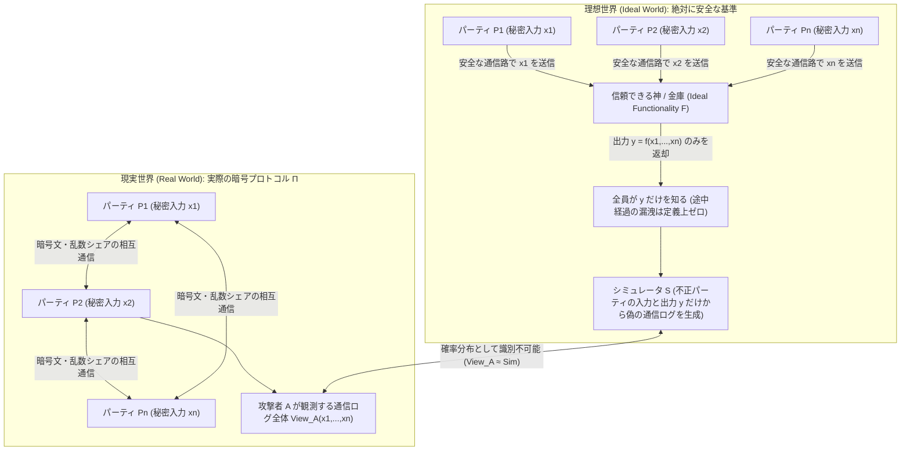
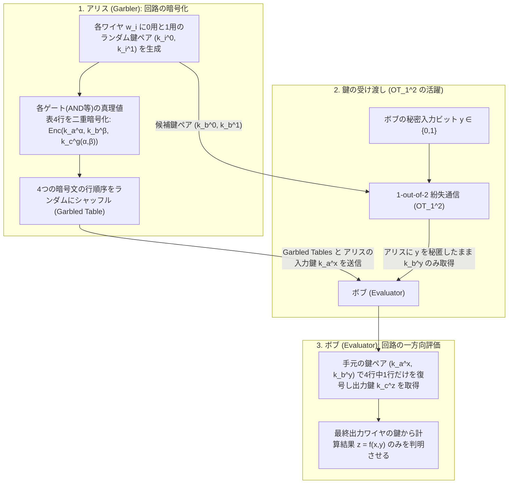
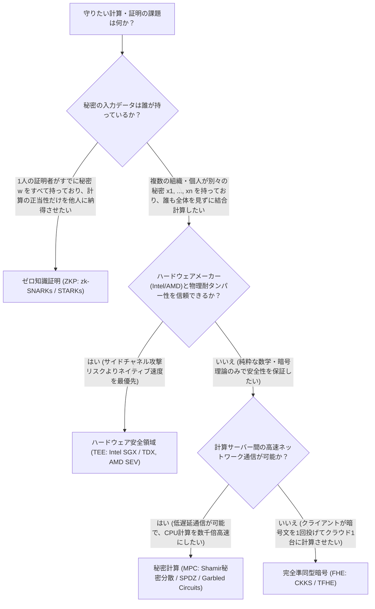

「複数の病院が持つ患者のゲノムデータを統合して新薬の統計解析を行いたいが、法律上、どの病院も患者の個人データを外部に1ビットたりとも持ち出すことはできない」
「競合する複数の銀行が、互いの顧客リストや不正取引の検知ノウハウを一切明かさずに、業界全体のマネーロンダリング経路だけを共同で特定したい」

常識的に考えれば、これらは矛盾した要求に見える。何らかの関数 $f(x_1, x_2, \dots, x_n)$ を計算するためには、誰か（あるいはどこかのサーバー）が入力データ $x_1, x_2, \dots, x_n$ を一度すべて集め、平文（生データ）としてメモリ上に展開してから演算を行わなければならないように思えるからだ。これまで人類は、その役割を「絶対に裏切らないと約束した信頼できる第三者（Trusted Third Party: TTP）」——たとえば政府機関、中央銀行、監査法人、あるいはクラウド事業者——に委ねることでしか解決できなかった。

しかし1980年代後半、現代暗号理論は驚くべき数学的定理に到達した。<strong>「信頼できる第三者などこの世に一切存在しなくても、参加者が互いの秘密入力 $x_i$ を1ビットも明かすことなく、任意の計算可能な関数 $f(x_1, \dots, x_n)$ の出力結果だけを得る通信プロトコルが構成できる」</strong>という事実である。

この技術は<strong>秘密計算（Secure Multi-Party Computation: MPC）</strong>と呼ばれる。本稿では、紙とペンだけで理解できる直感的な2つの思考実験から出発し、MPCを支える2大数学エンジン——<strong>シャミアの秘密分散法（ラグランジュ補間）とビーバーの乗算トリプル</strong>による算術回路アプローチ、そして<strong>紛失通信（Oblivious Transfer）とヤオのガーブルド・サーキット（Garbled Circuits）</strong>による論理回路アプローチ——の内部構造を数式とPython実装で完全に解き明かす。さらに、完全準同型暗号（FHE）やゼロ知識証明（ZKP）、ハードウェア安全領域（TEE）との決定的な違いと、オークション・医療・暗号資産ウォレットにおける最先端の実社会応用までを体系的に掘り下げる。

---

## 1. 直感を裏切る2つの思考実験：「上司なしの平均年収計算」と「ヤオの億万長者問題」

秘密計算の核心にある「データを隠したまま計算する」という感覚を掴むため、まずは暗号学の歴史において極めて重要な2つの思考実験を見てみよう。

### 1.1 思考実験①：誰にも自分の年収を知られずに「平均年収」だけを知る方法

同じカフェテーブルを囲む3人のエンジニア $A, B, C$ がいる。彼らは自分たちの待遇が妥当かを知るために、3人の<strong>平均年収 $\bar{x} = \frac{x_A + x_B + x_C}{3}$</strong> を知りたいと考えた。しかし、プライドや社内規定の都合上、<strong>自分の年収 $x_A, x_B, x_C$ がいくらであるかは、他の2人には絶対に知られたくない</strong>。また、彼ら全員が信頼できる上司や第三者もその場にはいない。紙とペンと耳打ち（1対1の秘匿通信）だけを使って、どうすれば3人の合計 $S = x_A + x_B + x_C$ だけを正確に求められるだろうか？

もし $A$ がそのまま自分の年収 $x_A = 800\text{万円}$ を $B$ に耳打ちしてしまえば、その瞬間に $B$ に $A$ の年収がバレてしまう。そこで $A$ は、計算を始める前に<strong>巨大な乱数によるマスク（ワンタイムパッド）</strong>をかけるという巧妙なトリックを使う。

1. <strong>乱数マスクの生成と最初の耳打ち（$A \to B$）</strong>：
   全員であらかじめ、3人の年収の合計よりも十分に大きな整数 $M$（たとえば $M = 10^9$）を決めておく。すべての計算は $M$ で割った余り（剰余環 $\mathbb{Z}_M = \{0, 1, \dots, M-1\}$）の上で行う。
   まずエンジニア $A$ は、サイコロや乱数生成器を使って、自分だけが知る一様乱数 $r \in \mathbb{Z}_M$（たとえば $r = 742,918,305$）を秘密裏に1つ選ぶ。そして自分の本当の年収 $x_A$ にこの乱数 $r$ を足し合わせた値
   $$s_1 = (x_A + r) \bmod M$$
   を計算し、この $s_1$ だけを隣の $B$ に耳打ちする。
   ここで重要なのは、$B$ の視点から見たとき、受け取った数値 $s_1$ は<strong>一様乱数 $r$ によって完全にマスクされているため、$x_A$ が 0 円であっても 5000 万円であっても、$s_1$ がその値になる確率はまったく同じ $1/M$ である</strong>という点だ。つまり、クロード・シャノンが証明した<strong>ワンタイムパッド（One-Time Pad）の完全秘匿性</strong>により、$B$ は $s_1$ から $x_A$ に関する情報を文字通り<strong>1ビットも得ることができない</strong>（相互情報量 $I(X_A; S_1) = 0$）。
2. <strong>第2の加算と耳打ち（$B \to C$）</strong>：
   数値 $s_1$ を受け取ったエンジニア $B$ は、そこに自分の年収 $x_B$ を足し合わせる：
   $$s_2 = (s_1 + x_B) \bmod M = (x_A + x_B + r) \bmod M$$
   そして $B$ はこの $s_2$ を隣の $C$ に耳打ちする。$C$ にとっても、乱数 $r$ の値がまったく分からないため、$s_2$ は依然として $\mathbb{Z}_M$ 上の単なる一様乱数にしか見えず、$x_A + x_B$ がいくらなのか1ビットも推測できない。
3. <strong>第3の加算と返却（$C \to A$）</strong>：
   数値 $s_2$ を受け取ったエンジニア $C$ は、そこに自分の年収 $x_C$ を足し合わせる：
   $$s_3 = (s_2 + x_C) \bmod M = (x_A + x_B + x_C + r) \bmod M$$
   そして $C$ はこの $s_3$ を最初のエンジニア $A$ に伝える。
4. <strong>乱数マスクの除去と結果の公表</strong>：
   最後に、乱数 $r$ を最初に作った張本人である $A$ が、受け取った $s_3$ から自分の乱数 $r$ を引き算する：
   $$S = (s_3 - r) \bmod M = x_A + x_B + x_C$$
   $A$ はこの合計 $S$ を3で割った平均年収 $\bar{x} = S / 3$ をテーブルの全員に公表する。

このプロトコルを振り返ってみよう。$B$ が見たのは $x_A + r$ と最終結果 $x_A + x_B + x_C$ だけであり、$r$ を知らないため $x_A$ と $x_C$ の内訳を知ることはできない。$C$ が見たのは $x_A + x_B + r$ と最終結果だけであり、やはり $x_A$ と $x_B$ の内訳は分からない。そして最初の $A$ も、自分が受け取った $s_3$ から $r$ を引いたときに初めて2人の合計 $x_B + x_C$ を知るが、それは「3人の合計 $S$ と自分の年収 $x_A$ から当然逆算できる情報（$S - x_A = x_B + x_C$）」に過ぎず、$B$ と $C$ の個別の年収がいくらであるかは $A$ にも決して分からない！

> [!NOTE]
> <strong>なぜ「2人」ではなく「3人以上」で平均を計算するのか？</strong>
> もし参加者がアリスとボブの2人だけだった場合、たとえ神様が間に入って2人の平均年収 $\bar{x} = \frac{x_A + x_B}{2}$ だけを教えてくれたとしても、アリスは自分の年収 $x_A$ を知っているため、$x_B = 2\bar{x} - x_A$ という引き算によってボブの年収を100%特定できてしまう。これは計算プロトコルの欠陥ではなく、<strong>「計算したい関数 $f(x_A, x_B) = \frac{x_A + x_B}{2}$ の出力そのものが相手の秘密を完全に決定してしまう」</strong>という数学的性質である。秘密計算（MPC）が保証するのは「<strong>最終出力 $f(x_1, \dots, x_n)$ から論理的に導かれる情報以外に、計算の過程から1ビットも余計な情報を漏らさないこと</strong>」である。3人以上であれば、合計 $x_A + x_B + x_C$ が分かっても残り2人の内訳には自由度が1つ残るため、個人の年収は守られる。

ちなみに、上記の耳打ち方式はもう一歩洗練させることができる。エンジニア $A$ が自分の年収 $x_A$ を、ランダムな3つの断片（シェア） $x_{A,1}, x_{A,2}, x_{A,3} \in \mathbb{Z}_M$ に分解し、
$$x_A \equiv x_{A,1} + x_{A,2} + x_{A,3} \pmod M$$
となるようにして、$x_{A,1}$ を自分自身の手元に残し、$x_{A,2}$ を $B$ に、$x_{A,3}$ を $C$ に配るのである。$B$ と $C$ もまったく同じように自分の年収を3つのランダムなシェアに分解して互いに配る。その後、3人がそれぞれ「手元に集まった3つのシェアの合計 $S_j = (x_{A,j} + x_{B,j} + x_{C,j}) \bmod M$」を計算して一斉に公開し、最後に $S = (S_1 + S_2 + S_3) \bmod M$ を足し合わせればよい。これを<strong>加法的秘密分散（Additive Secret Sharing）</strong>と呼び、現代の高速秘密計算フレームワークの最も基本的な構成要素となっている。

---

### 1.2 思考実験②：アンドリュー・ヤオの「億万長者問題（Millionaires' Problem）」

足し算だけであれば、上記のように乱数でマスクして足し合わせるだけで驚くほど簡単に秘密計算ができた。では、<strong>「大小比較（不等号）」</strong>はどうだろうか？

1982年、のちにチューリング賞を受賞する計算機科学者<strong>アンドリュー・ヤオ（Andrew Chi-Chih Yao）</strong>は、歴史的論文 *"Protocols for Secure Computations"* の中で、現代の秘密計算（MPC）という学問分野そのものを創始する有名な問題を提起した。それが<strong>「ヤオの億万長者問題（Yao's Millionaires' Problem）」</strong>である。

* <strong>問題設定</strong>：2人の億万長者アリス（資産 $x$ 百万ドル）とボブ（資産 $y$ 百万ドル）が偶然出会った。2人は<strong>「自分たちのうち、どちらの方がより裕福か（すなわち $x > y$ かどうか）」という1ビットの真偽値だけ</strong>を知りたい。しかし、自分の資産額 $x, y$ が具体的に何百万ドルであるか、あるいは2人の資産にどれくらいの差があるか（$x - y$ の値）については、相手に1ビットたりとも悟られたくない。信頼できる第三者もいない。

一見すると先ほどの平均年収問題に似ているが、数学的な難易度は劇的に跳ね上がる。
もし先ほどの方法で $x - y$ を計算して公開してしまえば、その瞬間に相手の資産額そのものが $x = y + (x - y)$ として完全にバレてしまう。知りたいのは差額 $x - y$ ではなく、その符号を表す<strong>非線形なステップ関数（比較述語）</strong>
$$f(x, y) = \begin{cases} 1 & (x > y \text{ のとき}) \\ 0 & (x \le y \text{ のとき}) \end{cases}$$
の1ビットだけなのだ。二進数のビット列で $x > y$ を判定するには、最上位ビットから順番に「両方のビットが等しいか（XOR の否定）」と「どちらが 1 でどちらが 0 か（AND ゲート）」を連鎖的に評価していく必要がある。つまり、<strong>単なる足し算（線形演算）だけでなく、掛け算（AND演算・非線形演算）を秘密のまま実行する仕組み</strong>が不可欠になるのである。

ヤオはこの問題を解くために、のちに<strong>「ガーブルド・サーキット（Garbled Circuits：暗号化回路）」</strong>と呼ばれる革命的な手法を考案した。その詳細なメカニズムは第5節で完全に解説するが、まずはその前に、「秘密計算が安全である」とは数学的にどういうことなのかを厳密に定義しておこう。

---

## 2. 秘密計算（MPC）の数学的定式化：理想世界と現実世界のシミュレーション・パラダイム

暗号プロトコルを設計する際、「アリスはボブの入力 $y$ を知ることができない」と言葉で言うのは簡単だが、それを数学の定理として証明するにはどうすればよいだろうか？たとえば、プロトコルの途中でアリスが受け取った暗号文や乱数の断片から、「$y$ の値そのものは分からないが、$y$ が偶数であることだけは分かる」とか「$y$ が素数である確率が少し高いと推測できる」といった微妙な情報漏洩すら完全にゼロであることを保証しなければならない。

この問題を解決するために、ゴールドライヒ、ミカリ、ウィグダーソン（Oded Goldreich, Silvio Micali, Avi Wigderson: GMW 1987）らによって確立され、のちにラン・カネッティ（Ran Canetti）の Universal Composability (UC) フレームワークへと結晶化したのが、<strong>「理想世界／現実世界のシミュレーション・パラダイム（Ideal/Real Simulation Paradigm）」</strong>である。



### 2.1 理想世界（Ideal World）と現実世界（Real World）

$n$ 人のパーティ $P_1, P_2, \dots, P_n$ がそれぞれ秘密の入力 $x_1, x_2, \dots, x_n$ を持ち、共同で関数 $f(x_1, \dots, x_n) = (y_1, \dots, y_n)$ を計算したいとする。ここで一部のパーティ集合 $I \subset \{1, \dots, n\}$ が攻撃者 $\mathcal{A}$ に乗っ取られ（あるいは互いに結託し）、正直なパーティたちの秘密を暴こうとしている状況を考える。

1. <strong>理想世界（Ideal World）</strong>：
   この世界には、絶対に買収されず、決して情報を漏らさない全知全能の「神（理想機能 $\mathcal{F}$：Ideal Functionality）」が存在すると仮定する。各パーティ $P_i$ は自分の秘密入力 $x_i$ を誰にも見られない専用パイプで神 $\mathcal{F}$ に渡す。神 $\mathcal{F}$ は一人で黙って $f(x_1, \dots, x_n)$ を計算し、各パーティ $P_i$ にその人の出力 $y_i$ だけを返す。
   この理想世界では、パーティ間のやり取りが一切存在しないため、結託した不正パーティ集合 $I$ が知り得る情報は、定義上<strong>「自分たちの入力 $\{x_i\}_{i \in I}$ と、神から返された自分たちの出力 $\{y_i\}_{i \in I}$」だけ</strong>である。これ以上安全な状態は原理的に存在しない。
2. <strong>現実世界（Real World）</strong>：
   神 $\mathcal{F}$ は存在しない。代わりに各パーティは暗号プロトコル $\Pi$ に従って、何ラウンドにもわたりメッセージ（乱数シェアや暗号文）を送受信し、最終的に出力 $y_i$ を得る。このとき、結託した不正パーティ集合 $I$ の手元には、自分たちの入力・内部乱数・そして正直なパーティから送られてきたすべての受信メッセージの履歴——これを<strong>攻撃者の視点 $\text{View}_I^\Pi(x_1, \dots, x_n)$</strong> と呼ぶ——が残る。

### 2.2 シミュレータ $\mathcal{S}$ による安全性の厳密な定義

では、現実世界のプロトコル $\Pi$ が「理想世界の神 $\mathcal{F}$ と同じくらい安全である」とはどういうことか？
それは、<strong>「理想世界に棲むアルゴリズム（シミュレータ $\mathcal{S}$）が、不正パーティ自身の入力 $\{x_i\}_{i \in I}$ と最終出力 $\{y_i\}_{i \in I}$ だけを与えられた状態で、正直なパーティの本当の入力 $\{x_j\}_{j \notin I}$ を一切見ることなく、現実世界で攻撃者が目にするはずの通信ログ $\text{View}_I^\Pi(x_1, \dots, x_n)$ とまったく見分けがつかない『模造の通信ログ』を単独で捏造（シミュレート）できること」</strong>として定義される：

$$\left\{ \mathcal{S}\left(I, \{x_i\}_{i \in I}, \{y_i\}_{i \in I}\right) \right\} \stackrel{c}{\approx} \left\{ \text{View}_I^\Pi(x_1, \dots, x_n) \right\}$$

ここで $\stackrel{c}{\approx}$ は計算量的識別不能（Computationally Indistinguishable：いかなる多項式時間アルゴリズムも両者の確率分布を区別できないこと）を表し、もし二つの確率分布が文字通り完全に一致する（$\equiv$）ならば<strong>情報理論的安全性（Information-Theoretic / Perfect Security）</strong>と呼ばれる。

なぜ「通信ログを捏造できるシミュレータ $\mathcal{S}$ が存在すること」が「情報が1ビットも漏れていないこと」の証明になるのだろうか？
考えてみてほしい。もし現実世界の通信ログ $\text{View}_I^\Pi$ の中に、正直なパーティの秘密入力 $x_j$ に関する何らかのヒントが含まれていたとしよう。しかし、入出力 $\{x_i, y_i\}_{i \in I}$ しか知らないシミュレータ $\mathcal{S}$ が、手元のサイコロ（乱数）を振るだけでそれと寸分違わぬ確率分布の通信ログを自分で作れてしまうのなら、現実世界で通信相手から送られてきたメッセージを受け取ることは、<strong>「自分自身の部屋でサイコロを振って乱数を眺めること」と情報量において完全に等価</strong>だということになる。自分の部屋でサイコロを振っても他人の秘密が分かるはずがない以上、実際の通信ログからも出力以上の秘密は1ビットも漏れていないことが数学的に確定するのである！

たとえば第1節の「3人の平均年収計算」では、不正なエンジニア $B$ が見る通信ログは $s_1 = (x_A + r) \bmod M$ と最終合計 $S$ である。シミュレータ $\mathcal{S}$ は、$A$ の年収 $x_A$ をまったく知らなくても、単に $\mathbb{Z}_M$ から一様乱数 $\tilde{s}_1 \xleftarrow{\$} \mathbb{Z}_M$ を1つ適当に選んで「これが $A$ から届いたメッセージだ」と差し出すだけでよい。本物の $s_1$ も模造の $\tilde{s}_1$ も $\mathbb{Z}_M$ 上の完全な一様分布に従うため、両者の確率分布は 100% 同一であり、情報理論的な完全安全性が直ちに証明される。

---

### 2.3 攻撃者モデル（Adversary Models）と結託閾値の分類

MPCプロトコルを設計・評価する際には、「敵がどこまで悪質な行動をとるか」と「何人まで裏切るか」という2つの軸を明確に区別する必要がある。

| 分類軸 | モデル名 | 定義と特徴 | 代表的なプロトコル・対策 |
| :--- | :--- | :--- | :--- |
| <strong>行動の悪質さ</strong> | <strong>セミオネスト攻撃者</strong><br>(Semi-Honest / Passive) | 「正直だが好奇心旺盛（Honest-but-Curious）」。プロトコルの手順・計算ルールには100%忠実に従うが、通信ログを後から徹底解析して他人の秘密を暴こうとする。 | 基本形Shamir秘密分散 (BGW)、基本形YaoのGarbled Circuits、GMWプロトコル |
| <strong>行動の悪質さ</strong> | <strong>マリシャス攻撃者</strong><br>(Malicious / Active) | プロトコルを無視して嘘の計算結果を送る、自分の入力を途中で書き換える、都合が悪くなると通信を切断する（Abort）など、あらゆる改ざんを行うビザンチン攻撃者。 | 検証可能秘密分散 (VSS)、SPDZ（情報理論的MAC付きシェア）、Cut-and-Choose法、ゼロ知識証明 (ZKP) |
| <strong>結託の人数</strong> | <strong>過半数が正直</strong><br>(Honest Majority: $t < n/2$) | 全参加者 $n$ 人のうち、裏切って結託する人数が半数未満（たとえば3人中1人以下）であると仮定できる環境。暗号仮定なしの情報理論的安全性が達成可能。 | BGWプロトコル、3者間複製秘密分散 (Replicated Secret Sharing: ABY3 / Falcon) |
| <strong>結託の人数</strong> | <strong>不正な過半数</strong><br>(Dishonest Majority: $t < n$) | $n$ 人中 $n-1$ 人が結託して最後の1人を騙そうとしても安全（2者間計算 2PC を含む）。情報理論的には不可能であり、紛失通信（OT）や準同型暗号などの計算量的仮定が必須。 | YaoのGarbled Circuits (2PC)、GMW、SPDZ / MASCOT / Overdrive |

---

## 3. 第1の数学的エンジン：シャミアの $(t, n)$ 閾値秘密分散法とラグランジュ補間

ここからは、現代のMPCを支える第1の数学的柱である<strong>「秘密分散（Secret Sharing）ベースの算術回路計算」</strong>に踏み込もう。

第1節で紹介した加法的秘密分散（$s \equiv s_1 + s_2 + \dots + s_n \pmod M$）には1つ弱点がある。それは「$n$ 人全員が揃わなければ秘密を復元できず、たった1人でもサーバーが故障したり通信を拒否したりすると計算が永久に止まってしまう」という点、そして「そのままでは秘密同士の掛け算（乗算）ができない」という点である。

この両方の課題を一挙に解決する美しい代数構造が、RSA暗号の発明者の1人でもある<strong>アディ・シャミア（Adi Shamir）</strong>が1979年のわずか2ページの論文 *"How to share a secret"* で発表した<strong>シャミアの $(t, n)$ 閾値秘密分散法（Shamir's Threshold Secret Sharing）</strong>である。

### 3.1 多項式の自由度を利用した秘密の分割（Share Generation）

シャミアの着想は、中学校や高校で習う代数学の極めてシンプルな定理に基づいている。

* $1$ 次関数（直線） $y = s + a_1 x$ は、平面上の異なる <strong>$2$ 個の点</strong>を指定すればただ1本に決まる（1点しか分からなければ、その点を通る直線はあらゆる傾きで無限に引けるため、切片 $s$ はまったく決まらない）。
* $2$ 次関数（放物線） $y = s + a_1 x + a_2 x^2$ は、異なる <strong>$3$ 個の点</strong>を指定すればただ1つに決まる（2点しか分からなければ、その2点を通る放物線は無限に存在し、切片 $s$ はあらゆる値をとり得る）。
* 一般に、<strong>$t-1$ 次多項式は、異なる $t$ 個の点 $(x_1, y_1), \dots, (x_t, y_t)$ を通るものがただ1つ一意に定まるが、$t-1$ 個以下の点しか与えられなければ、定数項（$y$ 切片）の値はすべての候補が完全に等確率で起こり得る。</strong>

これをそのまま暗号プロトコルに仕立て上げる。ただし、実数 $\mathbb{R}$ 上で計算すると「点の座標の大きさから大体の範囲が推測できてしまう（情報漏洩）」うえに浮動小数点の丸め誤差が生じるため、すべての計算を<strong>大きな素数 $p$（$p > n$）を法とする有限体（ガロア体） $\mathbb{F}_p = \{0, 1, 2, \dots, p-1\}$</strong> の上で行う。

<strong>【シャミアの $(t, n)$ 分散アルゴリズム】</strong>
秘密にしたい数値を $s \in \mathbb{F}_p$ とする。参加者 $n$ 人のうち、任意の $t$ 人以上が集まれば $s$ を復元でき、$t-1$ 人以下が結託しても $s$ について1ビットの情報も得られないようにしたい（これを $(t, n)$-閾値法と呼ぶ）。

1. ディーラー（秘密の持ち主）は、有限体 $\mathbb{F}_p$ から $t-1$ 個の独立な一様乱数 $a_1, a_2, \dots, a_{t-1} \xleftarrow{\$} \mathbb{F}_p$ を選び、定数項に秘密 $s$ を据えた $t-1$ 次多項式 $P(x) \in \mathbb{F}_p[x]$ を構成する：
   $$P(x) = s + a_1 x + a_2 x^2 + \dots + a_{t-1} x^{t-1} \pmod p$$
   ここで明らかに、$x = 0$ を代入したときの値（$y$ 切片）が元の秘密 $P(0) = s$ である。
2. ディーラーは、各パーティ $P_i$（$i = 1, 2, \dots, n$）に対して、それぞれ異なる非ゼロの公開座標 $x_i \in \mathbb{F}_p \setminus \{0\}$（通常はそのまま番号 $x_i = i$ を使う）における多項式の評価値
   $$y_i = P(x_i) \pmod p$$
   を計算し、点 $(x_i, y_i)$ をパーティ $P_i$ の<strong>シェア（断片）</strong>として秘密裏に配布する。

### 3.2 ラグランジュ補間公式（Lagrange Interpolation）による秘密の復元

さて、$n$ 人のうち任意の $t$ 人の集合 $T \subset \{1, \dots, n\}$（$|T| = t$）が自分のシェア $\{(x_i, y_i)\}_{i \in T}$ を持ち寄ったとしよう。彼らはどうやって元の多項式 $P(x)$、とりわけその定数項 $s = P(0)$ を求めるのだろうか？連立一次方程式（ヴァンデルモンド行列の逆行列）を解いてもよいが、数値解析における<strong>ラグランジュの補間公式（Lagrange Polynomial Interpolation）</strong>を使えば、一発で明示的な式として書き下すことができる。

集合 $T$ に属する各インデックス $i \in T$ に対して、<strong>「点 $x = x_i$ でだけ $1$ になり、他のすべての点 $x = x_j$ ($j \in T \setminus \{i\}$) で $0$ になる」</strong>という都合のよい $t-1$ 次多項式——<strong>ラグランジュ基底多項式 $\ell_i(x)$</strong>——を次のように定義する：

$$\ell_i(x) = \prod_{j \in T,\, j \ne i} \frac{x - x_j}{x_i - x_j} \pmod p$$

実際に確かめてみよう。$x = x_i$ を代入すれば、分子と分母がすべて一致して $\frac{x_i - x_j}{x_i - x_j} = 1$ の積となるため $\ell_i(x_i) = 1$ である。一方、$i$ 以外の任意の $k \in T$ ($k \ne i$) に対して $x = x_k$ を代入すると、積の中に必ず分子が $x_k - x_k = 0$ となる因数が1つ現れるため $\ell_i(x_k) = 0$ となる（なお、有限体 $\mathbb{F}_p$ における割り算 $\frac{A}{B}$ は、フェルマーの小定理 $B^{p-2} \bmod p$ または拡張ユークリッド互除法によるモジュラ逆元 $B^{-1} \bmod p$ を掛ける演算 $A \cdot B^{-1} \pmod p$ である）。

すると、各シェアの値 $y_i$ にこの基底多項式 $\ell_i(x)$ を掛けて足し合わせた多項式
$$P(x) = \sum_{i \in T} y_i \cdot \ell_i(x) \pmod p$$
は、高々 $t-1$ 次でありながら、すべての $k \in T$ に対して $P(x_k) = \sum_{i \in T} y_i \delta_{ik} = y_k$ を満たす。異なる $t$ 個の点を通る $t-1$ 次多項式はただ1つしか存在しないため、これこそが元の多項式 $P(x)$ そのものである！

私たちが本当に欲しいのは多項式全体ではなく、<strong>定数項である秘密 $s = P(0)$ だけ</strong>である。したがって、上式に $x = 0$ を代入すれば、次の極めてシンプルかつ美しい復元公式が得られる：

$$s = P(0) = \sum_{i \in T} y_i \cdot \ell_i(0) = \sum_{i \in T} y_i \left( \prod_{j \in T,\, j \ne i} \frac{-x_j}{x_i - x_j} \right) \pmod p$$

ここで、括弧内の定数 $\lambda_i = \ell_i(0) = \prod_{j \in T, j \ne i} \frac{-x_j}{x_i - x_j} \pmod p$ は、誰が参加したか（座標 $\{x_i\}_{i \in T}$）さえ決まれば、シェアの値 $y_i$ とは無関係に事前に計算できる公開の定数（ラグランジュ補間係数）である。つまり、<strong>秘密 $s$ の復元とは、各パーティのシェア $y_i$ に定数 $\lambda_i$ を掛けて足し合わせる単なる線形結合（内積） $\sum_{i \in T} \lambda_i y_i \pmod p$ に過ぎない</strong>のだ！

### 3.3 なぜ $t-1$ 人では1ビットも推測できないのか（情報理論的完全安全性の証明）

ここで、「$t-1$ 個のシェアが集まれば、あと1点足りないだけなのだから、秘密 $s$ の候補がある程度絞り込めてしまうのではないか？」という疑問を抱くかもしれない。答えは<strong>「断じてノー（1ビットたりとも絞り込めない）」</strong>である。

数学的に証明しよう。攻撃者が $t-1$ 個のシェア $(x_1, y_1), \dots, (x_{t-1}, y_{t-1})$ を手に入れたとする。いま、有限体 $\mathbb{F}_p$ の中から任意の仮説上の秘密の値 $s' \in \mathbb{F}_p$ を1つ勝手に選んでみよう。この仮説 $s'$ は点 $(0, s')$ を意味する。
すると、攻撃者が持っている $t-1$ 個の点 $(x_1, y_1), \dots, (x_{t-1}, y_{t-1})$ と、仮説の点 $(0, s')$ を合わせると、<strong>互いに異なる $x$ 座標を持つ合計 $t$ 個の点</strong>が揃うことになる。ラグランジュ補間の定理により、この $t$ 個の点をすべて通る $t-1$ 次多項式 $P_{s'}(x)$ が、<strong>どのような $s' \in \mathbb{F}_p$ を選んでも必ずただ1つずつ一意に存在する</strong>！

ディーラーが最初にランダムな係数 $(a_1, \dots, a_{t-1}) \in \mathbb{F}_p^{t-1}$ を選ぶ確率は、どの組み合わせに対しても完全に等しく $\frac{1}{p^{t-1}}$ である。したがって、観測された $t-1$ 個のシェアと整合する多項式 $P_{s'}(x)$ は、すべての $s' \in \{0, 1, \dots, p-1\}$ に対してちょうど1本ずつ、まったく同じ確率 $\frac{1}{p^{t-1}}$ で存在する。ゆえに、事後確率分布は事前確率分布とまったく変わらず、シャノン・エントロピーの言葉で書けば
$$H(S \mid Y_1 = y_1, \dots, Y_{t-1} = y_{t-1}) = H(S)$$
が厳密に成り立つ。たとえ攻撃者が宇宙の年齢以上の時間をかけて全探索を行える無限の計算能力（量子コンピュータを含む）を持っていたとしても、$t-1$ 個のシェアからは元の秘密 $s$ について1ビットの偏りも見出すことができないのである。

---

### 3.4 BGWプロトコル：シェアのまま「足し算」と「掛け算」を行う方法

シャミアの秘密分散が真に驚異的なのは、秘密をただ金庫のように分割保存できるだけでなく、<strong>「分割されたシェアの状態で、元の秘密を一度も復元することなく足し算や掛け算ができる（準同型性を持つ）」</strong>という点にある。1988年、マイケル・ベン＝オア（Michael Ben-Or）、シャフィ・ゴールドワッサー（Shafi Goldwasser）、アヴィ・ウィグダーソン（Avi Wigderson）の3人は、この性質を使って任意の算術回路を秘密計算する<strong>BGWプロトコル</strong>を発表した。

いま、2つの秘密 $a, b \in \mathbb{F}_p$ がそれぞれ $t-1$ 次多項式 $P(x), Q(x)$（ただし $P(0) = a, Q(0) = b$）によって分散されており、各パーティ $P_i$ がシェア $y_i^{(a)} = P(x_i)$ と $y_i^{(b)} = Q(x_i)$ を持っているとしよう。この状態を $[a], [b]$ と表記する。

#### ① 秘密の加算（$[a] + [b] = [a + b]$）と定数倍（$c \cdot [a] = [c \cdot a]$）：通信コスト完全ゼロ

2つの多項式を足し合わせた新しい多項式 $R(x) = P(x) + Q(x) \pmod p$ を考えてみよう。
多項式の和の性質から、$R(x)$ の次数もやはり高々 $t-1$ 次であり、その定数項は
$$R(0) = P(0) + Q(0) = a + b \pmod p$$
となる！しかも、点 $x_i$ における $R(x)$ の評価値は
$$R(x_i) = P(x_i) + Q(x_i) = y_i^{(a)} + y_i^{(b)} \pmod p$$
に他ならない。
これが何を意味するか分かるだろうか？各パーティ $P_i$ が<strong>誰とも一切通信することなく、自分の手元にある2つのシェア $y_i^{(a)}$ と $y_i^{(b)}$ をただ足し算するだけ</strong>で、その計算結果 $y_i^{(a+b)} = (y_i^{(a)} + y_i^{(b)}) \bmod p$ は、自動的に「和 $a + b$ を定数項に持つ $t-1$ 次多項式 $R(x)$ の正しいシャミア・シェア」になっているのである！公開の定数 $c \in \mathbb{F}_p$ を掛けるスカラー倍 $c \cdot [a] = [c \cdot a]$ もまったく同様に、手元のシェアを $c$ 倍するだけで通信ゼロで完了する。

#### ② 秘密同士の乗算（$[a] \cdot [b] = [a \cdot b]$）：次数の倍増と次数縮約（Degree Reduction）

では、秘密 $a$ と秘密 $b$ の掛け算 $a \cdot b \pmod p$ はどうだろうか？
もし各パーティ $P_i$ が手元で自分のシェア同士を掛け算して
$$z_i = y_i^{(a)} \cdot y_i^{(b)} = P(x_i) \cdot Q(x_i) \pmod p$$
を計算したとすると、この $z_i$ は積多項式 $H(x) = P(x) \cdot Q(x) \pmod p$ の点 $x_i$ における評価値となっている。そして確かに、$H(x)$ の定数項は
$$H(0) = P(0) \cdot Q(0) = a \cdot b \pmod p$$
であり、欲しい積 $a \cdot b$ そのものになっている！

しかし、ここに<strong>2つの重大な壁</strong>が立ちはだかる。
1. <strong>多項式の次数の倍増</strong>：$P(x)$ が $t-1$ 次式、$Q(x)$ も $t-1$ 次式であるため、それらを掛け合わせた $H(x) = P(x)Q(x)$ は<strong>次数が $2(t-1)$ に倍増してしまっている</strong>！もしこのまま次の掛け算をもう一度行えば次数は $4(t-1)$、次は $8(t-1)$ へと指数関数的に膨れ上がり、すぐにパーティ総数 $n$ を超えて補間不可能（復元不可能）になってしまう。
2. <strong>係数のランダム性の崩壊</strong>：$2(t-1)$ 次多項式 $H(x)$ は2つの $t-1$ 次多項式の積として作られているため（因数分解可能な特殊な多項式であるため）、その高次係数は独立な一様乱数ではなく、そのまま公開すると元の多項式 $P(x), Q(x)$ の情報が漏れてしまう。

そこでBGWプロトコルでは、手元でシェアを掛け算した直後に、<strong>次数を $2(t-1)$ から元の $t-1$ に引き戻し、かつ係数を完全にランダム化し直す「次数縮約（Degree Reduction）ステップ」</strong>を1ラウンドの通信で行う。

まず前提として、次数 $2(t-1)$ の多項式 $H(x)$ の定数項 $H(0) = a \cdot b$ をラグランジュ補間で一意に決定するためには、少なくとも $2(t-1) + 1 = 2t - 1$ 個の評価点が必要である。したがって、参加者の総数 $n$ は必ず
$$2t - 1 \le n \iff t \le \left\lfloor \frac{n + 1}{2} \right\rfloor$$
を満たしていなければならない。結託しても秘密が漏れない最大人数は $t - 1$ 人だから、これは<strong>不正パーティの数 $t - 1 < \frac{n}{2}$（すなわち参加者の過半数が正直：Honest Majority）</strong>であることを意味する（たとえば閾値 $t = 2$ なら最低 $n = 2(2) - 1 = 3$ 人のパーティが必要）。

$n \ge 2t - 1$ が満たされているとき、任意の $2t - 1$ 人（簡単のため $i = 1, \dots, 2t-1$ とする）の積シェア $z_i = H(x_i)$ に対して、ラグランジュ補間係数 $\lambda_i = \prod_{j=1, j \ne i}^{2t-1} \frac{-x_j}{x_i - x_j} \pmod p$ を用いれば、
$$a \cdot b = H(0) = \sum_{i=1}^{2t-1} \lambda_i z_i \pmod p$$
という<strong>線形結合</strong>で積 $a \cdot b$ が表せることに注目しよう！
この式はただの足し算と定数倍（線形結合）なのだから、以下の手順で次数を $t-1$ に戻すことができる：

1. <strong>積シェアの再分散（Sub-sharing）</strong>：各パーティ $P_i$ ($i = 1, \dots, 2t-1$) は、自分が計算した中間値 $z_i = y_i^{(a)} y_i^{(b)} \pmod p$ を「新たな秘密」とみなし、新しいランダムな<strong>$t-1$ 次多項式</strong> $R_i(x)$（ただし $R_i(0) = z_i$）を使って全パーティ $P_1, \dots, P_n$ に再分散する（$P_i$ から $P_k$ へ点 $s_{i \to k} = R_i(x_k)$ を送る）。
2. <strong>手元でのラグランジュ線形結合</strong>：各パーティ $P_k$ ($k = 1, \dots, n$) は、$2t-1$ 人から受け取った再分散シェア $s_{1 \to k}, \dots, s_{2t-1 \to k}$ に対して、公開のラグランジュ係数 $\lambda_i$ を掛けて足し合わせる：
   $$y_k^{(a \cdot b)} = \sum_{i=1}^{2t-1} \lambda_i \cdot s_{i \to k} = \sum_{i=1}^{2t-1} \lambda_i R_i(x_k) \pmod p$$
3. <strong>完了</strong>：新しい多項式 $R_{\text{new}}(x) = \sum_{i=1}^{2t-1} \lambda_i R_i(x) \pmod p$ は、<strong>$t-1$ 次多項式の線形結合なので次数は正しく $t-1$ に戻っており</strong>、しかもその定数項は
   $$R_{\text{new}}(0) = \sum_{i=1}^{2t-1} \lambda_i R_i(0) = \sum_{i=1}^{2t-1} \lambda_i z_i = H(0) = a \cdot b \pmod p$$
   となって、完全に独立ランダムな $t-1$ 次多項式による積 $[a \cdot b]$ のシャミア・シェアが得られるのである！

---

## 4. オフライン／オンライン分離の革命：ドナルド・ビーバーの乗算トリプルとSPDZプロトコル

BGWプロトコルは理論的に完璧な美しさを持っているが、実用上は2つの制約があった。第1に「掛け算のたびに全パーティ間で多項式の再分散（$O(n^2)$ 個のメッセージ通信）が必要になること」、第2に「$2t - 1 \le n$ という次数条件のせいで、2人だけの秘密計算（$n=2, t=2$）や不正な過半数（Dishonest Majority）では使えないこと」である。

この壁を打ち破り、現代の秘密計算（SPDZ、MASCOT、ABYなど）の標準アーキテクチャを確立したのが、1991年に<strong>ドナルド・ビーバー（Donald Beaver）</strong>が考案した<strong>「ビーバーの乗算トリプル（Beaver's Multiplication Triples）」</strong>である。

### 4.1 ビーバーの乗算トリプル $([u], [v], [w])$ による超高速乗算

ビーバーのアイデアは、計算プロセスを以下の2つのフェーズに完全に切り離すことにある：

* <strong>オフライン（事前準備）フェーズ（Offline / Preprocessing Phase）</strong>：実際に計算したい秘密データ $x, y$ がまだ入力される前（たとえば夜間のアイドル時間中）に、誰にも値が分からないランダムな秘密の3つ組 $([u], [v], [w])$ ——ただし $u, v \xleftarrow{\$} \mathbb{F}_p$ は一様乱数であり、<strong>$w = u \cdot v \pmod p$ という積の関係を満たす</strong>——を大量に事前生成して各パーティにシェアとして蓄えておく。
* <strong>オンラインフェーズ（Online Phase）</strong>：ユーザーの秘密入力 $[x], [y]$ が与えられた瞬間、事前生成しておいた乗算トリプル $([u], [v], [w])$ を1組消費して、<strong>線形演算とわずか2つのスカラー値の公開だけ</strong>で超高速に積 $[x \cdot y]$ を計算する。

なぜランダムな積 $w = u \cdot v$ のシェアを持っているだけで、任意の秘密 $x$ と $y$ の積 $[x \cdot y]$ が線形演算だけで計算できてしまうのか？その鮮やかな代数トリックを導出しよう。

<strong>【ビーバーの乗算プロトコル】</strong>
各パーティは秘密入力のシェア $[x], [y]$（これはシャミア秘密分散でも加法的秘密分散でもよい！）と、未使用の乗算トリプル $([u], [v], [w])$（ただし $w = u \cdot v \pmod p$）を持っているとする。

1. <strong>乱数マスク付きの差分シェアの局所計算（通信ゼロ）</strong>：
   各パーティは手元の引き算（線形演算）だけで、以下の2つのシェアを計算する：
   $$[d] = [x] - [u] \pmod p, \qquad [e] = [y] - [v] \pmod p$$
2. <strong>マスクされた差分 $d, e$ の公開（Open）</strong>：
   全員で $[d]$ と $[e]$ のシェアを持ち寄って復元し、平文の数値 $d = (x - u) \bmod p$ と $e = (y - v) \bmod p$ を<strong>全員に公開する</strong>。
   「えっ、公開してしまって大丈夫なのか！？」と思うかもしれない。しかし思い出してほしい。$u$ と $v$ は誰も知らない一度きりの一様乱数（ワンタイムパッド）である！したがって、$d = x - u \pmod p$ と $e = y - v \pmod p$ を全世界に公開したところで、それは乱数そのものを公開したのと同じであり、<strong>元の秘密 $x, y$ に関する情報は1ビットたりとも漏洩しない</strong>（このトリプル $([u],[v],[w])$ は二度と使い回さず、1回の乗算ごとに使い捨てる）。
3. <strong>公開された定数 $d, e$ を用いた線形結合による積の合成（通信ゼロ）</strong>：
   いまや $d = x - u$ と $e = y - v$ は全員が知っている<strong>ただの定数（スカラー）</strong>である。ここで $x = u + d$ および $y = v + e$ を代入して、私たちが求めたい積 $x \cdot y$ を展開してみよう：
   $$\begin{aligned} x \cdot y &= (u + d)(v + e) \\ &= u \cdot v + d \cdot v + e \cdot u + d \cdot e \\ &= w + d \cdot v + e \cdot u + d \cdot e \pmod p \end{aligned}$$
   この最後の式をじっくり眺めてほしい。右辺に登場する未知の秘密は $w, v, u$ の3つだけであり、それらのシェア $[w], [v], [u]$ は全員が最初から手元に持っている。そしてそこに掛かっている $d$ と $e$ は、ステップ2ですでに公開された<strong>既知の定数</strong>である！
   つまり、右辺にはもはや「秘密×秘密」の掛け算が1つも残っておらず、すべて<strong>「シェアの足し算」「定数×シェアのスカラー倍」「定数 $d \cdot e$ の加算」という線形演算のみ</strong>になっているのだ！
   したがって、各パーティは誰とも通信することなく、手元で
   $$[x \cdot y] = [w] + d \cdot [v] + e \cdot [u] + d \cdot e \pmod p$$
   を計算するだけで、瞬時に積 $x \cdot y$ の正しいシェア $[x \cdot y]$ を得ることができる！

このビーバーの乗算トリプルにより、オンライン計算中に必要な通信は「乗算ゲート1個につき2つの数値 $d, e$ をブロードキャストするだけ」に激減した。さらに、加法的秘密分散（$n$ 人全員のシェアの和が秘密になる方式）の上でもそのまま動くため、オフラインフェーズで準同型暗号（BGV/BFV）や紛失通信（OT）を使ってトリプル $([u], [v], [w])$ さえ安全に作っておけば、<strong>$n$ 人中 $n-1$ 人が結託しても安全な「不正な過半数（Dishonest Majority）」モデルでも超高速な算術秘密計算が可能になった</strong>のである。

2012年にアイヴァン・ダムゴード（Ivan Damgård）らが発表した<strong>SPDZ（スピードズ）プロトコル</strong>は、このビーバーのトリプルに「情報理論的MAC（秘密のグローバル鍵 $\alpha \in \mathbb{F}_p$ に対して、すべての秘密 $x$ のシェア $[x]$ と同時に $[\alpha \cdot x]$ のシェアも保持し続ける仕組み）」を組み合わせることで、たとえ $n-1$ 人のマリシャス攻撃者が途中で $d$ や $e$ の値を1ビットでも改ざんして嘘をついたとしても、ほぼ $1 - 1/p$ の確率で即座に不正を検知して計算を停止できる究極の安全性を達成している。

---

## 5. 第2の数学的エンジン：マイケル・ラビンの紛失通信（OT）とヤオのガーブルド・サーキット

ここまで見てきた「有限体 $\mathbb{F}_p$ 上の秘密分散（算術回路）」は、平均・分散・内積・行列積・多項式評価といった<strong>数値計算</strong>には無類の強さを発揮する。
しかし、第1節で登場した「ヤオの億万長者問題（$x > y$ の大小比較）」や、SHA-256・AES のようなビット演算、あるいは `if (x > y) then ...` のような条件分岐を有限体 $\mathbb{F}_p$ の足し算と掛け算だけで表現しようとすると、数値を一度ビット分解する必要があり、回路の深さ（通信ラウンド数）が大きく増えてしまう。

そこで、あらゆる計算を<strong>ブール論理回路（AND ゲート、XOR ゲート、OR ゲート）</strong>として表現し、しかも<strong>回路がどれほど深くても「常に定数ラウンド（実質1往復）」の通信だけで評価を完了できる</strong>もう1つの巨大な潮流が登場する。それがマイケル・ラビンの<strong>紛失通信（Oblivious Transfer: OT）</strong>と、アンドリュー・ヤオの<strong>ガーブルド・サーキット（Garbled Circuits）</strong>である。

### 5.1 マイケル・ラビンの「1-out-of-2 紛失通信（$\text{OT}_1^2$）」

1981年、チューリング賞受賞者<strong>マイケル・ラビン（Michael O. Rabin）</strong>が提唱し、シモン・イーブン、オデッド・ゴールドライヒ、アブラハム・レンペル（Even, Goldreich, Lempel 1985）が現在の形に定式化した<strong>「1-out-of-2 紛失通信（1-out-of-2 Oblivious Transfer: $\text{OT}_1^2$）」</strong>は、現代暗号学において最も不思議で、かつ最も重要な基本プリミティブである。

* <strong>$\text{OT}_1^2$ の仕様</strong>：
  * 送信者（Sender）アリスは、2つの秘密メッセージ $m_0, m_1$ を持っている。
  * 受信者（Receiver）ボブは、1ビットの選択値 $b \in \{0, 1\}$ を持っている。
  * プロトコルが終了したとき、以下の2つの条件が同時に満たされる：
    1. <strong>送信者のプライバシー（Sender's Privacy）</strong>：ボブは自分が選んだメッセージ $m_b$ だけを取得でき、<strong>選ばなかったもう一方のメッセージ $m_{1-b}$ については1ビットの情報も得られない</strong>。
    2. <strong>受信者のプライバシー（Receiver's Privacy）</strong>：アリスは、<strong>ボブが $m_0$ と $m_1$ のどちらを受け取ったのか（選択ビット $b$ が $0$ なのか $1$ なのか）を1ビットも知ることができない</strong>。

日常の感覚からすると魔法のような通信箱である。「郵便局員（アリス）が2通の手紙を入れて差し出し、受取人（ボブ）は片方だけを取り出して読むが、郵便局員にはどちらの手紙が抜かれたか分からず、受取人ももう片方の手紙を絶対に盗み見ることができない」という仕組みを、物理的な箱を使わずに公開鍵暗号の数式だけでどう実現するのだろうか？

最も直感的で美しい<strong>Bellare-Micali（Diffie-Hellman / ElGamal ベース）の構成法</strong>を見てみよう。

<strong>【離散対数問題に基づく $\text{OT}_1^2$ プロトコル】</strong>
離散対数問題が困難な素数位数 $q$ の巡回群 $\mathbb{G}$ とその生成元 $g$ を共有しておく。

1. <strong>アリスからのランダムチャレンジ</strong>：
   アリスはランダムな群要素 $C \xleftarrow{\$} \mathbb{G}$（ただしアリス自身も $\log_g C$ の離散対数を知らないよう、乱数シードからハッシュ関数で生成するか、アリスが選んだ乱数指数で生成する）を選び、ボブに $C$ を送る。
2. <strong>ボブによる「片方だけ秘密鍵を知っている2つの公開鍵」の生成</strong>：
   ボブは乱数（秘密鍵） $k \xleftarrow{\$} \mathbb{Z}_q$ を1つ選び、自分の選択ビット $b \in \{0, 1\}$ に応じて、2つの公開鍵 $(PK_0, PK_1)$ を次のようにセットする：
   * もしボブが <strong>$b = 0$</strong> を選びたいなら：
     $$PK_0 = g^k, \qquad PK_1 = \frac{C}{g^k}$$
   * もしボブが <strong>$b = 1$</strong> を選びたいなら：
     $$PK_0 = \frac{C}{g^k}, \qquad PK_1 = g^k$$
   そしてボブは、自分では $PK_0$ だけ（$PK_1$ は常に $C / PK_0$ から自動で決まるため）をアリスに送る。
   ここがこのプロトコルの白眉である！
   * <strong>なぜアリスに選択ビット $b$ がバレないのか？</strong>：$k$ は一様乱数なので、$b=0$ のときの $PK_0 = g^k$ も、$b=1$ のときの $PK_0 = C / g^k$ も、群 $\mathbb{G}$ 上の<strong>完全に一様なランダム要素</strong>である。つまり、アリスから見れば $PK_0$ と $PK_1$ は単に $PK_0 \cdot PK_1 = C$ を満たす無作為なペアにしか見えず、ボブがどちらの離散対数（秘密鍵 $k$）を知っているのかは、情報理論的に<strong>1ビットも区別できない</strong>！
   * <strong>なぜボブは両方の秘密鍵を知ることができないのか？</strong>：もしボブが $PK_0 = g^{k_0}$ の秘密鍵 $k_0$ と、$PK_1 = g^{k_1}$ の秘密鍵 $k_1$ の<strong>両方</strong>を同時に知ることができたとしたら、$PK_0 \cdot PK_1 = g^{k_0 + k_1} = C$ より、ボブはアリスが与えたランダム要素 $C$ の離散対数 $\log_g C = k_0 + k_1 \pmod q$ を解けてしまったことになり、離散対数問題の困難性に矛盾する！したがってボブは<strong>絶対に $PK_b$ の秘密鍵 $k$ しか知り得ない</strong>。
3. <strong>アリスによる二重暗号化とボブの復号</strong>：
   アリスは受け取った $PK_0$ と $PK_1 = C / PK_0$ を使って、2つのメッセージ $m_0, m_1$ をそれぞれ ElGamal 暗号化（乱数 $r_0, r_1 \xleftarrow{\$} \mathbb{Z}_q$ を用いて $E_0 = (g^{r_0},\, m_0 \oplus H(PK_0^{r_0}))$, $E_1 = (g^{r_1},\, m_1 \oplus H(PK_1^{r_1}))$）してボブに送る。
   ボブは自分が秘密鍵 $k$ を知っている方の暗号文 $E_b$ だけに対して $(g^{r_b})^k = (g^k)^{r_b} = PK_b^{r_b}$ を計算して $m_b$ を復号でき、もう片方の $E_{1-b}$ は離散対数が分からないため一切復号できない！

1988年、ジョー・キリアン（Joe Kilian）は暗号理論の歴史に残る大定理を証明した。それは<strong>「紛失通信（OT）というブラックボックスが1つあるだけで、他のいかなる暗号学的仮定も一切使わずに、任意の関数に対する安全なマルチパーティ計算（MPC）を構成できる（OT is complete for MPC）」</strong>という事実である。

---

### 5.2 ヤオのガーブルド・サーキット（Yao's Garbled Circuits）の完全解剖

では、この紛失通信（$\text{OT}_1^2$）を部品として使い、アンドリュー・ヤオの<strong>ガーブルド・サーキット（Garbled Circuits）</strong>がどのようにして億万長者問題をはじめとする任意のブール回路を1往復で秘密計算するのか、その手順をステップ・バイ・ステップで見ていこう。



いま、アリス（入力 $x$）とボブ（入力 $y$）がある論理ゲート——たとえば1ビットの <strong>AND ゲート $z = x \land y$</strong>——を計算したいとする（一般の複雑な関数も、このゲートを多数つなぎ合わせた有向非巡回グラフ（DAG）に過ぎない）。

#### ステップ1：各ワイヤへのランダムな暗号鍵ペア（ラベル）の割り当て
回路作成者（Garbler）であるアリスは、回路内のすべての電線（入力ワイヤ $w_a, w_b$ と出力ワイヤ $w_c$）に対して、それぞれ<strong>真理値 `0` を表す128ビットのランダムなAES暗号鍵 $k_i^0$</strong> と、<strong>真理値 `1` を表す128ビットのランダムなAES暗号鍵 $k_i^1$</strong> を生成する：
* 入力ワイヤ $w_a$（アリス用）：$(k_a^0,\, k_a^1) \xleftarrow{\$} \{0, 1\}^{128} \times \{0, 1\}^{128}$
* 入力ワイヤ $w_b$（ボブ用）：$(k_b^0,\, k_b^1) \xleftarrow{\$} \{0, 1\}^{128} \times \{0, 1\}^{128}$
* 出力ワイヤ $w_c$（結果用）：$(k_c^0,\, k_c^1) \xleftarrow{\$} \{0, 1\}^{128} \times \{0, 1\}^{128}$

ここで決定的に重要なのは、鍵 $k_i^0$ や $k_i^1$ は単なる128ビットの乱数ビット列（たとえば `0x8f3a...`）であり、<strong>そのビット列を単独で眺めただけでは、それが `0` に対応する鍵なのか `1` に対応する鍵なのかは誰にも（ボブにも）絶対に見分けがつかない</strong>という点である。

#### ステップ2：真理値表の二重暗号化と行のランダムシャッフル（Garbling）
通常の AND ゲートの真理値表は、$(\alpha, \beta) \in \{(0,0), (0,1), (1,0), (1,1)\}$ に対して出力 $\gamma = \alpha \land \beta \in \{0, 0, 0, 1\}$ を対応させる表である。
アリスはこの真理値表の `0` と `1` をすべて対応する暗号鍵ラベル $k_i^\alpha$ に置き換え、さらに各行の出力鍵 $k_c^{\alpha \land \beta}$ を、その行の2つの入力鍵 $k_a^\alpha$ と $k_b^\beta$ の<strong>両方が揃わなければ復号できないように二重暗号化（Double Encryption）</strong>する：

| 元の入力 $(\alpha, \beta)$ | 元の出力 $\alpha \land \beta$ | 二重暗号化された出力鍵（シャッフル前） |
| :---: | :---: | :--- |
| $(0, 0)$ | $0$ | $c_{0,0} = \text{Enc}_{k_a^0, k_b^0}\left(k_c^0\right)$ |
| $(0, 1)$ | $0$ | $c_{0,1} = \text{Enc}_{k_a^0, k_b^1}\left(k_c^0\right)$ |
| $(1, 0)$ | $0$ | $c_{1,0} = \text{Enc}_{k_a^1, k_b^0}\left(k_c^0\right)$ |
| $(1, 1)$ | $1$ | $c_{1,1} = \text{Enc}_{k_a^1, k_b^1}\left(k_c^1\right)$ |

もしこの4つの暗号文 $(c_{0,0}, c_{0,1}, c_{1,0}, c_{1,1})$ をこの順番のままボブに渡してしまうと、ボブが「3番目の暗号文が復号できた！」と分かった瞬間に、「上から3番目だから入力は $(1, 0)$ だったのだな」とバレてしまう。
そこでアリスは、<strong>この4つの暗号文の行の順番をランダムな置換 $\pi$ でシャッフル（並べ替え）した表（Garbled Table）</strong>を作り、ボブに送信する！

#### ステップ3：入力ワイヤの鍵の受け渡し（ここで $\text{OT}_1^2$ が決定的な役割を果たす！）
ボブがこのゲートを評価するためには、アリスの実際の入力ビット $x \in \{0, 1\}$ に対応する鍵 $k_a^x$ と、ボブ自身の入力ビット $y \in \{0, 1\}$ に対応する鍵 $k_b^y$ の2つ（各ワイヤにつき片方の鍵だけ）を手に入れる必要がある。

1. <strong>アリスの入力鍵 $k_a^x$ の送信</strong>：
   アリスは自分の入力ビット $x$ を知っているので、2つの鍵 $(k_a^0, k_a^1)$ のうち、実際の入力に対応する片方の鍵 $k_a^x$ だけをそのままボブに送る。先ほど述べた通り、$k_a^x$ はただの128ビットの乱数文字列なので、ボブはそれを受け取っても $x=0$ なのか $x=1$ なのかまったく分からない！
2. <strong>ボブの入力鍵 $k_b^y$ の取得（1-out-of-2 紛失通信 $\text{OT}_1^2$）</strong>：
   では、ボブの入力ワイヤの鍵 $k_b^y$ はどうやって渡せばよいだろうか？
   どちらの鍵 $(k_b^0, k_b^1)$ が `0` でどちらが `1` かを知っているのは、鍵を生成したアリスだけである。しかし、ボブがアリスに「私の入力は $y=1$ だから $k_b^1$ をちょうだい」と言ってしまえば、アリスにボブの秘密 $y$ がバレてしまう。かといって、アリスがボブに $k_b^0$ と $k_b^1$ の<strong>両方</strong>を渡してしまえば、ボブは $y=0$ のときと $y=1$ のときの両方の出力を計算できてしまい、そこからアリスの秘密 $x$ を逆算できてしまう！
   まさにこのジレンマを解決するために、第5.1節の<strong>1-out-of-2 紛失通信（$\text{OT}_1^2$）</strong>を使うのである！アリスが2つの鍵 $(m_0 = k_b^0,\, m_1 = k_b^1)$ を送信者としてセットし、ボブが自分の入力ビット $b = y \in \{0, 1\}$ を選択ビットとして $\text{OT}_1^2$ を実行する。すると、<strong>アリスにはボブの入力 $y$ が1ビットも知られることなく、ボブは自分の入力に対応する片方の鍵 $k_b^y$ だけを受け取ることができる</strong>！

#### ステップ4：ボブによるブラインド評価（Garbled Evaluation）
いま、評価者（Evaluator）であるボブの手元には、シャッフルされた4つの暗号文の表（Garbled Table）と、2つの鍵 $(k_a^x,\, k_b^y)$ が揃った。
ボブはこの鍵ペア $(k_a^x, k_b^y)$ を使って、表の4つの暗号文を復号してみる。他の3つの行は異なる鍵で暗号化されているため復号に失敗（あるいは認証タグが不一致）し、<strong>まさに $(x, y)$ に対応するただ1つの行だけが正しく復号されて、出力ワイヤの鍵 $k_c^{x \land y}$ が飛び出してくる</strong>！

複数のゲートが連なる大きな回路（たとえば億万長者問題の64ビット比較回路）であっても、ボブは得られた出力鍵 $k_c^{x \land y}$ をそのまま次のゲートの入力鍵として使い、誰とも通信することなく自分の手元のコンピュータだけで入力層から最終出力層まで一気に復号を連鎖させていくことができる。途中の何千本ものワイヤの鍵が `0` を表していたのか `1` を表していたのかは、ボブにも一切分からない（目隠しをしたまま迷路の鍵を次々と開けて進むような状態である）。
そして最後の出力ワイヤの鍵 $k_{\text{out}}^z$ に到達したときだけ、アリスがあらかじめ添付しておいた「最終出力ワイヤの翻訳表（$H(k_{\text{out}}^0) \to 0,\; H(k_{\text{out}}^1) \to 1$）」と照合することで、最終結果 $z = f(x, y) \in \{0, 1\}$ だけが初めて平文として浮かび上がるのである！

---

### 5.3 ガーブルド・サーキットを1000倍高速化した3大最適化技法

1980年代にヤオが提案した当初、ガーブルド・サーキットは「理論上の金字塔ではあるが、実用には重すぎる」と考えられていた。しかしその後30年間にわたり、暗号学者たちが驚くべき数学的最適化を次々と発明したことで、今日では1秒間に数千万〜数億ゲートを処理できるほど劇的に高速化されている。その決定的な3大ブレイクスルーを紹介しよう。

1. <strong>Point-and-Permute（Beaver, Micali, Rogaway 1990）：4回の試験復号を1回に削減</strong>
   素朴な構成では、ボブは4行の暗号文のうちどれが自分の鍵に対応する行か分からないため、平均2.5回（最悪4回）復号を試みる必要があり、しかも「どの行が正しく復号できたか」を判定するために平文に冗長なゼロビット列（パディング）を付加する必要があった。
   <strong>Point-and-Permute</strong> では、各ワイヤ $w_i$ の2つの鍵 $k_i^0, k_i^1$ の最下位ビット（これを<strong>選択ビット / カラービット $p_i$</strong> と呼ぶ）に、ランダムなビット $\pi_i \in \{0, 1\}$ とその反転 $\pi_i \oplus 1$ を割り当てる（$\pi_i$ が乱数なので、最下位ビットを見ても本当の真理値が $0$ か $1$ かはまったく分からない）。そしてアリスは、真理値表の4行を「本当の真理値 $(\alpha, \beta)$」ではなく<strong>「2つの鍵の最下位ビットの組 $(p_a, p_b) \in \{0,1\}^2$」の辞書順に並べて配置する</strong>。
   するとボブは、手元の2つの鍵 $k_a^x, k_b^y$ の最下位ビット $(p_a, p_b)$ を見るだけで、「4行のうち何行目を復号すればよいか」がピンポイントで即座に分かり、<strong>ゲートあたり常にたった1回の暗号関数呼び出し</strong>で済むようになった！
2. <strong>Free-XOR（Kolesnikov & Schneider 2008）：XOR ゲートの通信量・計算量を「完全ゼロ」にする魔法</strong>
   ウラジミール・コレスニコフとトーマス・シュナイダーが発見した <strong>Free-XOR</strong> は、ガーブルド・サーキットの歴史における最大の革命である。
   アリスは回路全体でただ1つのグローバルな秘密乱数オフセット $\Delta \xleftarrow{\$} \{0, 1\}^{127} \parallel 1$ を選び、回路内のすべてのワイヤ $w_i$ において、`0` 用の鍵 $k_i^0$ だけをランダムに選んだら、`1` 用の鍵 $k_i^1$ は必ず
   $$k_i^1 = k_i^0 \oplus \Delta$$
   という関係式で定義する（すなわち、任意の真理値 $\alpha \in \{0, 1\}$ に対して $k_i^\alpha = k_i^0 \oplus \alpha \Delta$ と書ける）。
   このとき、入力ワイヤ $w_a, w_b$ から出力ワイヤ $w_c$ への <strong>XOR ゲート（$\gamma = \alpha \oplus \beta$）</strong>を考えよう。アリスが出力ワイヤの `0` 用鍵を $k_c^0 = k_a^0 \oplus k_b^0$ と定義すると、ボブが手元の2つの入力鍵 $k_a^\alpha$ と $k_b^\beta$ のビット排他的論理和（XOR）を計算したとき、なんと次の恒等式が成り立つ：
   $$\begin{aligned} k_a^\alpha \oplus k_b^\beta &= \left(k_a^0 \oplus \alpha \Delta\right) \oplus \left(k_b^0 \oplus \beta \Delta\right) \\ &= \left(k_a^0 \oplus k_b^0\right) \oplus (\alpha \oplus \beta)\Delta \\ &= k_c^0 \oplus (\alpha \oplus \beta)\Delta = k_c^{\alpha \oplus \beta} \end{aligned}$$
   なんと、ボブが手元の2つの鍵をただ XOR するだけで、自動的に正しい出力鍵 $k_c^{\alpha \oplus \beta}$ が得られてしまうのだ！これにより、<strong>回路内のすべての XOR ゲートにおいて、暗号文テーブルの送信（通信量）も AES 暗号化・復号（計算量）も文字通り「ゼロ（完全無料）」</strong>となった！
3. <strong>Half-Gates（Zahur, Rosulek, Evans 2015）：AND ゲートの暗号文を4個から2個へ半減</strong>
   Free-XOR によって XOR ゲートが無料になったため、残るコストは非線形な AND ゲートだけとなった。サミール・ザフールらは、一般の AND ゲート $\alpha \land \beta$ を、カラービット $r$ を用いて
   $$\alpha \land \beta = (\alpha \land r) \oplus \left(\alpha \land (\beta \oplus r)\right)$$
   という2つの「片方の入力をアリスまたはボブがすでに知っている特殊な AND ゲート（ハーフゲート）」の XOR 結合に分解した。ハーフゲートはそれぞれ暗号文1個だけで表現でき、最後の結合は Free-XOR で無料になるため、<strong>AND ゲート1個あたりの暗号文数は4個からわずか2個（128ビット×2 = 32バイト）</strong>にまで圧縮され、かつこの「2個」が線形ガーブリングにおける数学的な下界（これ以上減らせない限界）であることも同時に証明された。

---

## 6. Pythonによる完全実装：有限体 $\mathbb{F}_p$ 上のシャミア秘密分散・ラグランジュ補間・Beaver乗算トリプル

理論の美しさを実際に手で触って確かめるために、有限体 $\mathbb{F}_p$（ここでは61ビットのメルセンヌ素数 $p = 2^{61} - 1$ を使用）の上で動作する<strong>シャミアの $(t, n)$ 閾値秘密分散法、ラグランジュ補間による秘密復元、BGW方式の通信ゼロ加算、そしてビーバーの乗算トリプルを用いた秘密の乗算と分散（Variance）計算</strong>をフルスクラッチのPythonコードで実装してみよう。

```python
import secrets
from typing import List, Tuple

# 61ビットのメルセンヌ素数 p = 2^61 - 1 (十分な大きさを持ちオーバーフローしにくい素数体 F_p)
PRIME = (1 << 61) - 1

def mod_inv(a: int, p: int = PRIME) -> int:
    # 拡張ユークリッド互除法（Python 3.8+ の pow(a, -1, p)）による有限体 F_p 上の逆元
    return pow(a % p, -1, p)

def shamir_share(secret: int, t: int, n: int, p: int = PRIME) -> List[Tuple[int, int]]:
    # シャミアの (t, n) 閾値秘密分散法:
    # 秘密 s を定数項とする t-1 次ランダム多項式 P(x) を生成し、n 個のシェア (x_i, P(x_i)) を返す。
    assert 1 <= t <= n < p, "閾値 t とパーティ数 n は 1 <= t <= n < p を満たす必要があります"
    # P(x) = s + a_1 * x + a_2 * x^2 + ... + a_{t-1} * x^{t-1} (mod p)
    coeffs = [secret % p] + [secrets.randbelow(p) for _ in range(t - 1)]
    
    shares = []
    for i in range(1, n + 1):
        # ホーナー法 (Horner's method) で多項式 P(i) を評価
        y = 0
        for c in reversed(coeffs):
            y = (y * i + c) % p
        shares.append((i, y))
    return shares

def lagrange_reconstruct(shares: List[Tuple[int, int]], p: int = PRIME) -> int:
    # ラグランジュ補間公式を用いて、与えられたシェア集合から P(0) = s を復元する:
    # s = sum_{i} y_i * prod_{j != i} (-x_j) / (x_i - x_j) (mod p)
    secret = 0
    k = len(shares)
    for i in range(k):
        xi, yi = shares[i]
        num = 1
        den = 1
        for j in range(k):
            if i == j:
                continue
            xj, _ = shares[j]
            num = (num * (-xj)) % p
            den = (den * (xi - xj)) % p
        lambda_i = (num * mod_inv(den, p)) % p
        secret = (secret + yi * lambda_i) % p
    return secret

def mpc_add(shares_a: List[Tuple[int, int]], shares_b: List[Tuple[int, int]], p: int = PRIME) -> List[Tuple[int, int]]:
    # 秘密の加算 [a] + [b] = [a + b] (各パーティが手元で計算・通信コスト完全ゼロ)
    return [(xa, (ya + yb) % p) for (xa, ya), (xb, yb) in zip(shares_a, shares_b)]

def mpc_sub(shares_a: List[Tuple[int, int]], shares_b: List[Tuple[int, int]], p: int = PRIME) -> List[Tuple[int, int]]:
    # 秘密の減算 [a] - [b] = [a - b] (通信コスト完全ゼロ)
    return [(xa, (ya - yb) % p) for (xa, ya), (xb, yb) in zip(shares_a, shares_b)]

def mpc_scalar_mul(scalar: int, shares_a: List[Tuple[int, int]], p: int = PRIME) -> List[Tuple[int, int]]:
    # 公開定数倍 c * [a] = [c * a] (通信コスト完全ゼロ)
    return [(xa, (scalar * ya) % p) for xa, ya in shares_a]

def mpc_add_constant(const: int, shares_a: List[Tuple[int, int]], p: int = PRIME) -> List[Tuple[int, int]]:
    # 公開定数の加算 [a] + c = [a + c] (P(x) + c は定数項のみが +c されるため全評価点に +c する)
    return [(xa, (ya + const) % p) for xa, ya in shares_a]

def generate_beaver_triple(t: int, n: int, p: int = PRIME):
    # オフラインフェーズ: ランダムな乗算トリプル ([u], [v], [w = u * v]) を生成
    u = secrets.randbelow(p)
    v = secrets.randbelow(p)
    w = (u * v) % p
    return shamir_share(u, t, n, p), shamir_share(v, t, n, p), shamir_share(w, t, n, p)

def mpc_beaver_mul(
    shares_x: List[Tuple[int, int]],
    shares_y: List[Tuple[int, int]],
    triple: Tuple[List[Tuple[int, int]], List[Tuple[int, int]], List[Tuple[int, int]]],
    t: int,
    p: int = PRIME
) -> List[Tuple[int, int]]:
    # オンラインフェーズ: ビーバーの乗算トリプル ([u], [v], [w]) を用いた秘密の乗算 [x * y]
    # 1. [d] = [x] - [u], [e] = [y] - [v] を手元で計算
    # 2. d と e のみを復元・公開 (u, v が一様乱数なので x, y の情報は1ビットも漏れない)
    # 3. [x * y] = [w] + d * [v] + e * [u] + d * e を手元の線形演算のみで合成
    shares_u, shares_v, shares_w = triple
    shares_d = mpc_sub(shares_x, shares_u, p)
    shares_e = mpc_sub(shares_y, shares_v, p)
    
    # t 個のシェアを使ってマスクされた差分 d = x - u, e = y - v を公開 (Open)
    d = lagrange_reconstruct(shares_d[:t], p)
    e = lagrange_reconstruct(shares_e[:t], p)
    
    # 線形結合のみで [x * y] を計算 (通信ゼロ)
    term1 = shares_w
    term2 = mpc_scalar_mul(d, shares_v, p)
    term3 = mpc_scalar_mul(e, shares_u, p)
    res = mpc_add(mpc_add(term1, term2, p), term3, p)
    res = mpc_add_constant((d * e) % p, res, p)
    return res

if __name__ == "__main__":
    # 5人のパーティ (n=5)、3人以上で復元可能な閾値 (t=3) で3人のエンジニアの給与の「平均」と「二乗和」を秘密計算
    t, n = 3, 5
    salaries = [850, 920, 780]  # 単位: 万円 (誰も他人の給与を知らない)
    
    # 各エンジニアが自分の給与を (t=3, n=5) シャミア秘密分散して5台のサーバーに配布
    shared_salaries = [shamir_share(s, t, n) for s in salaries]
    
    # 1. 合計の秘密計算 (通信ゼロで各サーバーが手元のシェアを足すだけ)
    sum_shares = shared_salaries[0]
    for s_share in shared_salaries[1:]:
        sum_shares = mpc_add(sum_shares, s_share)
    
    # 任意の3台 (例: サーバー 1, 3, 5) のシェアだけから合計を復元 (2台以下では情報量ゼロ)
    subset_3 = [sum_shares[0], sum_shares[2], sum_shares[4]]
    total_salary = lagrange_reconstruct(subset_3)
    print(f"復元された合計年収: {total_salary} 万円 (平均: {total_salary / len(salaries):.1f} 万円)")
    
    # 2. ビーバーの乗算トリプルを使って各給与の二乗和 S_2 = x_A^2 + x_B^2 + x_C^2 を秘密計算
    sq_sum_shares = shamir_share(0, t, n)
    for s_share in shared_salaries:
        triple = generate_beaver_triple(t, n)
        sq_share = mpc_beaver_mul(s_share, s_share, triple, t)
        sq_sum_shares = mpc_add(sq_sum_shares, sq_share)
        
    total_sq = lagrange_reconstruct(sq_sum_shares[:t])
    mean = total_salary / len(salaries)
    variance = (total_sq / len(salaries)) - (mean ** 2)
    print(f"復元された二乗和: {total_sq} -> 年収の分散: {variance:.2f} (個人の年収は一切秘匿されたまま算出完了)")
```

このコードを実行すると、`復元された合計年収: 2550 万円 (平均: 850.0 万円)` および `復元された二乗和: 2177300 -> 年収の分散: 3266.67` が1ビットの誤差もなく出力される。しかも計算の途中、どのサーバーも $850, 920, 780$ という個人の年収はおろか、その二乗値 $850^2 = 722500$ すら一切知ることなく、ランダムな数値の断片だけを処理して最終的な統計量（平均と分散）だけを導き出しているのである。

---

## 7. プライバシー強化技術（PETs）4大アプローチの徹底比較：MPC vs. 完全準同型暗号（FHE） vs. ゼロ知識証明（ZKP） vs. TEE

今日、<strong>プライバシー強化技術（Privacy-Enhancing Technologies: PETs）</strong>という大きな枠組みの中で、秘密計算（MPC）と並んで頻繁に言及される技術に、<strong>完全準同型暗号（Fully Homomorphic Encryption: FHE）</strong>、<strong>ゼロ知識証明（Zero-Knowledge Proofs: ZKP）</strong>、そして<strong>信頼実行環境（Trusted Execution Environment: TEE）</strong>がある。これらはしばしば混同されるが、数学的な目的も、ボトルネックの所在も、信頼の前提もまったく異なる。

| 比較項目 | 秘密計算 (MPC) | 完全準同型暗号 (FHE) | ゼロ知識証明 (ZKP) | ハードウェア安全領域 (TEE) |
| :--- | :--- | :--- | :--- | :--- |
| <strong>解決する核心問題</strong> | <strong>複数の主体が持つ別々の秘密入力 $x_1, \dots, x_n$</strong> から、互いの入力を明かさずに関数 $f(x_1, \dots, x_n)$ を共同計算する。 | <strong>暗号文 $\text{Enc}(x)$ のまま</strong>、秘密鍵を持たない単一のサーバー（クラウド等）が任意の計算を行い $\text{Enc}(f(x))$ を得る。 | <strong>1人の証明者がすでに知っている秘密 $w$</strong> について、$w$ を一切明かさずに「$f(x, w) = 1$ が正しいこと」だけを他者に証明する。 | CPU内部の隔離メモリ空間（Enclave）に暗号化データを送り、<strong>ハードウェアの内部でだけ平文に戻して</strong>高速計算する。 |
| <strong>代表的なアルゴリズム</strong> | Shamir秘密分散 (BGW), SPDZ, Yao's Garbled Circuits, GMW | Gentry (2009), BGV / BFV, CKKS (近似実数), TFHE (論理ゲート) | Groth16, PlonK, Halo2 (zk-SNARKs), zk-STARKs | Intel SGX / TDX, AMD SEV-SNP, ARM TrustZone, AWS Nitro |
| <strong>計算負荷 (CPU/Memory)</strong> | <strong>極めて軽い〜中程度</strong><br>（秘密分散は単なる整数剰余演算。GCも共通鍵AESのみ） | <strong>極めて重い（平文の $10^3 \sim 10^5$ 倍）</strong><br>（格子暗号上の多項式環演算とノイズ除去Bootstrapping） | <strong>証明生成が重い</strong><br>（楕円曲線上の多重スカラー倍算 MSM や巨大 FFT が必要。検証は一瞬） | <strong>ネイティブ並みに超高速</strong><br>（Enclave内部では通常のCPU命令で平文計算するためオーバーヘッド数%〜十数%） |
| <strong>通信負荷 (Network)</strong> | <strong>最大のボトルネック</strong><br>（乗算ごとにパーティ間の通信ラウンドや大量のOT通信が発生） | <strong>極めて小さい（1往復のみ）</strong><br>（計算中はサーバー間の通信が一切不要。暗号文サイズはやや大） | <strong>極めて小さい（非対話なら1方向送信のみ）</strong><br>（SNARKなら証明サイズはわずか数百バイト） | <strong>小さい</strong><br>（通常の暗号化通信＋リモートアテステーション証明書のみ） |
| <strong>信頼モデルと弱点</strong> | <strong>分散信頼（Non-Collusion）</strong><br>閾値以上のサーバー（例：全員または過半数）が裏で結託すると秘密が復元される。 | <strong>暗号学的仮定のみ（LWE問題）</strong><br>計算サーバーが1台でどれほど悪意を持ってもデータは漏れない（改ざん検証は別途必要）。 | <strong>数学的健全性（Soundness）</strong><br>そもそも複数の秘密を結合する技術ではない（1人が秘密を全部知っている前提）。 | <strong>ハードウェアベンダーへの絶対的信頼</strong><br>Intel/AMDの製造鍵漏洩や、キャッシュ・電力等の<strong>物理サイドチャネル攻撃</strong>に脆弱。 |



### 7.1 なぜ「MPC × FHE × ZKP」は対立するのではなく融合するのか？

現代の暗号システムにおいて、これら4つは決して排他的なライバルではなく、<strong>互いの弱点を補い合う強力な共生関係</strong>にある。

1. <strong>MPC の内部で FHE を使う（SPDZ / Overdrive）</strong>：
   第4節で解説した SPDZ プロトコルでは、オンライン計算を超高速にするための「ビーバーの乗算トリプル $([u], [v], [w=uv])$」をオフライン段階で大量に作る必要がある。このオフラインのトリプル生成にこそ、通信量が少ない<strong>準同型暗号（BGV/BFV）</strong>が使われている！つまり、「重い準同型暗号はオフラインの乱数トリプル生成だけに使い、本番のオンライン計算は超軽量な秘密分散だけで行う」というハイブリッド構成が現代の主流なのである。
2. <strong>MPC の内部で ZKP を使う（マリシャス安全性の達成）</strong>：
   参加者が嘘をつくマリシャス（Active）モデルにおいて、「自分がプロトコル通りに正しい乱数と入力を使って暗号文を作ったこと」を他のパーティに証明するために、<strong>ゼロ知識証明（ZKP）</strong>が組み込まれる。逆に、ZKP の証明サイズを極限まで小さくする<strong>「MPC-in-the-Head（頭の中の秘密計算：IKOS 2007 / ZKBoo / Picnic）」</strong>という驚くべき手法もある。これは、1人の証明者が自分の頭（メモリ）の中で仮想的な $n$ 人のパーティによるMPCをシミュレートしてコミットし、検証者がランダムに選んだ $n-1$ 人の通信ログ（View）を開示させることで、MPCのプライバシー性質をそのままゼロ知識証明に変換してしまうというエレガントな双対理論である。

---

## 8. 社会を変えたMPCの実世界応用：デンマークのテンサイ市場オークションから医療ゲノム解析・暗号資産ウォレットまで

かつては数学者の黒板の上にしか存在しなかった秘密計算（MPC）は、現在すでに私たちのスマートフォンや金融インフラ、医療研究の裏側で毎日数十億回も稼働している。その代表的な5つの実社会デプロイメントを見てみよう。

### 8.1 2008年：デンマークのテンサイ（砂糖大根）生産枠ダブルオークション（世界初の商用MPC実運用）

MPCが研究室を飛び出して現実の経済活動に使われた歴史的転換点は、2008年1月にデンマークで実施された<strong>テンサイ（Sugar Beet）生産枠の電子ダブルオークション</strong>である。
当時、EUの砂糖市場改革に伴い、デンマークの1,200軒以上のテンサイ農家と、国内唯一の製糖企業である Danisco 社の間で、数万トン規模の生産権（契約枠）を再配分する必要が生じた。経済学的に最も公平かつ効率的な価格決定方法は、各農家が「価格 $p$ なら何トン売りたいか／買いたいか」という<strong>供給・需要曲線（入札リスト）</strong>をすべて提出し、総需要と総供給が一致する<strong>市場清算価格（Market Clearing Price）</strong>を算出するダブルオークションである。

しかし、農家たちは頑強に反対した。なぜなら、農家が「いくらまでなら安く売れるか」という限界価格の入札データには各農場の経営状態や生産コストが丸裸に含まれており、もしオークション運営者である Danisco 社にその生データを見られれば、翌年以降の価格交渉で買い叩かれる恐れがあったからだ。かといって、外部のコンサルティング会社に委託するにはコストが高すぎた。

そこでオーフス大学（Aarhus University）の暗号学者ピーター・ボゲトフト（Peter Bogetoft）やアイヴァン・ダムゴードらのチームは、<strong>シャミアの秘密分散と比較回路を組み合わせた3サーバーMPCシステム</strong>を構築した。
1. 1,200軒の各農家は、自宅のPCのWebブラウザ上で、自分の入札価格ごとの数量データをシャミア秘密分散によって3つの乱数シェアに分割し、<strong>① Danisco 社のサーバー、② 農家組合（DKS）のサーバー、③ オーフス大学のサーバー</strong>という「絶対に3者全員が裏で結託することはない独立した3台のサーバー」にそれぞれ暗号化送信した。
2. 3台のサーバーは、どの農家がいくらで入札したかを1ビットも復元することなく、秘密分散のまま全農家の需要合計と供給合計を比較し、二分探索によって市場清算価格と各農家の落札量だけを計算した。
3. その結果、わずか数十分の計算で約25,000トンのテンサイ生産枠が完全に公正な価格で取引され、<strong>「暗号プロトコルが物理的な仲介者や監査法人を置き換え、市場の信頼を数学的に創出できる」</strong>ことを世界に実証したのである。

### 8.2 ボストン市（BWWC）における企業横断の男女間・人種間賃金格差調査

アメリカ・ボストン市とボストン大学が2015年から継続している <strong>Boston Women's Workforce Council (BWWC)</strong> のプロジェクトは、社会統計におけるMPCの最も美しい成功例である。
市全体の「男女間および人種間の賃金格差（Gender/Racial Wage Gap）」を正確に把握するには、都市圏の多数の民間企業から、役職・勤続年数・性別・人種ごとの詳細な給与支払データを集めて集計する必要がある。しかし、どの企業も自社の詳細な給与テーブルを競合他社や行政機関に提出することは、営業秘密の漏洩や訴訟リスクの観点から絶対に受け入れられなかった。

ボストン大学の暗号学チームは、第1節で解説した<strong>加法的秘密分散（Additive Secret Sharing）</strong>をベースにした軽量なWebアプリケーション『Sharemind / WebMPC』を開発した。参加する100社以上の企業は、自社のブラウザ上で給与データをランダムなマスクで分割して送信し、誰にも自社の個別給与データを見られることなく、ボストン市全体（従業員十数万人規模）の正確な賃金格差統計だけを毎年安全に算出している。

### 8.3 Google Chrome / Apple iCloud のパスワード漏洩チェック（Private Set Intersection: PSI）

あなたが今毎日使っている Google Chrome や Apple Safari で、Webサイトにログインした瞬間に<strong>「あなたのパスワードは過去のデータ漏洩で流出しています。すぐに変更してください」</strong>という警告が出たことはないだろうか？
よく考えてみてほしい。Google や Apple は、どうやってあなたのパスワードが漏洩リストに含まれているかを確認しているのだろうか？もしブラウザがあなたの平文パスワード（あるいは単純なハッシュ値）をそのまま Google のサーバーに送信していたら、Google のサーバー管理者にあなたのパスワードがバレてしまう。逆に、Google が持っている「ダークウェブに流出した数十億件の漏洩パスワード辞書」を丸ごとあなたのPCにダウンロードさせるのも、データ量とセキュリティの観点から不可能である。

ここで使われているのが、MPCの重要なサブジャンルである<strong>「秘密共通集合計算（Private Set Intersection: PSI）」</strong>である。
クライアント（あなたのブラウザ）が持つ集合 $X = \{x\}$ と、サーバー（Google）が持つ漏洩パスワード集合 $Y = \{y_1, y_2, \dots, y_N\}$ に対して、双方が可換な暗号化（楕円曲線上の秘匿ブラインド乗算 $H(x)^\alpha$ と $(H(x)^\alpha)^\beta = H(x)^{\alpha \beta}$、および準同型暗号によるバケット照合）を行うことで、<strong>サーバーはあなたがどのパスワードを問い合わせたかを1ビットも知ることができず、あなたもサーバーのリストの中身を知ることなく、ただ「$x \in Y$ かどうか（共通部分があるか）」の1ビットだけ</strong>を厳密に判定しているのである。

### 8.4 医療・創薬における複数病院間の横断ゲノム解析（GWAS）と連合学習

がんや希少疾患の原因遺伝子を特定する<strong>ゲノムワイド関連解析（GWAS）</strong>では、統計的な検出力（p値の有意性）を高めるために数万人〜数十万人規模の患者のDNA配列（一塩基多型：SNP）データが必要となる。しかし、個人のゲノム情報は究極の生涯不変プライバシーデータであり、各国の個人情報保護法（欧州のGDPR、米国のHIPAA、日本の次世代医療基盤法など）によって、病院や研究機関の外へ生データを持ち出すことが厳しく制限されている。

現在、Broad Institute や MIT などの研究グループは、複数の大学病院がそれぞれの院内サーバーに患者ゲノムデータを置いたまま、それらをシャミア秘密分散やSPDZプロトコルで仮想的に統合し、<strong>主成分分析（PCA：集団構造化補正）やカイ二乗検定・ロジスティック回帰を1ビットの個人ゲノムも開示せずに実行するシステム（Secure GWAS）</strong>を実用化している。また、スマートフォンのキーボード予測変換などの機械学習モデルを学習させる<strong>連合学習（Federated Learning）</strong>においても、各端末の勾配ベクトル（Gradient）から個人の入力テキストが逆算（Gradient Inversion Attack）されるのを防ぐため、Google らが開発した <strong>Secure Aggregation（秘密分散による勾配の安全な合算プロトコル）</strong>が標準搭載されている。

### 8.5 MPC閾値署名ウォレット（Threshold Crypto Wallets：Fireblocks / Coinbase / ZenGo）

最後に、現在MPCが商業的に最も巨大な市場を形成しているのが、暗号資産（ブロックチェーン）における<strong>MPC閾値署名ウォレット（Threshold Signatures / Distributed Key Generation）</strong>である。
ビットコインやイーサリアムなどの暗号資産では、楕円曲線デジタル署名アルゴリズム（ECDSA や Schnorr / EdDSA）の<strong>秘密鍵 $sk$</strong> を失うことは資産の全損を意味し、逆に秘密鍵 $sk$ がハッカーに盗まれれば一瞬で全額が流出する。従来のハードウェアウォレットや単一サーバー保管では、「署名を作る瞬間に必ずどこか1つのメモリ上に秘密鍵 $sk$ が復元される」という<strong>単一障害点（Single Point of Failure）</strong>が避けられなかった。

これに対し、ジェナロとゴールドフェダー（Gennaro & Goldfeder 2018 / Lindell 2017）らが実用化した<strong>閾値ECDSA（Threshold ECDSA）プロトコル</strong>は、秘密鍵の生成段階（Distributed Key Generation: DKG）からして、誰一人として完全な秘密鍵 $sk$ を知ることがない。
たとえば、ユーザーのスマートフォンにシェア $sk_1$、クラウドサーバーAにシェア $sk_2$、セキュリティ会社のサーバーBにシェア $sk_3$ が $(2, 3)$ 閾値分散で保持される。送金トランザクションに署名する際には、これらのサーバーがMPCプロトコル（乗算トリプルや加法準同型暗号 Paillier）を実行し、<strong>秘密鍵 $sk$ を一度もどのメモリ上にも復元することなく、最終的なデジタル署名 $(r, s)$ だけを共同計算してブロックチェーンに送信する</strong>！

この仕組みにより、たとえハッカーがサーバーAを完全に侵入・制圧したとしても、手に入るのは乱数にしか見えない1つのシェア $sk_2$ だけであり、さらに定期的に全シェアにゼロの多項式 $Z(x)$（$Z(0)=0$）を足し直してシェア自体を更新する<strong>プロアクティブ秘密分散（Proactive Secret Sharing）</strong>を組み合わせることで、時間差で複数サーバーを破る攻撃すら完全に無力化されている。今日、Fireblocks や Coinbase などの機関投資家向けカストディ基盤では、このMPC技術によって毎日数百億〜数千億ドル規模のデジタル資産が数学的に守られている。

---

## 9. まとめ：信頼を「制度」から「数学」へと置き換える

データを活用したいならプライバシーを犠牲にしなければならず、プライバシーを守りたいならデータの共有と分析を諦めなければならない——この長年にわたる「プライバシーとユーティリティの二律背反（トレードオフ）」は、データを平文のまま扱うという古い前提が生み出した幻想に過ぎなかった。

本稿で見てきた通り、秘密計算（MPC）は、
1. <strong>シャミアの $(t, n)$ 閾値秘密分散法とラグランジュ補間</strong>によって、データを情報理論的に無意味な多項式の評価点へと分解し、
2. <strong>BGWプロトコルとビーバーの乗算トリプル</strong>によって、秘密を一度も復元することなく有限体上の任意の足し算と掛け算（算術回路）を超高速に実行し、
3. <strong>マイケル・ラビンの紛失通信（OT）とヤオのガーブルド・サーキット（および Free-XOR / Half-Gates）</strong>によって、非線形な大小比較や任意のブール論理回路をわずか1往復の通信でブラインド評価する、

という精緻な数学的エンジンの結晶である。

「誰かを信用して秘密を預ける」のではなく、「誰も信用しなくてよいようにデータを数学的に分散したまま計算する」。アンドリュー・ヤオが2人の億万長者のパズルから始めたこの静かな革命は、医療、金融、行政、AIのあらゆる領域において、人類が知識を安全に結合するための最も強力なインフラストラクチャになろうとしている。
