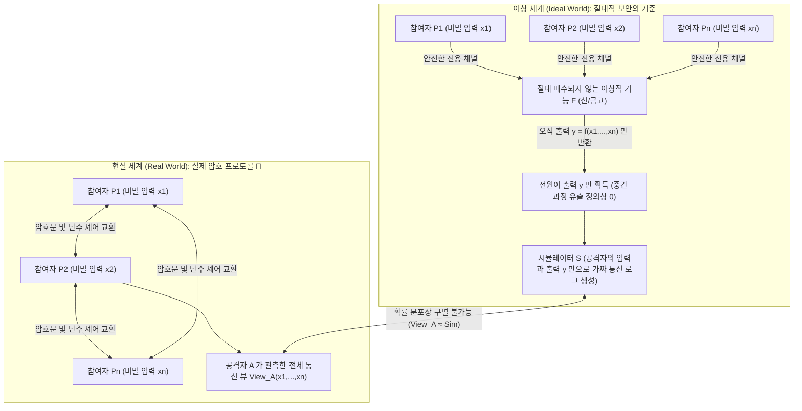
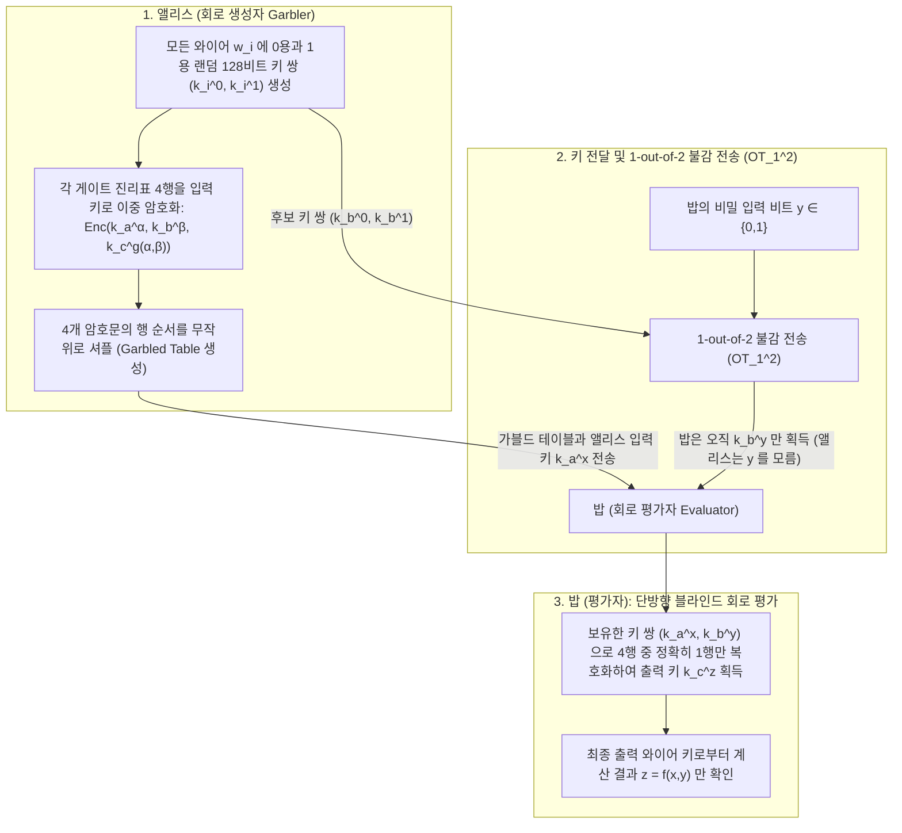

"여러 대학병원이 보유한 암 환자의 유전체(Genome) 데이터를 결합해 신약 통계 분석(GWAS)을 수행하고 싶지만, 개인정보 보호법상 어느 병원도 환자 데이터를 단 1비트조차 외부로 반출할 수 없다."
"경쟁 관계에 있는 시중 은행들이 자사의 고객 명단이나 내부 거래 그래프를 전혀 공개하지 않은 채, 은행 간 자금세탁 경로만 공동으로 추적하고 싶다."

상식적으로 생각하면 이는 모순된 요구처럼 보인다. 함수 $f(x_1, x_2, \dots, x_n)$을 계산하려면 누군가(신뢰할 수 있는 제3자, TTP)가 모든 입력 데이터 $x_i$를 한곳에 모아 평문으로 복호화한 뒤 연산을 수행해야만 할 것 같기 때문이다. 그러나 1980년대 후반 현대 암호학은 놀라운 수학적 정리에 도달했다. <strong>"신뢰할 수 있는 제3자가 전혀 존재하지 않아도, 참여자들이 각자의 비밀 입력 $x_i$를 단 1비트도 노출하지 않고 임의의 계산 가능한 함수 $f(x_1, \dots, x_n)$의 출력 결과만 정확히 얻을 수 있다."</strong>

이 기술을 <strong>다자간 보안 컴퓨팅(Secure Multi-Party Computation, MPC)</strong>이라 부른다. 본 글에서는 직관적인 두 가지 사고실험에서 출발하여, MPC를 지탱하는 양대 수학적 엔진인 <strong>샤미르(Shamir)의 임계값 비밀 분산과 라그랑주 보간법·비버의 곱셈 트리플</strong>(산술 회로 엔진), 그리고 <strong>불감 전송(Oblivious Transfer, OT)과 야오의 가블드 서킷(Garbled Circuits)</strong>(불리언 회로 엔진)의 원리를 수식과 파이썬 코드로 완벽히 해부한다.

---

## 1. 직관을 뒤집는 두 가지 사고실험: '상사 없는 평균 연봉 계산'과 '야오의 백만장자 문제'

### 1.1 사고실험 ①: 누구에게도 내 연봉을 알리지 않고 3명의 '평균 연봉'만 계산하는 법

카페에 모인 세 명의 엔지니어 $A, B, C$가 자신들의 <strong>평균 연봉 $\bar{x} = \frac{x_A + x_B + x_C}{3}$</strong>를 알고 싶지만, 자신의 개별 연봉 $x_A, x_B, x_C$는 다른 두 사람에게 절대 알리고 싶지 않다. 이들은 <strong>가법 비밀 분산(Additive Secret Sharing)과 일회용 패드(One-Time Pad)</strong> 원리만으로 이를 해결할 수 있다.

1. <strong>난수 마스크 생성과 첫 번째 귓속말 ($A \to B$)</strong>: 세 사람은 연봉 합계보다 훨씬 큰 법(Modulus) $M$(예: $M = 10^9$)을 정한다. 엔지니어 $A$는 유한환 $\mathbb{Z}_M$에서 자신만 아는 균일 난수 $r \xleftarrow{\$} \mathbb{Z}_M$을 뽑아 자신의 연봉에 더한 값 $s_1 = (x_A + r) \bmod M$만 $B$에게 귓속말로 전달한다. $r$이 완전한 균일 난수이므로 $s_1$ 역시 $\mathbb{Z}_M$ 위에서 균일 분포를 따르며, 섀넌의 완전 비밀성(Perfect Secrecy)에 의해 $B$는 $s_1$으로부터 $x_A$에 대한 정보를 단 1비트도 얻을 수 없다($I(X_A; S_1) = 0$).
2. <strong>누적 덧셈과 전달 ($B \to C \to A$)</strong>: $B$는 $s_1$에 자신의 연봉 $x_B$를 더해 $s_2 = (x_A + x_B + r) \bmod M$을 $C$에게 전달하고, $C$는 자신의 연봉 $x_C$를 더해 $s_3 = (x_A + x_B + x_C + r) \bmod M$을 처음의 $A$에게 돌려준다.
3. <strong>마스크 제거 및 평균 공개</strong>: $A$는 $s_3$에서 자신이 처음에 더했던 난수 $r$을 빼서 정확한 합계 $S = (s_3 - r) \bmod M = x_A + x_B + x_C$를 구한 뒤, 3으로 나눈 평균 연봉을 공개한다!

> [!NOTE]
> <strong>왜 2명이 아니라 최소 3명($n \ge 3$)이어야 할까?</strong>
> 만약 참여자가 앨리스와 밥 2명뿐이라면, 설령 신이 나타나 평균 $\bar{x} = \frac{x_A + x_B}{2}$만 알려주더라도 앨리스는 $x_B = 2\bar{x} - x_A$라는 뺄셈을 통해 밥의 연봉을 즉시 역산할 수 있다. 이는 프로토콜의 결함이 아니라 <strong>함수 출력 자체가 상대의 비밀을 결정해 버리는 수학적 성질</strong>이다. MPC가 보장하는 것은 "자신의 입력과 최종 출력으로부터 논리적으로 도출되는 정보 외에는 계산 과정에서 단 1비트의 추가 정보도 새어나가지 않는다"는 점이다.

### 1.2 사고실험 ②: 앤드류 야오(Andrew Yao)의 1982년 '백만장자 문제'

덧셈은 선형 연산이므로 난수 마스킹만으로 쉽게 해결되었다. 그렇다면 비선형 연산인 <strong>대소 비교(부등호)</strong>는 어떨까?
1982년 튜링상 수상자 <strong>앤드류 야오(Andrew Chi-Chih Yao)</strong>는 역사적인 논문 *"Protocols for Secure Computations"*에서 <strong>백만장자 문제(Millionaires' Problem)</strong>를 제기했다. 두 백만장자 앨리스(자산 $x$백만 달러)와 밥(자산 $y$백만 달러)이 제3자의 도움 없이 오직 비교 술어 $f(x, y) = [x > y] \in \{0, 1\}$(누가 더 부자인가)라는 1비트 진릿값만 계산하되, 각자의 실제 자산 액수나 두 사람의 자산 차이($x - y$)조차 전혀 노출하지 않는 문제다.

---

## 2. MPC 보안성의 수학적 정식화: 이상 세계와 현실 세계의 시뮬레이션 패러다임

Goldreich, Micali, Wigderson(GMW 1987)은 프로토콜의 안전성을 증명하기 위해 <strong>이상/현실 세계 시뮬레이션 패러다임(Ideal/Real Simulation Paradigm)</strong>을 확립했다.



결탁한 부정 참여자 집합 $I$의 입력 $\{x_i\}_{i \in I}$과 최종 출력 $\{y_i\}_{i \in I}$만 주어진 상태에서, 다항 시간 <strong>시뮬레이터(Simulator) $\mathcal{S}$</strong>가 정직한 참여자들의 실제 입력을 전혀 보지 않고도 현실 세계의 통신 로그 $\text{View}_I^\Pi(x_1, \dots, x_n)$와 확률 분포상 구별 불가능한 모조 로그를 만들어낼 수 있다면:
$$\left\{ \mathcal{S}\left(I, \{x_i\}_{i \in I}, \{y_i\}_{i \in I}\right) \right\} \stackrel{c}{\approx} \left\{ \text{View}_I^\Pi(x_1, \dots, x_n) \right\}$$
실제 통신 메시지를 수신하는 것은 자기 방에서 혼자 주사위를 굴리는 것과 정보량 측면에서 완전히 동치이므로, 출력 이상의 정보 유출이 0비트임이 수학적으로 증명된다. 공격자 모델은 규칙을 지키며 로그만 분석하는 <strong>반정직(Semi-Honest / Passive) 공격자</strong>와 거짓 값을 보내 프로토콜을 조작하는 <strong>악의적(Malicious / Active) 공격자</strong>로 구분된다.

---

## 3. 제1의 수학적 엔진: 샤미르의 $(t, n)$ 임계값 비밀 분산, 라그랑주 보간법 및 BGW / SPDZ 프로토콜

### 3.1 유한체 $\mathbb{F}_p$ 위의 다항식 분산과 라그랑주 복원
1979년 <strong>아디 샤미르(Adi Shamir)</strong>는 유한체 $\mathbb{F}_p$($p > n$은 큰 소수) 위에서 비밀 $s \in \mathbb{F}_p$를 상수항으로 갖는 $t-1$차 랜덤 다항식을 구성하는 <strong>$(t, n)$ 임계값 비밀 분산법</strong>을 발표했다:
$$P(x) = s + a_1 x + a_2 x^2 + \dots + a_{t-1} x^{t-1} \pmod p$$
각 참여자 $P_i$($i=1, \dots, n$)는 평가점 $(x_i = i,\, y_i = P(x_i))$를 자신의 셰어(조각)로 받는다. 임의의 $t$명 집합 $T$가 모이면 <strong>라그랑주 다항식 보간법(Lagrange Interpolation)</strong>을 통해 $x = 0$에서의 값 $s = P(0)$를 유일하게 복원할 수 있다:
$$s = P(0) = \sum_{i \in T} y_i \prod_{j \in T,\, j \ne i} \frac{-x_j}{x_i - x_j} \pmod p$$
반면 $t-1$개의 점만으로는 모든 후보 비밀 $s' \in \mathbb{F}_p$에 대해 그 점들을 지나는 $t-1$차 다항식이 정확히 하나씩 동일 확률 $1/p^{t-1}$로 존재하므로, 조건부 엔트로피 $H(S \mid \text{Shares}_{t-1}) = H(S)$가 성립하여 <strong>정보이론적 완전 보안</strong>을 달성한다.

### 3.2 BGW 프로토콜과 비버의 곱셈 트리플(Beaver's Multiplication Triples)
<strong>BGW 프로토콜(1988)</strong>에서 두 비밀의 <strong>덧셈($[a] + [b] = [a + b]$)은 통신 비용이 완전히 0</strong>이다(각자 로컬에서 $P(x_i) + Q(x_i) \bmod p$만 계산하면 된다). 반면 <strong>곱셈($[a] \cdot [b] = [a \cdot b]$)</strong>은 다항식 차수를 $2(t-1)$로 두 배 증가시키므로 $2t - 1 \le n$(즉 과반수가 정직한 <strong>Honest Majority</strong>) 조건과 1라운드의 차수 축소(Degree Reduction) 재분산 통신이 필요하다.

이를 극복하기 위해 <strong>도널드 비버(Donald Beaver, 1991)</strong>는 오프라인 단계에서 랜덤 곱셈 쌍 $([u], [v], [w = u \cdot v \bmod p])$를 미리 생성해 두는 <strong>비버의 곱셈 트리플</strong>(현대 <strong>SPDZ 프로토콜</strong>의 핵심)을 고안했다. 온라인 단계에서 $[x \cdot y]$를 계산할 때는 마스킹된 차이 $d = (x - u) \bmod p$와 $e = (y - v) \bmod p$만 복원하여 공개하고(일회용 난수 $u, v$ 덕분에 $x, y$는 전혀 노출되지 않음), 각자 로컬에서 선형 결합만 수행하여 즉시 곱셈 셰어를 얻는다:
$$[x \cdot y] = [w] + d \cdot [v] + e \cdot [u] + d \cdot e \pmod p$$

---

## 4. 제2의 수학적 엔진: 불감 전송($\text{OT}_1^2$)과 야오의 가블드 서킷(Garbled Circuits)

대소 비교($x > y$)나 비트 연산에는 불리언 논리 회로 엔진이 압도적으로 유리하다.



1. <strong>마이클 라빈(Michael Rabin)의 1-out-of-2 불감 전송($\text{OT}_1^2$)</strong>: 송신자 앨리스는 두 메시지 $(m_0, m_1)$를, 수신자 밥은 선택 비트 $b \in \{0, 1\}$를 가진다. 밥은 이산대수 문제에 기반해 자신이 비밀키 $k$를 아는 공개키 $PK_b = g^k$와 비밀키를 모르는 공개키 $PK_{1-b} = C / g^k$를 만들어 보냄으로써, 앨리스가 $b$를 전혀 알 수 없게 하면서도 자신은 오직 선택한 $m_b$만 복호화한다.
2. <strong>야오의 가블드 서킷과 3대 현대 최적화</strong>: 앨리스는 각 와이어에 `0`과 `1`을 나타내는 랜덤 AES 키 $(k_i^0, k_i^1)$를 부여하고 진리표 4행을 이중 암호화·셔플하여 밥에게 보낸다. 밥은 $\text{OT}_1^2$로 자신의 입력 키 $k_b^y$를 받아 회로 깊이에 무관하게 <strong>상수 라운드($O(1)$)</strong> 만에 회로를 평가한다. 여기에 <strong>Point-and-Permute</strong>(컬러 비트로 복호화 행 즉시 지정), <strong>Free-XOR</strong>($k_i^1 = k_i^0 \oplus \Delta$로 설정해 모든 `XOR` 게이트의 암호문과 연산량을 완전히 0으로 제거), <strong>Half-Gates</strong>(`AND` 게이트당 암호문을 4개에서 이론적 하한인 2개로 축소) 최적화가 더해져 초기 대비 1,000배 이상의 속도 향상을 이루었다.

---

## 5. 파이썬(Python) 완전 구현: 유한체 $\mathbb{F}_p$ 위의 샤미르 비밀 분산과 비버 곱셈 트리플

```python
import secrets
from typing import List, Tuple

PRIME = (1 << 61) - 1  # 61비트 메르센 소수 p = 2^61 - 1

def mod_inv(a: int, p: int = PRIME) -> int:
    return pow(a % p, -1, p)

def shamir_share(secret: int, t: int, n: int, p: int = PRIME) -> List[Tuple[int, int]]:
    coeffs = [secret % p] + [secrets.randbelow(p) for _ in range(t - 1)]
    shares = []
    for i in range(1, n + 1):
        y = 0
        for c in reversed(coeffs):
            y = (y * i + c) % p
        shares.append((i, y))
    return shares

def lagrange_reconstruct(shares: List[Tuple[int, int]], p: int = PRIME) -> int:
    secret = 0
    k = len(shares)
    for i in range(k):
        xi, yi = shares[i]
        num, den = 1, 1
        for j in range(k):
            if i != j:
                xj, _ = shares[j]
                num = (num * (-xj)) % p
                den = (den * (xi - xj)) % p
        secret = (secret + yi * num * mod_inv(den, p)) % p
    return secret

def mpc_add(sa, sb, p=PRIME):
    return [(xa, (ya + yb) % p) for (xa, ya), (_, yb) in zip(sa, sb)]

def mpc_sub(sa, sb, p=PRIME):
    return [(xa, (ya - yb) % p) for (xa, ya), (_, yb) in zip(sa, sb)]

def mpc_scalar_mul(c, sa, p=PRIME):
    return [(xa, (c * ya) % p) for xa, ya in sa]

def mpc_add_const(c, sa, p=PRIME):
    return [(xa, (ya + c) % p) for xa, ya in sa]

def generate_beaver_triple(t: int, n: int, p: int = PRIME):
    u, v = secrets.randbelow(p), secrets.randbelow(p)
    return shamir_share(u, t, n, p), shamir_share(v, t, n, p), shamir_share((u * v) % p, t, n, p)

def mpc_beaver_mul(sx, sy, triple, t: int, p: int = PRIME):
    su, sv, sw = triple
    d = lagrange_reconstruct(mpc_sub(sx, su, p)[:t], p)
    e = lagrange_reconstruct(mpc_sub(sy, sv, p)[:t], p)
    res = mpc_add(mpc_add(sw, mpc_scalar_mul(d, sv, p), p), mpc_scalar_mul(e, su, p), p)
    return mpc_add_const((d * e) % p, res, p)

if __name__ == "__main__":
    t, n = 3, 5
    salaries = [850, 920, 780]
    shared = [shamir_share(s, t, n) for s in salaries]
    total_shares = shared[0]
    for s in shared[1:]:
        total_shares = mpc_add(total_shares, s)
    print("복원된 총 연봉:", lagrange_reconstruct(total_shares[:t]))
```

---

## 6. 프라이버시 강화 기술(PETs) 4대 접근법 비교 및 실제 산업 응용

| 비교 항목 | 다자간 보안 컴퓨팅 (MPC) | 완전 동형암호 (FHE) | 영지식 증명 (ZKP) | 신뢰 실행 환경 (TEE) |
| :--- | :--- | :--- | :--- | :--- |
| <strong>핵심 해결 문제</strong> | <strong>다수 주체의 개별 비밀 입력 $x_1, \dots, x_n$</strong> 결합 연산 | <strong>단일 서버의 암호문 상태 연산</strong> $\text{Enc}(x) \mapsto \text{Enc}(f(x))$ | <strong>단일 증명자가 이미 아는 비밀 $w$</strong>의 정당성 증명 | <strong>CPU 하드웨어 격리 영역(Enclave) 내부</strong>에서 평문 연산 |
| <strong>연산 및 통신 병목</strong> | CPU 연산은 매우 가벼우나 <strong>네트워크 통신 라운드가 병목</strong> | 통신은 1회뿐이나 <strong>CPU 연산이 평문 대비 $10^3 \sim 10^5$배 무거움</strong> | 검증은 초고속이나 증명 생성에 대규모 연산 필요 | 네이티브 수준 속도이나 Enclave 메모리 제한 존재 |
| <strong>신뢰 모델과 한계</strong> | <strong>비결탁 가정</strong>(임계값 $t$ 미만의 서버가 담합하지 않는 한 안전) | <strong>격자 암호학적 난제(RLWE)</strong>에만 의존 | <strong>수학적 건전성</strong>(다수의 비밀 입력을 결합하는 기술은 아님) | <strong>하드웨어 제조사(Intel/AMD) 신뢰 및 부채널 공격 취약점</strong> |

오늘날 MPC는 <strong>2008년 덴마크 사탕무 생산 쿼터 경매</strong>(세계 최초 상용 MPC), <strong>보스턴시(BWWC) 기업 간 성별·인종별 임금 격차 조사</strong>, <strong>Google Chrome / Apple iCloud의 비밀번호 유출 확인(PSI)</strong>, <strong>다기관 유전체 연관 분석(Secure GWAS)</strong>, 그리고 수천억 달러의 디지털 자산을 지키는 <strong>MPC 임계값 서명 지갑(Fireblocks / Coinbase)</strong>에 이르기까지, 제도적 신뢰를 수학적 확실성으로 대체하고 있다.
