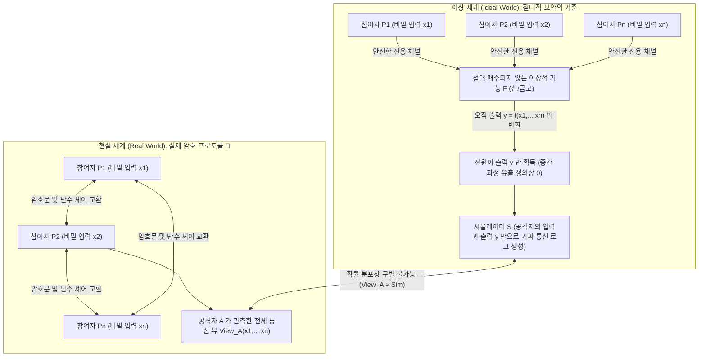
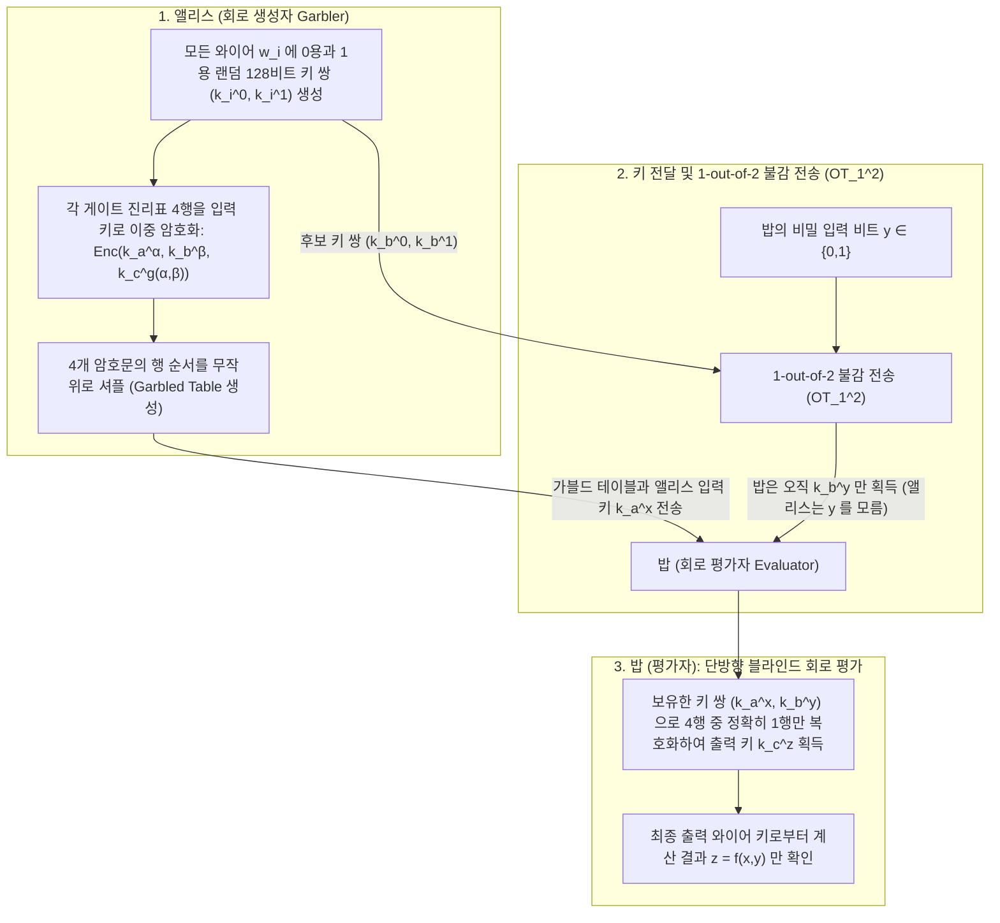

"여러 대학병원이 보유한 암 환자의 유전체(Genome) 데이터를 결합해 신약 통계 분석(GWAS)을 수행하고 싶지만, 개인정보 보호법상 어느 병원도 환자 데이터를 단 1비트조차 외부로 반출할 수 없다."
"경쟁 관계에 있는 시중 은행들이 자사의 고객 명단이나 내부 거래 그래프를 전혀 공개하지 않은 채, 은행 간 자금세탁 경로만 공동으로 추적하고 싶다."

상식적으로 생각하면 이는 모순된 요구처럼 보인다. 함수 $f(x_1, x_2, \dots, x_n)$을 계산하려면 누군가(신뢰할 수 있는 제3자, TTP)가 모든 입력 데이터 $x_i$를 한곳에 모아 평문으로 복호화한 뒤 연산을 수행해야만 할 것 같기 때문이다. 그러나 1980년대 후반 현대 암호학은 놀라운 수학적 정리에 도달했다. <strong>명시된 공격자 모델과 암호학적 가정 아래에서 참여자들은 함수를 공동 계산할 수 있다. 보안 정의는 허용된 입력과 출력만으로 추론할 수 있는 정보를 넘는 추가 공개를 제한한다.</strong>

이 기술을 <strong>다자간 보안 컴퓨팅(Secure Multi-Party Computation, MPC)</strong>이라 부른다. 본 글에서는 직관적인 두 가지 사고실험에서 출발하여, MPC를 지탱하는 양대 수학적 엔진인 <strong>샤미르(Shamir)의 임계값 비밀 분산과 라그랑주 보간법·비버의 곱셈 트리플</strong>(산술 회로 엔진), 그리고 <strong>불감 전송(Oblivious Transfer, OT)과 야오의 가블드 서킷(Garbled Circuits)</strong>(불리언 회로 엔진)의 원리를 수식과 파이썬 코드로 완벽히 해부한다.

---


**보안 주장의 해석:** 비밀이 “공개되지 않는다”는 설명은 명시된 공격자 모델, 보안 정의, 암호학적 가정에 한해 적용됩니다. 일반적으로 허용된 입력·출력에서 추론 가능한 정보 외의 추가 유출을 평가하며, 출력으로부터의 추론, 구현, 운영, 가용성, 사이드채널은 별도로 검토해야 합니다.

## 1. 직관을 뒤집는 두 가지 사고실험: '상사 없는 평균 연봉 계산'과 '야오의 백만장자 문제'

### 1.1 사고실험 ①: 누구에게도 내 연봉을 알리지 않고 3명의 '평균 연봉'만 계산하는 법

카페에 모인 세 명의 엔지니어 $A, B, C$가 자신들의 <strong>평균 연봉 $\bar{x} = \frac{x_A + x_B + x_C}{3}$</strong>를 알고 싶지만, 자신의 개별 연봉 $x_A, x_B, x_C$는 다른 두 사람에게 절대 알리고 싶지 않다. 이들은 <strong>가법 비밀 분산(Additive Secret Sharing)과 일회용 패드(One-Time Pad)</strong> 원리만으로 이를 해결할 수 있다.

1. <strong>난수 마스크 생성과 첫 번째 귓속말 ($A \to B$)</strong>: 세 사람은 연봉 합계보다 훨씬 큰 법(Modulus) $M$(예: $M = 10^9$)을 정한다. 엔지니어 $A$는 유한환 $\mathbb{Z}_M$에서 자신만 아는 균일 난수 $r \xleftarrow{\$} \mathbb{Z}_M$을 뽑아 자신의 연봉에 더한 값 $s_1 = (x_A + r) \bmod M$만 $B$에게 귓속말로 전달한다. $r$이 완전한 균일 난수이므로 $s_1$ 역시 $\mathbb{Z}_M$ 위에서 균일 분포를 따르며, 섀넌의 완전 비밀성(Perfect Secrecy)에 의해 $B$는 $s_1$으로부터 $x_A$에 대한 정보를 단 1비트도 얻을 수 없다($I(X_A; S_1) = 0$).
2. <strong>누적 덧셈과 전달 ($B \to C \to A$)</strong>: $B$는 $s_1$에 자신의 연봉 $x_B$를 더해 $s_2 = (x_A + x_B + r) \bmod M$을 $C$에게 전달하고, $C$는 자신의 연봉 $x_C$를 더해 $s_3 = (x_A + x_B + x_C + r) \bmod M$을 처음의 $A$에게 돌려준다.
3. <strong>마스크 제거 및 평균 공개</strong>: $A$는 $s_3$에서 자신이 처음에 더했던 난수 $r$을 빼서 정확한 합계 $S = (s_3 - r) \bmod M = x_A + x_B + x_C$를 구한 뒤, 3으로 나눈 평균 연봉을 공개한다!

> **이 귓속말 예시의 한계:** 교육용 설명일 뿐 안전성이 증명된 MPC 프로토콜이 아니다. 이웃 간 비공개 채널, 정직한 참여자, 공모가 없다는 가정을 둔다. 예를 들어 Bob과 Carol이 각자의 관찰값을 공유하면 공개된 합계와 결합해 Alice의 입력을 복원할 수 있다. 실제 배포에는 목표 위협 모델에 대해 안전성이 증명된 프로토콜을 사용해야 한다. 모듈러 래핑을 막으려면 $M$은 입력의 합보다 커야 한다.

> [!NOTE]
> <strong>왜 2명이 아니라 최소 3명($n \ge 3$)이어야 할까?</strong>
> 만약 참여자가 앨리스와 밥 2명뿐이라면, 설령 신이 나타나 평균 $\bar{x} = \frac{x_A + x_B}{2}$만 알려주더라도 앨리스는 $x_B = 2\bar{x} - x_A$라는 뺄셈을 통해 밥의 연봉을 즉시 역산할 수 있다. 이는 프로토콜의 결함이 아니라 <strong>함수 출력 자체가 상대의 비밀을 결정해 버리는 수학적 성질</strong>이다. MPC가 보장하는 것은 "자신의 입력과 최종 출력으로부터 논리적으로 도출되는 정보 외에는 계산 과정에서 단 1비트의 추가 정보도 새어나가지 않는다"는 점이다.

### 1.2 사고실험 ②: 앤드류 야오(Andrew Yao)의 1982년 '백만장자 문제'

덧셈은 선형 연산이므로 난수 마스킹만으로 쉽게 해결되었다. 그렇다면 비선형 연산인 <strong>대소 비교(부등호)</strong>는 어떨까?
1982년 튜링상 수상자 <strong>앤드류 야오(Andrew Chi-Chih Yao)</strong>는 역사적인 논문 *"Protocols for Secure Computations"*에서 <strong>백만장자 문제(Millionaires' Problem)</strong>를 제기했다. 두 백만장자 앨리스(자산 $x$백만 달러)와 밥(자산 $y$백만 달러)이 제3자의 도움 없이 오직 비교 술어 $f(x, y) = [x > y] \in \{0, 1\}$(누가 더 부자인가)라는 1비트 진릿값만 계산하되, 각자의 실제 자산 액수나 두 사람의 자산 차이($x - y$)조차 전혀 노출하지 않는 문제다.

---

## 2. MPC 보안성의 수학적 정식화: 이상 세계와 현실 세계의 시뮬레이션 패러다임

Goldreich, Micali, Wigderson(GMW 1987)은 프로토콜의 안전성을 증명하기 위해 <strong>이상/현실 세계 시뮬레이션 패러다임(Ideal/Real Simulation Paradigm)</strong>을 확립했다.



결탁한 부정 참여자 집합 $I$의 입력 $\{x_i\}_{i \in I}$과 최종 출력 $\{y_i\}_{i \in I}$만 주어진 상태에서, 다항 시간 <strong>시뮬레이터(Simulator) $\mathcal{S}$</strong>가 정직한 참여자들의 실제 입력을 전혀 보지 않고도 현실 세계의 통신 로그 $\text{View}_I^\Pi(x_1, \dots, x_n)$와 확률 분포상 구별 불가능한 모조 로그를 만들어낼 수 있다면:
$$\left\{ \mathcal{S}\left(I, \{x_i\}_{i \in I}, \{y_i\}_{i \in I}\right) \right\} \stackrel{c}{\approx} \left\{ \text{View}_I^\Pi(x_1, \dots, x_n) \right\}$$
실제 통신 메시지를 수신하는 것은 자기 방에서 혼자 주사위를 굴리는 것과 정보량 측면에서 완전히 동치이므로, 출력 이상의 정보 유출이 0비트임이 수학적으로 증명된다. 공격자 모델은 규칙을 지키며 로그만 분석하는 <strong>반정직(Semi-Honest / Passive) 공격자</strong>와 거짓 값을 보내 프로토콜을 조작하는 <strong>악의적(Malicious / Active) 공격자</strong>로 구분된다.

---

## 3. 제1의 수학적 엔진: 샤미르의 $(t, n)$ 임계값 비밀 분산, 라그랑주 보간법 및 BGW / SPDZ 프로토콜

### 3.1 유한체 $\mathbb{F}_p$ 위의 다항식 분산과 라그랑주 복원
1979년 <strong>아디 샤미르(Adi Shamir)</strong>는 유한체 $\mathbb{F}_p$($p > n$은 큰 소수) 위에서 비밀 $s \in \mathbb{F}_p$를 상수항으로 갖는 $t-1$차 랜덤 다항식을 구성하는 <strong>$(t, n)$ 임계값 비밀 분산법</strong>을 발표했다:
$$P(x) = s + a_1 x + a_2 x^2 + \dots + a_{t-1} x^{t-1} \pmod p$$
각 참여자 $P_i$($i=1, \dots, n$)는 평가점 $(x_i = i,\, y_i = P(x_i))$를 자신의 셰어(조각)로 받는다. 임의의 $t$명 집합 $T$가 모이면 <strong>라그랑주 다항식 보간법(Lagrange Interpolation)</strong>을 통해 $x = 0$에서의 값 $s = P(0)$를 유일하게 복원할 수 있다:
$$s = P(0) = \sum_{i \in T} y_i \prod_{j \in T,\, j \ne i} \frac{-x_j}{x_i - x_j} \pmod p$$
반면 $t-1$개의 점만으로는 모든 후보 비밀 $s' \in \mathbb{F}_p$에 대해 그 점들을 지나는 $t-1$차 다항식이 정확히 하나씩 동일 확률 $1/p^{t-1}$로 존재하므로, 조건부 엔트로피 $H(S \mid \text{Shares}_{t-1}) = H(S)$가 성립하여 <strong>정보이론적 완전 보안</strong>을 달성한다.

### 3.2 BGW 프로토콜과 비버의 곱셈 트리플(Beaver's Multiplication Triples)
<strong>BGW 프로토콜(1988)</strong>에서 두 비밀의 <strong>덧셈($[a] + [b] = [a + b]$)은 통신 비용이 완전히 0</strong>이다(각자 로컬에서 $P(x_i) + Q(x_i) \bmod p$만 계산하면 된다). 반면 <strong>곱셈($[a] \cdot [b] = [a \cdot b]$)</strong>은 다항식 차수를 $2(t-1)$로 두 배 증가시키므로 $2t - 1 \le n$(즉 과반수가 정직한 <strong>Honest Majority</strong>) 조건과 1라운드의 차수 축소(Degree Reduction) 재분산 통신이 필요하다.

이를 극복하기 위해 <strong>도널드 비버(Donald Beaver, 1991)</strong>는 오프라인 단계에서 랜덤 곱셈 쌍 $([u], [v], [w = u \cdot v \bmod p])$를 미리 생성해 두는 <strong>비버의 곱셈 트리플</strong>(현대 <strong>SPDZ 프로토콜</strong>의 핵심)을 고안했다. 온라인 단계에서 $[x \cdot y]$를 계산할 때는 마스킹된 차이 $d = (x - u) \bmod p$와 $e = (y - v) \bmod p$만 복원하여 공개하고(일회용 난수 $u, v$ 덕분에 $x, y$는 전혀 노출되지 않음), 각자 로컬에서 선형 결합만 수행하여 즉시 곱셈 셰어를 얻는다:
$$[x \cdot y] = [w] + d \cdot [v] + e \cdot [u] + d \cdot e \pmod p$$

---

**허용 가능한 부패 수는 공격자 모델에 따라 달라진다:** 고전 BGW는 수동적(정직하지만 호기심 많은) 모델에서 $c < n/2$를 허용한다. 악의적 참여자에 대한 정보이론적 보안은 일반적으로 적절한 통신 가정 아래 $c < n/3$을 요구한다. Beaver 트리플만으로 허용 임계값이 정해지거나 능동적 보안이 보장되지는 않는다.

## 4. 제2의 엔진: 불감 전송(OT)과 야오의 가블드 서킷

대소 비교($x > y$)나 비트 연산에는 불리언 논리 회로 엔진이 압도적으로 유리하다.



1. <strong>1-out-of-2 불감 전송($\text{OT}_1^2$)</strong>: 송신자 앨리스는 두 메시지 $(m_0, m_1)$를, 수신자 밥은 선택 비트 $b \in \{0, 1\}$를 가진다. 밥은 이산대수 문제에 기반해 자신이 비밀키 $k$를 아는 공개키 $PK_b = g^k$와 비밀키를 모르는 공개키 $PK_{1-b} = C / g^k$를 만들어 보냄으로써, 앨리스가 $b$를 전혀 알 수 없게 하면서도 자신은 오직 선택한 $m_b$만 복호화한다.
2. <strong>야오의 가블드 서킷과 3대 현대 최적화</strong>: 앨리스는 각 와이어에 `0`과 `1`을 나타내는 랜덤 AES 키 $(k_i^0, k_i^1)$를 부여하고 진리표 4행을 이중 암호화·셔플하여 밥에게 보낸다. 밥은 $\text{OT}_1^2$로 자신의 입력 키 $k_b^y$를 받아 입력 키를 받은 뒤 게이트 평가를 로컬로 진행하지만, 전체 통신 라운드 수는 OT 구현과 프로토콜 구성에 따라 달라진다. <strong>Point-and-Permute</strong>는 복호화할 행을 지정하고, <strong>Free-XOR</strong>는 XOR 게이트의 garbling을 생략하며, <strong>Half-Gates</strong>는 AND 게이트 통신량을 줄인다. 실제 효율 개선은 회로·구현·하드웨어·네트워크에 따라 달라져 일률적인 배수로 표현할 수 없다.

---

## 5. 파이썬(Python) 완전 구현: 유한체 $\mathbb{F}_p$ 위의 샤미르 비밀 분산과 비버 곱셈 트리플

이 예제는 새 Beaver 트리플로 각 연봉의 제곱도 계산한 다음 합계와 제곱합을 공개해 평균과 모집단 분산을 구합니다. 이 출력은 복원하는 당사자에게 공개됩니다. 전체 코드는 단일 프로세스에서 실행되는 교육용 시뮬레이션입니다.

```python
import secrets
from typing import List, Tuple

# 61-bit Mersenne prime p = 2^61 - 1 for our prime finite field F_p
PRIME = (1 << 61) - 1

def mod_inv(a: int, p: int = PRIME) -> int:
    # Modular inverse in F_p via Extended Euclidean Algorithm (Python 3.8+ pow(a, -1, p))
    return pow(a % p, -1, p)

def shamir_share(secret: int, t: int, n: int, p: int = PRIME) -> List[Tuple[int, int]]:
    # Shamir's (t, n) Threshold Secret Sharing:
    # Samples a random degree-(t-1) polynomial P(x) with P(0) = secret and evaluates it at x = 1..n.
    assert 1 <= t <= n < p, "Threshold t and party count n must satisfy 1 <= t <= n < p"
    # P(x) = s + a_1 * x + a_2 * x^2 + ... + a_{t-1} * x^{t-1} (mod p)
    coeffs = [secret % p] + [secrets.randbelow(p) for _ in range(t - 1)]

    shares = []
    for i in range(1, n + 1):
        # Evaluate P(i) using Horner's method
        y = 0
        for c in reversed(coeffs):
            y = (y * i + c) % p
        shares.append((i, y))
    return shares

def lagrange_reconstruct(shares: List[Tuple[int, int]], p: int = PRIME) -> int:
    # Reconstructs P(0) = s from any subset of >= t shares using Lagrange Polynomial Interpolation:
    # s = sum_{i in T} y_i * prod_{j in T, j != i} (-x_j) / (x_i - x_j) (mod p)
    secret = 0
    k = len(shares)
    for i in range(k):
        xi, yi = shares[i]
        num = 1
        den = 1
        for j in range(k):
            if i == j:
                continue
            xj, _ = shares[j]
            num = (num * (-xj)) % p
            den = (den * (xi - xj)) % p
        lambda_i = (num * mod_inv(den, p)) % p
        secret = (secret + yi * lambda_i) % p
    return secret

def mpc_add(shares_a: List[Tuple[int, int]], shares_b: List[Tuple[int, int]], p: int = PRIME) -> List[Tuple[int, int]]:
    # Local homomorphic addition [a] + [b] = [a + b] (Zero communication)
    return [(xa, (ya + yb) % p) for (xa, ya), (xb, yb) in zip(shares_a, shares_b)]

def mpc_sub(shares_a: List[Tuple[int, int]], shares_b: List[Tuple[int, int]], p: int = PRIME) -> List[Tuple[int, int]]:
    # Local homomorphic subtraction [a] - [b] = [a - b] (Zero communication)
    return [(xa, (ya - yb) % p) for (xa, ya), (xb, yb) in zip(shares_a, shares_b)]

def mpc_scalar_mul(scalar: int, shares_a: List[Tuple[int, int]], p: int = PRIME) -> List[Tuple[int, int]]:
    # Local multiplication by a public scalar c * [a] = [c * a] (Zero communication)
    return [(xa, (scalar * ya) % p) for xa, ya in shares_a]

def mpc_add_constant(const: int, shares_a: List[Tuple[int, int]], p: int = PRIME) -> List[Tuple[int, int]]:
    # Adding a public constant [a] + c = [a + c] shifts P(x) by +c at every evaluation point
    return [(xa, (ya + const) % p) for xa, ya in shares_a]

def generate_beaver_triple(t: int, n: int, p: int = PRIME):
    # Offline Preprocessing Phase: Generates a shared random multiplication triple ([u], [v], [w = u * v])
    u = secrets.randbelow(p)
    v = secrets.randbelow(p)
    w = (u * v) % p
    return shamir_share(u, t, n, p), shamir_share(v, t, n, p), shamir_share(w, t, n, p)

def mpc_beaver_mul(
    shares_x: List[Tuple[int, int]],
    shares_y: List[Tuple[int, int]],
    triple: Tuple[List[Tuple[int, int]], List[Tuple[int, int]], List[Tuple[int, int]]],
    t: int,
    p: int = PRIME
) -> List[Tuple[int, int]]:
    # Online Phase: Evaluates [x * y] using a Beaver Multiplication Triple ([u], [v], [w]):
    # 1. Locally compute [d] = [x] - [u] and [e] = [y] - [v]
    # 2. Open masked differences; security depends on fresh, valid, single-use triples and the threat model
    # 3. Locally compute the linear combination [x * y] = [w] + d * [v] + e * [u] + d * e
    shares_u, shares_v, shares_w = triple
    shares_d = mpc_sub(shares_x, shares_u, p)
    shares_e = mpc_sub(shares_y, shares_v, p)

    # Open the masked differences d = x - u and e = y - v using t shares
    d = lagrange_reconstruct(shares_d[:t], p)
    e = lagrange_reconstruct(shares_e[:t], p)

    # Linear combination to obtain degree-(t-1) shares of [x * y]
    term1 = shares_w
    term2 = mpc_scalar_mul(d, shares_v, p)
    term3 = mpc_scalar_mul(e, shares_u, p)
    res = mpc_add(mpc_add(term1, term2, p), term3, p)
    res = mpc_add_constant((d * e) % p, res, p)
    return res

if __name__ == "__main__":
    # 5 MPC servers (n = 5) with reconstruction threshold t = 3 (any 2 servers learn 0 bits)
    t, n = 3, 5
    salaries = [850, 920, 780]  # Example salary units

    # Each engineer splits their secret salary across the 5 servers
    shared_salaries = [shamir_share(s, t, n) for s in salaries]

    # 1. Compute the sum of salaries locally with zero inter-server communication
    sum_shares = shared_salaries[0]
    for s_share in shared_salaries[1:]:
        sum_shares = mpc_add(sum_shares, s_share)

    # Reconstruct the total from any 3 servers (e.g., servers 1, 3, and 5)
    subset_3 = [sum_shares[0], sum_shares[2], sum_shares[4]]
    total_salary = lagrange_reconstruct(subset_3)
    mean_salary = total_salary / len(salaries)
    print(f"Reconstructed total (units): {total_salary:,} (mean: {mean_salary:,.2f})")

    # 2. Compute the sum of squares S_2 = x_A^2 + x_B^2 + x_C^2 using Beaver Multiplication Triples
    sq_sum_shares = shamir_share(0, t, n)
    for s_share in shared_salaries:
        triple = generate_beaver_triple(t, n)
        sq_share = mpc_beaver_mul(s_share, s_share, triple, t)
        sq_sum_shares = mpc_add(sq_sum_shares, sq_share)

    total_sq = lagrange_reconstruct(sq_sum_shares[:t])
    variance = (total_sq / len(salaries)) - (mean_salary ** 2)
    print(f"Reconstructed sum of squares: {total_sq:,} (population variance: {variance:,.2f})")
```

---

## 6. 프라이버시 강화 기술(PETs) 4대 접근법 비교 및 실제 산업 응용

| 비교 항목 | 다자간 보안 컴퓨팅 (MPC) | 완전 동형암호 (FHE) | 영지식 증명 (ZKP) | 신뢰 실행 환경 (TEE) |
| :--- | :--- | :--- | :--- | :--- |
| <strong>핵심 해결 문제</strong> | <strong>다수 주체의 개별 비밀 입력 $x_1, \dots, x_n$</strong> 결합 연산 | <strong>단일 서버의 암호문 상태 연산</strong> $\text{Enc}(x) \mapsto \text{Enc}(f(x))$ | <strong>단일 증명자가 이미 아는 비밀 $w$</strong>의 정당성 증명 | <strong>CPU 하드웨어 격리 영역(Enclave) 내부</strong>에서 평문 연산 |
| <strong>연산 및 통신 병목</strong> | 통신 비용은 프로토콜, 회로 깊이, 네트워크에 따라 달라진다 | 계산·통신 비용은 방식, 회로, 하드웨어에 따라 달라지며 보편적인 고정 배수는 없다 | 증명·검증 비용은 증명 시스템과 명제에 따라 달라진다 | 성능과 보호 메모리는 플랫폼과 작업 부하에 따라 달라진다 |
| <strong>신뢰 모델과 한계</strong> | MPC 보안은 프로토콜별 임계값과 공격자 모델에 따라 달라진다. 출력 누출, 가용성, 공정성은 별도로 평가해야 한다. | <strong>격자 암호학적 난제(RLWE)</strong>에만 의존 | <strong>수학적 건전성</strong>(다수의 비밀 입력을 결합하는 기술은 아님) | <strong>하드웨어 제조사(Intel/AMD) 신뢰 및 부채널 공격 취약점</strong> |

연구되거나 실제 적용된 사례로는 덴마크 사탕무 경매, 보스턴 임금 격차 측정, 유출 비밀번호 검사, 유전체 연구, 분산 서명이 있습니다. 실제 배포 수준과 보안 모델, 잔여 위험은 사례마다 다르며, MPC가 제도적 신뢰를 절대적 확실성으로 바꾸는 것은 아닙니다.

## 7. 다른 PET와 한계

역사적 참고: 수신자가 1/2 확률로 메시지를 받는 Rabin의 1981년 OT는 Even, Goldreich, Lempel이 1985년에 정식화한 1-out-of-2 OT 기능과 다릅니다.
MPC는 입력을 분산하며 보장은 프로토콜과 공격자 모델에 달려 있습니다. FHE는 암호문에서 계산하게 하지만 계산을 자동 검증하거나 결과에서 정보가 새는 것을 막지는 않습니다. 영지식 증명은 증인을 공개하지 않고 명제를 증명하지만 공동 계산을 대신하지 않습니다. TEE는 보호 하드웨어에서 평문을 처리하므로 하드웨어와 증명을 신뢰해야 합니다. 기법을 결합할 수 있으며 비용과 보장은 용도에 따라 달라집니다.

## 8. 사례
2008년 덴마크 사탕무 경매는 3자 MPC를 사용했습니다. 논문은 약 1,200건의 입력, 약 30분 계산, 25,000톤 생산권 이전을 보고합니다. BWWC와 Boston University는 격년으로 임금 격차를 발표하며, BWWC의 2023년 자료에는 고용주 103곳과 정규직 165,000명이 나옵니다. Google Chrome과 Apple은 서로 다른 PSI 기반 비밀번호 확인을 문서화합니다. 2023년 USENIX 연구는 조사한 Chrome 구현의 부채널을 보고했습니다. MPC 기반 GWAS는 연구에서 시연됐지만 결과가 정보를 드러낼 수 있습니다. Secure Aggregation은 개별 업데이트를 숨겨도 모든 추론 위험을 없애지는 않습니다. 임계 서명과 share 갱신은 프로토콜 및 운영 조건에 달려 있습니다.

## 9. 결론
MPC는 평문 데이터의 중앙 집중을 줄일 수 있지만 결과에 의한 정보 노출과 운영·법률·가용성 위험을 제거하지 않습니다. 보장은 공격자 모델, 암호학적 가정, 구현과 운영에 달려 있습니다.

**코드 예제의 범위:** 이 Python 코드는 유한체에서 비밀 분산과 연산을 단일 프로세스로 흉내 내는 교육용 예제입니다. 각 당사자가 자기 몫만 보유하는 네트워크 MPC 시스템이 아닙니다. 악의적인 참여자 검증, 인증과 안전한 전송, 신뢰할 수 있는 사전 처리, 입력 범위 및 오버플로 제어를 구현하지 않았습니다. `lagrange_reconstruct`로 복원한 값은 복원하는 당사자에게 공개됩니다. 실제 데이터나 자산을 보호하는 데 사용하지 마세요.


## Sources

- [Rabin, “How to Exchange Secrets with Oblivious Transfer” (1981)](https://eprint.iacr.org/2005/187.pdf)
- [Even, Goldreich, and Lempel, “A Randomized Protocol for Signing Contracts” (1985)](https://luca-giuzzi.unibs.it/corsi/Support/papers-cryptography/SigningContracts.pdf)

- [Bogetoft et al., “Secure Multiparty Computation Goes Live” (2009)](https://www.acsu.buffalo.edu/~mblanton/cse715/sugar-beet-auction.pdf)
- [Boston Women’s Workforce Council: Wage Gap Studies](https://thebwwc.org/wage-gap-studies)
- [Google: Better password protections in Chrome](https://security.googleblog.com/2019/12/better-password-protections-in-chrome.html)
- [Apple Platform Security: Password Monitoring](https://support.apple.com/guide/security/password-monitoring-sec78e79fc3b/web)
- [Kwong et al., USENIX Security 2023: Chrome password-check side channels](https://www.usenix.org/conference/usenixsecurity23/presentation/kwong)
- [Cho et al., “Secure genome-wide association analysis using multiparty computation” (2018)](https://pmc.ncbi.nlm.nih.gov/articles/PMC5990440/)
- [Bonawitz et al., Google Research: Practical Secure Aggregation](https://research.google/pubs/practical-secure-aggregation-for-federated-learning-on-user-held-data/)
- [Canetti et al., “UC Non-Interactive, Proactive, Threshold ECDSA” (2020)](https://eprint.iacr.org/2020/492)
- [Kumar et al., “Understanding Information Disclosure from Secure Computation Output” (2025)](https://doi.org/10.1145/3705004)
- [Kolesnikov and Schneider, “Improved Garbled Circuit: Free XOR Gates and Applications” (2008)](https://encrypto.de/papers/KS08XOR.pdf)
- [Zahur, Rosulek, and Evans, “Two Halves Make a Whole: Reducing Data Transfer in Garbled Circuits using Half Gates” (2015)](https://www.cs.virginia.edu/~evans/pubs/ec2015/halfgates.pdf)

- [Stanford University cryptography notes: Oblivious Transfer](https://crypto.stanford.edu/pbc/notes/crypto/ot.html)

- [A Full Proof of the BGW Protocol for Perfectly Secure MPC](https://doi.org/10.1007/S00145-015-9214-4)

- [Yao, “Protocols for Secure Computations” (FOCS 1982)](https://doi.org/10.1109/SFCS.1982.38)
