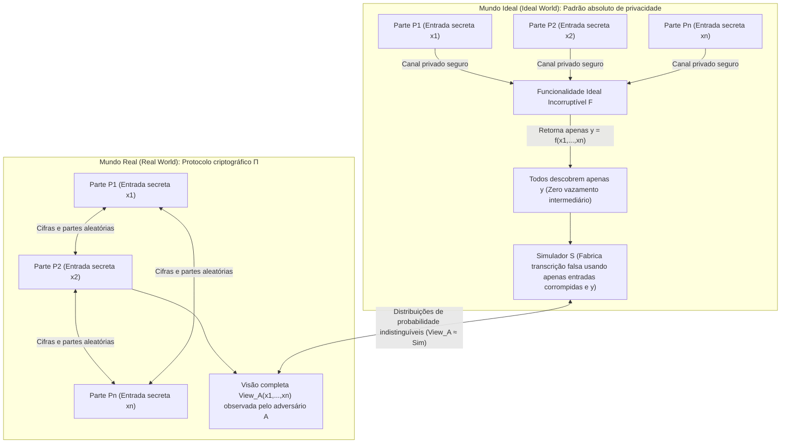
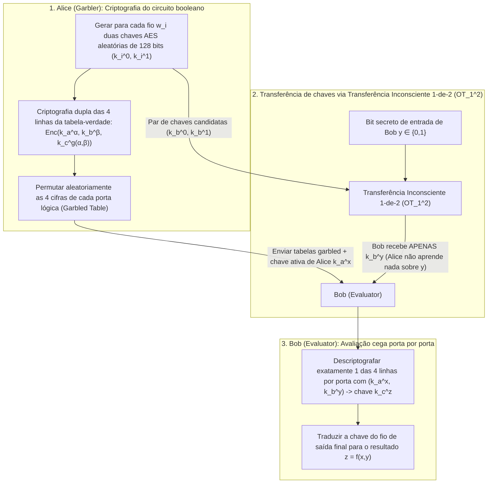

«Vários hospitais oncológicos desejam combinar sequências genômicas de seus pacientes para realizar um estudo estatístico de associação (GWAS), mas leis de privacidade (LGPD / GDPR / HIPAA) proíbem estritamente que um único byte de dado bruto saia de cada hospital.»
«Bancos comerciais concorrentes querem rastrear conjuntamente redes de lavagem de dinheiro interbancária sem jamais revelar suas listas de clientes ou grafos de transações internas.»

À primeira vista, isso parece logicamente impossível: para avaliar uma função $f(x_1, x_2, \dots, x_n)$, não seria indispensável que uma <strong>terceira parte confiável (Trusted Third Party, TTP)</strong> reunisse primeiro todas as entradas $x_i$ em texto simples? Contudo, no final da década de 1980, a criptografia moderna provou um teorema extraordinário: <strong>mesmo sem nenhuma terceira parte confiável, múltiplos participantes que desconfiam uns dos outros podem avaliar conjuntamente qualquer função computável $f(x_1, \dots, x_n)$ de modo que todos descubram o resultado exato sem que ninguém aprenda um único bit adicional sobre a entrada secreta $x_i$ dos demais.</strong>

Essa disciplina é chamada de <strong>Computação Multipartidária Segura (Secure Multi-Party Computation, MPC)</strong>. Neste artigo, partimos de dois experimentos mentais clássicos para deduzir os dois motores matemáticos fundamentais da MPC: o <strong>compartilhamento de segredos por limiar $(t, n)$ de Adi Shamir (interpolação de Lagrange, protocolo BGW e triplas de Beaver)</strong> e a abordagem de circuitos booleanos via <strong>transferência inconsciente ($\text{OT}_1^2$) de Rabin e circuitos embaralhados (Garbled Circuits) de Yao</strong>.

---

## 1. Dois experimentos mentais paradoxais: «A média salarial sem chefe» e «O Problema dos Milionários de Yao»

### 1.1 Experimento mental 1: Calcular a média salarial sem revelar nenhum salário individual

Três engenheiros $A, B$ e $C$ querem descobrir sua <strong>média salarial anual $\bar{x} = \frac{x_A + x_B + x_C}{3}$</strong> sem que nenhum deles descubra o salário individual $x_A, x_B$ ou $x_C$ dos outros dois. Usando <strong>compartilhamento aditivo de segredos (mascaramento One-Time Pad)</strong>, eles conseguem isso apenas com papel e caneta:

1. <strong>Máscara aleatória e primeiro sussurro ($A \to B$)</strong>: Os três escolhem um módulo público grande $M$ (por exemplo, $M = 10^9$). O engenheiro $A$ sorteia secretamente um número aleatório uniforme $r \xleftarrow{\$} \mathbb{Z}_M$, soma seu salário $x_A$ e sussurra apenas $s_1 = (x_A + r) \bmod M$ para $B$. Como $r$ é uniforme em $\mathbb{Z}_M$, $s_1$ também é perfeitamente uniforme independentemente do valor de $x_A$: pelo teorema de Shannon sobre o One-Time Pad, a informação mútua é $I(X_A; S_1) = 0$. $B$ aprende literalmente <strong>zero bits</strong> sobre $x_A$.
2. <strong>Somas sucessivas ($B \to C \to A$)</strong>: $B$ soma seu próprio salário $x_B$ e sussurra $s_2 = (x_A + x_B + r) \bmod M$ para $C$; $C$ soma $x_C$ e devolve $s_3 = (x_A + x_B + x_C + r) \bmod M$ para $A$.
3. <strong>Remoção da máscara</strong>: $A$ subtrai seu número aleatório $r$ módulo $M$, obtém a soma exata $S = x_A + x_B + x_C$ e anuncia a média $\bar{x} = S / 3$.

> [!NOTE]
> <strong>Por que são necessários pelo menos 3 participantes ($n \ge 3$)?</strong>
> Se houvesse apenas duas pessoas ($A$ e $B$), mesmo que um anjo incorruptível revelasse apenas a média $\bar{x} = \frac{x_A + x_B}{2}$, $A$ calcularia imediatamente $x_B = 2\bar{x} - x_A$. Isso não é uma falha do protocolo, mas uma propriedade matemática da própria função. <strong>A MPC garante que nenhum bit extra vaze além do que é logicamente dedutível da própria entrada e da saída final.</strong>

### 1.2 Experimento mental 2: O «Problema dos Milionários» de Andrew Yao (1982)

A adição é linear, mas e quanto a uma <strong>comparação não linear</strong>?
Em 1982, o cientista da computação <strong>Andrew Chi-Chih Yao</strong> (futuro vencedor do Prêmio Turing) publicou *"Protocols for Secure Computations"*, propondo o famoso <strong>Problema dos Milionários</strong>: dois milionários, Alice ($x$ milhões de dólares) e Bob ($y$ milhões de dólares), desejam calcular apenas o bit booleano $f(x, y) = [x > y] \in \{0, 1\}$ (quem é mais rico?) sem revelar o valor de $x$ ou $y$, nem mesmo a diferença $x - y$.

---

## 2. Formalização matemática da segurança: O paradigma de simulação Ideal/Real

Para provar rigorosamente a ausência de vazamento de informações, Goldreich, Micali e Wigderson (GMW 1987) estabeleceram o <strong>paradigma de simulação Mundo Ideal / Mundo Real</strong>:



Um protocolo real $\Pi$ é seguro se existir um algoritmo eficiente chamado <strong>Simulador $\mathcal{S}$</strong> capaz de gerar, <em>usando apenas as entradas $\{x_i\}_{i \in I}$ e saídas $\{y_i\}_{i \in I}$ das partes corrompidas</em>, uma transcrição sintética indistinguível da visão real $\text{View}_I^\Pi(x_1, \dots, x_n)$:
$$\left\{ \mathcal{S}\left(I, \{x_i\}_{i \in I}, \{y_i\}_{i \in I}\right) \right\} \stackrel{c}{\approx} \left\{ \text{View}_I^\Pi(x_1, \dots, x_n) \right\}$$
Distingue-se entre adversários <strong>semi-honestos (Semi-Honest / Passive)</strong>, que seguem o protocolo mas analisam os registros, e adversários <strong>maliciosos (Malicious / Active)</strong>, que adulteram mensagens ativamente.

---

## 3. Motor 1: Compartilhamento de segredos por limiar $(t, n)$ de Shamir, interpolação de Lagrange e BGW / SPDZ

### 3.1 Polinômios sobre $\mathbb{F}_p$ e reconstrução de Lagrange
Em 1979, <strong>Adi Shamir</strong> propôs ocultar o segredo $s \in \mathbb{F}_p$ ($p > n$ primo) como o termo constante de um polinômio aleatório de grau $t - 1$ sobre o corpo finito $\mathbb{F}_p$:
$$P(x) = s + a_1 x + a_2 x^2 + \dots + a_{t-1} x^{t-1} \pmod p$$
Cada parte $P_i$ recebe o ponto $(x_i = i,\, y_i = P(x_i))$. Qualquer subconjunto $T$ de pelo menos $t$ partes reconstrói exatamente $s = P(0)$ usando a <strong>fórmula de interpolação polinomial de Lagrange</strong>:
$$s = P(0) = \sum_{i \in T} y_i \prod_{j \in T,\, j \ne i} \frac{-x_j}{x_i - x_j} \pmod p$$
Com $t - 1$ partes ou menos, todo segredo candidato $s' \in \mathbb{F}_p$ é exatamente equiprovável ($H(S \mid \text{Shares}_{t-1}) = H(S)$, segurança incondicional em teoria da informação).

### 3.2 Protocolo BGW e triplas de multiplicação de Beaver
No <strong>protocolo BGW (1988)</strong>, a <strong>adição $[a] + [b] = [a + b]$ é local e sem comunicação</strong>. Já a <strong>multiplicação $[a] \cdot [b]$</strong> dobra o grau do polinômio produto $P(x)Q(x)$ para $2(t-1)$, exigindo $2t - 1 \le n$ (uma <strong>maioria honesta</strong>) e uma rodada de redução de grau.
<strong>Donald Beaver (1991)</strong> resolveu esse gargalo por meio das <strong>triplas de multiplicação $([u], [v], [w = u \cdot v \bmod p])$</strong> geradas em uma fase offline (base do protocolo <strong>SPDZ</strong>). Na fase online, para multiplicar $[x]$ e $[y]$, as partes abrem apenas as diferenças mascaradas $d = (x - u) \bmod p$ e $e = (y - v) \bmod p$, e calculam localmente a combinação linear:
$$[x \cdot y] = [w] + d \cdot [v] + e \cdot [u] + d \cdot e \pmod p$$

---

## 4. Motor 2: Transferência inconsciente ($\text{OT}_1^2$) de Rabin e circuitos garbled de Yao

Para comparações binárias ($x > y$), a abordagem de circuitos booleanos opera em um número constante $O(1)$ de rodadas:



Mediante a <strong>transferência inconsciente 1-de-2 ($\text{OT}_1^2$) de Michael Rabin</strong>, Bob obtém apenas a chave $k_b^y$ correspondente ao seu bit secreto $y$ sem que Alice descubra $y$. As três otimizações modernas — <strong>Point-and-Permute</strong> (bits de cor apontando diretamente a linha a descriptografar), <strong>Free-XOR</strong> ($k_i^1 = k_i^0 \oplus \Delta$, tornando todas as portas `XOR` livres de cifras e de operações AES) e <strong>Half-Gates</strong> (reduzindo cada porta `AND` a apenas 2 cifras) — aceleraram os circuitos garbled em mais de $1000$ vezes.

---

## 5. Implementação completa em Python: Shamir Secret Sharing e triplas de Beaver sobre $\mathbb{F}_p$

```python
import secrets
from typing import List, Tuple

PRIME = (1 << 61) - 1  # Primo de Mersenne de 61 bits p = 2^61 - 1

def mod_inv(a: int, p: int = PRIME) -> int:
    return pow(a % p, -1, p)

def shamir_share(secret: int, t: int, n: int, p: int = PRIME) -> List[Tuple[int, int]]:
    coeffs = [secret % p] + [secrets.randbelow(p) for _ in range(t - 1)]
    shares = []
    for i in range(1, n + 1):
        y = 0
        for c in reversed(coeffs):
            y = (y * i + c) % p
        shares.append((i, y))
    return shares

def lagrange_reconstruct(shares: List[Tuple[int, int]], p: int = PRIME) -> int:
    secret = 0
    k = len(shares)
    for i in range(k):
        xi, yi = shares[i]
        num, den = 1, 1
        for j in range(k):
            if i != j:
                xj, _ = shares[j]
                num = (num * (-xj)) % p
                den = (den * (xi - xj)) % p
        secret = (secret + yi * num * mod_inv(den, p)) % p
    return secret

def mpc_add(sa, sb, p=PRIME):
    return [(xa, (ya + yb) % p) for (xa, ya), (_, yb) in zip(sa, sb)]

def mpc_sub(sa, sb, p=PRIME):
    return [(xa, (ya - yb) % p) for (xa, ya), (_, yb) in zip(sa, sb)]

def mpc_scalar_mul(c, sa, p=PRIME):
    return [(xa, (c * ya) % p) for xa, ya in sa]

def mpc_add_const(c, sa, p=PRIME):
    return [(xa, (ya + c) % p) for xa, ya in sa]

def generate_beaver_triple(t: int, n: int, p: int = PRIME):
    u, v = secrets.randbelow(p), secrets.randbelow(p)
    return shamir_share(u, t, n, p), shamir_share(v, t, n, p), shamir_share((u * v) % p, t, n, p)

def mpc_beaver_mul(sx, sy, triple, t: int, p: int = PRIME):
    su, sv, sw = triple
    d = lagrange_reconstruct(mpc_sub(sx, su, p)[:t], p)
    e = lagrange_reconstruct(mpc_sub(sy, sv, p)[:t], p)
    res = mpc_add(mpc_add(sw, mpc_scalar_mul(d, sv, p), p), mpc_scalar_mul(e, su, p), p)
    return mpc_add_const((d * e) % p, res, p)

if __name__ == "__main__":
    t, n = 3, 5
    salaries = [85000, 92000, 78000]
    shared = [shamir_share(s, t, n) for s in salaries]
    total_shares = shared[0]
    for s in shared[1:]:
        total_shares = mpc_add(total_shares, s)
    print("Soma salarial total reconstruída:", lagrange_reconstruct(total_shares[:t]))
```

---

## 6. Comparativo das Tecnologias de Aprimoramento de Privacidade (PETs) e aplicações reais

| Critério | Computação Multipartidária Segura (MPC) | Criptografia Totalmente Homomórfica (FHE) | Provas de Conhecimento Zero (ZKP) | Ambiente de Execução Confiável (TEE) |
| :--- | :--- | :--- | :--- | :--- |
| <strong>Problema central</strong> | <strong>Cálculo conjunto</strong> sobre entradas privadas distribuídas $x_1, \dots, x_n$ | <strong>Cálculo cego em servidor único</strong> sobre cifras $\text{Enc}(x) \mapsto \text{Enc}(f(x))$ | <strong>Provar que um segredo $w$ já conhecido</strong> pelo provador satisfaz $f(x, w)=1$ | <strong>Execução isolada por hardware</strong> em texto simples dentro de enclave de CPU |
| <strong>Gargalo principal</strong> | CPU ultraleve, mas exige <strong>comunicação em rede por camada multiplicativa</strong> | Apenas 1 viagem de rede, mas <strong>cálculo de CPU $10^3$ a $10^5$ vezes mais lento</strong> | Verificação instantânea, geração de prova custosa (MSM / FFT) | Velocidade quase nativa, mas memória de enclave limitada |
| <strong>Modelo de confiança</strong> | <strong>Não colusão</strong> (menos de $t$ servidores em conluio) | <strong>Dureza criptográfica em reticulados (RLWE)</strong> | <strong>Solidez matemática</strong> (não combina sozinho segredos de múltiplas partes) | <strong>Confiança no fabricante (Intel/AMD)</strong>; vulnerável a ataques de canal lateral |

Desde o histórico <strong>leilão duplo de beterraba açucareira na Dinamarca em 2008</strong> até o <strong>estudo de disparidade salarial de Boston (BWWC)</strong>, a <strong>verificação de senhas vazadas no Google Chrome e Apple iCloud (Private Set Intersection, PSI)</strong>, os <strong>estudos genômicos inter-hospitalares (Secure GWAS)</strong> e as <strong>carteiras criptográficas MPC por limiar (Fireblocks, Coinbase)</strong>, a MPC substitui a confiança institucional pela certeza matemática.
