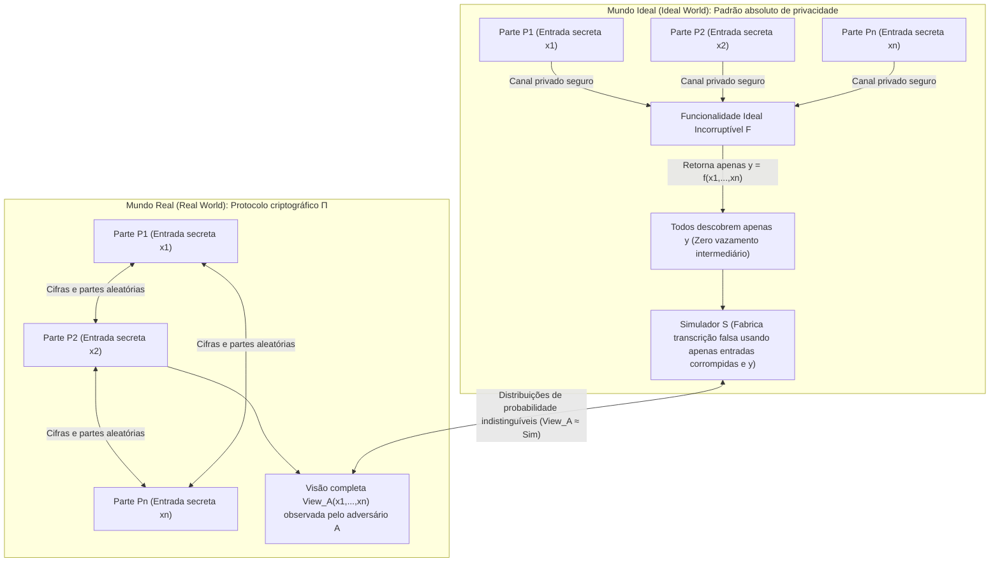
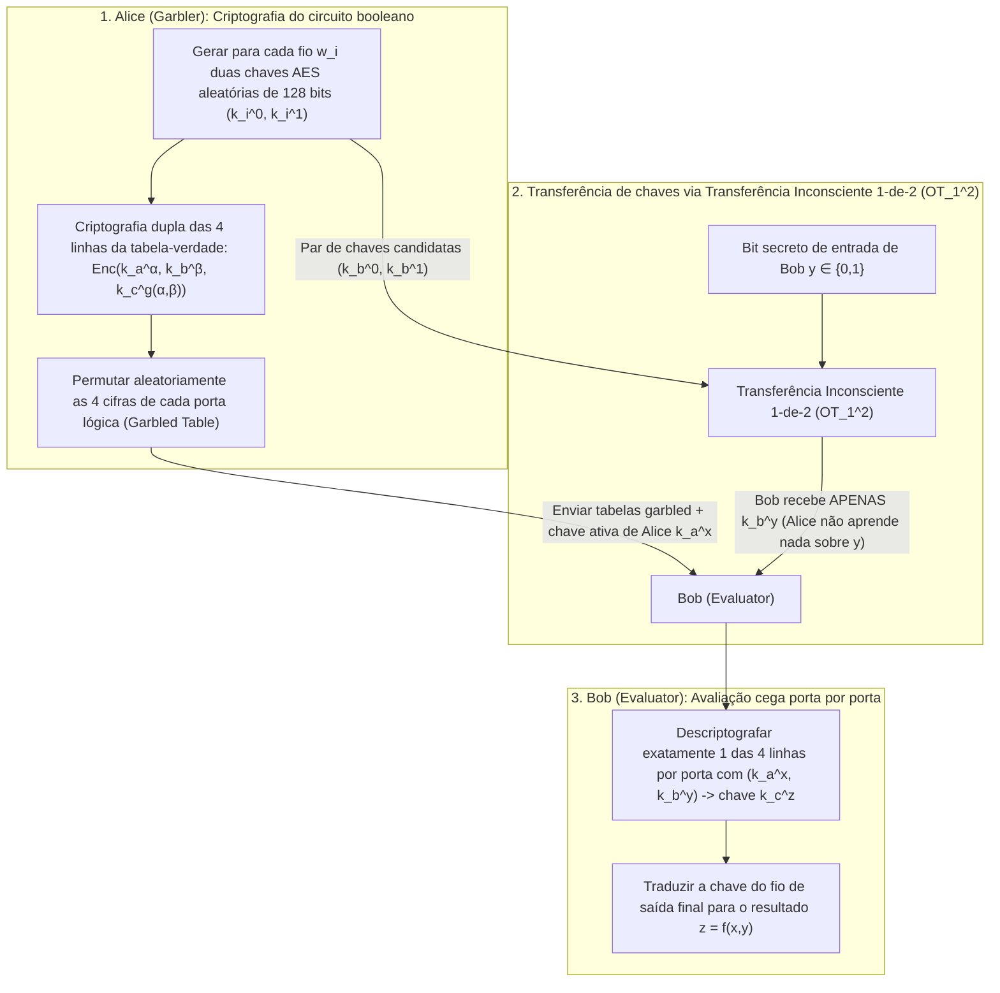

«Vários hospitais desejam analisar genomas de pacientes em conjunto, respeitando os requisitos legais, contratuais e éticos aplicáveis ao tratamento desses dados.»
«Bancos comerciais concorrentes querem rastrear conjuntamente redes de lavagem de dinheiro interbancária sem jamais revelar suas listas de clientes ou grafos de transações internas.»

À primeira vista, isso parece logicamente impossível: para avaliar uma função $f(x_1, x_2, \dots, x_n)$, não seria indispensável que uma <strong>terceira parte confiável (Trusted Third Party, TTP)</strong> reunisse primeiro todas as entradas $x_i$ em texto simples? Contudo, no final da década de 1980, a criptografia moderna provou um teorema extraordinário: <strong>Sob um modelo de adversário e hipóteses criptográficas explícitos, os participantes podem calcular uma função em conjunto; a definição de segurança limita a divulgação adicional além do que já pode ser inferido das entradas e saídas permitidas.</strong>

Essa disciplina é chamada de <strong>Computação Multipartidária Segura (Secure Multi-Party Computation, MPC)</strong>. Neste artigo, partimos de dois experimentos mentais clássicos para deduzir os dois motores matemáticos fundamentais da MPC: o <strong>compartilhamento de segredos por limiar $(t, n)$ de Adi Shamir (interpolação de Lagrange, protocolo BGW e triplas de Beaver)</strong> e a abordagem de circuitos booleanos via <strong>transferência inconsciente (OT) e circuitos embaralhados (Garbled Circuits) de Yao</strong>.

---


**Como interpretar as garantias:** Afirmações de que um segredo “não é revelado” aplicam-se apenas ao modelo de adversário, à definição de segurança e às hipóteses criptográficas indicadas. Em geral, avalia-se o vazamento adicional além do que entradas e saídas permitidas revelam; inferências a partir dos resultados, implementação, operação, disponibilidade e canais laterais exigem análise separada.

## 1. Dois experimentos mentais paradoxais: «A média salarial sem chefe» e «O Problema dos Milionários de Yao»

### 1.1 Experimento mental 1: Calcular a média salarial sem revelar nenhum salário individual

Três engenheiros $A, B$ e $C$ querem descobrir sua <strong>média salarial anual $\bar{x} = \frac{x_A + x_B + x_C}{3}$</strong> sem que nenhum deles descubra o salário individual $x_A, x_B$ ou $x_C$ dos outros dois. Usando <strong>compartilhamento aditivo de segredos (mascaramento One-Time Pad)</strong>, eles conseguem isso apenas com papel e caneta:

1. <strong>Máscara aleatória e primeiro sussurro ($A \to B$)</strong>: Os três escolhem um módulo público grande $M$ (por exemplo, $M = 10^9$). O engenheiro $A$ sorteia secretamente um número aleatório uniforme $r \xleftarrow{\$} \mathbb{Z}_M$, soma seu salário $x_A$ e sussurra apenas $s_1 = (x_A + r) \bmod M$ para $B$. Como $r$ é uniforme em $\mathbb{Z}_M$, $s_1$ também é perfeitamente uniforme independentemente do valor de $x_A$: pelo teorema de Shannon sobre o One-Time Pad, a informação mútua é $I(X_A; S_1) = 0$. $B$ aprende literalmente <strong>zero bits</strong> sobre $x_A$.
2. <strong>Somas sucessivas ($B \to C \to A$)</strong>: $B$ soma seu próprio salário $x_B$ e sussurra $s_2 = (x_A + x_B + r) \bmod M$ para $C$; $C$ soma $x_C$ e devolve $s_3 = (x_A + x_B + x_C + r) \bmod M$ para $A$.
3. <strong>Remoção da máscara</strong>: $A$ subtrai seu número aleatório $r$ módulo $M$, obtém a soma exata $S = x_A + x_B + x_C$ e anuncia a média $\bar{x} = S / 3$.

> **Limite deste exemplo de sussurros:** É uma ilustração didática, não um protocolo MPC seguro. Pressupõe canais privados entre vizinhos, comportamento honesto e ausência de conluio. Por exemplo, se Bob e Carol compartilharem suas observações, poderão combiná-las com a soma publicada para recuperar a entrada de Alice. Uma implantação real exige um protocolo comprovadamente seguro para o modelo de ameaça pretendido. Além disso, $M$ deve ser maior que a soma das entradas para evitar o retorno modular.

> [!NOTE]
> <strong>Por que são necessários pelo menos 3 participantes ($n \ge 3$)?</strong>
> Se houvesse apenas duas pessoas ($A$ e $B$), mesmo que um anjo incorruptível revelasse apenas a média $\bar{x} = \frac{x_A + x_B}{2}$, $A$ calcularia imediatamente $x_B = 2\bar{x} - x_A$. Isso não é uma falha do protocolo, mas uma propriedade matemática da própria função. <strong>A MPC garante que nenhum bit extra vaze além do que é logicamente dedutível da própria entrada e da saída final.</strong>

### 1.2 Experimento mental 2: O «Problema dos Milionários» de Andrew Yao (1982)

A adição é linear, mas e quanto a uma <strong>comparação não linear</strong>?
Em 1982, o cientista da computação <strong>Andrew Chi-Chih Yao</strong> (futuro vencedor do Prêmio Turing) publicou *"Protocols for Secure Computations"*, propondo o famoso <strong>Problema dos Milionários</strong>: dois milionários, Alice ($x$ milhões de dólares) e Bob ($y$ milhões de dólares), desejam calcular apenas o bit booleano $f(x, y) = [x > y] \in \{0, 1\}$ (quem é mais rico?) sem revelar o valor de $x$ ou $y$, nem mesmo a diferença $x - y$.

---

## 2. Formalização matemática da segurança: O paradigma de simulação Ideal/Real

Para provar rigorosamente a ausência de vazamento de informações, Goldreich, Micali e Wigderson (GMW 1987) estabeleceram o <strong>paradigma de simulação Mundo Ideal / Mundo Real</strong>:



Um protocolo real $\Pi$ é seguro se existir um algoritmo eficiente chamado <strong>Simulador $\mathcal{S}$</strong> capaz de gerar, <em>usando apenas as entradas $\{x_i\}_{i \in I}$ e saídas $\{y_i\}_{i \in I}$ das partes corrompidas</em>, uma transcrição sintética indistinguível da visão real $\text{View}_I^\Pi(x_1, \dots, x_n)$:
$$\left\{ \mathcal{S}\left(I, \{x_i\}_{i \in I}, \{y_i\}_{i \in I}\right) \right\} \stackrel{c}{\approx} \left\{ \text{View}_I^\Pi(x_1, \dots, x_n) \right\}$$
Distingue-se entre adversários <strong>semi-honestos (Semi-Honest / Passive)</strong>, que seguem o protocolo mas analisam os registros, e adversários <strong>maliciosos (Malicious / Active)</strong>, que adulteram mensagens ativamente.

---

## 3. Motor 1: Compartilhamento de segredos por limiar $(t, n)$ de Shamir, interpolação de Lagrange e BGW / SPDZ

### 3.1 Polinômios sobre $\mathbb{F}_p$ e reconstrução de Lagrange
Em 1979, <strong>Adi Shamir</strong> propôs ocultar o segredo $s \in \mathbb{F}_p$ ($p > n$ primo) como o termo constante de um polinômio aleatório de grau $t - 1$ sobre o corpo finito $\mathbb{F}_p$:
$$P(x) = s + a_1 x + a_2 x^2 + \dots + a_{t-1} x^{t-1} \pmod p$$
Cada parte $P_i$ recebe o ponto $(x_i = i,\, y_i = P(x_i))$. Qualquer subconjunto $T$ de pelo menos $t$ partes reconstrói exatamente $s = P(0)$ usando a <strong>fórmula de interpolação polinomial de Lagrange</strong>:
$$s = P(0) = \sum_{i \in T} y_i \prod_{j \in T,\, j \ne i} \frac{-x_j}{x_i - x_j} \pmod p$$
Com $t - 1$ partes ou menos, todo segredo candidato $s' \in \mathbb{F}_p$ é exatamente equiprovável ($H(S \mid \text{Shares}_{t-1}) = H(S)$, segurança incondicional em teoria da informação).

### 3.2 Protocolo BGW e triplas de multiplicação de Beaver
No <strong>protocolo BGW (1988)</strong>, a <strong>adição $[a] + [b] = [a + b]$ é local e sem comunicação</strong>. Já a <strong>multiplicação $[a] \cdot [b]$</strong> dobra o grau do polinômio produto $P(x)Q(x)$ para $2(t-1)$, exigindo $2t - 1 \le n$ (uma <strong>maioria honesta</strong>) e uma rodada de redução de grau.
<strong>Donald Beaver (1991)</strong> resolveu esse gargalo por meio das <strong>triplas de multiplicação $([u], [v], [w = u \cdot v \bmod p])$</strong> geradas em uma fase offline (base do protocolo <strong>SPDZ</strong>). Na fase online, para multiplicar $[x]$ e $[y]$, as partes abrem apenas as diferenças mascaradas $d = (x - u) \bmod p$ e $e = (y - v) \bmod p$, e calculam localmente a combinação linear:
$$[x \cdot y] = [w] + d \cdot [v] + e \cdot [u] + d \cdot e \pmod p$$

---

**Esses limites dependem do modelo de adversário:** o BGW clássico tolera $c < n/2$ corrupções no modelo passivo (honesto, mas curioso); a segurança informacional contra participantes maliciosos costuma exigir $c < n/3$ e hipóteses de comunicação adequadas. Uma tripla de Beaver, isoladamente, não define o limite nem fornece segurança ativa.

## 4. Motor 2: Transferência inconsciente (OT) e circuitos garbled de Yao

Em algumas construções, a avaliação das portas ocorre localmente após a transferência das entradas; o número total de rodadas de comunicação depende do protocolo OT e de sua configuração.



<strong>Point-and-Permute</strong> identifica a linha a descriptografar, <strong>Free-XOR</strong> evita o garbling das portas XOR e <strong>Half-Gates</strong> reduz a comunicação das portas AND. O ganho depende do circuito, da implementação, do hardware e da rede; não há um fator de aceleração universal.

---

## 5. Implementação completa em Python: Shamir Secret Sharing e triplas de Beaver sobre $\mathbb{F}_p$

O exemplo também calcula o quadrado de cada salário com uma nova tripla de Beaver e revela a soma e a soma dos quadrados para obter a média e a variância populacional. Esses resultados são abertos à parte que os reconstrói; trata-se de uma simulação educativa em um único processo.

```python
import secrets
from typing import List, Tuple

# 61-bit Mersenne prime p = 2^61 - 1 for our prime finite field F_p
PRIME = (1 << 61) - 1

def mod_inv(a: int, p: int = PRIME) -> int:
    # Modular inverse in F_p via Extended Euclidean Algorithm (Python 3.8+ pow(a, -1, p))
    return pow(a % p, -1, p)

def shamir_share(secret: int, t: int, n: int, p: int = PRIME) -> List[Tuple[int, int]]:
    # Shamir's (t, n) Threshold Secret Sharing:
    # Samples a random degree-(t-1) polynomial P(x) with P(0) = secret and evaluates it at x = 1..n.
    assert 1 <= t <= n < p, "Threshold t and party count n must satisfy 1 <= t <= n < p"
    # P(x) = s + a_1 * x + a_2 * x^2 + ... + a_{t-1} * x^{t-1} (mod p)
    coeffs = [secret % p] + [secrets.randbelow(p) for _ in range(t - 1)]

    shares = []
    for i in range(1, n + 1):
        # Evaluate P(i) using Horner's method
        y = 0
        for c in reversed(coeffs):
            y = (y * i + c) % p
        shares.append((i, y))
    return shares

def lagrange_reconstruct(shares: List[Tuple[int, int]], p: int = PRIME) -> int:
    # Reconstructs P(0) = s from any subset of >= t shares using Lagrange Polynomial Interpolation:
    # s = sum_{i in T} y_i * prod_{j in T, j != i} (-x_j) / (x_i - x_j) (mod p)
    secret = 0
    k = len(shares)
    for i in range(k):
        xi, yi = shares[i]
        num = 1
        den = 1
        for j in range(k):
            if i == j:
                continue
            xj, _ = shares[j]
            num = (num * (-xj)) % p
            den = (den * (xi - xj)) % p
        lambda_i = (num * mod_inv(den, p)) % p
        secret = (secret + yi * lambda_i) % p
    return secret

def mpc_add(shares_a: List[Tuple[int, int]], shares_b: List[Tuple[int, int]], p: int = PRIME) -> List[Tuple[int, int]]:
    # Local homomorphic addition [a] + [b] = [a + b] (Zero communication)
    return [(xa, (ya + yb) % p) for (xa, ya), (xb, yb) in zip(shares_a, shares_b)]

def mpc_sub(shares_a: List[Tuple[int, int]], shares_b: List[Tuple[int, int]], p: int = PRIME) -> List[Tuple[int, int]]:
    # Local homomorphic subtraction [a] - [b] = [a - b] (Zero communication)
    return [(xa, (ya - yb) % p) for (xa, ya), (xb, yb) in zip(shares_a, shares_b)]

def mpc_scalar_mul(scalar: int, shares_a: List[Tuple[int, int]], p: int = PRIME) -> List[Tuple[int, int]]:
    # Local multiplication by a public scalar c * [a] = [c * a] (Zero communication)
    return [(xa, (scalar * ya) % p) for xa, ya in shares_a]

def mpc_add_constant(const: int, shares_a: List[Tuple[int, int]], p: int = PRIME) -> List[Tuple[int, int]]:
    # Adding a public constant [a] + c = [a + c] shifts P(x) by +c at every evaluation point
    return [(xa, (ya + const) % p) for xa, ya in shares_a]

def generate_beaver_triple(t: int, n: int, p: int = PRIME):
    # Offline Preprocessing Phase: Generates a shared random multiplication triple ([u], [v], [w = u * v])
    u = secrets.randbelow(p)
    v = secrets.randbelow(p)
    w = (u * v) % p
    return shamir_share(u, t, n, p), shamir_share(v, t, n, p), shamir_share(w, t, n, p)

def mpc_beaver_mul(
    shares_x: List[Tuple[int, int]],
    shares_y: List[Tuple[int, int]],
    triple: Tuple[List[Tuple[int, int]], List[Tuple[int, int]], List[Tuple[int, int]]],
    t: int,
    p: int = PRIME
) -> List[Tuple[int, int]]:
    # Online Phase: Evaluates [x * y] using a Beaver Multiplication Triple ([u], [v], [w]):
    # 1. Locally compute [d] = [x] - [u] and [e] = [y] - [v]
    # 2. Open masked differences; security depends on fresh, valid, single-use triples and the threat model
    # 3. Locally compute the linear combination [x * y] = [w] + d * [v] + e * [u] + d * e
    shares_u, shares_v, shares_w = triple
    shares_d = mpc_sub(shares_x, shares_u, p)
    shares_e = mpc_sub(shares_y, shares_v, p)

    # Open the masked differences d = x - u and e = y - v using t shares
    d = lagrange_reconstruct(shares_d[:t], p)
    e = lagrange_reconstruct(shares_e[:t], p)

    # Linear combination to obtain degree-(t-1) shares of [x * y]
    term1 = shares_w
    term2 = mpc_scalar_mul(d, shares_v, p)
    term3 = mpc_scalar_mul(e, shares_u, p)
    res = mpc_add(mpc_add(term1, term2, p), term3, p)
    res = mpc_add_constant((d * e) % p, res, p)
    return res

if __name__ == "__main__":
    # 5 MPC servers (n = 5) with reconstruction threshold t = 3 (any 2 servers learn 0 bits)
    t, n = 3, 5
    salaries = [850, 920, 780]  # Example salary units

    # Each engineer splits their secret salary across the 5 servers
    shared_salaries = [shamir_share(s, t, n) for s in salaries]

    # 1. Compute the sum of salaries locally with zero inter-server communication
    sum_shares = shared_salaries[0]
    for s_share in shared_salaries[1:]:
        sum_shares = mpc_add(sum_shares, s_share)

    # Reconstruct the total from any 3 servers (e.g., servers 1, 3, and 5)
    subset_3 = [sum_shares[0], sum_shares[2], sum_shares[4]]
    total_salary = lagrange_reconstruct(subset_3)
    mean_salary = total_salary / len(salaries)
    print(f"Reconstructed total (units): {total_salary:,} (mean: {mean_salary:,.2f})")

    # 2. Compute the sum of squares S_2 = x_A^2 + x_B^2 + x_C^2 using Beaver Multiplication Triples
    sq_sum_shares = shamir_share(0, t, n)
    for s_share in shared_salaries:
        triple = generate_beaver_triple(t, n)
        sq_share = mpc_beaver_mul(s_share, s_share, triple, t)
        sq_sum_shares = mpc_add(sq_sum_shares, sq_share)

    total_sq = lagrange_reconstruct(sq_sum_shares[:t])
    variance = (total_sq / len(salaries)) - (mean_salary ** 2)
    print(f"Reconstructed sum of squares: {total_sq:,} (population variance: {variance:,.2f})")
```

---

## 6. Comparativo das Tecnologias de Aprimoramento de Privacidade (PETs) e aplicações reais

| Critério | Computação Multipartidária Segura (MPC) | Criptografia Totalmente Homomórfica (FHE) | Provas de Conhecimento Zero (ZKP) | Ambiente de Execução Confiável (TEE) |
| :--- | :--- | :--- | :--- | :--- |
| <strong>Problema central</strong> | <strong>Cálculo conjunto</strong> sobre entradas privadas distribuídas $x_1, \dots, x_n$ | <strong>Cálculo cego em servidor único</strong> sobre cifras $\text{Enc}(x) \mapsto \text{Enc}(f(x))$ | <strong>Provar que um segredo $w$ já conhecido</strong> pelo provador satisfaz $f(x, w)=1$ | <strong>Execução isolada por hardware</strong> em texto simples dentro de enclave de CPU |
| <strong>Gargalo principal</strong> | O custo de comunicação depende do protocolo, da profundidade do circuito e da rede | Os custos de computação e comunicação dependem do esquema, do circuito e do hardware; não há um fator universal de lentidão | O custo de provar e verificar depende do sistema e da afirmação | O desempenho e a memória protegida dependem da plataforma e da carga |
| <strong>Modelo de confiança</strong> | A segurança de MPC depende do limiar e do modelo de adversário do protocolo; vazamentos pelos resultados, disponibilidade e equidade exigem análise separada. | <strong>Dureza criptográfica em reticulados (RLWE)</strong> | <strong>Solidez matemática</strong> (não combina sozinho segredos de múltiplas partes) | <strong>Confiança no fabricante (Intel/AMD)</strong>; vulnerável a ataques de canal lateral |

Entre os exemplos estudados ou implantados estão o leilão dinamarquês de beterraba-açucareira, a medição da diferença salarial em Boston, verificações de senhas, pesquisas genômicas e assinaturas distribuídas. O grau de implantação, o modelo de segurança e os riscos residuais variam; MPC não substitui confiança institucional por certeza absoluta.

## 7. Outras PETs e limites

Nota histórica: o OT de Rabin de 1981 (recebimento com probabilidade 1/2) é diferente da funcionalidade 1-de-2 OT formulada por Even, Goldreich e Lempel em 1985.
O MPC distribui as entradas; suas garantias dependem do protocolo e do modelo de adversário. O FHE permite calcular dados cifrados, mas não verifica automaticamente o cálculo nem impede vazamentos pelos resultados. Provas de conhecimento zero demonstram afirmações sem revelar a testemunha, mas não substituem a computação conjunta. Uma TEE processa texto claro em hardware protegido e exige confiança no hardware e na atestação. As técnicas podem ser combinadas; custos e garantias variam conforme o uso.

## 8. Exemplos
O leilão dinamarquês de beterraba sacarina de 2008 usou MPC de três partes; o artigo relata cerca de 1.200 entradas, aproximadamente 30 minutos de cálculo e transferência de 25.000 toneladas de direitos de produção. BWWC e Boston University publicam lacunas salariais a cada dois anos; para 2023, o BWWC cita 103 empregadores e 165.000 funcionários em tempo integral. Google Chrome e Apple documentam verificações de senha distintas baseadas em PSI. Um estudo da USENIX de 2023 relatou canais laterais na implementação do Chrome analisada. GWAS com MPC foram demonstrados em pesquisas, mas os resultados podem revelar informações. Secure Aggregation oculta contribuições individuais, sem eliminar todos os riscos de inferência. Assinaturas de limiar e atualização de shares dependem do protocolo e das condições operacionais.

## 9. Conclusão
O MPC reduz a centralização de dados em texto claro, mas não elimina vazamentos pelos resultados nem riscos operacionais, legais ou de disponibilidade. As garantias dependem do modelo de adversário, das hipóteses criptográficas, da implementação e da operação.

**Escopo do exemplo de código:** Este código Python é uma simulação educativa, em um único processo, de compartilhamento de segredos e operações em um corpo finito. Não é um sistema MPC em rede no qual cada parte detém apenas suas próprias partes. Não implementa verificações contra participantes maliciosos, autenticação ou transporte seguro, pré-processamento confiável nem controles de faixa de entrada e overflow. Os valores reconstruídos por `lagrange_reconstruct` são revelados à parte que os reconstrói. Não use este exemplo para proteger dados ou ativos reais.


## Sources

- [Rabin, “How to Exchange Secrets with Oblivious Transfer” (1981)](https://eprint.iacr.org/2005/187.pdf)
- [Even, Goldreich, and Lempel, “A Randomized Protocol for Signing Contracts” (1985)](https://luca-giuzzi.unibs.it/corsi/Support/papers-cryptography/SigningContracts.pdf)

- [Bogetoft et al., “Secure Multiparty Computation Goes Live” (2009)](https://www.acsu.buffalo.edu/~mblanton/cse715/sugar-beet-auction.pdf)
- [Boston Women’s Workforce Council: Wage Gap Studies](https://thebwwc.org/wage-gap-studies)
- [Google: Better password protections in Chrome](https://security.googleblog.com/2019/12/better-password-protections-in-chrome.html)
- [Apple Platform Security: Password Monitoring](https://support.apple.com/guide/security/password-monitoring-sec78e79fc3b/web)
- [Kwong et al., USENIX Security 2023: Chrome password-check side channels](https://www.usenix.org/conference/usenixsecurity23/presentation/kwong)
- [Cho et al., “Secure genome-wide association analysis using multiparty computation” (2018)](https://pmc.ncbi.nlm.nih.gov/articles/PMC5990440/)
- [Bonawitz et al., Google Research: Practical Secure Aggregation](https://research.google/pubs/practical-secure-aggregation-for-federated-learning-on-user-held-data/)
- [Canetti et al., “UC Non-Interactive, Proactive, Threshold ECDSA” (2020)](https://eprint.iacr.org/2020/492)
- [Kumar et al., “Understanding Information Disclosure from Secure Computation Output” (2025)](https://doi.org/10.1145/3705004)
- [Kolesnikov and Schneider, “Improved Garbled Circuit: Free XOR Gates and Applications” (2008)](https://encrypto.de/papers/KS08XOR.pdf)
- [Zahur, Rosulek, and Evans, “Two Halves Make a Whole: Reducing Data Transfer in Garbled Circuits using Half Gates” (2015)](https://www.cs.virginia.edu/~evans/pubs/ec2015/halfgates.pdf)

- [Stanford University cryptography notes: Oblivious Transfer](https://crypto.stanford.edu/pbc/notes/crypto/ot.html)

- [A Full Proof of the BGW Protocol for Perfectly Secure MPC](https://doi.org/10.1007/S00145-015-9214-4)

- [Yao, “Protocols for Secure Computations” (FOCS 1982)](https://doi.org/10.1109/SFCS.1982.38)
